# Indian Pairs-Trading Scanner — 2026-10-12

> **What this is:** a market-neutral *pairs mean-reversion* scanner. It flags when two related NSE stocks have drifted apart far enough that their historical relationship signals a possible convergence trade. It does **not** forecast growth, rank "best" stocks, or predict company performance. A signal means the *spread between two stocks* is stretched — nothing about either stock being a good investment. Not investment advice; do your own research.

## Methodology (fixed in advance)

- **Universe:** 16 declared sector-mate pairs. Parameters (3y window, 60/40 train-test, z-entry 2.0, z-exit 0.5, 5 bps costs) are pre-registered; changes are logged in the README changelog *before* looking at results.
- **Multiple testing:** at the 5% level across 16 pairs, **≈0.8 false positives per run are expected by chance alone** even if nothing truly cointegrates. A single-day pass is a candidate, not a discovery.
- **Strict tier:** Bonferroni-corrected threshold p < 0.0031 (marked ✓✓).
- **Evidence = persistence:** the Persistence column counts how often each pair has passed the 5% test across all *real-data* daily runs recorded in `reports/history.csv`. Pairs deserve attention only when they pass persistently.

> ⚠️ **Some results use SIMULATED fallback data** (real data was unreachable this run) and are not real market results. These are marked below and are EXCLUDED from persistence counts.

## Summary

| Pair | p-value | Coint. | Persistence | Current z | Signal | OOS Sharpe |
|---|---|---|---|---|---|---|
| HDFCBANK.NS/ICICIBANK.NS *(sim)* | 0.0030 | ✓✓ | 1/60 | -1.55 | watch | 1.13 |
| AXISBANK.NS/ICICIBANK.NS | 0.9641 | ✗ | 0/73 | -1.40 | watch | -0.04 |
| KOTAKBANK.NS/HDFCBANK.NS | 0.3086 | ✗ | 0/73 | -1.81 | watch | 1.82 |
| SBIN.NS/BANKBARODA.NS | 0.1478 | ✗ | 0/73 | +1.91 | watch | 0.06 |
| TCS.NS/INFY.NS | 0.7389 | ✗ | 0/73 | -1.14 | watch | 2.39 |
| INFY.NS/WIPRO.NS | 0.1912 | ✗ | 0/73 | -0.95 | watch | 1.91 |
| HCLTECH.NS/TECHM.NS | 0.2568 | ✗ | 0/73 | -0.16 | flat / no stretch | -0.27 |
| ACC.NS/AMBUJACEM.NS | 0.8034 | ✗ | 0/73 | -1.91 | watch | 0.60 |
| ULTRACEMCO.NS/SHREECEM.NS | 0.3074 | ✗ | 0/73 | -1.02 | watch | -0.22 |
| IOC.NS/BPCL.NS | 0.8182 | ✗ | 0/73 | -1.47 | watch | 0.19 |
| BPCL.NS/HINDPETRO.NS | 0.2691 | ✗ | 0/73 | -0.61 | watch | 0.04 |
| ONGC.NS/COALINDIA.NS | 0.0188 | ✓ | 65/73 | +1.44 | watch | 0.70 |
| NTPC.NS/POWERGRID.NS | 0.1122 | ✗ | 0/73 | -0.78 | watch | 0.43 |
| BAJAJ-AUTO.NS/HEROMOTOCO.NS | 0.1826 | ✗ | 0/73 | +0.80 | watch | -0.52 |
| TATASTEEL.NS/JSWSTEEL.NS | 0.6417 | ✗ | 0/73 | -2.56 | LONG spread | 0.04 |
| SUNPHARMA.NS/CIPLA.NS | 0.0119 | ✓ | 73/73 | -1.70 | watch | 0.15 |

_Legend: ✓✓ passes strict Bonferroni tier · ✓ passes 5% only · ✗ fails. Persistence = 5%-passes / real-data runs recorded. \*no real-data history yet._

---

### HDFCBANK.NS / ICICIBANK.NS · _SIMULATED_

- **Latest prices:** HDFCBANK.NS ₹77.27 · ICICIBANK.NS ₹113.78
- **Hedge ratio (train-fitted):** 1.5557
- **Cointegration (train):** PASS at 5% — ADF -3.79, p=0.0030 · **passes strict Bonferroni tier**
- **Persistence:** passed 5% in 1 of 60 real-data runs (strict tier: 0/60)
- **Spread half-life:** 14.0 days
- **Current z-score:** -1.55
- **Signal today:** watch (approaching band)

**Out-of-sample backtest** (beta frozen from train window):

| Metric | Value |
|---|---|
| Sharpe | 1.13 |
| Sortino | 0.86 |
| Annualised return | 1.88% |
| Annualised vol | 1.66% |
| Max drawdown | -1.19% |
| Round-trip trades | 5 |

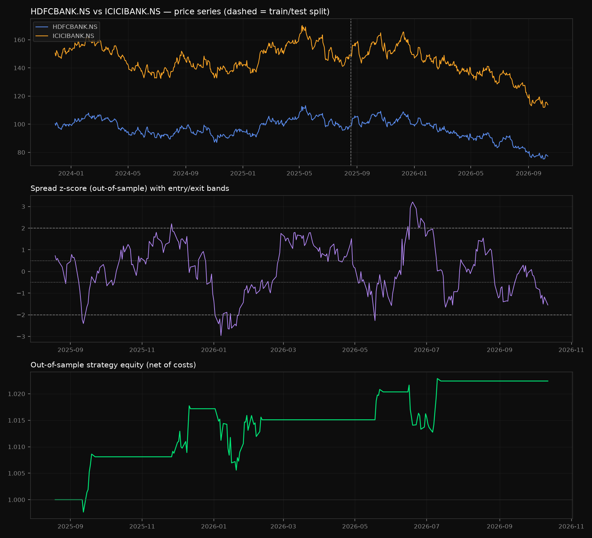

---

### AXISBANK.NS / ICICIBANK.NS

- **Latest prices:** AXISBANK.NS ₹1,259.10 · ICICIBANK.NS ₹1,355.00
- **Hedge ratio (train-fitted):** 0.9013
- **Cointegration (train):** FAIL at 5% — ADF 0.07, p=0.9641
- **Persistence:** passed 5% in 0 of 73 real-data runs (strict tier: 0/73)
- **Spread half-life:** n/a (not mean-reverting)
- **Current z-score:** -1.40
- **Signal today:** watch (approaching band)
- ⚠️ _Pair did not cointegrate on training data. Any signal here is not statistically justified — observation only._

**Out-of-sample backtest** (beta frozen from train window):

| Metric | Value |
|---|---|
| Sharpe | -0.04 |
| Sortino | -0.03 |
| Annualised return | -0.66% |
| Annualised vol | 8.51% |
| Max drawdown | -7.67% |
| Round-trip trades | 6 |

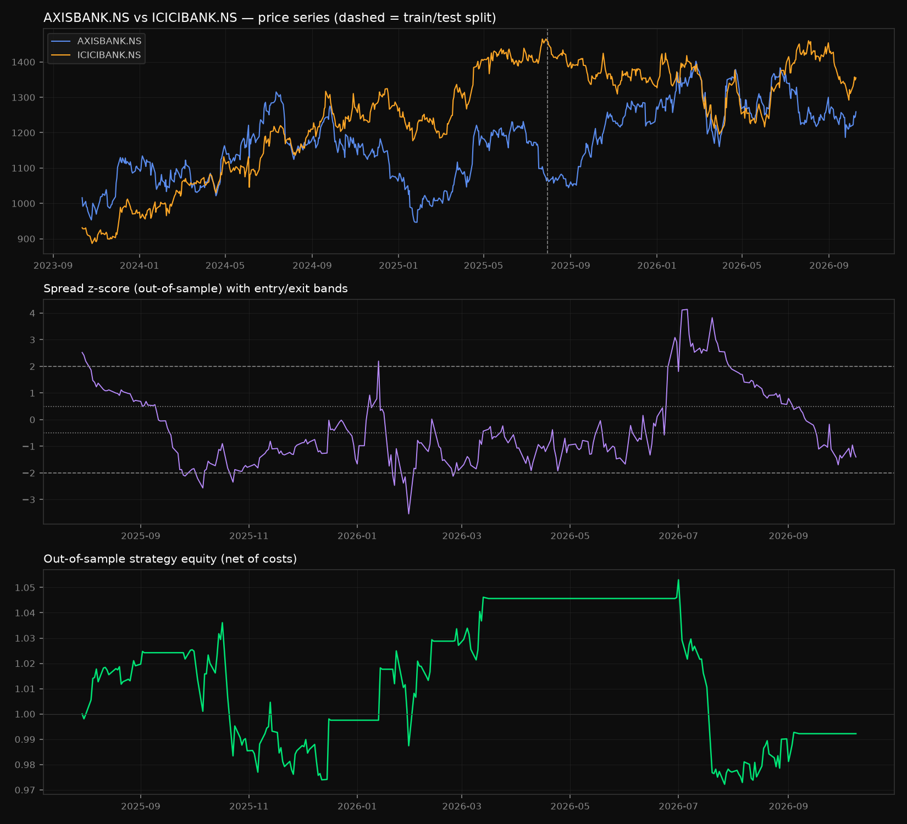

---

### KOTAKBANK.NS / HDFCBANK.NS

- **Latest prices:** KOTAKBANK.NS ₹441.00 · HDFCBANK.NS ₹707.25
- **Hedge ratio (train-fitted):** 2.1687
- **Cointegration (train):** FAIL at 5% — ADF -1.95, p=0.3086
- **Persistence:** passed 5% in 0 of 73 real-data runs (strict tier: 0/73)
- **Spread half-life:** 30.3 days
- **Current z-score:** -1.81
- **Signal today:** watch (approaching band)
- ⚠️ _Pair did not cointegrate on training data. Any signal here is not statistically justified — observation only._

**Out-of-sample backtest** (beta frozen from train window):

| Metric | Value |
|---|---|
| Sharpe | 1.82 |
| Sortino | 2.00 |
| Annualised return | 11.40% |
| Annualised vol | 6.04% |
| Max drawdown | -2.87% |
| Round-trip trades | 7 |

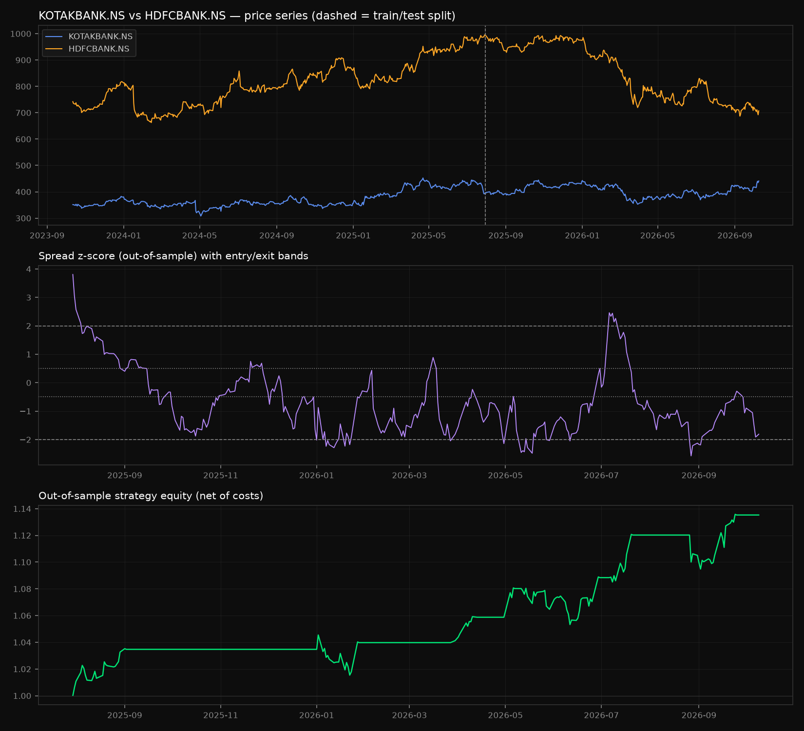

---

### SBIN.NS / BANKBARODA.NS

- **Latest prices:** SBIN.NS ₹959.10 · BANKBARODA.NS ₹235.80
- **Hedge ratio (train-fitted):** 0.1911
- **Cointegration (train):** FAIL at 5% — ADF -2.38, p=0.1478
- **Persistence:** passed 5% in 0 of 73 real-data runs (strict tier: 0/73)
- **Spread half-life:** 21.4 days
- **Current z-score:** +1.91
- **Signal today:** watch (approaching band)
- ⚠️ _Pair did not cointegrate on training data. Any signal here is not statistically justified — observation only._

**Out-of-sample backtest** (beta frozen from train window):

| Metric | Value |
|---|---|
| Sharpe | 0.06 |
| Sortino | 0.05 |
| Annualised return | 0.16% |
| Annualised vol | 9.20% |
| Max drawdown | -8.84% |
| Round-trip trades | 5 |

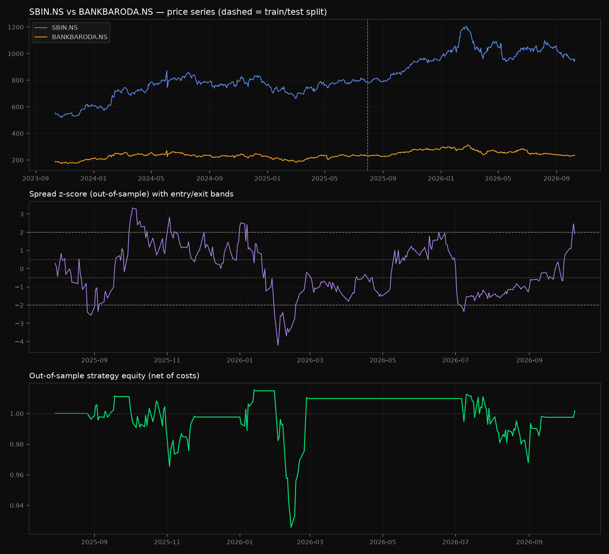

---

### TCS.NS / INFY.NS

- **Latest prices:** TCS.NS ₹2,156.00 · INFY.NS ₹1,023.40
- **Hedge ratio (train-fitted):** 0.4403
- **Cointegration (train):** FAIL at 5% — ADF -1.04, p=0.7389
- **Persistence:** passed 5% in 0 of 73 real-data runs (strict tier: 0/73)
- **Spread half-life:** 80.9 days
- **Current z-score:** -1.14
- **Signal today:** watch (approaching band)
- ⚠️ _Pair did not cointegrate on training data. Any signal here is not statistically justified — observation only._

**Out-of-sample backtest** (beta frozen from train window):

| Metric | Value |
|---|---|
| Sharpe | 2.39 |
| Sortino | 2.80 |
| Annualised return | 9.72% |
| Annualised vol | 3.92% |
| Max drawdown | -1.01% |
| Round-trip trades | 6 |

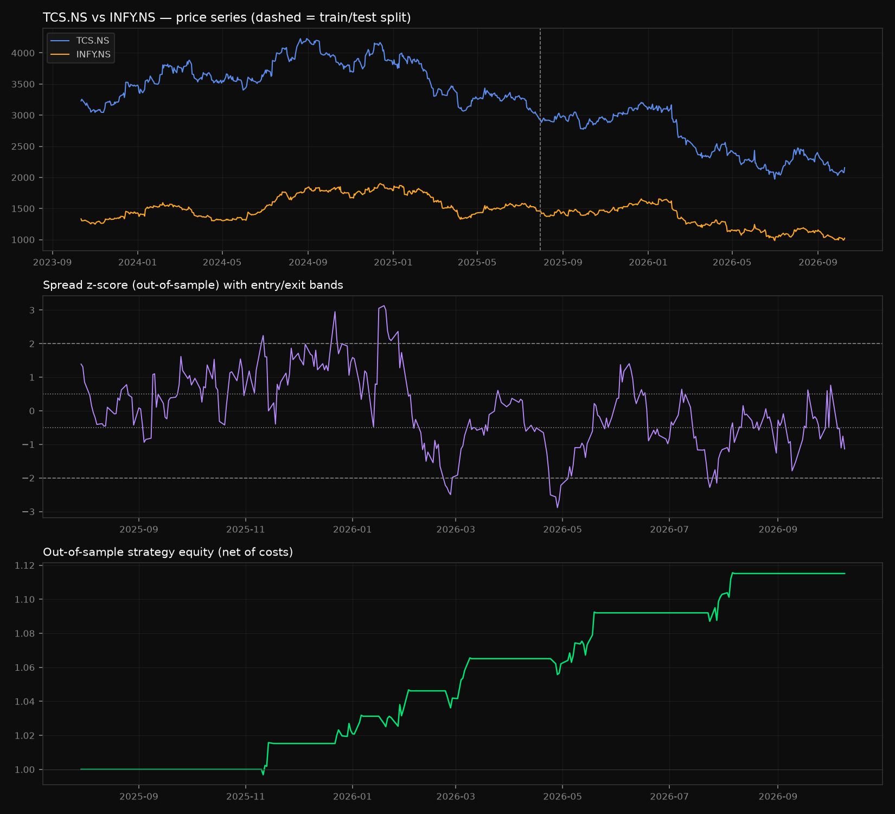

---

### INFY.NS / WIPRO.NS

- **Latest prices:** INFY.NS ₹1,023.40 · WIPRO.NS ₹162.57
- **Hedge ratio (train-fitted):** 0.1291
- **Cointegration (train):** FAIL at 5% — ADF -2.24, p=0.1912
- **Persistence:** passed 5% in 0 of 73 real-data runs (strict tier: 0/73)
- **Spread half-life:** 30.5 days
- **Current z-score:** -0.95
- **Signal today:** watch (approaching band)
- ⚠️ _Pair did not cointegrate on training data. Any signal here is not statistically justified — observation only._

**Out-of-sample backtest** (beta frozen from train window):

| Metric | Value |
|---|---|
| Sharpe | 1.91 |
| Sortino | 1.81 |
| Annualised return | 9.75% |
| Annualised vol | 4.95% |
| Max drawdown | -1.51% |
| Round-trip trades | 5 |

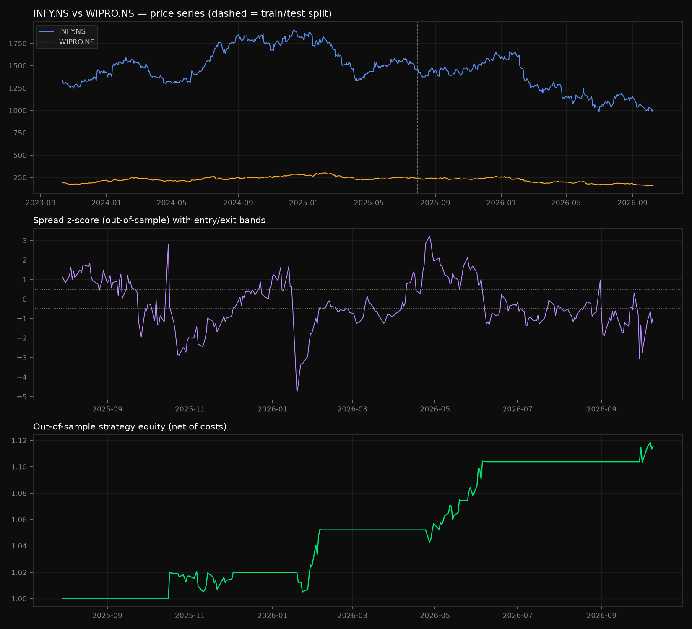

---

### HCLTECH.NS / TECHM.NS

- **Latest prices:** HCLTECH.NS ₹1,216.70 · TECHM.NS ₹1,514.10
- **Hedge ratio (train-fitted):** 0.9460
- **Cointegration (train):** FAIL at 5% — ADF -2.07, p=0.2568
- **Persistence:** passed 5% in 0 of 73 real-data runs (strict tier: 0/73)
- **Spread half-life:** 22.1 days
- **Current z-score:** -0.16
- **Signal today:** flat / no stretch
- ⚠️ _Pair did not cointegrate on training data. Any signal here is not statistically justified — observation only._

**Out-of-sample backtest** (beta frozen from train window):

| Metric | Value |
|---|---|
| Sharpe | -0.27 |
| Sortino | -0.25 |
| Annualised return | -2.22% |
| Annualised vol | 7.24% |
| Max drawdown | -8.40% |
| Round-trip trades | 4 |

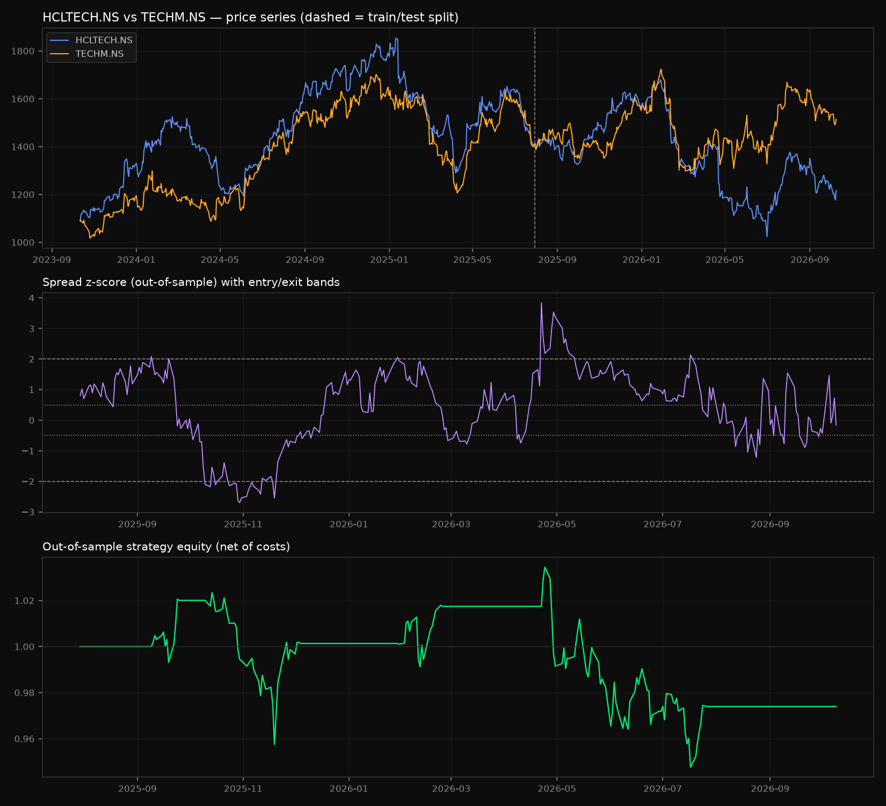

---

### ACC.NS / AMBUJACEM.NS

- **Latest prices:** ACC.NS ₹1,133.00 · AMBUJACEM.NS ₹351.50
- **Hedge ratio (train-fitted):** 0.1764
- **Cointegration (train):** FAIL at 5% — ADF -0.85, p=0.8034
- **Persistence:** passed 5% in 0 of 73 real-data runs (strict tier: 0/73)
- **Spread half-life:** 84.5 days
- **Current z-score:** -1.91
- **Signal today:** watch (approaching band)
- ⚠️ _Pair did not cointegrate on training data. Any signal here is not statistically justified — observation only._

**Out-of-sample backtest** (beta frozen from train window):

| Metric | Value |
|---|---|
| Sharpe | 0.60 |
| Sortino | 0.51 |
| Annualised return | 3.75% |
| Annualised vol | 6.49% |
| Max drawdown | -5.29% |
| Round-trip trades | 4 |

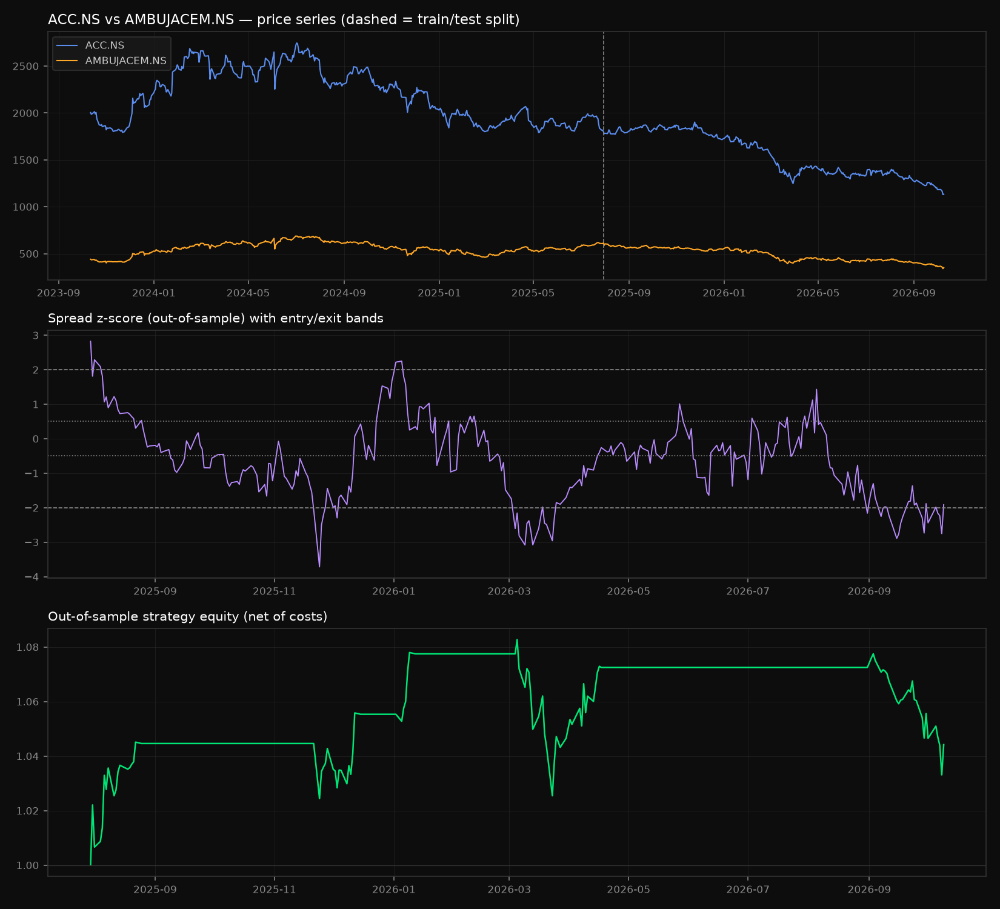

---

### ULTRACEMCO.NS / SHREECEM.NS

- **Latest prices:** ULTRACEMCO.NS ₹10,675.00 · SHREECEM.NS ₹22,080.00
- **Hedge ratio (train-fitted):** 0.9289
- **Cointegration (train):** FAIL at 5% — ADF -1.95, p=0.3074
- **Persistence:** passed 5% in 0 of 73 real-data runs (strict tier: 0/73)
- **Spread half-life:** 39.4 days
- **Current z-score:** -1.02
- **Signal today:** watch (approaching band)
- ⚠️ _Pair did not cointegrate on training data. Any signal here is not statistically justified — observation only._

**Out-of-sample backtest** (beta frozen from train window):

| Metric | Value |
|---|---|
| Sharpe | -0.22 |
| Sortino | -0.27 |
| Annualised return | -1.77% |
| Annualised vol | 7.11% |
| Max drawdown | -7.21% |
| Round-trip trades | 4 |

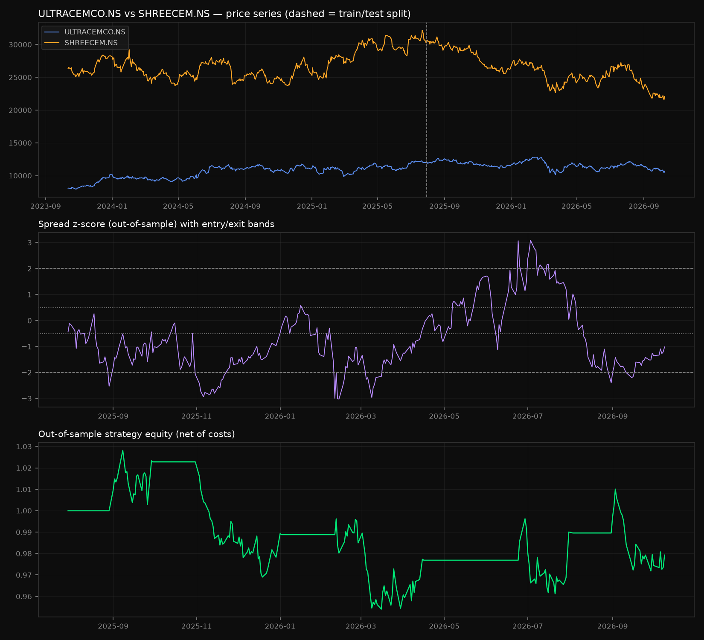

---

### IOC.NS / BPCL.NS

- **Latest prices:** IOC.NS ₹126.35 · BPCL.NS ₹287.80
- **Hedge ratio (train-fitted):** 1.6830
- **Cointegration (train):** FAIL at 5% — ADF -0.80, p=0.8182
- **Persistence:** passed 5% in 0 of 73 real-data runs (strict tier: 0/73)
- **Spread half-life:** 151.8 days
- **Current z-score:** -1.47
- **Signal today:** watch (approaching band)
- ⚠️ _Pair did not cointegrate on training data. Any signal here is not statistically justified — observation only._

**Out-of-sample backtest** (beta frozen from train window):

| Metric | Value |
|---|---|
| Sharpe | 0.19 |
| Sortino | 0.17 |
| Annualised return | 0.98% |
| Annualised vol | 6.04% |
| Max drawdown | -6.86% |
| Round-trip trades | 5 |

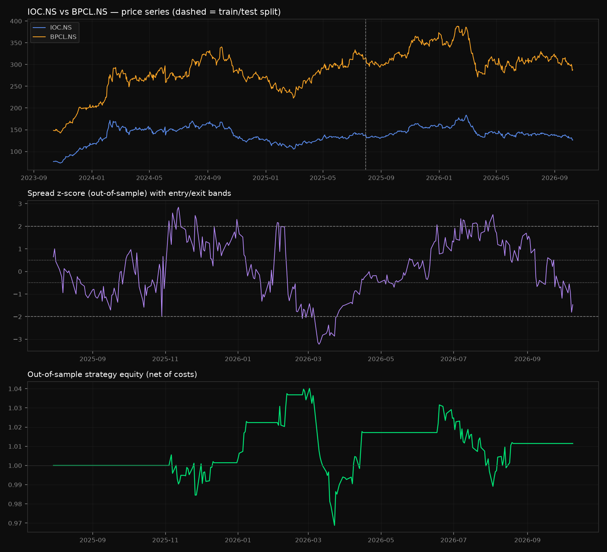

---

### BPCL.NS / HINDPETRO.NS

- **Latest prices:** BPCL.NS ₹287.80 · HINDPETRO.NS ₹326.00
- **Hedge ratio (train-fitted):** 1.3329
- **Cointegration (train):** FAIL at 5% — ADF -2.04, p=0.2691
- **Persistence:** passed 5% in 0 of 73 real-data runs (strict tier: 0/73)
- **Spread half-life:** 37.2 days
- **Current z-score:** -0.61
- **Signal today:** watch (approaching band)
- ⚠️ _Pair did not cointegrate on training data. Any signal here is not statistically justified — observation only._

**Out-of-sample backtest** (beta frozen from train window):

| Metric | Value |
|---|---|
| Sharpe | 0.04 |
| Sortino | 0.04 |
| Annualised return | 0.07% |
| Annualised vol | 5.81% |
| Max drawdown | -6.57% |
| Round-trip trades | 5 |

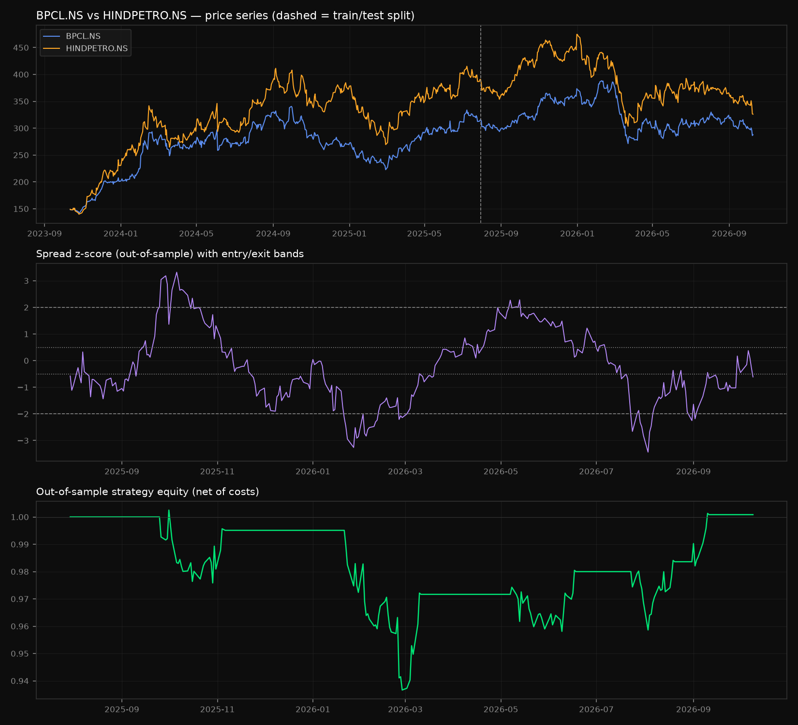

---

### ONGC.NS / COALINDIA.NS

- **Latest prices:** ONGC.NS ₹221.27 · COALINDIA.NS ₹411.55
- **Hedge ratio (train-fitted):** 1.3932
- **Cointegration (train):** PASS at 5% — ADF -3.22, p=0.0188
- **Persistence:** passed 5% in 65 of 73 real-data runs (strict tier: 1/73)
- **Spread half-life:** 12.7 days
- **Current z-score:** +1.44
- **Signal today:** watch (approaching band)

**Out-of-sample backtest** (beta frozen from train window):

| Metric | Value |
|---|---|
| Sharpe | 0.70 |
| Sortino | 0.57 |
| Annualised return | 5.34% |
| Annualised vol | 7.91% |
| Max drawdown | -6.33% |
| Round-trip trades | 5 |

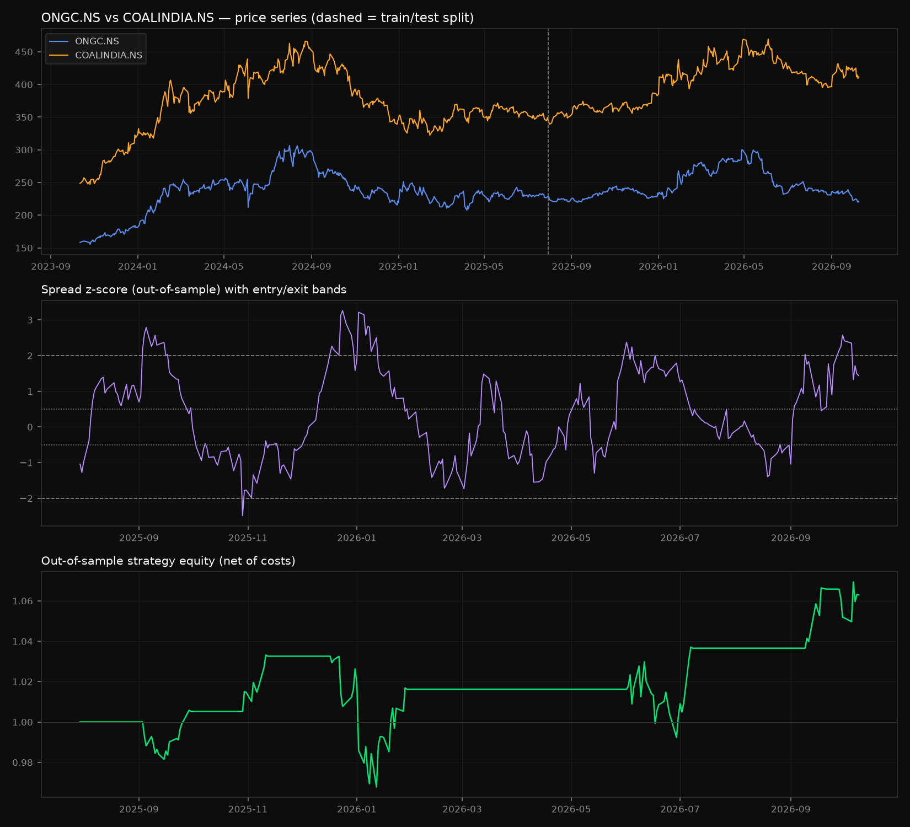

---

### NTPC.NS / POWERGRID.NS

- **Latest prices:** NTPC.NS ₹312.00 · POWERGRID.NS ₹249.15
- **Hedge ratio (train-fitted):** 0.8148
- **Cointegration (train):** FAIL at 5% — ADF -2.51, p=0.1122
- **Persistence:** passed 5% in 0 of 73 real-data runs (strict tier: 0/73)
- **Spread half-life:** 24.3 days
- **Current z-score:** -0.78
- **Signal today:** watch (approaching band)
- ⚠️ _Pair did not cointegrate on training data. Any signal here is not statistically justified — observation only._

**Out-of-sample backtest** (beta frozen from train window):

| Metric | Value |
|---|---|
| Sharpe | 0.43 |
| Sortino | 0.34 |
| Annualised return | 2.29% |
| Annualised vol | 5.58% |
| Max drawdown | -5.26% |
| Round-trip trades | 6 |

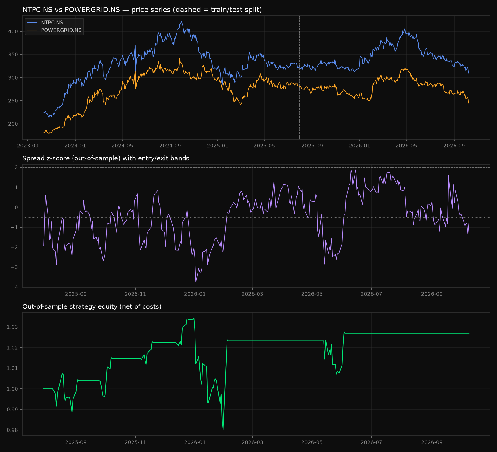

---

### BAJAJ-AUTO.NS / HEROMOTOCO.NS

- **Latest prices:** BAJAJ-AUTO.NS ₹9,778.00 · HEROMOTOCO.NS ₹4,895.50
- **Hedge ratio (train-fitted):** 0.4086
- **Cointegration (train):** FAIL at 5% — ADF -2.27, p=0.1826
- **Persistence:** passed 5% in 0 of 73 real-data runs (strict tier: 0/73)
- **Spread half-life:** 29.8 days
- **Current z-score:** +0.80
- **Signal today:** watch (approaching band)
- ⚠️ _Pair did not cointegrate on training data. Any signal here is not statistically justified — observation only._

**Out-of-sample backtest** (beta frozen from train window):

| Metric | Value |
|---|---|
| Sharpe | -0.52 |
| Sortino | -0.54 |
| Annualised return | -6.11% |
| Annualised vol | 10.92% |
| Max drawdown | -19.56% |
| Round-trip trades | 6 |

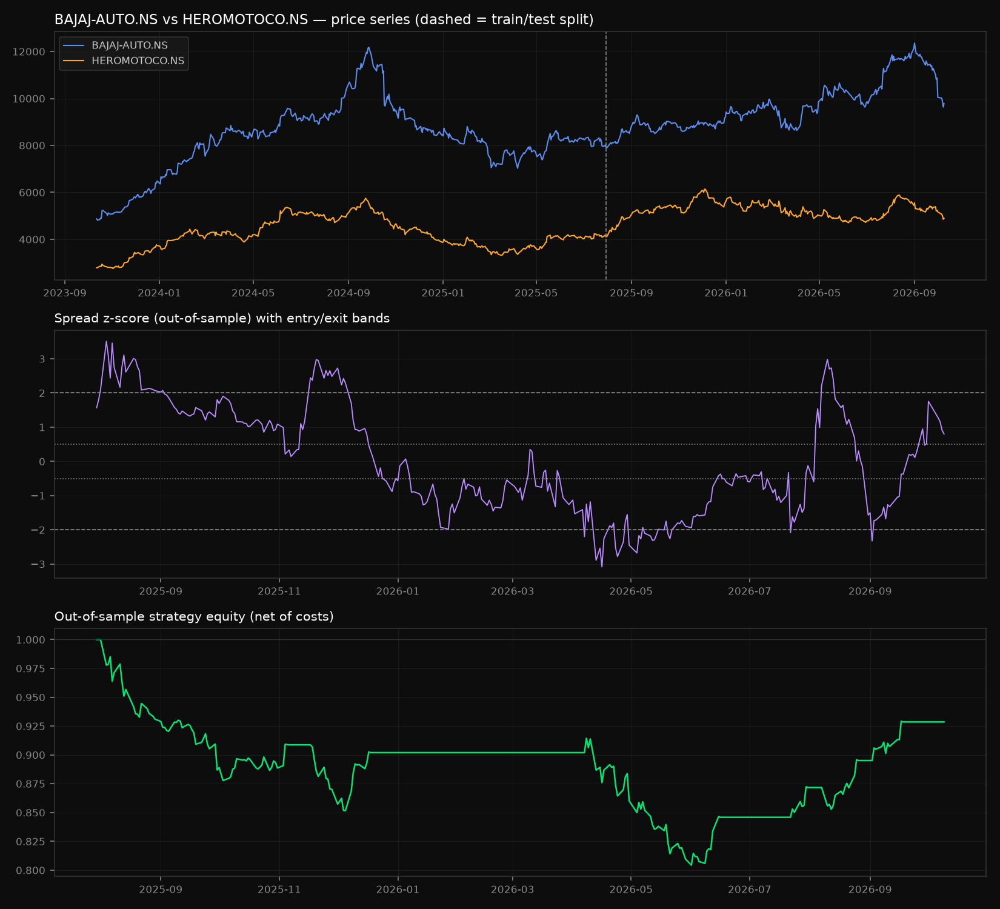

---

### TATASTEEL.NS / JSWSTEEL.NS

- **Latest prices:** TATASTEEL.NS ₹173.80 · JSWSTEEL.NS ₹1,168.00
- **Hedge ratio (train-fitted):** 3.0346
- **Cointegration (train):** FAIL at 5% — ADF -1.27, p=0.6417
- **Persistence:** passed 5% in 0 of 73 real-data runs (strict tier: 0/73)
- **Spread half-life:** 67.9 days
- **Current z-score:** -2.56
- **Signal today:** LONG spread (long JSWSTEEL.NS, short TATASTEEL.NS)
- ⚠️ _Pair did not cointegrate on training data. Any signal here is not statistically justified — observation only._

**Out-of-sample backtest** (beta frozen from train window):

| Metric | Value |
|---|---|
| Sharpe | 0.04 |
| Sortino | 0.04 |
| Annualised return | -0.03% |
| Annualised vol | 8.34% |
| Max drawdown | -5.55% |
| Round-trip trades | 5 |

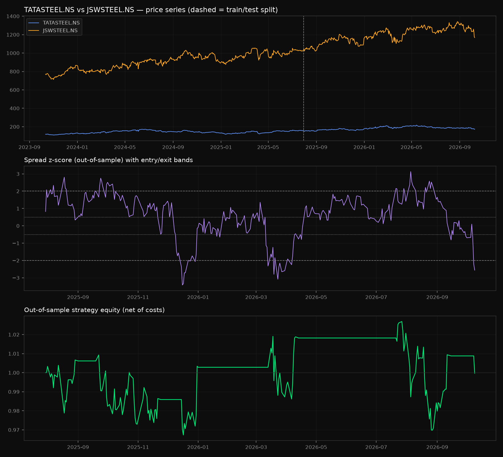

---

### SUNPHARMA.NS / CIPLA.NS

- **Latest prices:** SUNPHARMA.NS ₹1,760.00 · CIPLA.NS ₹1,301.00
- **Hedge ratio (train-fitted):** 0.4883
- **Cointegration (train):** PASS at 5% — ADF -3.37, p=0.0119
- **Persistence:** passed 5% in 73 of 73 real-data runs (strict tier: 5/73)
- **Spread half-life:** 10.7 days
- **Current z-score:** -1.70
- **Signal today:** watch (approaching band)

**Out-of-sample backtest** (beta frozen from train window):

| Metric | Value |
|---|---|
| Sharpe | 0.15 |
| Sortino | 0.16 |
| Annualised return | 0.82% |
| Annualised vol | 7.34% |
| Max drawdown | -9.89% |
| Round-trip trades | 5 |

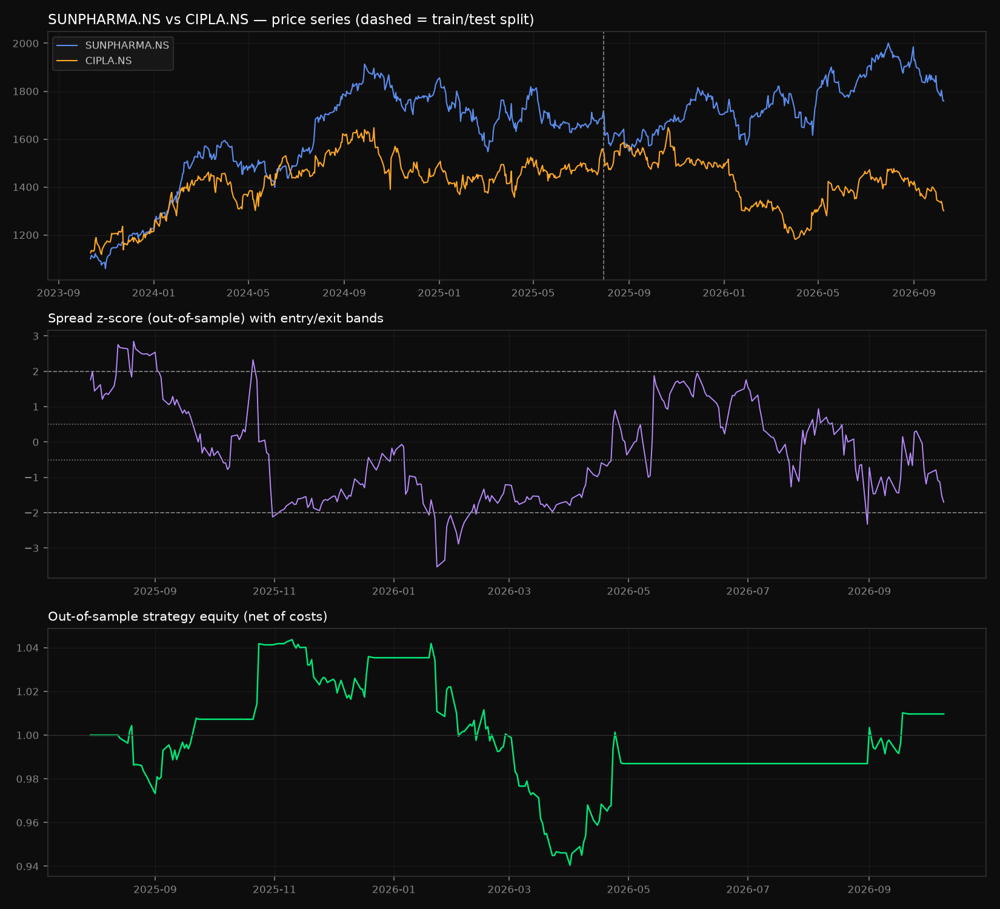

---

_Generated 2026-10-12 · pairs mean-reversion scanner · out-of-sample backtest · multiple-testing-aware · not investment advice._
