# Indian Pairs-Trading Scanner — 2026-10-13

> **What this is:** a market-neutral *pairs mean-reversion* scanner. It flags when two related NSE stocks have drifted apart far enough that their historical relationship signals a possible convergence trade. It does **not** forecast growth, rank "best" stocks, or predict company performance. A signal means the *spread between two stocks* is stretched — nothing about either stock being a good investment. Not investment advice; do your own research.

## Methodology (fixed in advance)

- **Universe:** 16 declared sector-mate pairs. Parameters (3y window, 60/40 train-test, z-entry 2.0, z-exit 0.5, 5 bps costs) are pre-registered; changes are logged in the README changelog *before* looking at results.
- **Multiple testing:** at the 5% level across 16 pairs, **≈0.8 false positives per run are expected by chance alone** even if nothing truly cointegrates. A single-day pass is a candidate, not a discovery.
- **Strict tier:** Bonferroni-corrected threshold p < 0.0031 (marked ✓✓).
- **Evidence = persistence:** the Persistence column counts how often each pair has passed the 5% test across all *real-data* daily runs recorded in `reports/history.csv`. Pairs deserve attention only when they pass persistently.

## Summary

| Pair | p-value | Coint. | Persistence | Current z | Signal | OOS Sharpe |
|---|---|---|---|---|---|---|
| HDFCBANK.NS/ICICIBANK.NS | 0.0751 | ✗ | 1/61 | -0.46 | flat / no stretch | -0.36 |
| AXISBANK.NS/ICICIBANK.NS | 0.9615 | ✗ | 0/74 | -1.61 | watch | -0.10 |
| KOTAKBANK.NS/HDFCBANK.NS | 0.3414 | ✗ | 0/74 | -1.93 | watch | 1.73 |
| SBIN.NS/BANKBARODA.NS | 0.1495 | ✗ | 0/74 | +2.64 | SHORT spread | -0.01 |
| TCS.NS/INFY.NS | 0.7632 | ✗ | 0/74 | -0.65 | watch | 2.00 |
| INFY.NS/WIPRO.NS | 0.1853 | ✗ | 0/74 | -1.03 | watch | 1.89 |
| HCLTECH.NS/TECHM.NS | 0.2667 | ✗ | 0/74 | -2.34 | LONG spread | -0.25 |
| ACC.NS/AMBUJACEM.NS | 0.8484 | ✗ | 0/74 | -1.96 | watch | 0.50 |
| ULTRACEMCO.NS/SHREECEM.NS | 0.3033 | ✗ | 0/74 | -1.03 | watch | -0.22 |
| IOC.NS/BPCL.NS | 0.8133 | ✗ | 0/74 | -1.83 | watch | 0.19 |
| BPCL.NS/HINDPETRO.NS | 0.2635 | ✗ | 0/74 | +0.96 | watch | 0.04 |
| ONGC.NS/COALINDIA.NS | 0.0208 | ✓ | 66/74 | +1.04 | watch | 0.77 |
| NTPC.NS/POWERGRID.NS | 0.1002 | ✗ | 0/74 | -0.46 | flat / no stretch | 0.43 |
| BAJAJ-AUTO.NS/HEROMOTOCO.NS | 0.1800 | ✗ | 0/74 | +0.49 | flat / no stretch | -0.52 |
| TATASTEEL.NS/JSWSTEEL.NS | 0.6618 | ✗ | 0/74 | -2.20 | LONG spread | 0.11 |
| SUNPHARMA.NS/CIPLA.NS | 0.0089 | ✓ | 74/74 | -1.23 | watch | 0.15 |

_Legend: ✓✓ passes strict Bonferroni tier · ✓ passes 5% only · ✗ fails. Persistence = 5%-passes / real-data runs recorded. \*no real-data history yet._

---

### HDFCBANK.NS / ICICIBANK.NS

- **Latest prices:** HDFCBANK.NS ₹704.90 · ICICIBANK.NS ₹1,340.00
- **Hedge ratio (train-fitted):** 1.6163
- **Cointegration (train):** FAIL at 5% — ADF -2.69, p=0.0751
- **Persistence:** passed 5% in 1 of 61 real-data runs (strict tier: 0/61)
- **Spread half-life:** 24.5 days
- **Current z-score:** -0.46
- **Signal today:** flat / no stretch
- ⚠️ _Pair did not cointegrate on training data. Any signal here is not statistically justified — observation only._

**Out-of-sample backtest** (beta frozen from train window):

| Metric | Value |
|---|---|
| Sharpe | -0.36 |
| Sortino | -0.39 |
| Annualised return | -2.51% |
| Annualised vol | 6.51% |
| Max drawdown | -7.94% |
| Round-trip trades | 4 |

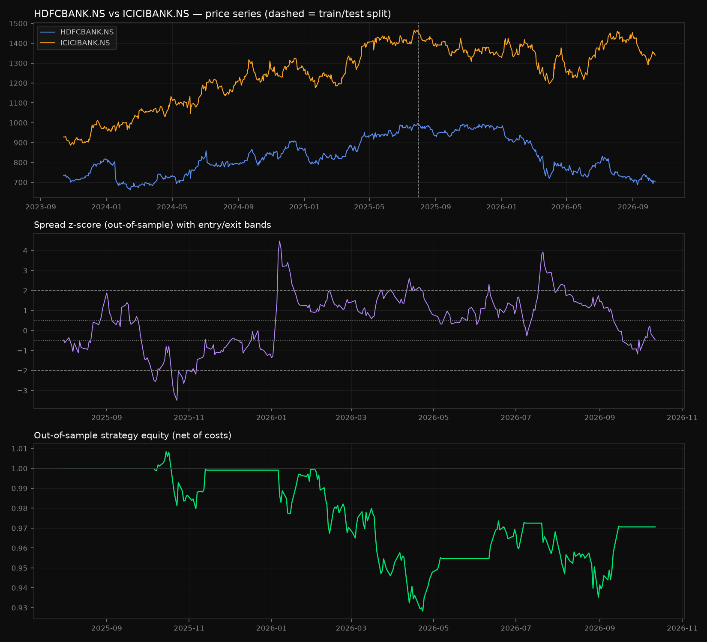

---

### AXISBANK.NS / ICICIBANK.NS

- **Latest prices:** AXISBANK.NS ₹1,253.00 · ICICIBANK.NS ₹1,340.00
- **Hedge ratio (train-fitted):** 0.8901
- **Cointegration (train):** FAIL at 5% — ADF 0.04, p=0.9615
- **Persistence:** passed 5% in 0 of 74 real-data runs (strict tier: 0/74)
- **Spread half-life:** n/a (not mean-reverting)
- **Current z-score:** -1.61
- **Signal today:** watch (approaching band)
- ⚠️ _Pair did not cointegrate on training data. Any signal here is not statistically justified — observation only._

**Out-of-sample backtest** (beta frozen from train window):

| Metric | Value |
|---|---|
| Sharpe | -0.10 |
| Sortino | -0.09 |
| Annualised return | -1.19% |
| Annualised vol | 8.53% |
| Max drawdown | -7.76% |
| Round-trip trades | 6 |

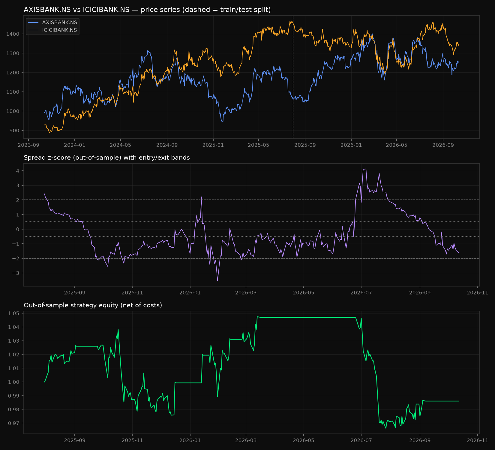

---

### KOTAKBANK.NS / HDFCBANK.NS

- **Latest prices:** KOTAKBANK.NS ₹443.40 · HDFCBANK.NS ₹704.90
- **Hedge ratio (train-fitted):** 2.1740
- **Cointegration (train):** FAIL at 5% — ADF -1.88, p=0.3414
- **Persistence:** passed 5% in 0 of 74 real-data runs (strict tier: 0/74)
- **Spread half-life:** 31.6 days
- **Current z-score:** -1.93
- **Signal today:** watch (approaching band)
- ⚠️ _Pair did not cointegrate on training data. Any signal here is not statistically justified — observation only._

**Out-of-sample backtest** (beta frozen from train window):

| Metric | Value |
|---|---|
| Sharpe | 1.73 |
| Sortino | 1.90 |
| Annualised return | 10.76% |
| Annualised vol | 6.00% |
| Max drawdown | -2.86% |
| Round-trip trades | 7 |

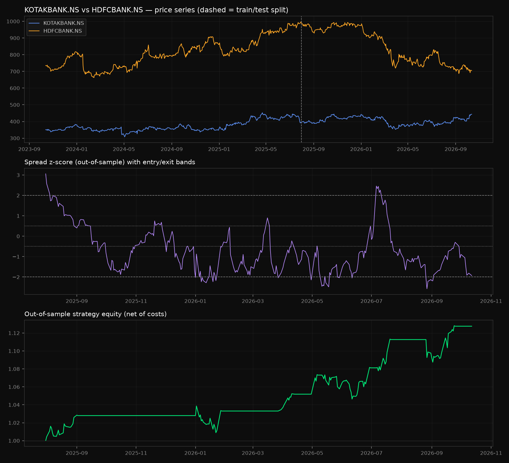

---

### SBIN.NS / BANKBARODA.NS

- **Latest prices:** SBIN.NS ₹941.00 · BANKBARODA.NS ₹235.40
- **Hedge ratio (train-fitted):** 0.1910
- **Cointegration (train):** FAIL at 5% — ADF -2.37, p=0.1495
- **Persistence:** passed 5% in 0 of 74 real-data runs (strict tier: 0/74)
- **Spread half-life:** 21.4 days
- **Current z-score:** +2.64
- **Signal today:** SHORT spread (short BANKBARODA.NS, long SBIN.NS)
- ⚠️ _Pair did not cointegrate on training data. Any signal here is not statistically justified — observation only._

**Out-of-sample backtest** (beta frozen from train window):

| Metric | Value |
|---|---|
| Sharpe | -0.01 |
| Sortino | -0.01 |
| Annualised return | -0.53% |
| Annualised vol | 9.30% |
| Max drawdown | -8.90% |
| Round-trip trades | 5 |

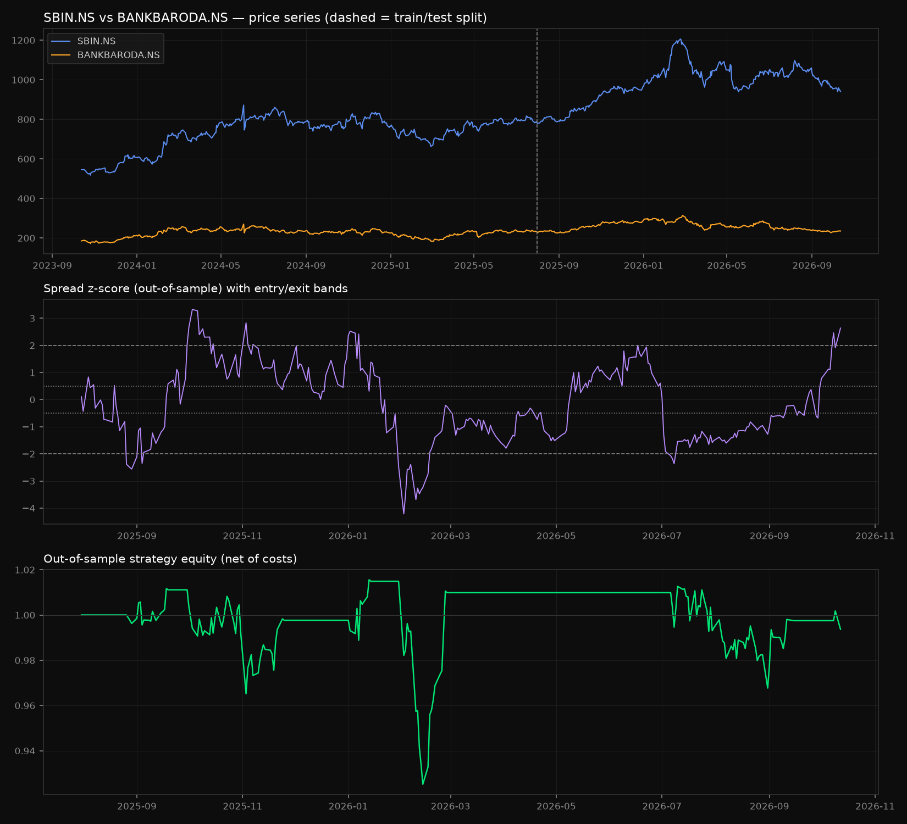

---

### TCS.NS / INFY.NS

- **Latest prices:** TCS.NS ₹2,125.00 · INFY.NS ₹1,020.00
- **Hedge ratio (train-fitted):** 0.4368
- **Cointegration (train):** FAIL at 5% — ADF -0.97, p=0.7632
- **Persistence:** passed 5% in 0 of 74 real-data runs (strict tier: 0/74)
- **Spread half-life:** 78.4 days
- **Current z-score:** -0.65
- **Signal today:** watch (approaching band)
- ⚠️ _Pair did not cointegrate on training data. Any signal here is not statistically justified — observation only._

**Out-of-sample backtest** (beta frozen from train window):

| Metric | Value |
|---|---|
| Sharpe | 2.00 |
| Sortino | 2.09 |
| Annualised return | 8.60% |
| Annualised vol | 4.18% |
| Max drawdown | -1.66% |
| Round-trip trades | 6 |

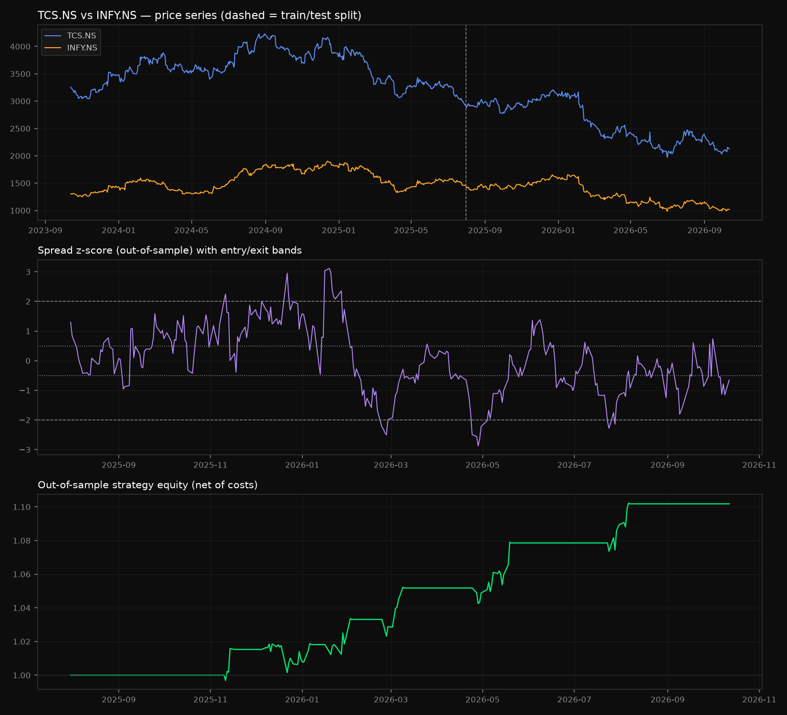

---

### INFY.NS / WIPRO.NS

- **Latest prices:** INFY.NS ₹1,020.00 · WIPRO.NS ₹161.80
- **Hedge ratio (train-fitted):** 0.1288
- **Cointegration (train):** FAIL at 5% — ADF -2.26, p=0.1853
- **Persistence:** passed 5% in 0 of 74 real-data runs (strict tier: 0/74)
- **Spread half-life:** 30.3 days
- **Current z-score:** -1.03
- **Signal today:** watch (approaching band)
- ⚠️ _Pair did not cointegrate on training data. Any signal here is not statistically justified — observation only._

**Out-of-sample backtest** (beta frozen from train window):

| Metric | Value |
|---|---|
| Sharpe | 1.89 |
| Sortino | 1.81 |
| Annualised return | 9.75% |
| Annualised vol | 4.98% |
| Max drawdown | -1.52% |
| Round-trip trades | 5 |

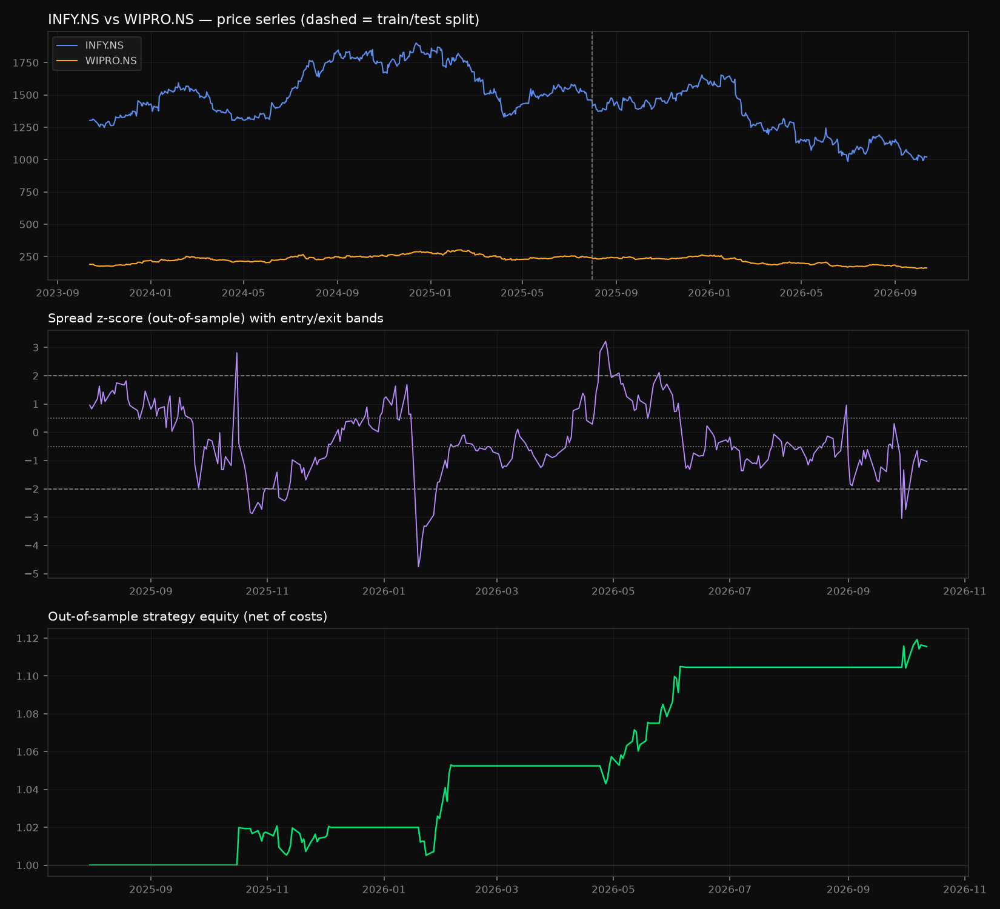

---

### HCLTECH.NS / TECHM.NS

- **Latest prices:** HCLTECH.NS ₹1,223.00 · TECHM.NS ₹1,471.00
- **Hedge ratio (train-fitted):** 0.9480
- **Cointegration (train):** FAIL at 5% — ADF -2.05, p=0.2667
- **Persistence:** passed 5% in 0 of 74 real-data runs (strict tier: 0/74)
- **Spread half-life:** 23.0 days
- **Current z-score:** -2.34
- **Signal today:** LONG spread (long TECHM.NS, short HCLTECH.NS)
- ⚠️ _Pair did not cointegrate on training data. Any signal here is not statistically justified — observation only._

**Out-of-sample backtest** (beta frozen from train window):

| Metric | Value |
|---|---|
| Sharpe | -0.25 |
| Sortino | -0.23 |
| Annualised return | -2.03% |
| Annualised vol | 7.26% |
| Max drawdown | -8.41% |
| Round-trip trades | 4 |

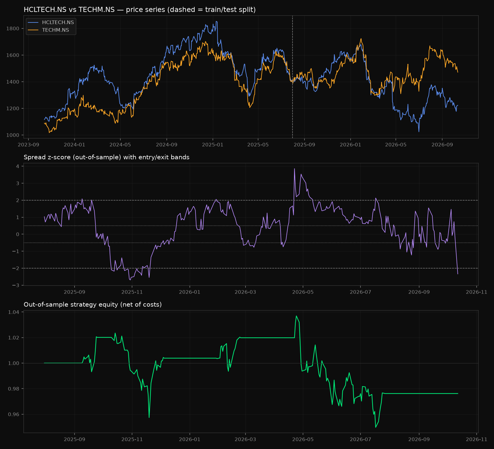

---

### ACC.NS / AMBUJACEM.NS

- **Latest prices:** ACC.NS ₹1,124.90 · AMBUJACEM.NS ₹348.00
- **Hedge ratio (train-fitted):** 0.1745
- **Cointegration (train):** FAIL at 5% — ADF -0.69, p=0.8484
- **Persistence:** passed 5% in 0 of 74 real-data runs (strict tier: 0/74)
- **Spread half-life:** 96.0 days
- **Current z-score:** -1.96
- **Signal today:** watch (approaching band)
- ⚠️ _Pair did not cointegrate on training data. Any signal here is not statistically justified — observation only._

**Out-of-sample backtest** (beta frozen from train window):

| Metric | Value |
|---|---|
| Sharpe | 0.50 |
| Sortino | 0.42 |
| Annualised return | 2.98% |
| Annualised vol | 6.24% |
| Max drawdown | -5.52% |
| Round-trip trades | 4 |

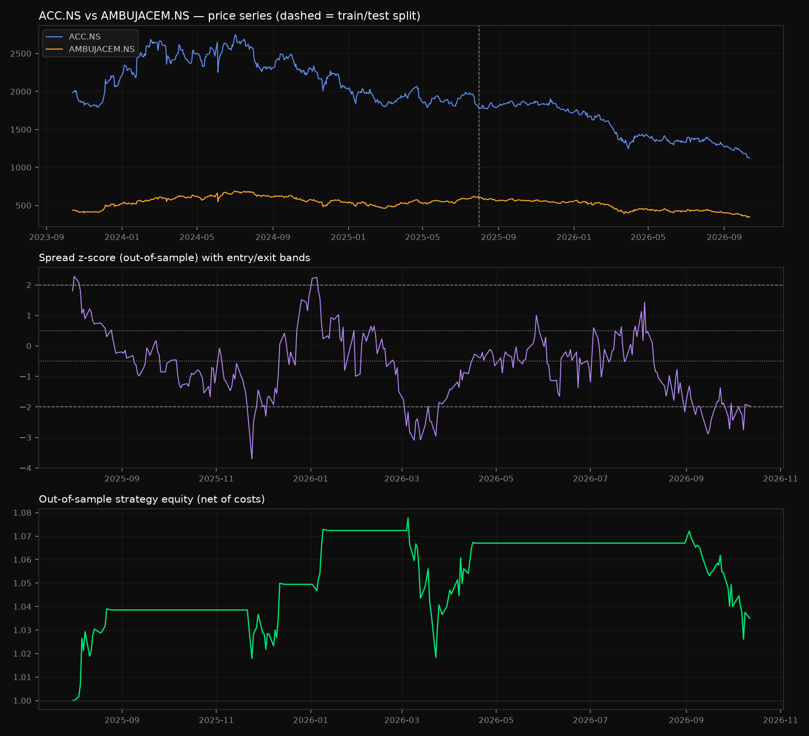

---

### ULTRACEMCO.NS / SHREECEM.NS

- **Latest prices:** ULTRACEMCO.NS ₹10,520.00 · SHREECEM.NS ₹21,860.00
- **Hedge ratio (train-fitted):** 0.9441
- **Cointegration (train):** FAIL at 5% — ADF -1.96, p=0.3033
- **Persistence:** passed 5% in 0 of 74 real-data runs (strict tier: 0/74)
- **Spread half-life:** 39.3 days
- **Current z-score:** -1.03
- **Signal today:** watch (approaching band)
- ⚠️ _Pair did not cointegrate on training data. Any signal here is not statistically justified — observation only._

**Out-of-sample backtest** (beta frozen from train window):

| Metric | Value |
|---|---|
| Sharpe | -0.22 |
| Sortino | -0.29 |
| Annualised return | -1.79% |
| Annualised vol | 7.02% |
| Max drawdown | -7.06% |
| Round-trip trades | 4 |

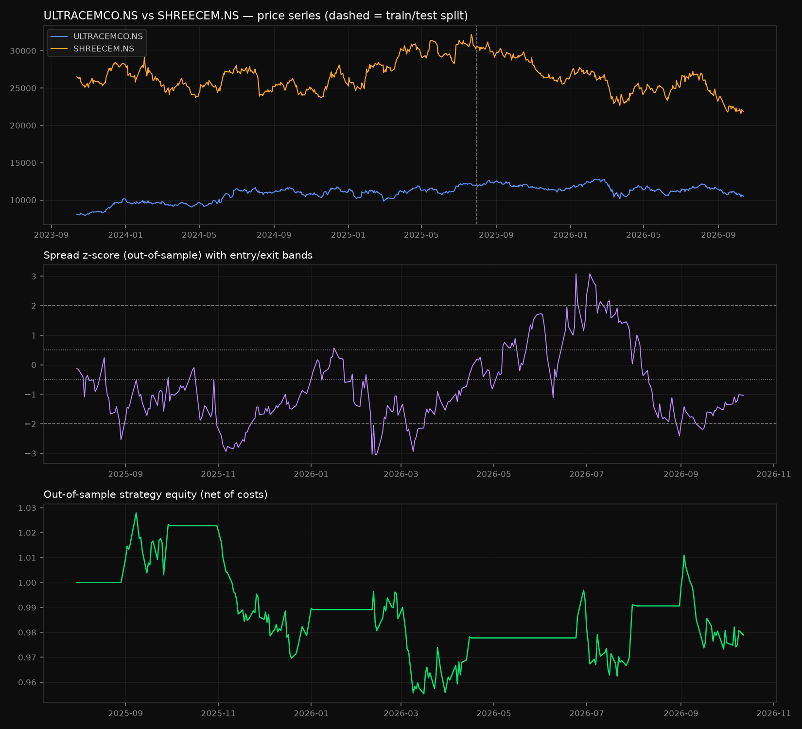

---

### IOC.NS / BPCL.NS

- **Latest prices:** IOC.NS ₹125.35 · BPCL.NS ₹284.50
- **Hedge ratio (train-fitted):** 1.6781
- **Cointegration (train):** FAIL at 5% — ADF -0.82, p=0.8133
- **Persistence:** passed 5% in 0 of 74 real-data runs (strict tier: 0/74)
- **Spread half-life:** 149.2 days
- **Current z-score:** -1.83
- **Signal today:** watch (approaching band)
- ⚠️ _Pair did not cointegrate on training data. Any signal here is not statistically justified — observation only._

**Out-of-sample backtest** (beta frozen from train window):

| Metric | Value |
|---|---|
| Sharpe | 0.19 |
| Sortino | 0.17 |
| Annualised return | 0.97% |
| Annualised vol | 6.15% |
| Max drawdown | -7.00% |
| Round-trip trades | 5 |

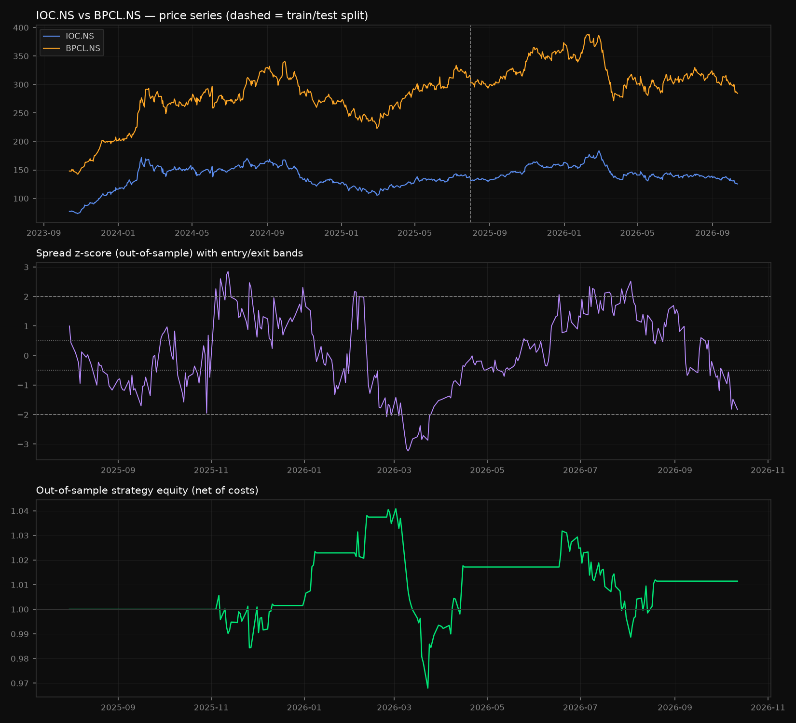

---

### BPCL.NS / HINDPETRO.NS

- **Latest prices:** BPCL.NS ₹284.50 · HINDPETRO.NS ₹332.25
- **Hedge ratio (train-fitted):** 1.3318
- **Cointegration (train):** FAIL at 5% — ADF -2.05, p=0.2635
- **Persistence:** passed 5% in 0 of 74 real-data runs (strict tier: 0/74)
- **Spread half-life:** 36.9 days
- **Current z-score:** +0.96
- **Signal today:** watch (approaching band)
- ⚠️ _Pair did not cointegrate on training data. Any signal here is not statistically justified — observation only._

**Out-of-sample backtest** (beta frozen from train window):

| Metric | Value |
|---|---|
| Sharpe | 0.04 |
| Sortino | 0.04 |
| Annualised return | 0.06% |
| Annualised vol | 5.88% |
| Max drawdown | -6.66% |
| Round-trip trades | 5 |

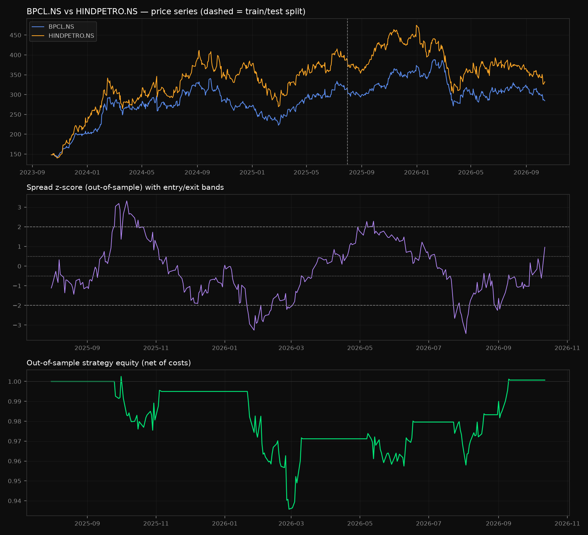

---

### ONGC.NS / COALINDIA.NS

- **Latest prices:** ONGC.NS ₹220.00 · COALINDIA.NS ₹404.80
- **Hedge ratio (train-fitted):** 1.3909
- **Cointegration (train):** PASS at 5% — ADF -3.19, p=0.0208
- **Persistence:** passed 5% in 66 of 74 real-data runs (strict tier: 1/74)
- **Spread half-life:** 12.7 days
- **Current z-score:** +1.04
- **Signal today:** watch (approaching band)

**Out-of-sample backtest** (beta frozen from train window):

| Metric | Value |
|---|---|
| Sharpe | 0.77 |
| Sortino | 0.63 |
| Annualised return | 6.05% |
| Annualised vol | 8.00% |
| Max drawdown | -6.38% |
| Round-trip trades | 5 |

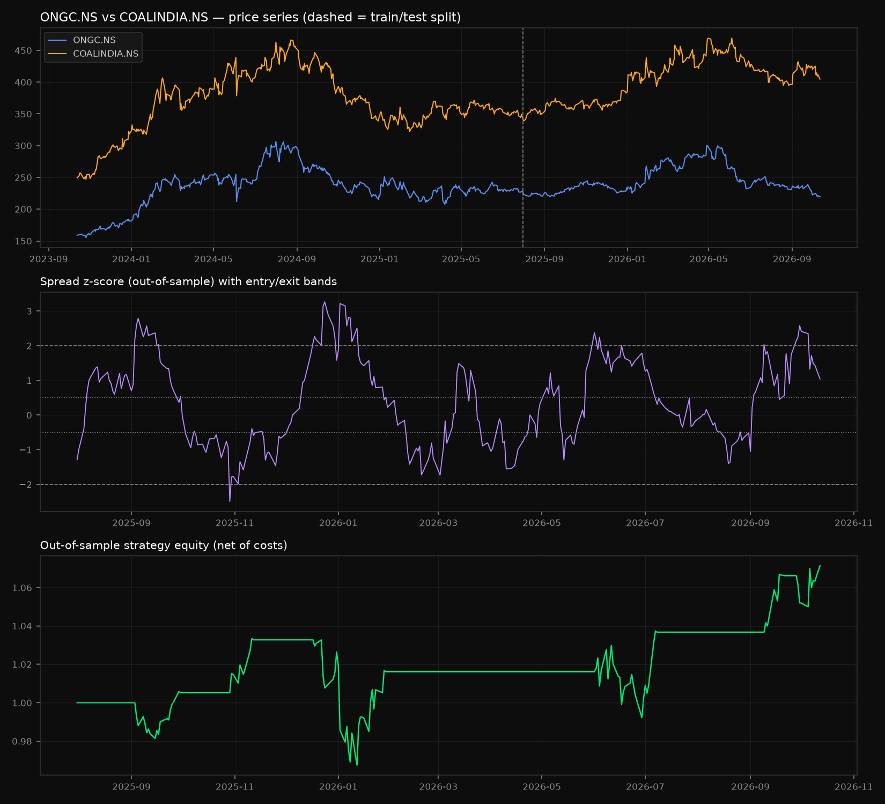

---

### NTPC.NS / POWERGRID.NS

- **Latest prices:** NTPC.NS ₹310.00 · POWERGRID.NS ₹249.00
- **Hedge ratio (train-fitted):** 0.8136
- **Cointegration (train):** FAIL at 5% — ADF -2.57, p=0.1002
- **Persistence:** passed 5% in 0 of 74 real-data runs (strict tier: 0/74)
- **Spread half-life:** 23.7 days
- **Current z-score:** -0.46
- **Signal today:** flat / no stretch
- ⚠️ _Pair did not cointegrate on training data. Any signal here is not statistically justified — observation only._

**Out-of-sample backtest** (beta frozen from train window):

| Metric | Value |
|---|---|
| Sharpe | 0.43 |
| Sortino | 0.34 |
| Annualised return | 2.30% |
| Annualised vol | 5.60% |
| Max drawdown | -5.28% |
| Round-trip trades | 6 |

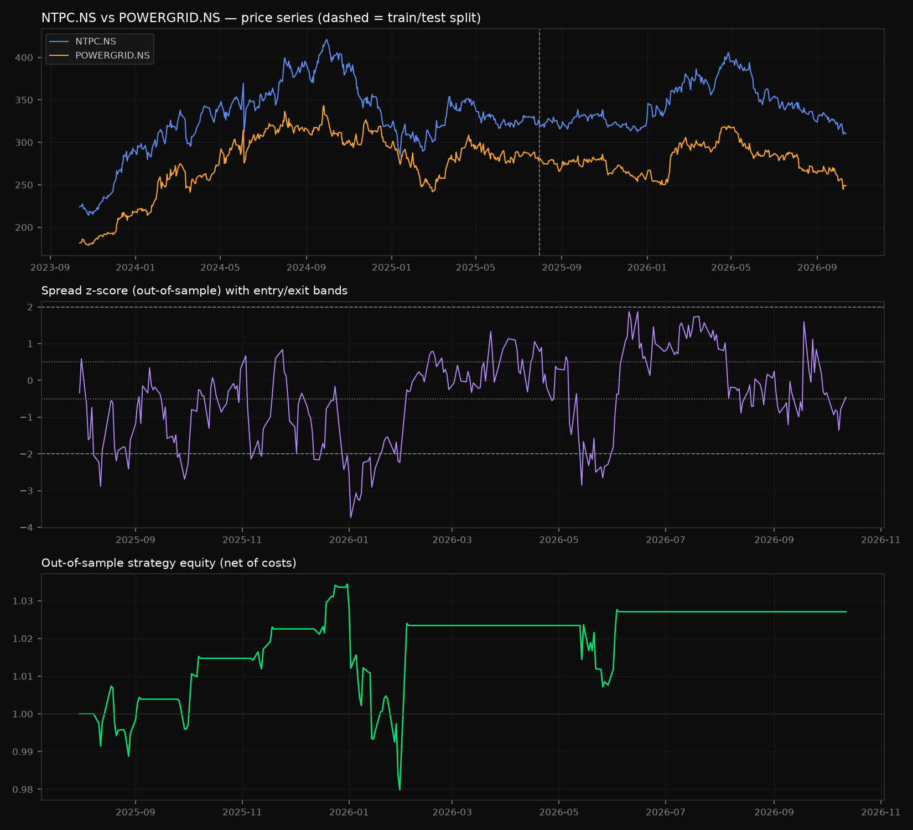

---

### BAJAJ-AUTO.NS / HEROMOTOCO.NS

- **Latest prices:** BAJAJ-AUTO.NS ₹10,034.00 · HEROMOTOCO.NS ₹4,937.00
- **Hedge ratio (train-fitted):** 0.4085
- **Cointegration (train):** FAIL at 5% — ADF -2.28, p=0.1800
- **Persistence:** passed 5% in 0 of 74 real-data runs (strict tier: 0/74)
- **Spread half-life:** 29.7 days
- **Current z-score:** +0.49
- **Signal today:** flat / no stretch
- ⚠️ _Pair did not cointegrate on training data. Any signal here is not statistically justified — observation only._

**Out-of-sample backtest** (beta frozen from train window):

| Metric | Value |
|---|---|
| Sharpe | -0.52 |
| Sortino | -0.54 |
| Annualised return | -6.12% |
| Annualised vol | 10.93% |
| Max drawdown | -19.58% |
| Round-trip trades | 6 |

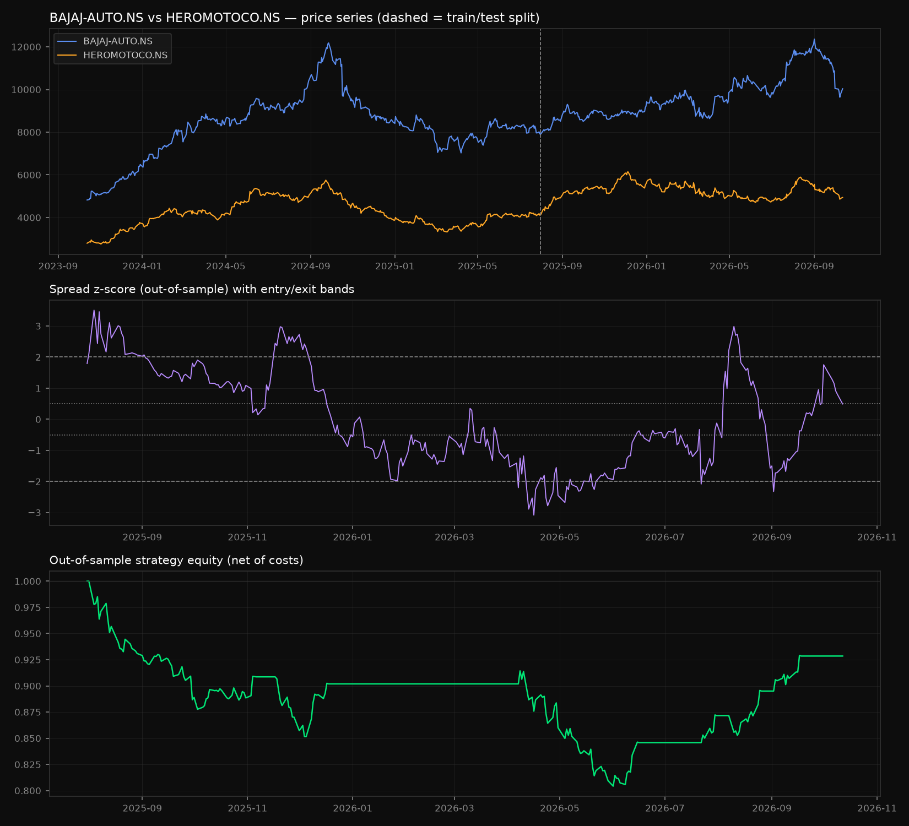

---

### TATASTEEL.NS / JSWSTEEL.NS

- **Latest prices:** TATASTEEL.NS ₹172.24 · JSWSTEEL.NS ₹1,173.00
- **Hedge ratio (train-fitted):** 3.0303
- **Cointegration (train):** FAIL at 5% — ADF -1.23, p=0.6618
- **Persistence:** passed 5% in 0 of 74 real-data runs (strict tier: 0/74)
- **Spread half-life:** 67.8 days
- **Current z-score:** -2.20
- **Signal today:** LONG spread (long JSWSTEEL.NS, short TATASTEEL.NS)
- ⚠️ _Pair did not cointegrate on training data. Any signal here is not statistically justified — observation only._

**Out-of-sample backtest** (beta frozen from train window):

| Metric | Value |
|---|---|
| Sharpe | 0.11 |
| Sortino | 0.10 |
| Annualised return | 0.53% |
| Annualised vol | 8.36% |
| Max drawdown | -5.56% |
| Round-trip trades | 5 |

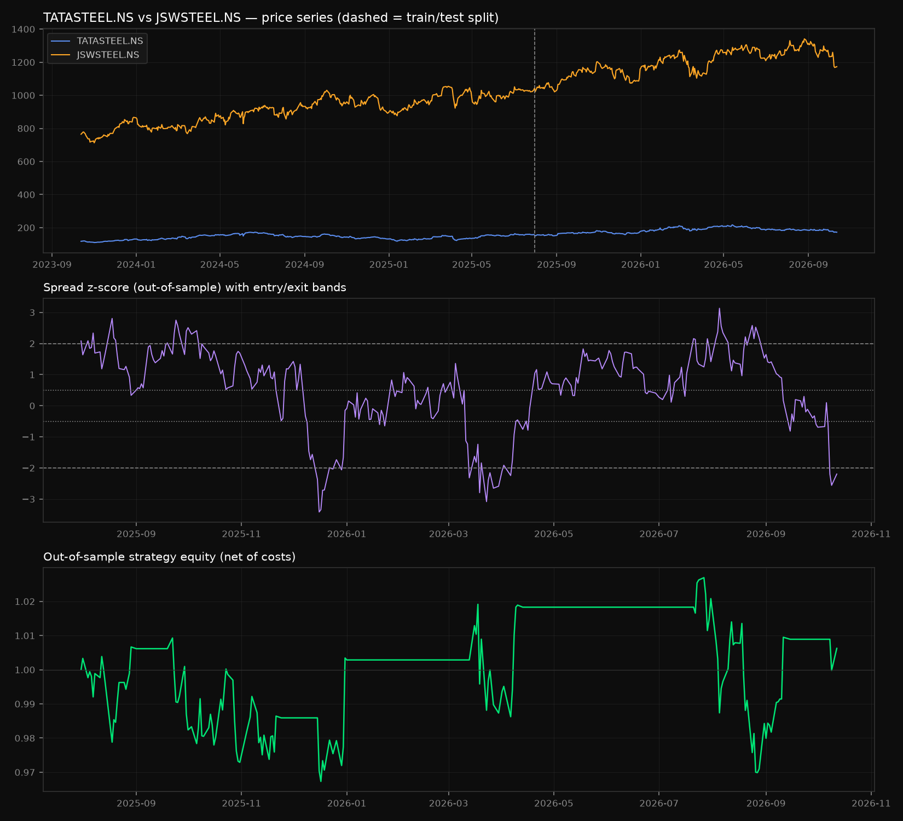

---

### SUNPHARMA.NS / CIPLA.NS

- **Latest prices:** SUNPHARMA.NS ₹1,760.00 · CIPLA.NS ₹1,311.30
- **Hedge ratio (train-fitted):** 0.4872
- **Cointegration (train):** PASS at 5% — ADF -3.47, p=0.0089
- **Persistence:** passed 5% in 74 of 74 real-data runs (strict tier: 5/74)
- **Spread half-life:** 10.5 days
- **Current z-score:** -1.23
- **Signal today:** watch (approaching band)

**Out-of-sample backtest** (beta frozen from train window):

| Metric | Value |
|---|---|
| Sharpe | 0.15 |
| Sortino | 0.16 |
| Annualised return | 0.83% |
| Annualised vol | 7.40% |
| Max drawdown | -9.96% |
| Round-trip trades | 5 |

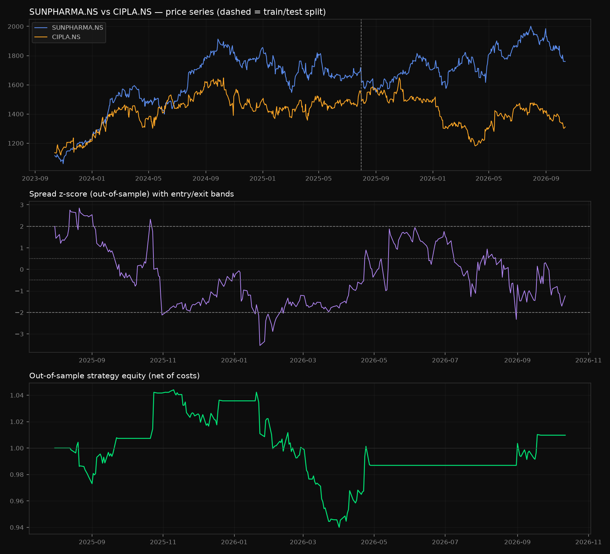

---

_Generated 2026-10-13 · pairs mean-reversion scanner · out-of-sample backtest · multiple-testing-aware · not investment advice._
