# Indian Pairs-Trading Scanner — 2026-10-15

> **What this is:** a market-neutral *pairs mean-reversion* scanner. It flags when two related NSE stocks have drifted apart far enough that their historical relationship signals a possible convergence trade. It does **not** forecast growth, rank "best" stocks, or predict company performance. A signal means the *spread between two stocks* is stretched — nothing about either stock being a good investment. Not investment advice; do your own research.

## Methodology (fixed in advance)

- **Universe:** 16 declared sector-mate pairs. Parameters (3y window, 60/40 train-test, z-entry 2.0, z-exit 0.5, 5 bps costs) are pre-registered; changes are logged in the README changelog *before* looking at results.
- **Multiple testing:** at the 5% level across 16 pairs, **≈0.8 false positives per run are expected by chance alone** even if nothing truly cointegrates. A single-day pass is a candidate, not a discovery.
- **Strict tier:** Bonferroni-corrected threshold p < 0.0031 (marked ✓✓).
- **Evidence = persistence:** the Persistence column counts how often each pair has passed the 5% test across all *real-data* daily runs recorded in `reports/history.csv`. Pairs deserve attention only when they pass persistently.

## Summary

| Pair | p-value | Coint. | Persistence | Current z | Signal | OOS Sharpe |
|---|---|---|---|---|---|---|
| HDFCBANK.NS/ICICIBANK.NS | 0.0775 | ✗ | 1/63 | -0.21 | flat / no stretch | -0.36 |
| AXISBANK.NS/ICICIBANK.NS | 0.9568 | ✗ | 0/76 | -1.02 | watch | -0.36 |
| KOTAKBANK.NS/HDFCBANK.NS | 0.2533 | ✗ | 0/76 | -1.61 | watch | 1.58 |
| SBIN.NS/BANKBARODA.NS | 0.1522 | ✗ | 0/76 | -0.33 | flat / no stretch | 0.43 |
| TCS.NS/INFY.NS | 0.7128 | ✗ | 0/76 | -1.14 | watch | 1.99 |
| INFY.NS/WIPRO.NS | 0.1758 | ✗ | 0/76 | -0.75 | watch | 1.95 |
| HCLTECH.NS/TECHM.NS | 0.2773 | ✗ | 0/76 | +0.15 | flat / no stretch | -0.04 |
| ACC.NS/AMBUJACEM.NS | 0.7640 | ✗ | 0/76 | -1.68 | watch | 0.47 |
| ULTRACEMCO.NS/SHREECEM.NS | 0.3240 | ✗ | 0/76 | -0.86 | watch | -0.16 |
| IOC.NS/BPCL.NS | 0.7984 | ✗ | 0/76 | -0.96 | watch | 0.18 |
| BPCL.NS/HINDPETRO.NS | 0.2594 | ✗ | 0/76 | +1.84 | watch | 0.04 |
| ONGC.NS/COALINDIA.NS | 0.0231 | ✓ | 68/76 | +1.39 | watch | 0.66 |
| NTPC.NS/POWERGRID.NS | 0.1113 | ✗ | 0/76 | -1.01 | watch | 0.43 |
| BAJAJ-AUTO.NS/HEROMOTOCO.NS | 0.1820 | ✗ | 0/76 | +1.03 | watch | -0.36 |
| TATASTEEL.NS/JSWSTEEL.NS | 0.6977 | ✗ | 0/76 | -1.50 | watch | 0.22 |
| SUNPHARMA.NS/CIPLA.NS | 0.0090 | ✓ | 76/76 | -0.57 | watch | 0.15 |

_Legend: ✓✓ passes strict Bonferroni tier · ✓ passes 5% only · ✗ fails. Persistence = 5%-passes / real-data runs recorded. \*no real-data history yet._

---

### HDFCBANK.NS / ICICIBANK.NS

- **Latest prices:** HDFCBANK.NS ₹726.85 · ICICIBANK.NS ₹1,389.40
- **Hedge ratio (train-fitted):** 1.6113
- **Cointegration (train):** FAIL at 5% — ADF -2.68, p=0.0775
- **Persistence:** passed 5% in 1 of 63 real-data runs (strict tier: 0/63)
- **Spread half-life:** 24.6 days
- **Current z-score:** -0.21
- **Signal today:** flat / no stretch
- ⚠️ _Pair did not cointegrate on training data. Any signal here is not statistically justified — observation only._

**Out-of-sample backtest** (beta frozen from train window):

| Metric | Value |
|---|---|
| Sharpe | -0.36 |
| Sortino | -0.38 |
| Annualised return | -2.52% |
| Annualised vol | 6.58% |
| Max drawdown | -8.02% |
| Round-trip trades | 4 |

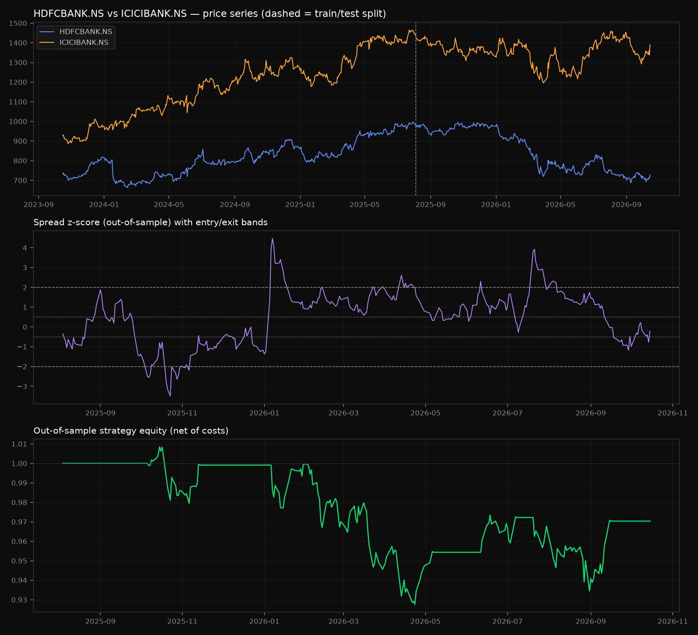

---

### AXISBANK.NS / ICICIBANK.NS

- **Latest prices:** AXISBANK.NS ₹1,288.00 · ICICIBANK.NS ₹1,389.40
- **Hedge ratio (train-fitted):** 0.8709
- **Cointegration (train):** FAIL at 5% — ADF -0.02, p=0.9568
- **Persistence:** passed 5% in 0 of 76 real-data runs (strict tier: 0/76)
- **Spread half-life:** 7419.6 days
- **Current z-score:** -1.02
- **Signal today:** watch (approaching band)
- ⚠️ _Pair did not cointegrate on training data. Any signal here is not statistically justified — observation only._

**Out-of-sample backtest** (beta frozen from train window):

| Metric | Value |
|---|---|
| Sharpe | -0.36 |
| Sortino | -0.33 |
| Annualised return | -3.27% |
| Annualised vol | 8.38% |
| Max drawdown | -7.77% |
| Round-trip trades | 5 |

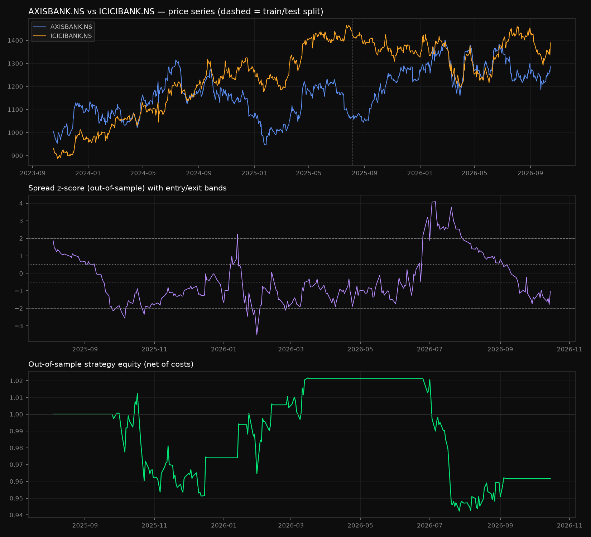

---

### KOTAKBANK.NS / HDFCBANK.NS

- **Latest prices:** KOTAKBANK.NS ₹447.95 · HDFCBANK.NS ₹726.85
- **Hedge ratio (train-fitted):** 2.1867
- **Cointegration (train):** FAIL at 5% — ADF -2.08, p=0.2533
- **Persistence:** passed 5% in 0 of 76 real-data runs (strict tier: 0/76)
- **Spread half-life:** 29.0 days
- **Current z-score:** -1.61
- **Signal today:** watch (approaching band)
- ⚠️ _Pair did not cointegrate on training data. Any signal here is not statistically justified — observation only._

**Out-of-sample backtest** (beta frozen from train window):

| Metric | Value |
|---|---|
| Sharpe | 1.58 |
| Sortino | 1.72 |
| Annualised return | 9.69% |
| Annualised vol | 5.97% |
| Max drawdown | -2.85% |
| Round-trip trades | 7 |

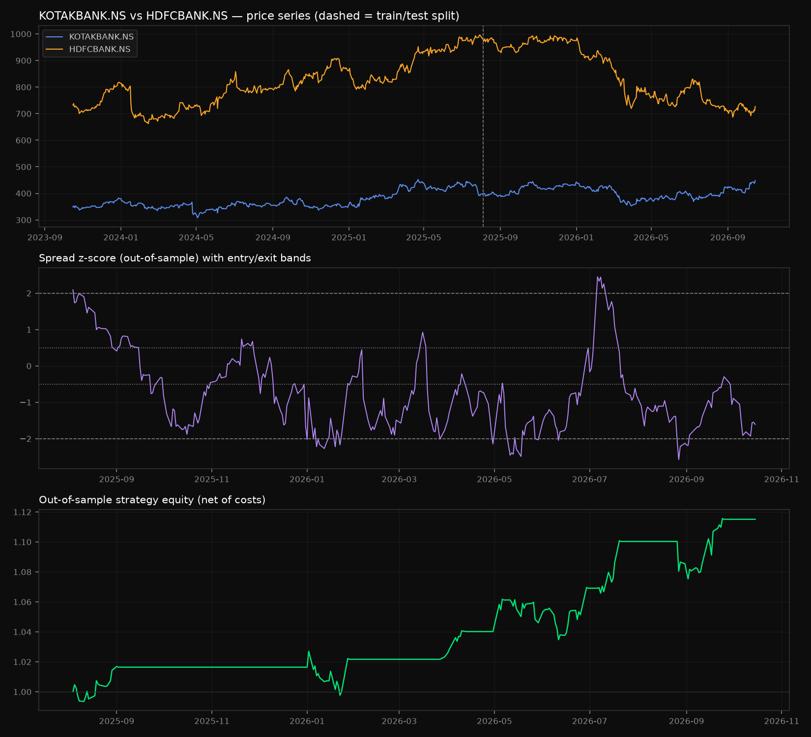

---

### SBIN.NS / BANKBARODA.NS

- **Latest prices:** SBIN.NS ₹960.00 · BANKBARODA.NS ₹228.00
- **Hedge ratio (train-fitted):** 0.1907
- **Cointegration (train):** FAIL at 5% — ADF -2.36, p=0.1522
- **Persistence:** passed 5% in 0 of 76 real-data runs (strict tier: 0/76)
- **Spread half-life:** 21.5 days
- **Current z-score:** -0.33
- **Signal today:** flat / no stretch
- ⚠️ _Pair did not cointegrate on training data. Any signal here is not statistically justified — observation only._

**Out-of-sample backtest** (beta frozen from train window):

| Metric | Value |
|---|---|
| Sharpe | 0.43 |
| Sortino | 0.39 |
| Annualised return | 3.77% |
| Annualised vol | 9.69% |
| Max drawdown | -8.83% |
| Round-trip trades | 7 |

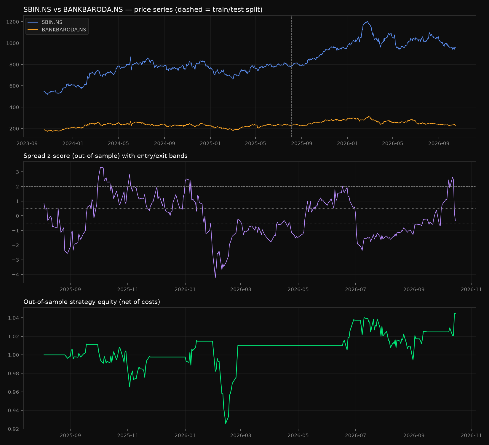

---

### TCS.NS / INFY.NS

- **Latest prices:** TCS.NS ₹2,350.00 · INFY.NS ₹1,110.00
- **Hedge ratio (train-fitted):** 0.4328
- **Cointegration (train):** FAIL at 5% — ADF -1.11, p=0.7128
- **Persistence:** passed 5% in 0 of 76 real-data runs (strict tier: 0/76)
- **Spread half-life:** 74.2 days
- **Current z-score:** -1.14
- **Signal today:** watch (approaching band)
- ⚠️ _Pair did not cointegrate on training data. Any signal here is not statistically justified — observation only._

**Out-of-sample backtest** (beta frozen from train window):

| Metric | Value |
|---|---|
| Sharpe | 1.99 |
| Sortino | 2.08 |
| Annualised return | 8.64% |
| Annualised vol | 4.21% |
| Max drawdown | -1.71% |
| Round-trip trades | 6 |

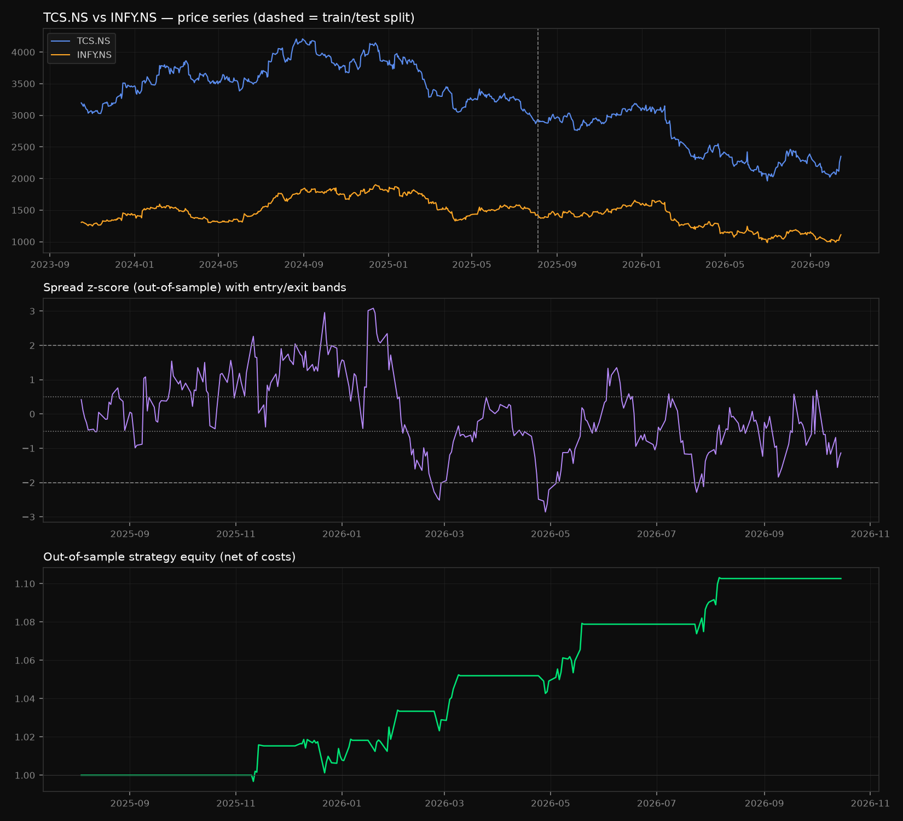

---

### INFY.NS / WIPRO.NS

- **Latest prices:** INFY.NS ₹1,110.00 · WIPRO.NS ₹174.05
- **Hedge ratio (train-fitted):** 0.1282
- **Cointegration (train):** FAIL at 5% — ADF -2.29, p=0.1758
- **Persistence:** passed 5% in 0 of 76 real-data runs (strict tier: 0/76)
- **Spread half-life:** 30.0 days
- **Current z-score:** -0.75
- **Signal today:** watch (approaching band)
- ⚠️ _Pair did not cointegrate on training data. Any signal here is not statistically justified — observation only._

**Out-of-sample backtest** (beta frozen from train window):

| Metric | Value |
|---|---|
| Sharpe | 1.95 |
| Sortino | 1.87 |
| Annualised return | 10.22% |
| Annualised vol | 5.05% |
| Max drawdown | -1.53% |
| Round-trip trades | 6 |

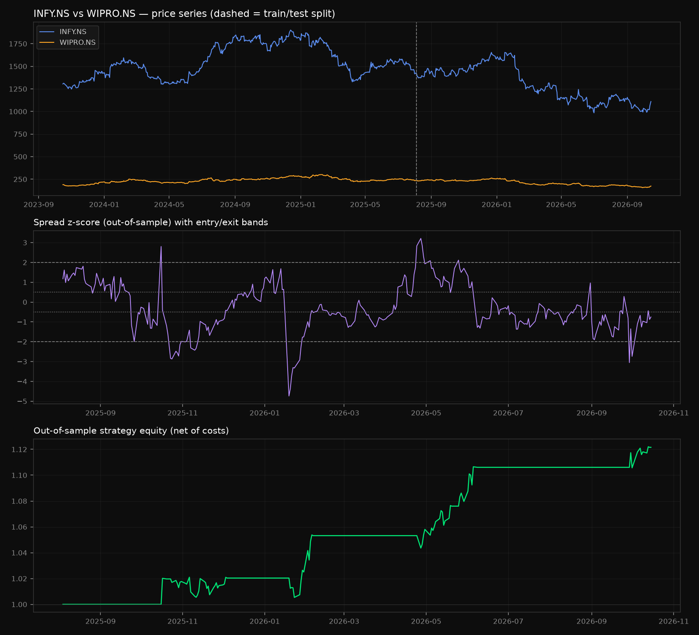

---

### HCLTECH.NS / TECHM.NS

- **Latest prices:** HCLTECH.NS ₹1,360.00 · TECHM.NS ₹1,650.00
- **Hedge ratio (train-fitted):** 0.9483
- **Cointegration (train):** FAIL at 5% — ADF -2.02, p=0.2773
- **Persistence:** passed 5% in 0 of 76 real-data runs (strict tier: 0/76)
- **Spread half-life:** 23.4 days
- **Current z-score:** +0.15
- **Signal today:** flat / no stretch
- ⚠️ _Pair did not cointegrate on training data. Any signal here is not statistically justified — observation only._

**Out-of-sample backtest** (beta frozen from train window):

| Metric | Value |
|---|---|
| Sharpe | -0.04 |
| Sortino | -0.04 |
| Annualised return | -0.59% |
| Annualised vol | 7.47% |
| Max drawdown | -8.36% |
| Round-trip trades | 4 |

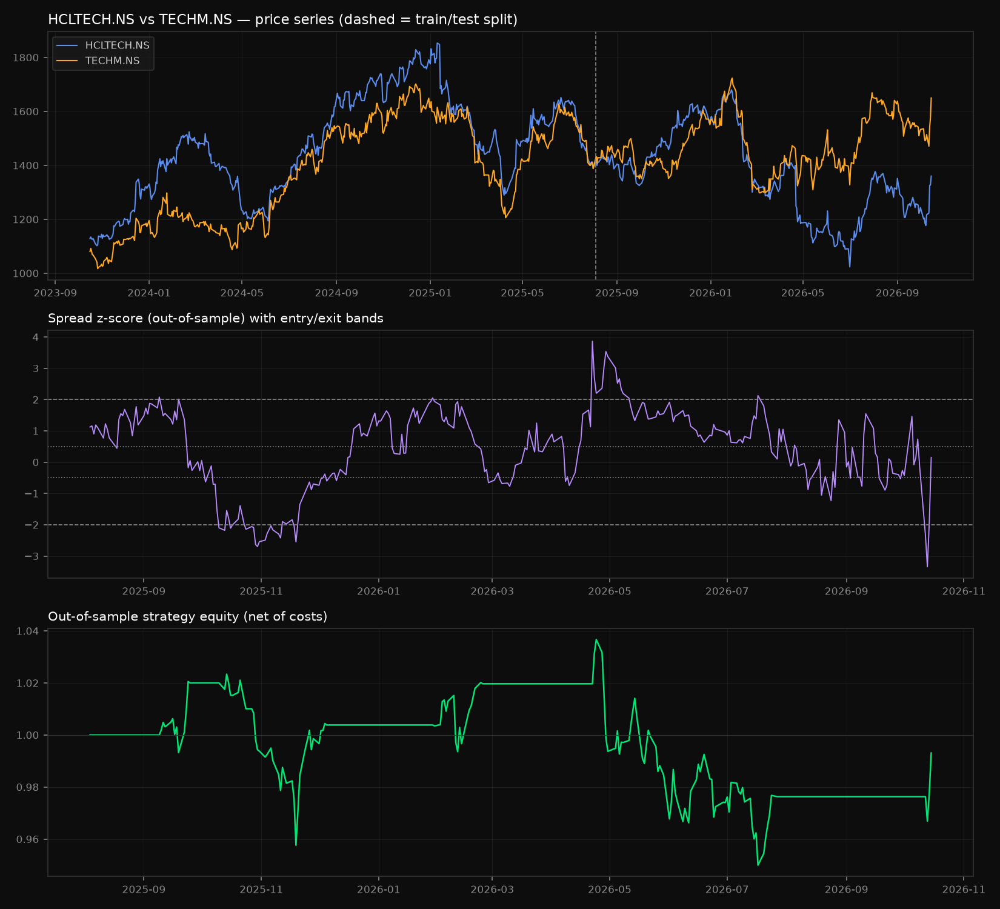

---

### ACC.NS / AMBUJACEM.NS

- **Latest prices:** ACC.NS ₹1,137.40 · AMBUJACEM.NS ₹350.90
- **Hedge ratio (train-fitted):** 0.1713
- **Cointegration (train):** FAIL at 5% — ADF -0.97, p=0.7640
- **Persistence:** passed 5% in 0 of 76 real-data runs (strict tier: 0/76)
- **Spread half-life:** 75.8 days
- **Current z-score:** -1.68
- **Signal today:** watch (approaching band)
- ⚠️ _Pair did not cointegrate on training data. Any signal here is not statistically justified — observation only._

**Out-of-sample backtest** (beta frozen from train window):

| Metric | Value |
|---|---|
| Sharpe | 0.47 |
| Sortino | 0.39 |
| Annualised return | 2.75% |
| Annualised vol | 6.20% |
| Max drawdown | -5.54% |
| Round-trip trades | 4 |

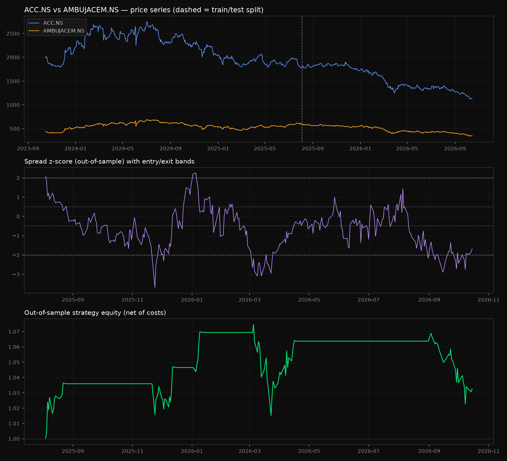

---

### ULTRACEMCO.NS / SHREECEM.NS

- **Latest prices:** ULTRACEMCO.NS ₹10,862.00 · SHREECEM.NS ₹22,315.00
- **Hedge ratio (train-fitted):** 0.9679
- **Cointegration (train):** FAIL at 5% — ADF -1.92, p=0.3240
- **Persistence:** passed 5% in 0 of 76 real-data runs (strict tier: 0/76)
- **Spread half-life:** 40.4 days
- **Current z-score:** -0.86
- **Signal today:** watch (approaching band)
- ⚠️ _Pair did not cointegrate on training data. Any signal here is not statistically justified — observation only._

**Out-of-sample backtest** (beta frozen from train window):

| Metric | Value |
|---|---|
| Sharpe | -0.16 |
| Sortino | -0.21 |
| Annualised return | -1.37% |
| Annualised vol | 6.94% |
| Max drawdown | -6.91% |
| Round-trip trades | 4 |

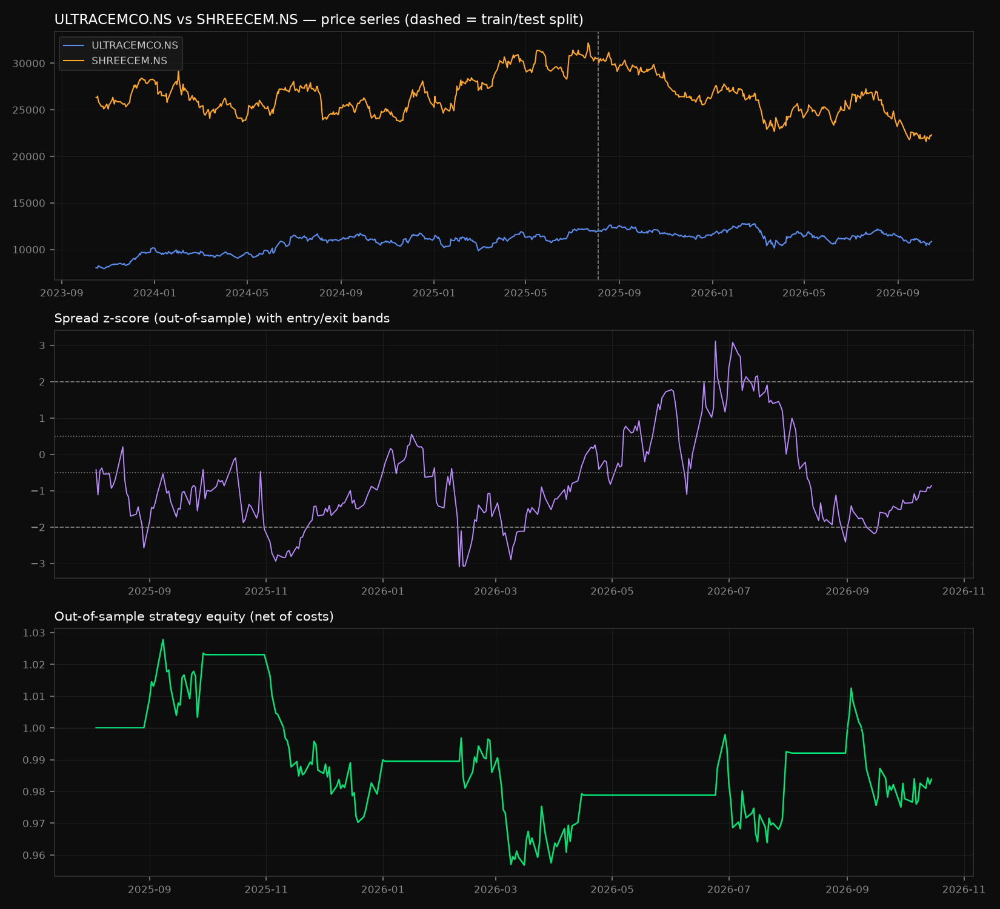

---

### IOC.NS / BPCL.NS

- **Latest prices:** IOC.NS ₹128.83 · BPCL.NS ₹293.70
- **Hedge ratio (train-fitted):** 1.6715
- **Cointegration (train):** FAIL at 5% — ADF -0.87, p=0.7984
- **Persistence:** passed 5% in 0 of 76 real-data runs (strict tier: 0/76)
- **Spread half-life:** 141.6 days
- **Current z-score:** -0.96
- **Signal today:** watch (approaching band)
- ⚠️ _Pair did not cointegrate on training data. Any signal here is not statistically justified — observation only._

**Out-of-sample backtest** (beta frozen from train window):

| Metric | Value |
|---|---|
| Sharpe | 0.18 |
| Sortino | 0.17 |
| Annualised return | 0.97% |
| Annualised vol | 6.34% |
| Max drawdown | -7.26% |
| Round-trip trades | 5 |

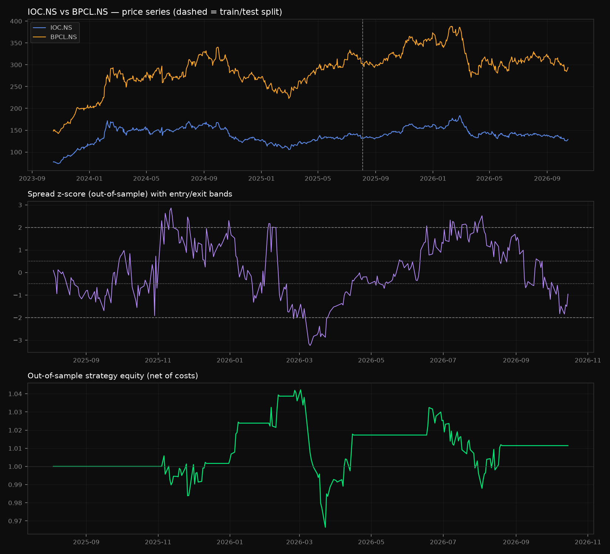

---

### BPCL.NS / HINDPETRO.NS

- **Latest prices:** BPCL.NS ₹293.70 · HINDPETRO.NS ₹348.50
- **Hedge ratio (train-fitted):** 1.3305
- **Cointegration (train):** FAIL at 5% — ADF -2.06, p=0.2594
- **Persistence:** passed 5% in 0 of 76 real-data runs (strict tier: 0/76)
- **Spread half-life:** 36.8 days
- **Current z-score:** +1.84
- **Signal today:** watch (approaching band)
- ⚠️ _Pair did not cointegrate on training data. Any signal here is not statistically justified — observation only._

**Out-of-sample backtest** (beta frozen from train window):

| Metric | Value |
|---|---|
| Sharpe | 0.04 |
| Sortino | 0.03 |
| Annualised return | 0.04% |
| Annualised vol | 6.05% |
| Max drawdown | -6.86% |
| Round-trip trades | 5 |

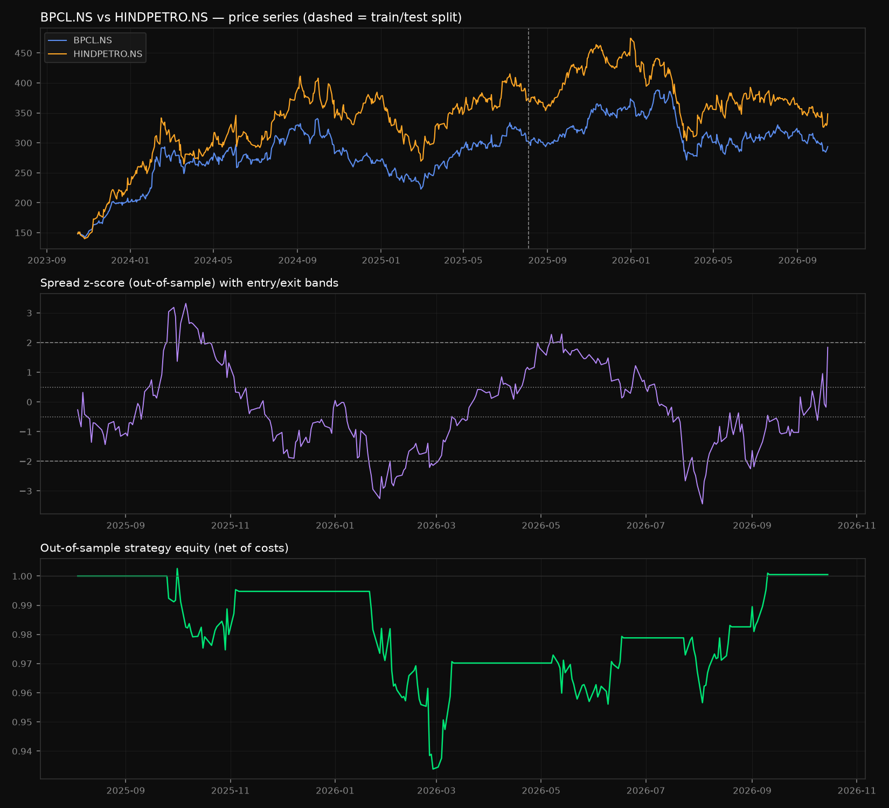

---

### ONGC.NS / COALINDIA.NS

- **Latest prices:** ONGC.NS ₹224.64 · COALINDIA.NS ₹418.00
- **Hedge ratio (train-fitted):** 1.3890
- **Cointegration (train):** PASS at 5% — ADF -3.15, p=0.0231
- **Persistence:** passed 5% in 68 of 76 real-data runs (strict tier: 1/76)
- **Spread half-life:** 12.8 days
- **Current z-score:** +1.39
- **Signal today:** watch (approaching band)

**Out-of-sample backtest** (beta frozen from train window):

| Metric | Value |
|---|---|
| Sharpe | 0.66 |
| Sortino | 0.55 |
| Annualised return | 5.18% |
| Annualised vol | 8.14% |
| Max drawdown | -6.48% |
| Round-trip trades | 5 |

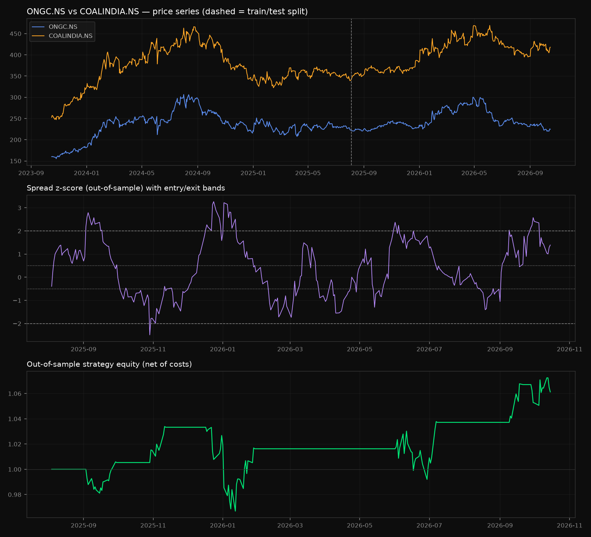

---

### NTPC.NS / POWERGRID.NS

- **Latest prices:** NTPC.NS ₹314.65 · POWERGRID.NS ₹249.85
- **Hedge ratio (train-fitted):** 0.8123
- **Cointegration (train):** FAIL at 5% — ADF -2.52, p=0.1113
- **Persistence:** passed 5% in 0 of 76 real-data runs (strict tier: 0/76)
- **Spread half-life:** 24.1 days
- **Current z-score:** -1.01
- **Signal today:** watch (approaching band)
- ⚠️ _Pair did not cointegrate on training data. Any signal here is not statistically justified — observation only._

**Out-of-sample backtest** (beta frozen from train window):

| Metric | Value |
|---|---|
| Sharpe | 0.43 |
| Sortino | 0.34 |
| Annualised return | 2.32% |
| Annualised vol | 5.64% |
| Max drawdown | -5.32% |
| Round-trip trades | 6 |

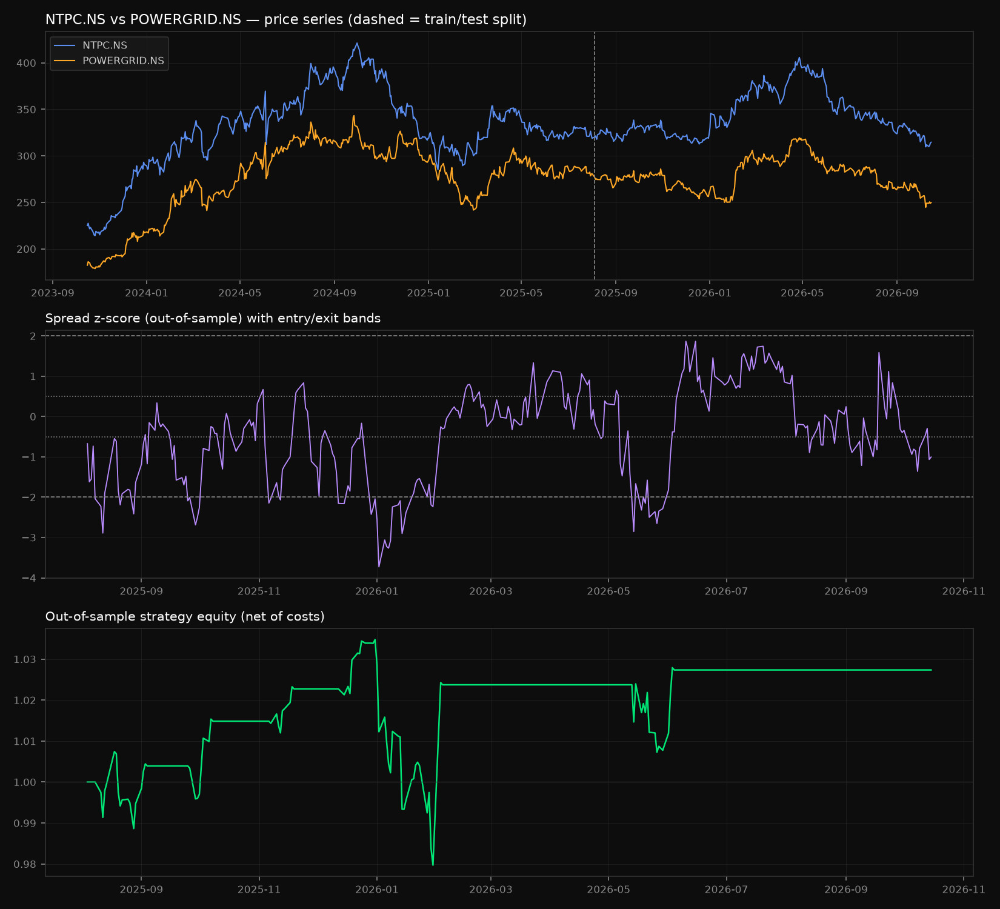

---

### BAJAJ-AUTO.NS / HEROMOTOCO.NS

- **Latest prices:** BAJAJ-AUTO.NS ₹10,385.00 · HEROMOTOCO.NS ₹5,210.00
- **Hedge ratio (train-fitted):** 0.4085
- **Cointegration (train):** FAIL at 5% — ADF -2.27, p=0.1820
- **Persistence:** passed 5% in 0 of 76 real-data runs (strict tier: 0/76)
- **Spread half-life:** 29.9 days
- **Current z-score:** +1.03
- **Signal today:** watch (approaching band)
- ⚠️ _Pair did not cointegrate on training data. Any signal here is not statistically justified — observation only._

**Out-of-sample backtest** (beta frozen from train window):

| Metric | Value |
|---|---|
| Sharpe | -0.36 |
| Sortino | -0.37 |
| Annualised return | -4.13% |
| Annualised vol | 10.25% |
| Max drawdown | -17.61% |
| Round-trip trades | 6 |

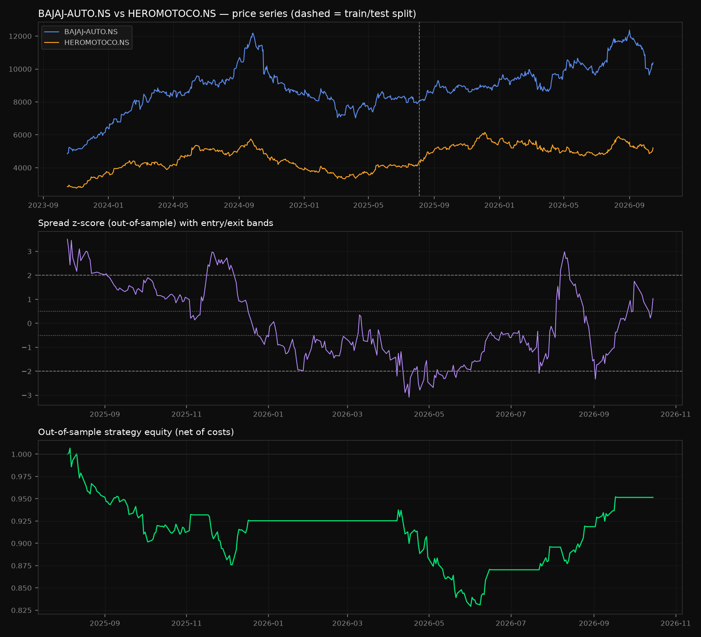

---

### TATASTEEL.NS / JSWSTEEL.NS

- **Latest prices:** TATASTEEL.NS ₹176.40 · JSWSTEEL.NS ₹1,200.40
- **Hedge ratio (train-fitted):** 3.0318
- **Cointegration (train):** FAIL at 5% — ADF -1.14, p=0.6977
- **Persistence:** passed 5% in 0 of 76 real-data runs (strict tier: 0/76)
- **Spread half-life:** 72.4 days
- **Current z-score:** -1.50
- **Signal today:** watch (approaching band)
- ⚠️ _Pair did not cointegrate on training data. Any signal here is not statistically justified — observation only._

**Out-of-sample backtest** (beta frozen from train window):

| Metric | Value |
|---|---|
| Sharpe | 0.22 |
| Sortino | 0.21 |
| Annualised return | 1.51% |
| Annualised vol | 8.34% |
| Max drawdown | -5.51% |
| Round-trip trades | 5 |

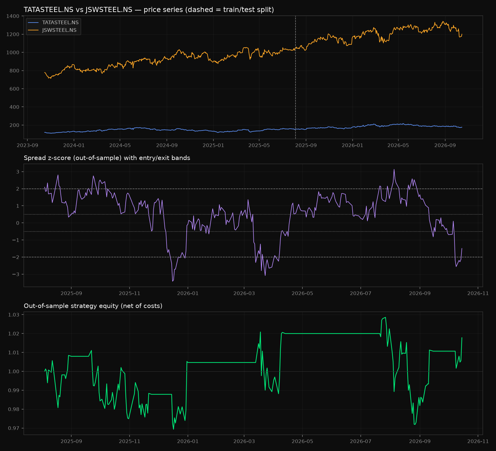

---

### SUNPHARMA.NS / CIPLA.NS

- **Latest prices:** SUNPHARMA.NS ₹1,764.00 · CIPLA.NS ₹1,328.00
- **Hedge ratio (train-fitted):** 0.4862
- **Cointegration (train):** PASS at 5% — ADF -3.46, p=0.0090
- **Persistence:** passed 5% in 76 of 76 real-data runs (strict tier: 5/76)
- **Spread half-life:** 10.5 days
- **Current z-score:** -0.57
- **Signal today:** watch (approaching band)

**Out-of-sample backtest** (beta frozen from train window):

| Metric | Value |
|---|---|
| Sharpe | 0.15 |
| Sortino | 0.16 |
| Annualised return | 0.84% |
| Annualised vol | 7.61% |
| Max drawdown | -10.26% |
| Round-trip trades | 5 |

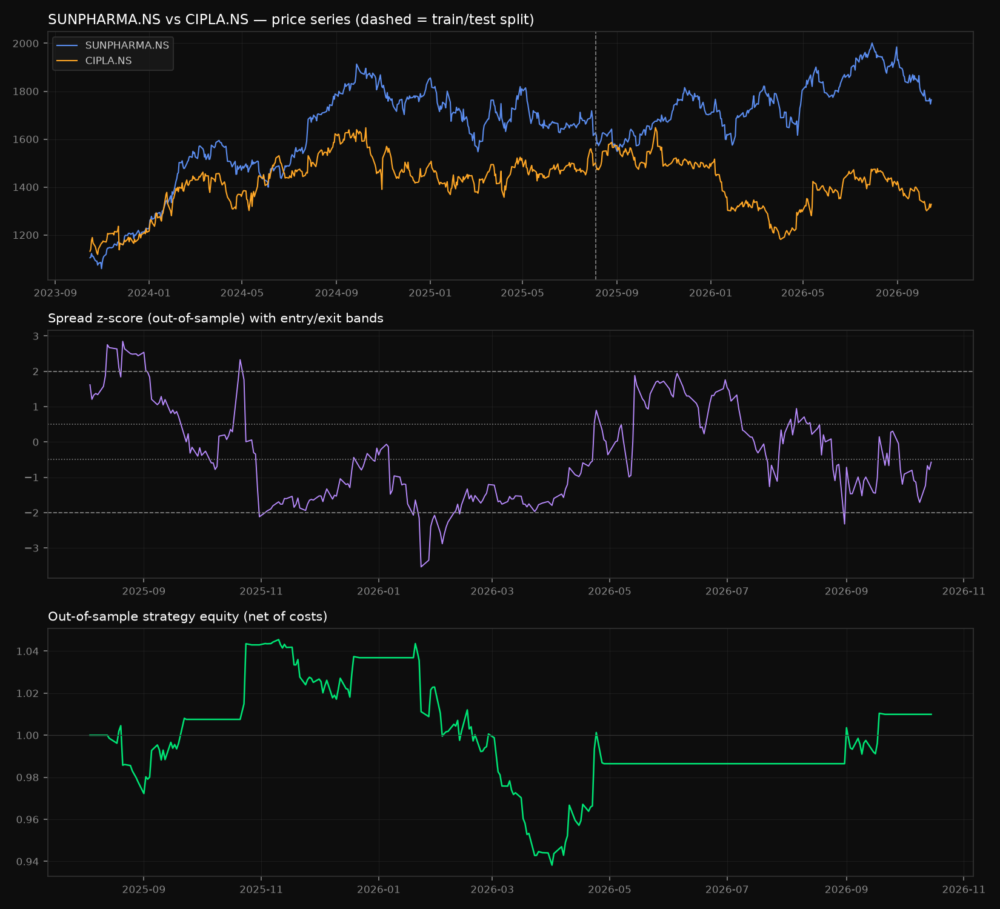

---

_Generated 2026-10-15 · pairs mean-reversion scanner · out-of-sample backtest · multiple-testing-aware · not investment advice._
