# Indian Pairs-Trading Scanner — 2026-10-16

> **What this is:** a market-neutral *pairs mean-reversion* scanner. It flags when two related NSE stocks have drifted apart far enough that their historical relationship signals a possible convergence trade. It does **not** forecast growth, rank "best" stocks, or predict company performance. A signal means the *spread between two stocks* is stretched — nothing about either stock being a good investment. Not investment advice; do your own research.

## Methodology (fixed in advance)

- **Universe:** 16 declared sector-mate pairs. Parameters (3y window, 60/40 train-test, z-entry 2.0, z-exit 0.5, 5 bps costs) are pre-registered; changes are logged in the README changelog *before* looking at results.
- **Multiple testing:** at the 5% level across 16 pairs, **≈0.8 false positives per run are expected by chance alone** even if nothing truly cointegrates. A single-day pass is a candidate, not a discovery.
- **Strict tier:** Bonferroni-corrected threshold p < 0.0031 (marked ✓✓).
- **Evidence = persistence:** the Persistence column counts how often each pair has passed the 5% test across all *real-data* daily runs recorded in `reports/history.csv`. Pairs deserve attention only when they pass persistently.

> ⚠️ **Some results use SIMULATED fallback data** (real data was unreachable this run) and are not real market results. These are marked below and are EXCLUDED from persistence counts.

## Summary

| Pair | p-value | Coint. | Persistence | Current z | Signal | OOS Sharpe |
|---|---|---|---|---|---|---|
| HDFCBANK.NS/ICICIBANK.NS *(sim)* | 0.0030 | ✓✓ | 1/63 | -1.55 | watch | 1.13 |
| AXISBANK.NS/ICICIBANK.NS | 0.9455 | ✗ | 0/77 | -0.85 | watch | -0.36 |
| KOTAKBANK.NS/HDFCBANK.NS | 0.2131 | ✗ | 0/77 | -1.50 | watch | 1.39 |
| SBIN.NS/BANKBARODA.NS | 0.1460 | ✗ | 0/77 | +0.19 | flat / no stretch | 0.43 |
| TCS.NS/INFY.NS | 0.6718 | ✗ | 0/77 | -1.04 | watch | 1.99 |
| INFY.NS/WIPRO.NS | 0.1827 | ✗ | 0/77 | +0.51 | watch | 1.95 |
| HCLTECH.NS/TECHM.NS | 0.2995 | ✗ | 0/77 | +4.47 | SHORT spread | -0.05 |
| ACC.NS/AMBUJACEM.NS | 0.7580 | ✗ | 0/77 | -1.58 | watch | -0.02 |
| ULTRACEMCO.NS/SHREECEM.NS | 0.3096 | ✗ | 0/77 | -0.76 | watch | -0.13 |
| IOC.NS/BPCL.NS | 0.7795 | ✗ | 0/77 | -1.55 | watch | 0.18 |
| BPCL.NS/HINDPETRO.NS | 0.2634 | ✗ | 0/77 | +1.50 | watch | 0.04 |
| ONGC.NS/COALINDIA.NS | 0.0207 | ✓ | 69/77 | +1.54 | watch | 0.61 |
| NTPC.NS/POWERGRID.NS | 0.1023 | ✗ | 0/77 | -0.93 | watch | 0.43 |
| BAJAJ-AUTO.NS/HEROMOTOCO.NS | 0.2033 | ✗ | 0/77 | +1.03 | watch | -0.37 |
| TATASTEEL.NS/JSWSTEEL.NS | 0.7157 | ✗ | 0/77 | -0.89 | watch | 0.40 |
| SUNPHARMA.NS/CIPLA.NS | 0.0094 | ✓ | 77/77 | -0.59 | watch | 0.15 |

_Legend: ✓✓ passes strict Bonferroni tier · ✓ passes 5% only · ✗ fails. Persistence = 5%-passes / real-data runs recorded. \*no real-data history yet._

---

### HDFCBANK.NS / ICICIBANK.NS · _SIMULATED_

- **Latest prices:** HDFCBANK.NS ₹77.27 · ICICIBANK.NS ₹113.78
- **Hedge ratio (train-fitted):** 1.5557
- **Cointegration (train):** PASS at 5% — ADF -3.79, p=0.0030 · **passes strict Bonferroni tier**
- **Persistence:** passed 5% in 1 of 63 real-data runs (strict tier: 0/63)
- **Spread half-life:** 14.0 days
- **Current z-score:** -1.55
- **Signal today:** watch (approaching band)

**Out-of-sample backtest** (beta frozen from train window):

| Metric | Value |
|---|---|
| Sharpe | 1.13 |
| Sortino | 0.86 |
| Annualised return | 1.88% |
| Annualised vol | 1.66% |
| Max drawdown | -1.19% |
| Round-trip trades | 5 |

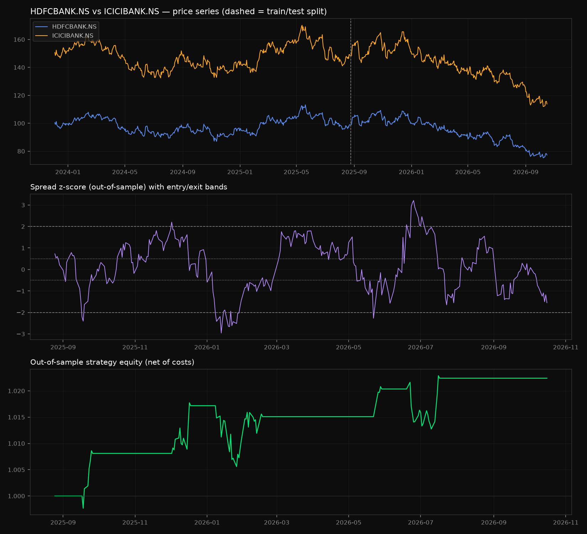

---

### AXISBANK.NS / ICICIBANK.NS

- **Latest prices:** AXISBANK.NS ₹1,290.00 · ICICIBANK.NS ₹1,397.00
- **Hedge ratio (train-fitted):** 0.8652
- **Cointegration (train):** FAIL at 5% — ADF -0.14, p=0.9455
- **Persistence:** passed 5% in 0 of 77 real-data runs (strict tier: 0/77)
- **Spread half-life:** 1100.4 days
- **Current z-score:** -0.85
- **Signal today:** watch (approaching band)
- ⚠️ _Pair did not cointegrate on training data. Any signal here is not statistically justified — observation only._

**Out-of-sample backtest** (beta frozen from train window):

| Metric | Value |
|---|---|
| Sharpe | -0.36 |
| Sortino | -0.33 |
| Annualised return | -3.30% |
| Annualised vol | 8.42% |
| Max drawdown | -7.81% |
| Round-trip trades | 5 |

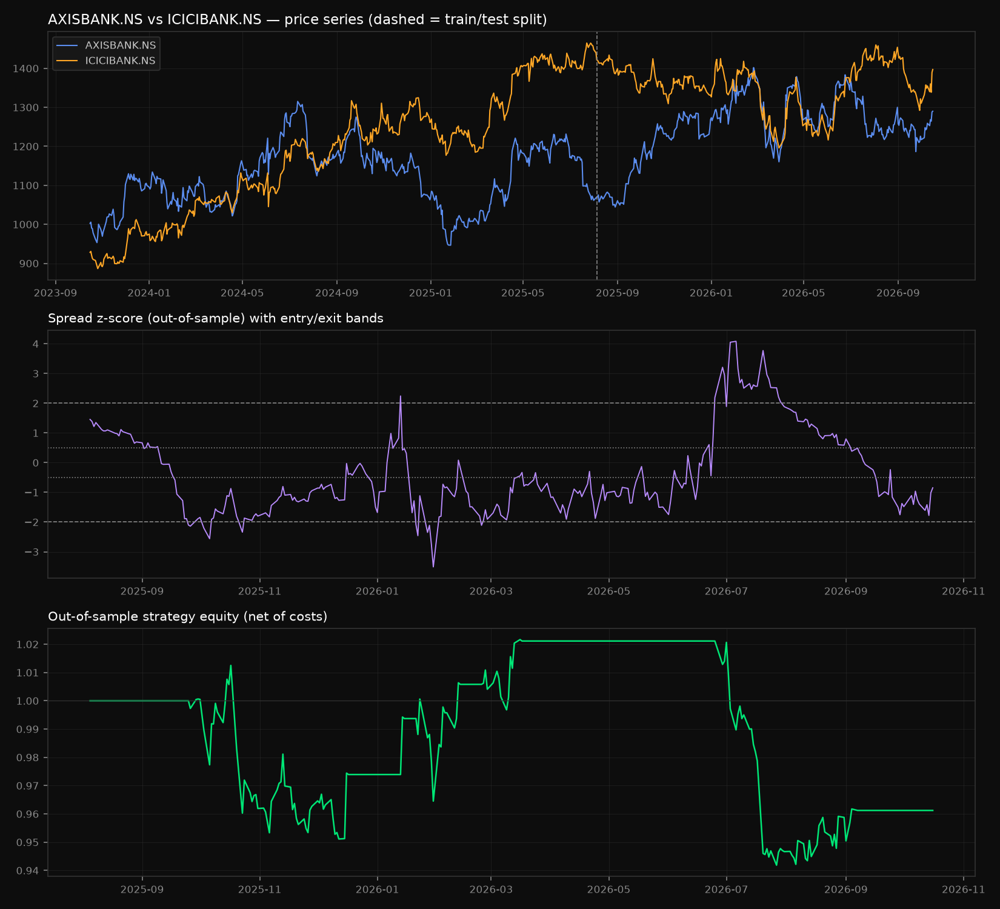

---

### KOTAKBANK.NS / HDFCBANK.NS

- **Latest prices:** KOTAKBANK.NS ₹447.40 · HDFCBANK.NS ₹728.85
- **Hedge ratio (train-fitted):** 2.1933
- **Cointegration (train):** FAIL at 5% — ADF -2.18, p=0.2131
- **Persistence:** passed 5% in 0 of 77 real-data runs (strict tier: 0/77)
- **Spread half-life:** 27.7 days
- **Current z-score:** -1.50
- **Signal today:** watch (approaching band)
- ⚠️ _Pair did not cointegrate on training data. Any signal here is not statistically justified — observation only._

**Out-of-sample backtest** (beta frozen from train window):

| Metric | Value |
|---|---|
| Sharpe | 1.39 |
| Sortino | 1.38 |
| Annualised return | 8.20% |
| Annualised vol | 5.78% |
| Max drawdown | -2.85% |
| Round-trip trades | 6 |

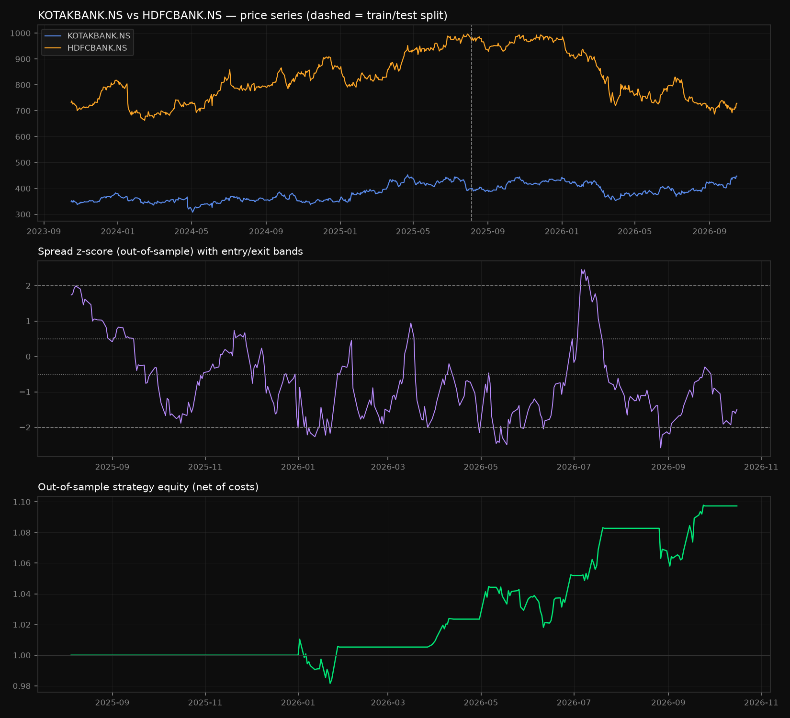

---

### SBIN.NS / BANKBARODA.NS

- **Latest prices:** SBIN.NS ₹962.60 · BANKBARODA.NS ₹230.40
- **Hedge ratio (train-fitted):** 0.1907
- **Cointegration (train):** FAIL at 5% — ADF -2.38, p=0.1460
- **Persistence:** passed 5% in 0 of 77 real-data runs (strict tier: 0/77)
- **Spread half-life:** 21.3 days
- **Current z-score:** +0.19
- **Signal today:** flat / no stretch
- ⚠️ _Pair did not cointegrate on training data. Any signal here is not statistically justified — observation only._

**Out-of-sample backtest** (beta frozen from train window):

| Metric | Value |
|---|---|
| Sharpe | 0.43 |
| Sortino | 0.39 |
| Annualised return | 3.76% |
| Annualised vol | 9.68% |
| Max drawdown | -8.82% |
| Round-trip trades | 7 |

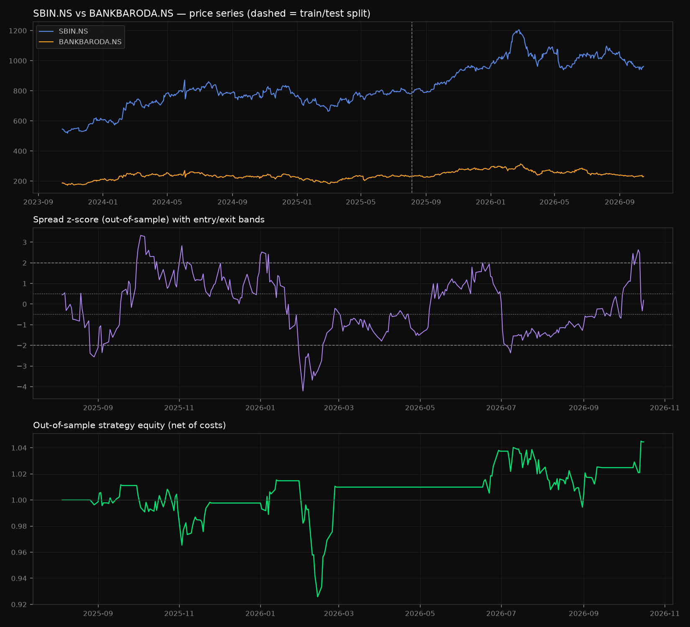

---

### TCS.NS / INFY.NS

- **Latest prices:** TCS.NS ₹2,465.00 · INFY.NS ₹1,161.20
- **Hedge ratio (train-fitted):** 0.4308
- **Cointegration (train):** FAIL at 5% — ADF -1.20, p=0.6718
- **Persistence:** passed 5% in 0 of 77 real-data runs (strict tier: 0/77)
- **Spread half-life:** 70.4 days
- **Current z-score:** -1.04
- **Signal today:** watch (approaching band)
- ⚠️ _Pair did not cointegrate on training data. Any signal here is not statistically justified — observation only._

**Out-of-sample backtest** (beta frozen from train window):

| Metric | Value |
|---|---|
| Sharpe | 1.99 |
| Sortino | 2.08 |
| Annualised return | 8.74% |
| Annualised vol | 4.25% |
| Max drawdown | -1.74% |
| Round-trip trades | 6 |

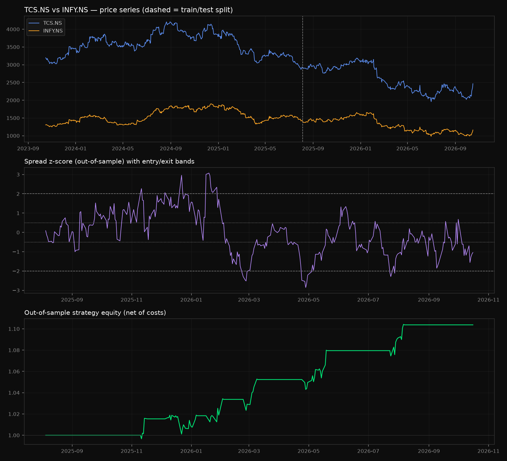

---

### INFY.NS / WIPRO.NS

- **Latest prices:** INFY.NS ₹1,161.20 · WIPRO.NS ₹184.40
- **Hedge ratio (train-fitted):** 0.1281
- **Cointegration (train):** FAIL at 5% — ADF -2.27, p=0.1827
- **Persistence:** passed 5% in 0 of 77 real-data runs (strict tier: 0/77)
- **Spread half-life:** 30.3 days
- **Current z-score:** +0.51
- **Signal today:** watch (approaching band)
- ⚠️ _Pair did not cointegrate on training data. Any signal here is not statistically justified — observation only._

**Out-of-sample backtest** (beta frozen from train window):

| Metric | Value |
|---|---|
| Sharpe | 1.95 |
| Sortino | 1.87 |
| Annualised return | 10.29% |
| Annualised vol | 5.08% |
| Max drawdown | -1.54% |
| Round-trip trades | 6 |

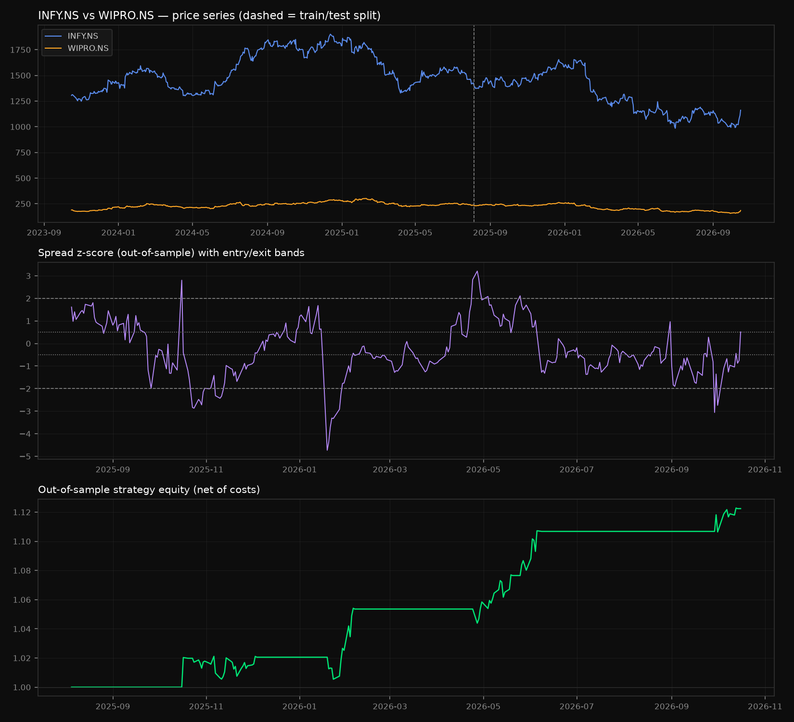

---

### HCLTECH.NS / TECHM.NS

- **Latest prices:** HCLTECH.NS ₹1,380.00 · TECHM.NS ₹1,790.00
- **Hedge ratio (train-fitted):** 0.9561
- **Cointegration (train):** FAIL at 5% — ADF -1.97, p=0.2995
- **Persistence:** passed 5% in 0 of 77 real-data runs (strict tier: 0/77)
- **Spread half-life:** 23.9 days
- **Current z-score:** +4.47
- **Signal today:** SHORT spread (short TECHM.NS, long HCLTECH.NS)
- ⚠️ _Pair did not cointegrate on training data. Any signal here is not statistically justified — observation only._

**Out-of-sample backtest** (beta frozen from train window):

| Metric | Value |
|---|---|
| Sharpe | -0.05 |
| Sortino | -0.04 |
| Annualised return | -0.62% |
| Annualised vol | 7.42% |
| Max drawdown | -8.31% |
| Round-trip trades | 5 |

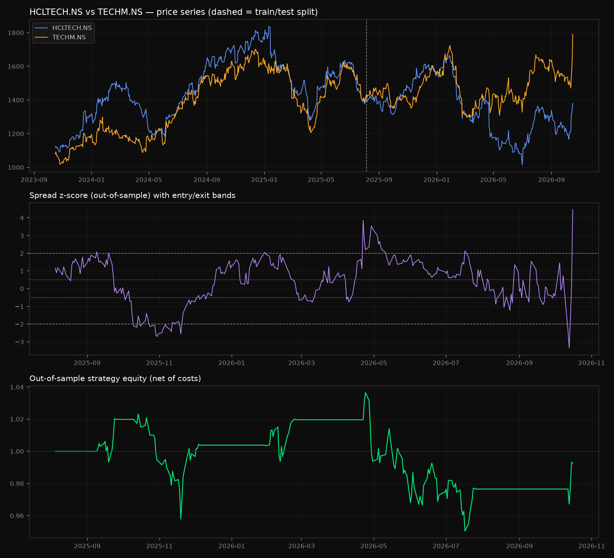

---

### ACC.NS / AMBUJACEM.NS

- **Latest prices:** ACC.NS ₹1,187.20 · AMBUJACEM.NS ₹360.00
- **Hedge ratio (train-fitted):** 0.1700
- **Cointegration (train):** FAIL at 5% — ADF -0.99, p=0.7580
- **Persistence:** passed 5% in 0 of 77 real-data runs (strict tier: 0/77)
- **Spread half-life:** 72.9 days
- **Current z-score:** -1.58
- **Signal today:** watch (approaching band)
- ⚠️ _Pair did not cointegrate on training data. Any signal here is not statistically justified — observation only._

**Out-of-sample backtest** (beta frozen from train window):

| Metric | Value |
|---|---|
| Sharpe | -0.02 |
| Sortino | -0.01 |
| Annualised return | -0.25% |
| Annualised vol | 5.73% |
| Max drawdown | -5.58% |
| Round-trip trades | 3 |

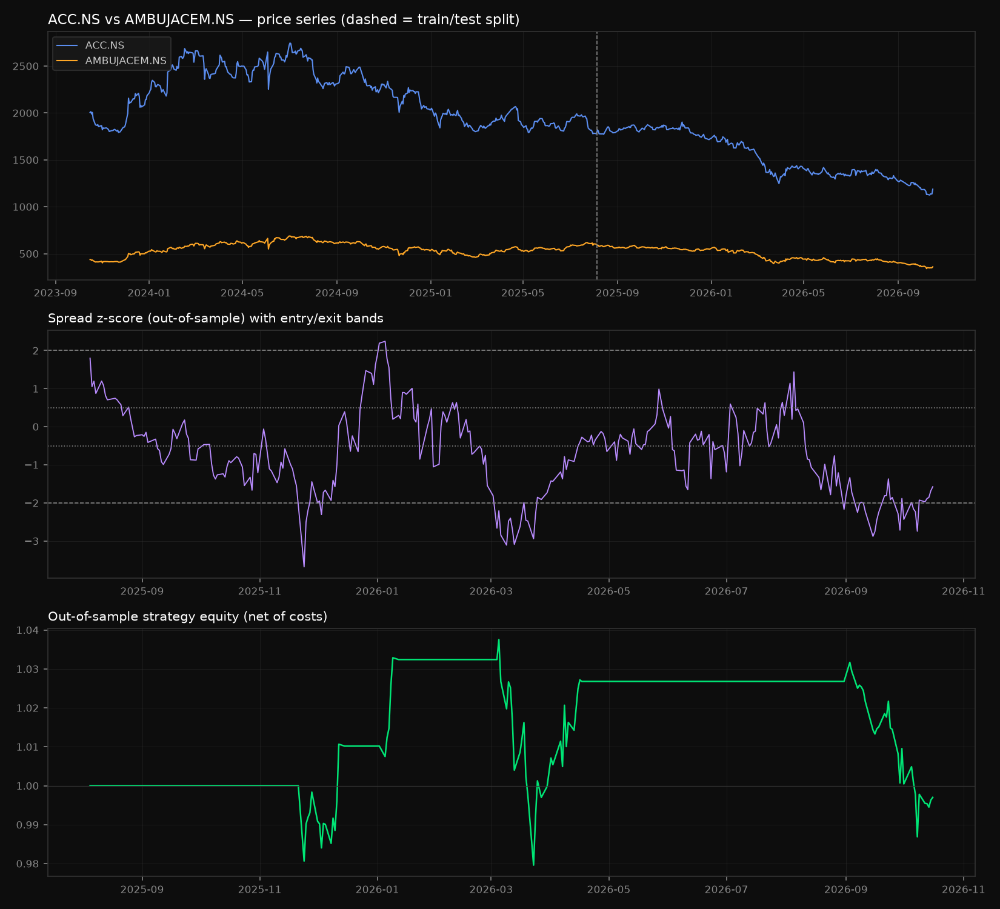

---

### ULTRACEMCO.NS / SHREECEM.NS

- **Latest prices:** ULTRACEMCO.NS ₹10,907.00 · SHREECEM.NS ₹22,460.00
- **Hedge ratio (train-fitted):** 0.9746
- **Cointegration (train):** FAIL at 5% — ADF -1.95, p=0.3096
- **Persistence:** passed 5% in 0 of 77 real-data runs (strict tier: 0/77)
- **Spread half-life:** 39.8 days
- **Current z-score:** -0.76
- **Signal today:** watch (approaching band)
- ⚠️ _Pair did not cointegrate on training data. Any signal here is not statistically justified — observation only._

**Out-of-sample backtest** (beta frozen from train window):

| Metric | Value |
|---|---|
| Sharpe | -0.13 |
| Sortino | -0.17 |
| Annualised return | -1.14% |
| Annualised vol | 6.98% |
| Max drawdown | -6.92% |
| Round-trip trades | 4 |

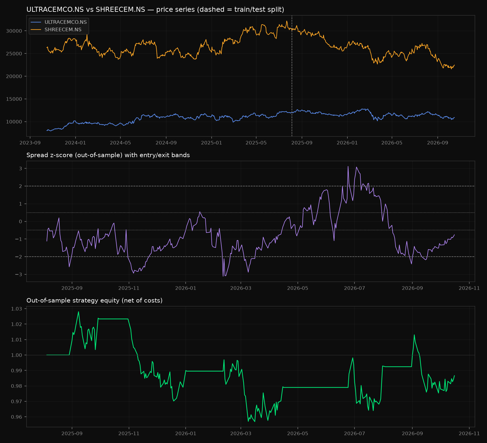

---

### IOC.NS / BPCL.NS

- **Latest prices:** IOC.NS ₹130.38 · BPCL.NS ₹293.50
- **Hedge ratio (train-fitted):** 1.6712
- **Cointegration (train):** FAIL at 5% — ADF -0.93, p=0.7795
- **Persistence:** passed 5% in 0 of 77 real-data runs (strict tier: 0/77)
- **Spread half-life:** 133.3 days
- **Current z-score:** -1.55
- **Signal today:** watch (approaching band)
- ⚠️ _Pair did not cointegrate on training data. Any signal here is not statistically justified — observation only._

**Out-of-sample backtest** (beta frozen from train window):

| Metric | Value |
|---|---|
| Sharpe | 0.18 |
| Sortino | 0.17 |
| Annualised return | 0.98% |
| Annualised vol | 6.40% |
| Max drawdown | -7.32% |
| Round-trip trades | 5 |

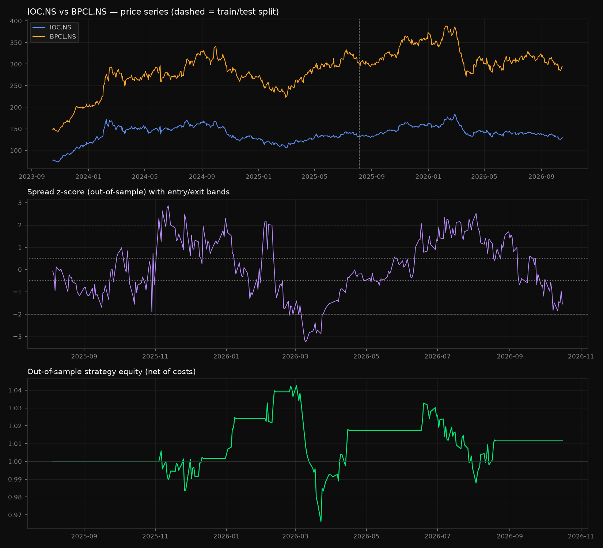

---

### BPCL.NS / HINDPETRO.NS

- **Latest prices:** BPCL.NS ₹293.50 · HINDPETRO.NS ₹346.00
- **Hedge ratio (train-fitted):** 1.3309
- **Cointegration (train):** FAIL at 5% — ADF -2.05, p=0.2634
- **Persistence:** passed 5% in 0 of 77 real-data runs (strict tier: 0/77)
- **Spread half-life:** 36.9 days
- **Current z-score:** +1.50
- **Signal today:** watch (approaching band)
- ⚠️ _Pair did not cointegrate on training data. Any signal here is not statistically justified — observation only._

**Out-of-sample backtest** (beta frozen from train window):

| Metric | Value |
|---|---|
| Sharpe | 0.04 |
| Sortino | 0.03 |
| Annualised return | 0.04% |
| Annualised vol | 6.12% |
| Max drawdown | -6.94% |
| Round-trip trades | 5 |

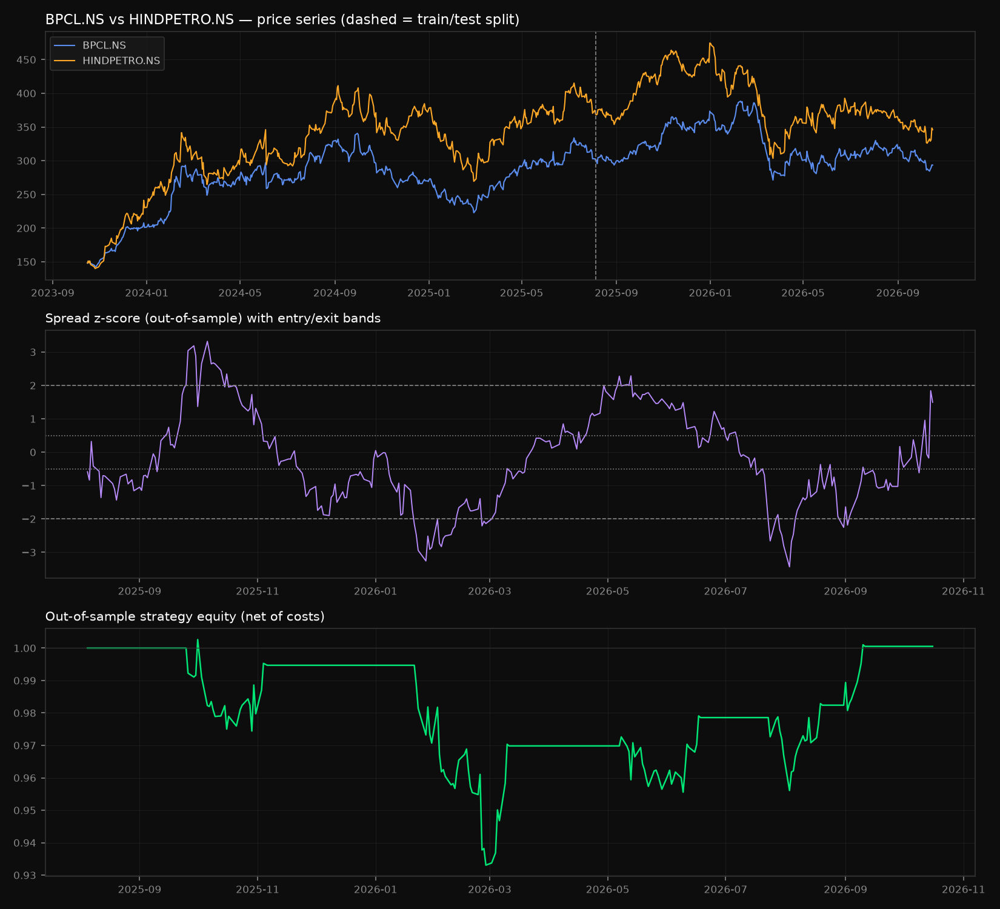

---

### ONGC.NS / COALINDIA.NS

- **Latest prices:** ONGC.NS ₹222.00 · COALINDIA.NS ₹417.20
- **Hedge ratio (train-fitted):** 1.3892
- **Cointegration (train):** PASS at 5% — ADF -3.19, p=0.0207
- **Persistence:** passed 5% in 69 of 77 real-data runs (strict tier: 1/77)
- **Spread half-life:** 12.7 days
- **Current z-score:** +1.54
- **Signal today:** watch (approaching band)

**Out-of-sample backtest** (beta frozen from train window):

| Metric | Value |
|---|---|
| Sharpe | 0.61 |
| Sortino | 0.52 |
| Annualised return | 4.76% |
| Annualised vol | 8.10% |
| Max drawdown | -6.44% |
| Round-trip trades | 5 |

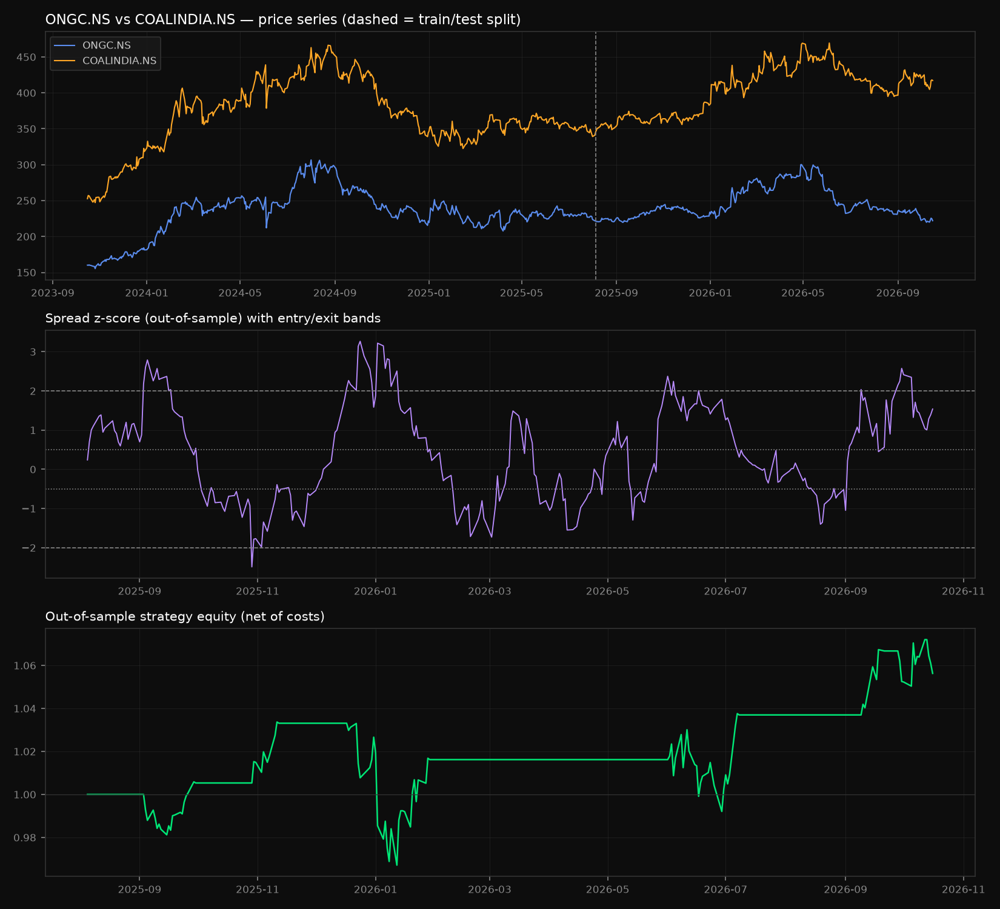

---

### NTPC.NS / POWERGRID.NS

- **Latest prices:** NTPC.NS ₹315.15 · POWERGRID.NS ₹250.45
- **Hedge ratio (train-fitted):** 0.8122
- **Cointegration (train):** FAIL at 5% — ADF -2.56, p=0.1023
- **Persistence:** passed 5% in 0 of 77 real-data runs (strict tier: 0/77)
- **Spread half-life:** 23.8 days
- **Current z-score:** -0.93
- **Signal today:** watch (approaching band)
- ⚠️ _Pair did not cointegrate on training data. Any signal here is not statistically justified — observation only._

**Out-of-sample backtest** (beta frozen from train window):

| Metric | Value |
|---|---|
| Sharpe | 0.43 |
| Sortino | 0.34 |
| Annualised return | 2.32% |
| Annualised vol | 5.65% |
| Max drawdown | -5.33% |
| Round-trip trades | 6 |

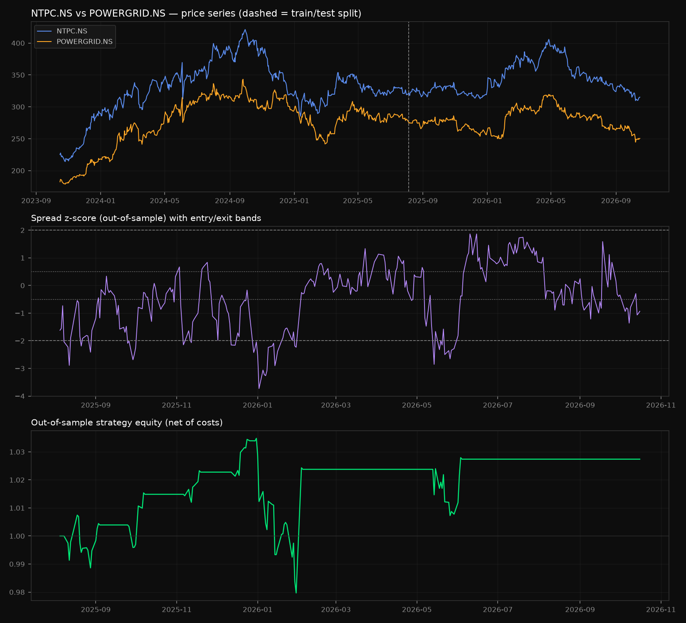

---

### BAJAJ-AUTO.NS / HEROMOTOCO.NS

- **Latest prices:** BAJAJ-AUTO.NS ₹10,405.00 · HEROMOTOCO.NS ₹5,225.00
- **Hedge ratio (train-fitted):** 0.4085
- **Cointegration (train):** FAIL at 5% — ADF -2.21, p=0.2033
- **Persistence:** passed 5% in 0 of 77 real-data runs (strict tier: 0/77)
- **Spread half-life:** 30.5 days
- **Current z-score:** +1.03
- **Signal today:** watch (approaching band)
- ⚠️ _Pair did not cointegrate on training data. Any signal here is not statistically justified — observation only._

**Out-of-sample backtest** (beta frozen from train window):

| Metric | Value |
|---|---|
| Sharpe | -0.37 |
| Sortino | -0.38 |
| Annualised return | -4.18% |
| Annualised vol | 10.21% |
| Max drawdown | -17.56% |
| Round-trip trades | 6 |

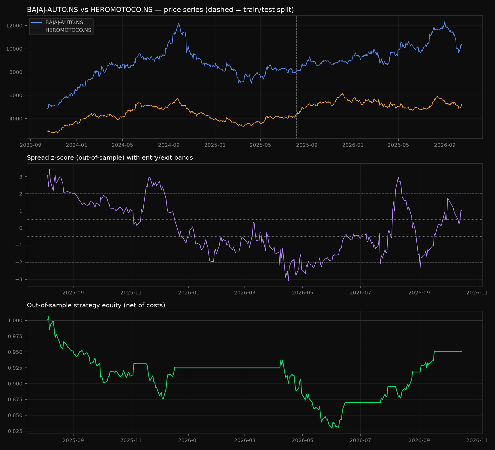

---

### TATASTEEL.NS / JSWSTEEL.NS

- **Latest prices:** TATASTEEL.NS ₹175.50 · JSWSTEEL.NS ₹1,216.30
- **Hedge ratio (train-fitted):** 3.0463
- **Cointegration (train):** FAIL at 5% — ADF -1.10, p=0.7157
- **Persistence:** passed 5% in 0 of 77 real-data runs (strict tier: 0/77)
- **Spread half-life:** 75.2 days
- **Current z-score:** -0.89
- **Signal today:** watch (approaching band)
- ⚠️ _Pair did not cointegrate on training data. Any signal here is not statistically justified — observation only._

**Out-of-sample backtest** (beta frozen from train window):

| Metric | Value |
|---|---|
| Sharpe | 0.40 |
| Sortino | 0.38 |
| Annualised return | 3.01% |
| Annualised vol | 8.38% |
| Max drawdown | -5.51% |
| Round-trip trades | 5 |

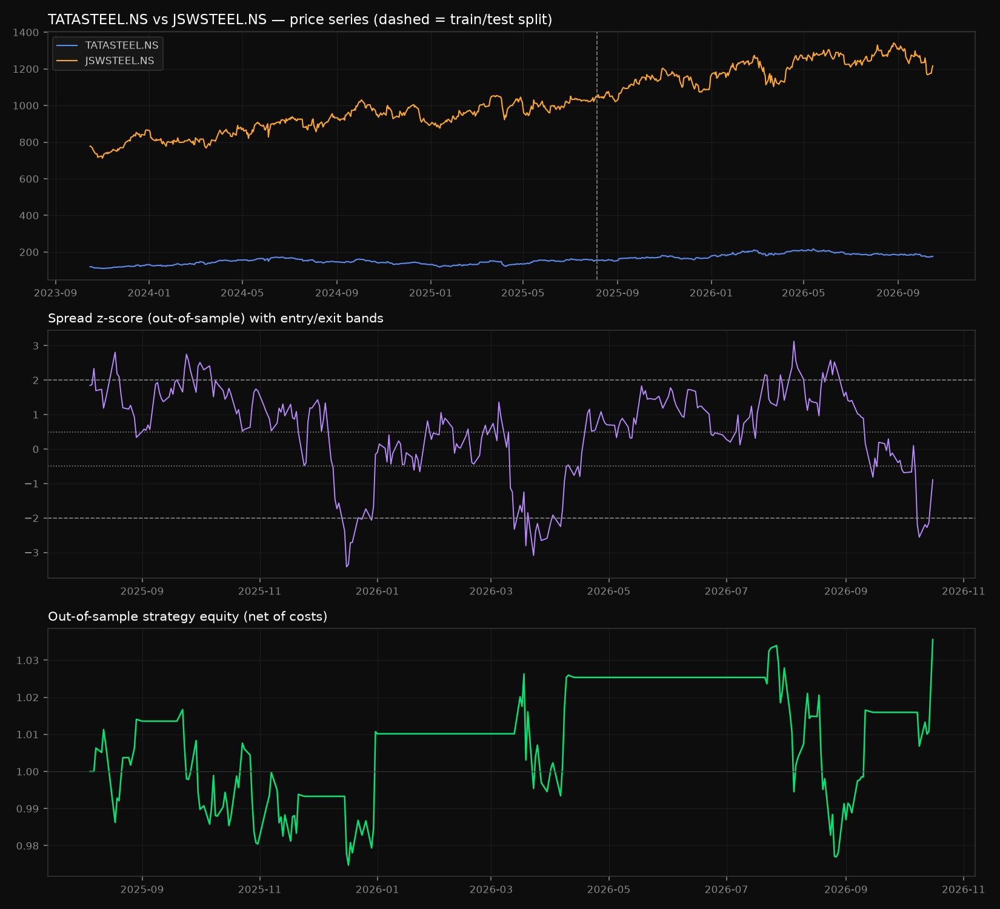

---

### SUNPHARMA.NS / CIPLA.NS

- **Latest prices:** SUNPHARMA.NS ₹1,758.80 · CIPLA.NS ₹1,325.10
- **Hedge ratio (train-fitted):** 0.4863
- **Cointegration (train):** PASS at 5% — ADF -3.45, p=0.0094
- **Persistence:** passed 5% in 77 of 77 real-data runs (strict tier: 5/77)
- **Spread half-life:** 10.5 days
- **Current z-score:** -0.59
- **Signal today:** watch (approaching band)

**Out-of-sample backtest** (beta frozen from train window):

| Metric | Value |
|---|---|
| Sharpe | 0.15 |
| Sortino | 0.16 |
| Annualised return | 0.85% |
| Annualised vol | 7.68% |
| Max drawdown | -10.34% |
| Round-trip trades | 5 |

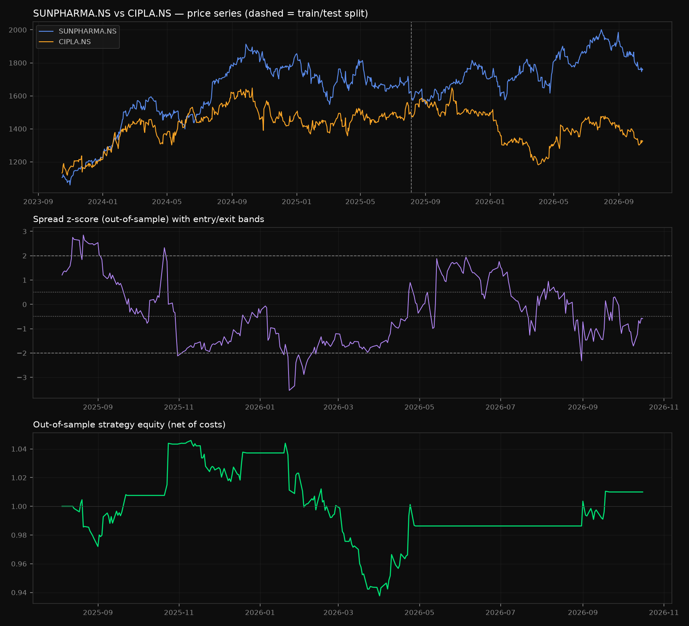

---

_Generated 2026-10-16 · pairs mean-reversion scanner · out-of-sample backtest · multiple-testing-aware · not investment advice._
