# Indian Pairs-Trading Scanner — 2026-10-19

> **What this is:** a market-neutral *pairs mean-reversion* scanner. It flags when two related NSE stocks have drifted apart far enough that their historical relationship signals a possible convergence trade. It does **not** forecast growth, rank "best" stocks, or predict company performance. A signal means the *spread between two stocks* is stretched — nothing about either stock being a good investment. Not investment advice; do your own research.

## Methodology (fixed in advance)

- **Universe:** 16 declared sector-mate pairs. Parameters (3y window, 60/40 train-test, z-entry 2.0, z-exit 0.5, 5 bps costs) are pre-registered; changes are logged in the README changelog *before* looking at results.
- **Multiple testing:** at the 5% level across 16 pairs, **≈0.8 false positives per run are expected by chance alone** even if nothing truly cointegrates. A single-day pass is a candidate, not a discovery.
- **Strict tier:** Bonferroni-corrected threshold p < 0.0031 (marked ✓✓).
- **Evidence = persistence:** the Persistence column counts how often each pair has passed the 5% test across all *real-data* daily runs recorded in `reports/history.csv`. Pairs deserve attention only when they pass persistently.

## Summary

| Pair | p-value | Coint. | Persistence | Current z | Signal | OOS Sharpe |
|---|---|---|---|---|---|---|
| HDFCBANK.NS/ICICIBANK.NS | 0.0686 | ✗ | 1/64 | -0.11 | flat / no stretch | -0.35 |
| AXISBANK.NS/ICICIBANK.NS | 0.9217 | ✗ | 0/78 | -0.82 | watch | -0.34 |
| KOTAKBANK.NS/HDFCBANK.NS | 0.1873 | ✗ | 0/78 | -1.50 | watch | 1.39 |
| SBIN.NS/BANKBARODA.NS | 0.1471 | ✗ | 0/78 | +0.18 | flat / no stretch | 0.43 |
| TCS.NS/INFY.NS | 0.6173 | ✗ | 0/78 | -1.00 | watch | 1.94 |
| INFY.NS/WIPRO.NS | 0.1530 | ✗ | 0/78 | +0.53 | watch | 2.13 |
| HCLTECH.NS/TECHM.NS | 0.3103 | ✗ | 0/78 | +4.46 | SHORT spread | -0.05 |
| ACC.NS/AMBUJACEM.NS | 0.6894 | ✗ | 0/78 | -1.57 | watch | -0.02 |
| ULTRACEMCO.NS/SHREECEM.NS | 0.3071 | ✗ | 0/78 | -0.76 | watch | -0.28 |
| IOC.NS/BPCL.NS | 0.7791 | ✗ | 0/78 | -1.55 | watch | 0.23 |
| BPCL.NS/HINDPETRO.NS | 0.2582 | ✗ | 0/78 | +1.48 | watch | -0.11 |
| ONGC.NS/COALINDIA.NS | 0.0074 | ✓ | 70/78 | +1.54 | watch | 0.62 |
| NTPC.NS/POWERGRID.NS | 0.1061 | ✗ | 0/78 | -0.94 | watch | 0.44 |
| BAJAJ-AUTO.NS/HEROMOTOCO.NS | 0.2059 | ✗ | 0/78 | +1.03 | watch | -0.42 |
| TATASTEEL.NS/JSWSTEEL.NS | 0.6907 | ✗ | 0/78 | -0.90 | watch | 0.40 |
| SUNPHARMA.NS/CIPLA.NS | 0.0114 | ✓ | 78/78 | -0.60 | watch | 0.15 |

_Legend: ✓✓ passes strict Bonferroni tier · ✓ passes 5% only · ✗ fails. Persistence = 5%-passes / real-data runs recorded. \*no real-data history yet._

---

### HDFCBANK.NS / ICICIBANK.NS

- **Latest prices:** HDFCBANK.NS ₹728.85 · ICICIBANK.NS ₹1,397.00
- **Hedge ratio (train-fitted):** 1.6005
- **Cointegration (train):** FAIL at 5% — ADF -2.73, p=0.0686
- **Persistence:** passed 5% in 1 of 64 real-data runs (strict tier: 0/64)
- **Spread half-life:** 23.9 days
- **Current z-score:** -0.11
- **Signal today:** flat / no stretch
- ⚠️ _Pair did not cointegrate on training data. Any signal here is not statistically justified — observation only._

**Out-of-sample backtest** (beta frozen from train window):

| Metric | Value |
|---|---|
| Sharpe | -0.35 |
| Sortino | -0.38 |
| Annualised return | -2.52% |
| Annualised vol | 6.64% |
| Max drawdown | -8.05% |
| Round-trip trades | 4 |

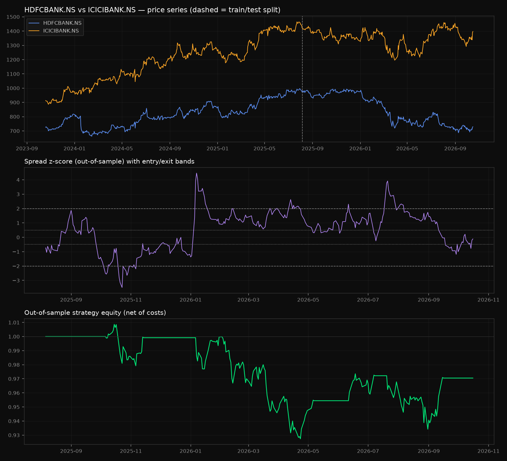

---

### AXISBANK.NS / ICICIBANK.NS

- **Latest prices:** AXISBANK.NS ₹1,290.00 · ICICIBANK.NS ₹1,397.00
- **Hedge ratio (train-fitted):** 0.8399
- **Cointegration (train):** FAIL at 5% — ADF -0.33, p=0.9217
- **Persistence:** passed 5% in 0 of 78 real-data runs (strict tier: 0/78)
- **Spread half-life:** 470.3 days
- **Current z-score:** -0.82
- **Signal today:** watch (approaching band)
- ⚠️ _Pair did not cointegrate on training data. Any signal here is not statistically justified — observation only._

**Out-of-sample backtest** (beta frozen from train window):

| Metric | Value |
|---|---|
| Sharpe | -0.34 |
| Sortino | -0.32 |
| Annualised return | -3.18% |
| Annualised vol | 8.39% |
| Max drawdown | -7.75% |
| Round-trip trades | 5 |

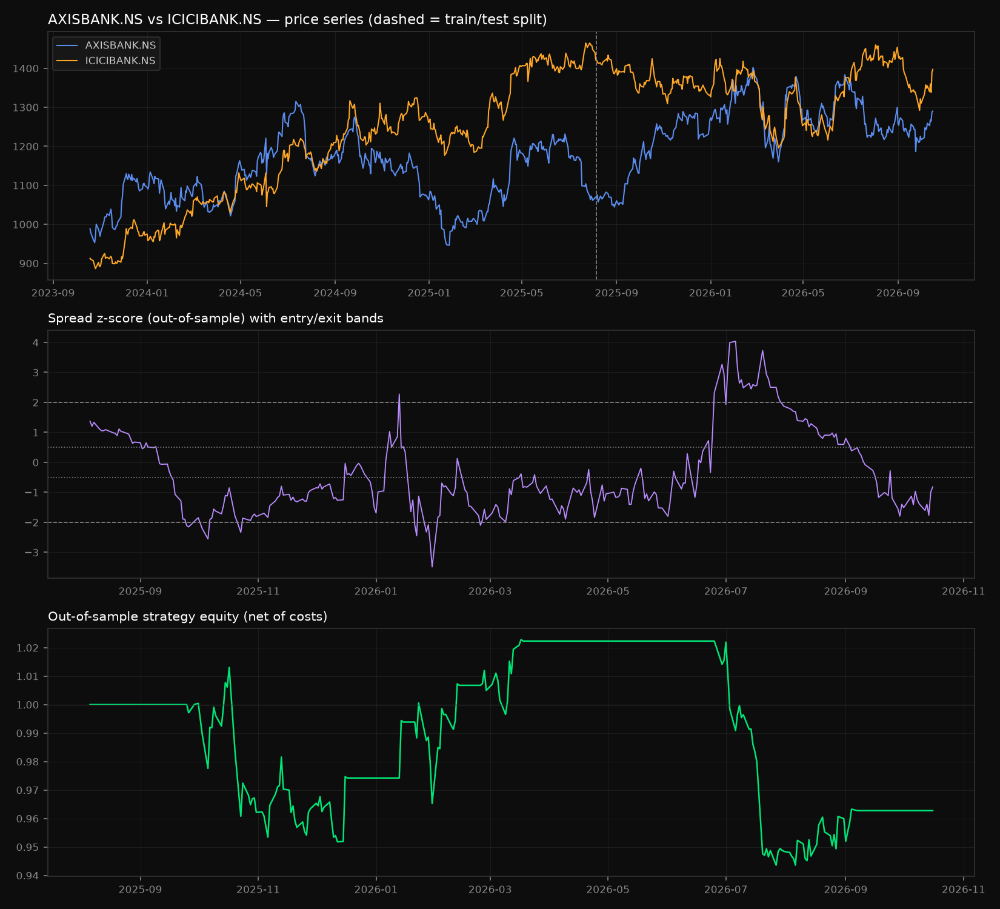

---

### KOTAKBANK.NS / HDFCBANK.NS

- **Latest prices:** KOTAKBANK.NS ₹447.40 · HDFCBANK.NS ₹728.85
- **Hedge ratio (train-fitted):** 2.1944
- **Cointegration (train):** FAIL at 5% — ADF -2.25, p=0.1873
- **Persistence:** passed 5% in 0 of 78 real-data runs (strict tier: 0/78)
- **Spread half-life:** 26.9 days
- **Current z-score:** -1.50
- **Signal today:** watch (approaching band)
- ⚠️ _Pair did not cointegrate on training data. Any signal here is not statistically justified — observation only._

**Out-of-sample backtest** (beta frozen from train window):

| Metric | Value |
|---|---|
| Sharpe | 1.39 |
| Sortino | 1.39 |
| Annualised return | 8.21% |
| Annualised vol | 5.78% |
| Max drawdown | -2.84% |
| Round-trip trades | 6 |

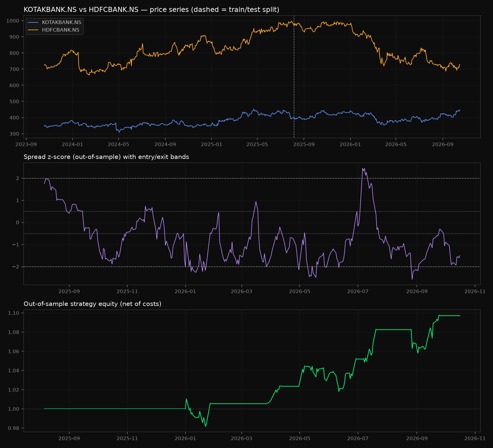

---

### SBIN.NS / BANKBARODA.NS

- **Latest prices:** SBIN.NS ₹962.60 · BANKBARODA.NS ₹230.40
- **Hedge ratio (train-fitted):** 0.1905
- **Cointegration (train):** FAIL at 5% — ADF -2.38, p=0.1471
- **Persistence:** passed 5% in 0 of 78 real-data runs (strict tier: 0/78)
- **Spread half-life:** 21.3 days
- **Current z-score:** +0.18
- **Signal today:** flat / no stretch
- ⚠️ _Pair did not cointegrate on training data. Any signal here is not statistically justified — observation only._

**Out-of-sample backtest** (beta frozen from train window):

| Metric | Value |
|---|---|
| Sharpe | 0.43 |
| Sortino | 0.39 |
| Annualised return | 3.76% |
| Annualised vol | 9.65% |
| Max drawdown | -8.77% |
| Round-trip trades | 7 |

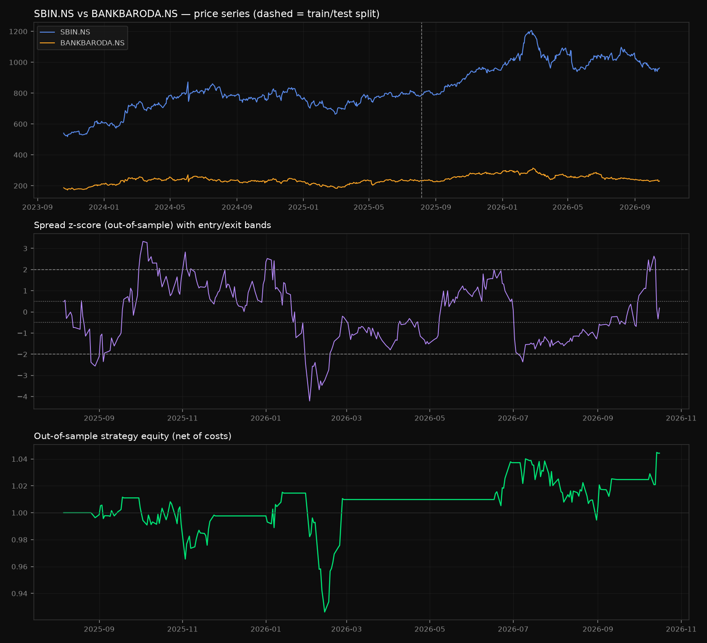

---

### TCS.NS / INFY.NS

- **Latest prices:** TCS.NS ₹2,465.00 · INFY.NS ₹1,161.20
- **Hedge ratio (train-fitted):** 0.4269
- **Cointegration (train):** FAIL at 5% — ADF -1.33, p=0.6173
- **Persistence:** passed 5% in 0 of 78 real-data runs (strict tier: 0/78)
- **Spread half-life:** 69.7 days
- **Current z-score:** -1.00
- **Signal today:** watch (approaching band)
- ⚠️ _Pair did not cointegrate on training data. Any signal here is not statistically justified — observation only._

**Out-of-sample backtest** (beta frozen from train window):

| Metric | Value |
|---|---|
| Sharpe | 1.94 |
| Sortino | 2.03 |
| Annualised return | 8.63% |
| Annualised vol | 4.32% |
| Max drawdown | -1.79% |
| Round-trip trades | 6 |

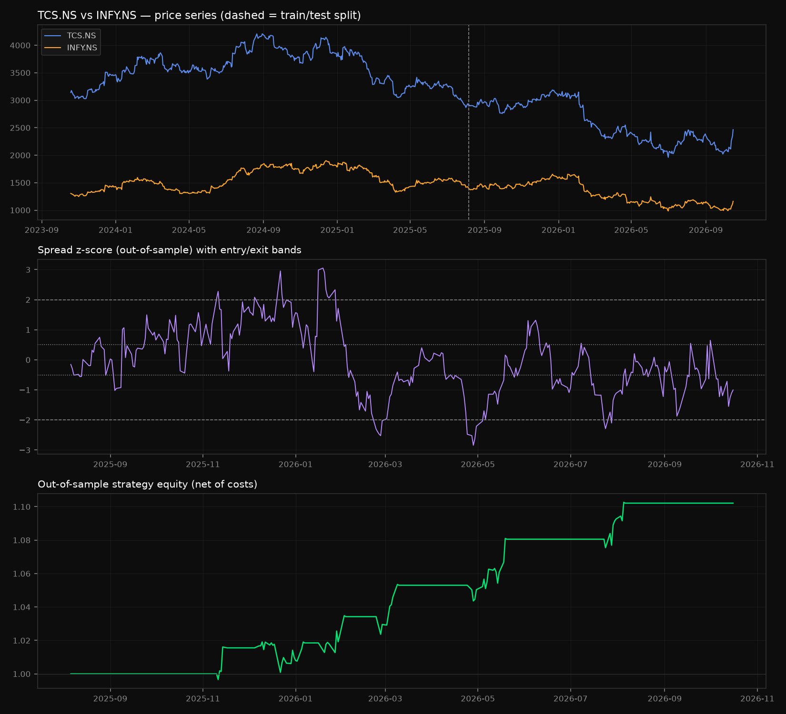

---

### INFY.NS / WIPRO.NS

- **Latest prices:** INFY.NS ₹1,161.20 · WIPRO.NS ₹184.40
- **Hedge ratio (train-fitted):** 0.1270
- **Cointegration (train):** FAIL at 5% — ADF -2.36, p=0.1530
- **Persistence:** passed 5% in 0 of 78 real-data runs (strict tier: 0/78)
- **Spread half-life:** 29.1 days
- **Current z-score:** +0.53
- **Signal today:** watch (approaching band)
- ⚠️ _Pair did not cointegrate on training data. Any signal here is not statistically justified — observation only._

**Out-of-sample backtest** (beta frozen from train window):

| Metric | Value |
|---|---|
| Sharpe | 2.13 |
| Sortino | 2.08 |
| Annualised return | 11.76% |
| Annualised vol | 5.29% |
| Max drawdown | -1.57% |
| Round-trip trades | 7 |

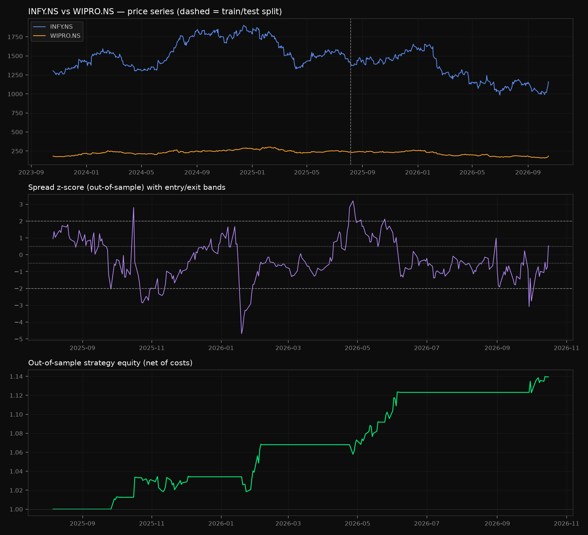

---

### HCLTECH.NS / TECHM.NS

- **Latest prices:** HCLTECH.NS ₹1,380.00 · TECHM.NS ₹1,790.00
- **Hedge ratio (train-fitted):** 0.9587
- **Cointegration (train):** FAIL at 5% — ADF -1.95, p=0.3103
- **Persistence:** passed 5% in 0 of 78 real-data runs (strict tier: 0/78)
- **Spread half-life:** 24.1 days
- **Current z-score:** +4.46
- **Signal today:** SHORT spread (short TECHM.NS, long HCLTECH.NS)
- ⚠️ _Pair did not cointegrate on training data. Any signal here is not statistically justified — observation only._

**Out-of-sample backtest** (beta frozen from train window):

| Metric | Value |
|---|---|
| Sharpe | -0.05 |
| Sortino | -0.05 |
| Annualised return | -0.68% |
| Annualised vol | 7.55% |
| Max drawdown | -8.43% |
| Round-trip trades | 5 |

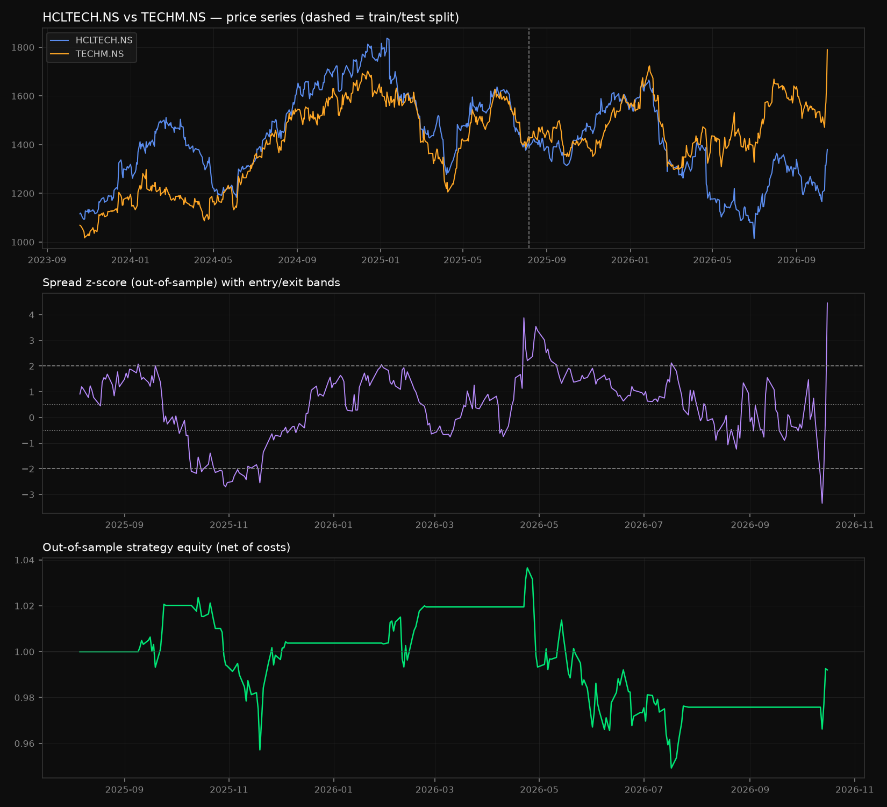

---

### ACC.NS / AMBUJACEM.NS

- **Latest prices:** ACC.NS ₹1,187.20 · AMBUJACEM.NS ₹360.00
- **Hedge ratio (train-fitted):** 0.1672
- **Cointegration (train):** FAIL at 5% — ADF -1.16, p=0.6894
- **Persistence:** passed 5% in 0 of 78 real-data runs (strict tier: 0/78)
- **Spread half-life:** 60.0 days
- **Current z-score:** -1.57
- **Signal today:** watch (approaching band)
- ⚠️ _Pair did not cointegrate on training data. Any signal here is not statistically justified — observation only._

**Out-of-sample backtest** (beta frozen from train window):

| Metric | Value |
|---|---|
| Sharpe | -0.02 |
| Sortino | -0.02 |
| Annualised return | -0.31% |
| Annualised vol | 5.85% |
| Max drawdown | -5.72% |
| Round-trip trades | 3 |

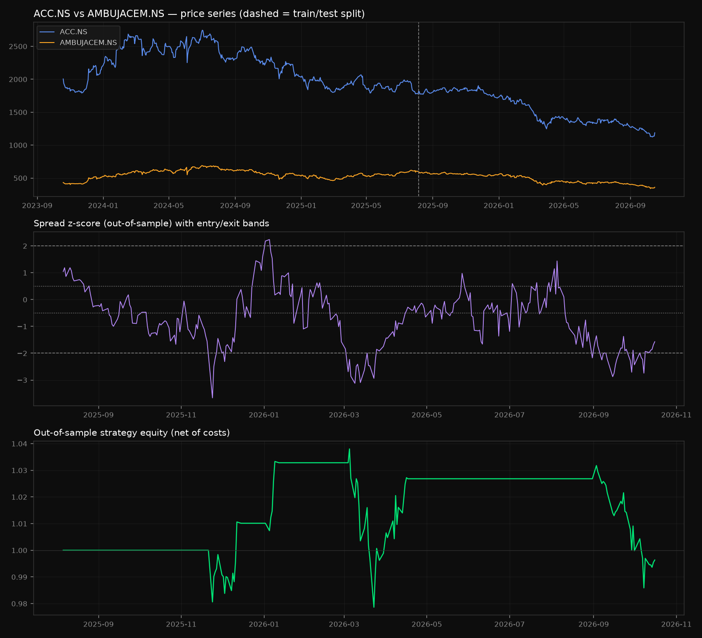

---

### ULTRACEMCO.NS / SHREECEM.NS

- **Latest prices:** ULTRACEMCO.NS ₹10,907.00 · SHREECEM.NS ₹22,460.00
- **Hedge ratio (train-fitted):** 1.0104
- **Cointegration (train):** FAIL at 5% — ADF -1.95, p=0.3071
- **Persistence:** passed 5% in 0 of 78 real-data runs (strict tier: 0/78)
- **Spread half-life:** 39.7 days
- **Current z-score:** -0.76
- **Signal today:** watch (approaching band)
- ⚠️ _Pair did not cointegrate on training data. Any signal here is not statistically justified — observation only._

**Out-of-sample backtest** (beta frozen from train window):

| Metric | Value |
|---|---|
| Sharpe | -0.28 |
| Sortino | -0.34 |
| Annualised return | -2.22% |
| Annualised vol | 7.12% |
| Max drawdown | -7.39% |
| Round-trip trades | 4 |

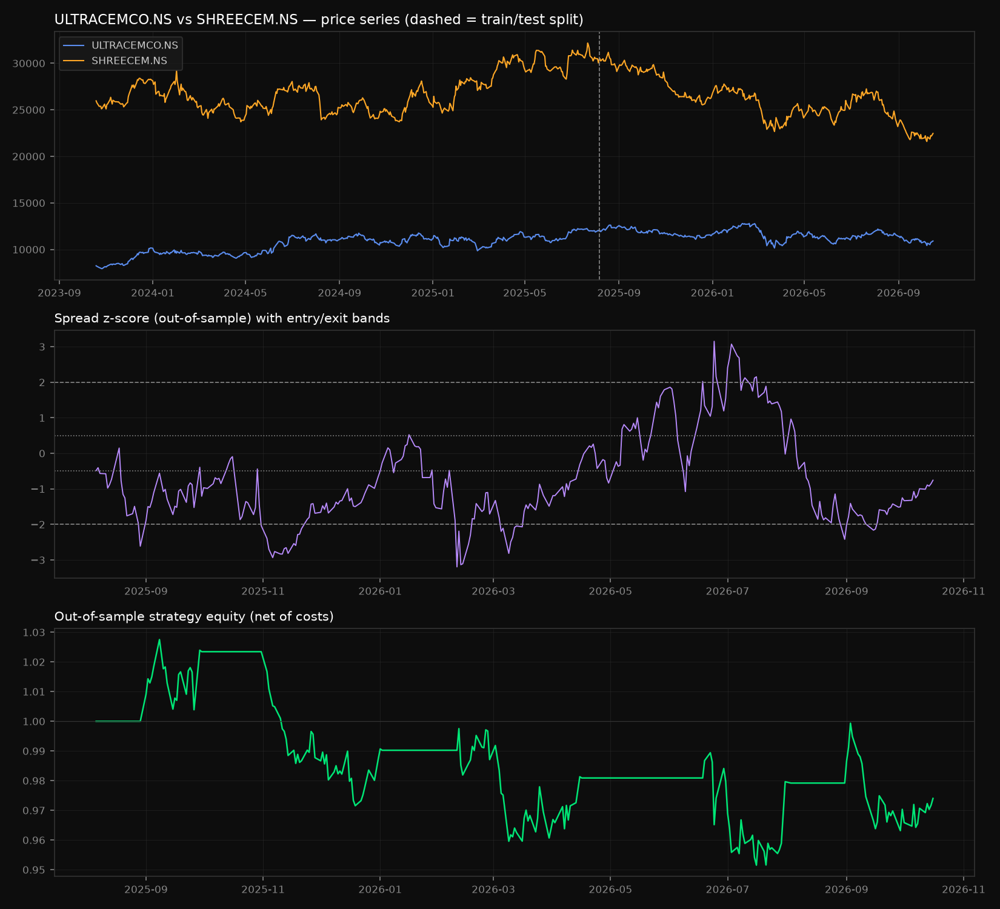

---

### IOC.NS / BPCL.NS

- **Latest prices:** IOC.NS ₹130.38 · BPCL.NS ₹293.50
- **Hedge ratio (train-fitted):** 1.6506
- **Cointegration (train):** FAIL at 5% — ADF -0.93, p=0.7791
- **Persistence:** passed 5% in 0 of 78 real-data runs (strict tier: 0/78)
- **Spread half-life:** 133.0 days
- **Current z-score:** -1.55
- **Signal today:** watch (approaching band)
- ⚠️ _Pair did not cointegrate on training data. Any signal here is not statistically justified — observation only._

**Out-of-sample backtest** (beta frozen from train window):

| Metric | Value |
|---|---|
| Sharpe | 0.23 |
| Sortino | 0.21 |
| Annualised return | 1.30% |
| Annualised vol | 6.36% |
| Max drawdown | -7.07% |
| Round-trip trades | 5 |

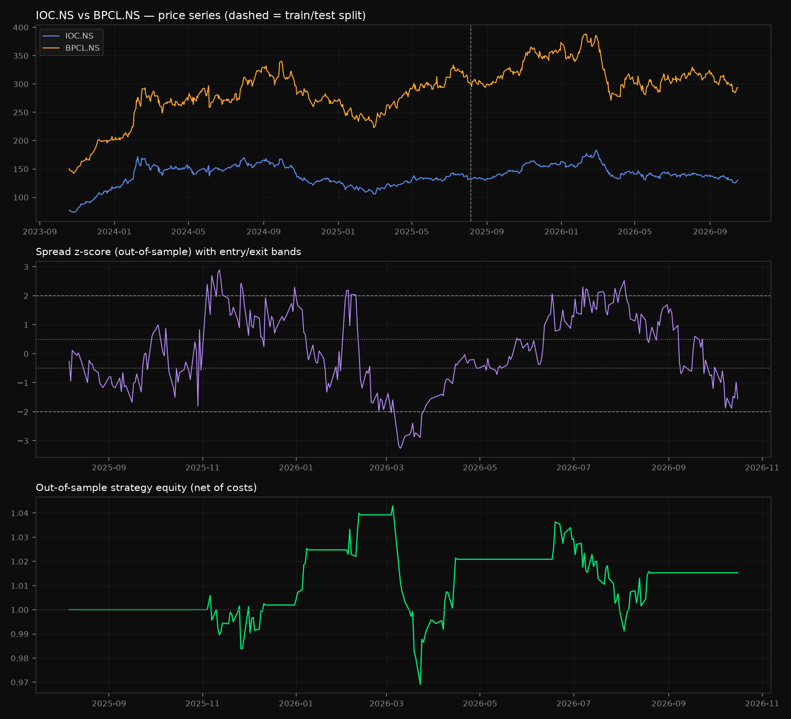

---

### BPCL.NS / HINDPETRO.NS

- **Latest prices:** BPCL.NS ₹293.50 · HINDPETRO.NS ₹346.00
- **Hedge ratio (train-fitted):** 1.3256
- **Cointegration (train):** FAIL at 5% — ADF -2.07, p=0.2582
- **Persistence:** passed 5% in 0 of 78 real-data runs (strict tier: 0/78)
- **Spread half-life:** 36.6 days
- **Current z-score:** +1.48
- **Signal today:** watch (approaching band)
- ⚠️ _Pair did not cointegrate on training data. Any signal here is not statistically justified — observation only._

**Out-of-sample backtest** (beta frozen from train window):

| Metric | Value |
|---|---|
| Sharpe | -0.11 |
| Sortino | -0.11 |
| Annualised return | -0.93% |
| Annualised vol | 6.38% |
| Max drawdown | -6.94% |
| Round-trip trades | 5 |

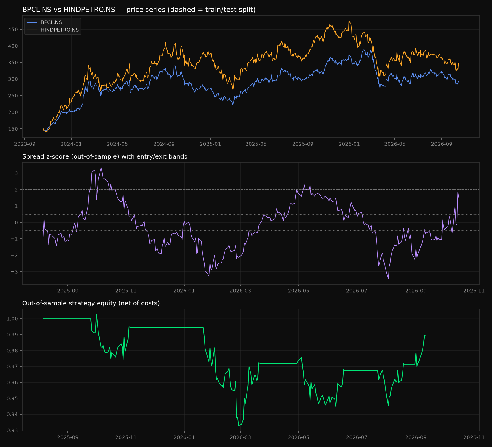

---

### ONGC.NS / COALINDIA.NS

- **Latest prices:** ONGC.NS ₹222.00 · COALINDIA.NS ₹417.20
- **Hedge ratio (train-fitted):** 1.3839
- **Cointegration (train):** PASS at 5% — ADF -3.52, p=0.0074
- **Persistence:** passed 5% in 70 of 78 real-data runs (strict tier: 1/78)
- **Spread half-life:** 12.7 days
- **Current z-score:** +1.54
- **Signal today:** watch (approaching band)

**Out-of-sample backtest** (beta frozen from train window):

| Metric | Value |
|---|---|
| Sharpe | 0.62 |
| Sortino | 0.52 |
| Annualised return | 4.76% |
| Annualised vol | 8.10% |
| Max drawdown | -6.44% |
| Round-trip trades | 5 |

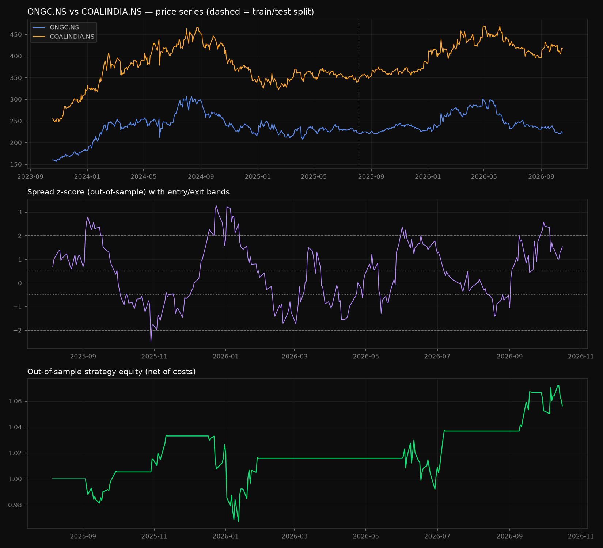

---

### NTPC.NS / POWERGRID.NS

- **Latest prices:** NTPC.NS ₹315.15 · POWERGRID.NS ₹250.45
- **Hedge ratio (train-fitted):** 0.8093
- **Cointegration (train):** FAIL at 5% — ADF -2.54, p=0.1061
- **Persistence:** passed 5% in 0 of 78 real-data runs (strict tier: 0/78)
- **Spread half-life:** 23.9 days
- **Current z-score:** -0.94
- **Signal today:** watch (approaching band)
- ⚠️ _Pair did not cointegrate on training data. Any signal here is not statistically justified — observation only._

**Out-of-sample backtest** (beta frozen from train window):

| Metric | Value |
|---|---|
| Sharpe | 0.44 |
| Sortino | 0.34 |
| Annualised return | 2.35% |
| Annualised vol | 5.68% |
| Max drawdown | -5.35% |
| Round-trip trades | 6 |

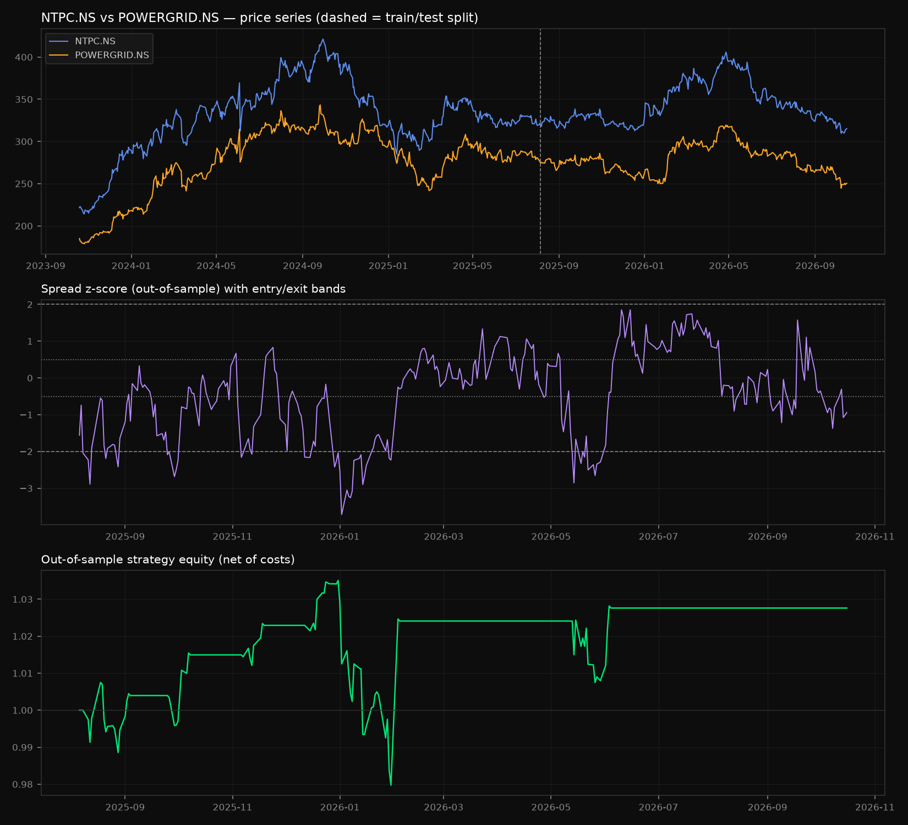

---

### BAJAJ-AUTO.NS / HEROMOTOCO.NS

- **Latest prices:** BAJAJ-AUTO.NS ₹10,405.00 · HEROMOTOCO.NS ₹5,225.00
- **Hedge ratio (train-fitted):** 0.4090
- **Cointegration (train):** FAIL at 5% — ADF -2.20, p=0.2059
- **Persistence:** passed 5% in 0 of 78 real-data runs (strict tier: 0/78)
- **Spread half-life:** 30.6 days
- **Current z-score:** +1.03
- **Signal today:** watch (approaching band)
- ⚠️ _Pair did not cointegrate on training data. Any signal here is not statistically justified — observation only._

**Out-of-sample backtest** (beta frozen from train window):

| Metric | Value |
|---|---|
| Sharpe | -0.42 |
| Sortino | -0.43 |
| Annualised return | -4.77% |
| Annualised vol | 10.33% |
| Max drawdown | -17.79% |
| Round-trip trades | 6 |

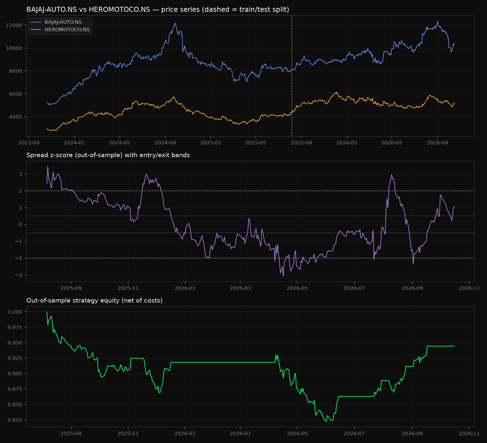

---

### TATASTEEL.NS / JSWSTEEL.NS

- **Latest prices:** TATASTEEL.NS ₹175.50 · JSWSTEEL.NS ₹1,216.30
- **Hedge ratio (train-fitted):** 3.0112
- **Cointegration (train):** FAIL at 5% — ADF -1.16, p=0.6907
- **Persistence:** passed 5% in 0 of 78 real-data runs (strict tier: 0/78)
- **Spread half-life:** 71.8 days
- **Current z-score:** -0.90
- **Signal today:** watch (approaching band)
- ⚠️ _Pair did not cointegrate on training data. Any signal here is not statistically justified — observation only._

**Out-of-sample backtest** (beta frozen from train window):

| Metric | Value |
|---|---|
| Sharpe | 0.40 |
| Sortino | 0.38 |
| Annualised return | 3.08% |
| Annualised vol | 8.47% |
| Max drawdown | -5.55% |
| Round-trip trades | 5 |

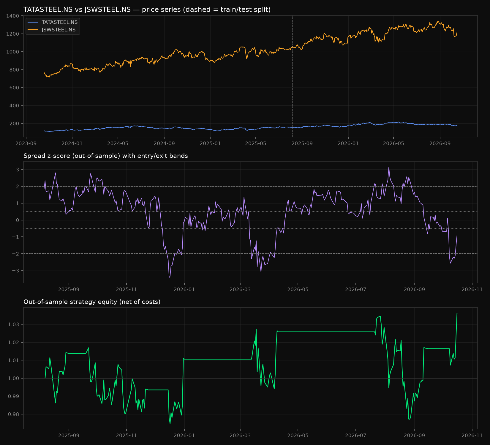

---

### SUNPHARMA.NS / CIPLA.NS

- **Latest prices:** SUNPHARMA.NS ₹1,758.80 · CIPLA.NS ₹1,325.10
- **Hedge ratio (train-fitted):** 0.4830
- **Cointegration (train):** PASS at 5% — ADF -3.39, p=0.0114
- **Persistence:** passed 5% in 78 of 78 real-data runs (strict tier: 5/78)
- **Spread half-life:** 10.7 days
- **Current z-score:** -0.60
- **Signal today:** watch (approaching band)

**Out-of-sample backtest** (beta frozen from train window):

| Metric | Value |
|---|---|
| Sharpe | 0.15 |
| Sortino | 0.16 |
| Annualised return | 0.85% |
| Annualised vol | 7.80% |
| Max drawdown | -10.49% |
| Round-trip trades | 5 |

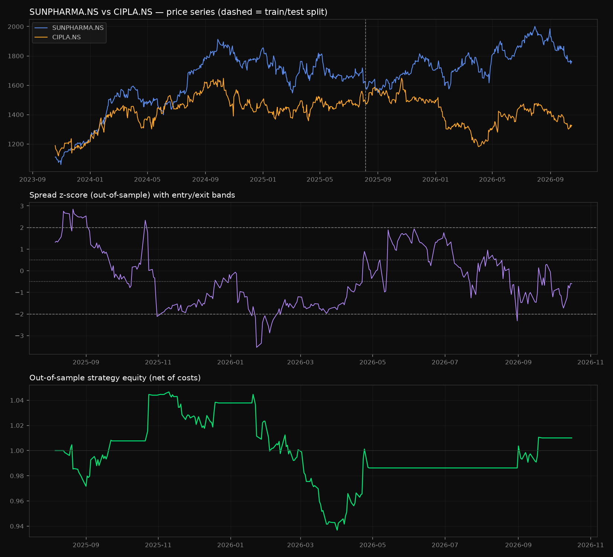

---

_Generated 2026-10-19 · pairs mean-reversion scanner · out-of-sample backtest · multiple-testing-aware · not investment advice._
