# Indian Pairs-Trading Scanner — 2026-10-20

> **What this is:** a market-neutral *pairs mean-reversion* scanner. It flags when two related NSE stocks have drifted apart far enough that their historical relationship signals a possible convergence trade. It does **not** forecast growth, rank "best" stocks, or predict company performance. A signal means the *spread between two stocks* is stretched — nothing about either stock being a good investment. Not investment advice; do your own research.

## Methodology (fixed in advance)

- **Universe:** 16 declared sector-mate pairs. Parameters (3y window, 60/40 train-test, z-entry 2.0, z-exit 0.5, 5 bps costs) are pre-registered; changes are logged in the README changelog *before* looking at results.
- **Multiple testing:** at the 5% level across 16 pairs, **≈0.8 false positives per run are expected by chance alone** even if nothing truly cointegrates. A single-day pass is a candidate, not a discovery.
- **Strict tier:** Bonferroni-corrected threshold p < 0.0031 (marked ✓✓).
- **Evidence = persistence:** the Persistence column counts how often each pair has passed the 5% test across all *real-data* daily runs recorded in `reports/history.csv`. Pairs deserve attention only when they pass persistently.

> ⚠️ **Some results use SIMULATED fallback data** (real data was unreachable this run) and are not real market results. These are marked below and are EXCLUDED from persistence counts.

## Summary

| Pair | p-value | Coint. | Persistence | Current z | Signal | OOS Sharpe |
|---|---|---|---|---|---|---|
| HDFCBANK.NS/ICICIBANK.NS *(sim)* | 0.0030 | ✓✓ | 1/64 | -1.55 | watch | 1.13 |
| AXISBANK.NS/ICICIBANK.NS | 0.9197 | ✗ | 0/79 | -0.10 | flat / no stretch | -0.34 |
| KOTAKBANK.NS/HDFCBANK.NS | 0.1965 | ✗ | 0/79 | -1.57 | watch | 1.14 |
| SBIN.NS/BANKBARODA.NS | 0.1463 | ✗ | 0/79 | +1.66 | watch | 0.43 |
| TCS.NS/INFY.NS | 0.5976 | ✗ | 0/79 | -2.20 | LONG spread | 1.94 |
| INFY.NS/WIPRO.NS | 0.1403 | ✗ | 0/79 | +1.08 | watch | 2.13 |
| HCLTECH.NS/TECHM.NS | 0.2984 | ✗ | 0/79 | +3.53 | SHORT spread | -0.01 |
| ACC.NS/AMBUJACEM.NS | 0.5337 | ✗ | 0/79 | -1.20 | watch | 0.06 |
| ULTRACEMCO.NS/SHREECEM.NS | 0.3318 | ✗ | 0/79 | -0.66 | watch | -0.25 |
| IOC.NS/BPCL.NS | 0.7708 | ✗ | 0/79 | -1.32 | watch | 0.23 |
| BPCL.NS/HINDPETRO.NS | 0.2550 | ✗ | 0/79 | +1.70 | watch | -0.11 |
| ONGC.NS/COALINDIA.NS | 0.0071 | ✓ | 71/79 | +0.83 | watch | 0.76 |
| NTPC.NS/POWERGRID.NS | 0.1055 | ✗ | 0/79 | +0.19 | flat / no stretch | 0.44 |
| BAJAJ-AUTO.NS/HEROMOTOCO.NS | 0.1945 | ✗ | 0/79 | +1.24 | watch | -0.25 |
| TATASTEEL.NS/JSWSTEEL.NS | 0.6949 | ✗ | 0/79 | +0.02 | flat / no stretch | 0.58 |
| SUNPHARMA.NS/CIPLA.NS | 0.0117 | ✓ | 79/79 | -0.36 | flat / no stretch | 0.15 |

_Legend: ✓✓ passes strict Bonferroni tier · ✓ passes 5% only · ✗ fails. Persistence = 5%-passes / real-data runs recorded. \*no real-data history yet._

---

### HDFCBANK.NS / ICICIBANK.NS · _SIMULATED_

- **Latest prices:** HDFCBANK.NS ₹77.27 · ICICIBANK.NS ₹113.78
- **Hedge ratio (train-fitted):** 1.5557
- **Cointegration (train):** PASS at 5% — ADF -3.79, p=0.0030 · **passes strict Bonferroni tier**
- **Persistence:** passed 5% in 1 of 64 real-data runs (strict tier: 0/64)
- **Spread half-life:** 14.0 days
- **Current z-score:** -1.55
- **Signal today:** watch (approaching band)

**Out-of-sample backtest** (beta frozen from train window):

| Metric | Value |
|---|---|
| Sharpe | 1.13 |
| Sortino | 0.86 |
| Annualised return | 1.88% |
| Annualised vol | 1.66% |
| Max drawdown | -1.19% |
| Round-trip trades | 5 |

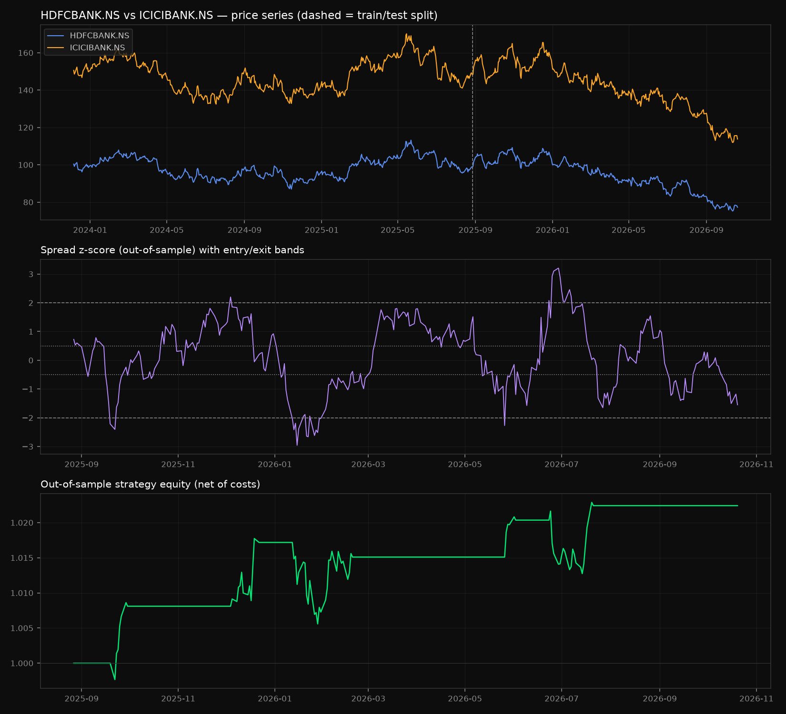

---

### AXISBANK.NS / ICICIBANK.NS

- **Latest prices:** AXISBANK.NS ₹1,236.00 · ICICIBANK.NS ₹1,381.00
- **Hedge ratio (train-fitted):** 0.8348
- **Cointegration (train):** FAIL at 5% — ADF -0.34, p=0.9197
- **Persistence:** passed 5% in 0 of 79 real-data runs (strict tier: 0/79)
- **Spread half-life:** 456.3 days
- **Current z-score:** -0.10
- **Signal today:** flat / no stretch
- ⚠️ _Pair did not cointegrate on training data. Any signal here is not statistically justified — observation only._

**Out-of-sample backtest** (beta frozen from train window):

| Metric | Value |
|---|---|
| Sharpe | -0.34 |
| Sortino | -0.32 |
| Annualised return | -3.18% |
| Annualised vol | 8.38% |
| Max drawdown | -7.73% |
| Round-trip trades | 5 |

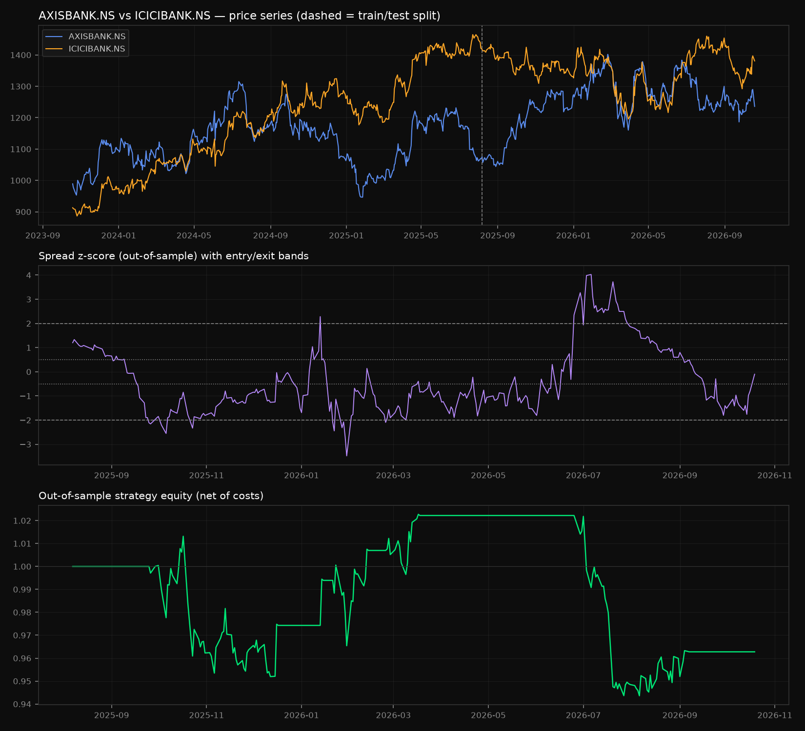

---

### KOTAKBANK.NS / HDFCBANK.NS

- **Latest prices:** KOTAKBANK.NS ₹442.30 · HDFCBANK.NS ₹712.00
- **Hedge ratio (train-fitted):** 2.2009
- **Cointegration (train):** FAIL at 5% — ADF -2.23, p=0.1965
- **Persistence:** passed 5% in 0 of 79 real-data runs (strict tier: 0/79)
- **Spread half-life:** 27.3 days
- **Current z-score:** -1.57
- **Signal today:** watch (approaching band)
- ⚠️ _Pair did not cointegrate on training data. Any signal here is not statistically justified — observation only._

**Out-of-sample backtest** (beta frozen from train window):

| Metric | Value |
|---|---|
| Sharpe | 1.14 |
| Sortino | 1.11 |
| Annualised return | 6.57% |
| Annualised vol | 5.71% |
| Max drawdown | -2.83% |
| Round-trip trades | 5 |

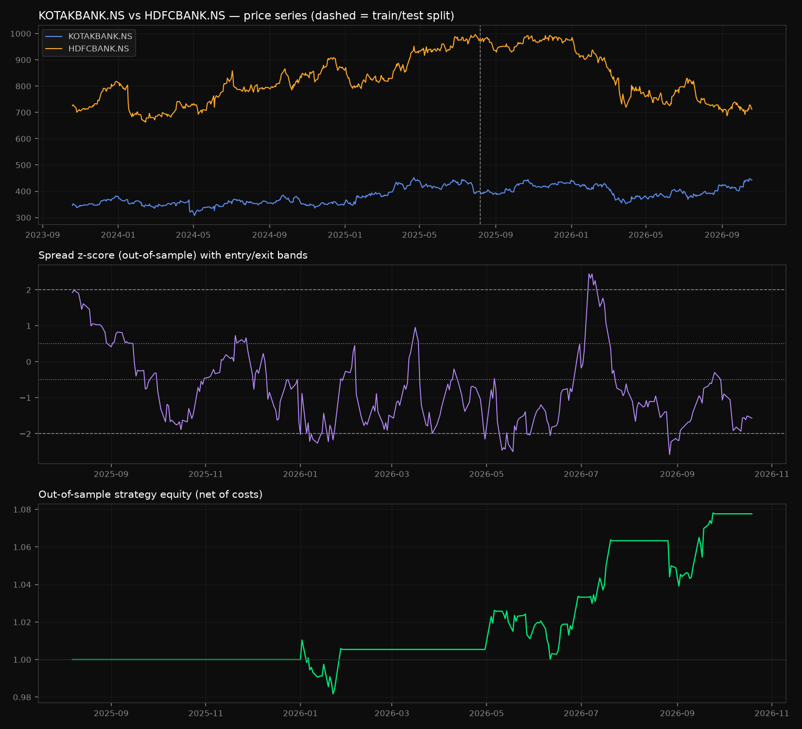

---

### SBIN.NS / BANKBARODA.NS

- **Latest prices:** SBIN.NS ₹973.70 · BANKBARODA.NS ₹238.20
- **Hedge ratio (train-fitted):** 0.1904
- **Cointegration (train):** FAIL at 5% — ADF -2.38, p=0.1463
- **Persistence:** passed 5% in 0 of 79 real-data runs (strict tier: 0/79)
- **Spread half-life:** 21.3 days
- **Current z-score:** +1.66
- **Signal today:** watch (approaching band)
- ⚠️ _Pair did not cointegrate on training data. Any signal here is not statistically justified — observation only._

**Out-of-sample backtest** (beta frozen from train window):

| Metric | Value |
|---|---|
| Sharpe | 0.43 |
| Sortino | 0.39 |
| Annualised return | 3.76% |
| Annualised vol | 9.64% |
| Max drawdown | -8.77% |
| Round-trip trades | 7 |

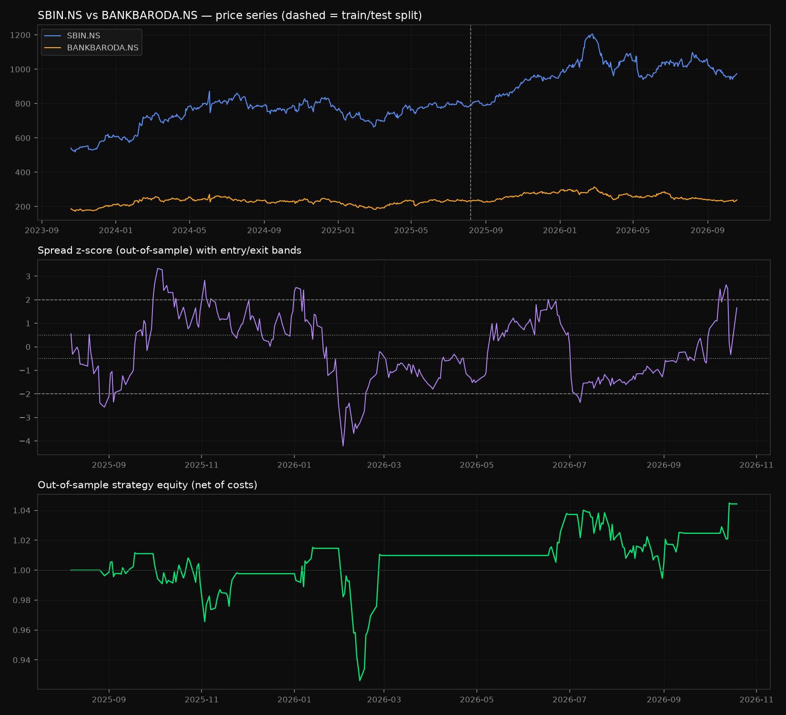

---

### TCS.NS / INFY.NS

- **Latest prices:** TCS.NS ₹2,460.90 · INFY.NS ₹1,130.70
- **Hedge ratio (train-fitted):** 0.4252
- **Cointegration (train):** FAIL at 5% — ADF -1.37, p=0.5976
- **Persistence:** passed 5% in 0 of 79 real-data runs (strict tier: 0/79)
- **Spread half-life:** 68.4 days
- **Current z-score:** -2.20
- **Signal today:** LONG spread (long INFY.NS, short TCS.NS)
- ⚠️ _Pair did not cointegrate on training data. Any signal here is not statistically justified — observation only._

**Out-of-sample backtest** (beta frozen from train window):

| Metric | Value |
|---|---|
| Sharpe | 1.94 |
| Sortino | 2.03 |
| Annualised return | 8.62% |
| Annualised vol | 4.32% |
| Max drawdown | -1.80% |
| Round-trip trades | 6 |

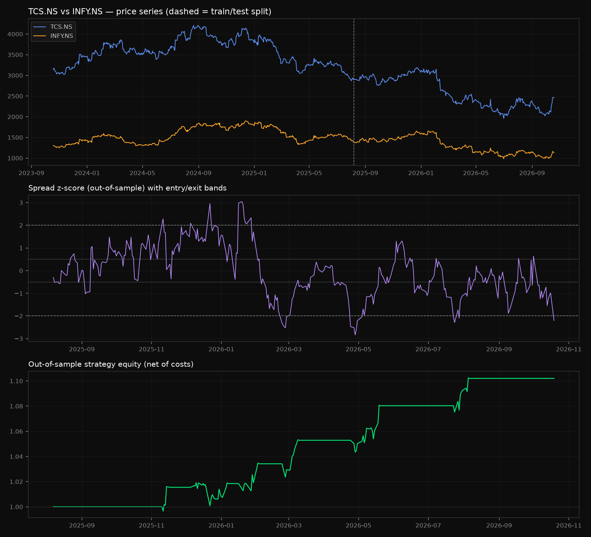

---

### INFY.NS / WIPRO.NS

- **Latest prices:** INFY.NS ₹1,130.70 · WIPRO.NS ₹182.14
- **Hedge ratio (train-fitted):** 0.1268
- **Cointegration (train):** FAIL at 5% — ADF -2.40, p=0.1403
- **Persistence:** passed 5% in 0 of 79 real-data runs (strict tier: 0/79)
- **Spread half-life:** 28.6 days
- **Current z-score:** +1.08
- **Signal today:** watch (approaching band)
- ⚠️ _Pair did not cointegrate on training data. Any signal here is not statistically justified — observation only._

**Out-of-sample backtest** (beta frozen from train window):

| Metric | Value |
|---|---|
| Sharpe | 2.13 |
| Sortino | 2.09 |
| Annualised return | 11.70% |
| Annualised vol | 5.26% |
| Max drawdown | -1.56% |
| Round-trip trades | 7 |

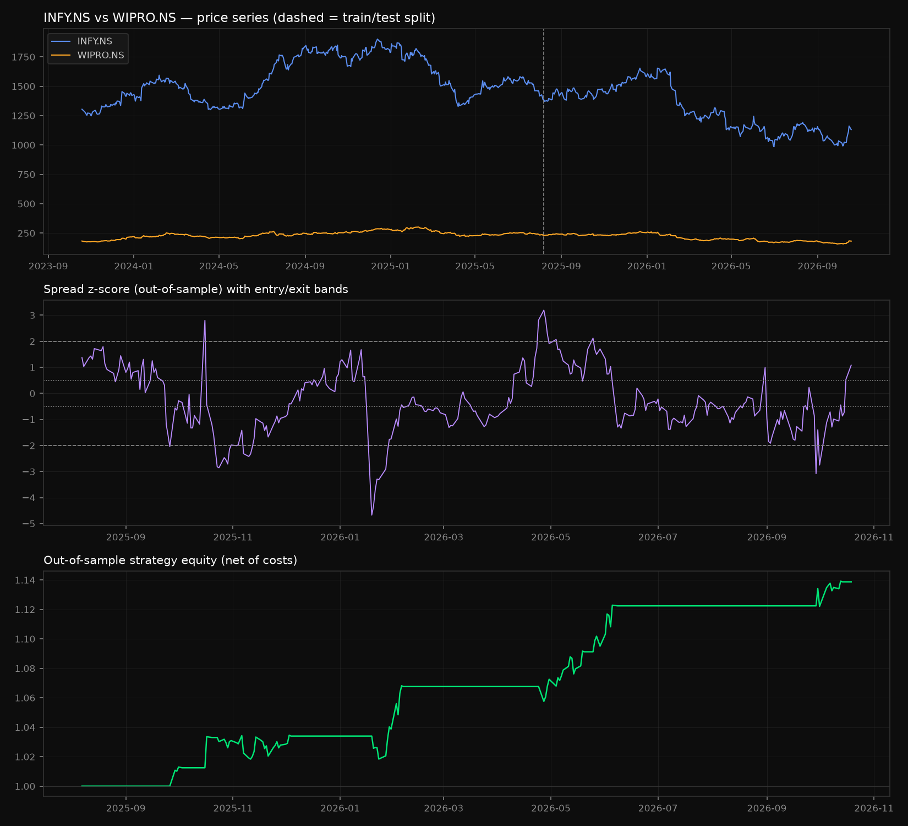

---

### HCLTECH.NS / TECHM.NS

- **Latest prices:** HCLTECH.NS ₹1,379.90 · TECHM.NS ₹1,779.10
- **Hedge ratio (train-fitted):** 0.9580
- **Cointegration (train):** FAIL at 5% — ADF -1.97, p=0.2984
- **Persistence:** passed 5% in 0 of 79 real-data runs (strict tier: 0/79)
- **Spread half-life:** 24.0 days
- **Current z-score:** +3.53
- **Signal today:** SHORT spread (short TECHM.NS, long HCLTECH.NS)
- ⚠️ _Pair did not cointegrate on training data. Any signal here is not statistically justified — observation only._

**Out-of-sample backtest** (beta frozen from train window):

| Metric | Value |
|---|---|
| Sharpe | -0.01 |
| Sortino | -0.01 |
| Annualised return | -0.38% |
| Annualised vol | 7.46% |
| Max drawdown | -8.33% |
| Round-trip trades | 5 |

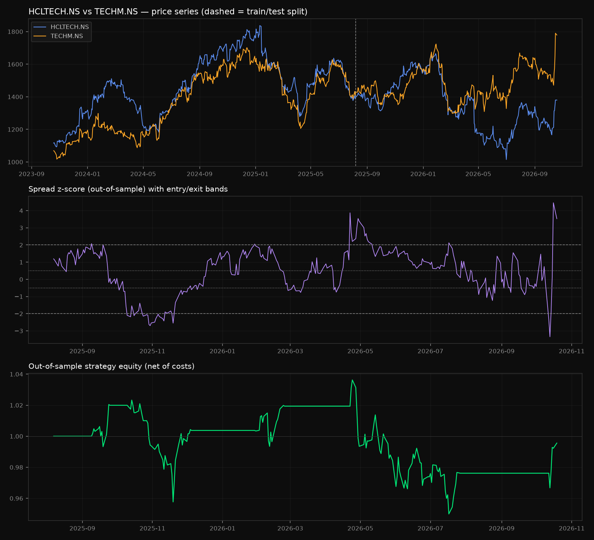

---

### ACC.NS / AMBUJACEM.NS

- **Latest prices:** ACC.NS ₹1,167.80 · AMBUJACEM.NS ₹361.85
- **Hedge ratio (train-fitted):** 0.1662
- **Cointegration (train):** FAIL at 5% — ADF -1.50, p=0.5337
- **Persistence:** passed 5% in 0 of 79 real-data runs (strict tier: 0/79)
- **Spread half-life:** 50.0 days
- **Current z-score:** -1.20
- **Signal today:** watch (approaching band)
- ⚠️ _Pair did not cointegrate on training data. Any signal here is not statistically justified — observation only._

**Out-of-sample backtest** (beta frozen from train window):

| Metric | Value |
|---|---|
| Sharpe | 0.06 |
| Sortino | 0.04 |
| Annualised return | 0.16% |
| Annualised vol | 5.90% |
| Max drawdown | -5.75% |
| Round-trip trades | 3 |

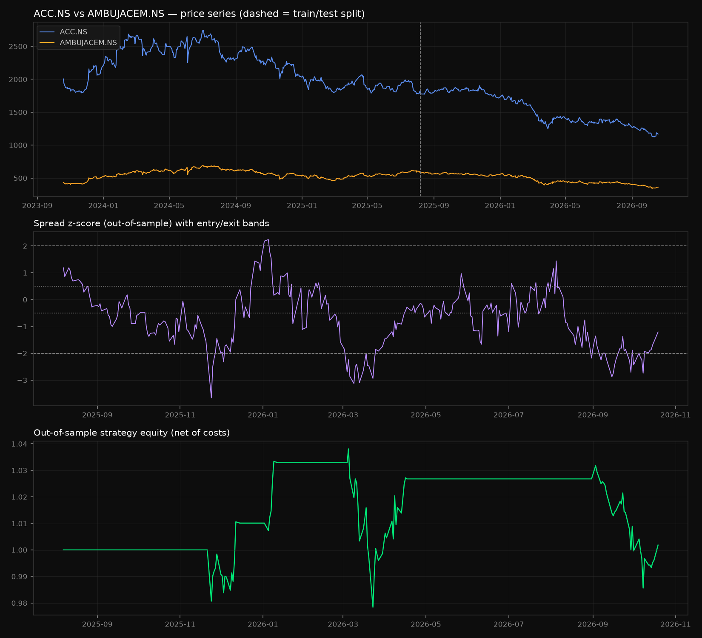

---

### ULTRACEMCO.NS / SHREECEM.NS

- **Latest prices:** ULTRACEMCO.NS ₹10,650.00 · SHREECEM.NS ₹22,290.00
- **Hedge ratio (train-fitted):** 1.0168
- **Cointegration (train):** FAIL at 5% — ADF -1.90, p=0.3318
- **Persistence:** passed 5% in 0 of 79 real-data runs (strict tier: 0/79)
- **Spread half-life:** 40.9 days
- **Current z-score:** -0.66
- **Signal today:** watch (approaching band)
- ⚠️ _Pair did not cointegrate on training data. Any signal here is not statistically justified — observation only._

**Out-of-sample backtest** (beta frozen from train window):

| Metric | Value |
|---|---|
| Sharpe | -0.25 |
| Sortino | -0.30 |
| Annualised return | -1.99% |
| Annualised vol | 7.08% |
| Max drawdown | -7.33% |
| Round-trip trades | 4 |

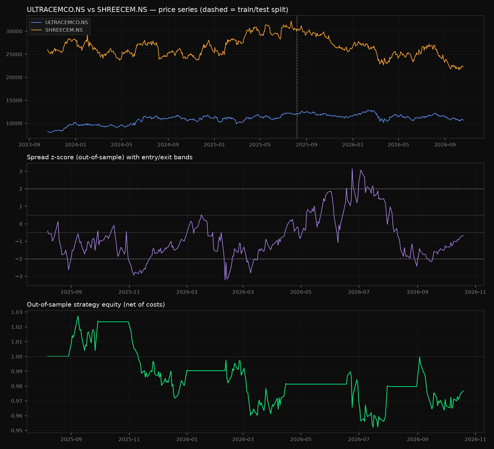

---

### IOC.NS / BPCL.NS

- **Latest prices:** IOC.NS ₹130.25 · BPCL.NS ₹294.30
- **Hedge ratio (train-fitted):** 1.6501
- **Cointegration (train):** FAIL at 5% — ADF -0.95, p=0.7708
- **Persistence:** passed 5% in 0 of 79 real-data runs (strict tier: 0/79)
- **Spread half-life:** 130.1 days
- **Current z-score:** -1.32
- **Signal today:** watch (approaching band)
- ⚠️ _Pair did not cointegrate on training data. Any signal here is not statistically justified — observation only._

**Out-of-sample backtest** (beta frozen from train window):

| Metric | Value |
|---|---|
| Sharpe | 0.23 |
| Sortino | 0.21 |
| Annualised return | 1.31% |
| Annualised vol | 6.44% |
| Max drawdown | -7.16% |
| Round-trip trades | 5 |

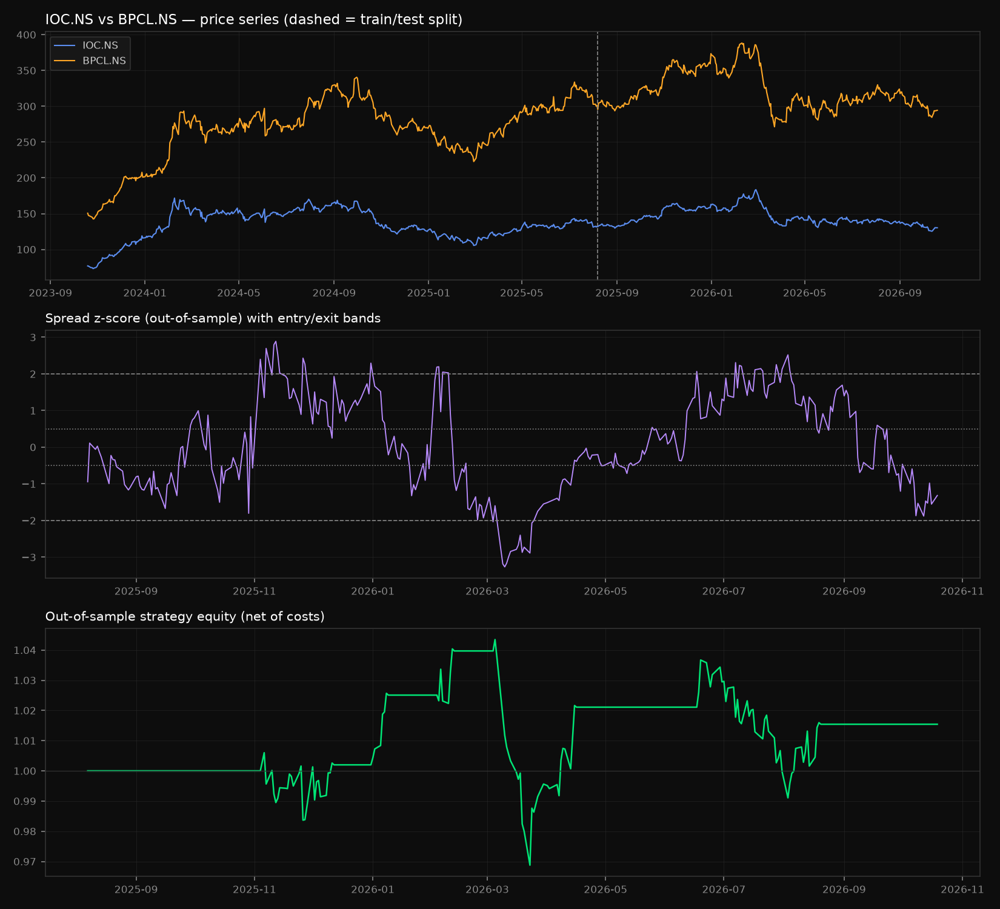

---

### BPCL.NS / HINDPETRO.NS

- **Latest prices:** BPCL.NS ₹294.30 · HINDPETRO.NS ₹348.50
- **Hedge ratio (train-fitted):** 1.3258
- **Cointegration (train):** FAIL at 5% — ADF -2.07, p=0.2550
- **Persistence:** passed 5% in 0 of 79 real-data runs (strict tier: 0/79)
- **Spread half-life:** 36.5 days
- **Current z-score:** +1.70
- **Signal today:** watch (approaching band)
- ⚠️ _Pair did not cointegrate on training data. Any signal here is not statistically justified — observation only._

**Out-of-sample backtest** (beta frozen from train window):

| Metric | Value |
|---|---|
| Sharpe | -0.11 |
| Sortino | -0.11 |
| Annualised return | -0.93% |
| Annualised vol | 6.43% |
| Max drawdown | -7.00% |
| Round-trip trades | 5 |

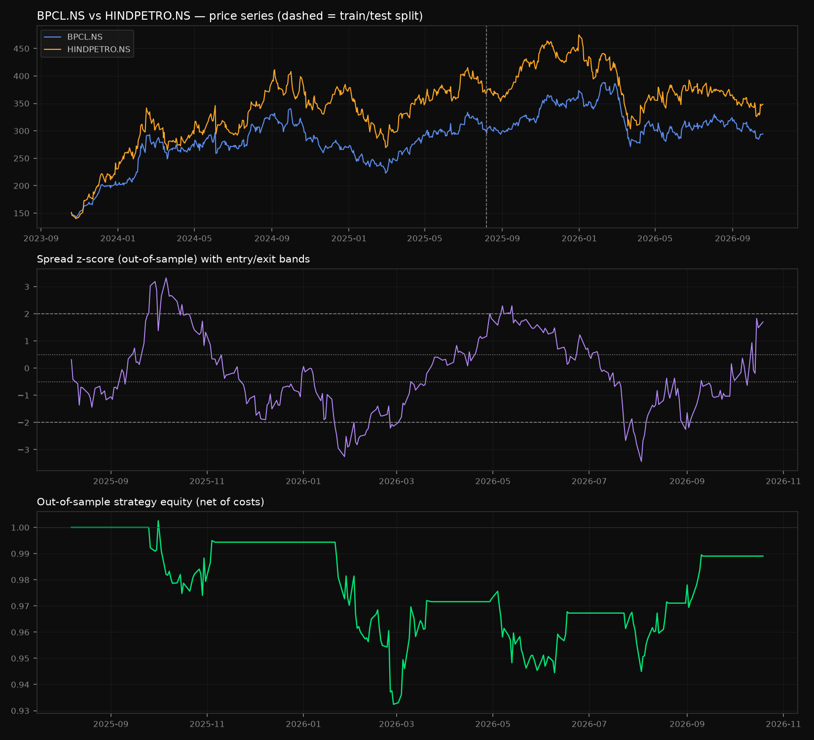

---

### ONGC.NS / COALINDIA.NS

- **Latest prices:** ONGC.NS ₹225.00 · COALINDIA.NS ₹411.70
- **Hedge ratio (train-fitted):** 1.3840
- **Cointegration (train):** PASS at 5% — ADF -3.54, p=0.0071
- **Persistence:** passed 5% in 71 of 79 real-data runs (strict tier: 1/79)
- **Spread half-life:** 12.7 days
- **Current z-score:** +0.83
- **Signal today:** watch (approaching band)

**Out-of-sample backtest** (beta frozen from train window):

| Metric | Value |
|---|---|
| Sharpe | 0.76 |
| Sortino | 0.65 |
| Annualised return | 6.05% |
| Annualised vol | 8.17% |
| Max drawdown | -6.41% |
| Round-trip trades | 5 |

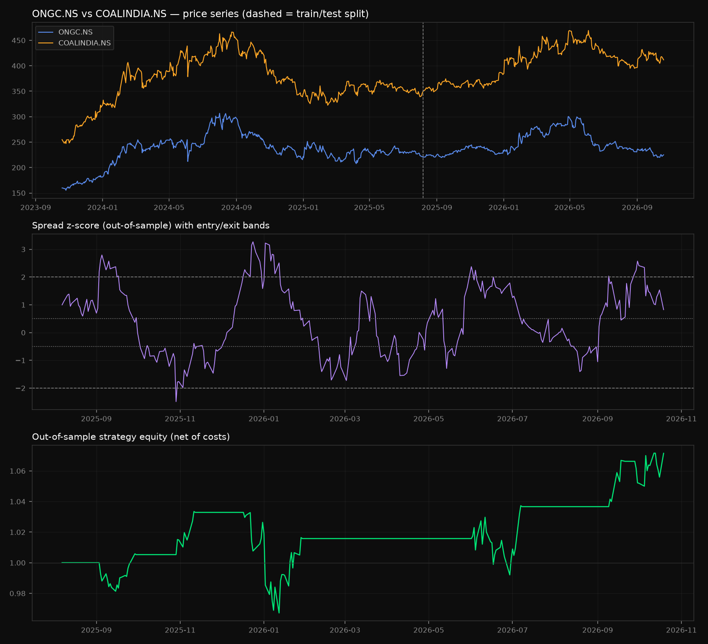

---

### NTPC.NS / POWERGRID.NS

- **Latest prices:** NTPC.NS ₹309.00 · POWERGRID.NS ₹250.35
- **Hedge ratio (train-fitted):** 0.8092
- **Cointegration (train):** FAIL at 5% — ADF -2.54, p=0.1055
- **Persistence:** passed 5% in 0 of 79 real-data runs (strict tier: 0/79)
- **Spread half-life:** 23.9 days
- **Current z-score:** +0.19
- **Signal today:** flat / no stretch
- ⚠️ _Pair did not cointegrate on training data. Any signal here is not statistically justified — observation only._

**Out-of-sample backtest** (beta frozen from train window):

| Metric | Value |
|---|---|
| Sharpe | 0.44 |
| Sortino | 0.34 |
| Annualised return | 2.35% |
| Annualised vol | 5.70% |
| Max drawdown | -5.36% |
| Round-trip trades | 6 |

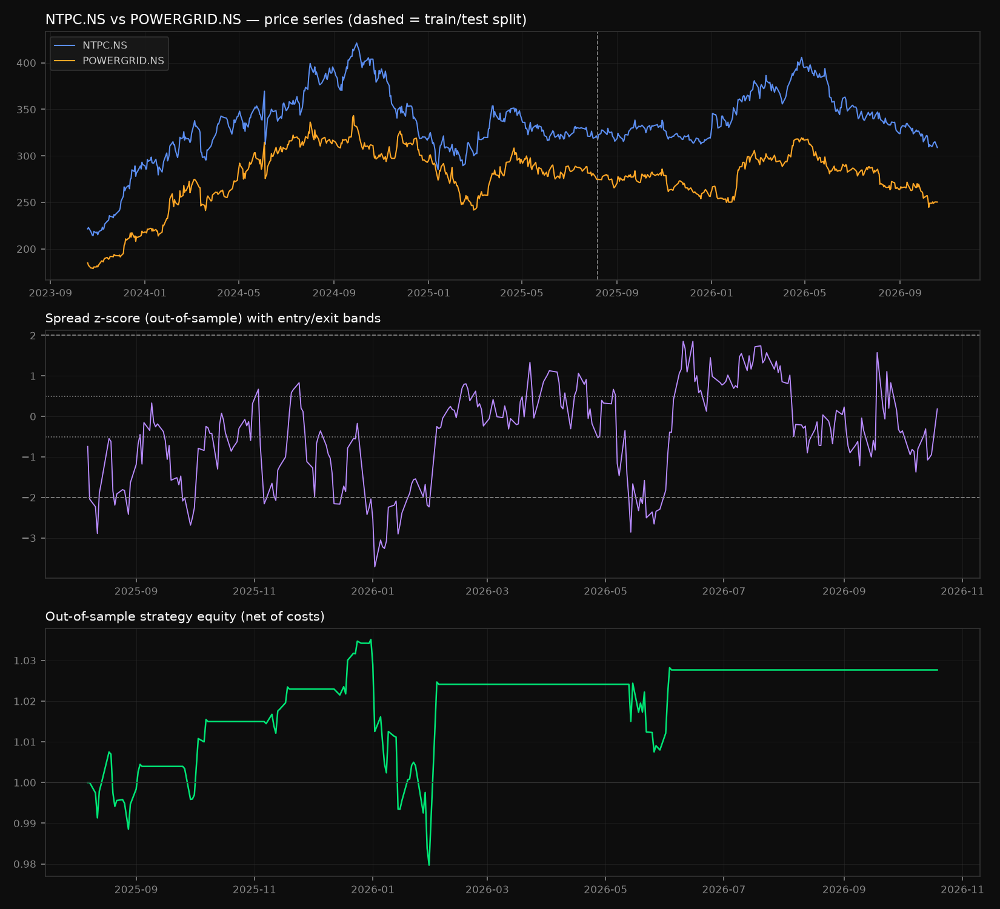

---

### BAJAJ-AUTO.NS / HEROMOTOCO.NS

- **Latest prices:** BAJAJ-AUTO.NS ₹10,287.00 · HEROMOTOCO.NS ₹5,230.00
- **Hedge ratio (train-fitted):** 0.4090
- **Cointegration (train):** FAIL at 5% — ADF -2.23, p=0.1945
- **Persistence:** passed 5% in 0 of 79 real-data runs (strict tier: 0/79)
- **Spread half-life:** 30.2 days
- **Current z-score:** +1.24
- **Signal today:** watch (approaching band)
- ⚠️ _Pair did not cointegrate on training data. Any signal here is not statistically justified — observation only._

**Out-of-sample backtest** (beta frozen from train window):

| Metric | Value |
|---|---|
| Sharpe | -0.25 |
| Sortino | -0.26 |
| Annualised return | -2.95% |
| Annualised vol | 9.88% |
| Max drawdown | -16.82% |
| Round-trip trades | 6 |

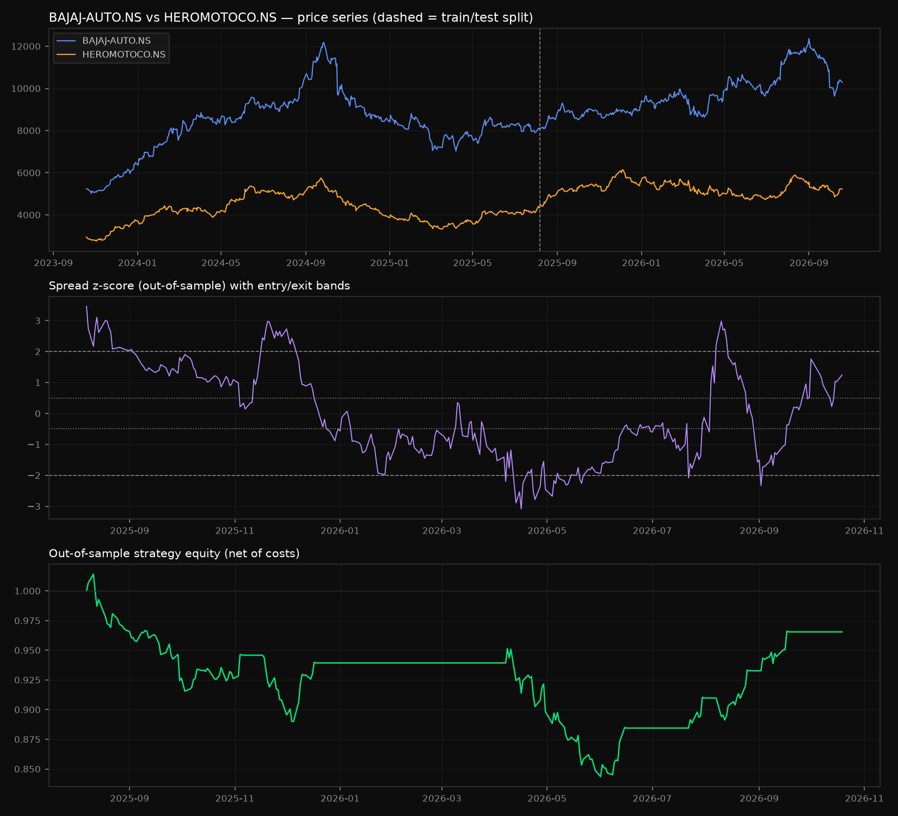

---

### TATASTEEL.NS / JSWSTEEL.NS

- **Latest prices:** TATASTEEL.NS ₹174.04 · JSWSTEEL.NS ₹1,241.30
- **Hedge ratio (train-fitted):** 3.0247
- **Cointegration (train):** FAIL at 5% — ADF -1.15, p=0.6949
- **Persistence:** passed 5% in 0 of 79 real-data runs (strict tier: 0/79)
- **Spread half-life:** 72.7 days
- **Current z-score:** +0.02
- **Signal today:** flat / no stretch
- ⚠️ _Pair did not cointegrate on training data. Any signal here is not statistically justified — observation only._

**Out-of-sample backtest** (beta frozen from train window):

| Metric | Value |
|---|---|
| Sharpe | 0.58 |
| Sortino | 0.57 |
| Annualised return | 4.69% |
| Annualised vol | 8.55% |
| Max drawdown | -5.48% |
| Round-trip trades | 5 |

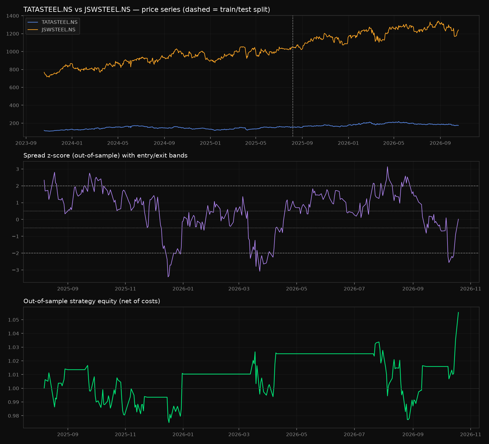

---

### SUNPHARMA.NS / CIPLA.NS

- **Latest prices:** SUNPHARMA.NS ₹1,743.00 · CIPLA.NS ₹1,324.10
- **Hedge ratio (train-fitted):** 0.4829
- **Cointegration (train):** PASS at 5% — ADF -3.38, p=0.0117
- **Persistence:** passed 5% in 79 of 79 real-data runs (strict tier: 5/79)
- **Spread half-life:** 10.7 days
- **Current z-score:** -0.36
- **Signal today:** flat / no stretch

**Out-of-sample backtest** (beta frozen from train window):

| Metric | Value |
|---|---|
| Sharpe | 0.15 |
| Sortino | 0.16 |
| Annualised return | 0.85% |
| Annualised vol | 7.78% |
| Max drawdown | -10.46% |
| Round-trip trades | 5 |

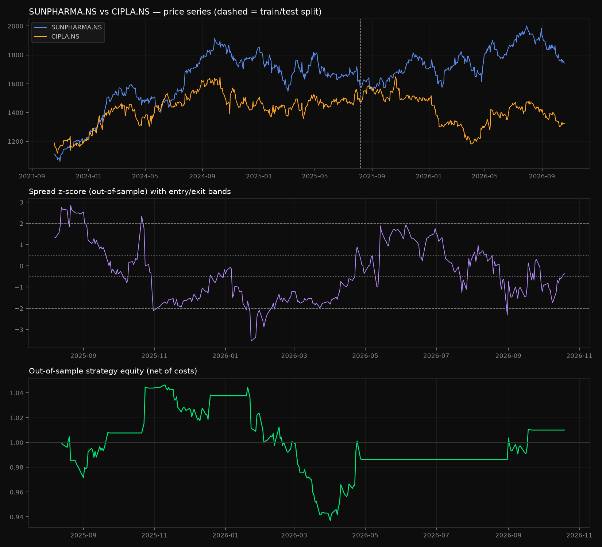

---

_Generated 2026-10-20 · pairs mean-reversion scanner · out-of-sample backtest · multiple-testing-aware · not investment advice._
