# Indian Pairs-Trading Scanner — 2026-10-21

> **What this is:** a market-neutral *pairs mean-reversion* scanner. It flags when two related NSE stocks have drifted apart far enough that their historical relationship signals a possible convergence trade. It does **not** forecast growth, rank "best" stocks, or predict company performance. A signal means the *spread between two stocks* is stretched — nothing about either stock being a good investment. Not investment advice; do your own research.

## Methodology (fixed in advance)

- **Universe:** 16 declared sector-mate pairs. Parameters (3y window, 60/40 train-test, z-entry 2.0, z-exit 0.5, 5 bps costs) are pre-registered; changes are logged in the README changelog *before* looking at results.
- **Multiple testing:** at the 5% level across 16 pairs, **≈0.8 false positives per run are expected by chance alone** even if nothing truly cointegrates. A single-day pass is a candidate, not a discovery.
- **Strict tier:** Bonferroni-corrected threshold p < 0.0031 (marked ✓✓).
- **Evidence = persistence:** the Persistence column counts how often each pair has passed the 5% test across all *real-data* daily runs recorded in `reports/history.csv`. Pairs deserve attention only when they pass persistently.

## Summary

| Pair | p-value | Coint. | Persistence | Current z | Signal | OOS Sharpe |
|---|---|---|---|---|---|---|
| HDFCBANK.NS/ICICIBANK.NS | 0.0691 | ✗ | 1/65 | +0.39 | flat / no stretch | -0.35 |
| AXISBANK.NS/ICICIBANK.NS | 0.9198 | ✗ | 0/80 | +0.52 | watch | -0.33 |
| KOTAKBANK.NS/HDFCBANK.NS | 0.2188 | ✗ | 0/80 | -1.43 | watch | 1.14 |
| SBIN.NS/BANKBARODA.NS | 0.1406 | ✗ | 0/80 | +1.96 | watch | 0.43 |
| TCS.NS/INFY.NS | 0.6086 | ✗ | 0/80 | -1.82 | watch | 1.99 |
| INFY.NS/WIPRO.NS | 0.1266 | ✗ | 0/80 | +1.91 | watch | 2.13 |
| HCLTECH.NS/TECHM.NS | 0.1370 | ✗ | 0/80 | +3.49 | SHORT spread | -0.07 |
| ACC.NS/AMBUJACEM.NS | 0.5067 | ✗ | 0/80 | -1.24 | watch | 0.03 |
| ULTRACEMCO.NS/SHREECEM.NS | 0.3501 | ✗ | 0/80 | -0.78 | watch | -0.42 |
| IOC.NS/BPCL.NS | 0.7237 | ✗ | 0/80 | -2.30 | LONG spread | 0.23 |
| BPCL.NS/HINDPETRO.NS | 0.2620 | ✗ | 0/80 | +2.67 | SHORT spread | -0.12 |
| ONGC.NS/COALINDIA.NS | 0.0063 | ✓ | 72/80 | +0.44 | flat / no stretch | 0.84 |
| NTPC.NS/POWERGRID.NS | 0.1065 | ✗ | 0/80 | +1.75 | watch | 0.44 |
| BAJAJ-AUTO.NS/HEROMOTOCO.NS | 0.2322 | ✗ | 0/80 | +1.25 | watch | -0.32 |
| TATASTEEL.NS/JSWSTEEL.NS | 0.6750 | ✗ | 0/80 | -0.43 | flat / no stretch | 0.73 |
| SUNPHARMA.NS/CIPLA.NS | 0.0101 | ✓ | 80/80 | -0.83 | watch | 0.15 |

_Legend: ✓✓ passes strict Bonferroni tier · ✓ passes 5% only · ✗ fails. Persistence = 5%-passes / real-data runs recorded. \*no real-data history yet._

---

### HDFCBANK.NS / ICICIBANK.NS

- **Latest prices:** HDFCBANK.NS ₹706.95 · ICICIBANK.NS ₹1,385.00
- **Hedge ratio (train-fitted):** 1.5905
- **Cointegration (train):** FAIL at 5% — ADF -2.73, p=0.0691
- **Persistence:** passed 5% in 1 of 65 real-data runs (strict tier: 0/65)
- **Spread half-life:** 23.9 days
- **Current z-score:** +0.39
- **Signal today:** flat / no stretch
- ⚠️ _Pair did not cointegrate on training data. Any signal here is not statistically justified — observation only._

**Out-of-sample backtest** (beta frozen from train window):

| Metric | Value |
|---|---|
| Sharpe | -0.35 |
| Sortino | -0.37 |
| Annualised return | -2.50% |
| Annualised vol | 6.68% |
| Max drawdown | -8.06% |
| Round-trip trades | 4 |

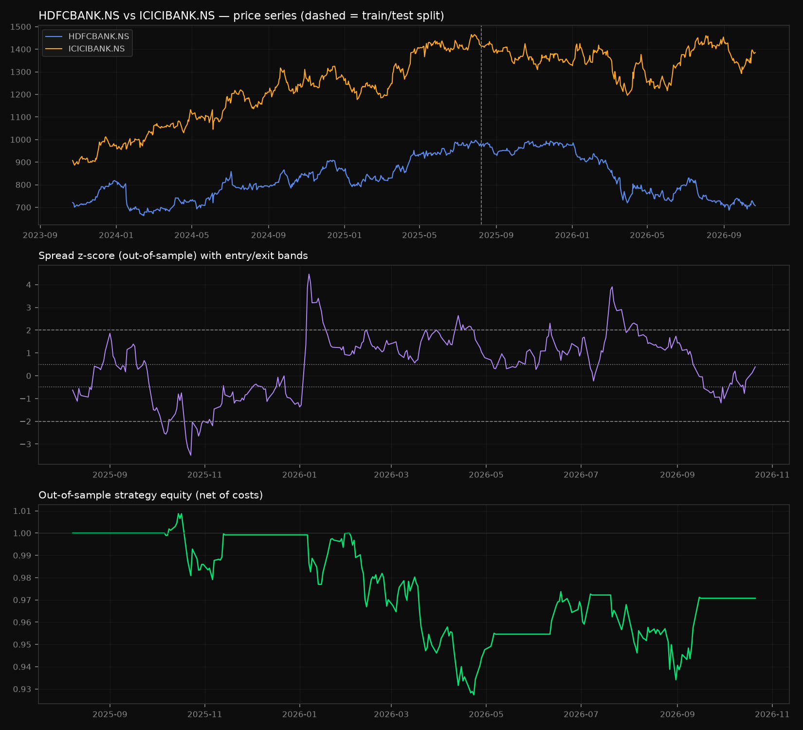

---

### AXISBANK.NS / ICICIBANK.NS

- **Latest prices:** AXISBANK.NS ₹1,210.00 · ICICIBANK.NS ₹1,385.00
- **Hedge ratio (train-fitted):** 0.8142
- **Cointegration (train):** FAIL at 5% — ADF -0.34, p=0.9198
- **Persistence:** passed 5% in 0 of 80 real-data runs (strict tier: 0/80)
- **Spread half-life:** 462.1 days
- **Current z-score:** +0.52
- **Signal today:** watch (approaching band)
- ⚠️ _Pair did not cointegrate on training data. Any signal here is not statistically justified — observation only._

**Out-of-sample backtest** (beta frozen from train window):

| Metric | Value |
|---|---|
| Sharpe | -0.33 |
| Sortino | -0.30 |
| Annualised return | -3.08% |
| Annualised vol | 8.41% |
| Max drawdown | -7.77% |
| Round-trip trades | 5 |

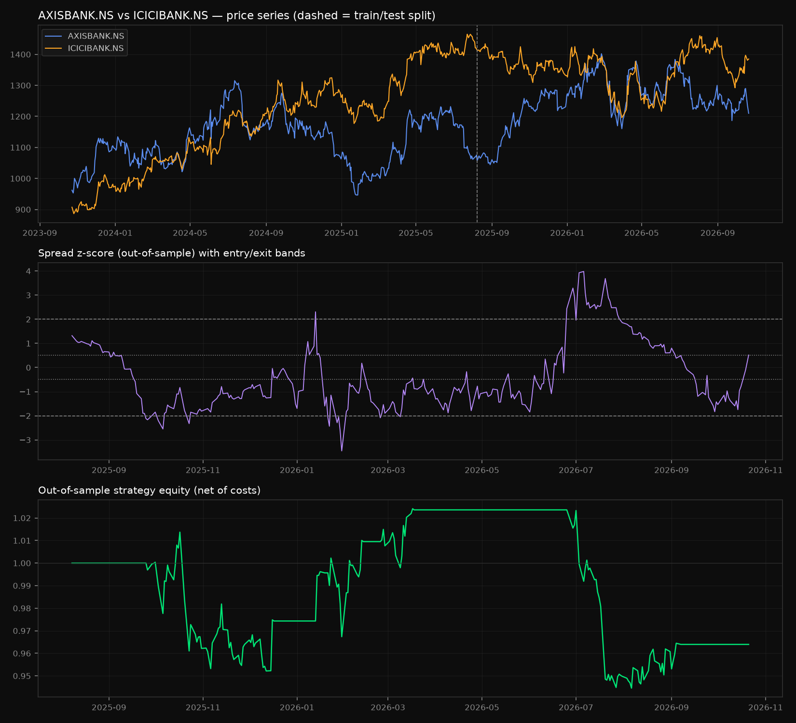

---

### KOTAKBANK.NS / HDFCBANK.NS

- **Latest prices:** KOTAKBANK.NS ₹437.80 · HDFCBANK.NS ₹706.95
- **Hedge ratio (train-fitted):** 2.2034
- **Cointegration (train):** FAIL at 5% — ADF -2.17, p=0.2188
- **Persistence:** passed 5% in 0 of 80 real-data runs (strict tier: 0/80)
- **Spread half-life:** 28.0 days
- **Current z-score:** -1.43
- **Signal today:** watch (approaching band)
- ⚠️ _Pair did not cointegrate on training data. Any signal here is not statistically justified — observation only._

**Out-of-sample backtest** (beta frozen from train window):

| Metric | Value |
|---|---|
| Sharpe | 1.14 |
| Sortino | 1.11 |
| Annualised return | 6.68% |
| Annualised vol | 5.80% |
| Max drawdown | -2.87% |
| Round-trip trades | 5 |

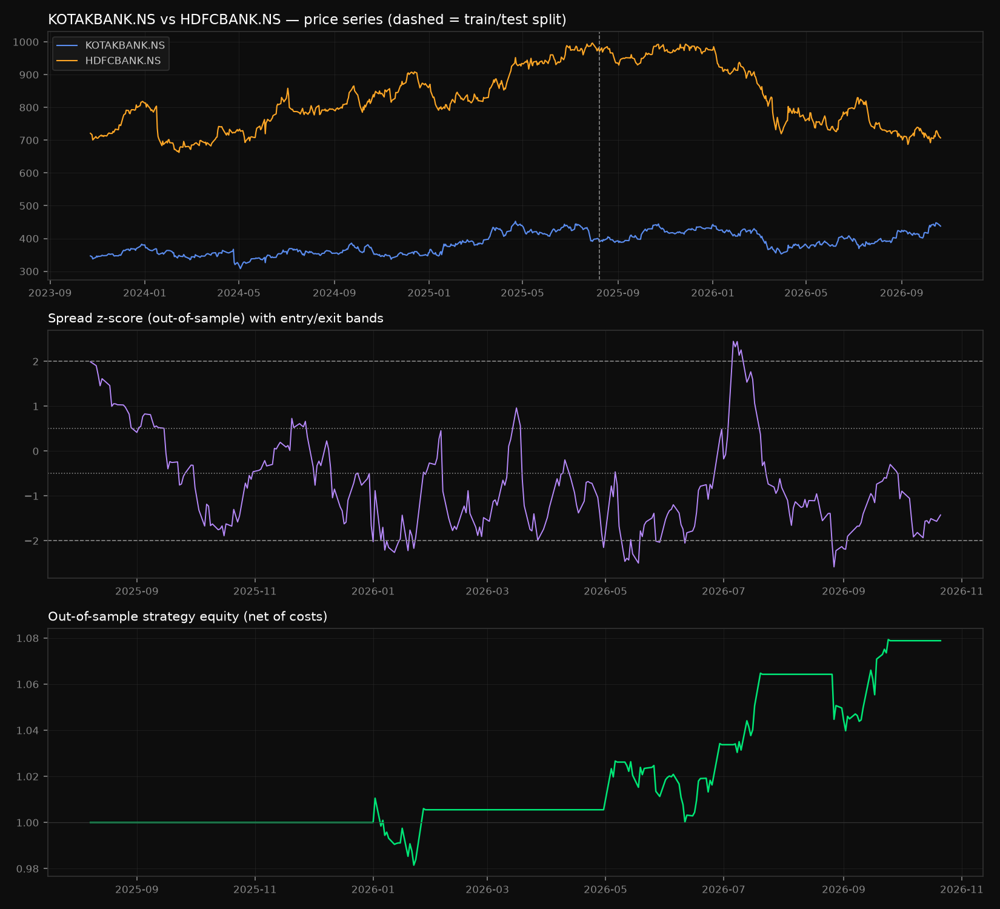

---

### SBIN.NS / BANKBARODA.NS

- **Latest prices:** SBIN.NS ₹963.00 · BANKBARODA.NS ₹237.38
- **Hedge ratio (train-fitted):** 0.1902
- **Cointegration (train):** FAIL at 5% — ADF -2.40, p=0.1406
- **Persistence:** passed 5% in 0 of 80 real-data runs (strict tier: 0/80)
- **Spread half-life:** 21.2 days
- **Current z-score:** +1.96
- **Signal today:** watch (approaching band)
- ⚠️ _Pair did not cointegrate on training data. Any signal here is not statistically justified — observation only._

**Out-of-sample backtest** (beta frozen from train window):

| Metric | Value |
|---|---|
| Sharpe | 0.43 |
| Sortino | 0.39 |
| Annualised return | 3.78% |
| Annualised vol | 9.72% |
| Max drawdown | -8.83% |
| Round-trip trades | 7 |

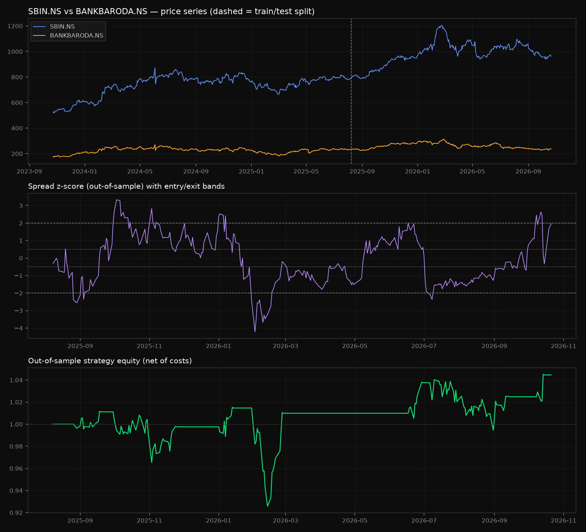

---

### TCS.NS / INFY.NS

- **Latest prices:** TCS.NS ₹2,529.00 · INFY.NS ₹1,168.00
- **Hedge ratio (train-fitted):** 0.4222
- **Cointegration (train):** FAIL at 5% — ADF -1.34, p=0.6086
- **Persistence:** passed 5% in 0 of 80 real-data runs (strict tier: 0/80)
- **Spread half-life:** 67.4 days
- **Current z-score:** -1.82
- **Signal today:** watch (approaching band)
- ⚠️ _Pair did not cointegrate on training data. Any signal here is not statistically justified — observation only._

**Out-of-sample backtest** (beta frozen from train window):

| Metric | Value |
|---|---|
| Sharpe | 1.99 |
| Sortino | 2.08 |
| Annualised return | 8.97% |
| Annualised vol | 4.36% |
| Max drawdown | -1.83% |
| Round-trip trades | 6 |

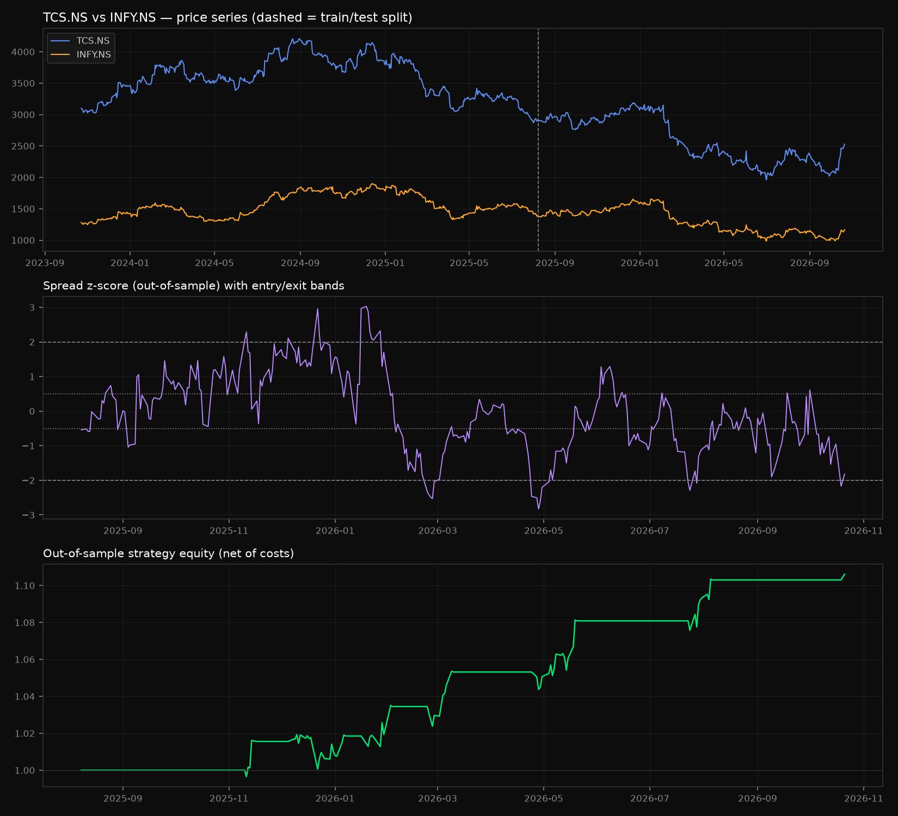

---

### INFY.NS / WIPRO.NS

- **Latest prices:** INFY.NS ₹1,168.00 · WIPRO.NS ₹189.17
- **Hedge ratio (train-fitted):** 0.1258
- **Cointegration (train):** FAIL at 5% — ADF -2.46, p=0.1266
- **Persistence:** passed 5% in 0 of 80 real-data runs (strict tier: 0/80)
- **Spread half-life:** 27.9 days
- **Current z-score:** +1.91
- **Signal today:** watch (approaching band)
- ⚠️ _Pair did not cointegrate on training data. Any signal here is not statistically justified — observation only._

**Out-of-sample backtest** (beta frozen from train window):

| Metric | Value |
|---|---|
| Sharpe | 2.13 |
| Sortino | 2.09 |
| Annualised return | 11.87% |
| Annualised vol | 5.32% |
| Max drawdown | -1.59% |
| Round-trip trades | 7 |

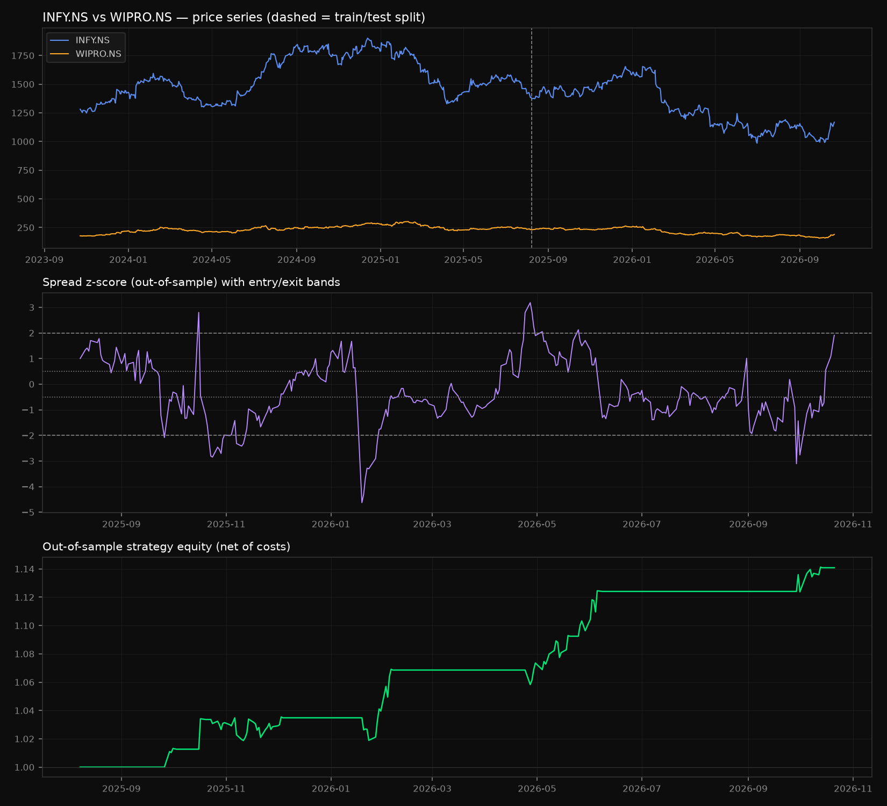

---

### HCLTECH.NS / TECHM.NS

- **Latest prices:** HCLTECH.NS ₹1,424.20 · TECHM.NS ₹1,834.70
- **Hedge ratio (train-fitted):** 0.9588
- **Cointegration (train):** FAIL at 5% — ADF -2.42, p=0.1370
- **Persistence:** passed 5% in 0 of 80 real-data runs (strict tier: 0/80)
- **Spread half-life:** 24.4 days
- **Current z-score:** +3.49
- **Signal today:** SHORT spread (short TECHM.NS, long HCLTECH.NS)
- ⚠️ _Pair did not cointegrate on training data. Any signal here is not statistically justified — observation only._

**Out-of-sample backtest** (beta frozen from train window):

| Metric | Value |
|---|---|
| Sharpe | -0.07 |
| Sortino | -0.07 |
| Annualised return | -0.79% |
| Annualised vol | 7.48% |
| Max drawdown | -8.33% |
| Round-trip trades | 5 |

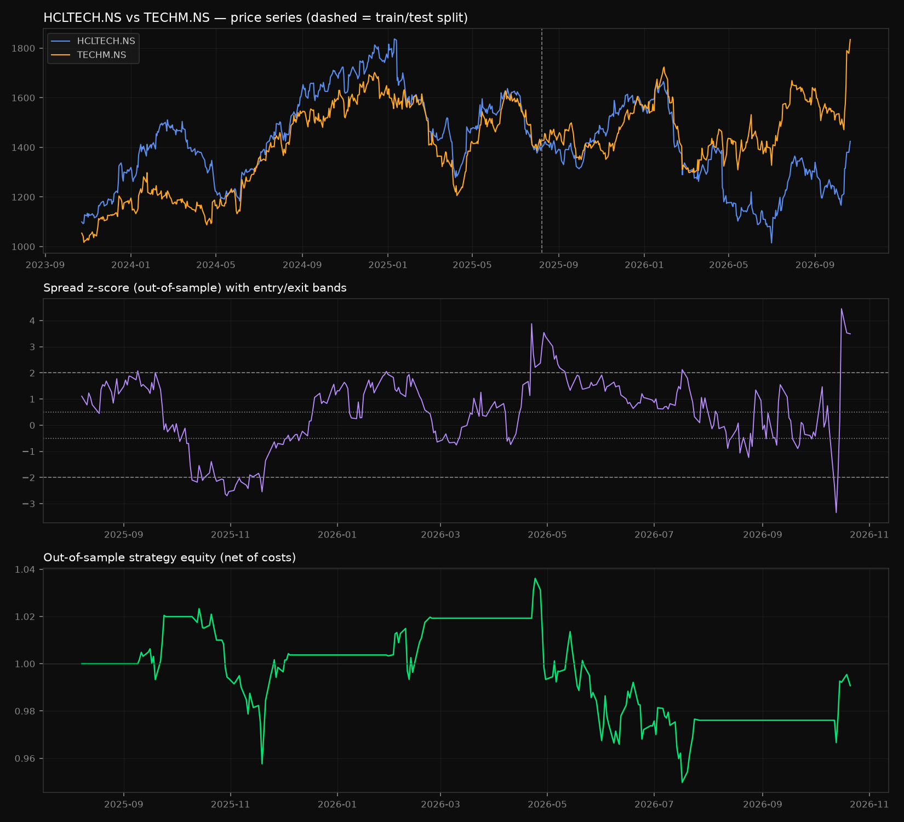

---

### ACC.NS / AMBUJACEM.NS

- **Latest prices:** ACC.NS ₹1,163.60 · AMBUJACEM.NS ₹359.90
- **Hedge ratio (train-fitted):** 0.1640
- **Cointegration (train):** FAIL at 5% — ADF -1.55, p=0.5067
- **Persistence:** passed 5% in 0 of 80 real-data runs (strict tier: 0/80)
- **Spread half-life:** 49.8 days
- **Current z-score:** -1.24
- **Signal today:** watch (approaching band)
- ⚠️ _Pair did not cointegrate on training data. Any signal here is not statistically justified — observation only._

**Out-of-sample backtest** (beta frozen from train window):

| Metric | Value |
|---|---|
| Sharpe | 0.03 |
| Sortino | 0.02 |
| Annualised return | -0.01% |
| Annualised vol | 6.06% |
| Max drawdown | -5.93% |
| Round-trip trades | 3 |

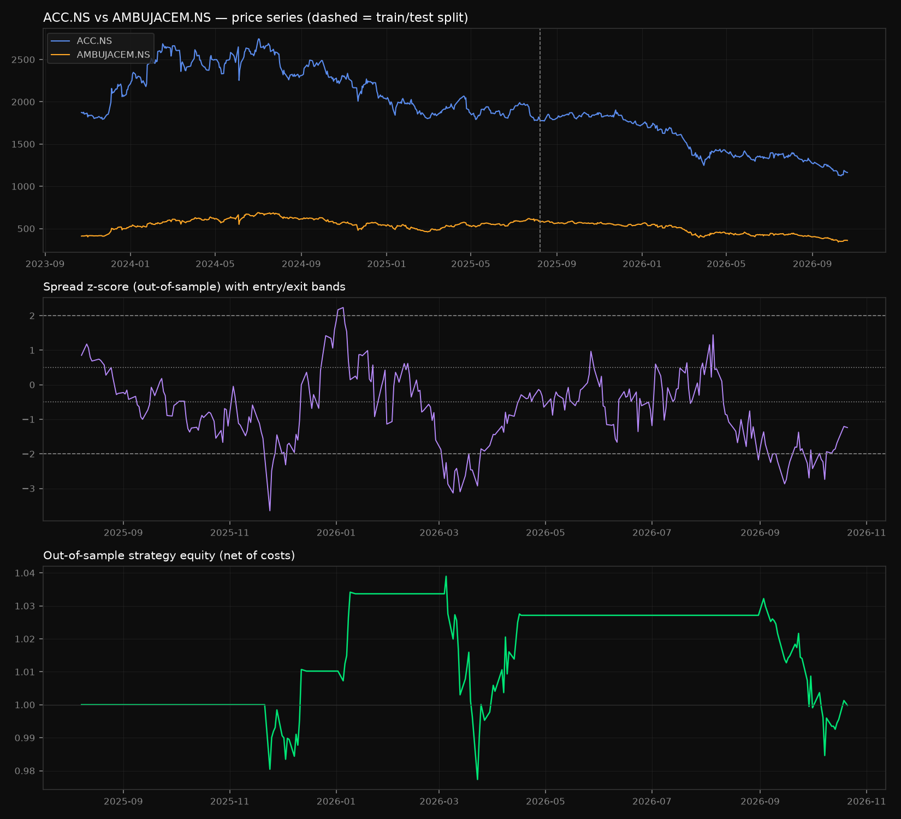

---

### ULTRACEMCO.NS / SHREECEM.NS

- **Latest prices:** ULTRACEMCO.NS ₹10,849.00 · SHREECEM.NS ₹22,310.00
- **Hedge ratio (train-fitted):** 1.0364
- **Cointegration (train):** FAIL at 5% — ADF -1.86, p=0.3501
- **Persistence:** passed 5% in 0 of 80 real-data runs (strict tier: 0/80)
- **Spread half-life:** 41.7 days
- **Current z-score:** -0.78
- **Signal today:** watch (approaching band)
- ⚠️ _Pair did not cointegrate on training data. Any signal here is not statistically justified — observation only._

**Out-of-sample backtest** (beta frozen from train window):

| Metric | Value |
|---|---|
| Sharpe | -0.42 |
| Sortino | -0.51 |
| Annualised return | -3.25% |
| Annualised vol | 7.17% |
| Max drawdown | -7.25% |
| Round-trip trades | 4 |

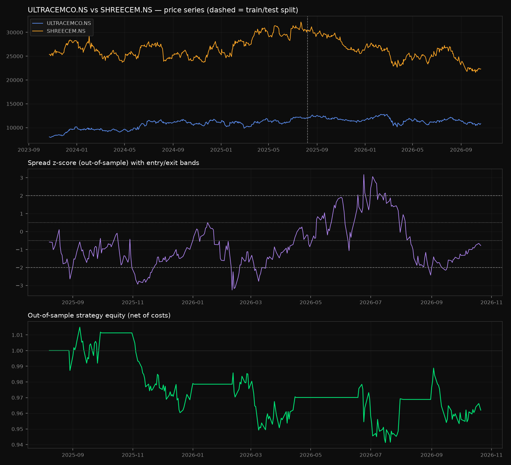

---

### IOC.NS / BPCL.NS

- **Latest prices:** IOC.NS ₹129.61 · BPCL.NS ₹288.00
- **Hedge ratio (train-fitted):** 1.6351
- **Cointegration (train):** FAIL at 5% — ADF -1.08, p=0.7237
- **Persistence:** passed 5% in 0 of 80 real-data runs (strict tier: 0/80)
- **Spread half-life:** 114.6 days
- **Current z-score:** -2.30
- **Signal today:** LONG spread (long BPCL.NS, short IOC.NS)
- ⚠️ _Pair did not cointegrate on training data. Any signal here is not statistically justified — observation only._

**Out-of-sample backtest** (beta frozen from train window):

| Metric | Value |
|---|---|
| Sharpe | 0.23 |
| Sortino | 0.20 |
| Annualised return | 1.27% |
| Annualised vol | 6.36% |
| Max drawdown | -7.13% |
| Round-trip trades | 5 |

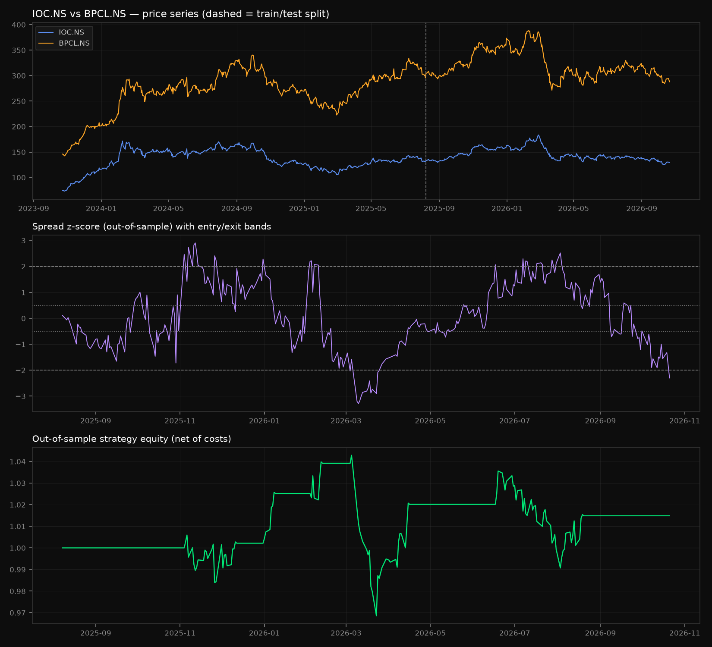

---

### BPCL.NS / HINDPETRO.NS

- **Latest prices:** BPCL.NS ₹288.00 · HINDPETRO.NS ₹347.30
- **Hedge ratio (train-fitted):** 1.3221
- **Cointegration (train):** FAIL at 5% — ADF -2.06, p=0.2620
- **Persistence:** passed 5% in 0 of 80 real-data runs (strict tier: 0/80)
- **Spread half-life:** 36.6 days
- **Current z-score:** +2.67
- **Signal today:** SHORT spread (short HINDPETRO.NS, long BPCL.NS)
- ⚠️ _Pair did not cointegrate on training data. Any signal here is not statistically justified — observation only._

**Out-of-sample backtest** (beta frozen from train window):

| Metric | Value |
|---|---|
| Sharpe | -0.12 |
| Sortino | -0.12 |
| Annualised return | -0.96% |
| Annualised vol | 6.28% |
| Max drawdown | -6.84% |
| Round-trip trades | 5 |

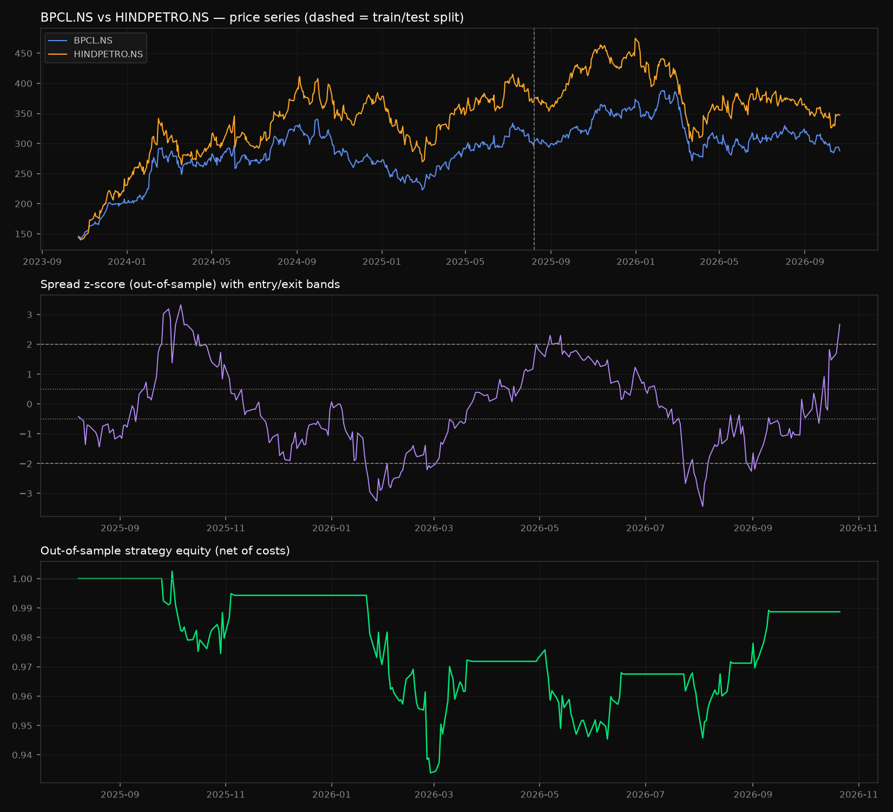

---

### ONGC.NS / COALINDIA.NS

- **Latest prices:** ONGC.NS ₹225.62 · COALINDIA.NS ₹407.50
- **Hedge ratio (train-fitted):** 1.3796
- **Cointegration (train):** PASS at 5% — ADF -3.57, p=0.0063
- **Persistence:** passed 5% in 72 of 80 real-data runs (strict tier: 1/80)
- **Spread half-life:** 12.6 days
- **Current z-score:** +0.44
- **Signal today:** flat / no stretch

**Out-of-sample backtest** (beta frozen from train window):

| Metric | Value |
|---|---|
| Sharpe | 0.84 |
| Sortino | 0.72 |
| Annualised return | 6.75% |
| Annualised vol | 8.21% |
| Max drawdown | -6.42% |
| Round-trip trades | 5 |

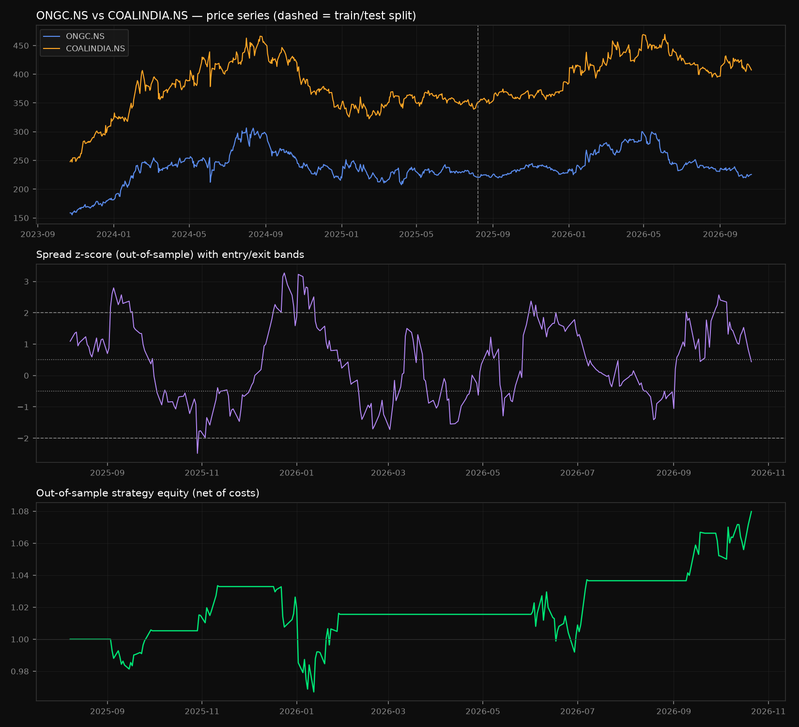

---

### NTPC.NS / POWERGRID.NS

- **Latest prices:** NTPC.NS ₹303.00 · POWERGRID.NS ₹252.15
- **Hedge ratio (train-fitted):** 0.8074
- **Cointegration (train):** FAIL at 5% — ADF -2.54, p=0.1065
- **Persistence:** passed 5% in 0 of 80 real-data runs (strict tier: 0/80)
- **Spread half-life:** 24.0 days
- **Current z-score:** +1.75
- **Signal today:** watch (approaching band)
- ⚠️ _Pair did not cointegrate on training data. Any signal here is not statistically justified — observation only._

**Out-of-sample backtest** (beta frozen from train window):

| Metric | Value |
|---|---|
| Sharpe | 0.44 |
| Sortino | 0.35 |
| Annualised return | 2.34% |
| Annualised vol | 5.66% |
| Max drawdown | -5.32% |
| Round-trip trades | 6 |

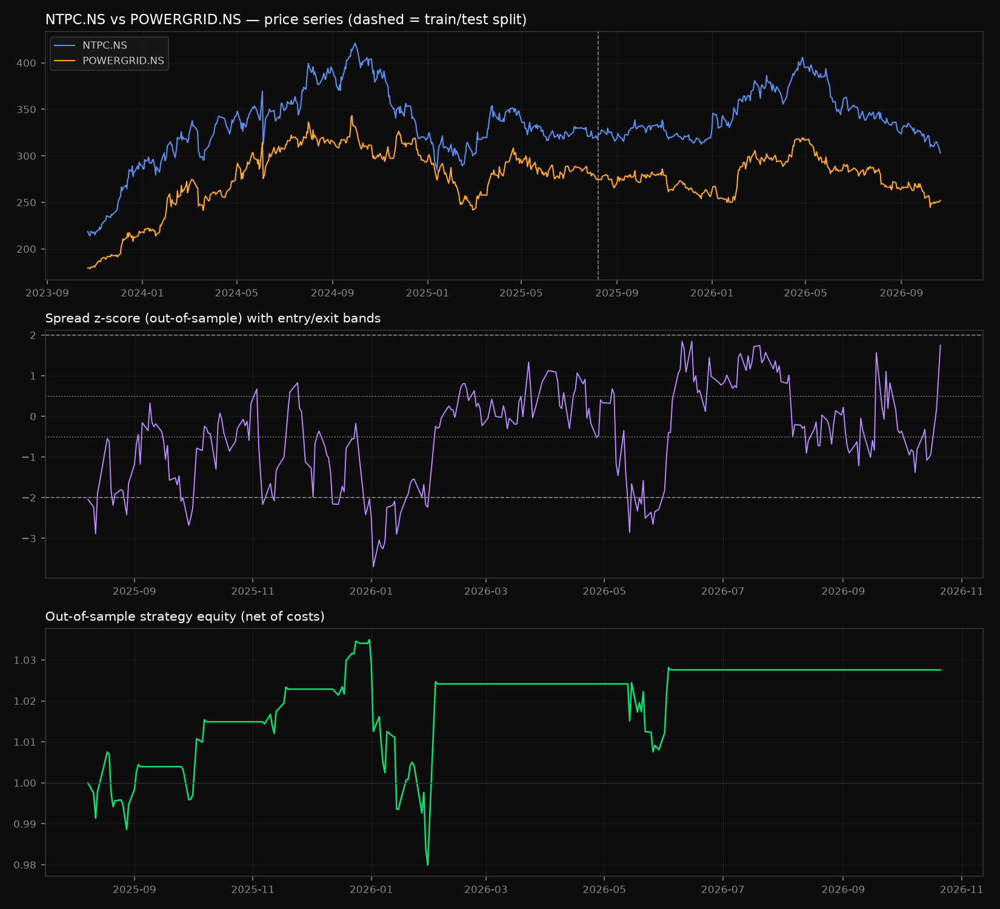

---

### BAJAJ-AUTO.NS / HEROMOTOCO.NS

- **Latest prices:** BAJAJ-AUTO.NS ₹10,072.00 · HEROMOTOCO.NS ₹5,153.50
- **Hedge ratio (train-fitted):** 0.4087
- **Cointegration (train):** FAIL at 5% — ADF -2.13, p=0.2322
- **Persistence:** passed 5% in 0 of 80 real-data runs (strict tier: 0/80)
- **Spread half-life:** 31.4 days
- **Current z-score:** +1.25
- **Signal today:** watch (approaching band)
- ⚠️ _Pair did not cointegrate on training data. Any signal here is not statistically justified — observation only._

**Out-of-sample backtest** (beta frozen from train window):

| Metric | Value |
|---|---|
| Sharpe | -0.32 |
| Sortino | -0.33 |
| Annualised return | -3.58% |
| Annualised vol | 9.94% |
| Max drawdown | -16.94% |
| Round-trip trades | 6 |

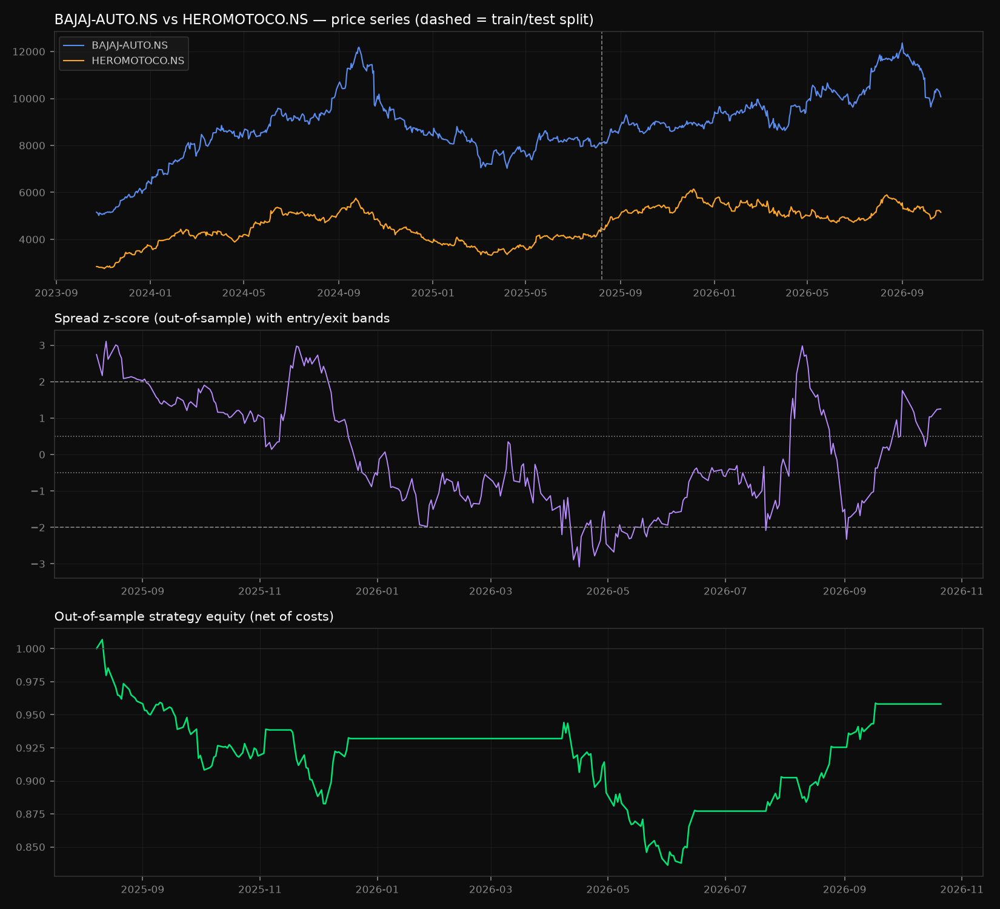

---

### TATASTEEL.NS / JSWSTEEL.NS

- **Latest prices:** TATASTEEL.NS ₹172.45 · JSWSTEEL.NS ₹1,222.90
- **Hedge ratio (train-fitted):** 2.9994
- **Cointegration (train):** FAIL at 5% — ADF -1.20, p=0.6750
- **Persistence:** passed 5% in 0 of 80 real-data runs (strict tier: 0/80)
- **Spread half-life:** 71.4 days
- **Current z-score:** -0.43
- **Signal today:** flat / no stretch
- ⚠️ _Pair did not cointegrate on training data. Any signal here is not statistically justified — observation only._

**Out-of-sample backtest** (beta frozen from train window):

| Metric | Value |
|---|---|
| Sharpe | 0.73 |
| Sortino | 0.70 |
| Annualised return | 5.98% |
| Annualised vol | 8.49% |
| Max drawdown | -5.57% |
| Round-trip trades | 6 |

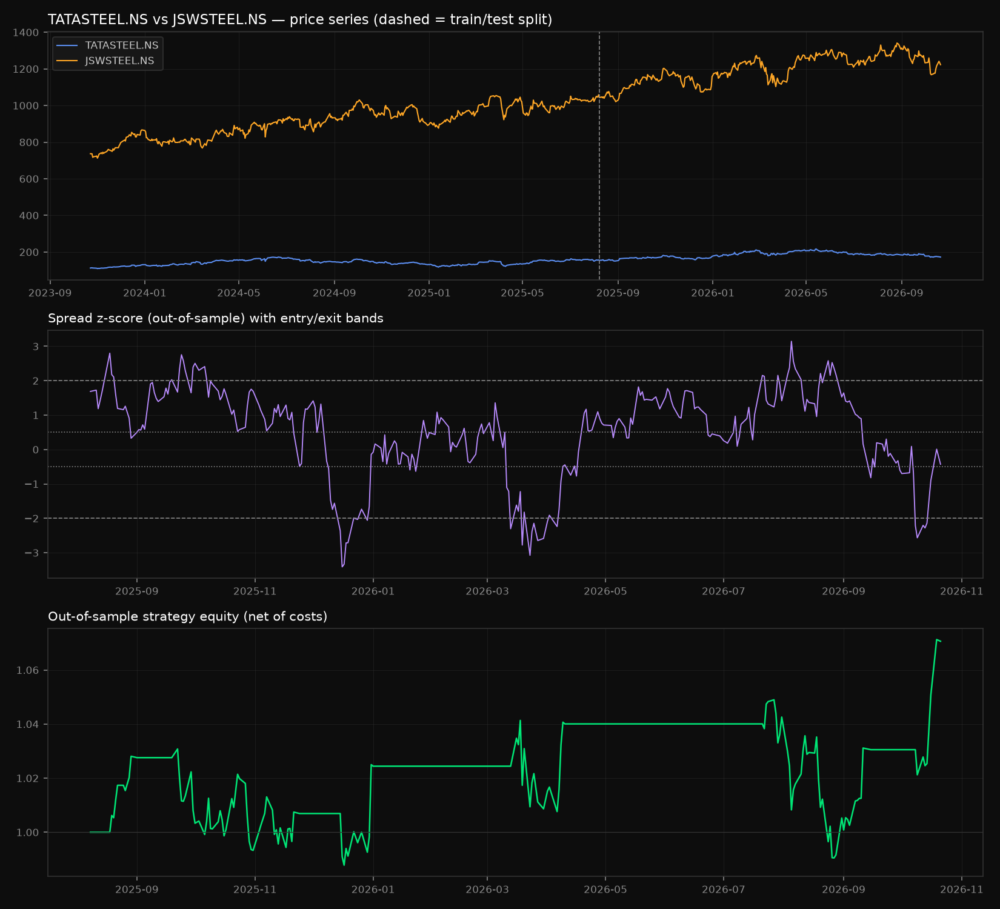

---

### SUNPHARMA.NS / CIPLA.NS

- **Latest prices:** SUNPHARMA.NS ₹1,745.10 · CIPLA.NS ₹1,314.00
- **Hedge ratio (train-fitted):** 0.4820
- **Cointegration (train):** PASS at 5% — ADF -3.43, p=0.0101
- **Persistence:** passed 5% in 80 of 80 real-data runs (strict tier: 5/80)
- **Spread half-life:** 10.7 days
- **Current z-score:** -0.83
- **Signal today:** watch (approaching band)

**Out-of-sample backtest** (beta frozen from train window):

| Metric | Value |
|---|---|
| Sharpe | 0.15 |
| Sortino | 0.16 |
| Annualised return | 0.86% |
| Annualised vol | 7.82% |
| Max drawdown | -10.51% |
| Round-trip trades | 5 |

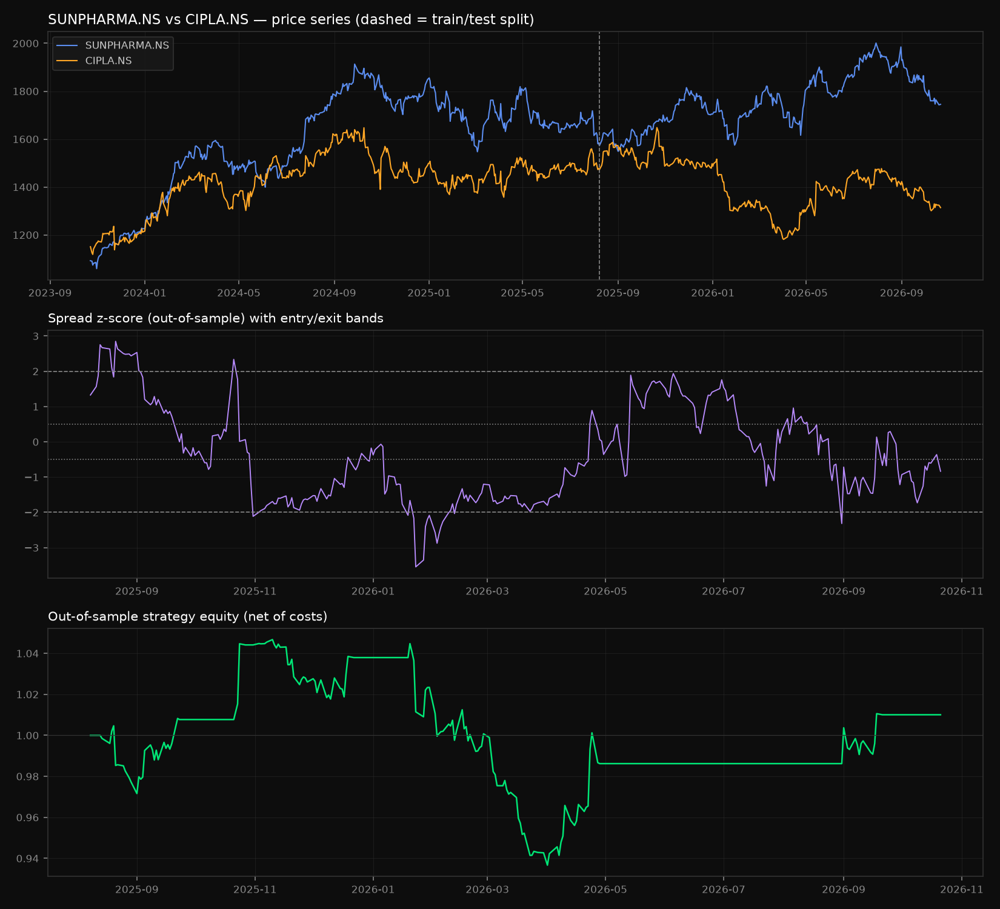

---

_Generated 2026-10-21 · pairs mean-reversion scanner · out-of-sample backtest · multiple-testing-aware · not investment advice._
