# Indian Pairs-Trading Scanner — 2026-10-22

> **What this is:** a market-neutral *pairs mean-reversion* scanner. It flags when two related NSE stocks have drifted apart far enough that their historical relationship signals a possible convergence trade. It does **not** forecast growth, rank "best" stocks, or predict company performance. A signal means the *spread between two stocks* is stretched — nothing about either stock being a good investment. Not investment advice; do your own research.

## Methodology (fixed in advance)

- **Universe:** 16 declared sector-mate pairs. Parameters (3y window, 60/40 train-test, z-entry 2.0, z-exit 0.5, 5 bps costs) are pre-registered; changes are logged in the README changelog *before* looking at results.
- **Multiple testing:** at the 5% level across 16 pairs, **≈0.8 false positives per run are expected by chance alone** even if nothing truly cointegrates. A single-day pass is a candidate, not a discovery.
- **Strict tier:** Bonferroni-corrected threshold p < 0.0031 (marked ✓✓).
- **Evidence = persistence:** the Persistence column counts how often each pair has passed the 5% test across all *real-data* daily runs recorded in `reports/history.csv`. Pairs deserve attention only when they pass persistently.

## Summary

| Pair | p-value | Coint. | Persistence | Current z | Signal | OOS Sharpe |
|---|---|---|---|---|---|---|
| HDFCBANK.NS/ICICIBANK.NS | 0.0660 | ✗ | 1/66 | +1.13 | watch | -0.34 |
| AXISBANK.NS/ICICIBANK.NS | 0.9291 | ✗ | 0/81 | +0.82 | watch | -0.33 |
| KOTAKBANK.NS/HDFCBANK.NS | 0.2402 | ✗ | 0/81 | -1.59 | watch | 1.14 |
| SBIN.NS/BANKBARODA.NS | 0.1409 | ✗ | 0/81 | +1.34 | watch | 0.43 |
| TCS.NS/INFY.NS | 0.5954 | ✗ | 0/81 | -1.98 | watch | 1.95 |
| INFY.NS/WIPRO.NS | 0.1205 | ✗ | 0/81 | +2.83 | SHORT spread | 2.14 |
| HCLTECH.NS/TECHM.NS | 0.1363 | ✗ | 0/81 | +3.05 | SHORT spread | -0.05 |
| ACC.NS/AMBUJACEM.NS | 0.4478 | ✗ | 0/81 | -1.24 | watch | 0.01 |
| ULTRACEMCO.NS/SHREECEM.NS | 0.3404 | ✗ | 0/81 | -0.83 | watch | -0.45 |
| IOC.NS/BPCL.NS | 0.7764 | ✗ | 0/81 | -2.73 | LONG spread | 0.14 |
| BPCL.NS/HINDPETRO.NS | 0.2498 | ✗ | 0/81 | +1.82 | watch | -0.04 |
| ONGC.NS/COALINDIA.NS | 0.0063 | ✓ | 73/81 | +0.14 | flat / no stretch | 0.83 |
| NTPC.NS/POWERGRID.NS | 0.1004 | ✗ | 0/81 | +0.98 | watch | 0.47 |
| BAJAJ-AUTO.NS/HEROMOTOCO.NS | 0.2129 | ✗ | 0/81 | +0.94 | watch | -0.38 |
| TATASTEEL.NS/JSWSTEEL.NS | 0.6515 | ✗ | 0/81 | -0.51 | watch | 0.72 |
| SUNPHARMA.NS/CIPLA.NS | 0.0102 | ✓ | 81/81 | -0.40 | flat / no stretch | 0.15 |

_Legend: ✓✓ passes strict Bonferroni tier · ✓ passes 5% only · ✗ fails. Persistence = 5%-passes / real-data runs recorded. \*no real-data history yet._

---

### HDFCBANK.NS / ICICIBANK.NS

- **Latest prices:** HDFCBANK.NS ₹694.05 · ICICIBANK.NS ₹1,398.50
- **Hedge ratio (train-fitted):** 1.5895
- **Cointegration (train):** FAIL at 5% — ADF -2.75, p=0.0660
- **Persistence:** passed 5% in 1 of 66 real-data runs (strict tier: 0/66)
- **Spread half-life:** 23.7 days
- **Current z-score:** +1.13
- **Signal today:** watch (approaching band)
- ⚠️ _Pair did not cointegrate on training data. Any signal here is not statistically justified — observation only._

**Out-of-sample backtest** (beta frozen from train window):

| Metric | Value |
|---|---|
| Sharpe | -0.34 |
| Sortino | -0.37 |
| Annualised return | -2.48% |
| Annualised vol | 6.64% |
| Max drawdown | -8.01% |
| Round-trip trades | 4 |

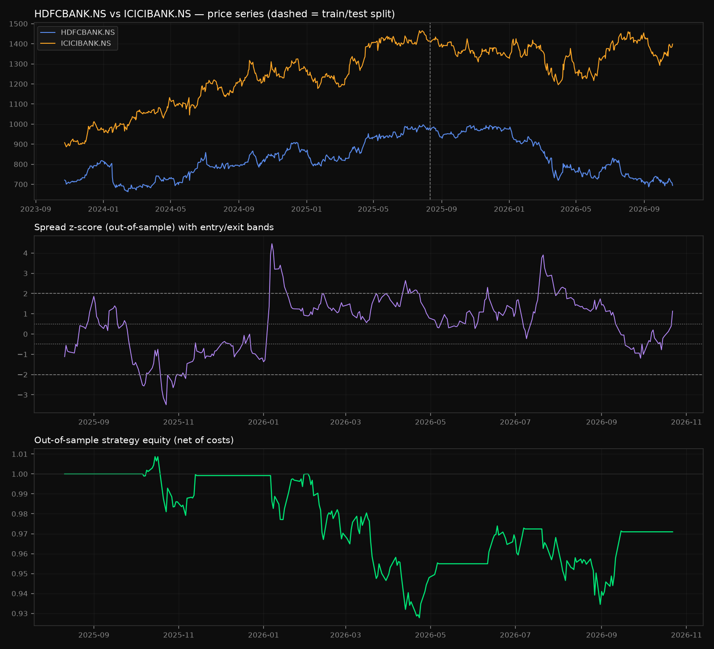

---

### AXISBANK.NS / ICICIBANK.NS

- **Latest prices:** AXISBANK.NS ₹1,212.00 · ICICIBANK.NS ₹1,398.50
- **Hedge ratio (train-fitted):** 0.8077
- **Cointegration (train):** FAIL at 5% — ADF -0.27, p=0.9291
- **Persistence:** passed 5% in 0 of 81 real-data runs (strict tier: 0/81)
- **Spread half-life:** 577.4 days
- **Current z-score:** +0.82
- **Signal today:** watch (approaching band)
- ⚠️ _Pair did not cointegrate on training data. Any signal here is not statistically justified — observation only._

**Out-of-sample backtest** (beta frozen from train window):

| Metric | Value |
|---|---|
| Sharpe | -0.33 |
| Sortino | -0.30 |
| Annualised return | -3.06% |
| Annualised vol | 8.35% |
| Max drawdown | -7.71% |
| Round-trip trades | 5 |

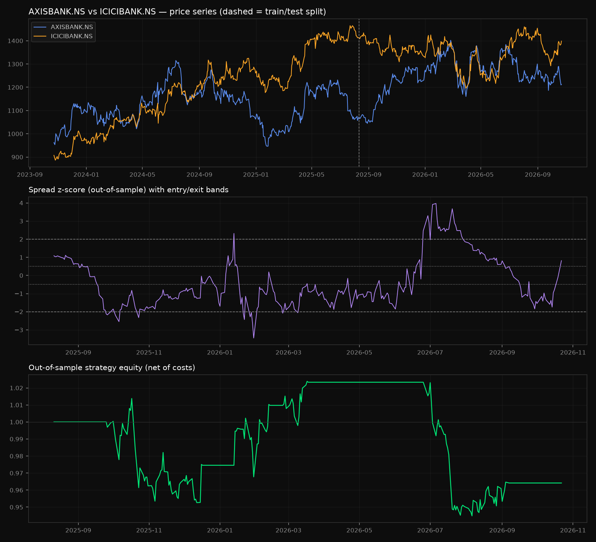

---

### KOTAKBANK.NS / HDFCBANK.NS

- **Latest prices:** KOTAKBANK.NS ₹437.00 · HDFCBANK.NS ₹694.05
- **Hedge ratio (train-fitted):** 2.2081
- **Cointegration (train):** FAIL at 5% — ADF -2.11, p=0.2402
- **Persistence:** passed 5% in 0 of 81 real-data runs (strict tier: 0/81)
- **Spread half-life:** 28.9 days
- **Current z-score:** -1.59
- **Signal today:** watch (approaching band)
- ⚠️ _Pair did not cointegrate on training data. Any signal here is not statistically justified — observation only._

**Out-of-sample backtest** (beta frozen from train window):

| Metric | Value |
|---|---|
| Sharpe | 1.14 |
| Sortino | 1.11 |
| Annualised return | 6.60% |
| Annualised vol | 5.74% |
| Max drawdown | -2.84% |
| Round-trip trades | 5 |

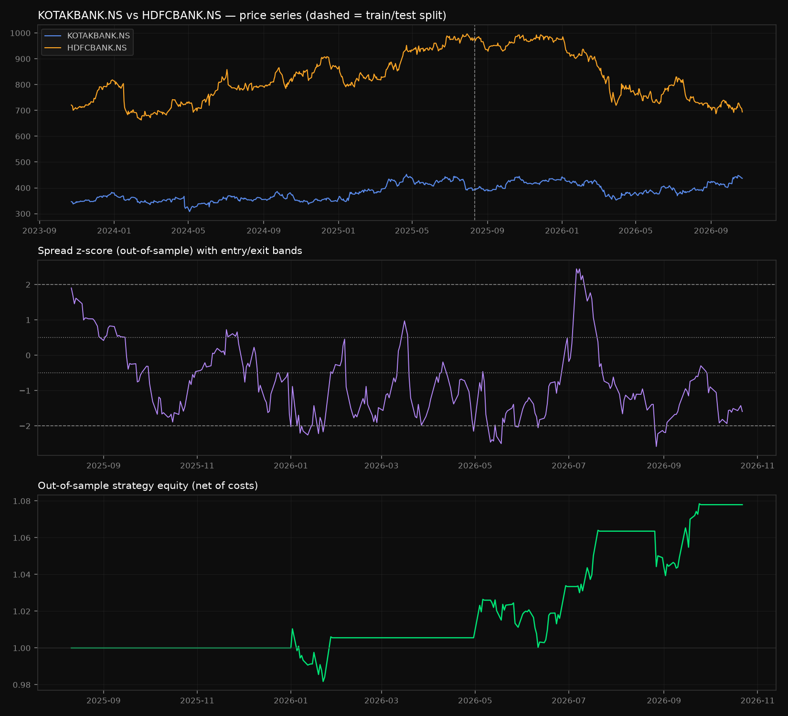

---

### SBIN.NS / BANKBARODA.NS

- **Latest prices:** SBIN.NS ₹970.00 · BANKBARODA.NS ₹236.42
- **Hedge ratio (train-fitted):** 0.1902
- **Cointegration (train):** FAIL at 5% — ADF -2.40, p=0.1409
- **Persistence:** passed 5% in 0 of 81 real-data runs (strict tier: 0/81)
- **Spread half-life:** 21.2 days
- **Current z-score:** +1.34
- **Signal today:** watch (approaching band)
- ⚠️ _Pair did not cointegrate on training data. Any signal here is not statistically justified — observation only._

**Out-of-sample backtest** (beta frozen from train window):

| Metric | Value |
|---|---|
| Sharpe | 0.43 |
| Sortino | 0.39 |
| Annualised return | 3.71% |
| Annualised vol | 9.51% |
| Max drawdown | -8.65% |
| Round-trip trades | 7 |

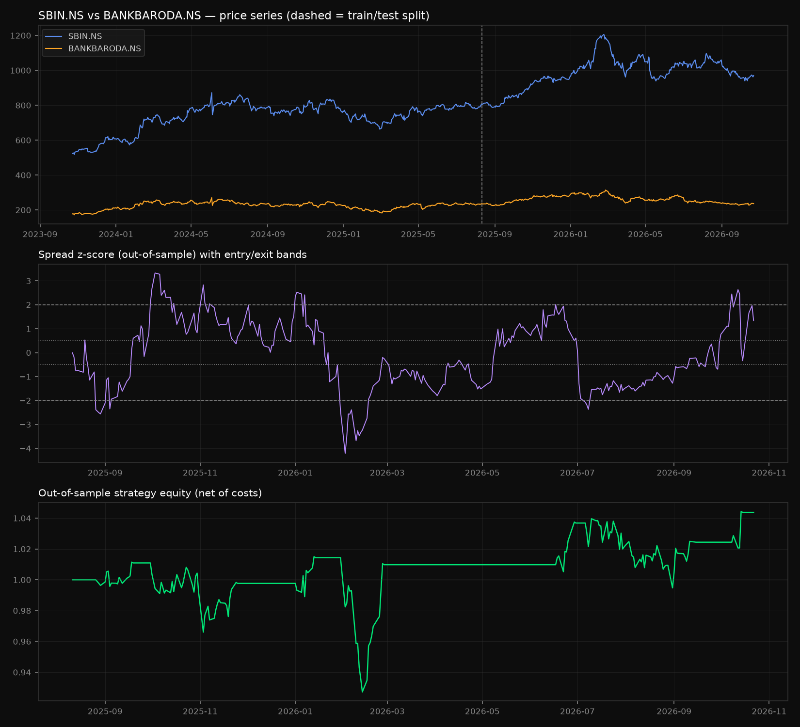

---

### TCS.NS / INFY.NS

- **Latest prices:** TCS.NS ₹2,506.90 · INFY.NS ₹1,153.35
- **Hedge ratio (train-fitted):** 0.4208
- **Cointegration (train):** FAIL at 5% — ADF -1.37, p=0.5954
- **Persistence:** passed 5% in 0 of 81 real-data runs (strict tier: 0/81)
- **Spread half-life:** 66.4 days
- **Current z-score:** -1.98
- **Signal today:** watch (approaching band)
- ⚠️ _Pair did not cointegrate on training data. Any signal here is not statistically justified — observation only._

**Out-of-sample backtest** (beta frozen from train window):

| Metric | Value |
|---|---|
| Sharpe | 1.95 |
| Sortino | 2.07 |
| Annualised return | 8.77% |
| Annualised vol | 4.36% |
| Max drawdown | -1.83% |
| Round-trip trades | 6 |

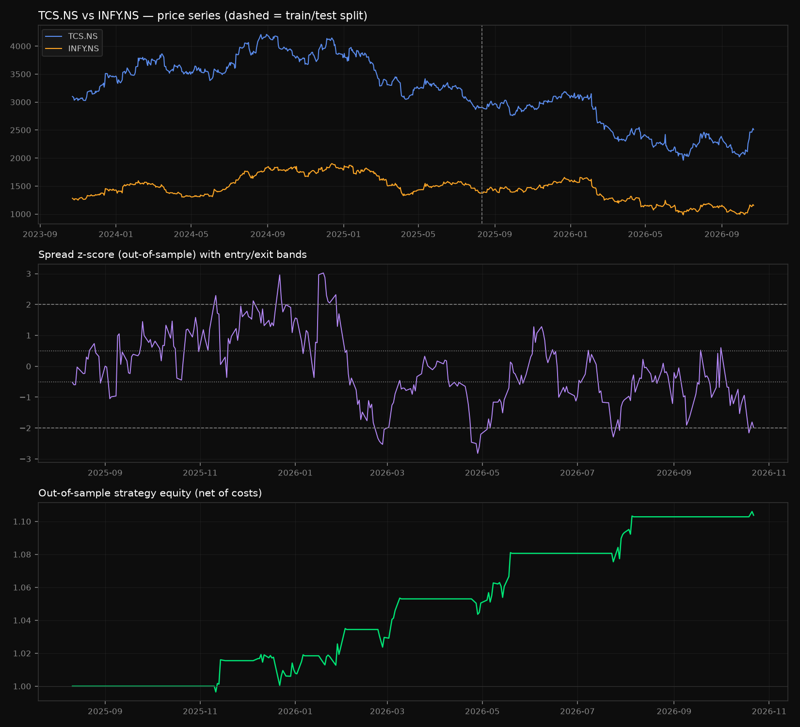

---

### INFY.NS / WIPRO.NS

- **Latest prices:** INFY.NS ₹1,153.35 · WIPRO.NS ₹190.41
- **Hedge ratio (train-fitted):** 0.1256
- **Cointegration (train):** FAIL at 5% — ADF -2.48, p=0.1205
- **Persistence:** passed 5% in 0 of 81 real-data runs (strict tier: 0/81)
- **Spread half-life:** 27.7 days
- **Current z-score:** +2.83
- **Signal today:** SHORT spread (short WIPRO.NS, long INFY.NS)
- ⚠️ _Pair did not cointegrate on training data. Any signal here is not statistically justified — observation only._

**Out-of-sample backtest** (beta frozen from train window):

| Metric | Value |
|---|---|
| Sharpe | 2.14 |
| Sortino | 2.09 |
| Annualised return | 11.78% |
| Annualised vol | 5.28% |
| Max drawdown | -1.58% |
| Round-trip trades | 7 |

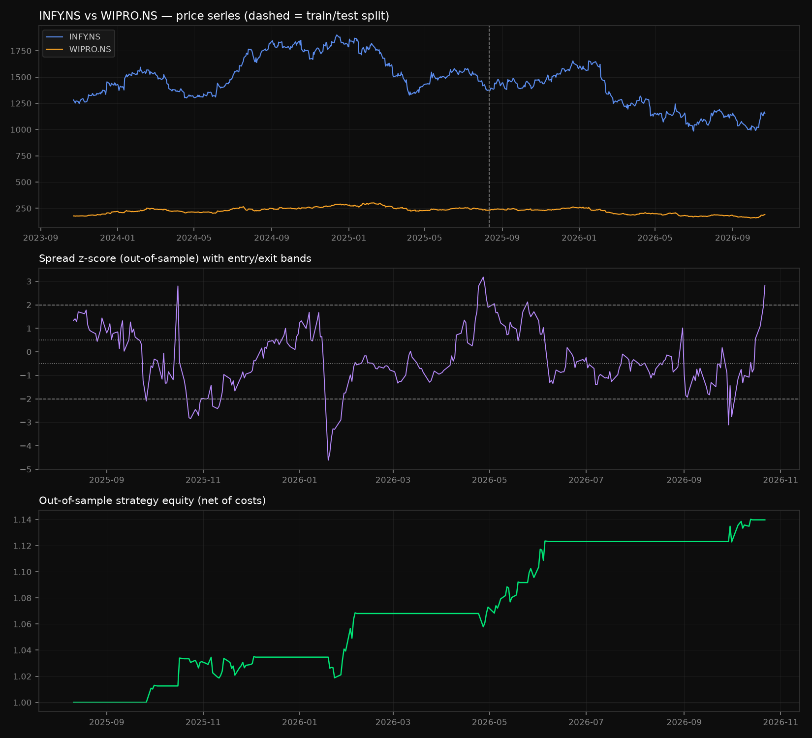

---

### HCLTECH.NS / TECHM.NS

- **Latest prices:** HCLTECH.NS ₹1,421.70 · TECHM.NS ₹1,829.10
- **Hedge ratio (train-fitted):** 0.9582
- **Cointegration (train):** FAIL at 5% — ADF -2.42, p=0.1363
- **Persistence:** passed 5% in 0 of 81 real-data runs (strict tier: 0/81)
- **Spread half-life:** 24.5 days
- **Current z-score:** +3.05
- **Signal today:** SHORT spread (short TECHM.NS, long HCLTECH.NS)
- ⚠️ _Pair did not cointegrate on training data. Any signal here is not statistically justified — observation only._

**Out-of-sample backtest** (beta frozen from train window):

| Metric | Value |
|---|---|
| Sharpe | -0.05 |
| Sortino | -0.05 |
| Annualised return | -0.68% |
| Annualised vol | 7.45% |
| Max drawdown | -8.30% |
| Round-trip trades | 5 |

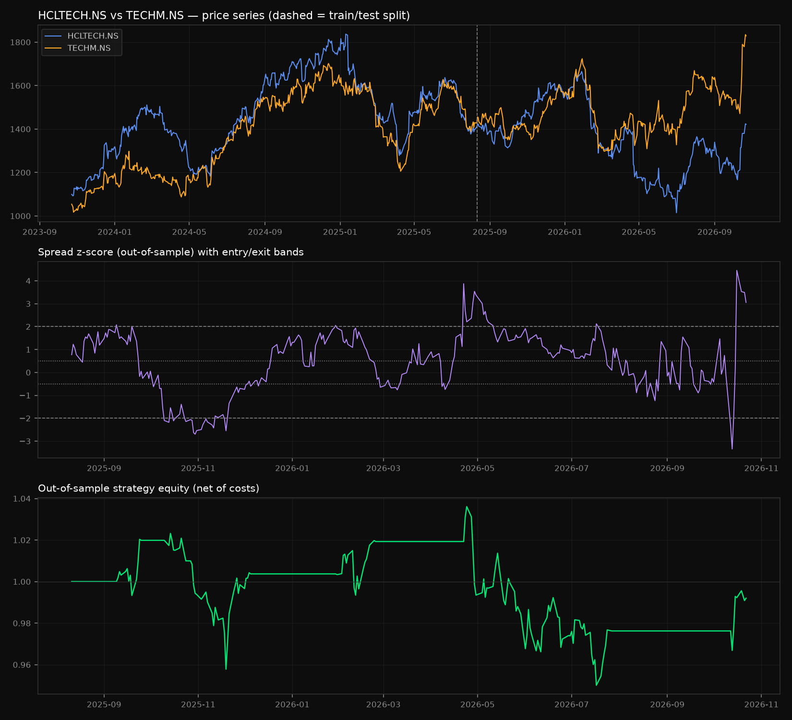

---

### ACC.NS / AMBUJACEM.NS

- **Latest prices:** ACC.NS ₹1,186.90 · AMBUJACEM.NS ₹363.00
- **Hedge ratio (train-fitted):** 0.1630
- **Cointegration (train):** FAIL at 5% — ADF -1.67, p=0.4478
- **Persistence:** passed 5% in 0 of 81 real-data runs (strict tier: 0/81)
- **Spread half-life:** 46.8 days
- **Current z-score:** -1.24
- **Signal today:** watch (approaching band)
- ⚠️ _Pair did not cointegrate on training data. Any signal here is not statistically justified — observation only._

**Out-of-sample backtest** (beta frozen from train window):

| Metric | Value |
|---|---|
| Sharpe | 0.01 |
| Sortino | 0.01 |
| Annualised return | -0.10% |
| Annualised vol | 6.03% |
| Max drawdown | -5.91% |
| Round-trip trades | 3 |

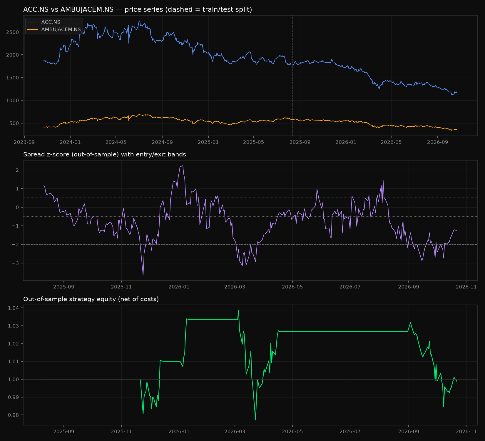

---

### ULTRACEMCO.NS / SHREECEM.NS

- **Latest prices:** ULTRACEMCO.NS ₹10,958.00 · SHREECEM.NS ₹22,330.00
- **Hedge ratio (train-fitted):** 1.0421
- **Cointegration (train):** FAIL at 5% — ADF -1.88, p=0.3404
- **Persistence:** passed 5% in 0 of 81 real-data runs (strict tier: 0/81)
- **Spread half-life:** 41.4 days
- **Current z-score:** -0.83
- **Signal today:** watch (approaching band)
- ⚠️ _Pair did not cointegrate on training data. Any signal here is not statistically justified — observation only._

**Out-of-sample backtest** (beta frozen from train window):

| Metric | Value |
|---|---|
| Sharpe | -0.45 |
| Sortino | -0.54 |
| Annualised return | -3.35% |
| Annualised vol | 7.07% |
| Max drawdown | -7.14% |
| Round-trip trades | 4 |

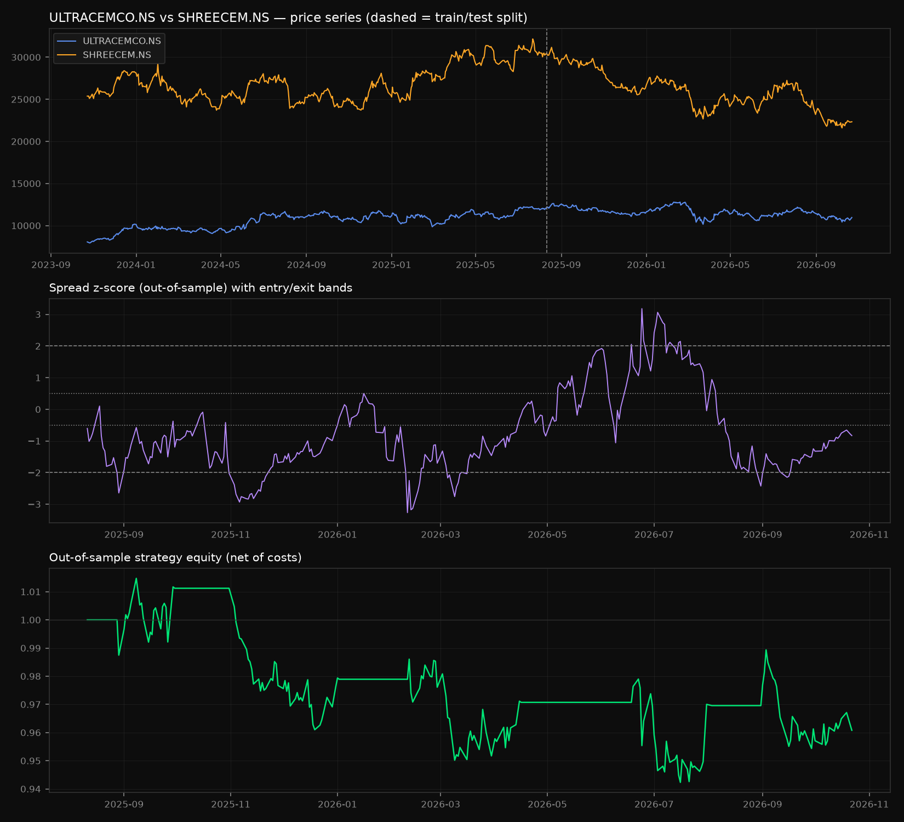

---

### IOC.NS / BPCL.NS

- **Latest prices:** IOC.NS ₹130.98 · BPCL.NS ₹286.95
- **Hedge ratio (train-fitted):** 1.6347
- **Cointegration (train):** FAIL at 5% — ADF -0.93, p=0.7764
- **Persistence:** passed 5% in 0 of 81 real-data runs (strict tier: 0/81)
- **Spread half-life:** 131.8 days
- **Current z-score:** -2.73
- **Signal today:** LONG spread (long BPCL.NS, short IOC.NS)
- ⚠️ _Pair did not cointegrate on training data. Any signal here is not statistically justified — observation only._

**Out-of-sample backtest** (beta frozen from train window):

| Metric | Value |
|---|---|
| Sharpe | 0.14 |
| Sortino | 0.12 |
| Annualised return | 0.68% |
| Annualised vol | 6.34% |
| Max drawdown | -7.08% |
| Round-trip trades | 5 |

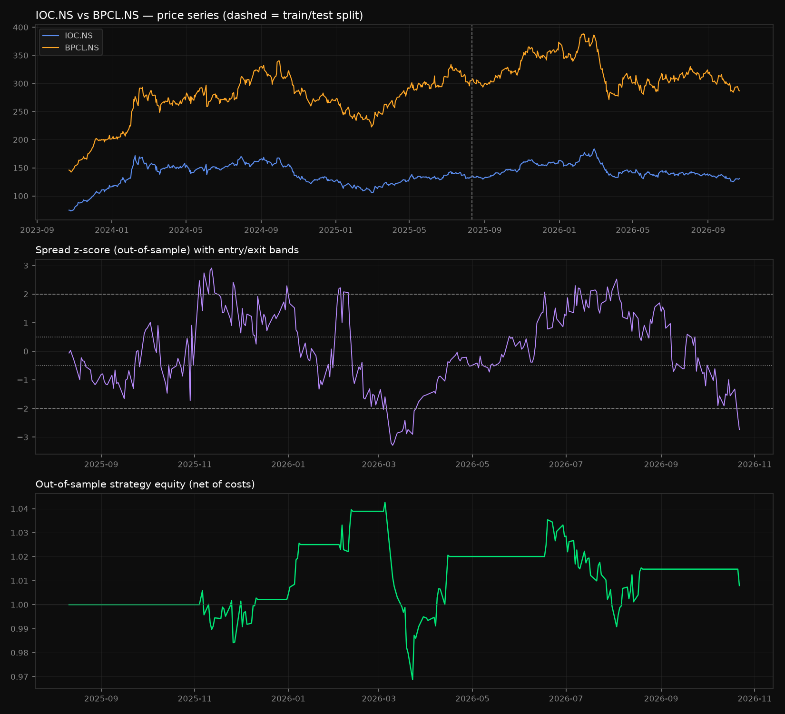

---

### BPCL.NS / HINDPETRO.NS

- **Latest prices:** BPCL.NS ₹286.95 · HINDPETRO.NS ₹340.80
- **Hedge ratio (train-fitted):** 1.3224
- **Cointegration (train):** FAIL at 5% — ADF -2.09, p=0.2498
- **Persistence:** passed 5% in 0 of 81 real-data runs (strict tier: 0/81)
- **Spread half-life:** 36.1 days
- **Current z-score:** +1.82
- **Signal today:** watch (approaching band)
- ⚠️ _Pair did not cointegrate on training data. Any signal here is not statistically justified — observation only._

**Out-of-sample backtest** (beta frozen from train window):

| Metric | Value |
|---|---|
| Sharpe | -0.04 |
| Sortino | -0.04 |
| Annualised return | -0.44% |
| Annualised vol | 6.29% |
| Max drawdown | -6.82% |
| Round-trip trades | 5 |

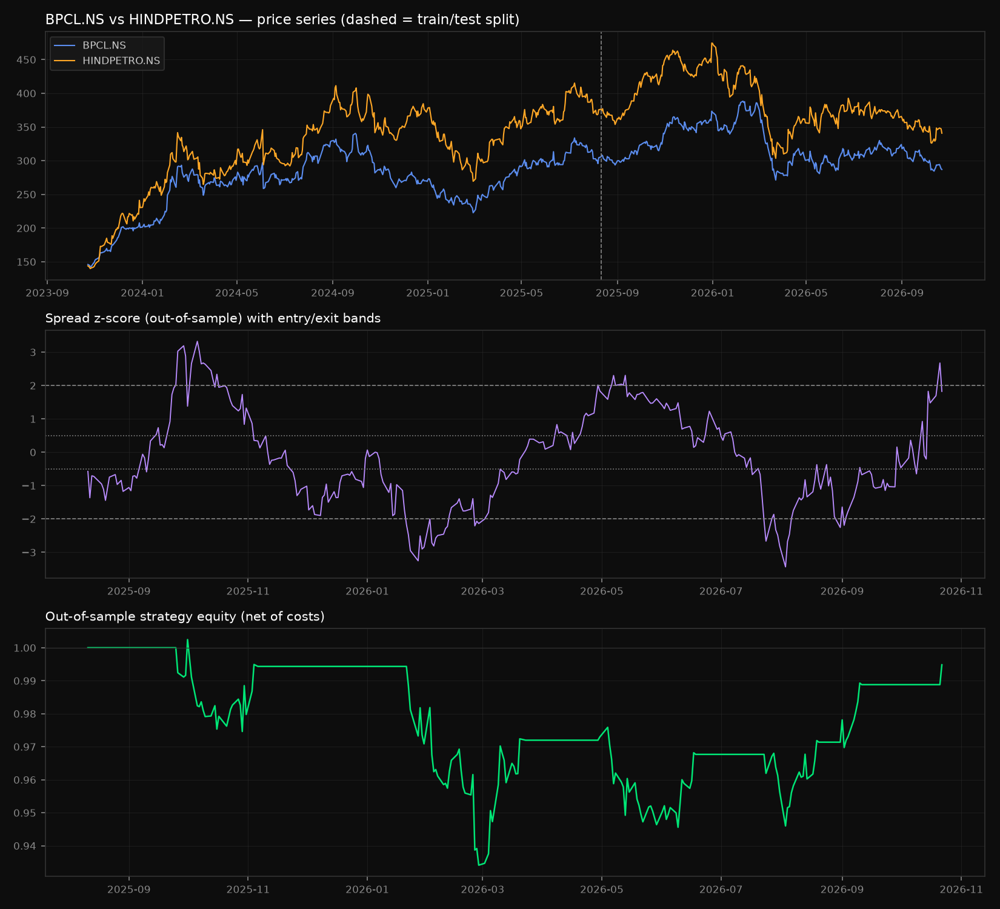

---

### ONGC.NS / COALINDIA.NS

- **Latest prices:** ONGC.NS ₹225.00 · COALINDIA.NS ₹402.55
- **Hedge ratio (train-fitted):** 1.3796
- **Cointegration (train):** PASS at 5% — ADF -3.57, p=0.0063
- **Persistence:** passed 5% in 73 of 81 real-data runs (strict tier: 1/81)
- **Spread half-life:** 12.6 days
- **Current z-score:** +0.14
- **Signal today:** flat / no stretch

**Out-of-sample backtest** (beta frozen from train window):

| Metric | Value |
|---|---|
| Sharpe | 0.83 |
| Sortino | 0.71 |
| Annualised return | 6.67% |
| Annualised vol | 8.17% |
| Max drawdown | -6.40% |
| Round-trip trades | 6 |

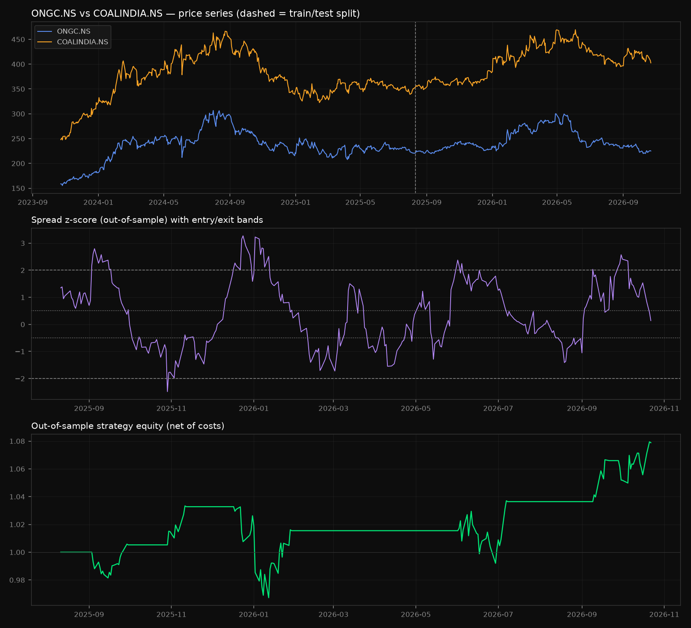

---

### NTPC.NS / POWERGRID.NS

- **Latest prices:** NTPC.NS ₹302.60 · POWERGRID.NS ₹248.40
- **Hedge ratio (train-fitted):** 0.8074
- **Cointegration (train):** FAIL at 5% — ADF -2.57, p=0.1004
- **Persistence:** passed 5% in 0 of 81 real-data runs (strict tier: 0/81)
- **Spread half-life:** 23.7 days
- **Current z-score:** +0.98
- **Signal today:** watch (approaching band)
- ⚠️ _Pair did not cointegrate on training data. Any signal here is not statistically justified — observation only._

**Out-of-sample backtest** (beta frozen from train window):

| Metric | Value |
|---|---|
| Sharpe | 0.47 |
| Sortino | 0.36 |
| Annualised return | 2.52% |
| Annualised vol | 5.65% |
| Max drawdown | -5.31% |
| Round-trip trades | 6 |

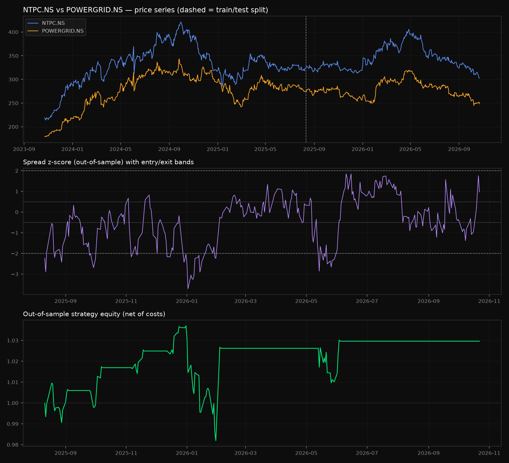

---

### BAJAJ-AUTO.NS / HEROMOTOCO.NS

- **Latest prices:** BAJAJ-AUTO.NS ₹10,155.00 · HEROMOTOCO.NS ₹5,128.00
- **Hedge ratio (train-fitted):** 0.4086
- **Cointegration (train):** FAIL at 5% — ADF -2.18, p=0.2129
- **Persistence:** passed 5% in 0 of 81 real-data runs (strict tier: 0/81)
- **Spread half-life:** 30.8 days
- **Current z-score:** +0.94
- **Signal today:** watch (approaching band)
- ⚠️ _Pair did not cointegrate on training data. Any signal here is not statistically justified — observation only._

**Out-of-sample backtest** (beta frozen from train window):

| Metric | Value |
|---|---|
| Sharpe | -0.38 |
| Sortino | -0.39 |
| Annualised return | -4.19% |
| Annualised vol | 9.95% |
| Max drawdown | -17.02% |
| Round-trip trades | 6 |

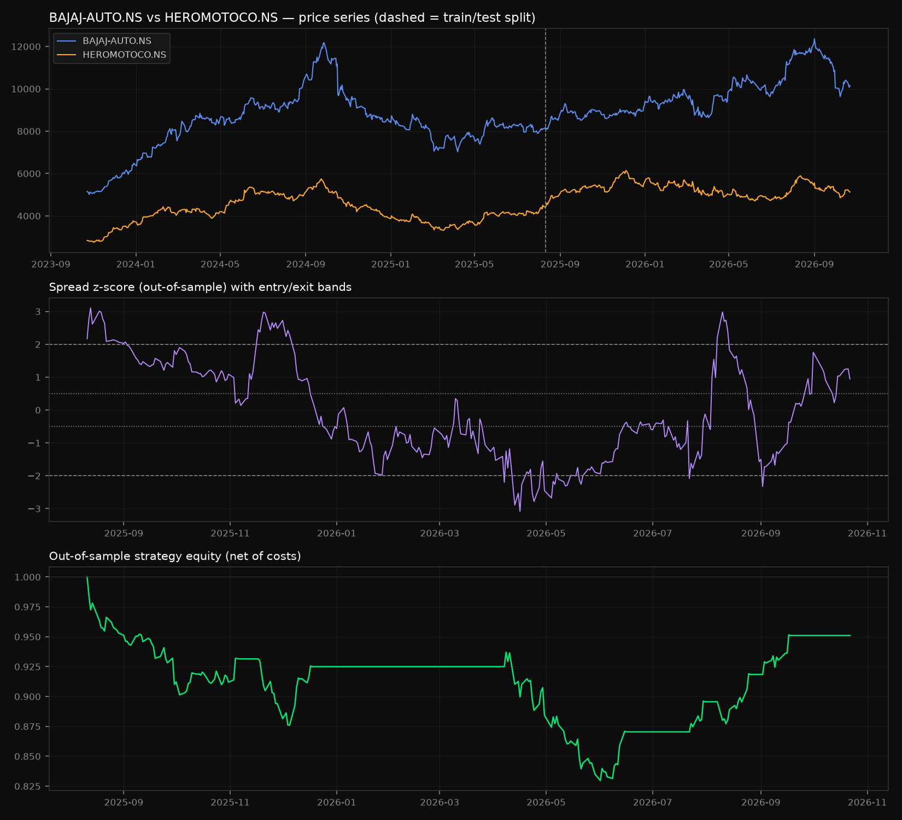

---

### TATASTEEL.NS / JSWSTEEL.NS

- **Latest prices:** TATASTEEL.NS ₹172.33 · JSWSTEEL.NS ₹1,220.00
- **Hedge ratio (train-fitted):** 3.0119
- **Cointegration (train):** FAIL at 5% — ADF -1.25, p=0.6515
- **Persistence:** passed 5% in 0 of 81 real-data runs (strict tier: 0/81)
- **Spread half-life:** 68.5 days
- **Current z-score:** -0.51
- **Signal today:** watch (approaching band)
- ⚠️ _Pair did not cointegrate on training data. Any signal here is not statistically justified — observation only._

**Out-of-sample backtest** (beta frozen from train window):

| Metric | Value |
|---|---|
| Sharpe | 0.72 |
| Sortino | 0.70 |
| Annualised return | 5.92% |
| Annualised vol | 8.44% |
| Max drawdown | -5.55% |
| Round-trip trades | 6 |

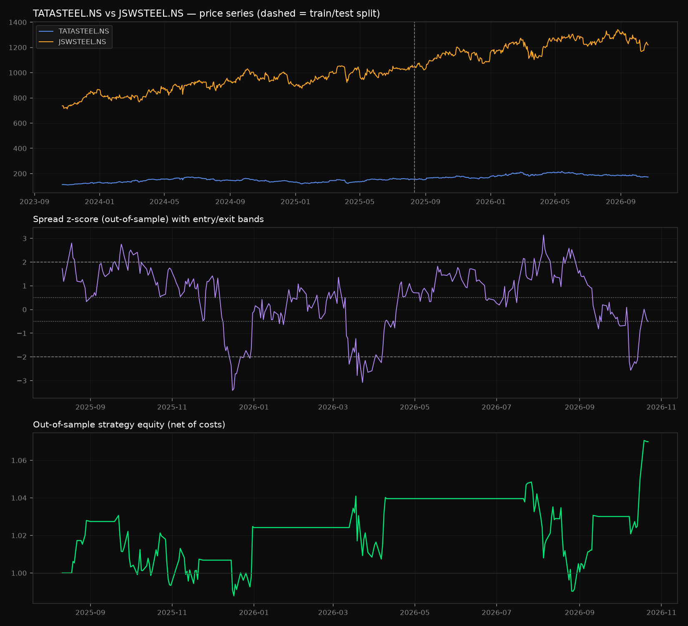

---

### SUNPHARMA.NS / CIPLA.NS

- **Latest prices:** SUNPHARMA.NS ₹1,758.00 · CIPLA.NS ₹1,330.90
- **Hedge ratio (train-fitted):** 0.4819
- **Cointegration (train):** PASS at 5% — ADF -3.42, p=0.0102
- **Persistence:** passed 5% in 81 of 81 real-data runs (strict tier: 5/81)
- **Spread half-life:** 10.8 days
- **Current z-score:** -0.40
- **Signal today:** flat / no stretch

**Out-of-sample backtest** (beta frozen from train window):

| Metric | Value |
|---|---|
| Sharpe | 0.15 |
| Sortino | 0.16 |
| Annualised return | 0.85% |
| Annualised vol | 7.72% |
| Max drawdown | -10.38% |
| Round-trip trades | 5 |

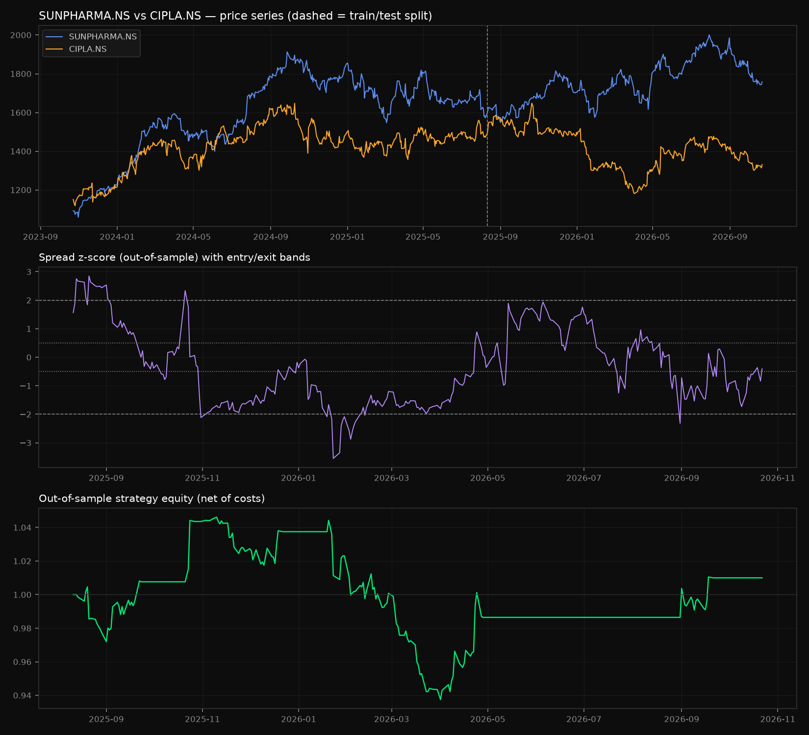

---

_Generated 2026-10-22 · pairs mean-reversion scanner · out-of-sample backtest · multiple-testing-aware · not investment advice._
