# Indian Pairs-Trading Scanner — 2026-10-23

> **What this is:** a market-neutral *pairs mean-reversion* scanner. It flags when two related NSE stocks have drifted apart far enough that their historical relationship signals a possible convergence trade. It does **not** forecast growth, rank "best" stocks, or predict company performance. A signal means the *spread between two stocks* is stretched — nothing about either stock being a good investment. Not investment advice; do your own research.

## Methodology (fixed in advance)

- **Universe:** 16 declared sector-mate pairs. Parameters (3y window, 60/40 train-test, z-entry 2.0, z-exit 0.5, 5 bps costs) are pre-registered; changes are logged in the README changelog *before* looking at results.
- **Multiple testing:** at the 5% level across 16 pairs, **≈0.8 false positives per run are expected by chance alone** even if nothing truly cointegrates. A single-day pass is a candidate, not a discovery.
- **Strict tier:** Bonferroni-corrected threshold p < 0.0031 (marked ✓✓).
- **Evidence = persistence:** the Persistence column counts how often each pair has passed the 5% test across all *real-data* daily runs recorded in `reports/history.csv`. Pairs deserve attention only when they pass persistently.

## Summary

| Pair | p-value | Coint. | Persistence | Current z | Signal | OOS Sharpe |
|---|---|---|---|---|---|---|
| HDFCBANK.NS/ICICIBANK.NS | 0.0660 | ✗ | 1/67 | +1.05 | watch | -0.34 |
| AXISBANK.NS/ICICIBANK.NS | 0.9291 | ✗ | 0/82 | +0.61 | watch | -0.33 |
| KOTAKBANK.NS/HDFCBANK.NS | 0.2402 | ✗ | 0/82 | -1.29 | watch | 1.14 |
| SBIN.NS/BANKBARODA.NS | 0.1409 | ✗ | 0/82 | +0.47 | flat / no stretch | 0.43 |
| TCS.NS/INFY.NS | 0.5954 | ✗ | 0/82 | -2.32 | LONG spread | 1.87 |
| INFY.NS/WIPRO.NS | 0.1205 | ✗ | 0/82 | +2.53 | SHORT spread | 2.15 |
| HCLTECH.NS/TECHM.NS | 0.1363 | ✗ | 0/82 | +2.21 | SHORT spread | 0.05 |
| ACC.NS/AMBUJACEM.NS | 0.4478 | ✗ | 0/82 | -1.18 | watch | 0.02 |
| ULTRACEMCO.NS/SHREECEM.NS | 0.3404 | ✗ | 0/82 | -0.55 | watch | -0.36 |
| IOC.NS/BPCL.NS | 0.7764 | ✗ | 0/82 | -2.83 | LONG spread | 0.09 |
| BPCL.NS/HINDPETRO.NS | 0.2498 | ✗ | 0/82 | +2.35 | SHORT spread | -0.11 |
| ONGC.NS/COALINDIA.NS | 0.0063 | ✓ | 74/82 | -0.50 | flat / no stretch | 0.83 |
| NTPC.NS/POWERGRID.NS | 0.1004 | ✗ | 0/82 | +1.67 | watch | 0.47 |
| BAJAJ-AUTO.NS/HEROMOTOCO.NS | 0.2129 | ✗ | 0/82 | +0.70 | watch | -0.38 |
| TATASTEEL.NS/JSWSTEEL.NS | 0.6515 | ✗ | 0/82 | -1.15 | watch | 0.72 |
| SUNPHARMA.NS/CIPLA.NS | 0.0102 | ✓ | 82/82 | +0.11 | flat / no stretch | 0.15 |

_Legend: ✓✓ passes strict Bonferroni tier · ✓ passes 5% only · ✗ fails. Persistence = 5%-passes / real-data runs recorded. \*no real-data history yet._

---

### HDFCBANK.NS / ICICIBANK.NS

- **Latest prices:** HDFCBANK.NS ₹692.80 · ICICIBANK.NS ₹1,394.20
- **Hedge ratio (train-fitted):** 1.5895
- **Cointegration (train):** FAIL at 5% — ADF -2.75, p=0.0660
- **Persistence:** passed 5% in 1 of 67 real-data runs (strict tier: 0/67)
- **Spread half-life:** 23.7 days
- **Current z-score:** +1.05
- **Signal today:** watch (approaching band)
- ⚠️ _Pair did not cointegrate on training data. Any signal here is not statistically justified — observation only._

**Out-of-sample backtest** (beta frozen from train window):

| Metric | Value |
|---|---|
| Sharpe | -0.34 |
| Sortino | -0.37 |
| Annualised return | -2.47% |
| Annualised vol | 6.63% |
| Max drawdown | -8.01% |
| Round-trip trades | 4 |

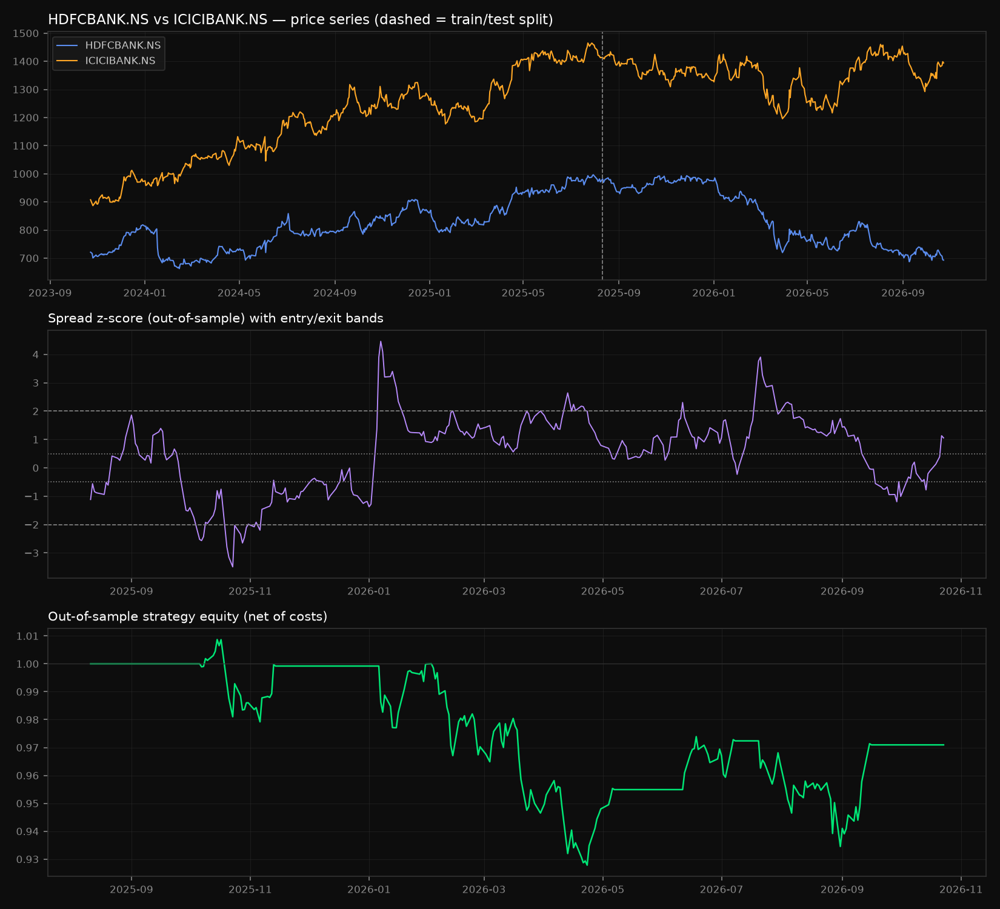

---

### AXISBANK.NS / ICICIBANK.NS

- **Latest prices:** AXISBANK.NS ₹1,217.50 · ICICIBANK.NS ₹1,394.20
- **Hedge ratio (train-fitted):** 0.8077
- **Cointegration (train):** FAIL at 5% — ADF -0.27, p=0.9291
- **Persistence:** passed 5% in 0 of 82 real-data runs (strict tier: 0/82)
- **Spread half-life:** 577.4 days
- **Current z-score:** +0.61
- **Signal today:** watch (approaching band)
- ⚠️ _Pair did not cointegrate on training data. Any signal here is not statistically justified — observation only._

**Out-of-sample backtest** (beta frozen from train window):

| Metric | Value |
|---|---|
| Sharpe | -0.33 |
| Sortino | -0.30 |
| Annualised return | -3.05% |
| Annualised vol | 8.34% |
| Max drawdown | -7.71% |
| Round-trip trades | 5 |

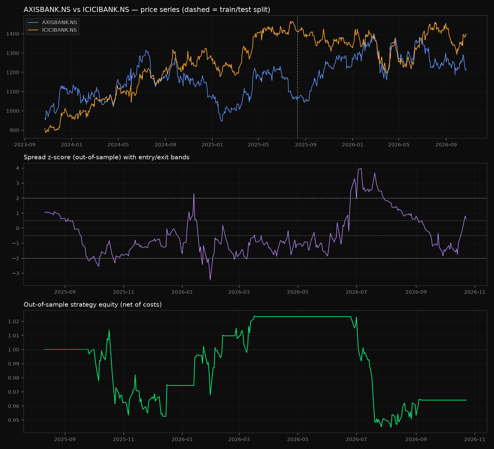

---

### KOTAKBANK.NS / HDFCBANK.NS

- **Latest prices:** KOTAKBANK.NS ₹430.50 · HDFCBANK.NS ₹692.80
- **Hedge ratio (train-fitted):** 2.2081
- **Cointegration (train):** FAIL at 5% — ADF -2.11, p=0.2402
- **Persistence:** passed 5% in 0 of 82 real-data runs (strict tier: 0/82)
- **Spread half-life:** 28.9 days
- **Current z-score:** -1.29
- **Signal today:** watch (approaching band)
- ⚠️ _Pair did not cointegrate on training data. Any signal here is not statistically justified — observation only._

**Out-of-sample backtest** (beta frozen from train window):

| Metric | Value |
|---|---|
| Sharpe | 1.14 |
| Sortino | 1.11 |
| Annualised return | 6.58% |
| Annualised vol | 5.73% |
| Max drawdown | -2.84% |
| Round-trip trades | 5 |

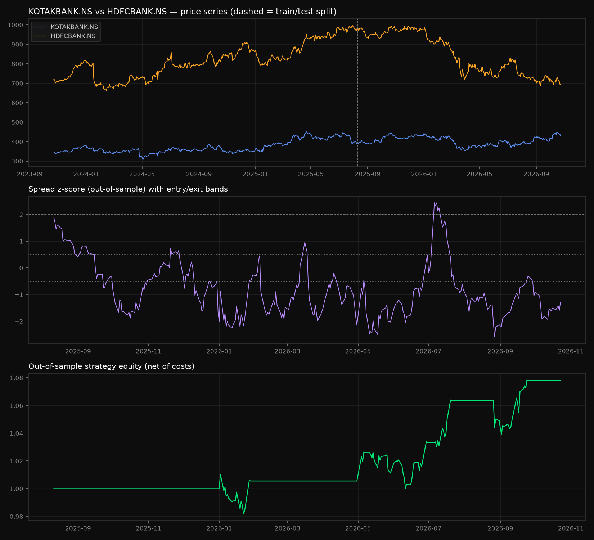

---

### SBIN.NS / BANKBARODA.NS

- **Latest prices:** SBIN.NS ₹958.60 · BANKBARODA.NS ₹230.90
- **Hedge ratio (train-fitted):** 0.1902
- **Cointegration (train):** FAIL at 5% — ADF -2.40, p=0.1409
- **Persistence:** passed 5% in 0 of 82 real-data runs (strict tier: 0/82)
- **Spread half-life:** 21.2 days
- **Current z-score:** +0.47
- **Signal today:** flat / no stretch
- ⚠️ _Pair did not cointegrate on training data. Any signal here is not statistically justified — observation only._

**Out-of-sample backtest** (beta frozen from train window):

| Metric | Value |
|---|---|
| Sharpe | 0.43 |
| Sortino | 0.39 |
| Annualised return | 3.70% |
| Annualised vol | 9.50% |
| Max drawdown | -8.65% |
| Round-trip trades | 7 |

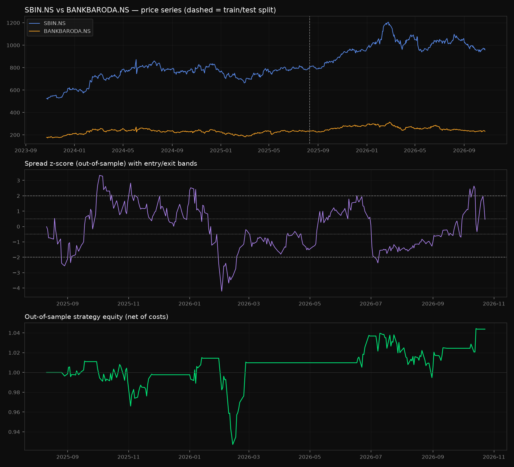

---

### TCS.NS / INFY.NS

- **Latest prices:** TCS.NS ₹2,530.00 · INFY.NS ₹1,153.80
- **Hedge ratio (train-fitted):** 0.4208
- **Cointegration (train):** FAIL at 5% — ADF -1.37, p=0.5954
- **Persistence:** passed 5% in 0 of 82 real-data runs (strict tier: 0/82)
- **Spread half-life:** 66.4 days
- **Current z-score:** -2.32
- **Signal today:** LONG spread (long INFY.NS, short TCS.NS)
- ⚠️ _Pair did not cointegrate on training data. Any signal here is not statistically justified — observation only._

**Out-of-sample backtest** (beta frozen from train window):

| Metric | Value |
|---|---|
| Sharpe | 1.87 |
| Sortino | 2.01 |
| Annualised return | 8.41% |
| Annualised vol | 4.37% |
| Max drawdown | -1.83% |
| Round-trip trades | 6 |

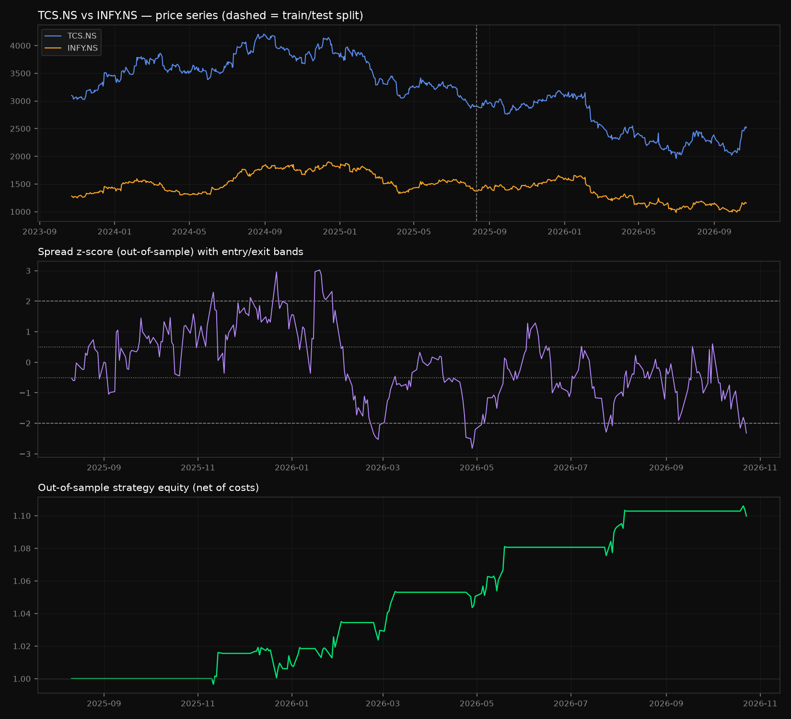

---

### INFY.NS / WIPRO.NS

- **Latest prices:** INFY.NS ₹1,153.80 · WIPRO.NS ₹189.84
- **Hedge ratio (train-fitted):** 0.1256
- **Cointegration (train):** FAIL at 5% — ADF -2.48, p=0.1205
- **Persistence:** passed 5% in 0 of 82 real-data runs (strict tier: 0/82)
- **Spread half-life:** 27.7 days
- **Current z-score:** +2.53
- **Signal today:** SHORT spread (short WIPRO.NS, long INFY.NS)
- ⚠️ _Pair did not cointegrate on training data. Any signal here is not statistically justified — observation only._

**Out-of-sample backtest** (beta frozen from train window):

| Metric | Value |
|---|---|
| Sharpe | 2.15 |
| Sortino | 2.10 |
| Annualised return | 11.85% |
| Annualised vol | 5.27% |
| Max drawdown | -1.58% |
| Round-trip trades | 7 |

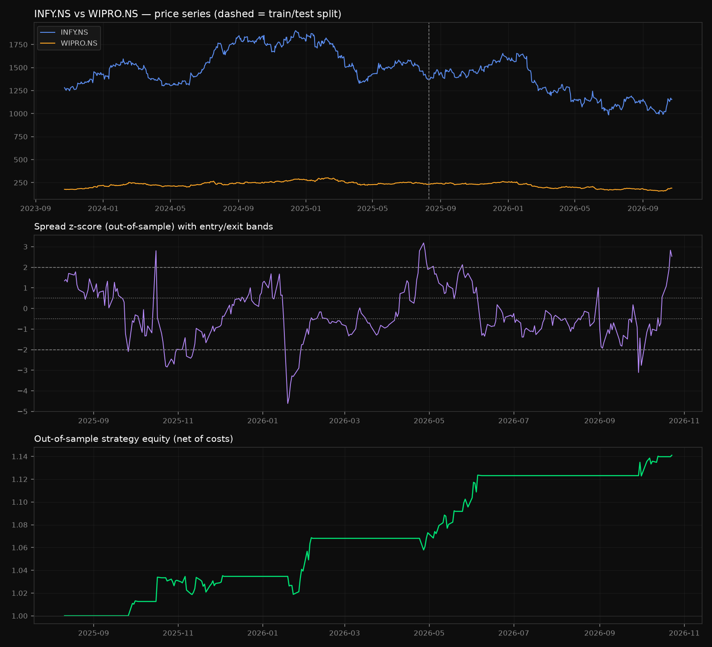

---

### HCLTECH.NS / TECHM.NS

- **Latest prices:** HCLTECH.NS ₹1,422.20 · TECHM.NS ₹1,790.00
- **Hedge ratio (train-fitted):** 0.9504
- **Cointegration (train):** FAIL at 5% — ADF -2.42, p=0.1363
- **Persistence:** passed 5% in 0 of 82 real-data runs (strict tier: 0/82)
- **Spread half-life:** 24.5 days
- **Current z-score:** +2.21
- **Signal today:** SHORT spread (short TECHM.NS, long HCLTECH.NS)
- ⚠️ _Pair did not cointegrate on training data. Any signal here is not statistically justified — observation only._

**Out-of-sample backtest** (beta frozen from train window):

| Metric | Value |
|---|---|
| Sharpe | 0.05 |
| Sortino | 0.05 |
| Annualised return | 0.07% |
| Annualised vol | 7.48% |
| Max drawdown | -8.30% |
| Round-trip trades | 5 |

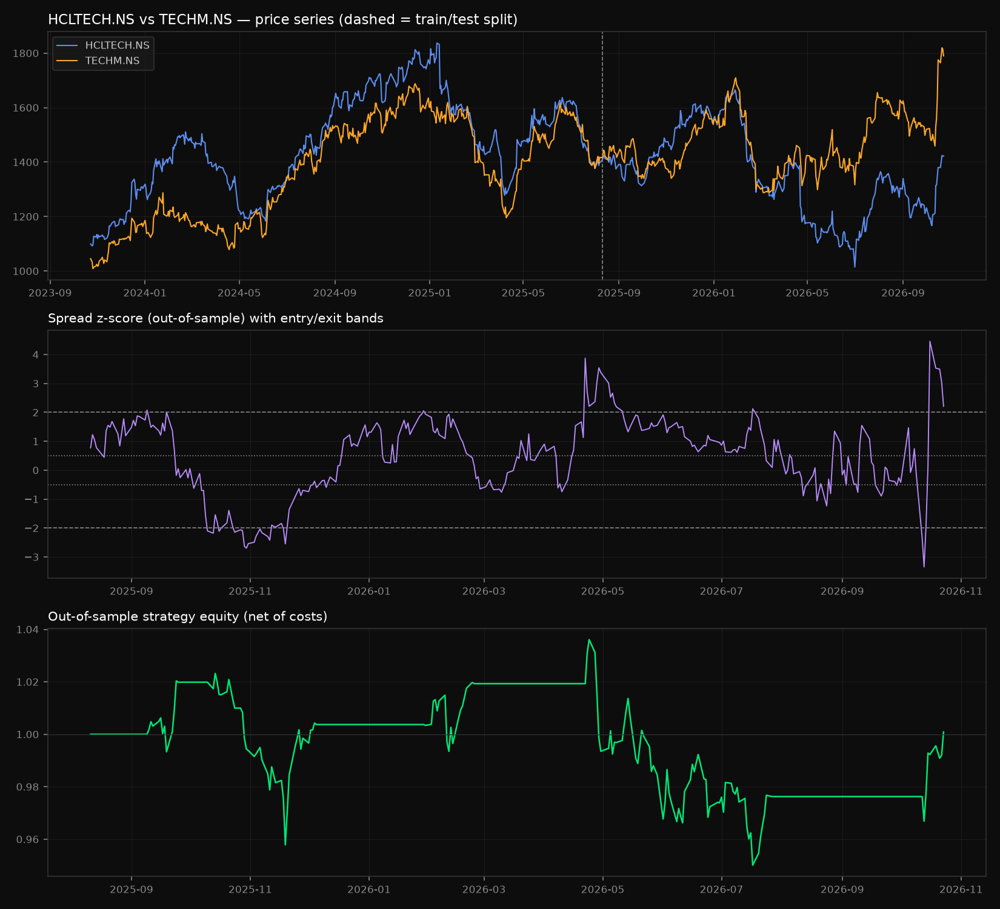

---

### ACC.NS / AMBUJACEM.NS

- **Latest prices:** ACC.NS ₹1,159.40 · AMBUJACEM.NS ₹358.90
- **Hedge ratio (train-fitted):** 0.1630
- **Cointegration (train):** FAIL at 5% — ADF -1.67, p=0.4478
- **Persistence:** passed 5% in 0 of 82 real-data runs (strict tier: 0/82)
- **Spread half-life:** 46.8 days
- **Current z-score:** -1.18
- **Signal today:** watch (approaching band)
- ⚠️ _Pair did not cointegrate on training data. Any signal here is not statistically justified — observation only._

**Out-of-sample backtest** (beta frozen from train window):

| Metric | Value |
|---|---|
| Sharpe | 0.02 |
| Sortino | 0.01 |
| Annualised return | -0.06% |
| Annualised vol | 6.02% |
| Max drawdown | -5.91% |
| Round-trip trades | 3 |

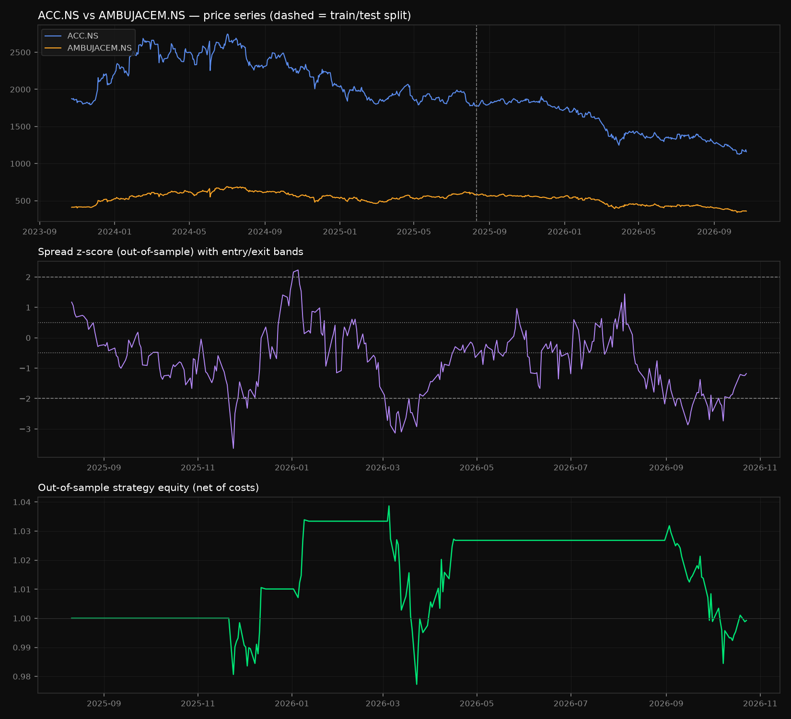

---

### ULTRACEMCO.NS / SHREECEM.NS

- **Latest prices:** ULTRACEMCO.NS ₹11,050.00 · SHREECEM.NS ₹22,735.00
- **Hedge ratio (train-fitted):** 1.0421
- **Cointegration (train):** FAIL at 5% — ADF -1.88, p=0.3404
- **Persistence:** passed 5% in 0 of 82 real-data runs (strict tier: 0/82)
- **Spread half-life:** 41.4 days
- **Current z-score:** -0.55
- **Signal today:** watch (approaching band)
- ⚠️ _Pair did not cointegrate on training data. Any signal here is not statistically justified — observation only._

**Out-of-sample backtest** (beta frozen from train window):

| Metric | Value |
|---|---|
| Sharpe | -0.36 |
| Sortino | -0.43 |
| Annualised return | -2.75% |
| Annualised vol | 7.09% |
| Max drawdown | -7.14% |
| Round-trip trades | 4 |

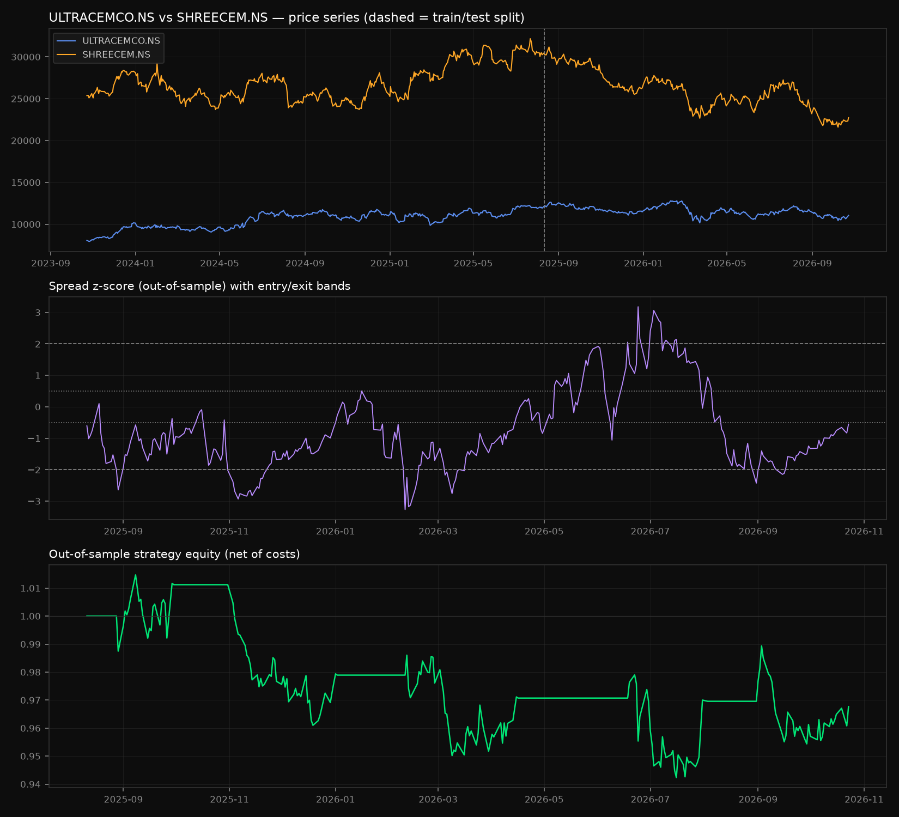

---

### IOC.NS / BPCL.NS

- **Latest prices:** IOC.NS ₹129.09 · BPCL.NS ₹281.95
- **Hedge ratio (train-fitted):** 1.6347
- **Cointegration (train):** FAIL at 5% — ADF -0.93, p=0.7764
- **Persistence:** passed 5% in 0 of 82 real-data runs (strict tier: 0/82)
- **Spread half-life:** 131.8 days
- **Current z-score:** -2.83
- **Signal today:** LONG spread (long BPCL.NS, short IOC.NS)
- ⚠️ _Pair did not cointegrate on training data. Any signal here is not statistically justified — observation only._

**Out-of-sample backtest** (beta frozen from train window):

| Metric | Value |
|---|---|
| Sharpe | 0.09 |
| Sortino | 0.08 |
| Annualised return | 0.36% |
| Annualised vol | 6.34% |
| Max drawdown | -7.08% |
| Round-trip trades | 5 |

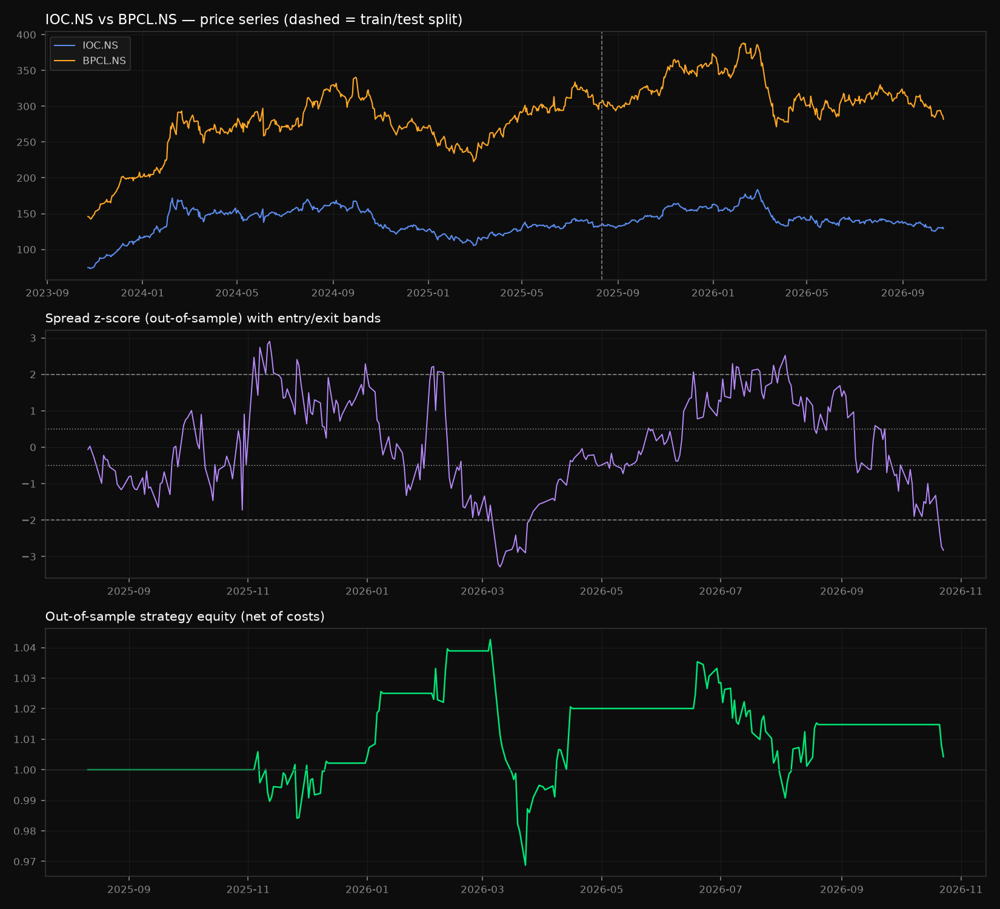

---

### BPCL.NS / HINDPETRO.NS

- **Latest prices:** BPCL.NS ₹281.95 · HINDPETRO.NS ₹338.30
- **Hedge ratio (train-fitted):** 1.3224
- **Cointegration (train):** FAIL at 5% — ADF -2.09, p=0.2498
- **Persistence:** passed 5% in 0 of 82 real-data runs (strict tier: 0/82)
- **Spread half-life:** 36.1 days
- **Current z-score:** +2.35
- **Signal today:** SHORT spread (short HINDPETRO.NS, long BPCL.NS)
- ⚠️ _Pair did not cointegrate on training data. Any signal here is not statistically justified — observation only._

**Out-of-sample backtest** (beta frozen from train window):

| Metric | Value |
|---|---|
| Sharpe | -0.11 |
| Sortino | -0.11 |
| Annualised return | -0.88% |
| Annualised vol | 6.30% |
| Max drawdown | -6.82% |
| Round-trip trades | 5 |

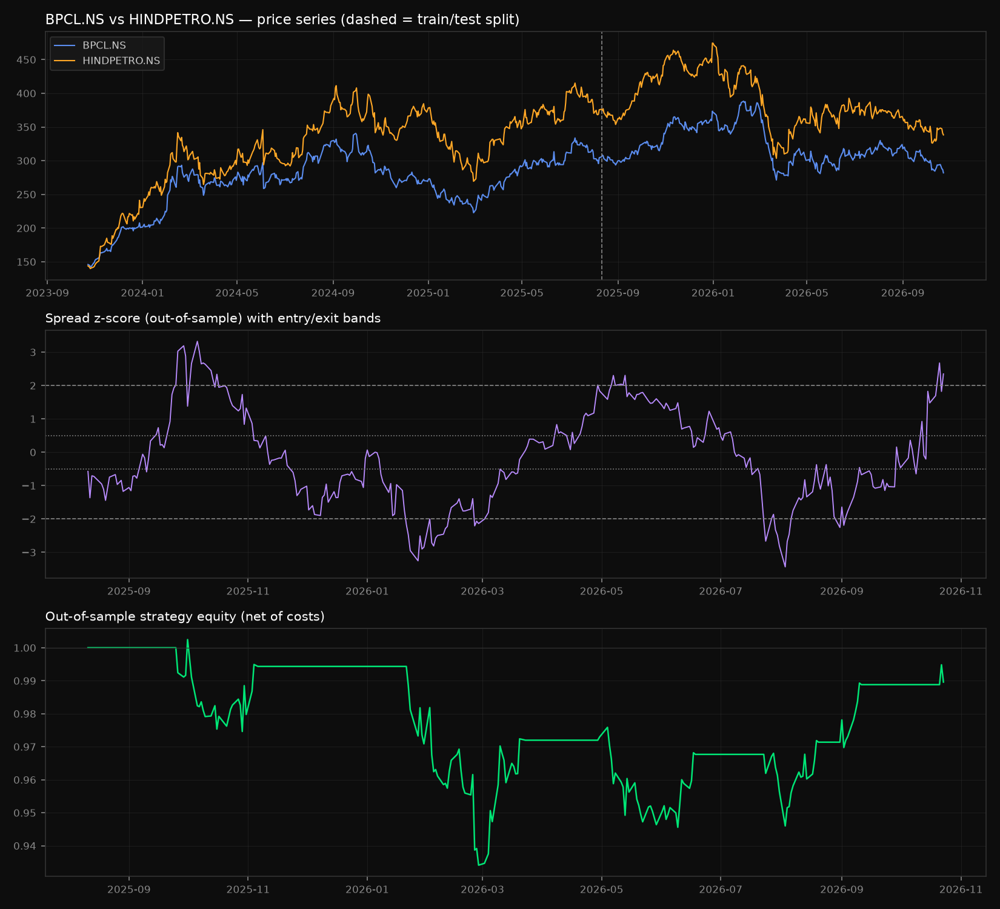

---

### ONGC.NS / COALINDIA.NS

- **Latest prices:** ONGC.NS ₹227.50 · COALINDIA.NS ₹397.45
- **Hedge ratio (train-fitted):** 1.3796
- **Cointegration (train):** PASS at 5% — ADF -3.57, p=0.0063
- **Persistence:** passed 5% in 74 of 82 real-data runs (strict tier: 1/82)
- **Spread half-life:** 12.6 days
- **Current z-score:** -0.50
- **Signal today:** flat / no stretch

**Out-of-sample backtest** (beta frozen from train window):

| Metric | Value |
|---|---|
| Sharpe | 0.83 |
| Sortino | 0.71 |
| Annualised return | 6.65% |
| Annualised vol | 8.16% |
| Max drawdown | -6.40% |
| Round-trip trades | 6 |

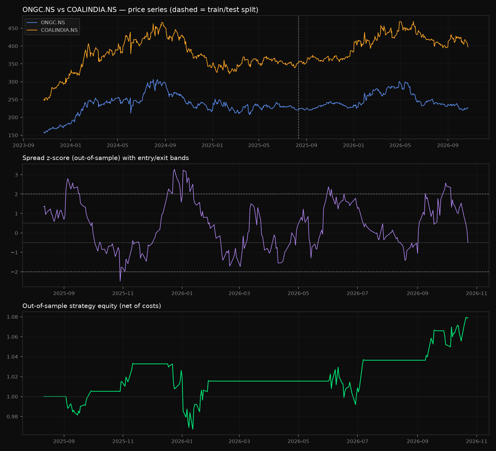

---

### NTPC.NS / POWERGRID.NS

- **Latest prices:** NTPC.NS ₹298.00 · POWERGRID.NS ₹247.40
- **Hedge ratio (train-fitted):** 0.8074
- **Cointegration (train):** FAIL at 5% — ADF -2.57, p=0.1004
- **Persistence:** passed 5% in 0 of 82 real-data runs (strict tier: 0/82)
- **Spread half-life:** 23.7 days
- **Current z-score:** +1.67
- **Signal today:** watch (approaching band)
- ⚠️ _Pair did not cointegrate on training data. Any signal here is not statistically justified — observation only._

**Out-of-sample backtest** (beta frozen from train window):

| Metric | Value |
|---|---|
| Sharpe | 0.47 |
| Sortino | 0.36 |
| Annualised return | 2.51% |
| Annualised vol | 5.64% |
| Max drawdown | -5.31% |
| Round-trip trades | 6 |

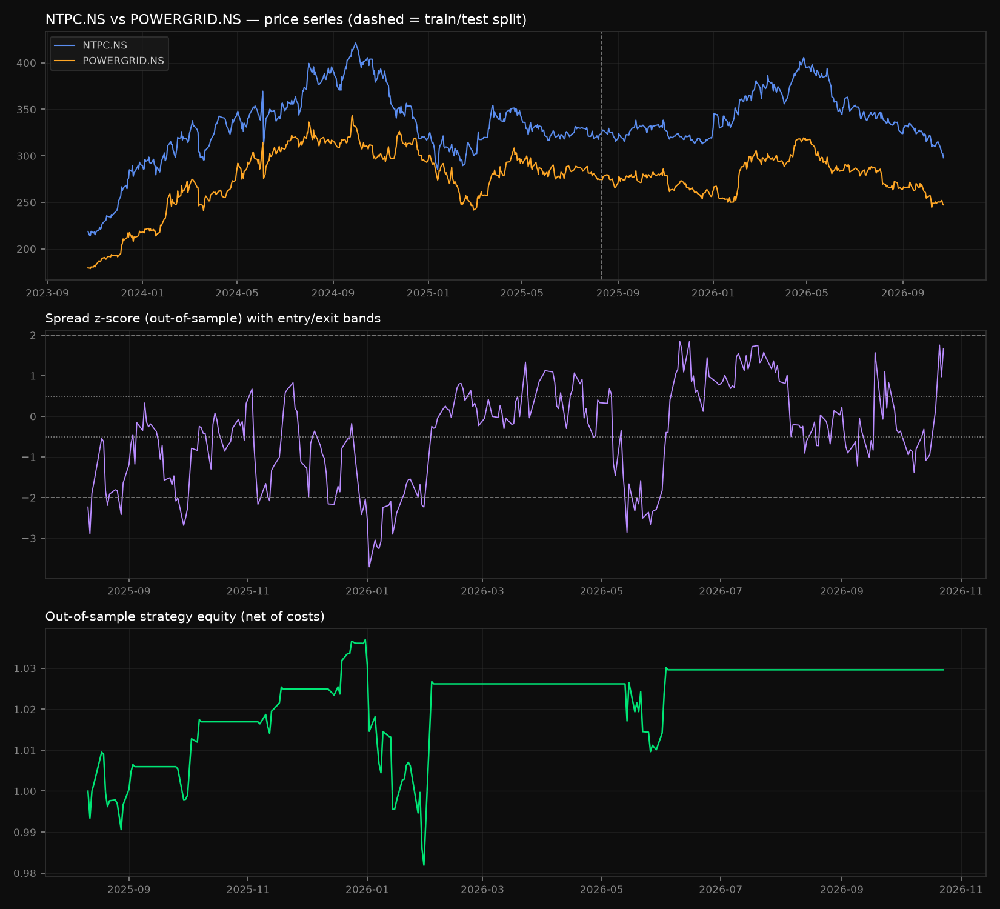

---

### BAJAJ-AUTO.NS / HEROMOTOCO.NS

- **Latest prices:** BAJAJ-AUTO.NS ₹10,072.00 · HEROMOTOCO.NS ₹5,047.00
- **Hedge ratio (train-fitted):** 0.4086
- **Cointegration (train):** FAIL at 5% — ADF -2.18, p=0.2129
- **Persistence:** passed 5% in 0 of 82 real-data runs (strict tier: 0/82)
- **Spread half-life:** 30.8 days
- **Current z-score:** +0.70
- **Signal today:** watch (approaching band)
- ⚠️ _Pair did not cointegrate on training data. Any signal here is not statistically justified — observation only._

**Out-of-sample backtest** (beta frozen from train window):

| Metric | Value |
|---|---|
| Sharpe | -0.38 |
| Sortino | -0.39 |
| Annualised return | -4.17% |
| Annualised vol | 9.93% |
| Max drawdown | -17.02% |
| Round-trip trades | 6 |

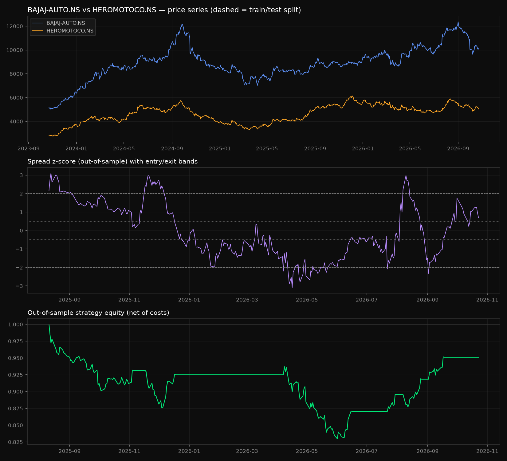

---

### TATASTEEL.NS / JSWSTEEL.NS

- **Latest prices:** TATASTEEL.NS ₹167.67 · JSWSTEEL.NS ₹1,185.50
- **Hedge ratio (train-fitted):** 3.0119
- **Cointegration (train):** FAIL at 5% — ADF -1.25, p=0.6515
- **Persistence:** passed 5% in 0 of 82 real-data runs (strict tier: 0/82)
- **Spread half-life:** 68.5 days
- **Current z-score:** -1.15
- **Signal today:** watch (approaching band)
- ⚠️ _Pair did not cointegrate on training data. Any signal here is not statistically justified — observation only._

**Out-of-sample backtest** (beta frozen from train window):

| Metric | Value |
|---|---|
| Sharpe | 0.72 |
| Sortino | 0.70 |
| Annualised return | 5.90% |
| Annualised vol | 8.43% |
| Max drawdown | -5.55% |
| Round-trip trades | 6 |

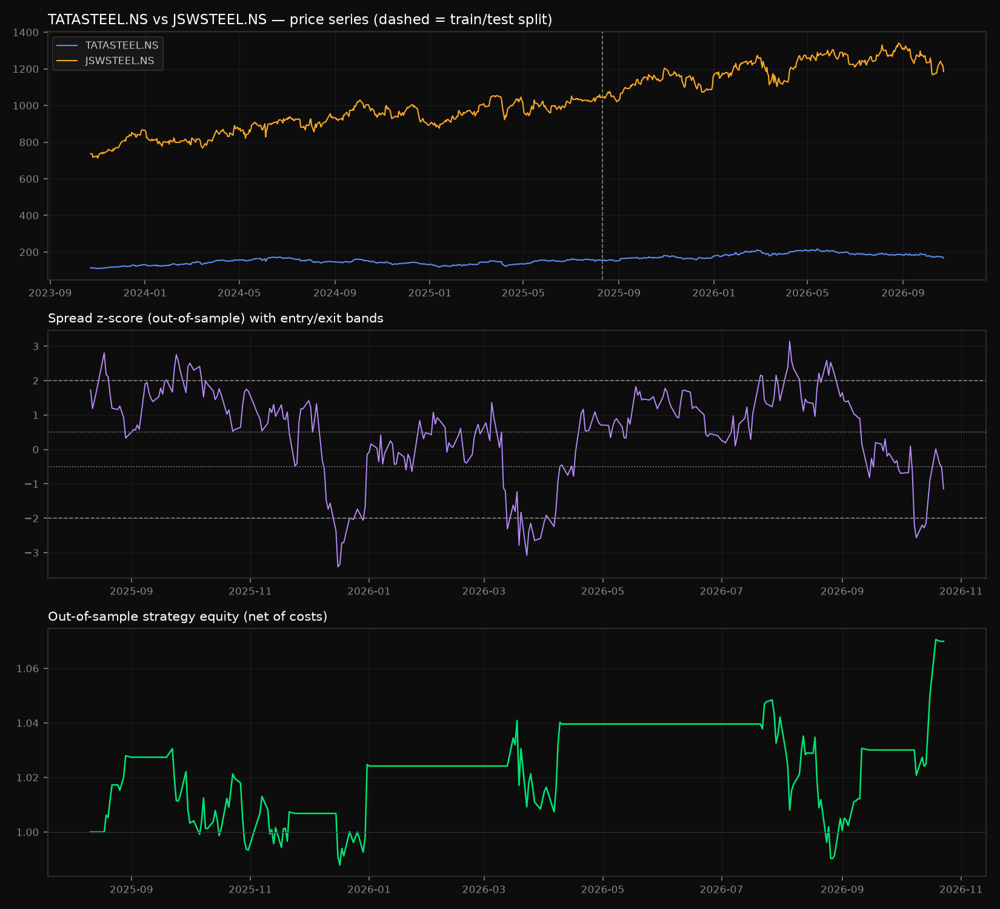

---

### SUNPHARMA.NS / CIPLA.NS

- **Latest prices:** SUNPHARMA.NS ₹1,748.00 · CIPLA.NS ₹1,338.00
- **Hedge ratio (train-fitted):** 0.4819
- **Cointegration (train):** PASS at 5% — ADF -3.42, p=0.0102
- **Persistence:** passed 5% in 82 of 82 real-data runs (strict tier: 5/82)
- **Spread half-life:** 10.8 days
- **Current z-score:** +0.11
- **Signal today:** flat / no stretch

**Out-of-sample backtest** (beta frozen from train window):

| Metric | Value |
|---|---|
| Sharpe | 0.15 |
| Sortino | 0.16 |
| Annualised return | 0.85% |
| Annualised vol | 7.71% |
| Max drawdown | -10.38% |
| Round-trip trades | 5 |

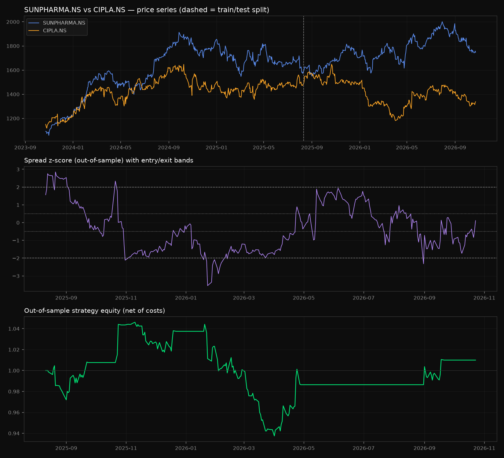

---

_Generated 2026-10-23 · pairs mean-reversion scanner · out-of-sample backtest · multiple-testing-aware · not investment advice._
