# Indian Pairs-Trading Scanner — 2026-10-27

> **What this is:** a market-neutral *pairs mean-reversion* scanner. It flags when two related NSE stocks have drifted apart far enough that their historical relationship signals a possible convergence trade. It does **not** forecast growth, rank "best" stocks, or predict company performance. A signal means the *spread between two stocks* is stretched — nothing about either stock being a good investment. Not investment advice; do your own research.

## Methodology (fixed in advance)

- **Universe:** 16 declared sector-mate pairs. Parameters (3y window, 60/40 train-test, z-entry 2.0, z-exit 0.5, 5 bps costs) are pre-registered; changes are logged in the README changelog *before* looking at results.
- **Multiple testing:** at the 5% level across 16 pairs, **≈0.8 false positives per run are expected by chance alone** even if nothing truly cointegrates. A single-day pass is a candidate, not a discovery.
- **Strict tier:** Bonferroni-corrected threshold p < 0.0031 (marked ✓✓).
- **Evidence = persistence:** the Persistence column counts how often each pair has passed the 5% test across all *real-data* daily runs recorded in `reports/history.csv`. Pairs deserve attention only when they pass persistently.

## Summary

| Pair | p-value | Coint. | Persistence | Current z | Signal | OOS Sharpe |
|---|---|---|---|---|---|---|
| HDFCBANK.NS/ICICIBANK.NS | 0.0709 | ✗ | 1/69 | +1.36 | watch | -0.53 |
| AXISBANK.NS/ICICIBANK.NS | 0.8674 | ✗ | 0/84 | +0.77 | watch | -0.47 |
| KOTAKBANK.NS/HDFCBANK.NS | 0.2278 | ✗ | 0/84 | -1.77 | watch | 1.14 |
| SBIN.NS/BANKBARODA.NS | 0.1422 | ✗ | 0/84 | +0.64 | watch | 0.50 |
| TCS.NS/INFY.NS | 0.5759 | ✗ | 0/84 | -1.77 | watch | 1.87 |
| INFY.NS/WIPRO.NS | 0.1238 | ✗ | 0/84 | +1.78 | watch | 2.24 |
| HCLTECH.NS/TECHM.NS | 0.1492 | ✗ | 0/84 | +2.33 | SHORT spread | 0.01 |
| ACC.NS/AMBUJACEM.NS | 0.4830 | ✗ | 0/84 | -0.68 | watch | 0.13 |
| ULTRACEMCO.NS/SHREECEM.NS | 0.3213 | ✗ | 0/84 | +0.07 | flat / no stretch | -0.18 |
| IOC.NS/BPCL.NS | 0.7507 | ✗ | 0/84 | -1.75 | watch | 0.20 |
| BPCL.NS/HINDPETRO.NS | 0.2440 | ✗ | 0/84 | +1.41 | watch | -0.02 |
| ONGC.NS/COALINDIA.NS | 0.0074 | ✓ | 76/84 | -0.07 | flat / no stretch | 0.83 |
| NTPC.NS/POWERGRID.NS | 0.1015 | ✗ | 0/84 | +1.19 | watch | 0.53 |
| BAJAJ-AUTO.NS/HEROMOTOCO.NS | 0.2281 | ✗ | 0/84 | +1.36 | watch | -0.15 |
| TATASTEEL.NS/JSWSTEEL.NS | 0.5839 | ✗ | 0/84 | +0.93 | watch | 0.74 |
| SUNPHARMA.NS/CIPLA.NS | 0.0157 | ✓ | 84/84 | +0.98 | watch | 0.15 |

_Legend: ✓✓ passes strict Bonferroni tier · ✓ passes 5% only · ✗ fails. Persistence = 5%-passes / real-data runs recorded. \*no real-data history yet._

---

### HDFCBANK.NS / ICICIBANK.NS

- **Latest prices:** HDFCBANK.NS ₹688.05 · ICICIBANK.NS ₹1,403.00
- **Hedge ratio (train-fitted):** 1.5748
- **Cointegration (train):** FAIL at 5% — ADF -2.72, p=0.0709
- **Persistence:** passed 5% in 1 of 69 real-data runs (strict tier: 0/69)
- **Spread half-life:** 23.8 days
- **Current z-score:** +1.36
- **Signal today:** watch (approaching band)
- ⚠️ _Pair did not cointegrate on training data. Any signal here is not statistically justified — observation only._

**Out-of-sample backtest** (beta frozen from train window):

| Metric | Value |
|---|---|
| Sharpe | -0.53 |
| Sortino | -0.56 |
| Annualised return | -3.61% |
| Annualised vol | 6.55% |
| Max drawdown | -8.02% |
| Round-trip trades | 4 |

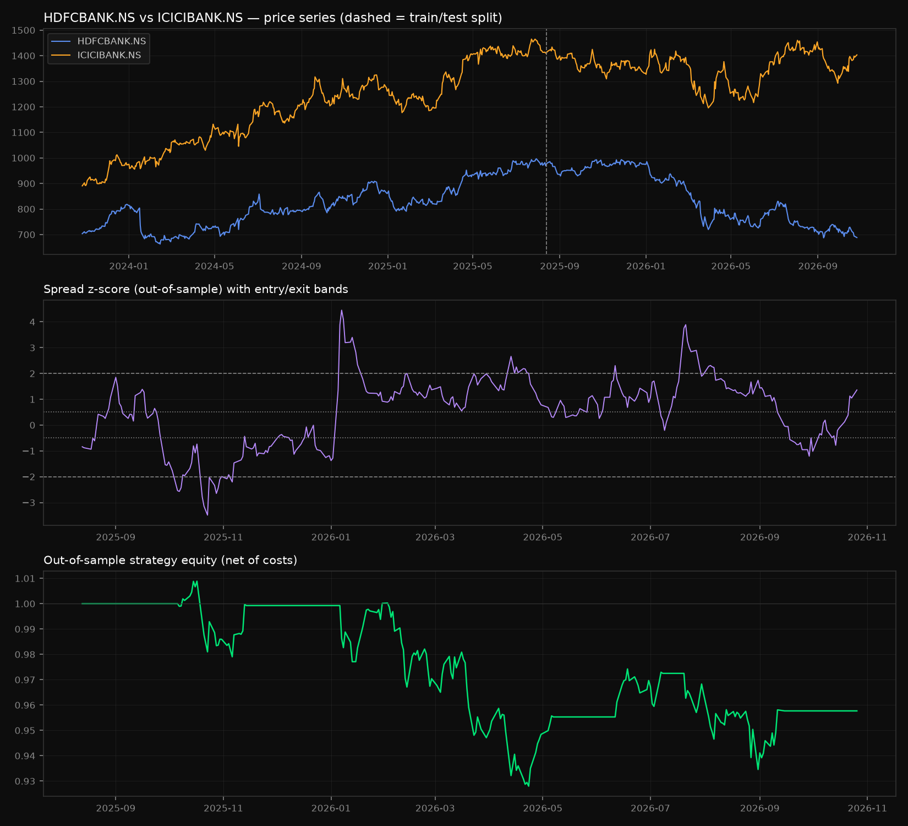

---

### AXISBANK.NS / ICICIBANK.NS

- **Latest prices:** AXISBANK.NS ₹1,220.00 · ICICIBANK.NS ₹1,403.00
- **Hedge ratio (train-fitted):** 0.7680
- **Cointegration (train):** FAIL at 5% — ADF -0.62, p=0.8674
- **Persistence:** passed 5% in 0 of 84 real-data runs (strict tier: 0/84)
- **Spread half-life:** 264.0 days
- **Current z-score:** +0.77
- **Signal today:** watch (approaching band)
- ⚠️ _Pair did not cointegrate on training data. Any signal here is not statistically justified — observation only._

**Out-of-sample backtest** (beta frozen from train window):

| Metric | Value |
|---|---|
| Sharpe | -0.47 |
| Sortino | -0.46 |
| Annualised return | -4.44% |
| Annualised vol | 8.87% |
| Max drawdown | -11.39% |
| Round-trip trades | 4 |

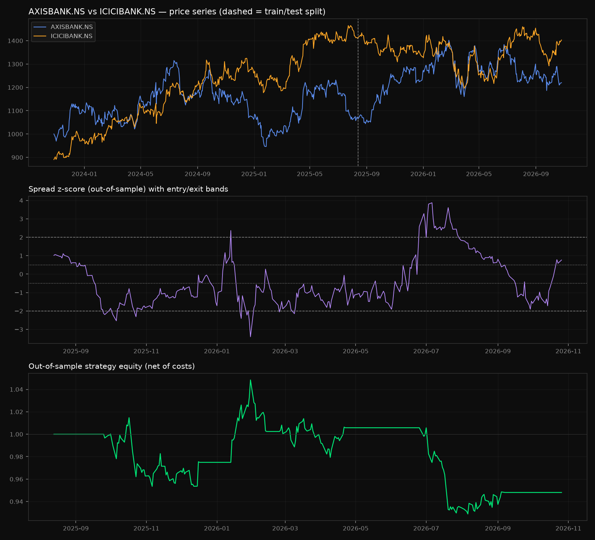

---

### KOTAKBANK.NS / HDFCBANK.NS

- **Latest prices:** KOTAKBANK.NS ₹440.75 · HDFCBANK.NS ₹688.05
- **Hedge ratio (train-fitted):** 2.2108
- **Cointegration (train):** FAIL at 5% — ADF -2.14, p=0.2278
- **Persistence:** passed 5% in 0 of 84 real-data runs (strict tier: 0/84)
- **Spread half-life:** 28.7 days
- **Current z-score:** -1.77
- **Signal today:** watch (approaching band)
- ⚠️ _Pair did not cointegrate on training data. Any signal here is not statistically justified — observation only._

**Out-of-sample backtest** (beta frozen from train window):

| Metric | Value |
|---|---|
| Sharpe | 1.14 |
| Sortino | 1.11 |
| Annualised return | 6.61% |
| Annualised vol | 5.74% |
| Max drawdown | -2.84% |
| Round-trip trades | 5 |

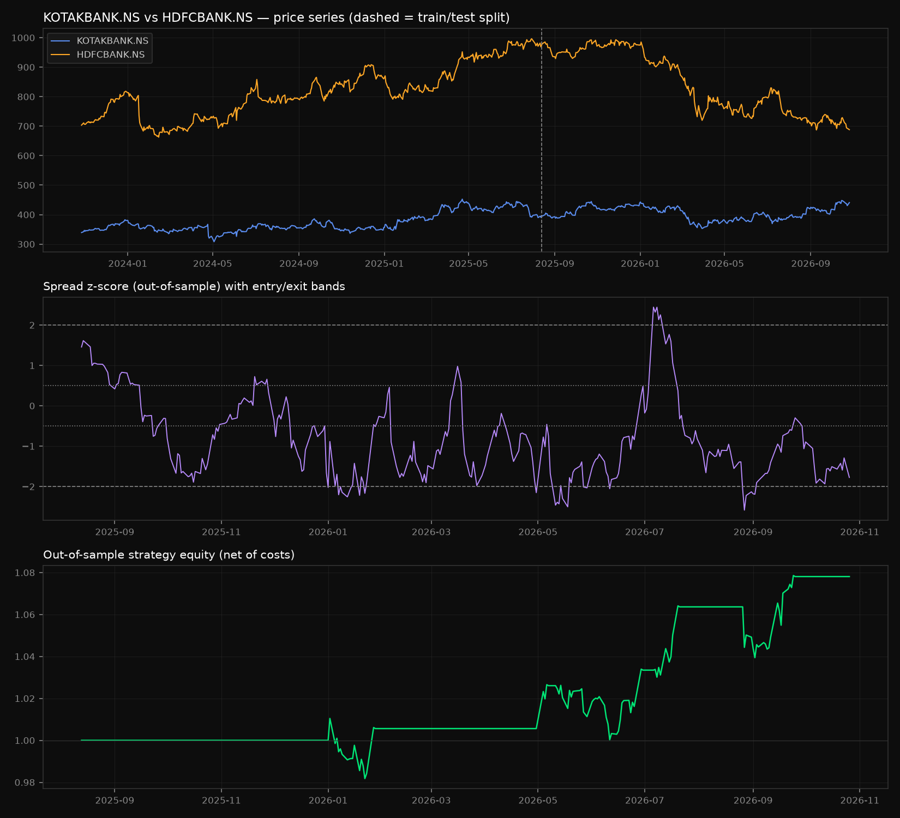

---

### SBIN.NS / BANKBARODA.NS

- **Latest prices:** SBIN.NS ₹960.80 · BANKBARODA.NS ₹232.00
- **Hedge ratio (train-fitted):** 0.1881
- **Cointegration (train):** FAIL at 5% — ADF -2.40, p=0.1422
- **Persistence:** passed 5% in 0 of 84 real-data runs (strict tier: 0/84)
- **Spread half-life:** 21.1 days
- **Current z-score:** +0.64
- **Signal today:** watch (approaching band)
- ⚠️ _Pair did not cointegrate on training data. Any signal here is not statistically justified — observation only._

**Out-of-sample backtest** (beta frozen from train window):

| Metric | Value |
|---|---|
| Sharpe | 0.50 |
| Sortino | 0.46 |
| Annualised return | 4.48% |
| Annualised vol | 9.67% |
| Max drawdown | -8.68% |
| Round-trip trades | 7 |

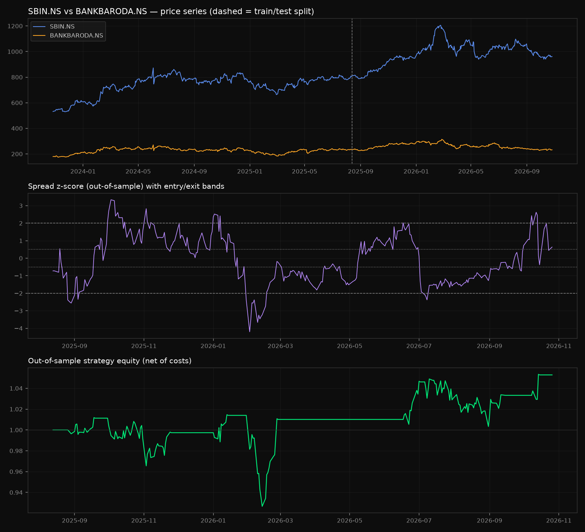

---

### TCS.NS / INFY.NS

- **Latest prices:** TCS.NS ₹2,535.00 · INFY.NS ₹1,166.00
- **Hedge ratio (train-fitted):** 0.4154
- **Cointegration (train):** FAIL at 5% — ADF -1.41, p=0.5759
- **Persistence:** passed 5% in 0 of 84 real-data runs (strict tier: 0/84)
- **Spread half-life:** 67.3 days
- **Current z-score:** -1.77
- **Signal today:** watch (approaching band)
- ⚠️ _Pair did not cointegrate on training data. Any signal here is not statistically justified — observation only._

**Out-of-sample backtest** (beta frozen from train window):

| Metric | Value |
|---|---|
| Sharpe | 1.87 |
| Sortino | 2.15 |
| Annualised return | 8.77% |
| Annualised vol | 4.56% |
| Max drawdown | -1.88% |
| Round-trip trades | 6 |

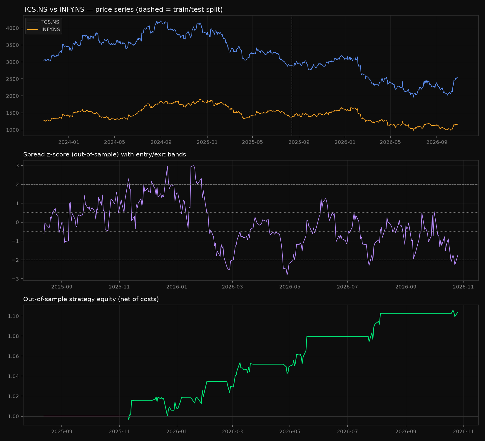

---

### INFY.NS / WIPRO.NS

- **Latest prices:** INFY.NS ₹1,166.00 · WIPRO.NS ₹189.20
- **Hedge ratio (train-fitted):** 0.1235
- **Cointegration (train):** FAIL at 5% — ADF -2.47, p=0.1238
- **Persistence:** passed 5% in 0 of 84 real-data runs (strict tier: 0/84)
- **Spread half-life:** 27.6 days
- **Current z-score:** +1.78
- **Signal today:** watch (approaching band)
- ⚠️ _Pair did not cointegrate on training data. Any signal here is not statistically justified — observation only._

**Out-of-sample backtest** (beta frozen from train window):

| Metric | Value |
|---|---|
| Sharpe | 2.24 |
| Sortino | 2.20 |
| Annualised return | 12.45% |
| Annualised vol | 5.30% |
| Max drawdown | -1.60% |
| Round-trip trades | 7 |

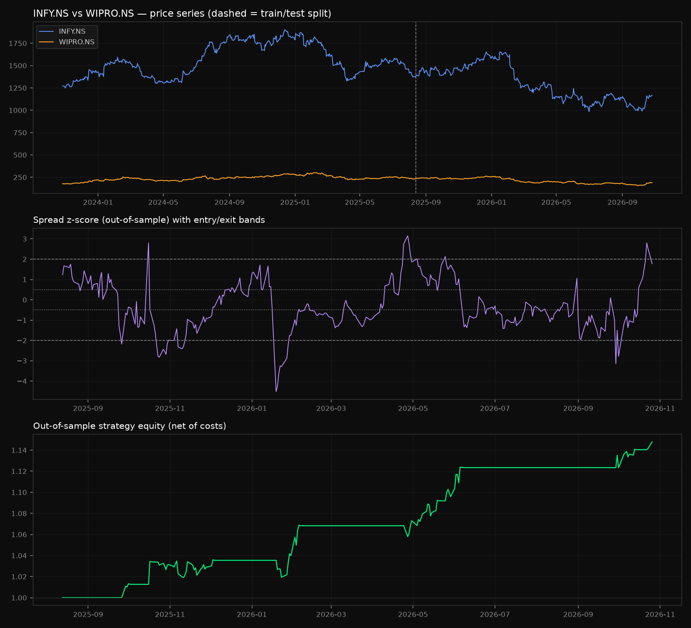

---

### HCLTECH.NS / TECHM.NS

- **Latest prices:** HCLTECH.NS ₹1,417.00 · TECHM.NS ₹1,795.00
- **Hedge ratio (train-fitted):** 0.9508
- **Cointegration (train):** FAIL at 5% — ADF -2.37, p=0.1492
- **Persistence:** passed 5% in 0 of 84 real-data runs (strict tier: 0/84)
- **Spread half-life:** 25.1 days
- **Current z-score:** +2.33
- **Signal today:** SHORT spread (short TECHM.NS, long HCLTECH.NS)
- ⚠️ _Pair did not cointegrate on training data. Any signal here is not statistically justified — observation only._

**Out-of-sample backtest** (beta frozen from train window):

| Metric | Value |
|---|---|
| Sharpe | 0.01 |
| Sortino | 0.01 |
| Annualised return | -0.24% |
| Annualised vol | 7.40% |
| Max drawdown | -8.19% |
| Round-trip trades | 5 |

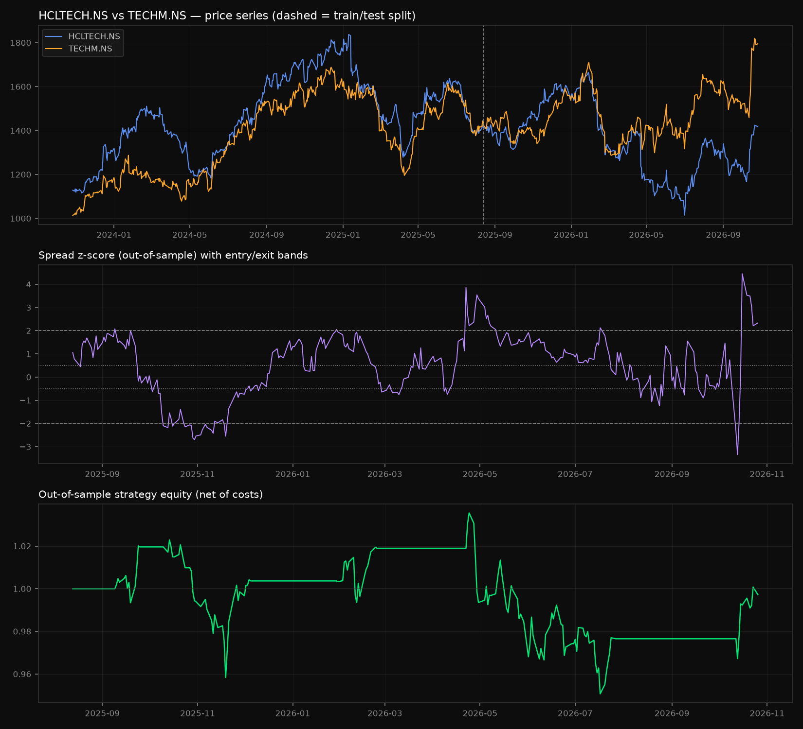

---

### ACC.NS / AMBUJACEM.NS

- **Latest prices:** ACC.NS ₹1,166.70 · AMBUJACEM.NS ₹368.00
- **Hedge ratio (train-fitted):** 0.1582
- **Cointegration (train):** FAIL at 5% — ADF -1.60, p=0.4830
- **Persistence:** passed 5% in 0 of 84 real-data runs (strict tier: 0/84)
- **Spread half-life:** 46.9 days
- **Current z-score:** -0.68
- **Signal today:** watch (approaching band)
- ⚠️ _Pair did not cointegrate on training data. Any signal here is not statistically justified — observation only._

**Out-of-sample backtest** (beta frozen from train window):

| Metric | Value |
|---|---|
| Sharpe | 0.13 |
| Sortino | 0.10 |
| Annualised return | 0.61% |
| Annualised vol | 6.26% |
| Max drawdown | -6.12% |
| Round-trip trades | 3 |

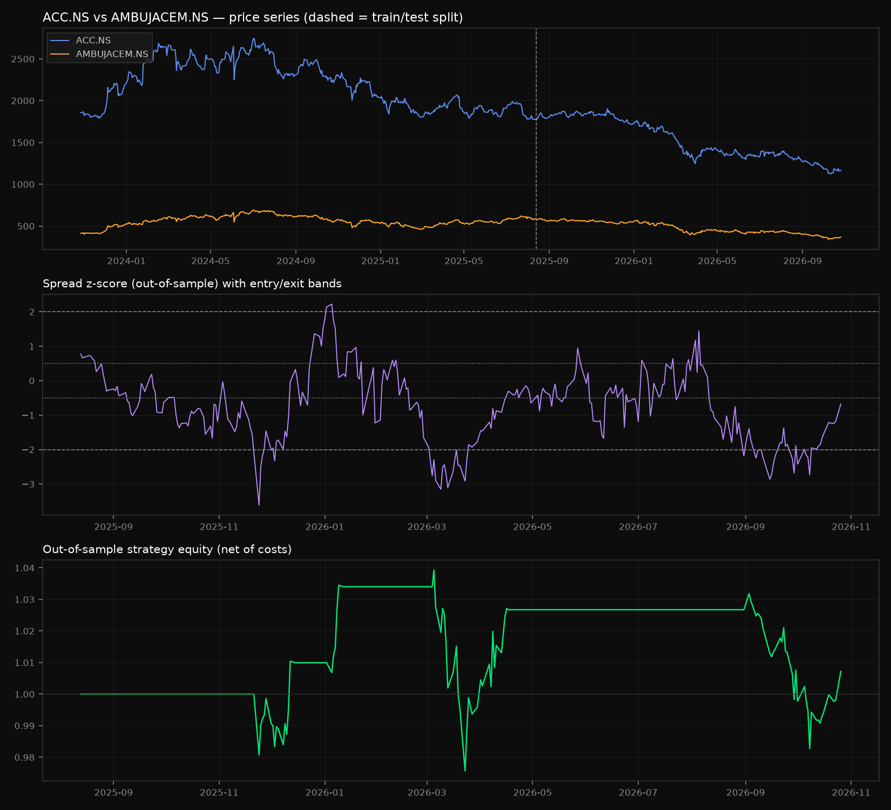

---

### ULTRACEMCO.NS / SHREECEM.NS

- **Latest prices:** ULTRACEMCO.NS ₹11,180.00 · SHREECEM.NS ₹23,540.00
- **Hedge ratio (train-fitted):** 1.0716
- **Cointegration (train):** FAIL at 5% — ADF -1.92, p=0.3213
- **Persistence:** passed 5% in 0 of 84 real-data runs (strict tier: 0/84)
- **Spread half-life:** 40.6 days
- **Current z-score:** +0.07
- **Signal today:** flat / no stretch
- ⚠️ _Pair did not cointegrate on training data. Any signal here is not statistically justified — observation only._

**Out-of-sample backtest** (beta frozen from train window):

| Metric | Value |
|---|---|
| Sharpe | -0.18 |
| Sortino | -0.22 |
| Annualised return | -1.56% |
| Annualised vol | 7.29% |
| Max drawdown | -7.25% |
| Round-trip trades | 4 |

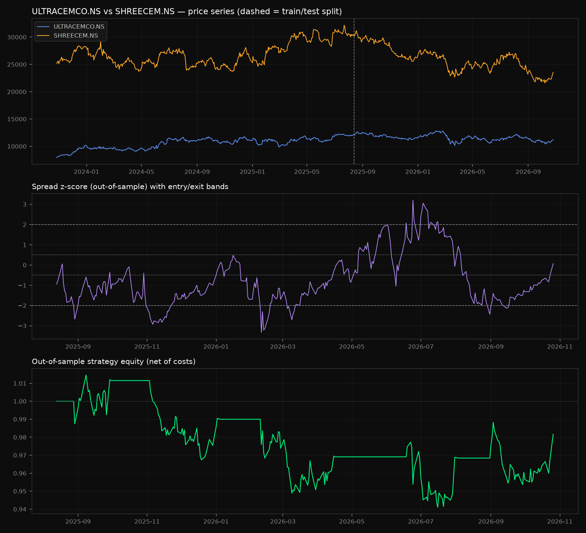

---

### IOC.NS / BPCL.NS

- **Latest prices:** IOC.NS ₹130.85 · BPCL.NS ₹290.40
- **Hedge ratio (train-fitted):** 1.6088
- **Cointegration (train):** FAIL at 5% — ADF -1.01, p=0.7507
- **Persistence:** passed 5% in 0 of 84 real-data runs (strict tier: 0/84)
- **Spread half-life:** 122.5 days
- **Current z-score:** -1.75
- **Signal today:** watch (approaching band)
- ⚠️ _Pair did not cointegrate on training data. Any signal here is not statistically justified — observation only._

**Out-of-sample backtest** (beta frozen from train window):

| Metric | Value |
|---|---|
| Sharpe | 0.20 |
| Sortino | 0.18 |
| Annualised return | 1.08% |
| Annualised vol | 6.48% |
| Max drawdown | -7.23% |
| Round-trip trades | 5 |

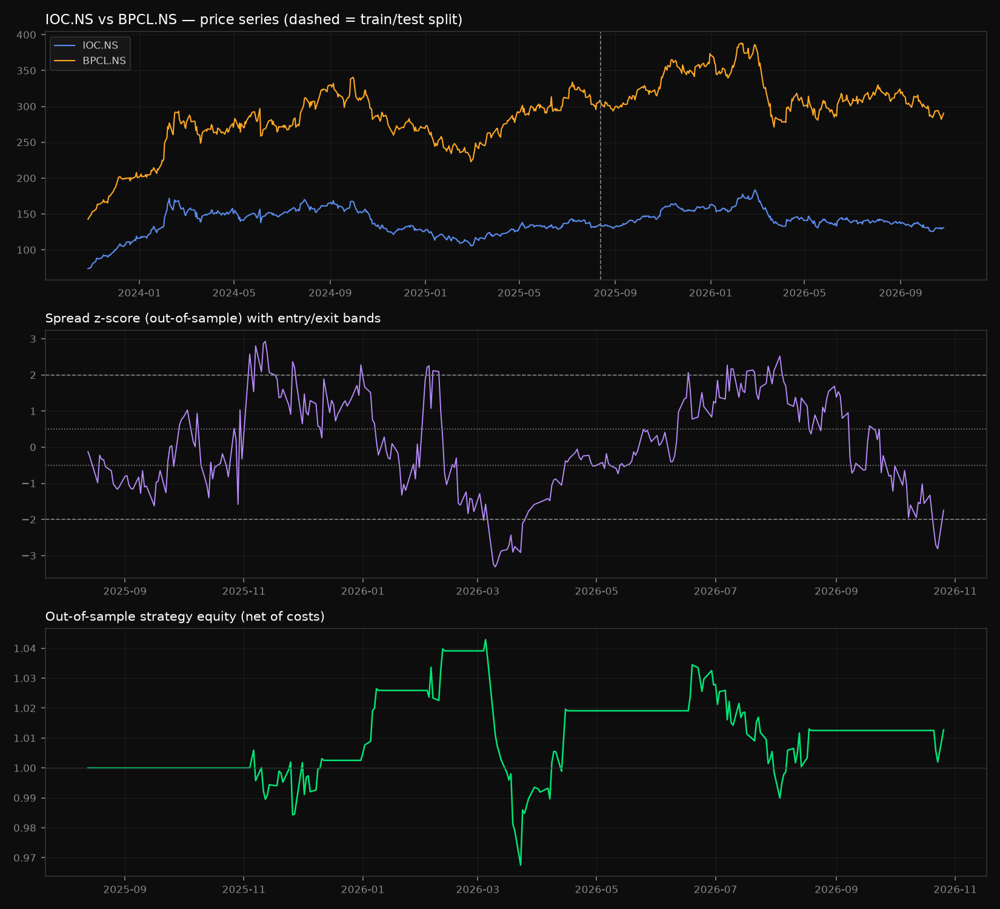

---

### BPCL.NS / HINDPETRO.NS

- **Latest prices:** BPCL.NS ₹290.40 · HINDPETRO.NS ₹343.45
- **Hedge ratio (train-fitted):** 1.3153
- **Cointegration (train):** FAIL at 5% — ADF -2.10, p=0.2440
- **Persistence:** passed 5% in 0 of 84 real-data runs (strict tier: 0/84)
- **Spread half-life:** 35.8 days
- **Current z-score:** +1.41
- **Signal today:** watch (approaching band)
- ⚠️ _Pair did not cointegrate on training data. Any signal here is not statistically justified — observation only._

**Out-of-sample backtest** (beta frozen from train window):

| Metric | Value |
|---|---|
| Sharpe | -0.02 |
| Sortino | -0.02 |
| Annualised return | -0.34% |
| Annualised vol | 6.33% |
| Max drawdown | -6.80% |
| Round-trip trades | 5 |

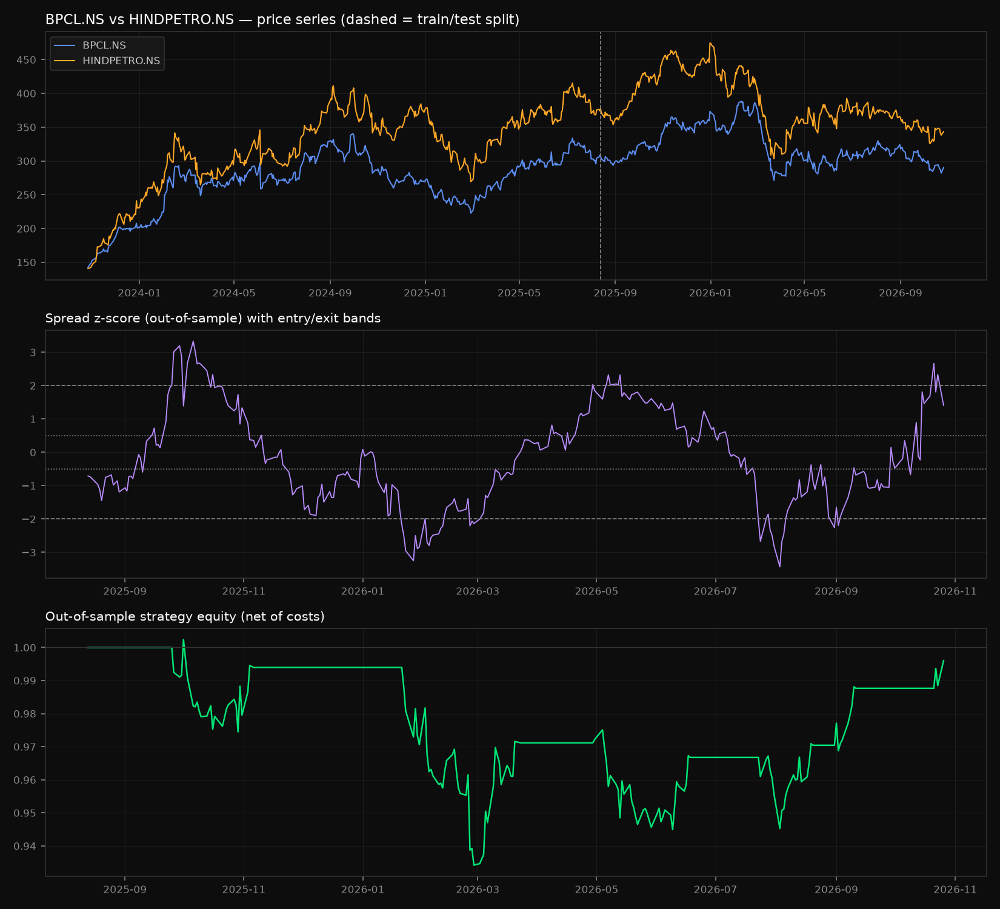

---

### ONGC.NS / COALINDIA.NS

- **Latest prices:** ONGC.NS ₹228.44 · COALINDIA.NS ₹405.00
- **Hedge ratio (train-fitted):** 1.3711
- **Cointegration (train):** PASS at 5% — ADF -3.52, p=0.0074
- **Persistence:** passed 5% in 76 of 84 real-data runs (strict tier: 1/84)
- **Spread half-life:** 12.7 days
- **Current z-score:** -0.07
- **Signal today:** flat / no stretch

**Out-of-sample backtest** (beta frozen from train window):

| Metric | Value |
|---|---|
| Sharpe | 0.83 |
| Sortino | 0.71 |
| Annualised return | 6.58% |
| Annualised vol | 8.06% |
| Max drawdown | -6.32% |
| Round-trip trades | 6 |

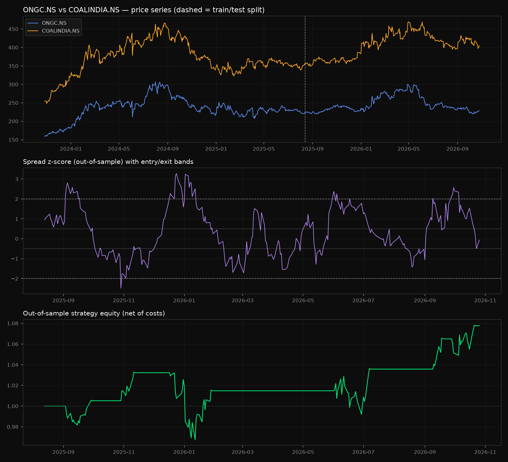

---

### NTPC.NS / POWERGRID.NS

- **Latest prices:** NTPC.NS ₹300.00 · POWERGRID.NS ₹247.00
- **Hedge ratio (train-fitted):** 0.8047
- **Cointegration (train):** FAIL at 5% — ADF -2.56, p=0.1015
- **Persistence:** passed 5% in 0 of 84 real-data runs (strict tier: 0/84)
- **Spread half-life:** 23.8 days
- **Current z-score:** +1.19
- **Signal today:** watch (approaching band)
- ⚠️ _Pair did not cointegrate on training data. Any signal here is not statistically justified — observation only._

**Out-of-sample backtest** (beta frozen from train window):

| Metric | Value |
|---|---|
| Sharpe | 0.53 |
| Sortino | 0.39 |
| Annualised return | 2.78% |
| Annualised vol | 5.40% |
| Max drawdown | -5.25% |
| Round-trip trades | 6 |

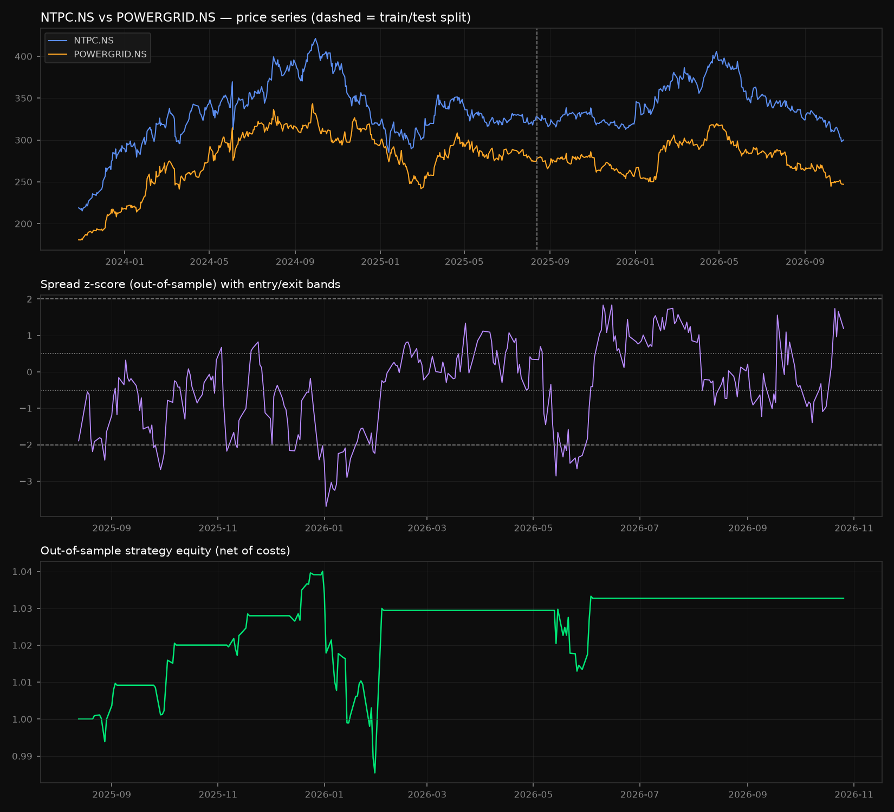

---

### BAJAJ-AUTO.NS / HEROMOTOCO.NS

- **Latest prices:** BAJAJ-AUTO.NS ₹10,071.00 · HEROMOTOCO.NS ₹5,199.00
- **Hedge ratio (train-fitted):** 0.4077
- **Cointegration (train):** FAIL at 5% — ADF -2.14, p=0.2281
- **Persistence:** passed 5% in 0 of 84 real-data runs (strict tier: 0/84)
- **Spread half-life:** 31.3 days
- **Current z-score:** +1.36
- **Signal today:** watch (approaching band)
- ⚠️ _Pair did not cointegrate on training data. Any signal here is not statistically justified — observation only._

**Out-of-sample backtest** (beta frozen from train window):

| Metric | Value |
|---|---|
| Sharpe | -0.15 |
| Sortino | -0.15 |
| Annualised return | -1.87% |
| Annualised vol | 9.55% |
| Max drawdown | -14.83% |
| Round-trip trades | 6 |

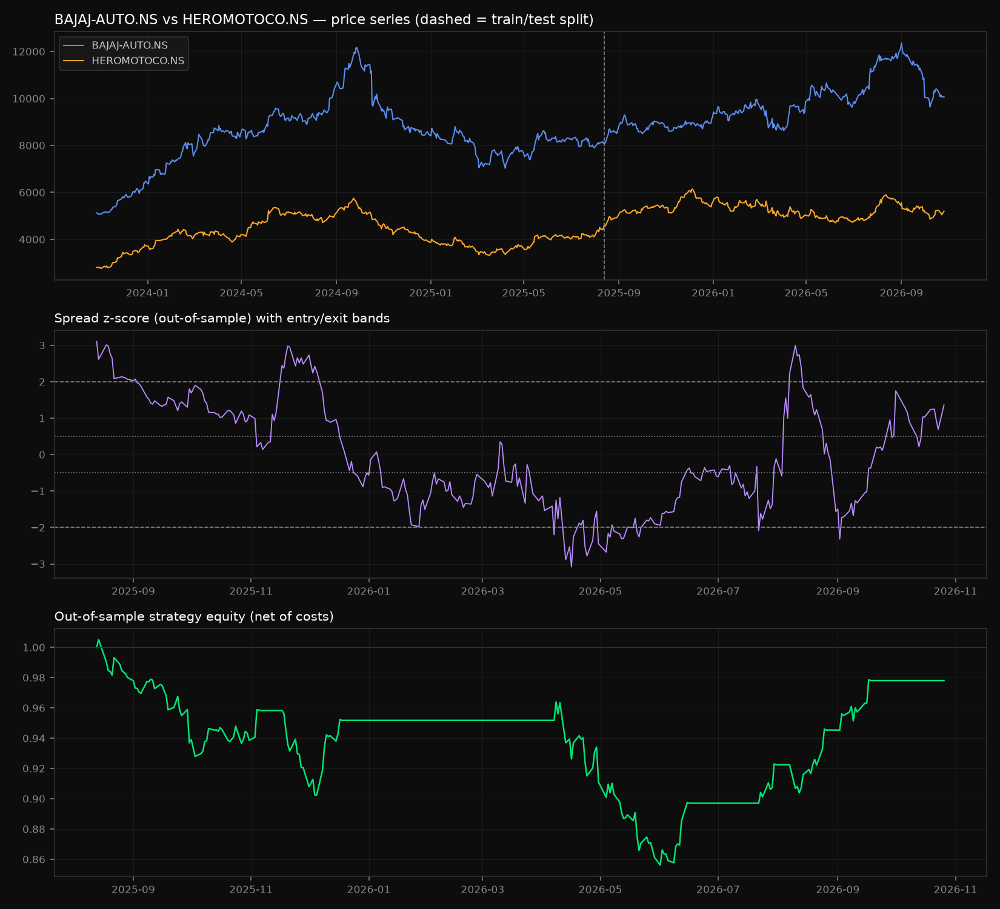

---

### TATASTEEL.NS / JSWSTEEL.NS

- **Latest prices:** TATASTEEL.NS ₹169.94 · JSWSTEEL.NS ₹1,260.00
- **Hedge ratio (train-fitted):** 2.9436
- **Cointegration (train):** FAIL at 5% — ADF -1.40, p=0.5839
- **Persistence:** passed 5% in 0 of 84 real-data runs (strict tier: 0/84)
- **Spread half-life:** 61.1 days
- **Current z-score:** +0.93
- **Signal today:** watch (approaching band)
- ⚠️ _Pair did not cointegrate on training data. Any signal here is not statistically justified — observation only._

**Out-of-sample backtest** (beta frozen from train window):

| Metric | Value |
|---|---|
| Sharpe | 0.74 |
| Sortino | 0.71 |
| Annualised return | 6.11% |
| Annualised vol | 8.52% |
| Max drawdown | -5.58% |
| Round-trip trades | 6 |

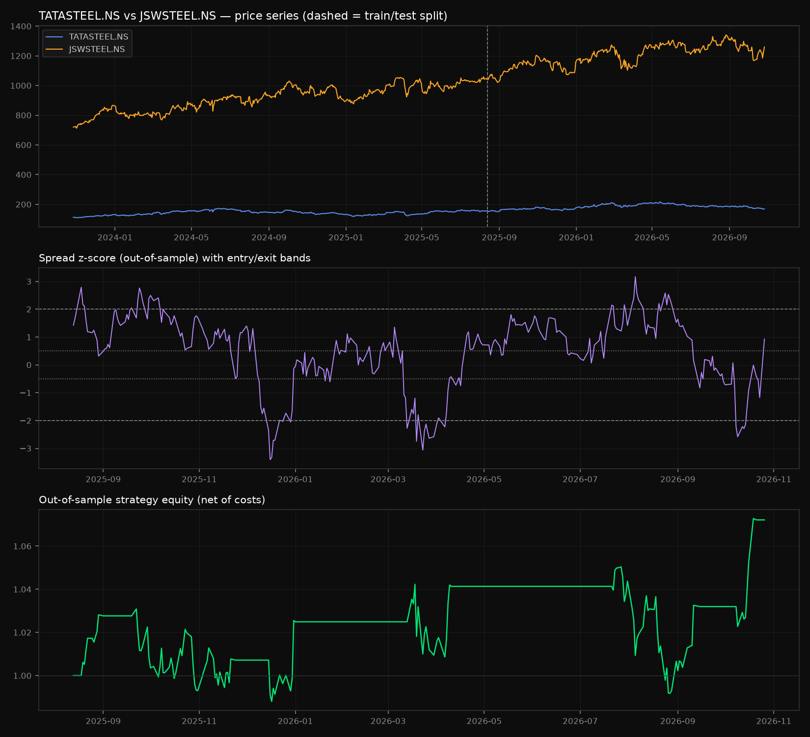

---

### SUNPHARMA.NS / CIPLA.NS

- **Latest prices:** SUNPHARMA.NS ₹1,740.00 · CIPLA.NS ₹1,355.00
- **Hedge ratio (train-fitted):** 0.4774
- **Cointegration (train):** PASS at 5% — ADF -3.28, p=0.0157
- **Persistence:** passed 5% in 84 of 84 real-data runs (strict tier: 5/84)
- **Spread half-life:** 10.9 days
- **Current z-score:** +0.98
- **Signal today:** watch (approaching band)

**Out-of-sample backtest** (beta frozen from train window):

| Metric | Value |
|---|---|
| Sharpe | 0.15 |
| Sortino | 0.16 |
| Annualised return | 0.83% |
| Annualised vol | 7.50% |
| Max drawdown | -10.09% |
| Round-trip trades | 5 |

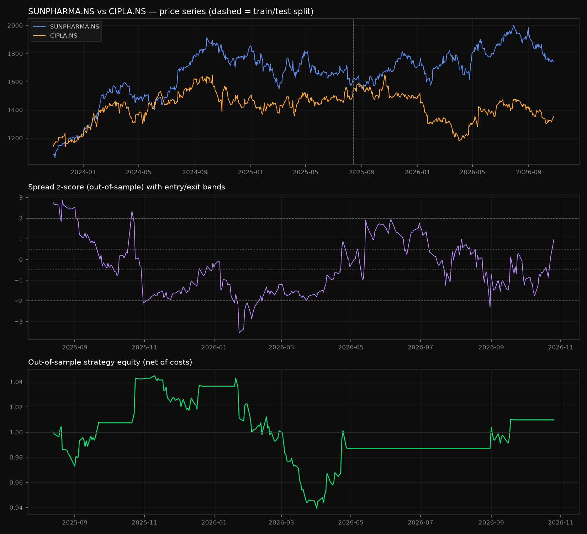

---

_Generated 2026-10-27 · pairs mean-reversion scanner · out-of-sample backtest · multiple-testing-aware · not investment advice._
