# Indian Pairs-Trading Scanner — 2026-10-28

> **What this is:** a market-neutral *pairs mean-reversion* scanner. It flags when two related NSE stocks have drifted apart far enough that their historical relationship signals a possible convergence trade. It does **not** forecast growth, rank "best" stocks, or predict company performance. A signal means the *spread between two stocks* is stretched — nothing about either stock being a good investment. Not investment advice; do your own research.

## Methodology (fixed in advance)

- **Universe:** 16 declared sector-mate pairs. Parameters (3y window, 60/40 train-test, z-entry 2.0, z-exit 0.5, 5 bps costs) are pre-registered; changes are logged in the README changelog *before* looking at results.
- **Multiple testing:** at the 5% level across 16 pairs, **≈0.8 false positives per run are expected by chance alone** even if nothing truly cointegrates. A single-day pass is a candidate, not a discovery.
- **Strict tier:** Bonferroni-corrected threshold p < 0.0031 (marked ✓✓).
- **Evidence = persistence:** the Persistence column counts how often each pair has passed the 5% test across all *real-data* daily runs recorded in `reports/history.csv`. Pairs deserve attention only when they pass persistently.

## Summary

| Pair | p-value | Coint. | Persistence | Current z | Signal | OOS Sharpe |
|---|---|---|---|---|---|---|
| HDFCBANK.NS/ICICIBANK.NS | 0.0706 | ✗ | 1/70 | +1.23 | watch | -0.53 |
| AXISBANK.NS/ICICIBANK.NS | 0.8920 | ✗ | 0/85 | +0.64 | watch | -0.47 |
| KOTAKBANK.NS/HDFCBANK.NS | 0.2083 | ✗ | 0/85 | -1.94 | watch | 1.14 |
| SBIN.NS/BANKBARODA.NS | 0.1381 | ✗ | 0/85 | +1.83 | watch | 0.50 |
| TCS.NS/INFY.NS | 0.5813 | ✗ | 0/85 | -1.20 | watch | 1.95 |
| INFY.NS/WIPRO.NS | 0.1199 | ✗ | 0/85 | +1.24 | watch | 2.31 |
| HCLTECH.NS/TECHM.NS | 0.1480 | ✗ | 0/85 | +2.52 | SHORT spread | -0.05 |
| ACC.NS/AMBUJACEM.NS | 0.4349 | ✗ | 0/85 | -1.61 | watch | -0.13 |
| ULTRACEMCO.NS/SHREECEM.NS | 0.3138 | ✗ | 0/85 | -0.08 | flat / no stretch | -0.01 |
| IOC.NS/BPCL.NS | 0.7585 | ✗ | 0/85 | -1.07 | watch | 0.29 |
| BPCL.NS/HINDPETRO.NS | 0.2278 | ✗ | 0/85 | +1.87 | watch | -0.09 |
| ONGC.NS/COALINDIA.NS | 0.0067 | ✓ | 77/85 | -0.75 | watch | 0.83 |
| NTPC.NS/POWERGRID.NS | 0.1033 | ✗ | 0/85 | +2.03 | SHORT spread | 0.54 |
| BAJAJ-AUTO.NS/HEROMOTOCO.NS | 0.2704 | ✗ | 0/85 | +0.81 | watch | -0.20 |
| TATASTEEL.NS/JSWSTEEL.NS | 0.6000 | ✗ | 0/85 | +0.54 | watch | 0.74 |
| SUNPHARMA.NS/CIPLA.NS | 0.0243 | ✓ | 85/85 | +0.53 | watch | 0.16 |

_Legend: ✓✓ passes strict Bonferroni tier · ✓ passes 5% only · ✗ fails. Persistence = 5%-passes / real-data runs recorded. \*no real-data history yet._

---

### HDFCBANK.NS / ICICIBANK.NS

- **Latest prices:** HDFCBANK.NS ₹680.20 · ICICIBANK.NS ₹1,386.90
- **Hedge ratio (train-fitted):** 1.5693
- **Cointegration (train):** FAIL at 5% — ADF -2.72, p=0.0706
- **Persistence:** passed 5% in 1 of 70 real-data runs (strict tier: 0/70)
- **Spread half-life:** 23.7 days
- **Current z-score:** +1.23
- **Signal today:** watch (approaching band)
- ⚠️ _Pair did not cointegrate on training data. Any signal here is not statistically justified — observation only._

**Out-of-sample backtest** (beta frozen from train window):

| Metric | Value |
|---|---|
| Sharpe | -0.53 |
| Sortino | -0.56 |
| Annualised return | -3.58% |
| Annualised vol | 6.51% |
| Max drawdown | -7.96% |
| Round-trip trades | 4 |

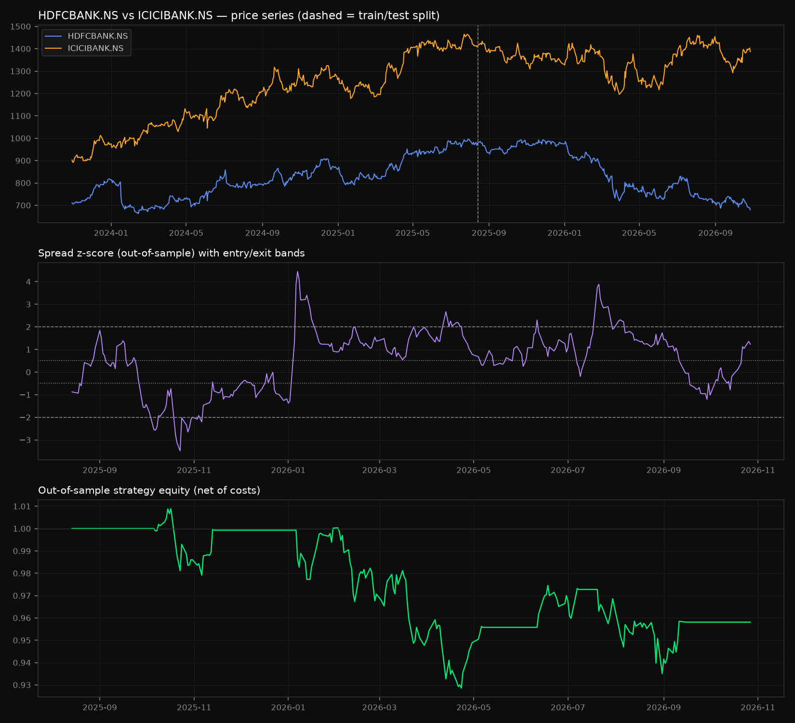

---

### AXISBANK.NS / ICICIBANK.NS

- **Latest prices:** AXISBANK.NS ₹1,205.70 · ICICIBANK.NS ₹1,386.90
- **Hedge ratio (train-fitted):** 0.7528
- **Cointegration (train):** FAIL at 5% — ADF -0.50, p=0.8920
- **Persistence:** passed 5% in 0 of 85 real-data runs (strict tier: 0/85)
- **Spread half-life:** 328.9 days
- **Current z-score:** +0.64
- **Signal today:** watch (approaching band)
- ⚠️ _Pair did not cointegrate on training data. Any signal here is not statistically justified — observation only._

**Out-of-sample backtest** (beta frozen from train window):

| Metric | Value |
|---|---|
| Sharpe | -0.47 |
| Sortino | -0.46 |
| Annualised return | -4.41% |
| Annualised vol | 8.82% |
| Max drawdown | -11.34% |
| Round-trip trades | 4 |

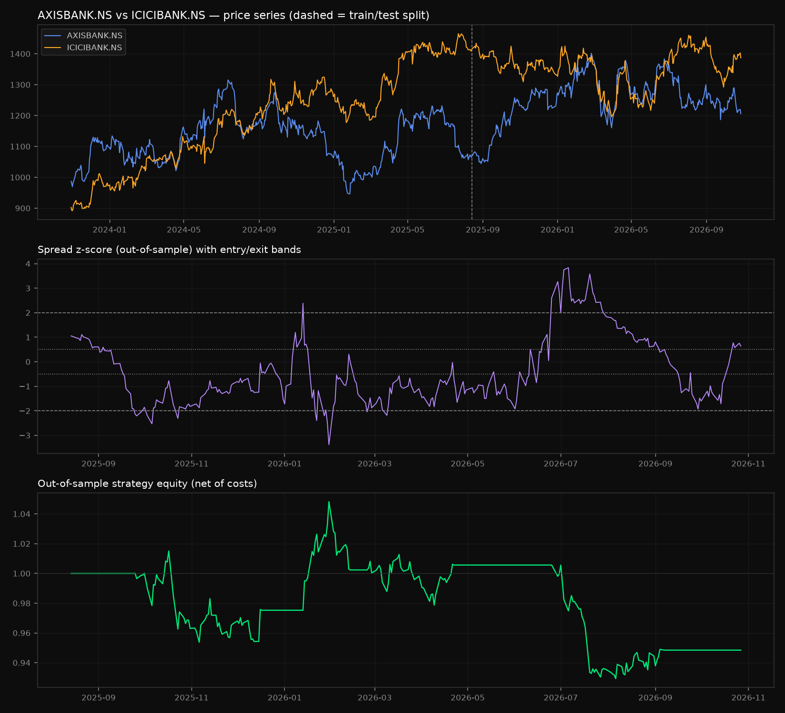

---

### KOTAKBANK.NS / HDFCBANK.NS

- **Latest prices:** KOTAKBANK.NS ₹442.50 · HDFCBANK.NS ₹680.20
- **Hedge ratio (train-fitted):** 2.2134
- **Cointegration (train):** FAIL at 5% — ADF -2.19, p=0.2083
- **Persistence:** passed 5% in 0 of 85 real-data runs (strict tier: 0/85)
- **Spread half-life:** 28.1 days
- **Current z-score:** -1.94
- **Signal today:** watch (approaching band)
- ⚠️ _Pair did not cointegrate on training data. Any signal here is not statistically justified — observation only._

**Out-of-sample backtest** (beta frozen from train window):

| Metric | Value |
|---|---|
| Sharpe | 1.14 |
| Sortino | 1.11 |
| Annualised return | 6.61% |
| Annualised vol | 5.74% |
| Max drawdown | -2.83% |
| Round-trip trades | 5 |

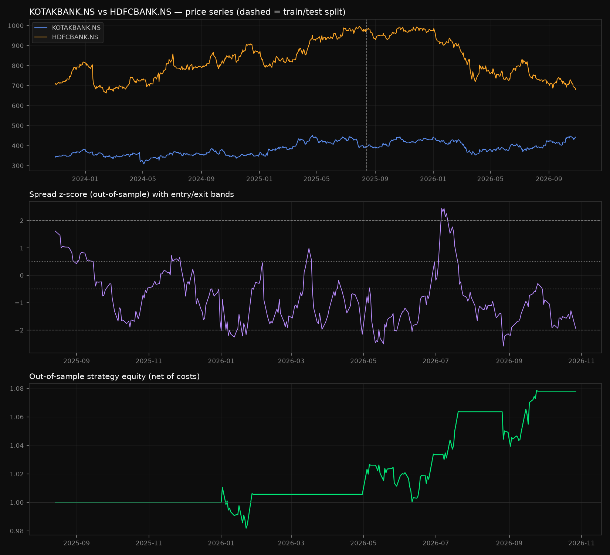

---

### SBIN.NS / BANKBARODA.NS

- **Latest prices:** SBIN.NS ₹945.10 · BANKBARODA.NS ₹233.93
- **Hedge ratio (train-fitted):** 0.1875
- **Cointegration (train):** FAIL at 5% — ADF -2.41, p=0.1381
- **Persistence:** passed 5% in 0 of 85 real-data runs (strict tier: 0/85)
- **Spread half-life:** 21.1 days
- **Current z-score:** +1.83
- **Signal today:** watch (approaching band)
- ⚠️ _Pair did not cointegrate on training data. Any signal here is not statistically justified — observation only._

**Out-of-sample backtest** (beta frozen from train window):

| Metric | Value |
|---|---|
| Sharpe | 0.50 |
| Sortino | 0.46 |
| Annualised return | 4.46% |
| Annualised vol | 9.64% |
| Max drawdown | -8.63% |
| Round-trip trades | 7 |

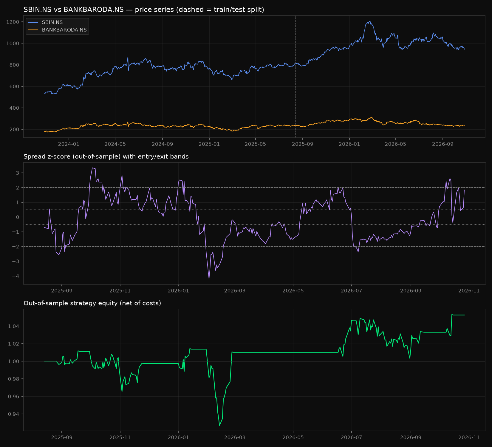

---

### TCS.NS / INFY.NS

- **Latest prices:** TCS.NS ₹2,496.90 · INFY.NS ₹1,163.00
- **Hedge ratio (train-fitted):** 0.4133
- **Cointegration (train):** FAIL at 5% — ADF -1.40, p=0.5813
- **Persistence:** passed 5% in 0 of 85 real-data runs (strict tier: 0/85)
- **Spread half-life:** 66.4 days
- **Current z-score:** -1.20
- **Signal today:** watch (approaching band)
- ⚠️ _Pair did not cointegrate on training data. Any signal here is not statistically justified — observation only._

**Out-of-sample backtest** (beta frozen from train window):

| Metric | Value |
|---|---|
| Sharpe | 1.95 |
| Sortino | 2.26 |
| Annualised return | 9.18% |
| Annualised vol | 4.57% |
| Max drawdown | -1.88% |
| Round-trip trades | 6 |

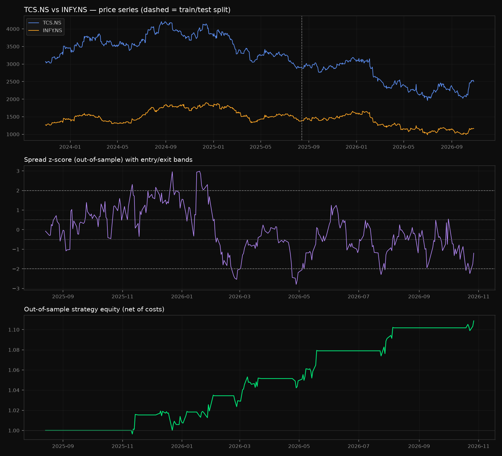

---

### INFY.NS / WIPRO.NS

- **Latest prices:** INFY.NS ₹1,163.00 · WIPRO.NS ₹187.00
- **Hedge ratio (train-fitted):** 0.1227
- **Cointegration (train):** FAIL at 5% — ADF -2.48, p=0.1199
- **Persistence:** passed 5% in 0 of 85 real-data runs (strict tier: 0/85)
- **Spread half-life:** 27.4 days
- **Current z-score:** +1.24
- **Signal today:** watch (approaching band)
- ⚠️ _Pair did not cointegrate on training data. Any signal here is not statistically justified — observation only._

**Out-of-sample backtest** (beta frozen from train window):

| Metric | Value |
|---|---|
| Sharpe | 2.31 |
| Sortino | 2.27 |
| Annualised return | 12.66% |
| Annualised vol | 5.21% |
| Max drawdown | -1.57% |
| Round-trip trades | 7 |

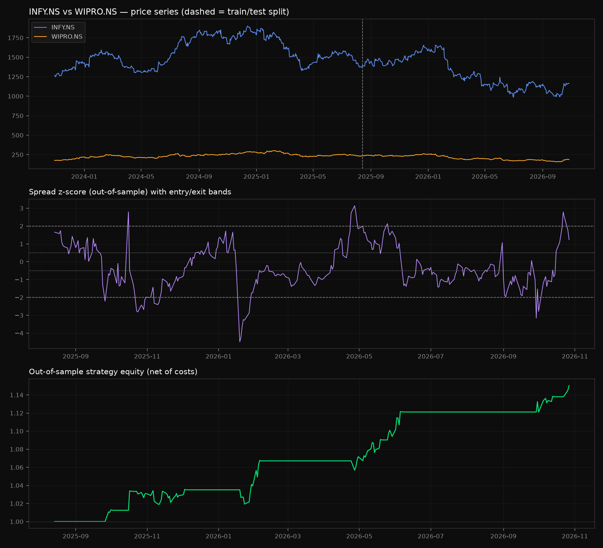

---

### HCLTECH.NS / TECHM.NS

- **Latest prices:** HCLTECH.NS ₹1,420.00 · TECHM.NS ₹1,811.40
- **Hedge ratio (train-fitted):** 0.9496
- **Cointegration (train):** FAIL at 5% — ADF -2.38, p=0.1480
- **Persistence:** passed 5% in 0 of 85 real-data runs (strict tier: 0/85)
- **Spread half-life:** 25.1 days
- **Current z-score:** +2.52
- **Signal today:** SHORT spread (short TECHM.NS, long HCLTECH.NS)
- ⚠️ _Pair did not cointegrate on training data. Any signal here is not statistically justified — observation only._

**Out-of-sample backtest** (beta frozen from train window):

| Metric | Value |
|---|---|
| Sharpe | -0.05 |
| Sortino | -0.05 |
| Annualised return | -0.64% |
| Annualised vol | 7.50% |
| Max drawdown | -8.28% |
| Round-trip trades | 5 |

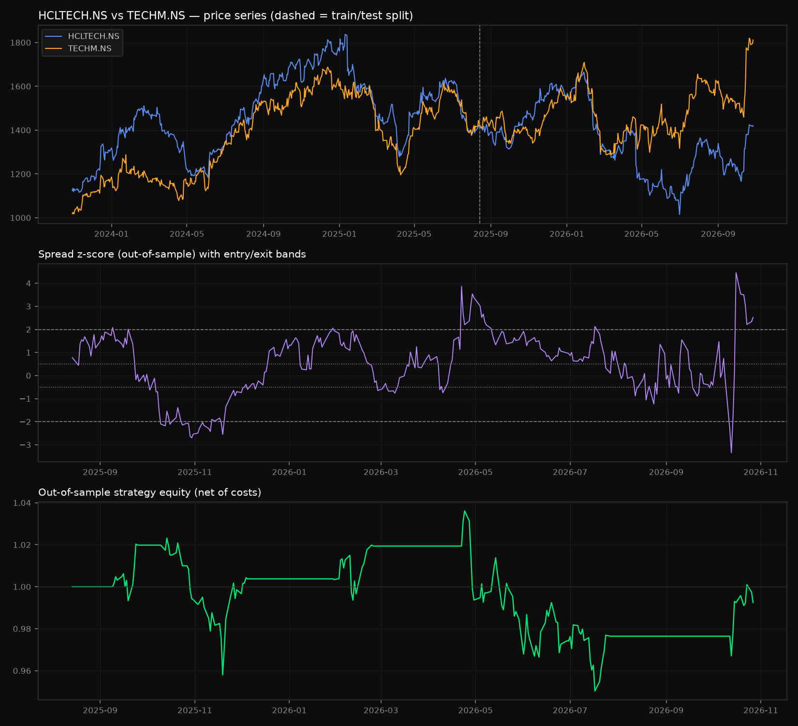

---

### ACC.NS / AMBUJACEM.NS

- **Latest prices:** ACC.NS ₹1,147.50 · AMBUJACEM.NS ₹348.80
- **Hedge ratio (train-fitted):** 0.1563
- **Cointegration (train):** FAIL at 5% — ADF -1.69, p=0.4349
- **Persistence:** passed 5% in 0 of 85 real-data runs (strict tier: 0/85)
- **Spread half-life:** 44.9 days
- **Current z-score:** -1.61
- **Signal today:** watch (approaching band)
- ⚠️ _Pair did not cointegrate on training data. Any signal here is not statistically justified — observation only._

**Out-of-sample backtest** (beta frozen from train window):

| Metric | Value |
|---|---|
| Sharpe | -0.13 |
| Sortino | -0.10 |
| Annualised return | -1.05% |
| Annualised vol | 6.56% |
| Max drawdown | -6.21% |
| Round-trip trades | 3 |

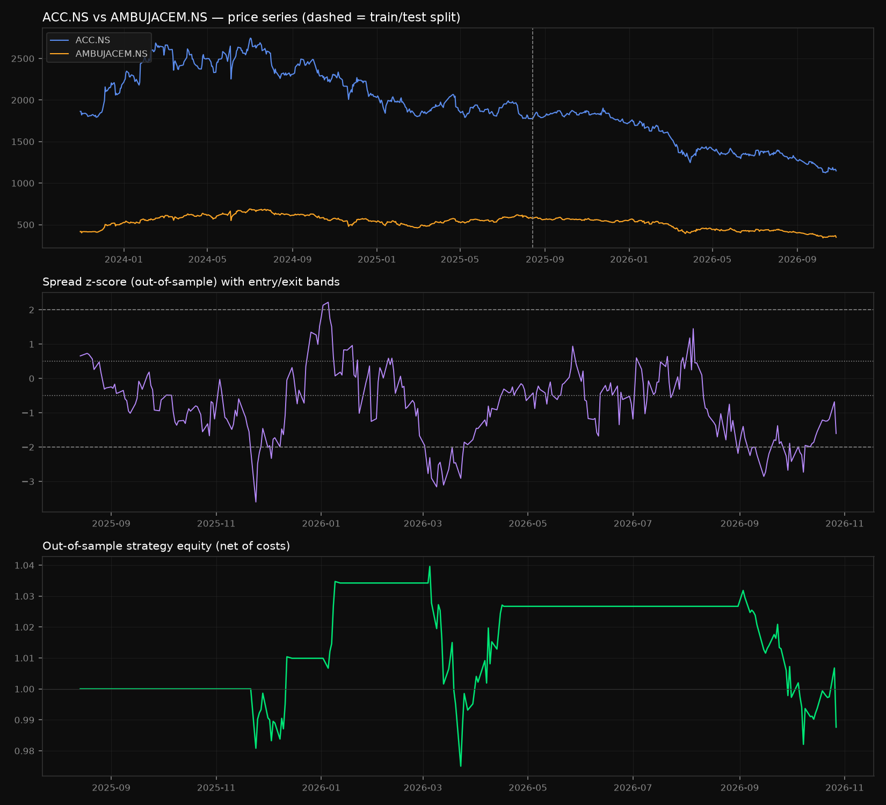

---

### ULTRACEMCO.NS / SHREECEM.NS

- **Latest prices:** ULTRACEMCO.NS ₹11,150.00 · SHREECEM.NS ₹23,300.00
- **Hedge ratio (train-fitted):** 1.0833
- **Cointegration (train):** FAIL at 5% — ADF -1.94, p=0.3138
- **Persistence:** passed 5% in 0 of 85 real-data runs (strict tier: 0/85)
- **Spread half-life:** 40.3 days
- **Current z-score:** -0.08
- **Signal today:** flat / no stretch
- ⚠️ _Pair did not cointegrate on training data. Any signal here is not statistically justified — observation only._

**Out-of-sample backtest** (beta frozen from train window):

| Metric | Value |
|---|---|
| Sharpe | -0.01 |
| Sortino | -0.02 |
| Annualised return | -0.37% |
| Annualised vol | 7.31% |
| Max drawdown | -6.41% |
| Round-trip trades | 6 |

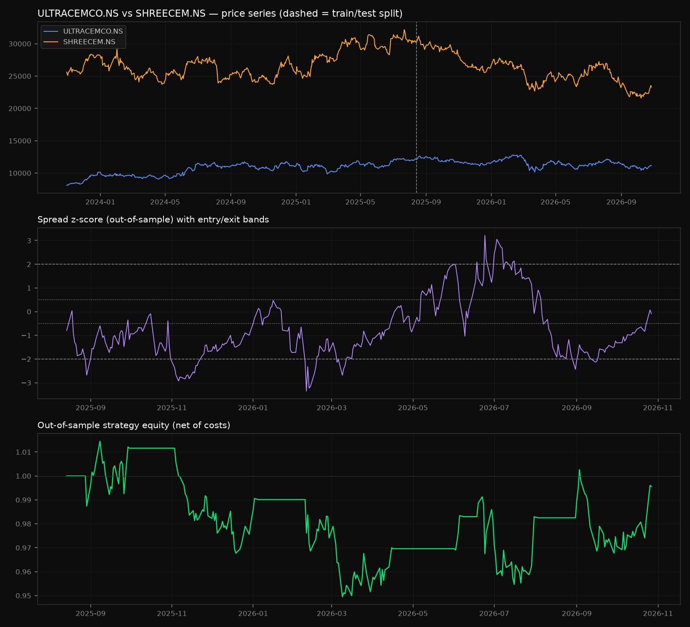

---

### IOC.NS / BPCL.NS

- **Latest prices:** IOC.NS ₹131.75 · BPCL.NS ₹295.60
- **Hedge ratio (train-fitted):** 1.5988
- **Cointegration (train):** FAIL at 5% — ADF -0.99, p=0.7585
- **Persistence:** passed 5% in 0 of 85 real-data runs (strict tier: 0/85)
- **Spread half-life:** 125.4 days
- **Current z-score:** -1.07
- **Signal today:** watch (approaching band)
- ⚠️ _Pair did not cointegrate on training data. Any signal here is not statistically justified — observation only._

**Out-of-sample backtest** (beta frozen from train window):

| Metric | Value |
|---|---|
| Sharpe | 0.29 |
| Sortino | 0.26 |
| Annualised return | 1.71% |
| Annualised vol | 6.64% |
| Max drawdown | -7.41% |
| Round-trip trades | 5 |

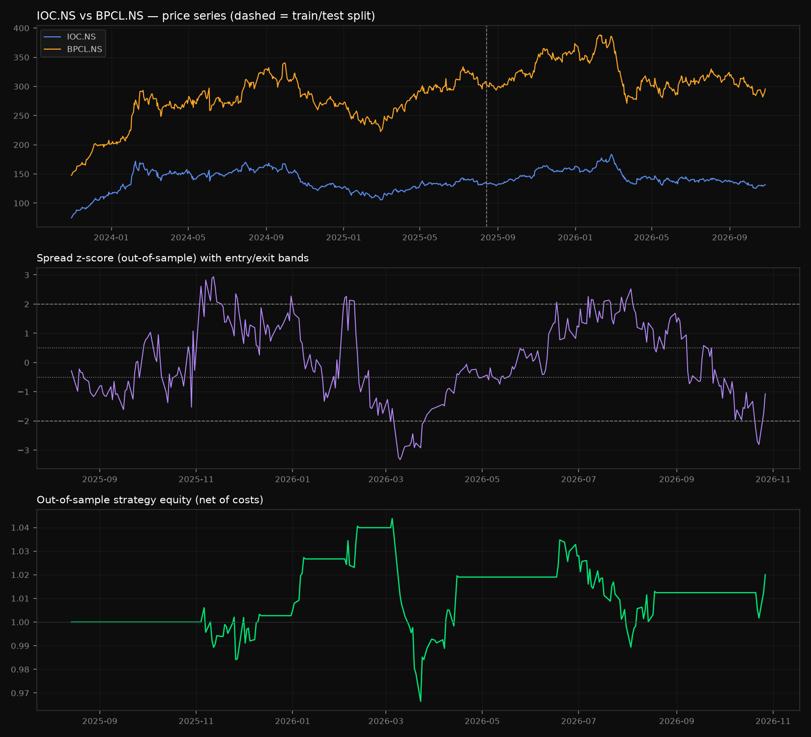

---

### BPCL.NS / HINDPETRO.NS

- **Latest prices:** BPCL.NS ₹295.60 · HINDPETRO.NS ₹354.00
- **Hedge ratio (train-fitted):** 1.3130
- **Cointegration (train):** FAIL at 5% — ADF -2.14, p=0.2278
- **Persistence:** passed 5% in 0 of 85 real-data runs (strict tier: 0/85)
- **Spread half-life:** 35.1 days
- **Current z-score:** +1.87
- **Signal today:** watch (approaching band)
- ⚠️ _Pair did not cointegrate on training data. Any signal here is not statistically justified — observation only._

**Out-of-sample backtest** (beta frozen from train window):

| Metric | Value |
|---|---|
| Sharpe | -0.09 |
| Sortino | -0.09 |
| Annualised return | -0.79% |
| Annualised vol | 6.44% |
| Max drawdown | -6.91% |
| Round-trip trades | 5 |

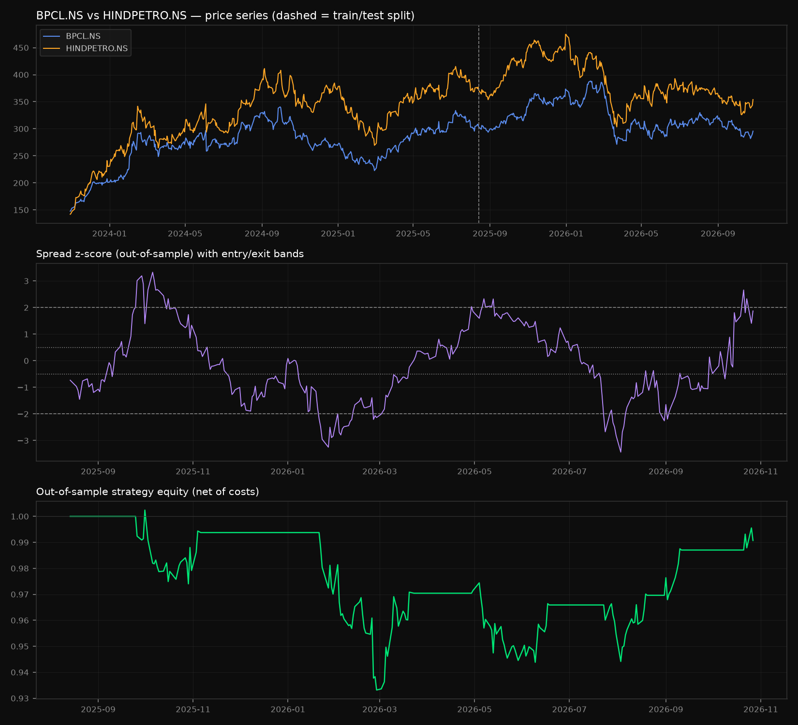

---

### ONGC.NS / COALINDIA.NS

- **Latest prices:** ONGC.NS ₹229.85 · COALINDIA.NS ₹398.00
- **Hedge ratio (train-fitted):** 1.3690
- **Cointegration (train):** PASS at 5% — ADF -3.56, p=0.0067
- **Persistence:** passed 5% in 77 of 85 real-data runs (strict tier: 1/85)
- **Spread half-life:** 12.6 days
- **Current z-score:** -0.75
- **Signal today:** watch (approaching band)

**Out-of-sample backtest** (beta frozen from train window):

| Metric | Value |
|---|---|
| Sharpe | 0.83 |
| Sortino | 0.71 |
| Annualised return | 6.62% |
| Annualised vol | 8.11% |
| Max drawdown | -6.37% |
| Round-trip trades | 6 |

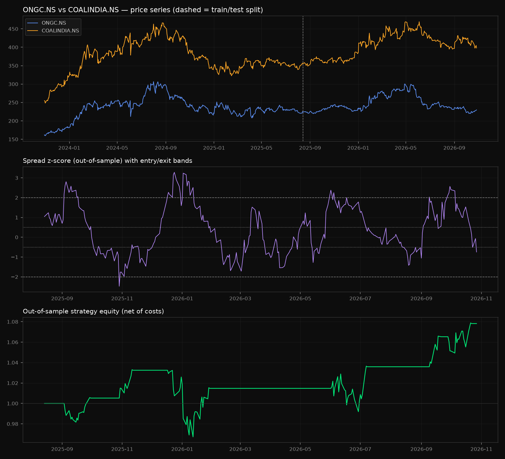

---

### NTPC.NS / POWERGRID.NS

- **Latest prices:** NTPC.NS ₹301.80 · POWERGRID.NS ₹251.75
- **Hedge ratio (train-fitted):** 0.8036
- **Cointegration (train):** FAIL at 5% — ADF -2.55, p=0.1033
- **Persistence:** passed 5% in 0 of 85 real-data runs (strict tier: 0/85)
- **Spread half-life:** 23.8 days
- **Current z-score:** +2.03
- **Signal today:** SHORT spread (short POWERGRID.NS, long NTPC.NS)
- ⚠️ _Pair did not cointegrate on training data. Any signal here is not statistically justified — observation only._

**Out-of-sample backtest** (beta frozen from train window):

| Metric | Value |
|---|---|
| Sharpe | 0.54 |
| Sortino | 0.40 |
| Annualised return | 2.78% |
| Annualised vol | 5.40% |
| Max drawdown | -5.25% |
| Round-trip trades | 6 |

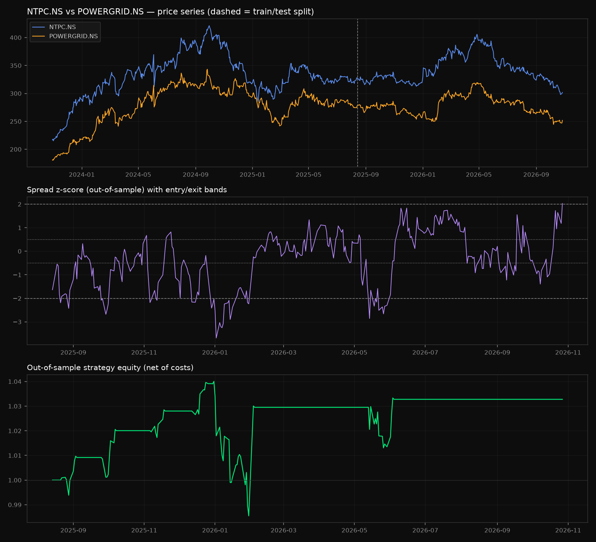

---

### BAJAJ-AUTO.NS / HEROMOTOCO.NS

- **Latest prices:** BAJAJ-AUTO.NS ₹10,390.00 · HEROMOTOCO.NS ₹5,218.50
- **Hedge ratio (train-fitted):** 0.4072
- **Cointegration (train):** FAIL at 5% — ADF -2.04, p=0.2704
- **Persistence:** passed 5% in 0 of 85 real-data runs (strict tier: 0/85)
- **Spread half-life:** 32.8 days
- **Current z-score:** +0.81
- **Signal today:** watch (approaching band)
- ⚠️ _Pair did not cointegrate on training data. Any signal here is not statistically justified — observation only._

**Out-of-sample backtest** (beta frozen from train window):

| Metric | Value |
|---|---|
| Sharpe | -0.20 |
| Sortino | -0.21 |
| Annualised return | -2.37% |
| Annualised vol | 9.64% |
| Max drawdown | -15.00% |
| Round-trip trades | 6 |

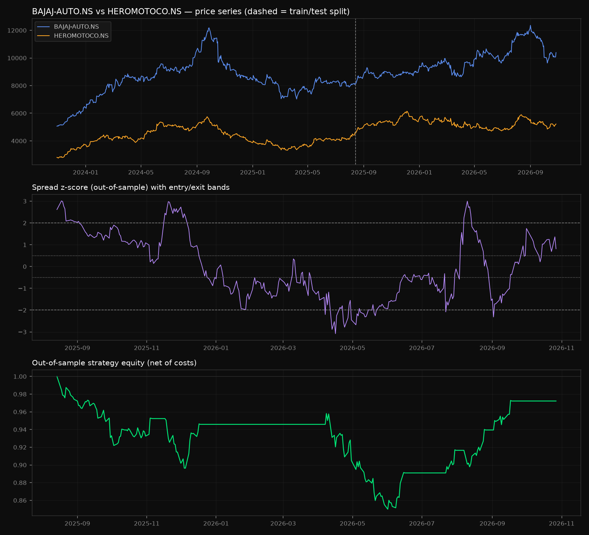

---

### TATASTEEL.NS / JSWSTEEL.NS

- **Latest prices:** TATASTEEL.NS ₹171.42 · JSWSTEEL.NS ₹1,252.70
- **Hedge ratio (train-fitted):** 2.9215
- **Cointegration (train):** FAIL at 5% — ADF -1.36, p=0.6000
- **Persistence:** passed 5% in 0 of 85 real-data runs (strict tier: 0/85)
- **Spread half-life:** 62.7 days
- **Current z-score:** +0.54
- **Signal today:** watch (approaching band)
- ⚠️ _Pair did not cointegrate on training data. Any signal here is not statistically justified — observation only._

**Out-of-sample backtest** (beta frozen from train window):

| Metric | Value |
|---|---|
| Sharpe | 0.74 |
| Sortino | 0.72 |
| Annualised return | 6.27% |
| Annualised vol | 8.69% |
| Max drawdown | -5.67% |
| Round-trip trades | 6 |

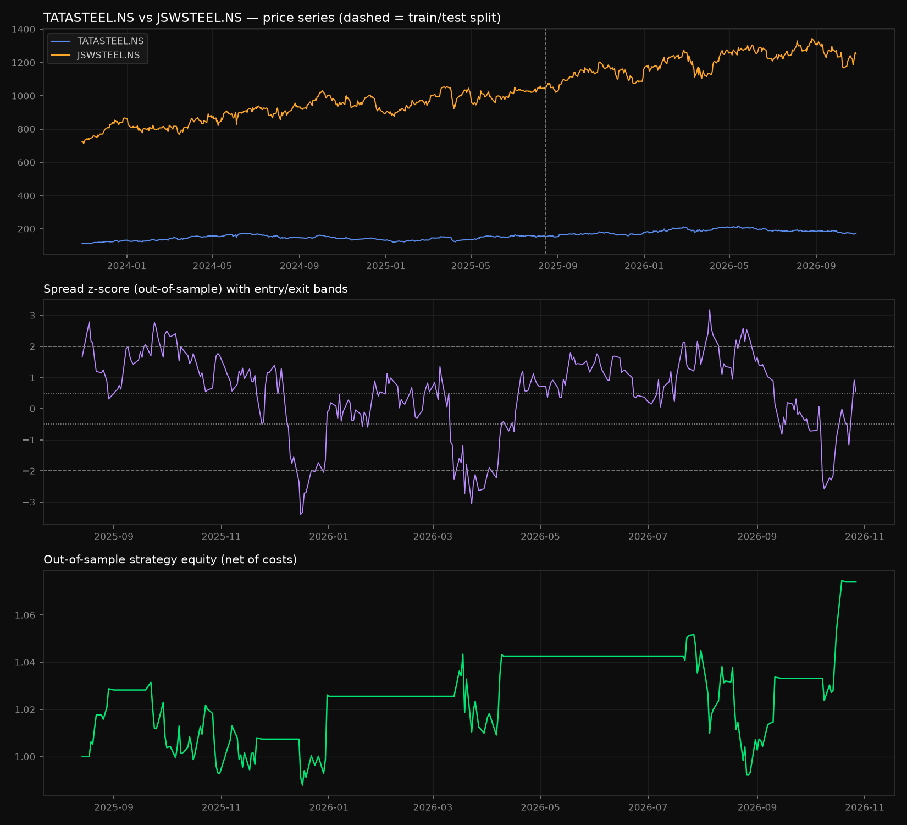

---

### SUNPHARMA.NS / CIPLA.NS

- **Latest prices:** SUNPHARMA.NS ₹1,751.20 · CIPLA.NS ₹1,350.00
- **Hedge ratio (train-fitted):** 0.4762
- **Cointegration (train):** PASS at 5% — ADF -3.13, p=0.0243
- **Persistence:** passed 5% in 85 of 85 real-data runs (strict tier: 5/85)
- **Spread half-life:** 11.4 days
- **Current z-score:** +0.53
- **Signal today:** watch (approaching band)

**Out-of-sample backtest** (beta frozen from train window):

| Metric | Value |
|---|---|
| Sharpe | 0.16 |
| Sortino | 0.17 |
| Annualised return | 0.91% |
| Annualised vol | 7.49% |
| Max drawdown | -10.08% |
| Round-trip trades | 5 |

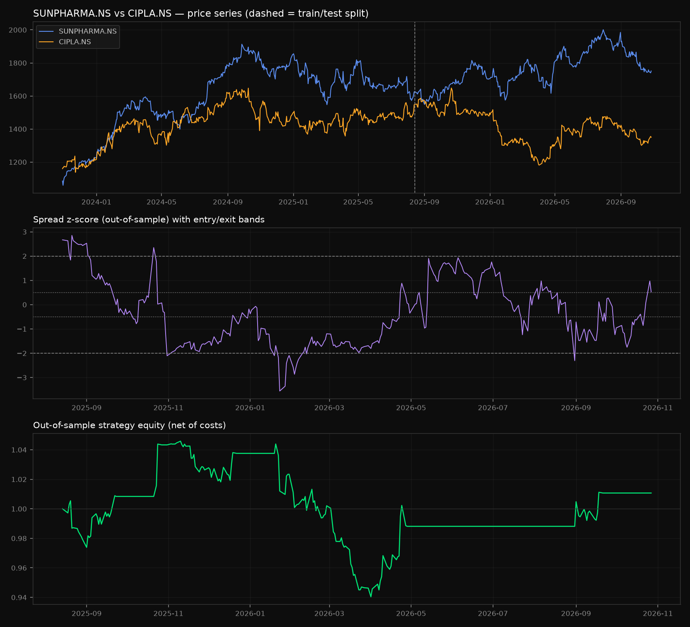

---

_Generated 2026-10-28 · pairs mean-reversion scanner · out-of-sample backtest · multiple-testing-aware · not investment advice._
