# Indian Pairs-Trading Scanner — 2026-10-30

> **What this is:** a market-neutral *pairs mean-reversion* scanner. It flags when two related NSE stocks have drifted apart far enough that their historical relationship signals a possible convergence trade. It does **not** forecast growth, rank "best" stocks, or predict company performance. A signal means the *spread between two stocks* is stretched — nothing about either stock being a good investment. Not investment advice; do your own research.

## Methodology (fixed in advance)

- **Universe:** 16 declared sector-mate pairs. Parameters (3y window, 60/40 train-test, z-entry 2.0, z-exit 0.5, 5 bps costs) are pre-registered; changes are logged in the README changelog *before* looking at results.
- **Multiple testing:** at the 5% level across 16 pairs, **≈0.8 false positives per run are expected by chance alone** even if nothing truly cointegrates. A single-day pass is a candidate, not a discovery.
- **Strict tier:** Bonferroni-corrected threshold p < 0.0031 (marked ✓✓).
- **Evidence = persistence:** the Persistence column counts how often each pair has passed the 5% test across all *real-data* daily runs recorded in `reports/history.csv`. Pairs deserve attention only when they pass persistently.

## Summary

| Pair | p-value | Coint. | Persistence | Current z | Signal | OOS Sharpe |
|---|---|---|---|---|---|---|
| HDFCBANK.NS/ICICIBANK.NS | 0.0706 | ✗ | 1/72 | +1.07 | watch | -0.53 |
| AXISBANK.NS/ICICIBANK.NS | 0.8968 | ✗ | 0/87 | +0.30 | flat / no stretch | -0.47 |
| KOTAKBANK.NS/HDFCBANK.NS | 0.2344 | ✗ | 0/87 | -2.40 | LONG spread | 1.14 |
| SBIN.NS/BANKBARODA.NS | 0.1373 | ✗ | 0/87 | +2.28 | SHORT spread | 0.50 |
| TCS.NS/INFY.NS | 0.6072 | ✗ | 0/87 | -1.40 | watch | 1.83 |
| INFY.NS/WIPRO.NS | 0.1286 | ✗ | 0/87 | +2.55 | SHORT spread | 2.08 |
| HCLTECH.NS/TECHM.NS | 0.1400 | ✗ | 0/87 | +1.67 | watch | 0.06 |
| ACC.NS/AMBUJACEM.NS | 0.4050 | ✗ | 0/87 | -1.23 | watch | -0.06 |
| ULTRACEMCO.NS/SHREECEM.NS | 0.3169 | ✗ | 0/87 | -0.22 | flat / no stretch | -0.01 |
| IOC.NS/BPCL.NS | 0.7511 | ✗ | 0/87 | -1.64 | watch | 0.18 |
| BPCL.NS/HINDPETRO.NS | 0.2267 | ✗ | 0/87 | +1.25 | watch | -0.03 |
| ONGC.NS/COALINDIA.NS | 0.0066 | ✓ | 79/87 | -0.72 | watch | 0.83 |
| NTPC.NS/POWERGRID.NS | 0.1031 | ✗ | 0/87 | +2.25 | SHORT spread | 0.49 |
| BAJAJ-AUTO.NS/HEROMOTOCO.NS | 0.2504 | ✗ | 0/87 | +0.25 | flat / no stretch | -0.07 |
| TATASTEEL.NS/JSWSTEEL.NS | 0.6183 | ✗ | 0/87 | +0.78 | watch | 0.74 |
| SUNPHARMA.NS/CIPLA.NS | 0.0265 | ✓ | 87/87 | +0.69 | watch | 0.18 |

_Legend: ✓✓ passes strict Bonferroni tier · ✓ passes 5% only · ✗ fails. Persistence = 5%-passes / real-data runs recorded. \*no real-data history yet._

---

### HDFCBANK.NS / ICICIBANK.NS

- **Latest prices:** HDFCBANK.NS ₹683.30 · ICICIBANK.NS ₹1,386.60
- **Hedge ratio (train-fitted):** 1.5679
- **Cointegration (train):** FAIL at 5% — ADF -2.72, p=0.0706
- **Persistence:** passed 5% in 1 of 72 real-data runs (strict tier: 0/72)
- **Spread half-life:** 23.8 days
- **Current z-score:** +1.07
- **Signal today:** watch (approaching band)
- ⚠️ _Pair did not cointegrate on training data. Any signal here is not statistically justified — observation only._

**Out-of-sample backtest** (beta frozen from train window):

| Metric | Value |
|---|---|
| Sharpe | -0.53 |
| Sortino | -0.56 |
| Annualised return | -3.54% |
| Annualised vol | 6.46% |
| Max drawdown | -7.92% |
| Round-trip trades | 4 |

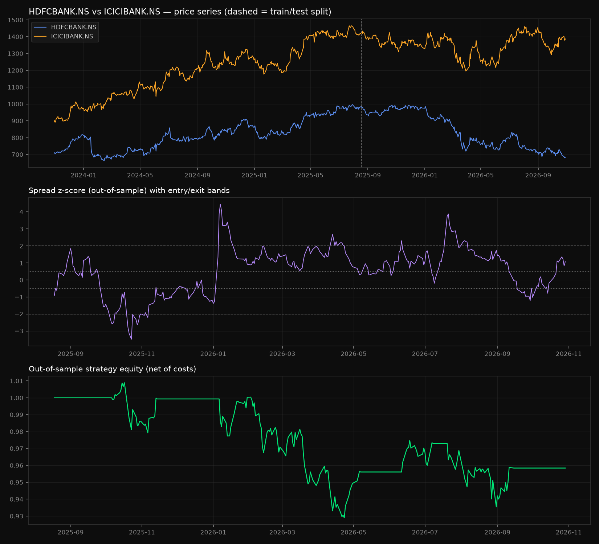

---

### AXISBANK.NS / ICICIBANK.NS

- **Latest prices:** AXISBANK.NS ₹1,225.00 · ICICIBANK.NS ₹1,386.60
- **Hedge ratio (train-fitted):** 0.7474
- **Cointegration (train):** FAIL at 5% — ADF -0.47, p=0.8968
- **Persistence:** passed 5% in 0 of 87 real-data runs (strict tier: 0/87)
- **Spread half-life:** 348.9 days
- **Current z-score:** +0.30
- **Signal today:** flat / no stretch
- ⚠️ _Pair did not cointegrate on training data. Any signal here is not statistically justified — observation only._

**Out-of-sample backtest** (beta frozen from train window):

| Metric | Value |
|---|---|
| Sharpe | -0.47 |
| Sortino | -0.46 |
| Annualised return | -4.35% |
| Annualised vol | 8.73% |
| Max drawdown | -11.25% |
| Round-trip trades | 4 |

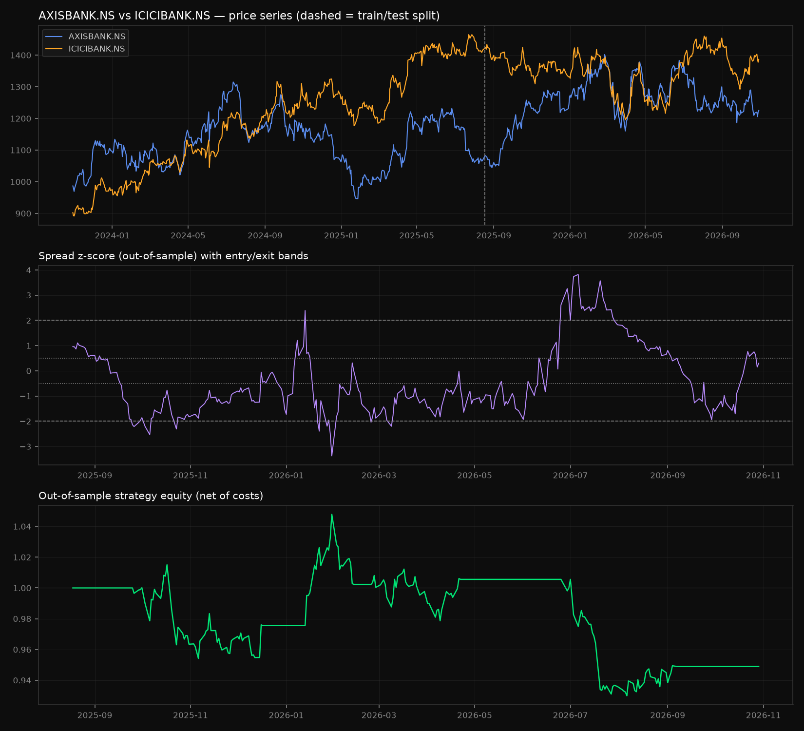

---

### KOTAKBANK.NS / HDFCBANK.NS

- **Latest prices:** KOTAKBANK.NS ₹459.00 · HDFCBANK.NS ₹683.30
- **Hedge ratio (train-fitted):** 2.2192
- **Cointegration (train):** FAIL at 5% — ADF -2.13, p=0.2344
- **Persistence:** passed 5% in 0 of 87 real-data runs (strict tier: 0/87)
- **Spread half-life:** 29.1 days
- **Current z-score:** -2.40
- **Signal today:** LONG spread (long HDFCBANK.NS, short KOTAKBANK.NS)
- ⚠️ _Pair did not cointegrate on training data. Any signal here is not statistically justified — observation only._

**Out-of-sample backtest** (beta frozen from train window):

| Metric | Value |
|---|---|
| Sharpe | 1.14 |
| Sortino | 1.11 |
| Annualised return | 6.53% |
| Annualised vol | 5.68% |
| Max drawdown | -2.80% |
| Round-trip trades | 5 |

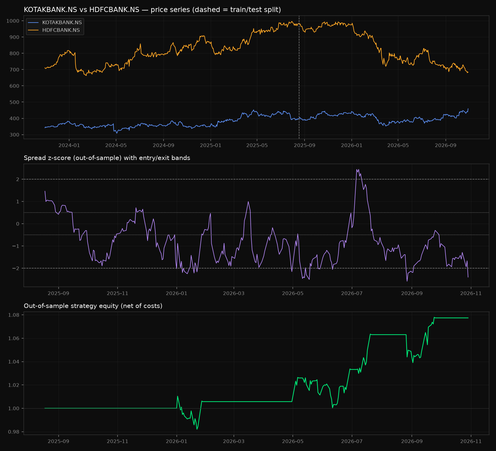

---

### SBIN.NS / BANKBARODA.NS

- **Latest prices:** SBIN.NS ₹971.90 · BANKBARODA.NS ₹241.31
- **Hedge ratio (train-fitted):** 0.1874
- **Cointegration (train):** FAIL at 5% — ADF -2.42, p=0.1373
- **Persistence:** passed 5% in 0 of 87 real-data runs (strict tier: 0/87)
- **Spread half-life:** 21.1 days
- **Current z-score:** +2.28
- **Signal today:** SHORT spread (short BANKBARODA.NS, long SBIN.NS)
- ⚠️ _Pair did not cointegrate on training data. Any signal here is not statistically justified — observation only._

**Out-of-sample backtest** (beta frozen from train window):

| Metric | Value |
|---|---|
| Sharpe | 0.50 |
| Sortino | 0.46 |
| Annualised return | 4.45% |
| Annualised vol | 9.62% |
| Max drawdown | -8.62% |
| Round-trip trades | 7 |

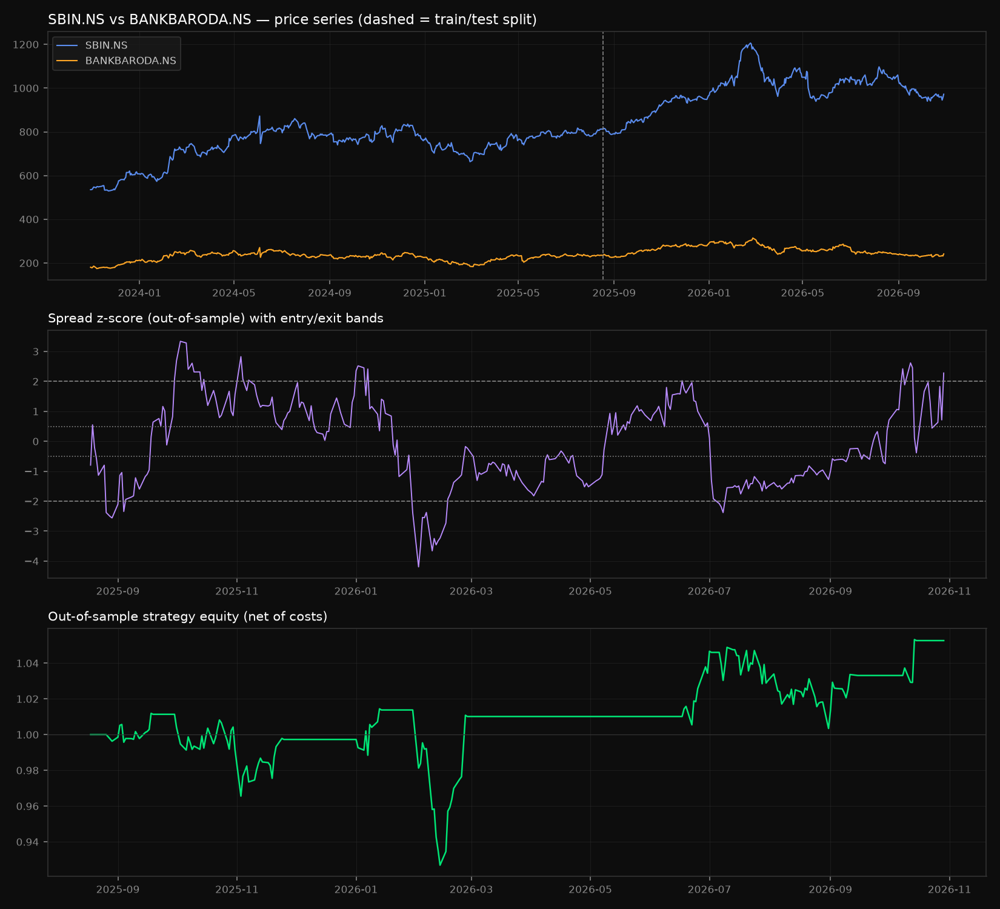

---

### TCS.NS / INFY.NS

- **Latest prices:** TCS.NS ₹2,478.00 · INFY.NS ₹1,146.50
- **Hedge ratio (train-fitted):** 0.4115
- **Cointegration (train):** FAIL at 5% — ADF -1.35, p=0.6072
- **Persistence:** passed 5% in 0 of 87 real-data runs (strict tier: 0/87)
- **Spread half-life:** 68.9 days
- **Current z-score:** -1.40
- **Signal today:** watch (approaching band)
- ⚠️ _Pair did not cointegrate on training data. Any signal here is not statistically justified — observation only._

**Out-of-sample backtest** (beta frozen from train window):

| Metric | Value |
|---|---|
| Sharpe | 1.83 |
| Sortino | 2.04 |
| Annualised return | 8.90% |
| Annualised vol | 4.72% |
| Max drawdown | -1.90% |
| Round-trip trades | 6 |

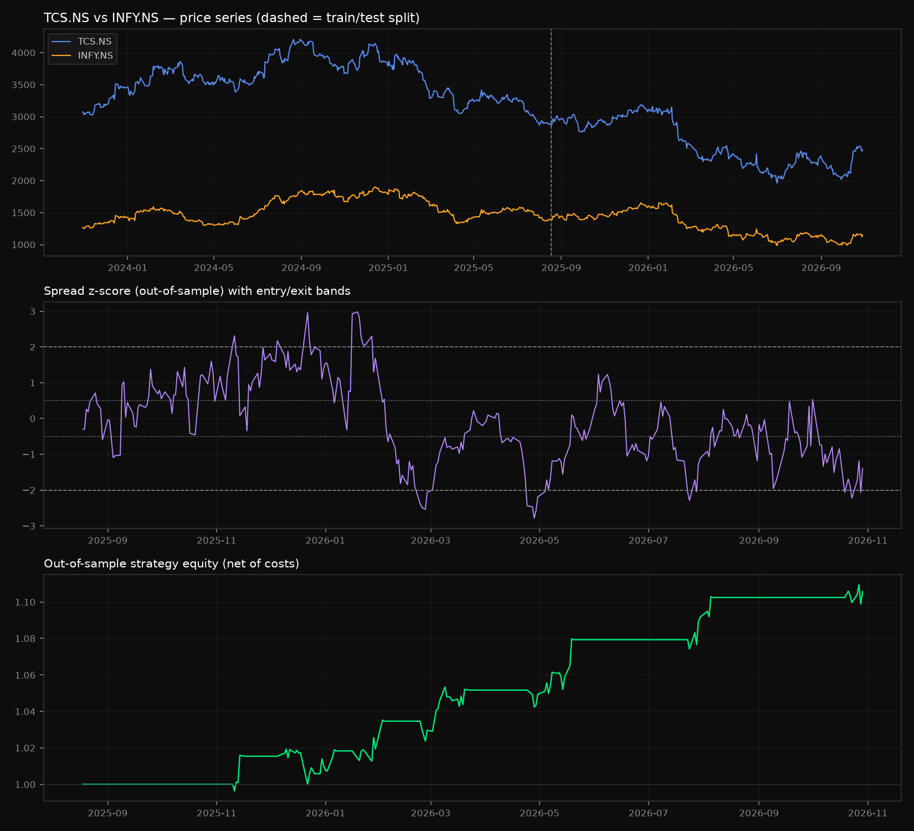

---

### INFY.NS / WIPRO.NS

- **Latest prices:** INFY.NS ₹1,146.50 · WIPRO.NS ₹190.10
- **Hedge ratio (train-fitted):** 0.1225
- **Cointegration (train):** FAIL at 5% — ADF -2.45, p=0.1286
- **Persistence:** passed 5% in 0 of 87 real-data runs (strict tier: 0/87)
- **Spread half-life:** 27.9 days
- **Current z-score:** +2.55
- **Signal today:** SHORT spread (short WIPRO.NS, long INFY.NS)
- ⚠️ _Pair did not cointegrate on training data. Any signal here is not statistically justified — observation only._

**Out-of-sample backtest** (beta frozen from train window):

| Metric | Value |
|---|---|
| Sharpe | 2.08 |
| Sortino | 2.08 |
| Annualised return | 11.52% |
| Annualised vol | 5.32% |
| Max drawdown | -1.59% |
| Round-trip trades | 7 |

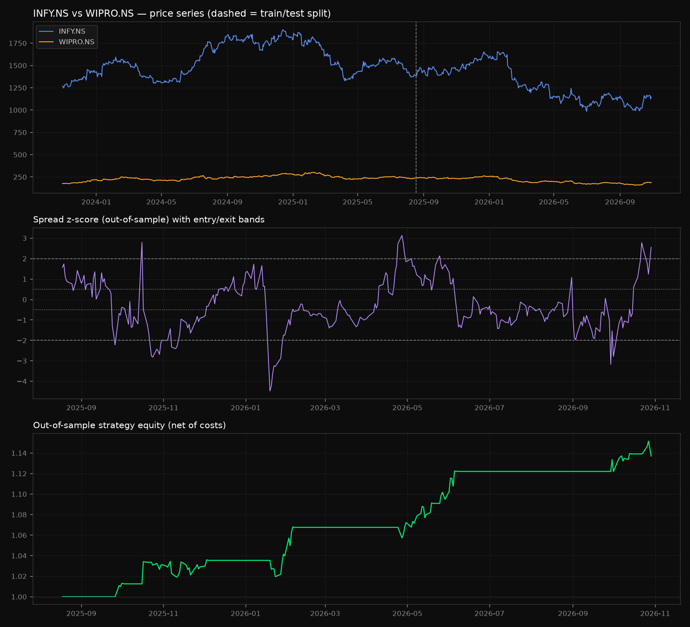

---

### HCLTECH.NS / TECHM.NS

- **Latest prices:** HCLTECH.NS ₹1,403.90 · TECHM.NS ₹1,769.60
- **Hedge ratio (train-fitted):** 0.9491
- **Cointegration (train):** FAIL at 5% — ADF -2.41, p=0.1400
- **Persistence:** passed 5% in 0 of 87 real-data runs (strict tier: 0/87)
- **Spread half-life:** 24.9 days
- **Current z-score:** +1.67
- **Signal today:** watch (approaching band)
- ⚠️ _Pair did not cointegrate on training data. Any signal here is not statistically justified — observation only._

**Out-of-sample backtest** (beta frozen from train window):

| Metric | Value |
|---|---|
| Sharpe | 0.06 |
| Sortino | 0.06 |
| Annualised return | 0.18% |
| Annualised vol | 7.57% |
| Max drawdown | -8.34% |
| Round-trip trades | 5 |

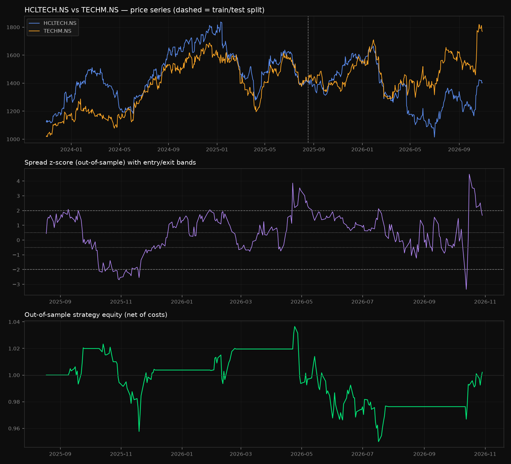

---

### ACC.NS / AMBUJACEM.NS

- **Latest prices:** ACC.NS ₹1,153.50 · AMBUJACEM.NS ₹354.70
- **Hedge ratio (train-fitted):** 0.1554
- **Cointegration (train):** FAIL at 5% — ADF -1.75, p=0.4050
- **Persistence:** passed 5% in 0 of 87 real-data runs (strict tier: 0/87)
- **Spread half-life:** 44.1 days
- **Current z-score:** -1.23
- **Signal today:** watch (approaching band)
- ⚠️ _Pair did not cointegrate on training data. Any signal here is not statistically justified — observation only._

**Out-of-sample backtest** (beta frozen from train window):

| Metric | Value |
|---|---|
| Sharpe | -0.06 |
| Sortino | -0.04 |
| Annualised return | -0.56% |
| Annualised vol | 6.43% |
| Max drawdown | -6.09% |
| Round-trip trades | 3 |

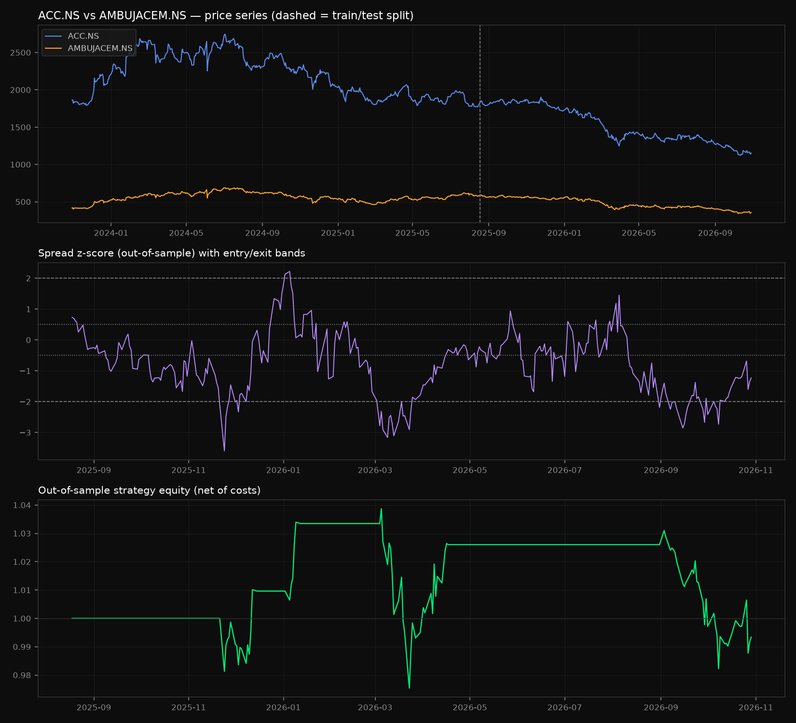

---

### ULTRACEMCO.NS / SHREECEM.NS

- **Latest prices:** ULTRACEMCO.NS ₹11,175.00 · SHREECEM.NS ₹23,120.00
- **Hedge ratio (train-fitted):** 1.0889
- **Cointegration (train):** FAIL at 5% — ADF -1.93, p=0.3169
- **Persistence:** passed 5% in 0 of 87 real-data runs (strict tier: 0/87)
- **Spread half-life:** 40.5 days
- **Current z-score:** -0.22
- **Signal today:** flat / no stretch
- ⚠️ _Pair did not cointegrate on training data. Any signal here is not statistically justified — observation only._

**Out-of-sample backtest** (beta frozen from train window):

| Metric | Value |
|---|---|
| Sharpe | -0.01 |
| Sortino | -0.01 |
| Annualised return | -0.33% |
| Annualised vol | 7.05% |
| Max drawdown | -6.17% |
| Round-trip trades | 6 |

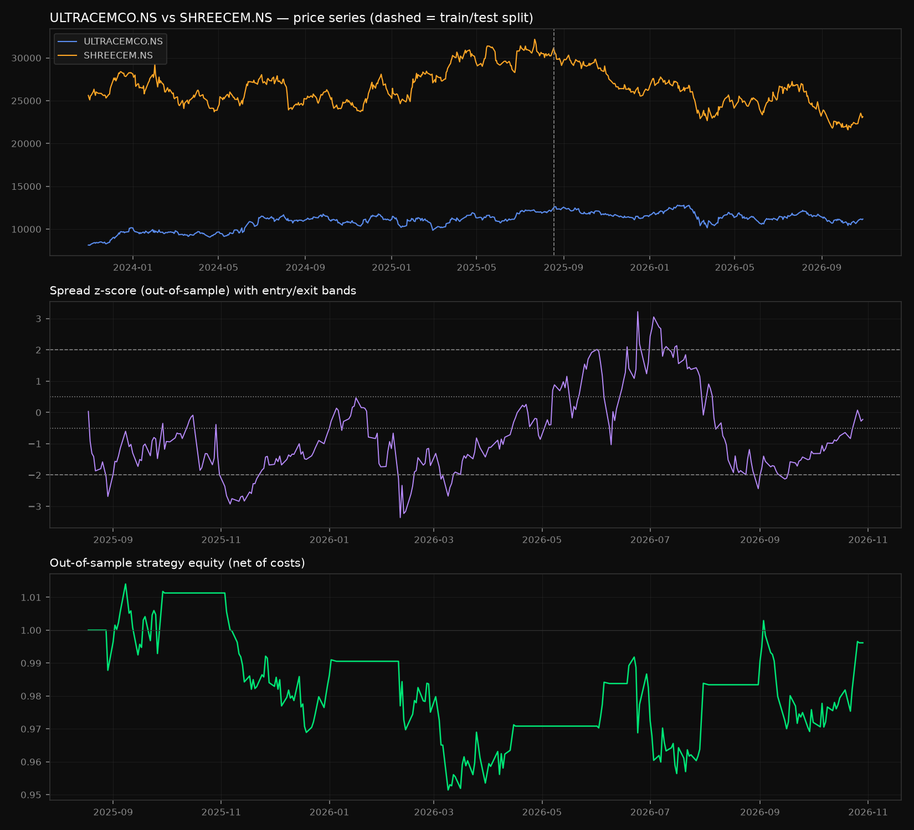

---

### IOC.NS / BPCL.NS

- **Latest prices:** IOC.NS ₹130.41 · BPCL.NS ₹289.20
- **Hedge ratio (train-fitted):** 1.5984
- **Cointegration (train):** FAIL at 5% — ADF -1.01, p=0.7511
- **Persistence:** passed 5% in 0 of 87 real-data runs (strict tier: 0/87)
- **Spread half-life:** 123.3 days
- **Current z-score:** -1.64
- **Signal today:** watch (approaching band)
- ⚠️ _Pair did not cointegrate on training data. Any signal here is not statistically justified — observation only._

**Out-of-sample backtest** (beta frozen from train window):

| Metric | Value |
|---|---|
| Sharpe | 0.18 |
| Sortino | 0.16 |
| Annualised return | 0.99% |
| Annualised vol | 6.78% |
| Max drawdown | -7.46% |
| Round-trip trades | 5 |

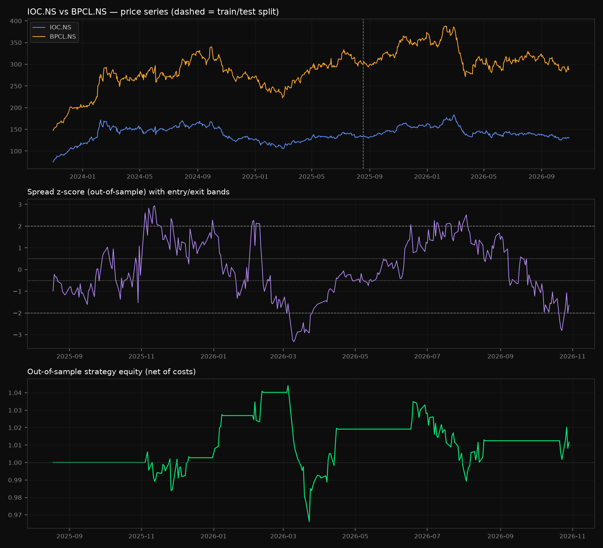

---

### BPCL.NS / HINDPETRO.NS

- **Latest prices:** BPCL.NS ₹289.20 · HINDPETRO.NS ₹342.30
- **Hedge ratio (train-fitted):** 1.3133
- **Cointegration (train):** FAIL at 5% — ADF -2.15, p=0.2267
- **Persistence:** passed 5% in 0 of 87 real-data runs (strict tier: 0/87)
- **Spread half-life:** 35.1 days
- **Current z-score:** +1.25
- **Signal today:** watch (approaching band)
- ⚠️ _Pair did not cointegrate on training data. Any signal here is not statistically justified — observation only._

**Out-of-sample backtest** (beta frozen from train window):

| Metric | Value |
|---|---|
| Sharpe | -0.03 |
| Sortino | -0.03 |
| Annualised return | -0.44% |
| Annualised vol | 6.62% |
| Max drawdown | -7.01% |
| Round-trip trades | 5 |

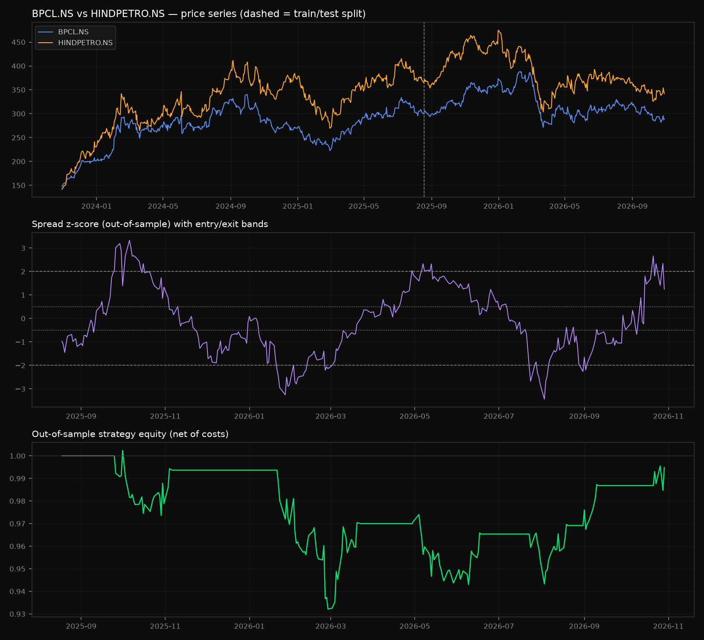

---

### ONGC.NS / COALINDIA.NS

- **Latest prices:** ONGC.NS ₹225.79 · COALINDIA.NS ₹393.10
- **Hedge ratio (train-fitted):** 1.3690
- **Cointegration (train):** PASS at 5% — ADF -3.56, p=0.0066
- **Persistence:** passed 5% in 79 of 87 real-data runs (strict tier: 1/87)
- **Spread half-life:** 12.6 days
- **Current z-score:** -0.72
- **Signal today:** watch (approaching band)

**Out-of-sample backtest** (beta frozen from train window):

| Metric | Value |
|---|---|
| Sharpe | 0.83 |
| Sortino | 0.71 |
| Annualised return | 6.55% |
| Annualised vol | 8.04% |
| Max drawdown | -6.32% |
| Round-trip trades | 6 |

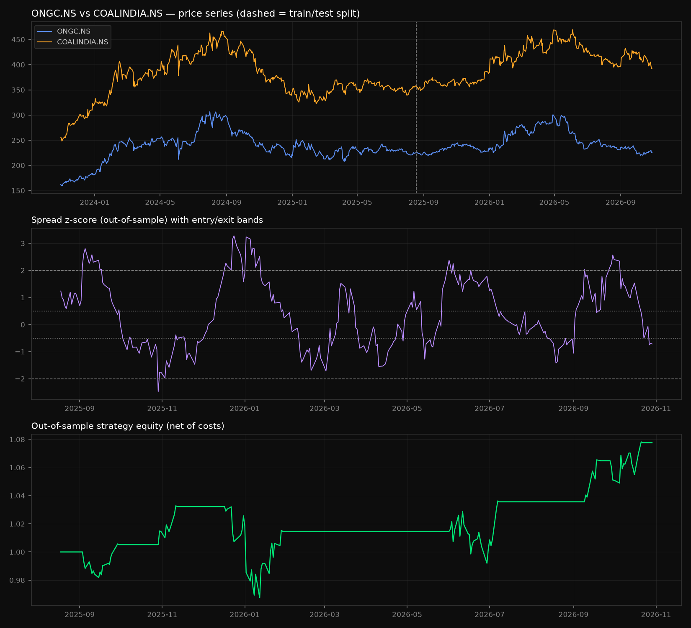

---

### NTPC.NS / POWERGRID.NS

- **Latest prices:** NTPC.NS ₹310.50 · POWERGRID.NS ₹260.00
- **Hedge ratio (train-fitted):** 0.8036
- **Cointegration (train):** FAIL at 5% — ADF -2.55, p=0.1031
- **Persistence:** passed 5% in 0 of 87 real-data runs (strict tier: 0/87)
- **Spread half-life:** 23.9 days
- **Current z-score:** +2.25
- **Signal today:** SHORT spread (short POWERGRID.NS, long NTPC.NS)
- ⚠️ _Pair did not cointegrate on training data. Any signal here is not statistically justified — observation only._

**Out-of-sample backtest** (beta frozen from train window):

| Metric | Value |
|---|---|
| Sharpe | 0.49 |
| Sortino | 0.37 |
| Annualised return | 2.53% |
| Annualised vol | 5.43% |
| Max drawdown | -5.25% |
| Round-trip trades | 6 |

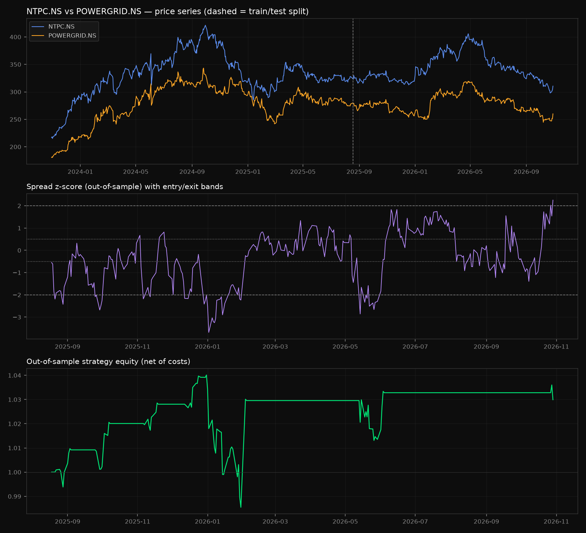

---

### BAJAJ-AUTO.NS / HEROMOTOCO.NS

- **Latest prices:** BAJAJ-AUTO.NS ₹10,383.00 · HEROMOTOCO.NS ₹5,105.00
- **Hedge ratio (train-fitted):** 0.4071
- **Cointegration (train):** FAIL at 5% — ADF -2.09, p=0.2504
- **Persistence:** passed 5% in 0 of 87 real-data runs (strict tier: 0/87)
- **Spread half-life:** 32.2 days
- **Current z-score:** +0.25
- **Signal today:** flat / no stretch
- ⚠️ _Pair did not cointegrate on training data. Any signal here is not statistically justified — observation only._

**Out-of-sample backtest** (beta frozen from train window):

| Metric | Value |
|---|---|
| Sharpe | -0.07 |
| Sortino | -0.07 |
| Annualised return | -1.04% |
| Annualised vol | 9.05% |
| Max drawdown | -13.26% |
| Round-trip trades | 6 |

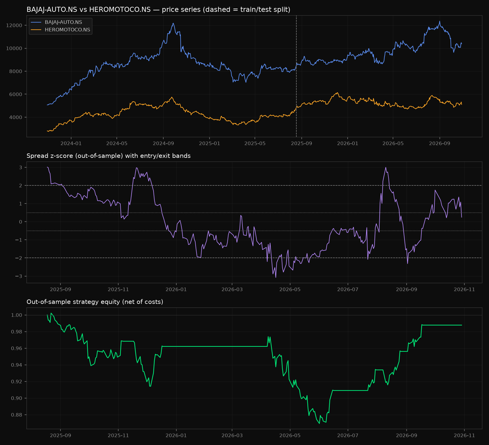

---

### TATASTEEL.NS / JSWSTEEL.NS

- **Latest prices:** TATASTEEL.NS ₹169.46 · JSWSTEEL.NS ₹1,255.40
- **Hedge ratio (train-fitted):** 2.9316
- **Cointegration (train):** FAIL at 5% — ADF -1.32, p=0.6183
- **Persistence:** passed 5% in 0 of 87 real-data runs (strict tier: 0/87)
- **Spread half-life:** 64.3 days
- **Current z-score:** +0.78
- **Signal today:** watch (approaching band)
- ⚠️ _Pair did not cointegrate on training data. Any signal here is not statistically justified — observation only._

**Out-of-sample backtest** (beta frozen from train window):

| Metric | Value |
|---|---|
| Sharpe | 0.74 |
| Sortino | 0.71 |
| Annualised return | 6.05% |
| Annualised vol | 8.42% |
| Max drawdown | -5.51% |
| Round-trip trades | 6 |

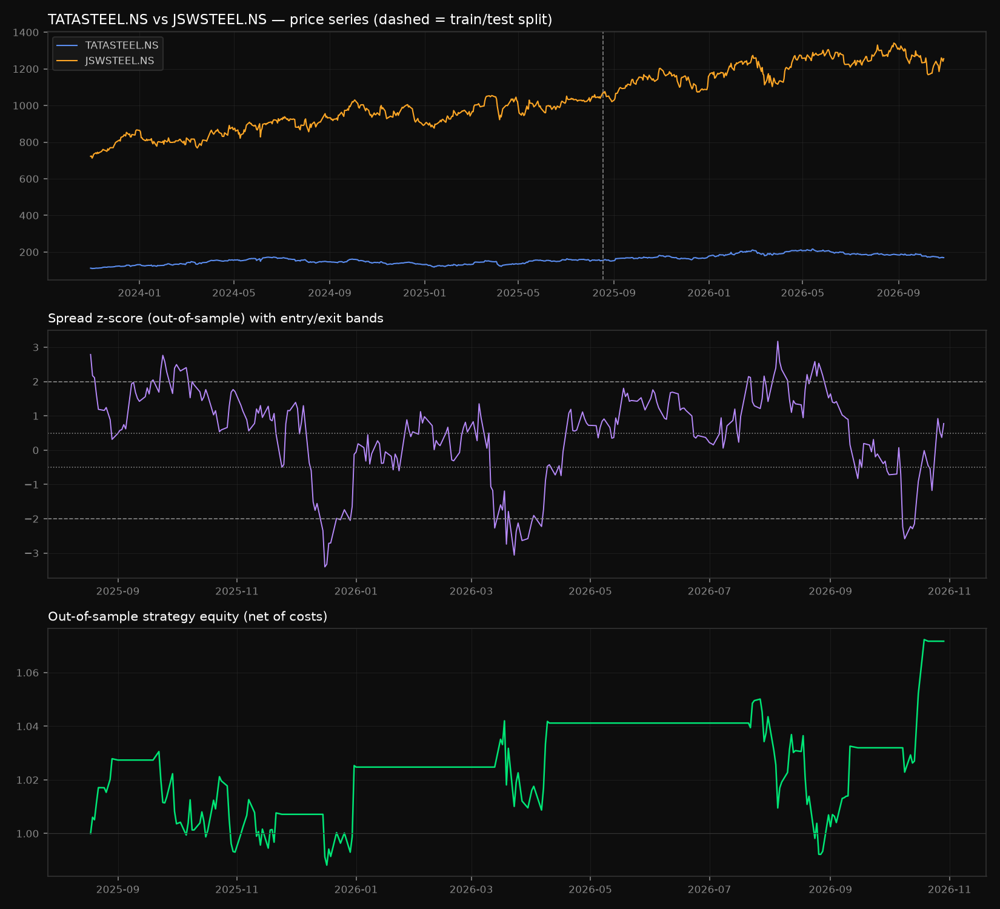

---

### SUNPHARMA.NS / CIPLA.NS

- **Latest prices:** SUNPHARMA.NS ₹1,761.00 · CIPLA.NS ₹1,358.00
- **Hedge ratio (train-fitted):** 0.4764
- **Cointegration (train):** PASS at 5% — ADF -3.10, p=0.0265
- **Persistence:** passed 5% in 87 of 87 real-data runs (strict tier: 5/87)
- **Spread half-life:** 11.5 days
- **Current z-score:** +0.69
- **Signal today:** watch (approaching band)

**Out-of-sample backtest** (beta frozen from train window):

| Metric | Value |
|---|---|
| Sharpe | 0.18 |
| Sortino | 0.19 |
| Annualised return | 1.10% |
| Annualised vol | 7.48% |
| Max drawdown | -10.09% |
| Round-trip trades | 5 |

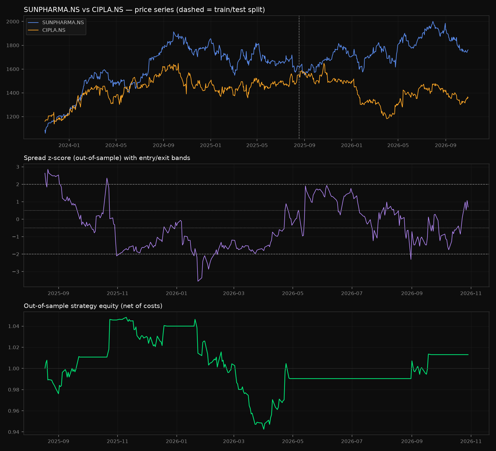

---

_Generated 2026-10-30 · pairs mean-reversion scanner · out-of-sample backtest · multiple-testing-aware · not investment advice._
