# Indian Pairs-Trading Scanner — 2026-11-02

> **What this is:** a market-neutral *pairs mean-reversion* scanner. It flags when two related NSE stocks have drifted apart far enough that their historical relationship signals a possible convergence trade. It does **not** forecast growth, rank "best" stocks, or predict company performance. A signal means the *spread between two stocks* is stretched — nothing about either stock being a good investment. Not investment advice; do your own research.

## Methodology (fixed in advance)

- **Universe:** 16 declared sector-mate pairs. Parameters (3y window, 60/40 train-test, z-entry 2.0, z-exit 0.5, 5 bps costs) are pre-registered; changes are logged in the README changelog *before* looking at results.
- **Multiple testing:** at the 5% level across 16 pairs, **≈0.8 false positives per run are expected by chance alone** even if nothing truly cointegrates. A single-day pass is a candidate, not a discovery.
- **Strict tier:** Bonferroni-corrected threshold p < 0.0031 (marked ✓✓).
- **Evidence = persistence:** the Persistence column counts how often each pair has passed the 5% test across all *real-data* daily runs recorded in `reports/history.csv`. Pairs deserve attention only when they pass persistently.

> ⚠️ **Some results use SIMULATED fallback data** (real data was unreachable this run) and are not real market results. These are marked below and are EXCLUDED from persistence counts.

## Summary

| Pair | p-value | Coint. | Persistence | Current z | Signal | OOS Sharpe |
|---|---|---|---|---|---|---|
| HDFCBANK.NS/ICICIBANK.NS *(sim)* | 0.0030 | ✓✓ | 1/72 | -1.55 | watch | 1.13 |
| AXISBANK.NS/ICICIBANK.NS | 0.9168 | ✗ | 0/88 | +0.74 | watch | -0.45 |
| KOTAKBANK.NS/HDFCBANK.NS | 0.1635 | ✗ | 0/88 | -2.20 | LONG spread | 1.17 |
| SBIN.NS/BANKBARODA.NS | 0.1429 | ✗ | 0/88 | +1.98 | watch | 0.51 |
| TCS.NS/INFY.NS | 0.6281 | ✗ | 0/88 | -0.25 | flat / no stretch | 1.95 |
| INFY.NS/WIPRO.NS | 0.1317 | ✗ | 0/88 | +3.16 | SHORT spread | 2.09 |
| HCLTECH.NS/TECHM.NS | 0.3765 | ✗ | 0/88 | +1.57 | watch | 0.05 |
| ACC.NS/AMBUJACEM.NS | 0.3713 | ✗ | 0/88 | -1.37 | watch | -0.28 |
| ULTRACEMCO.NS/SHREECEM.NS | 0.3108 | ✗ | 0/88 | -0.16 | flat / no stretch | -0.08 |
| IOC.NS/BPCL.NS | 0.7127 | ✗ | 0/88 | -2.16 | LONG spread | -0.08 |
| BPCL.NS/HINDPETRO.NS | 0.2089 | ✗ | 0/88 | +1.69 | watch | -0.12 |
| ONGC.NS/COALINDIA.NS | 0.0063 | ✓ | 80/88 | -0.99 | watch | 0.83 |
| NTPC.NS/POWERGRID.NS | 0.1087 | ✗ | 0/88 | +2.30 | SHORT spread | 0.48 |
| BAJAJ-AUTO.NS/HEROMOTOCO.NS | 0.3322 | ✗ | 0/88 | +0.59 | watch | -0.01 |
| TATASTEEL.NS/JSWSTEEL.NS | 0.6995 | ✗ | 0/88 | +0.60 | watch | 0.63 |
| SUNPHARMA.NS/CIPLA.NS | 0.0246 | ✓ | 88/88 | +1.24 | watch | 0.31 |

_Legend: ✓✓ passes strict Bonferroni tier · ✓ passes 5% only · ✗ fails. Persistence = 5%-passes / real-data runs recorded. \*no real-data history yet._

---

### HDFCBANK.NS / ICICIBANK.NS · _SIMULATED_

- **Latest prices:** HDFCBANK.NS ₹77.27 · ICICIBANK.NS ₹113.78
- **Hedge ratio (train-fitted):** 1.5557
- **Cointegration (train):** PASS at 5% — ADF -3.79, p=0.0030 · **passes strict Bonferroni tier**
- **Persistence:** passed 5% in 1 of 72 real-data runs (strict tier: 0/72)
- **Spread half-life:** 14.0 days
- **Current z-score:** -1.55
- **Signal today:** watch (approaching band)

**Out-of-sample backtest** (beta frozen from train window):

| Metric | Value |
|---|---|
| Sharpe | 1.13 |
| Sortino | 0.86 |
| Annualised return | 1.88% |
| Annualised vol | 1.66% |
| Max drawdown | -1.19% |
| Round-trip trades | 5 |

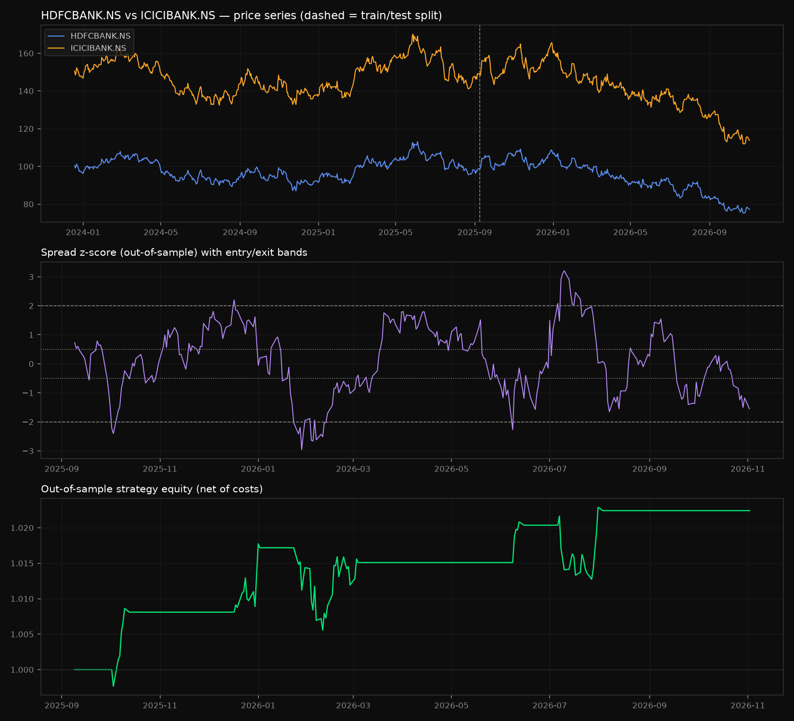

---

### AXISBANK.NS / ICICIBANK.NS

- **Latest prices:** AXISBANK.NS ₹1,217.00 · ICICIBANK.NS ₹1,398.00
- **Hedge ratio (train-fitted):** 0.7075
- **Cointegration (train):** FAIL at 5% — ADF -0.36, p=0.9168
- **Persistence:** passed 5% in 0 of 88 real-data runs (strict tier: 0/88)
- **Spread half-life:** 312.2 days
- **Current z-score:** +0.74
- **Signal today:** watch (approaching band)
- ⚠️ _Pair did not cointegrate on training data. Any signal here is not statistically justified — observation only._

**Out-of-sample backtest** (beta frozen from train window):

| Metric | Value |
|---|---|
| Sharpe | -0.45 |
| Sortino | -0.45 |
| Annualised return | -4.15% |
| Annualised vol | 8.61% |
| Max drawdown | -11.04% |
| Round-trip trades | 4 |

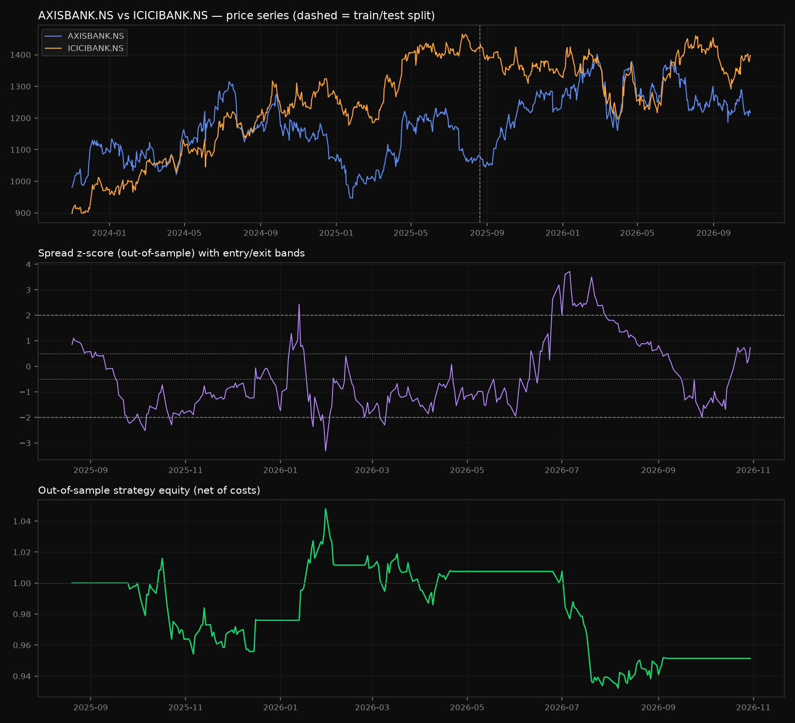

---

### KOTAKBANK.NS / HDFCBANK.NS

- **Latest prices:** KOTAKBANK.NS ₹461.60 · HDFCBANK.NS ₹692.80
- **Hedge ratio (train-fitted):** 2.2229
- **Cointegration (train):** FAIL at 5% — ADF -2.33, p=0.1635
- **Persistence:** passed 5% in 0 of 88 real-data runs (strict tier: 0/88)
- **Spread half-life:** 26.7 days
- **Current z-score:** -2.20
- **Signal today:** LONG spread (long HDFCBANK.NS, short KOTAKBANK.NS)
- ⚠️ _Pair did not cointegrate on training data. Any signal here is not statistically justified — observation only._

**Out-of-sample backtest** (beta frozen from train window):

| Metric | Value |
|---|---|
| Sharpe | 1.17 |
| Sortino | 1.14 |
| Annualised return | 6.69% |
| Annualised vol | 5.70% |
| Max drawdown | -2.79% |
| Round-trip trades | 5 |

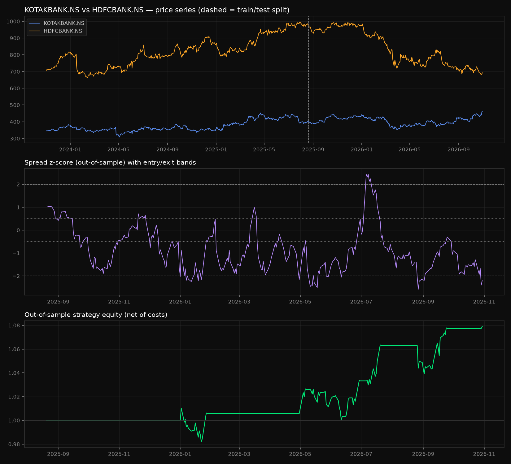

---

### SBIN.NS / BANKBARODA.NS

- **Latest prices:** SBIN.NS ₹961.85 · BANKBARODA.NS ₹238.60
- **Hedge ratio (train-fitted):** 0.1853
- **Cointegration (train):** FAIL at 5% — ADF -2.40, p=0.1429
- **Persistence:** passed 5% in 0 of 88 real-data runs (strict tier: 0/88)
- **Spread half-life:** 20.8 days
- **Current z-score:** +1.98
- **Signal today:** watch (approaching band)
- ⚠️ _Pair did not cointegrate on training data. Any signal here is not statistically justified — observation only._

**Out-of-sample backtest** (beta frozen from train window):

| Metric | Value |
|---|---|
| Sharpe | 0.51 |
| Sortino | 0.47 |
| Annualised return | 4.59% |
| Annualised vol | 9.61% |
| Max drawdown | -8.55% |
| Round-trip trades | 7 |

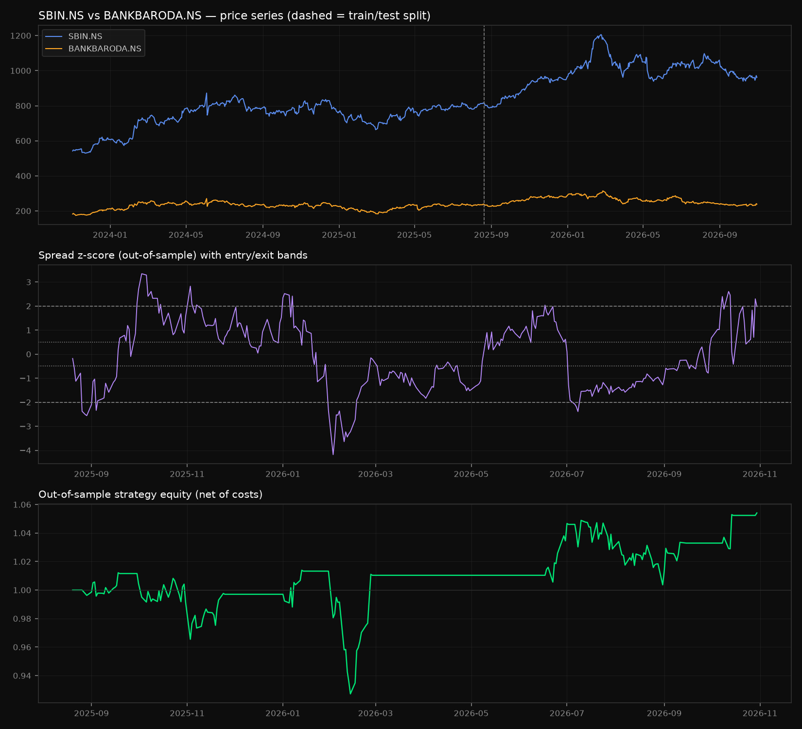

---

### TCS.NS / INFY.NS

- **Latest prices:** TCS.NS ₹2,502.60 · INFY.NS ₹1,185.00
- **Hedge ratio (train-fitted):** 0.4055
- **Cointegration (train):** FAIL at 5% — ADF -1.30, p=0.6281
- **Persistence:** passed 5% in 0 of 88 real-data runs (strict tier: 0/88)
- **Spread half-life:** 67.7 days
- **Current z-score:** -0.25
- **Signal today:** flat / no stretch
- ⚠️ _Pair did not cointegrate on training data. Any signal here is not statistically justified — observation only._

**Out-of-sample backtest** (beta frozen from train window):

| Metric | Value |
|---|---|
| Sharpe | 1.95 |
| Sortino | 2.19 |
| Annualised return | 9.47% |
| Annualised vol | 4.71% |
| Max drawdown | -2.03% |
| Round-trip trades | 6 |

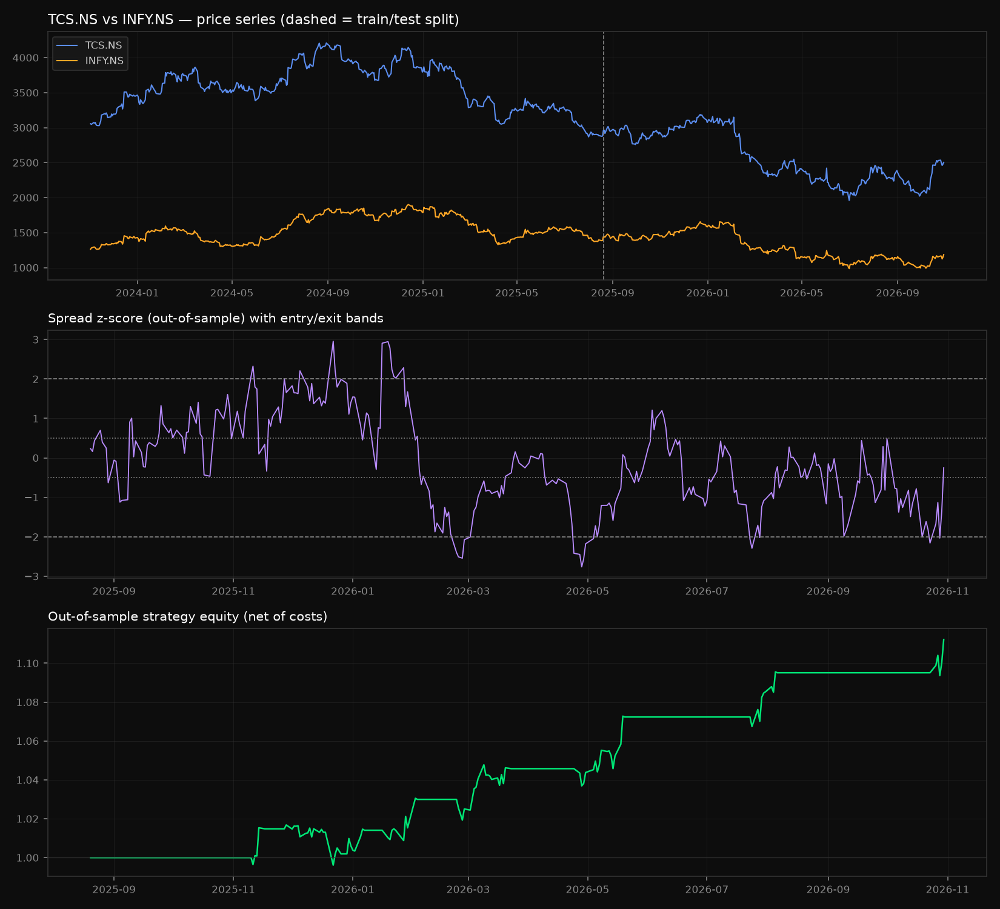

---

### INFY.NS / WIPRO.NS

- **Latest prices:** INFY.NS ₹1,185.00 · WIPRO.NS ₹198.31
- **Hedge ratio (train-fitted):** 0.1203
- **Cointegration (train):** FAIL at 5% — ADF -2.44, p=0.1317
- **Persistence:** passed 5% in 0 of 88 real-data runs (strict tier: 0/88)
- **Spread half-life:** 27.8 days
- **Current z-score:** +3.16
- **Signal today:** SHORT spread (short WIPRO.NS, long INFY.NS)
- ⚠️ _Pair did not cointegrate on training data. Any signal here is not statistically justified — observation only._

**Out-of-sample backtest** (beta frozen from train window):

| Metric | Value |
|---|---|
| Sharpe | 2.09 |
| Sortino | 2.22 |
| Annualised return | 11.62% |
| Annualised vol | 5.32% |
| Max drawdown | -3.17% |
| Round-trip trades | 6 |

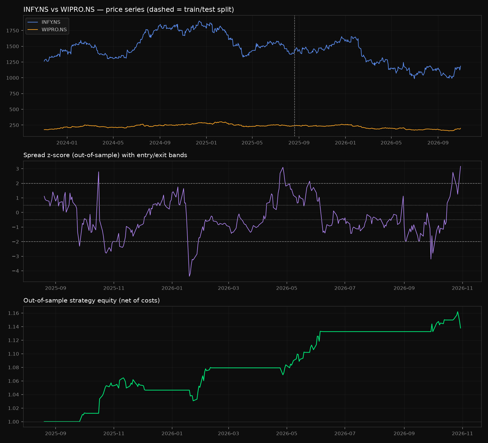

---

### HCLTECH.NS / TECHM.NS

- **Latest prices:** HCLTECH.NS ₹1,428.10 · TECHM.NS ₹1,790.80
- **Hedge ratio (train-fitted):** 0.9461
- **Cointegration (train):** FAIL at 5% — ADF -1.81, p=0.3765
- **Persistence:** passed 5% in 0 of 88 real-data runs (strict tier: 0/88)
- **Spread half-life:** 25.8 days
- **Current z-score:** +1.57
- **Signal today:** watch (approaching band)
- ⚠️ _Pair did not cointegrate on training data. Any signal here is not statistically justified — observation only._

**Out-of-sample backtest** (beta frozen from train window):

| Metric | Value |
|---|---|
| Sharpe | 0.05 |
| Sortino | 0.05 |
| Annualised return | 0.07% |
| Annualised vol | 7.42% |
| Max drawdown | -8.18% |
| Round-trip trades | 5 |

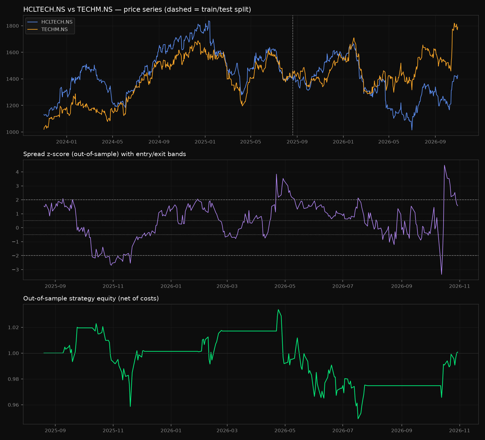

---

### ACC.NS / AMBUJACEM.NS

- **Latest prices:** ACC.NS ₹1,130.00 · AMBUJACEM.NS ₹348.05
- **Hedge ratio (train-fitted):** 0.1510
- **Cointegration (train):** FAIL at 5% — ADF -1.82, p=0.3713
- **Persistence:** passed 5% in 0 of 88 real-data runs (strict tier: 0/88)
- **Spread half-life:** 42.2 days
- **Current z-score:** -1.37
- **Signal today:** watch (approaching band)
- ⚠️ _Pair did not cointegrate on training data. Any signal here is not statistically justified — observation only._

**Out-of-sample backtest** (beta frozen from train window):

| Metric | Value |
|---|---|
| Sharpe | -0.28 |
| Sortino | -0.22 |
| Annualised return | -2.04% |
| Annualised vol | 6.64% |
| Max drawdown | -6.97% |
| Round-trip trades | 3 |

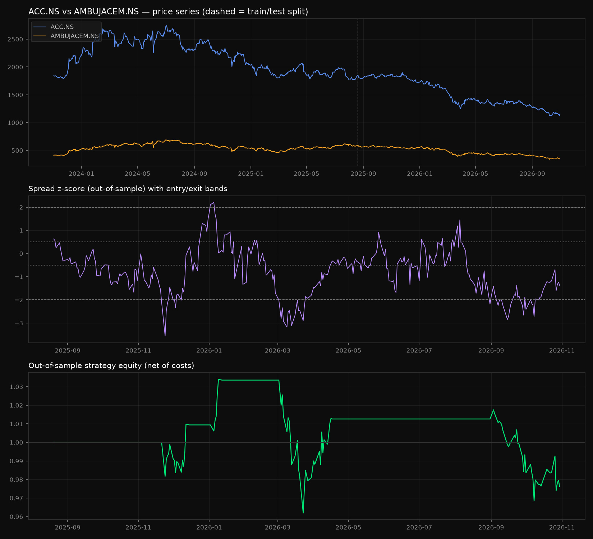

---

### ULTRACEMCO.NS / SHREECEM.NS

- **Latest prices:** ULTRACEMCO.NS ₹11,045.00 · SHREECEM.NS ₹22,995.00
- **Hedge ratio (train-fitted):** 1.1227
- **Cointegration (train):** FAIL at 5% — ADF -1.95, p=0.3108
- **Persistence:** passed 5% in 0 of 88 real-data runs (strict tier: 0/88)
- **Spread half-life:** 40.2 days
- **Current z-score:** -0.16
- **Signal today:** flat / no stretch
- ⚠️ _Pair did not cointegrate on training data. Any signal here is not statistically justified — observation only._

**Out-of-sample backtest** (beta frozen from train window):

| Metric | Value |
|---|---|
| Sharpe | -0.08 |
| Sortino | -0.10 |
| Annualised return | -0.84% |
| Annualised vol | 7.34% |
| Max drawdown | -6.03% |
| Round-trip trades | 6 |

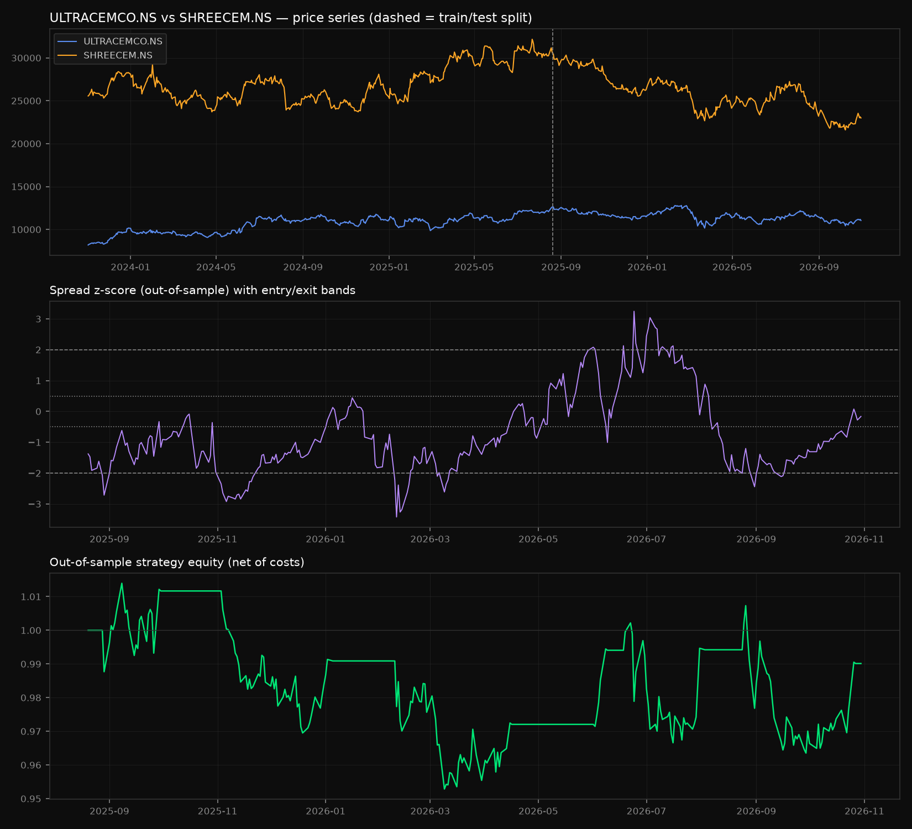

---

### IOC.NS / BPCL.NS

- **Latest prices:** IOC.NS ₹130.15 · BPCL.NS ₹284.90
- **Hedge ratio (train-fitted):** 1.5687
- **Cointegration (train):** FAIL at 5% — ADF -1.11, p=0.7127
- **Persistence:** passed 5% in 0 of 88 real-data runs (strict tier: 0/88)
- **Spread half-life:** 111.6 days
- **Current z-score:** -2.16
- **Signal today:** LONG spread (long BPCL.NS, short IOC.NS)
- ⚠️ _Pair did not cointegrate on training data. Any signal here is not statistically justified — observation only._

**Out-of-sample backtest** (beta frozen from train window):

| Metric | Value |
|---|---|
| Sharpe | -0.08 |
| Sortino | -0.08 |
| Annualised return | -0.83% |
| Annualised vol | 6.98% |
| Max drawdown | -7.58% |
| Round-trip trades | 5 |

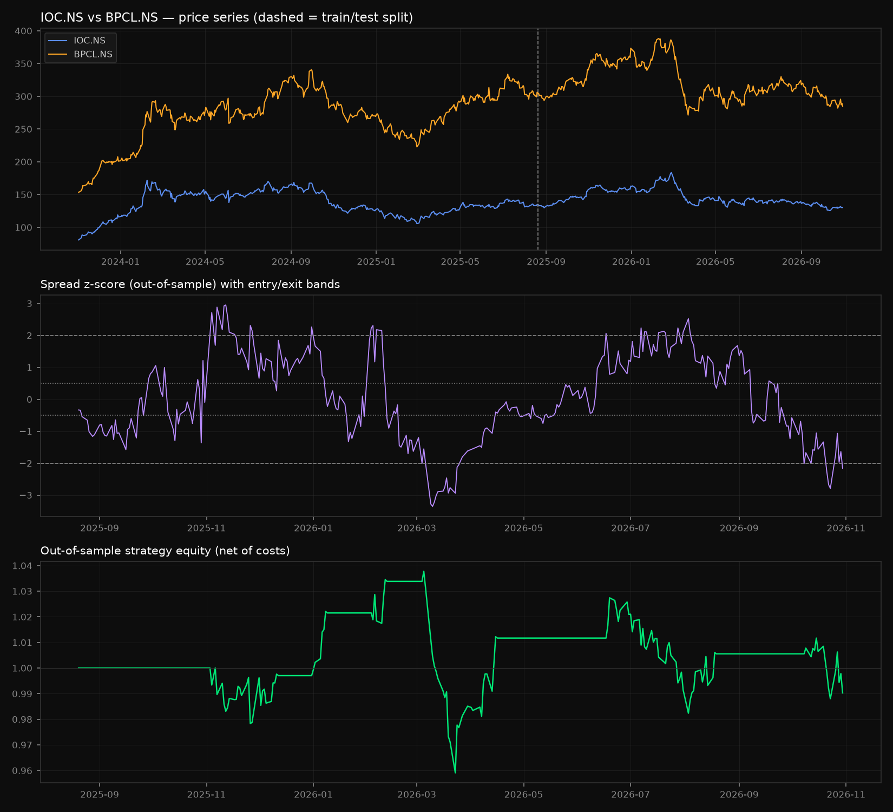

---

### BPCL.NS / HINDPETRO.NS

- **Latest prices:** BPCL.NS ₹284.90 · HINDPETRO.NS ₹340.55
- **Hedge ratio (train-fitted):** 1.3023
- **Cointegration (train):** FAIL at 5% — ADF -2.19, p=0.2089
- **Persistence:** passed 5% in 0 of 88 real-data runs (strict tier: 0/88)
- **Spread half-life:** 34.3 days
- **Current z-score:** +1.69
- **Signal today:** watch (approaching band)
- ⚠️ _Pair did not cointegrate on training data. Any signal here is not statistically justified — observation only._

**Out-of-sample backtest** (beta frozen from train window):

| Metric | Value |
|---|---|
| Sharpe | -0.12 |
| Sortino | -0.13 |
| Annualised return | -1.02% |
| Annualised vol | 6.56% |
| Max drawdown | -6.93% |
| Round-trip trades | 5 |

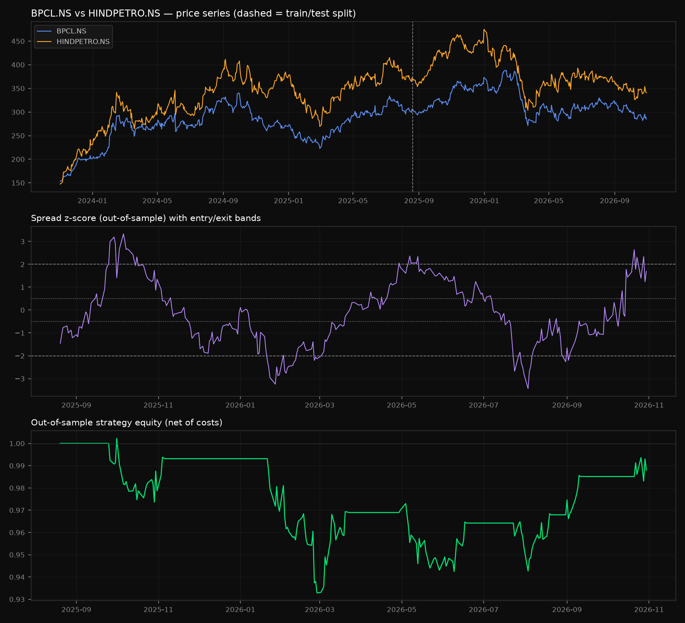

---

### ONGC.NS / COALINDIA.NS

- **Latest prices:** ONGC.NS ₹225.39 · COALINDIA.NS ₹389.00
- **Hedge ratio (train-fitted):** 1.3594
- **Cointegration (train):** PASS at 5% — ADF -3.57, p=0.0063
- **Persistence:** passed 5% in 80 of 88 real-data runs (strict tier: 1/88)
- **Spread half-life:** 12.6 days
- **Current z-score:** -0.99
- **Signal today:** watch (approaching band)

**Out-of-sample backtest** (beta frozen from train window):

| Metric | Value |
|---|---|
| Sharpe | 0.83 |
| Sortino | 0.71 |
| Annualised return | 6.61% |
| Annualised vol | 8.10% |
| Max drawdown | -6.37% |
| Round-trip trades | 6 |

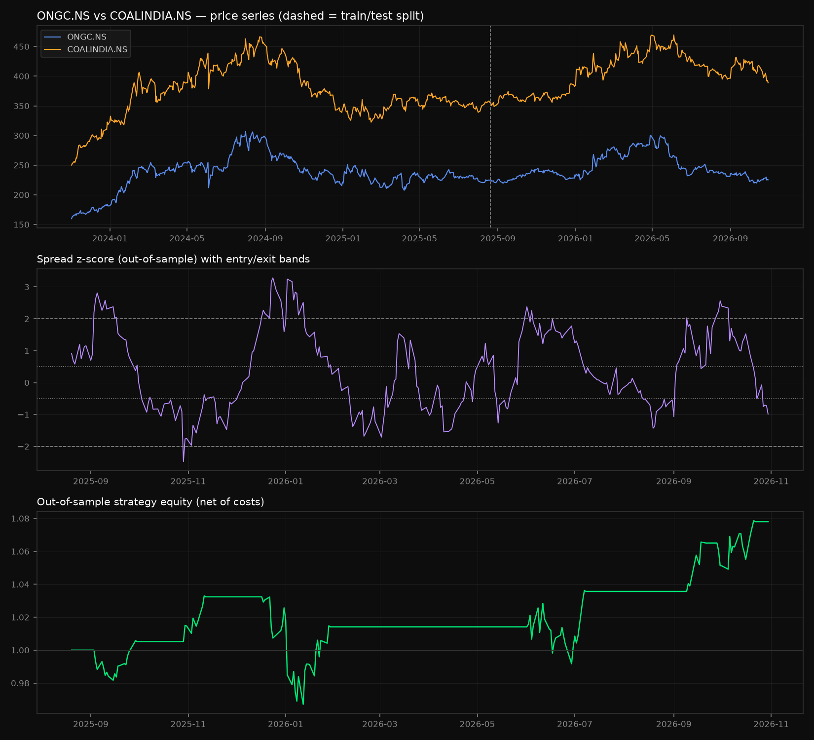

---

### NTPC.NS / POWERGRID.NS

- **Latest prices:** NTPC.NS ₹316.25 · POWERGRID.NS ₹265.00
- **Hedge ratio (train-fitted):** 0.8009
- **Cointegration (train):** FAIL at 5% — ADF -2.53, p=0.1087
- **Persistence:** passed 5% in 0 of 88 real-data runs (strict tier: 0/88)
- **Spread half-life:** 24.1 days
- **Current z-score:** +2.30
- **Signal today:** SHORT spread (short POWERGRID.NS, long NTPC.NS)
- ⚠️ _Pair did not cointegrate on training data. Any signal here is not statistically justified — observation only._

**Out-of-sample backtest** (beta frozen from train window):

| Metric | Value |
|---|---|
| Sharpe | 0.48 |
| Sortino | 0.36 |
| Annualised return | 2.46% |
| Annualised vol | 5.40% |
| Max drawdown | -5.21% |
| Round-trip trades | 6 |

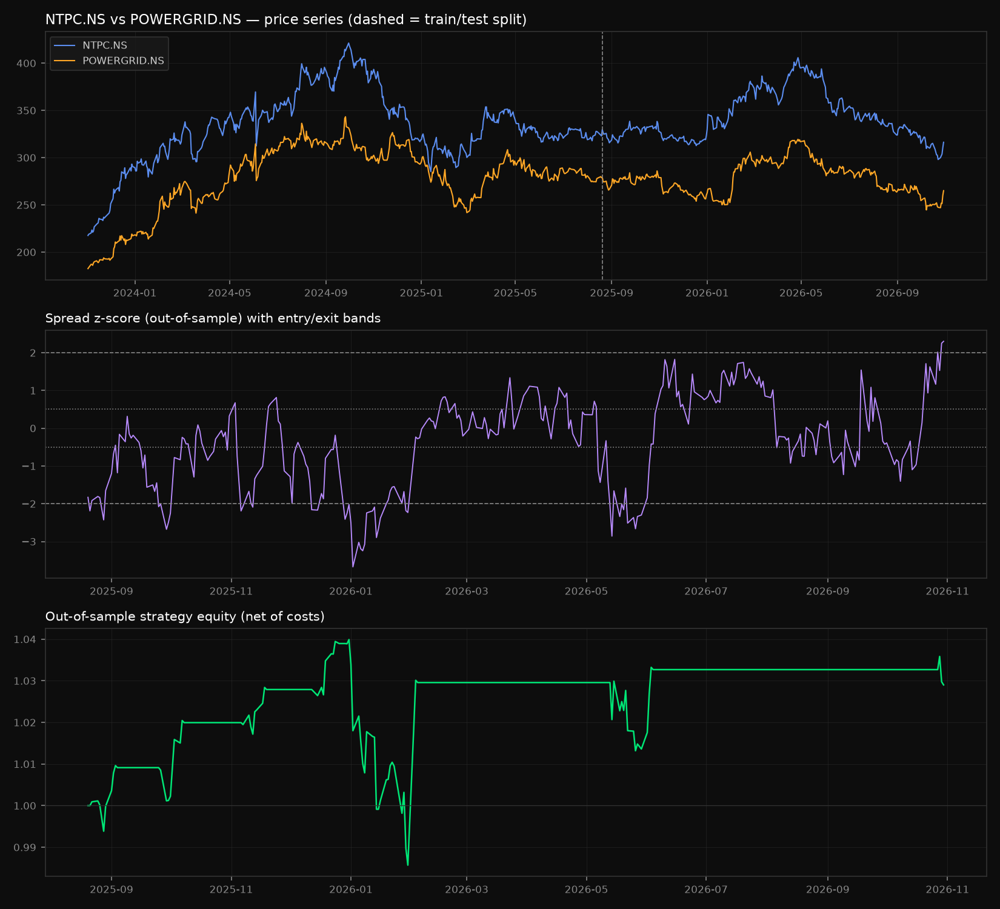

---

### BAJAJ-AUTO.NS / HEROMOTOCO.NS

- **Latest prices:** BAJAJ-AUTO.NS ₹10,350.00 · HEROMOTOCO.NS ₹5,167.00
- **Hedge ratio (train-fitted):** 0.4062
- **Cointegration (train):** FAIL at 5% — ADF -1.90, p=0.3322
- **Persistence:** passed 5% in 0 of 88 real-data runs (strict tier: 0/88)
- **Spread half-life:** 35.4 days
- **Current z-score:** +0.59
- **Signal today:** watch (approaching band)
- ⚠️ _Pair did not cointegrate on training data. Any signal here is not statistically justified — observation only._

**Out-of-sample backtest** (beta frozen from train window):

| Metric | Value |
|---|---|
| Sharpe | -0.01 |
| Sortino | -0.01 |
| Annualised return | -0.49% |
| Annualised vol | 8.79% |
| Max drawdown | -12.89% |
| Round-trip trades | 6 |

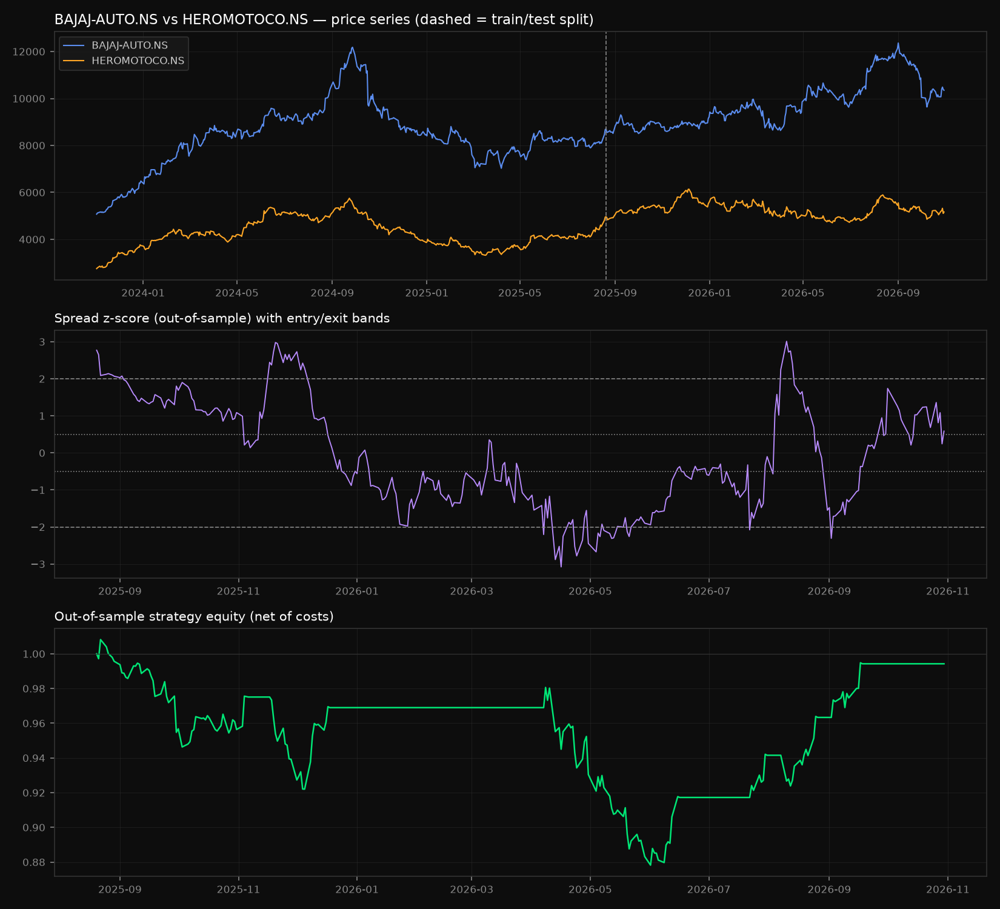

---

### TATASTEEL.NS / JSWSTEEL.NS

- **Latest prices:** TATASTEEL.NS ₹167.60 · JSWSTEEL.NS ₹1,246.00
- **Hedge ratio (train-fitted):** 2.8490
- **Cointegration (train):** FAIL at 5% — ADF -1.14, p=0.6995
- **Persistence:** passed 5% in 0 of 88 real-data runs (strict tier: 0/88)
- **Spread half-life:** 66.0 days
- **Current z-score:** +0.60
- **Signal today:** watch (approaching band)
- ⚠️ _Pair did not cointegrate on training data. Any signal here is not statistically justified — observation only._

**Out-of-sample backtest** (beta frozen from train window):

| Metric | Value |
|---|---|
| Sharpe | 0.63 |
| Sortino | 0.62 |
| Annualised return | 5.09% |
| Annualised vol | 8.51% |
| Max drawdown | -5.53% |
| Round-trip trades | 6 |

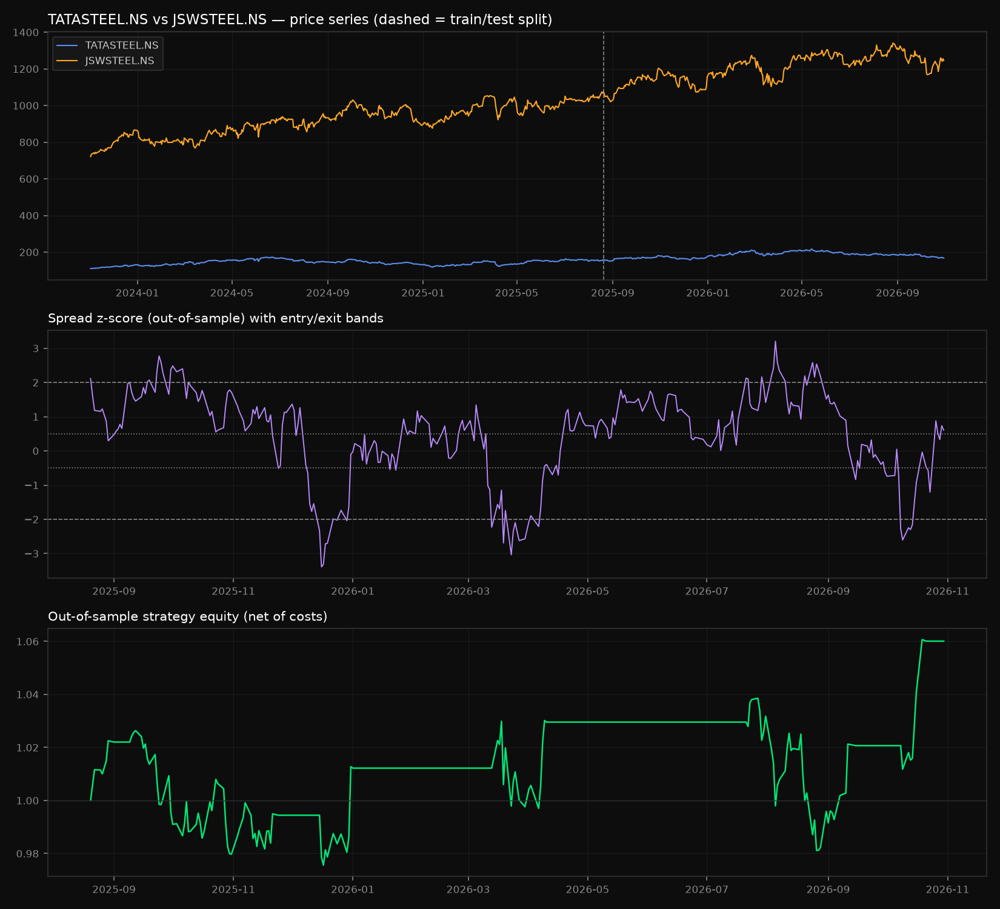

---

### SUNPHARMA.NS / CIPLA.NS

- **Latest prices:** SUNPHARMA.NS ₹1,777.70 · CIPLA.NS ₹1,378.90
- **Hedge ratio (train-fitted):** 0.4748
- **Cointegration (train):** PASS at 5% — ADF -3.13, p=0.0246
- **Persistence:** passed 5% in 88 of 88 real-data runs (strict tier: 5/88)
- **Spread half-life:** 11.6 days
- **Current z-score:** +1.24
- **Signal today:** watch (approaching band)

**Out-of-sample backtest** (beta frozen from train window):

| Metric | Value |
|---|---|
| Sharpe | 0.31 |
| Sortino | 0.34 |
| Annualised return | 2.02% |
| Annualised vol | 7.33% |
| Max drawdown | -10.17% |
| Round-trip trades | 5 |

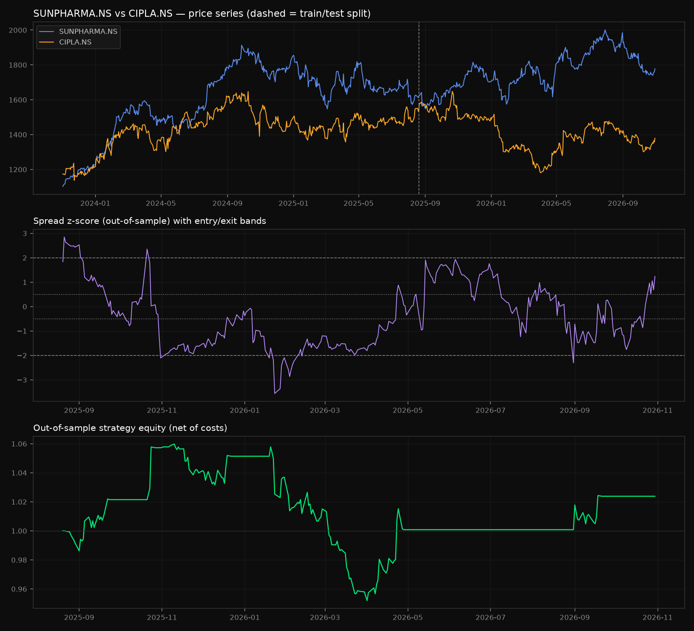

---

_Generated 2026-11-02 · pairs mean-reversion scanner · out-of-sample backtest · multiple-testing-aware · not investment advice._
