# Indian Pairs-Trading Scanner — 2026-11-03

> **What this is:** a market-neutral *pairs mean-reversion* scanner. It flags when two related NSE stocks have drifted apart far enough that their historical relationship signals a possible convergence trade. It does **not** forecast growth, rank "best" stocks, or predict company performance. A signal means the *spread between two stocks* is stretched — nothing about either stock being a good investment. Not investment advice; do your own research.

## Methodology (fixed in advance)

- **Universe:** 16 declared sector-mate pairs. Parameters (3y window, 60/40 train-test, z-entry 2.0, z-exit 0.5, 5 bps costs) are pre-registered; changes are logged in the README changelog *before* looking at results.
- **Multiple testing:** at the 5% level across 16 pairs, **≈0.8 false positives per run are expected by chance alone** even if nothing truly cointegrates. A single-day pass is a candidate, not a discovery.
- **Strict tier:** Bonferroni-corrected threshold p < 0.0031 (marked ✓✓).
- **Evidence = persistence:** the Persistence column counts how often each pair has passed the 5% test across all *real-data* daily runs recorded in `reports/history.csv`. Pairs deserve attention only when they pass persistently.

## Summary

| Pair | p-value | Coint. | Persistence | Current z | Signal | OOS Sharpe |
|---|---|---|---|---|---|---|
| HDFCBANK.NS/ICICIBANK.NS | 0.0715 | ✗ | 1/73 | +0.52 | watch | -0.56 |
| AXISBANK.NS/ICICIBANK.NS | 0.9048 | ✗ | 0/89 | +0.62 | watch | -0.03 |
| KOTAKBANK.NS/HDFCBANK.NS | 0.1775 | ✗ | 0/89 | -1.85 | watch | 1.27 |
| SBIN.NS/BANKBARODA.NS | 0.1287 | ✗ | 0/89 | +2.29 | SHORT spread | 0.47 |
| TCS.NS/INFY.NS | 0.6315 | ✗ | 0/89 | -1.10 | watch | 1.93 |
| INFY.NS/WIPRO.NS | 0.1040 | ✗ | 0/89 | +3.07 | SHORT spread | 2.05 |
| HCLTECH.NS/TECHM.NS | 0.3959 | ✗ | 0/89 | +1.31 | watch | 0.09 |
| ACC.NS/AMBUJACEM.NS | 0.3445 | ✗ | 0/89 | -0.82 | watch | -0.15 |
| ULTRACEMCO.NS/SHREECEM.NS | 0.2978 | ✗ | 0/89 | +0.13 | flat / no stretch | -0.07 |
| IOC.NS/BPCL.NS | 0.6937 | ✗ | 0/89 | -1.87 | watch | -0.06 |
| BPCL.NS/HINDPETRO.NS | 0.2088 | ✗ | 0/89 | +1.22 | watch | -0.08 |
| ONGC.NS/COALINDIA.NS | 0.0059 | ✓ | 81/89 | -0.52 | watch | 0.83 |
| NTPC.NS/POWERGRID.NS | 0.1036 | ✗ | 0/89 | +1.59 | watch | 0.55 |
| BAJAJ-AUTO.NS/HEROMOTOCO.NS | 0.3399 | ✗ | 0/89 | +0.72 | watch | 0.01 |
| TATASTEEL.NS/JSWSTEEL.NS | 0.7070 | ✗ | 0/89 | +1.66 | watch | 0.41 |
| SUNPHARMA.NS/CIPLA.NS | 0.0222 | ✓ | 89/89 | +1.72 | watch | 0.31 |

_Legend: ✓✓ passes strict Bonferroni tier · ✓ passes 5% only · ✗ fails. Persistence = 5%-passes / real-data runs recorded. \*no real-data history yet._

---

### HDFCBANK.NS / ICICIBANK.NS

- **Latest prices:** HDFCBANK.NS ₹700.00 · ICICIBANK.NS ₹1,387.40
- **Hedge ratio (train-fitted):** 1.5481
- **Cointegration (train):** FAIL at 5% — ADF -2.71, p=0.0715
- **Persistence:** passed 5% in 1 of 73 real-data runs (strict tier: 0/73)
- **Spread half-life:** 23.6 days
- **Current z-score:** +0.52
- **Signal today:** watch (approaching band)
- ⚠️ _Pair did not cointegrate on training data. Any signal here is not statistically justified — observation only._

**Out-of-sample backtest** (beta frozen from train window):

| Metric | Value |
|---|---|
| Sharpe | -0.56 |
| Sortino | -0.59 |
| Annualised return | -3.74% |
| Annualised vol | 6.47% |
| Max drawdown | -7.86% |
| Round-trip trades | 4 |

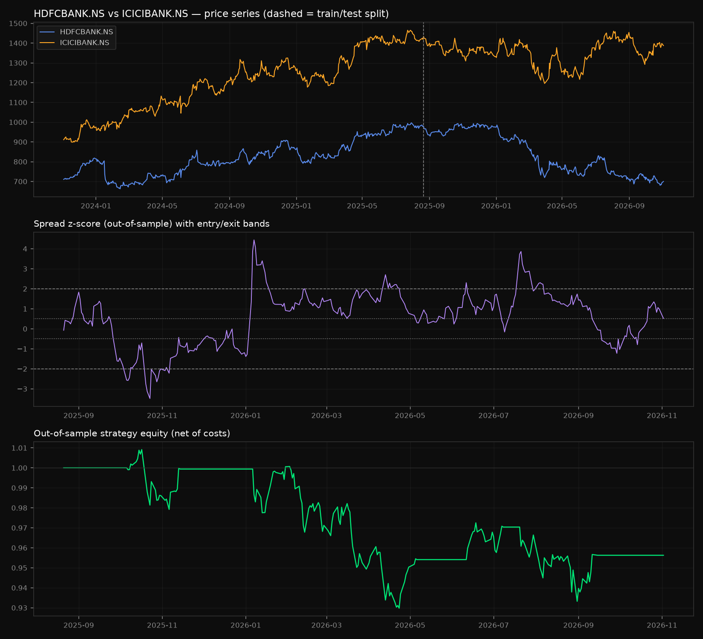

---

### AXISBANK.NS / ICICIBANK.NS

- **Latest prices:** AXISBANK.NS ₹1,209.00 · ICICIBANK.NS ₹1,387.40
- **Hedge ratio (train-fitted):** 0.6922
- **Cointegration (train):** FAIL at 5% — ADF -0.43, p=0.9048
- **Persistence:** passed 5% in 0 of 89 real-data runs (strict tier: 0/89)
- **Spread half-life:** 317.9 days
- **Current z-score:** +0.62
- **Signal today:** watch (approaching band)
- ⚠️ _Pair did not cointegrate on training data. Any signal here is not statistically justified — observation only._

**Out-of-sample backtest** (beta frozen from train window):

| Metric | Value |
|---|---|
| Sharpe | -0.03 |
| Sortino | -0.03 |
| Annualised return | -0.66% |
| Annualised vol | 8.81% |
| Max drawdown | -10.10% |
| Round-trip trades | 5 |

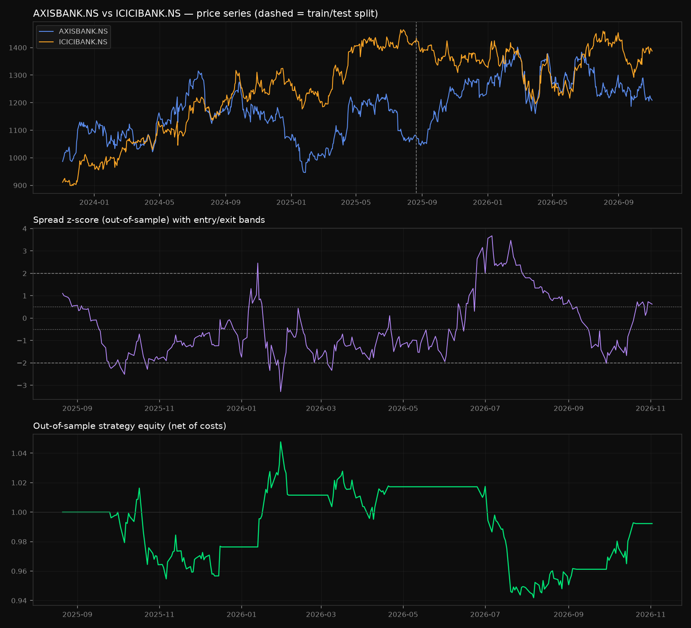

---

### KOTAKBANK.NS / HDFCBANK.NS

- **Latest prices:** KOTAKBANK.NS ₹458.35 · HDFCBANK.NS ₹700.00
- **Hedge ratio (train-fitted):** 2.2258
- **Cointegration (train):** FAIL at 5% — ADF -2.28, p=0.1775
- **Persistence:** passed 5% in 0 of 89 real-data runs (strict tier: 0/89)
- **Spread half-life:** 27.2 days
- **Current z-score:** -1.85
- **Signal today:** watch (approaching band)
- ⚠️ _Pair did not cointegrate on training data. Any signal here is not statistically justified — observation only._

**Out-of-sample backtest** (beta frozen from train window):

| Metric | Value |
|---|---|
| Sharpe | 1.27 |
| Sortino | 1.25 |
| Annualised return | 7.39% |
| Annualised vol | 5.73% |
| Max drawdown | -2.79% |
| Round-trip trades | 5 |

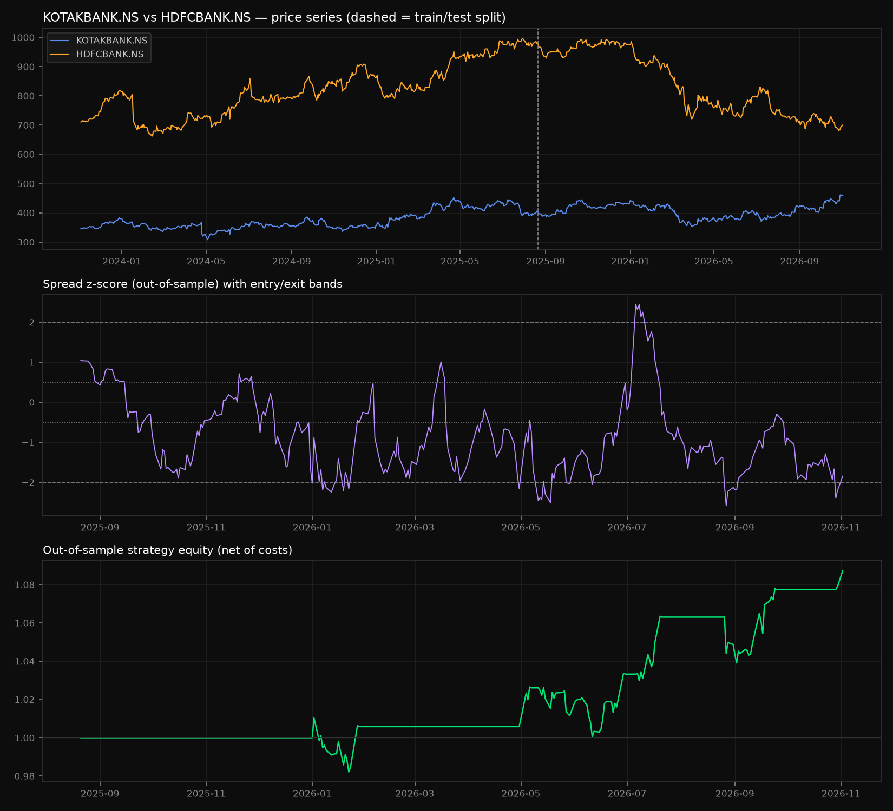

---

### SBIN.NS / BANKBARODA.NS

- **Latest prices:** SBIN.NS ₹987.00 · BANKBARODA.NS ₹245.16
- **Hedge ratio (train-fitted):** 0.1847
- **Cointegration (train):** FAIL at 5% — ADF -2.45, p=0.1287
- **Persistence:** passed 5% in 0 of 89 real-data runs (strict tier: 0/89)
- **Spread half-life:** 20.9 days
- **Current z-score:** +2.29
- **Signal today:** SHORT spread (short BANKBARODA.NS, long SBIN.NS)
- ⚠️ _Pair did not cointegrate on training data. Any signal here is not statistically justified — observation only._

**Out-of-sample backtest** (beta frozen from train window):

| Metric | Value |
|---|---|
| Sharpe | 0.47 |
| Sortino | 0.44 |
| Annualised return | 4.17% |
| Annualised vol | 9.68% |
| Max drawdown | -8.59% |
| Round-trip trades | 7 |

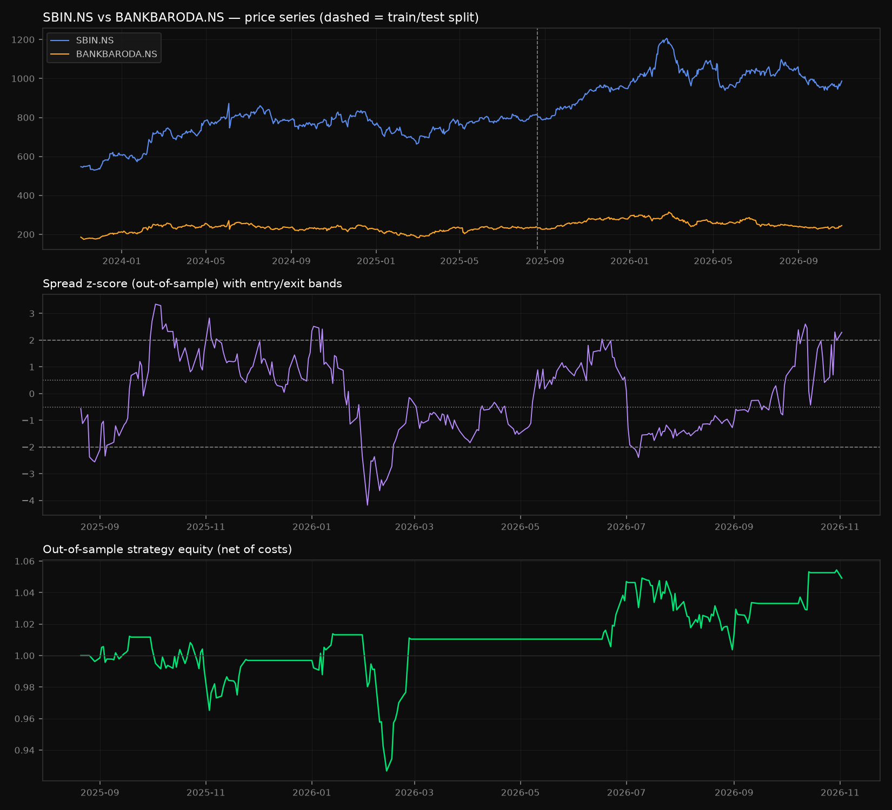

---

### TCS.NS / INFY.NS

- **Latest prices:** TCS.NS ₹2,501.70 · INFY.NS ₹1,135.00
- **Hedge ratio (train-fitted):** 0.3938
- **Cointegration (train):** FAIL at 5% — ADF -1.29, p=0.6315
- **Persistence:** passed 5% in 0 of 89 real-data runs (strict tier: 0/89)
- **Spread half-life:** 72.3 days
- **Current z-score:** -1.10
- **Signal today:** watch (approaching band)
- ⚠️ _Pair did not cointegrate on training data. Any signal here is not statistically justified — observation only._

**Out-of-sample backtest** (beta frozen from train window):

| Metric | Value |
|---|---|
| Sharpe | 1.93 |
| Sortino | 2.18 |
| Annualised return | 9.42% |
| Annualised vol | 4.72% |
| Max drawdown | -2.06% |
| Round-trip trades | 7 |

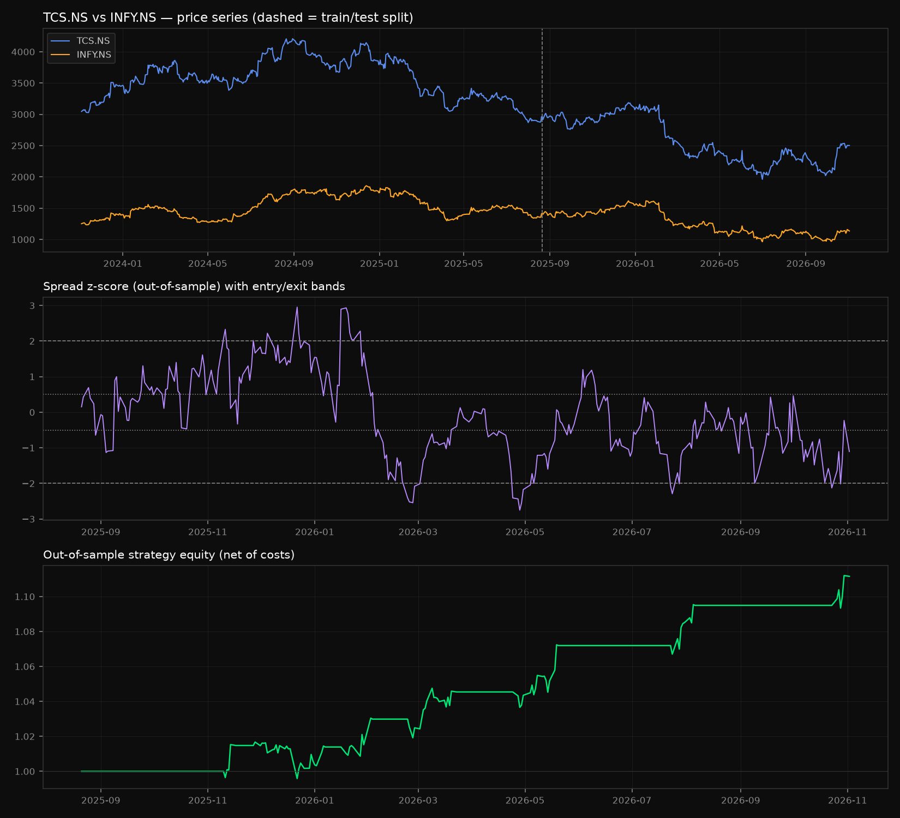

---

### INFY.NS / WIPRO.NS

- **Latest prices:** INFY.NS ₹1,135.00 · WIPRO.NS ₹196.40
- **Hedge ratio (train-fitted):** 0.1224
- **Cointegration (train):** FAIL at 5% — ADF -2.55, p=0.1040
- **Persistence:** passed 5% in 0 of 89 real-data runs (strict tier: 0/89)
- **Spread half-life:** 26.6 days
- **Current z-score:** +3.07
- **Signal today:** SHORT spread (short WIPRO.NS, long INFY.NS)
- ⚠️ _Pair did not cointegrate on training data. Any signal here is not statistically justified — observation only._

**Out-of-sample backtest** (beta frozen from train window):

| Metric | Value |
|---|---|
| Sharpe | 2.05 |
| Sortino | 2.21 |
| Annualised return | 11.40% |
| Annualised vol | 5.34% |
| Max drawdown | -3.20% |
| Round-trip trades | 6 |

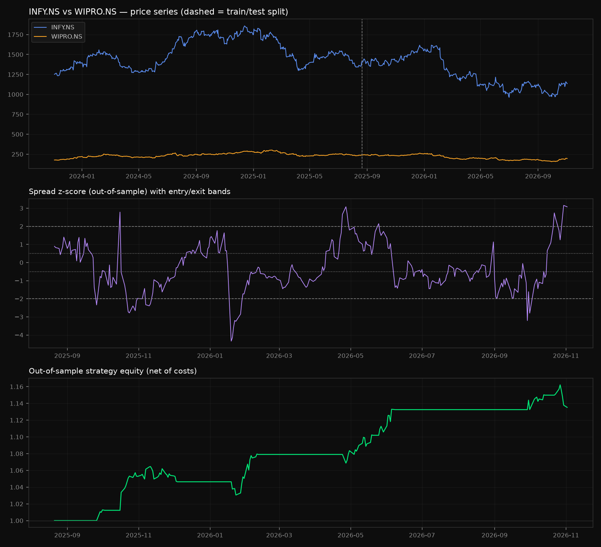

---

### HCLTECH.NS / TECHM.NS

- **Latest prices:** HCLTECH.NS ₹1,434.00 · TECHM.NS ₹1,786.90
- **Hedge ratio (train-fitted):** 0.9447
- **Cointegration (train):** FAIL at 5% — ADF -1.77, p=0.3959
- **Persistence:** passed 5% in 0 of 89 real-data runs (strict tier: 0/89)
- **Spread half-life:** 26.6 days
- **Current z-score:** +1.31
- **Signal today:** watch (approaching band)
- ⚠️ _Pair did not cointegrate on training data. Any signal here is not statistically justified — observation only._

**Out-of-sample backtest** (beta frozen from train window):

| Metric | Value |
|---|---|
| Sharpe | 0.09 |
| Sortino | 0.09 |
| Annualised return | 0.38% |
| Annualised vol | 7.44% |
| Max drawdown | -8.20% |
| Round-trip trades | 5 |

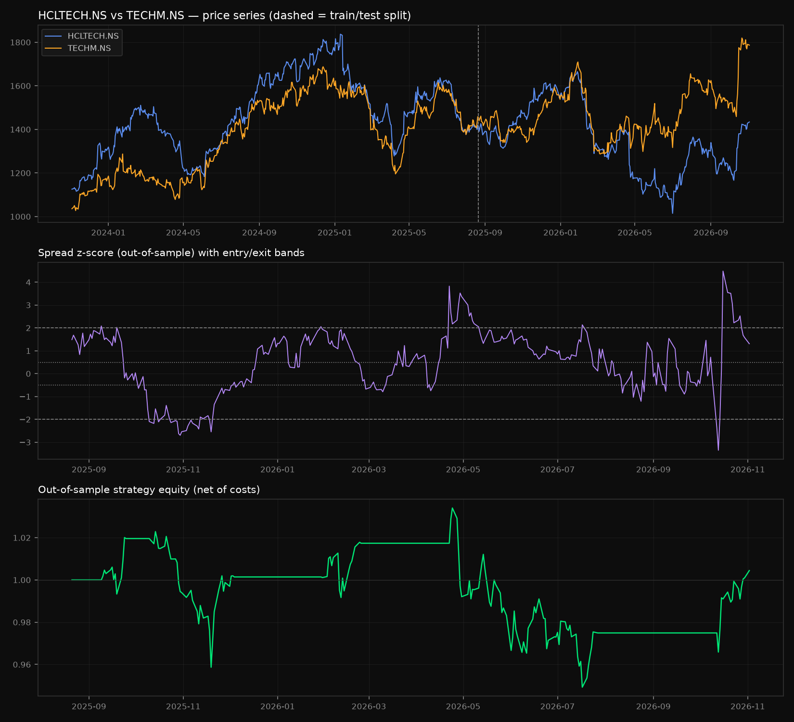

---

### ACC.NS / AMBUJACEM.NS

- **Latest prices:** ACC.NS ₹1,151.60 · AMBUJACEM.NS ₹360.20
- **Hedge ratio (train-fitted):** 0.1493
- **Cointegration (train):** FAIL at 5% — ADF -1.87, p=0.3445
- **Persistence:** passed 5% in 0 of 89 real-data runs (strict tier: 0/89)
- **Spread half-life:** 41.4 days
- **Current z-score:** -0.82
- **Signal today:** watch (approaching band)
- ⚠️ _Pair did not cointegrate on training data. Any signal here is not statistically justified — observation only._

**Out-of-sample backtest** (beta frozen from train window):

| Metric | Value |
|---|---|
| Sharpe | -0.15 |
| Sortino | -0.12 |
| Annualised return | -1.24% |
| Annualised vol | 6.79% |
| Max drawdown | -7.08% |
| Round-trip trades | 3 |

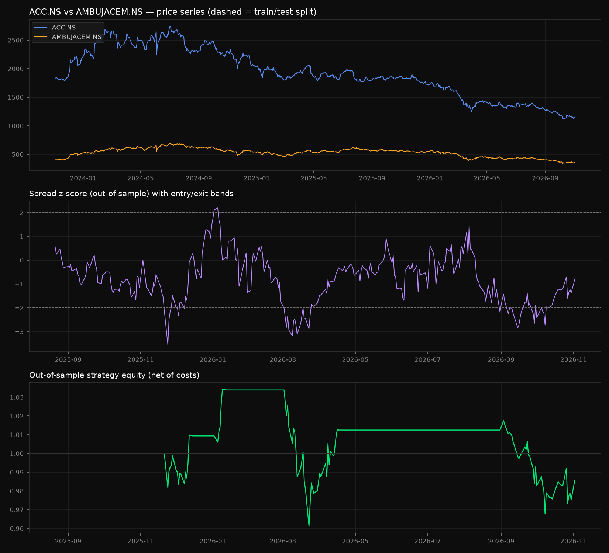

---

### ULTRACEMCO.NS / SHREECEM.NS

- **Latest prices:** ULTRACEMCO.NS ₹11,387.00 · SHREECEM.NS ₹23,590.00
- **Hedge ratio (train-fitted):** 1.1355
- **Cointegration (train):** FAIL at 5% — ADF -1.97, p=0.2978
- **Persistence:** passed 5% in 0 of 89 real-data runs (strict tier: 0/89)
- **Spread half-life:** 39.6 days
- **Current z-score:** +0.13
- **Signal today:** flat / no stretch
- ⚠️ _Pair did not cointegrate on training data. Any signal here is not statistically justified — observation only._

**Out-of-sample backtest** (beta frozen from train window):

| Metric | Value |
|---|---|
| Sharpe | -0.07 |
| Sortino | -0.09 |
| Annualised return | -0.78% |
| Annualised vol | 7.31% |
| Max drawdown | -5.95% |
| Round-trip trades | 6 |

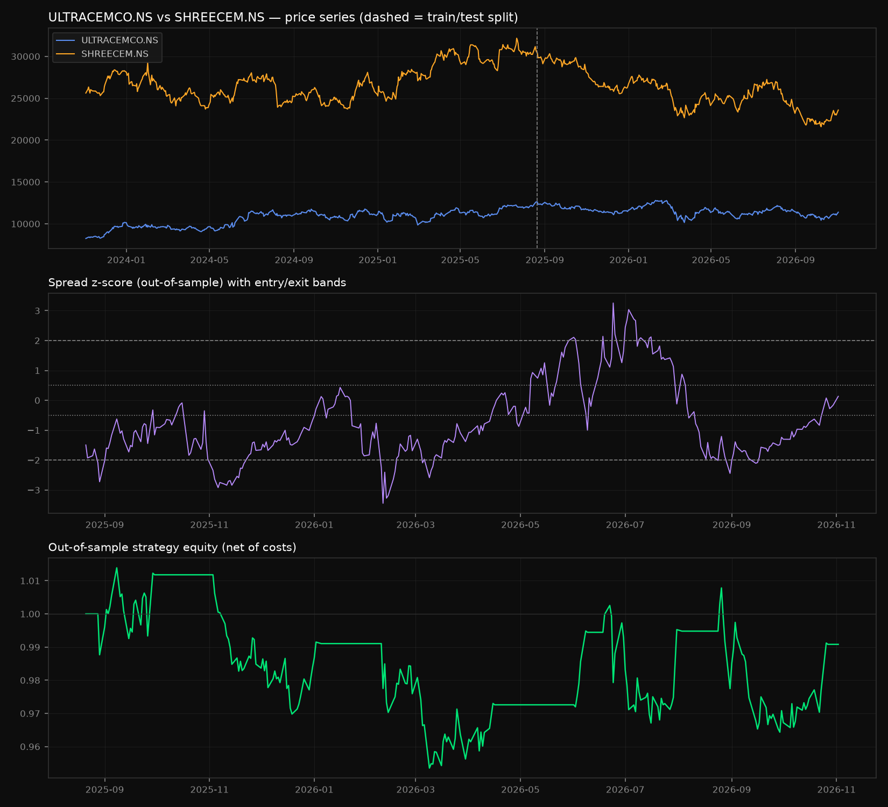

---

### IOC.NS / BPCL.NS

- **Latest prices:** IOC.NS ₹134.59 · BPCL.NS ₹293.05
- **Hedge ratio (train-fitted):** 1.5575
- **Cointegration (train):** FAIL at 5% — ADF -1.15, p=0.6937
- **Persistence:** passed 5% in 0 of 89 real-data runs (strict tier: 0/89)
- **Spread half-life:** 107.1 days
- **Current z-score:** -1.87
- **Signal today:** watch (approaching band)
- ⚠️ _Pair did not cointegrate on training data. Any signal here is not statistically justified — observation only._

**Out-of-sample backtest** (beta frozen from train window):

| Metric | Value |
|---|---|
| Sharpe | -0.06 |
| Sortino | -0.06 |
| Annualised return | -0.65% |
| Annualised vol | 7.03% |
| Max drawdown | -7.67% |
| Round-trip trades | 5 |

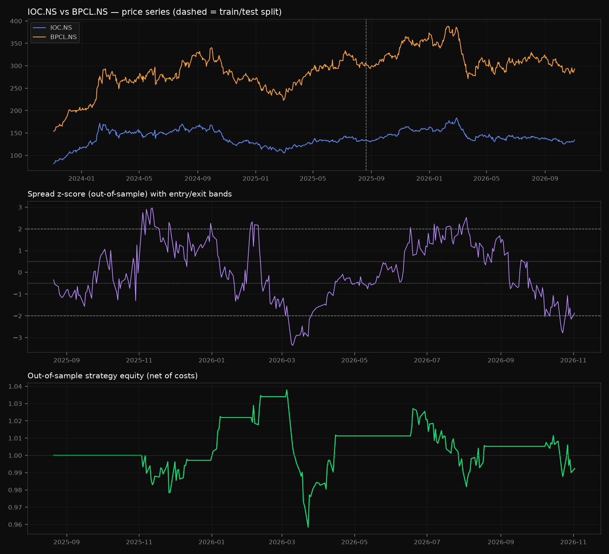

---

### BPCL.NS / HINDPETRO.NS

- **Latest prices:** BPCL.NS ₹293.05 · HINDPETRO.NS ₹348.00
- **Hedge ratio (train-fitted):** 1.2980
- **Cointegration (train):** FAIL at 5% — ADF -2.19, p=0.2088
- **Persistence:** passed 5% in 0 of 89 real-data runs (strict tier: 0/89)
- **Spread half-life:** 34.2 days
- **Current z-score:** +1.22
- **Signal today:** watch (approaching band)
- ⚠️ _Pair did not cointegrate on training data. Any signal here is not statistically justified — observation only._

**Out-of-sample backtest** (beta frozen from train window):

| Metric | Value |
|---|---|
| Sharpe | -0.08 |
| Sortino | -0.08 |
| Annualised return | -0.73% |
| Annualised vol | 6.56% |
| Max drawdown | -6.91% |
| Round-trip trades | 5 |

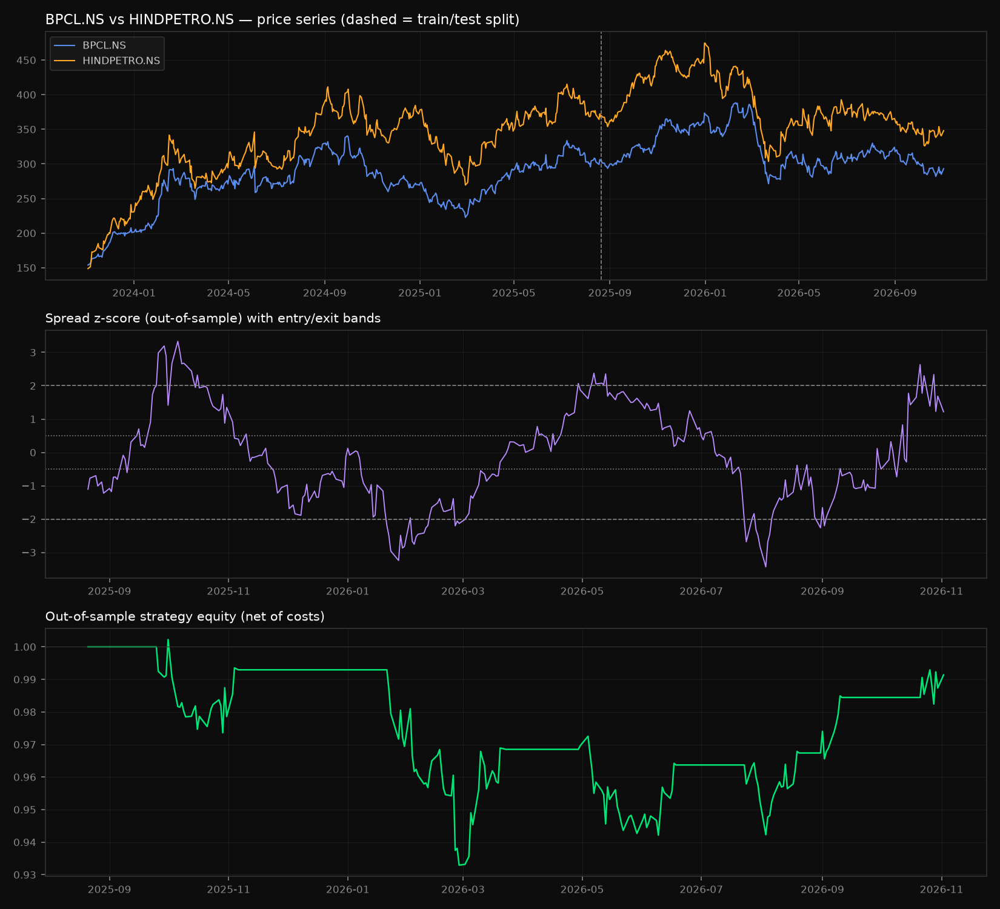

---

### ONGC.NS / COALINDIA.NS

- **Latest prices:** ONGC.NS ₹234.83 · COALINDIA.NS ₹408.00
- **Hedge ratio (train-fitted):** 1.3558
- **Cointegration (train):** PASS at 5% — ADF -3.59, p=0.0059
- **Persistence:** passed 5% in 81 of 89 real-data runs (strict tier: 1/89)
- **Spread half-life:** 12.5 days
- **Current z-score:** -0.52
- **Signal today:** watch (approaching band)

**Out-of-sample backtest** (beta frozen from train window):

| Metric | Value |
|---|---|
| Sharpe | 0.83 |
| Sortino | 0.71 |
| Annualised return | 6.62% |
| Annualised vol | 8.12% |
| Max drawdown | -6.39% |
| Round-trip trades | 6 |

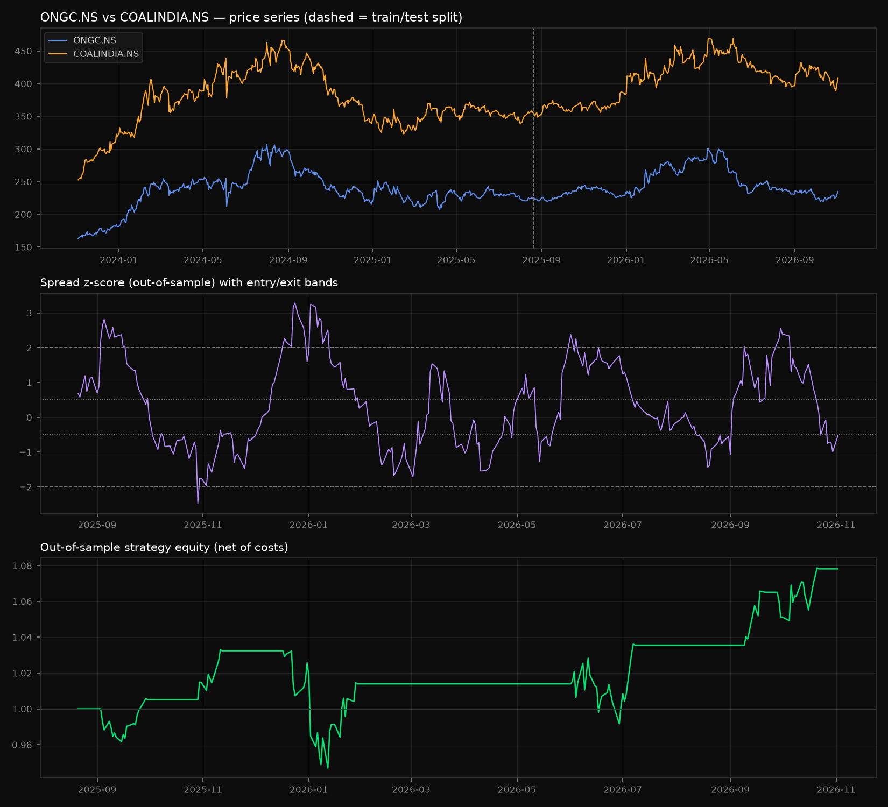

---

### NTPC.NS / POWERGRID.NS

- **Latest prices:** NTPC.NS ₹323.00 · POWERGRID.NS ₹267.70
- **Hedge ratio (train-fitted):** 0.8001
- **Cointegration (train):** FAIL at 5% — ADF -2.55, p=0.1036
- **Persistence:** passed 5% in 0 of 89 real-data runs (strict tier: 0/89)
- **Spread half-life:** 23.8 days
- **Current z-score:** +1.59
- **Signal today:** watch (approaching band)
- ⚠️ _Pair did not cointegrate on training data. Any signal here is not statistically justified — observation only._

**Out-of-sample backtest** (beta frozen from train window):

| Metric | Value |
|---|---|
| Sharpe | 0.55 |
| Sortino | 0.42 |
| Annualised return | 2.93% |
| Annualised vol | 5.49% |
| Max drawdown | -5.28% |
| Round-trip trades | 6 |

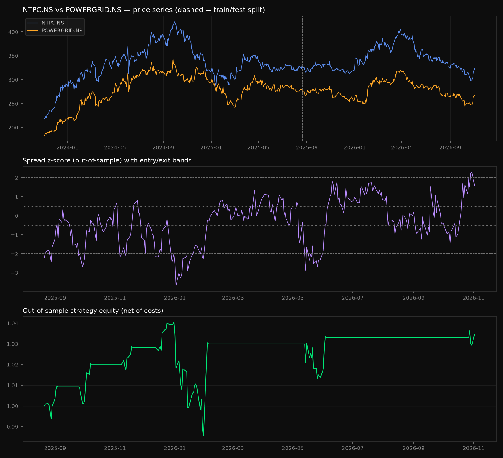

---

### BAJAJ-AUTO.NS / HEROMOTOCO.NS

- **Latest prices:** BAJAJ-AUTO.NS ₹10,339.00 · HEROMOTOCO.NS ₹5,193.00
- **Hedge ratio (train-fitted):** 0.4058
- **Cointegration (train):** FAIL at 5% — ADF -1.88, p=0.3399
- **Persistence:** passed 5% in 0 of 89 real-data runs (strict tier: 0/89)
- **Spread half-life:** 35.8 days
- **Current z-score:** +0.72
- **Signal today:** watch (approaching band)
- ⚠️ _Pair did not cointegrate on training data. Any signal here is not statistically justified — observation only._

**Out-of-sample backtest** (beta frozen from train window):

| Metric | Value |
|---|---|
| Sharpe | 0.01 |
| Sortino | 0.01 |
| Annualised return | -0.30% |
| Annualised vol | 8.88% |
| Max drawdown | -13.03% |
| Round-trip trades | 6 |

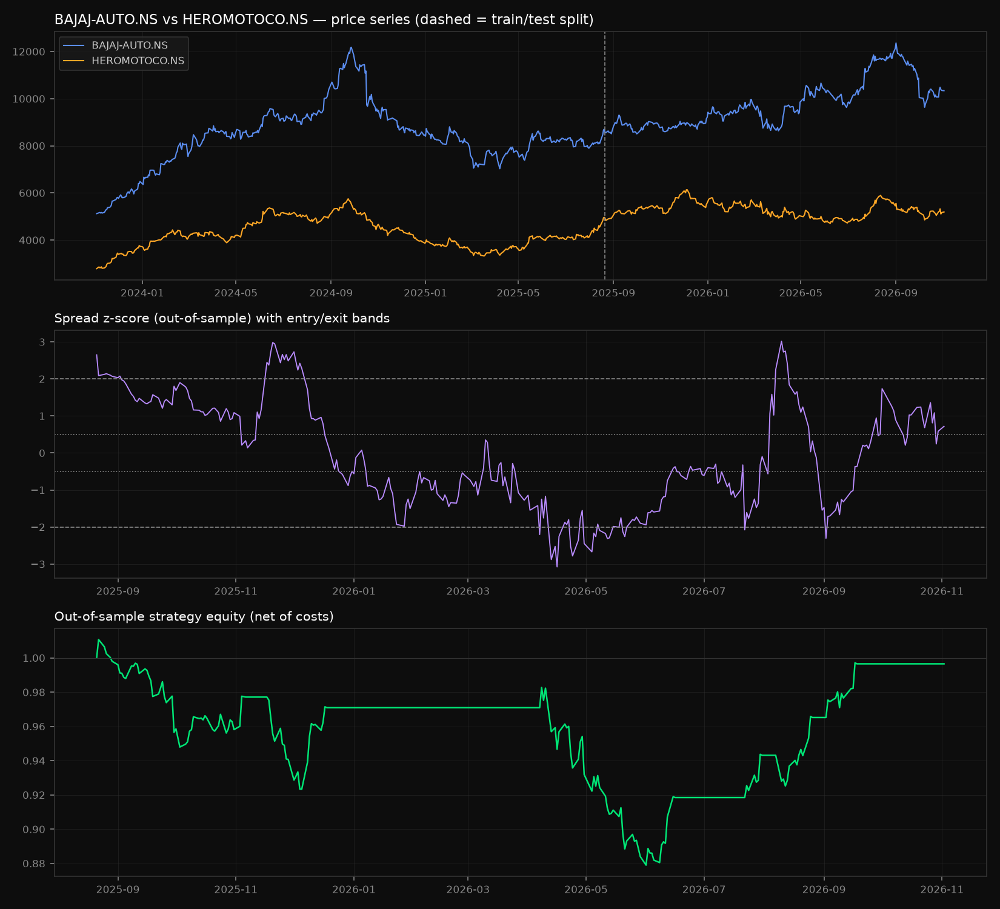

---

### TATASTEEL.NS / JSWSTEEL.NS

- **Latest prices:** TATASTEEL.NS ₹177.37 · JSWSTEEL.NS ₹1,309.90
- **Hedge ratio (train-fitted):** 2.8295
- **Cointegration (train):** FAIL at 5% — ADF -1.12, p=0.7070
- **Persistence:** passed 5% in 0 of 89 real-data runs (strict tier: 0/89)
- **Spread half-life:** 70.5 days
- **Current z-score:** +1.66
- **Signal today:** watch (approaching band)
- ⚠️ _Pair did not cointegrate on training data. Any signal here is not statistically justified — observation only._

**Out-of-sample backtest** (beta frozen from train window):

| Metric | Value |
|---|---|
| Sharpe | 0.41 |
| Sortino | 0.40 |
| Annualised return | 3.23% |
| Annualised vol | 8.54% |
| Max drawdown | -5.59% |
| Round-trip trades | 5 |

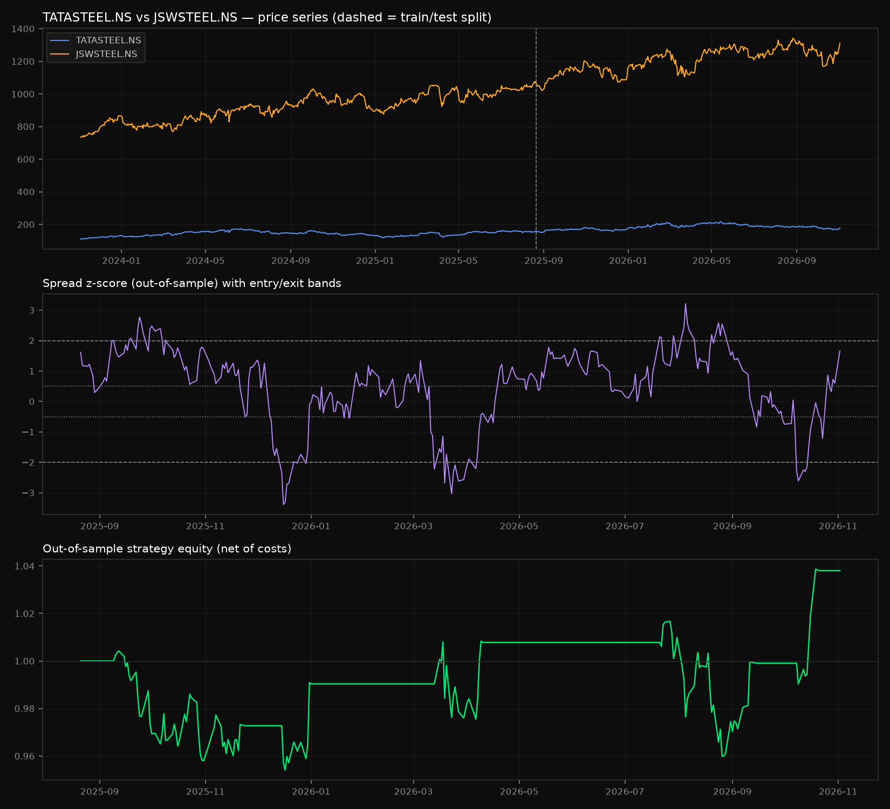

---

### SUNPHARMA.NS / CIPLA.NS

- **Latest prices:** SUNPHARMA.NS ₹1,770.00 · CIPLA.NS ₹1,387.00
- **Hedge ratio (train-fitted):** 0.4742
- **Cointegration (train):** PASS at 5% — ADF -3.16, p=0.0222
- **Persistence:** passed 5% in 89 of 89 real-data runs (strict tier: 5/89)
- **Spread half-life:** 11.6 days
- **Current z-score:** +1.72
- **Signal today:** watch (approaching band)

**Out-of-sample backtest** (beta frozen from train window):

| Metric | Value |
|---|---|
| Sharpe | 0.31 |
| Sortino | 0.34 |
| Annualised return | 1.99% |
| Annualised vol | 7.18% |
| Max drawdown | -9.97% |
| Round-trip trades | 5 |

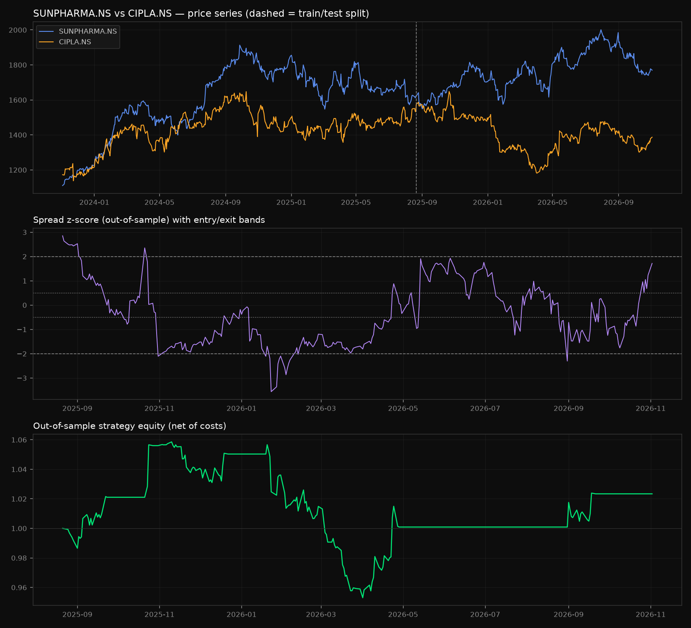

---

_Generated 2026-11-03 · pairs mean-reversion scanner · out-of-sample backtest · multiple-testing-aware · not investment advice._
