# Indian Pairs-Trading Scanner — 2026-11-04

> **What this is:** a market-neutral *pairs mean-reversion* scanner. It flags when two related NSE stocks have drifted apart far enough that their historical relationship signals a possible convergence trade. It does **not** forecast growth, rank "best" stocks, or predict company performance. A signal means the *spread between two stocks* is stretched — nothing about either stock being a good investment. Not investment advice; do your own research.

## Methodology (fixed in advance)

- **Universe:** 16 declared sector-mate pairs. Parameters (3y window, 60/40 train-test, z-entry 2.0, z-exit 0.5, 5 bps costs) are pre-registered; changes are logged in the README changelog *before* looking at results.
- **Multiple testing:** at the 5% level across 16 pairs, **≈0.8 false positives per run are expected by chance alone** even if nothing truly cointegrates. A single-day pass is a candidate, not a discovery.
- **Strict tier:** Bonferroni-corrected threshold p < 0.0031 (marked ✓✓).
- **Evidence = persistence:** the Persistence column counts how often each pair has passed the 5% test across all *real-data* daily runs recorded in `reports/history.csv`. Pairs deserve attention only when they pass persistently.

## Summary

| Pair | p-value | Coint. | Persistence | Current z | Signal | OOS Sharpe |
|---|---|---|---|---|---|---|
| HDFCBANK.NS/ICICIBANK.NS | 0.0712 | ✗ | 1/74 | +0.48 | flat / no stretch | -0.55 |
| AXISBANK.NS/ICICIBANK.NS | 0.9086 | ✗ | 0/90 | +1.18 | watch | -0.02 |
| KOTAKBANK.NS/HDFCBANK.NS | 0.1824 | ✗ | 0/90 | -1.58 | watch | 1.36 |
| SBIN.NS/BANKBARODA.NS | 0.1127 | ✗ | 0/90 | +2.41 | SHORT spread | 0.44 |
| TCS.NS/INFY.NS | 0.6276 | ✗ | 0/90 | -0.50 | watch | 2.27 |
| INFY.NS/WIPRO.NS | 0.0914 | ✗ | 0/90 | +2.82 | SHORT spread | 2.13 |
| HCLTECH.NS/TECHM.NS | 0.3964 | ✗ | 0/90 | +1.21 | watch | 0.10 |
| ACC.NS/AMBUJACEM.NS | 0.3080 | ✗ | 0/90 | -0.43 | flat / no stretch | -0.07 |
| ULTRACEMCO.NS/SHREECEM.NS | 0.2782 | ✗ | 0/90 | +0.13 | flat / no stretch | -0.20 |
| IOC.NS/BPCL.NS | 0.6666 | ✗ | 0/90 | -2.13 | LONG spread | -0.09 |
| BPCL.NS/HINDPETRO.NS | 0.2059 | ✗ | 0/90 | +1.11 | watch | -0.08 |
| ONGC.NS/COALINDIA.NS | 0.0058 | ✓ | 82/90 | -0.25 | flat / no stretch | 0.83 |
| NTPC.NS/POWERGRID.NS | 0.1047 | ✗ | 0/90 | -0.08 | flat / no stretch | 0.83 |
| BAJAJ-AUTO.NS/HEROMOTOCO.NS | 0.3445 | ✗ | 0/90 | +0.82 | watch | -0.10 |
| TATASTEEL.NS/JSWSTEEL.NS | 0.6617 | ✗ | 0/90 | +1.95 | watch | 0.42 |
| SUNPHARMA.NS/CIPLA.NS | 0.0399 | ✓ | 90/90 | +2.12 | SHORT spread | 0.31 |

_Legend: ✓✓ passes strict Bonferroni tier · ✓ passes 5% only · ✗ fails. Persistence = 5%-passes / real-data runs recorded. \*no real-data history yet._

---

### HDFCBANK.NS / ICICIBANK.NS

- **Latest prices:** HDFCBANK.NS ₹725.50 · ICICIBANK.NS ₹1,424.50
- **Hedge ratio (train-fitted):** 1.5440
- **Cointegration (train):** FAIL at 5% — ADF -2.72, p=0.0712
- **Persistence:** passed 5% in 1 of 74 real-data runs (strict tier: 0/74)
- **Spread half-life:** 23.6 days
- **Current z-score:** +0.48
- **Signal today:** flat / no stretch
- ⚠️ _Pair did not cointegrate on training data. Any signal here is not statistically justified — observation only._

**Out-of-sample backtest** (beta frozen from train window):

| Metric | Value |
|---|---|
| Sharpe | -0.55 |
| Sortino | -0.59 |
| Annualised return | -3.76% |
| Annualised vol | 6.53% |
| Max drawdown | -7.93% |
| Round-trip trades | 4 |

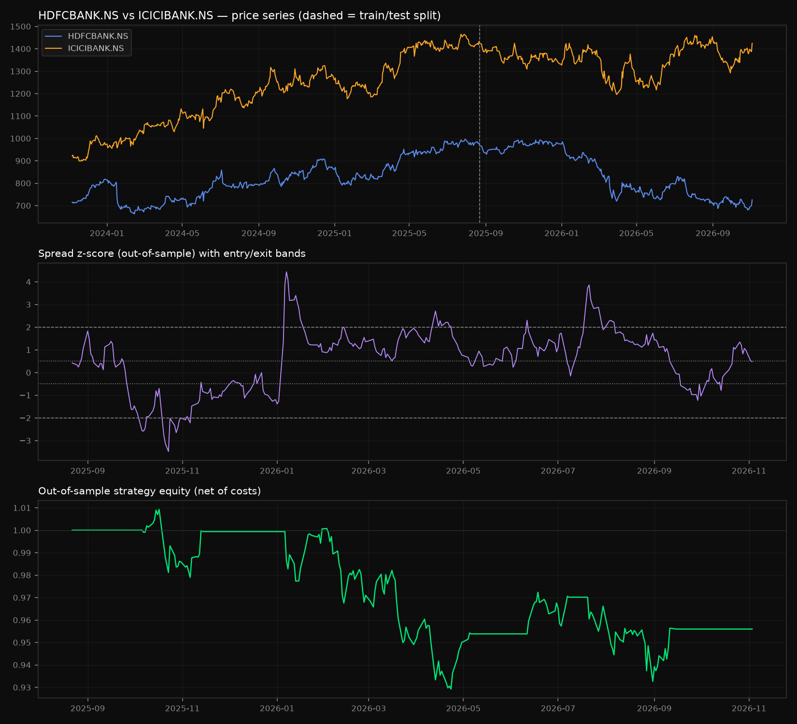

---

### AXISBANK.NS / ICICIBANK.NS

- **Latest prices:** AXISBANK.NS ₹1,232.70 · ICICIBANK.NS ₹1,424.50
- **Hedge ratio (train-fitted):** 0.6772
- **Cointegration (train):** FAIL at 5% — ADF -0.41, p=0.9086
- **Persistence:** passed 5% in 0 of 90 real-data runs (strict tier: 0/90)
- **Spread half-life:** 374.4 days
- **Current z-score:** +1.18
- **Signal today:** watch (approaching band)
- ⚠️ _Pair did not cointegrate on training data. Any signal here is not statistically justified — observation only._

**Out-of-sample backtest** (beta frozen from train window):

| Metric | Value |
|---|---|
| Sharpe | -0.02 |
| Sortino | -0.02 |
| Annualised return | -0.58% |
| Annualised vol | 8.86% |
| Max drawdown | -10.11% |
| Round-trip trades | 5 |

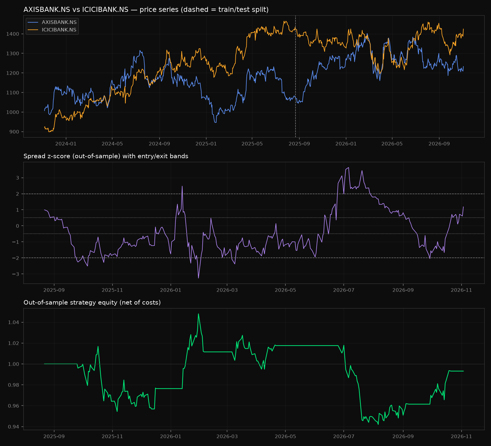

---

### KOTAKBANK.NS / HDFCBANK.NS

- **Latest prices:** KOTAKBANK.NS ₹464.65 · HDFCBANK.NS ₹725.50
- **Hedge ratio (train-fitted):** 2.2290
- **Cointegration (train):** FAIL at 5% — ADF -2.27, p=0.1824
- **Persistence:** passed 5% in 0 of 90 real-data runs (strict tier: 0/90)
- **Spread half-life:** 27.4 days
- **Current z-score:** -1.58
- **Signal today:** watch (approaching band)
- ⚠️ _Pair did not cointegrate on training data. Any signal here is not statistically justified — observation only._

**Out-of-sample backtest** (beta frozen from train window):

| Metric | Value |
|---|---|
| Sharpe | 1.36 |
| Sortino | 1.34 |
| Annualised return | 8.06% |
| Annualised vol | 5.84% |
| Max drawdown | -2.82% |
| Round-trip trades | 5 |

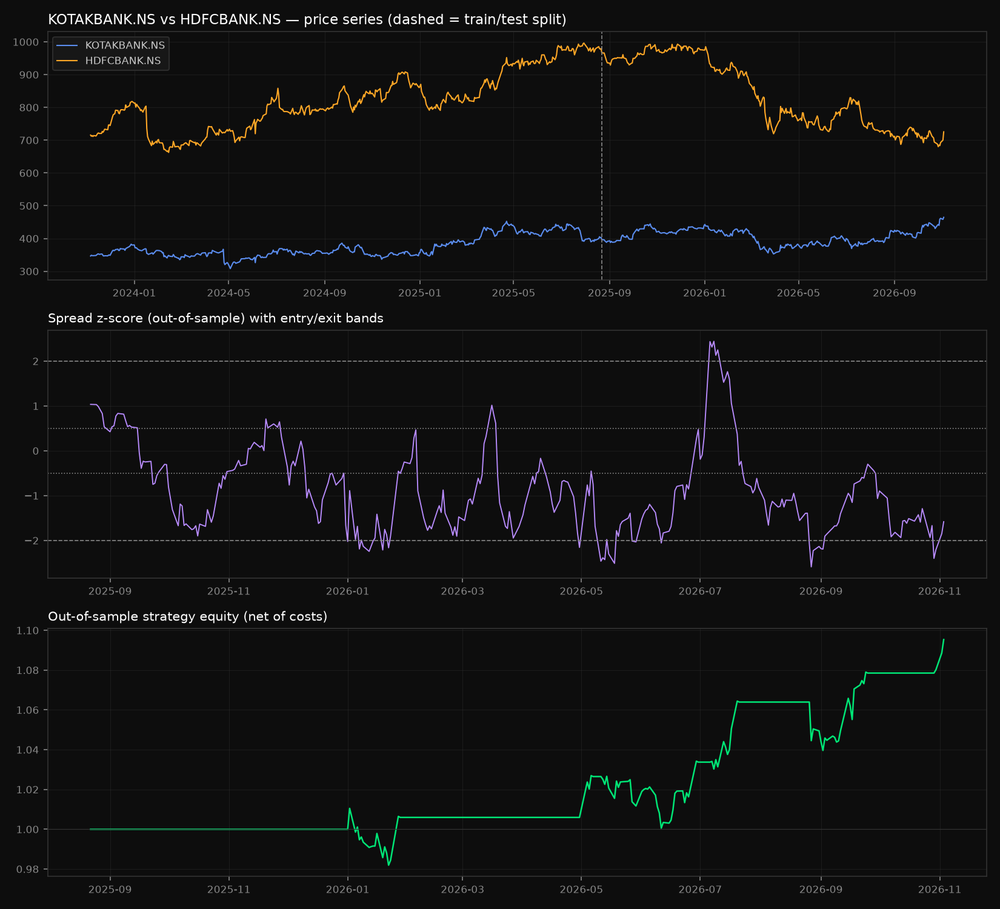

---

### SBIN.NS / BANKBARODA.NS

- **Latest prices:** SBIN.NS ₹970.25 · BANKBARODA.NS ₹243.30
- **Hedge ratio (train-fitted):** 0.1843
- **Cointegration (train):** FAIL at 5% — ADF -2.51, p=0.1127
- **Persistence:** passed 5% in 0 of 90 real-data runs (strict tier: 0/90)
- **Spread half-life:** 20.6 days
- **Current z-score:** +2.41
- **Signal today:** SHORT spread (short BANKBARODA.NS, long SBIN.NS)
- ⚠️ _Pair did not cointegrate on training data. Any signal here is not statistically justified — observation only._

**Out-of-sample backtest** (beta frozen from train window):

| Metric | Value |
|---|---|
| Sharpe | 0.44 |
| Sortino | 0.41 |
| Annualised return | 3.93% |
| Annualised vol | 9.82% |
| Max drawdown | -8.69% |
| Round-trip trades | 7 |

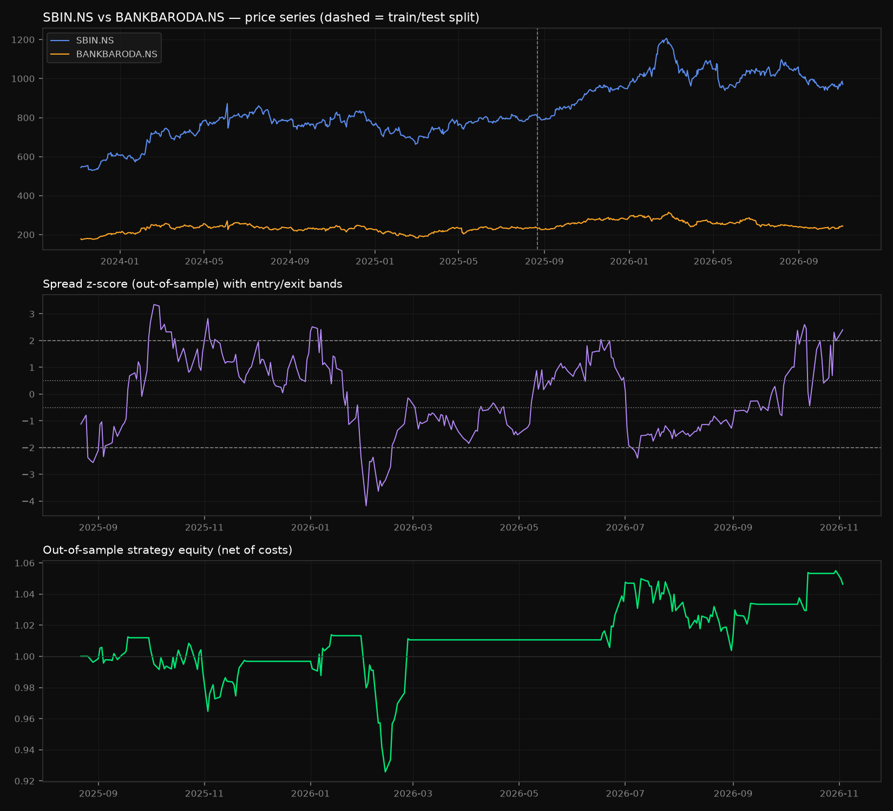

---

### TCS.NS / INFY.NS

- **Latest prices:** TCS.NS ₹2,499.10 · INFY.NS ₹1,148.10
- **Hedge ratio (train-fitted):** 0.3915
- **Cointegration (train):** FAIL at 5% — ADF -1.30, p=0.6276
- **Persistence:** passed 5% in 0 of 90 real-data runs (strict tier: 0/90)
- **Spread half-life:** 72.1 days
- **Current z-score:** -0.50
- **Signal today:** watch (approaching band)
- ⚠️ _Pair did not cointegrate on training data. Any signal here is not statistically justified — observation only._

**Out-of-sample backtest** (beta frozen from train window):

| Metric | Value |
|---|---|
| Sharpe | 2.27 |
| Sortino | 2.62 |
| Annualised return | 11.65% |
| Annualised vol | 4.92% |
| Max drawdown | -2.10% |
| Round-trip trades | 8 |

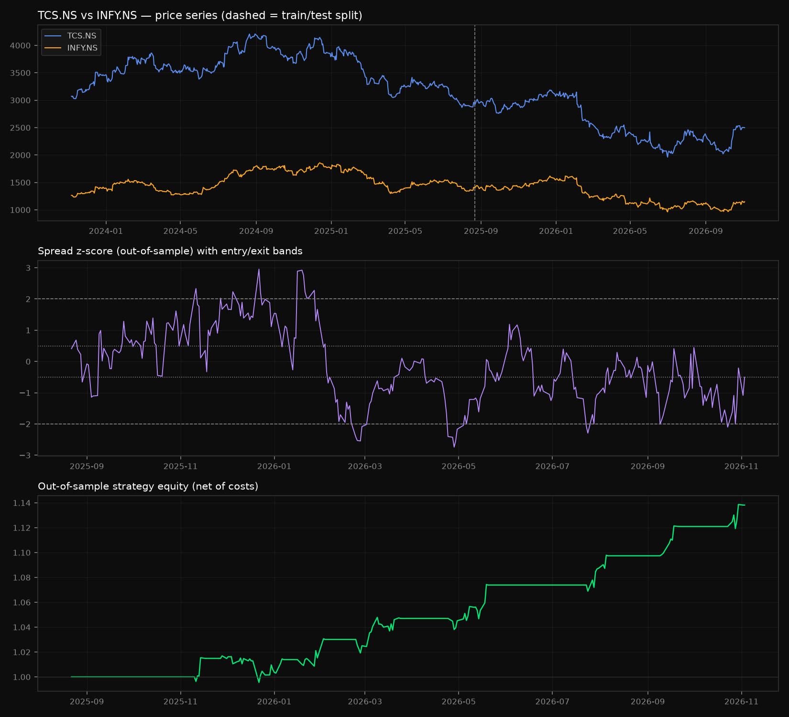

---

### INFY.NS / WIPRO.NS

- **Latest prices:** INFY.NS ₹1,148.10 · WIPRO.NS ₹198.00
- **Hedge ratio (train-fitted):** 0.1216
- **Cointegration (train):** FAIL at 5% — ADF -2.61, p=0.0914
- **Persistence:** passed 5% in 0 of 90 real-data runs (strict tier: 0/90)
- **Spread half-life:** 25.9 days
- **Current z-score:** +2.82
- **Signal today:** SHORT spread (short WIPRO.NS, long INFY.NS)
- ⚠️ _Pair did not cointegrate on training data. Any signal here is not statistically justified — observation only._

**Out-of-sample backtest** (beta frozen from train window):

| Metric | Value |
|---|---|
| Sharpe | 2.13 |
| Sortino | 2.46 |
| Annualised return | 12.24% |
| Annualised vol | 5.48% |
| Max drawdown | -3.23% |
| Round-trip trades | 7 |

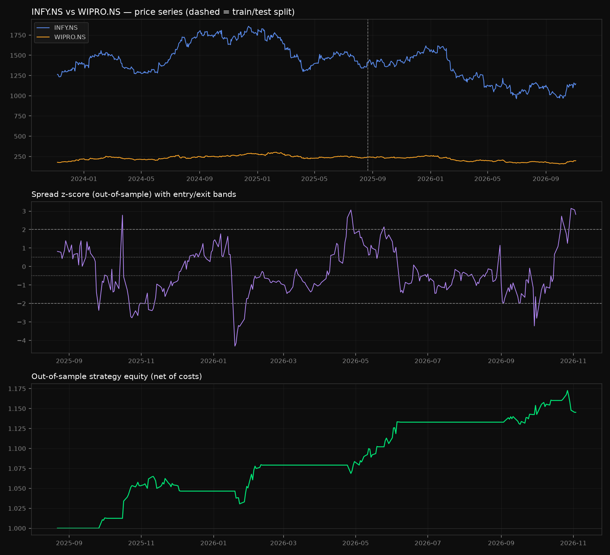

---

### HCLTECH.NS / TECHM.NS

- **Latest prices:** HCLTECH.NS ₹1,439.10 · TECHM.NS ₹1,789.10
- **Hedge ratio (train-fitted):** 0.9438
- **Cointegration (train):** FAIL at 5% — ADF -1.77, p=0.3964
- **Persistence:** passed 5% in 0 of 90 real-data runs (strict tier: 0/90)
- **Spread half-life:** 26.7 days
- **Current z-score:** +1.21
- **Signal today:** watch (approaching band)
- ⚠️ _Pair did not cointegrate on training data. Any signal here is not statistically justified — observation only._

**Out-of-sample backtest** (beta frozen from train window):

| Metric | Value |
|---|---|
| Sharpe | 0.10 |
| Sortino | 0.10 |
| Annualised return | 0.47% |
| Annualised vol | 7.56% |
| Max drawdown | -8.32% |
| Round-trip trades | 5 |

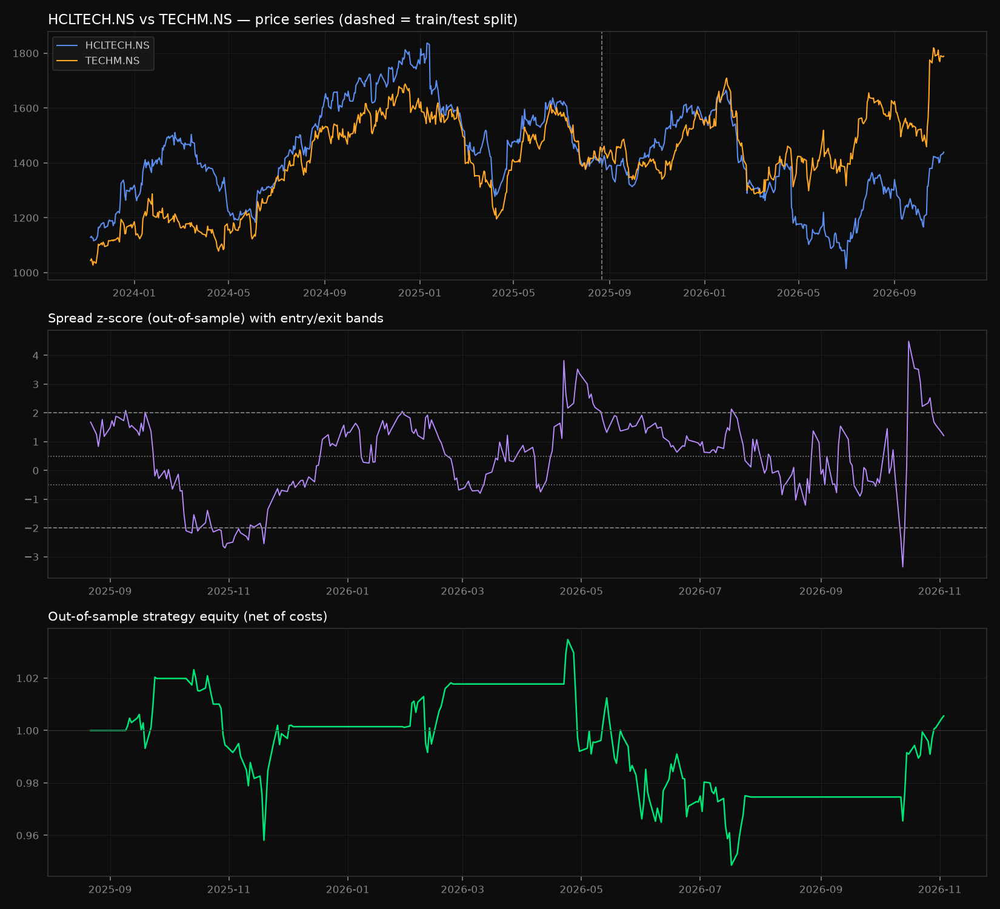

---

### ACC.NS / AMBUJACEM.NS

- **Latest prices:** ACC.NS ₹1,170.10 · AMBUJACEM.NS ₹368.90
- **Hedge ratio (train-fitted):** 0.1476
- **Cointegration (train):** FAIL at 5% — ADF -1.95, p=0.3080
- **Persistence:** passed 5% in 0 of 90 real-data runs (strict tier: 0/90)
- **Spread half-life:** 40.0 days
- **Current z-score:** -0.43
- **Signal today:** flat / no stretch
- ⚠️ _Pair did not cointegrate on training data. Any signal here is not statistically justified — observation only._

**Out-of-sample backtest** (beta frozen from train window):

| Metric | Value |
|---|---|
| Sharpe | -0.07 |
| Sortino | -0.05 |
| Annualised return | -0.72% |
| Annualised vol | 6.99% |
| Max drawdown | -7.28% |
| Round-trip trades | 3 |

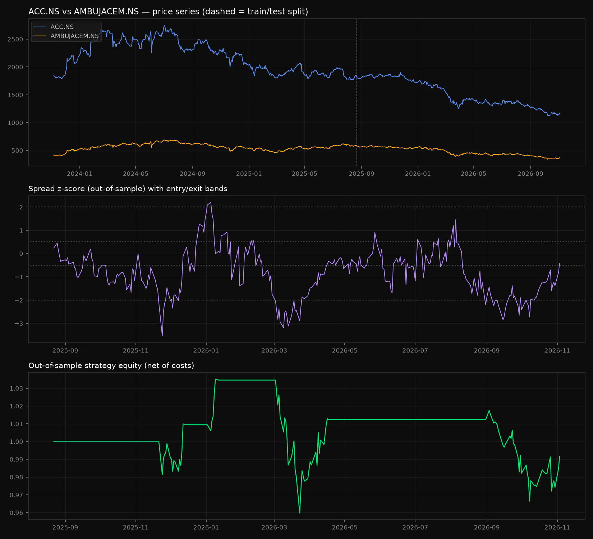

---

### ULTRACEMCO.NS / SHREECEM.NS

- **Latest prices:** ULTRACEMCO.NS ₹11,700.00 · SHREECEM.NS ₹23,910.00
- **Hedge ratio (train-fitted):** 1.1479
- **Cointegration (train):** FAIL at 5% — ADF -2.02, p=0.2782
- **Persistence:** passed 5% in 0 of 90 real-data runs (strict tier: 0/90)
- **Spread half-life:** 38.7 days
- **Current z-score:** +0.13
- **Signal today:** flat / no stretch
- ⚠️ _Pair did not cointegrate on training data. Any signal here is not statistically justified — observation only._

**Out-of-sample backtest** (beta frozen from train window):

| Metric | Value |
|---|---|
| Sharpe | -0.20 |
| Sortino | -0.25 |
| Annualised return | -1.75% |
| Annualised vol | 7.35% |
| Max drawdown | -6.03% |
| Round-trip trades | 6 |

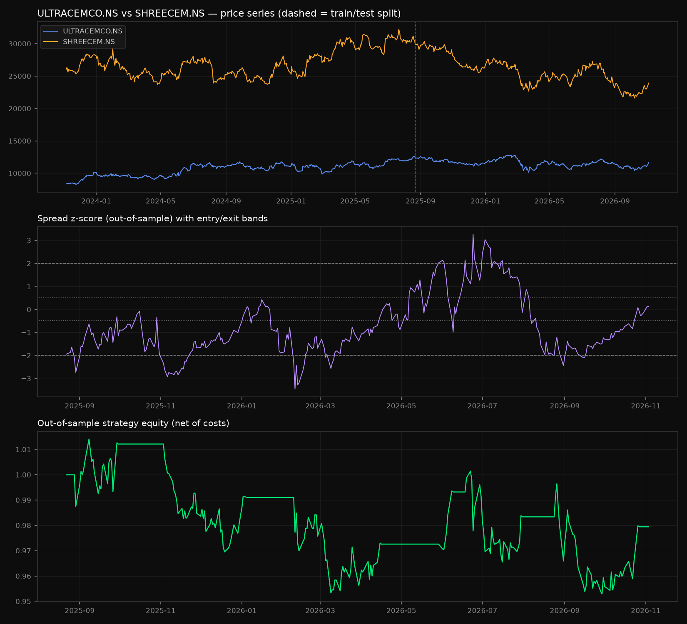

---

### IOC.NS / BPCL.NS

- **Latest prices:** IOC.NS ₹138.67 · BPCL.NS ₹296.90
- **Hedge ratio (train-fitted):** 1.5457
- **Cointegration (train):** FAIL at 5% — ADF -1.22, p=0.6666
- **Persistence:** passed 5% in 0 of 90 real-data runs (strict tier: 0/90)
- **Spread half-life:** 101.5 days
- **Current z-score:** -2.13
- **Signal today:** LONG spread (long BPCL.NS, short IOC.NS)
- ⚠️ _Pair did not cointegrate on training data. Any signal here is not statistically justified — observation only._

**Out-of-sample backtest** (beta frozen from train window):

| Metric | Value |
|---|---|
| Sharpe | -0.09 |
| Sortino | -0.09 |
| Annualised return | -0.91% |
| Annualised vol | 7.15% |
| Max drawdown | -7.35% |
| Round-trip trades | 5 |

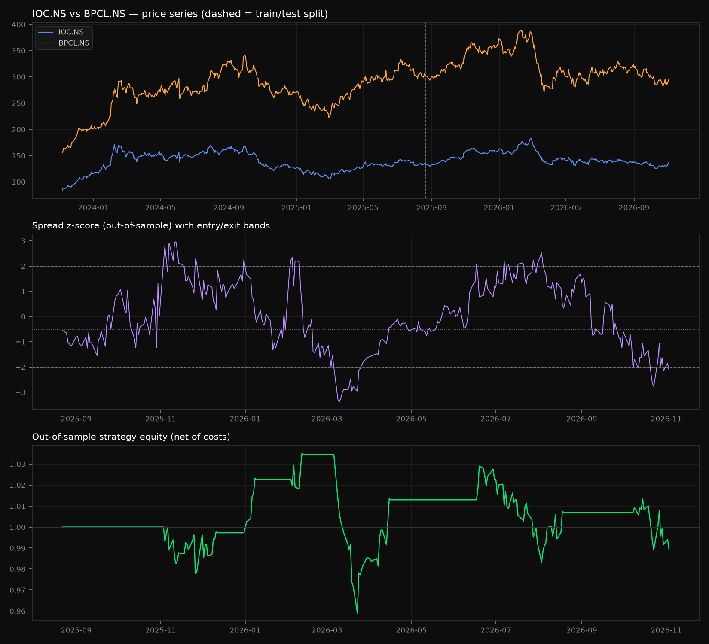

---

### BPCL.NS / HINDPETRO.NS

- **Latest prices:** BPCL.NS ₹296.90 · HINDPETRO.NS ₹352.50
- **Hedge ratio (train-fitted):** 1.2939
- **Cointegration (train):** FAIL at 5% — ADF -2.20, p=0.2059
- **Persistence:** passed 5% in 0 of 90 real-data runs (strict tier: 0/90)
- **Spread half-life:** 34.1 days
- **Current z-score:** +1.11
- **Signal today:** watch (approaching band)
- ⚠️ _Pair did not cointegrate on training data. Any signal here is not statistically justified — observation only._

**Out-of-sample backtest** (beta frozen from train window):

| Metric | Value |
|---|---|
| Sharpe | -0.08 |
| Sortino | -0.09 |
| Annualised return | -0.75% |
| Annualised vol | 6.62% |
| Max drawdown | -6.98% |
| Round-trip trades | 5 |

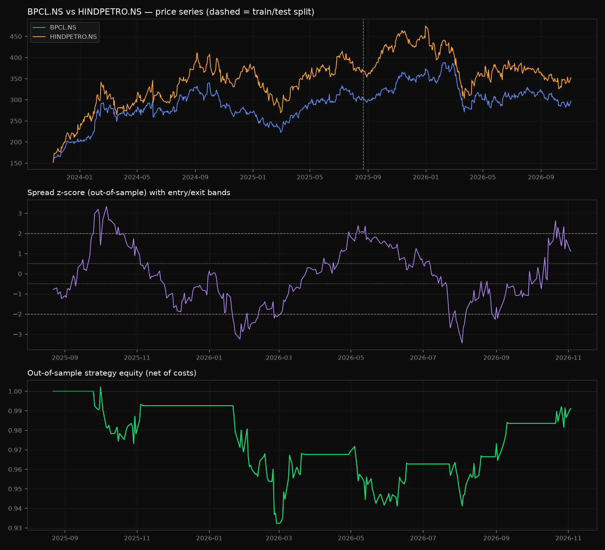

---

### ONGC.NS / COALINDIA.NS

- **Latest prices:** ONGC.NS ₹232.17 · COALINDIA.NS ₹397.75
- **Hedge ratio (train-fitted):** 1.3179
- **Cointegration (train):** PASS at 5% — ADF -3.60, p=0.0058
- **Persistence:** passed 5% in 82 of 90 real-data runs (strict tier: 1/90)
- **Spread half-life:** 12.5 days
- **Current z-score:** -0.25
- **Signal today:** flat / no stretch

**Out-of-sample backtest** (beta frozen from train window):

| Metric | Value |
|---|---|
| Sharpe | 0.83 |
| Sortino | 0.71 |
| Annualised return | 6.68% |
| Annualised vol | 8.20% |
| Max drawdown | -6.46% |
| Round-trip trades | 6 |

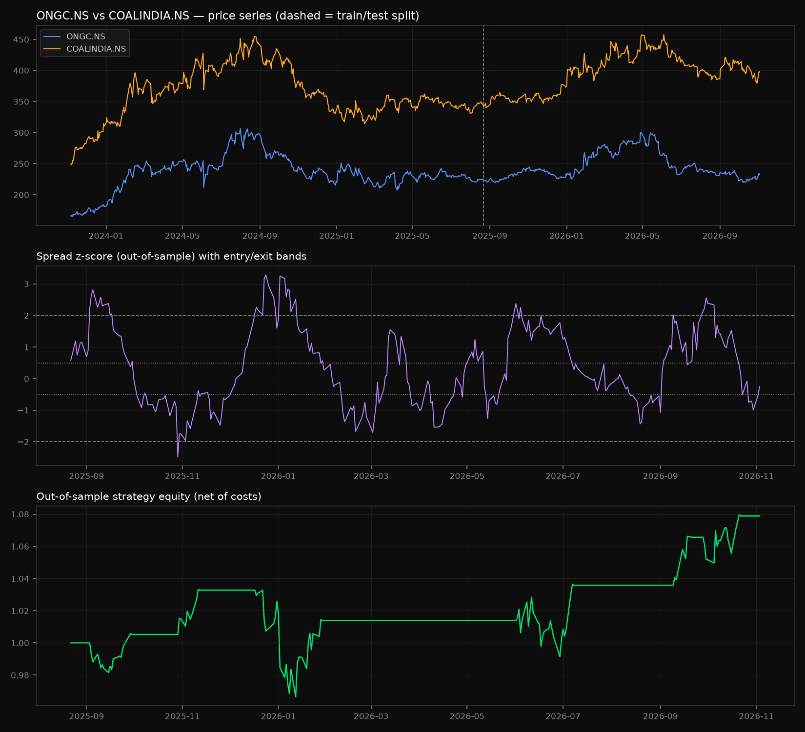

---

### NTPC.NS / POWERGRID.NS

- **Latest prices:** NTPC.NS ₹321.55 · POWERGRID.NS ₹259.55
- **Hedge ratio (train-fitted):** 0.7993
- **Cointegration (train):** FAIL at 5% — ADF -2.55, p=0.1047
- **Persistence:** passed 5% in 0 of 90 real-data runs (strict tier: 0/90)
- **Spread half-life:** 23.9 days
- **Current z-score:** -0.08
- **Signal today:** flat / no stretch
- ⚠️ _Pair did not cointegrate on training data. Any signal here is not statistically justified — observation only._

**Out-of-sample backtest** (beta frozen from train window):

| Metric | Value |
|---|---|
| Sharpe | 0.83 |
| Sortino | 0.63 |
| Annualised return | 4.61% |
| Annualised vol | 5.60% |
| Max drawdown | -5.29% |
| Round-trip trades | 6 |

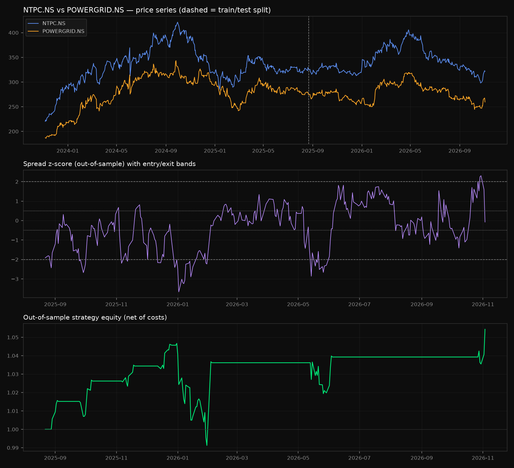

---

### BAJAJ-AUTO.NS / HEROMOTOCO.NS

- **Latest prices:** BAJAJ-AUTO.NS ₹10,540.00 · HEROMOTOCO.NS ₹5,300.00
- **Hedge ratio (train-fitted):** 0.4054
- **Cointegration (train):** FAIL at 5% — ADF -1.87, p=0.3445
- **Persistence:** passed 5% in 0 of 90 real-data runs (strict tier: 0/90)
- **Spread half-life:** 37.0 days
- **Current z-score:** +0.82
- **Signal today:** watch (approaching band)
- ⚠️ _Pair did not cointegrate on training data. Any signal here is not statistically justified — observation only._

**Out-of-sample backtest** (beta frozen from train window):

| Metric | Value |
|---|---|
| Sharpe | -0.10 |
| Sortino | -0.10 |
| Annualised return | -1.25% |
| Annualised vol | 8.94% |
| Max drawdown | -13.22% |
| Round-trip trades | 6 |

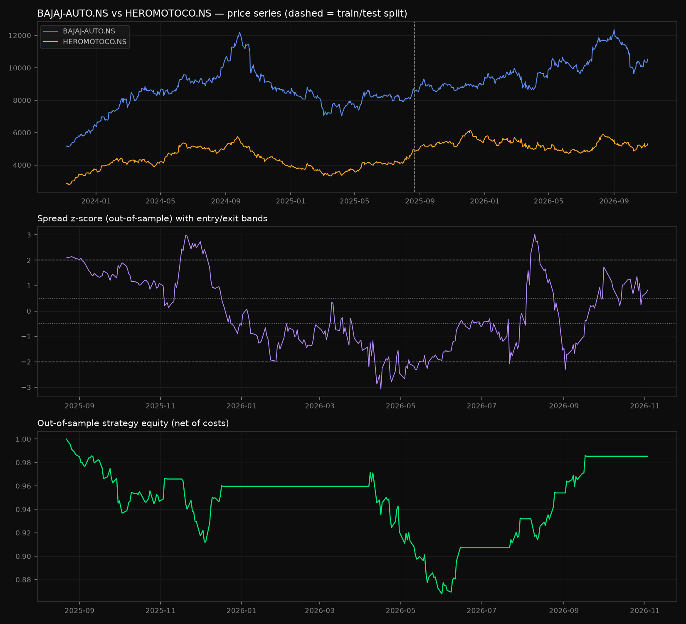

---

### TATASTEEL.NS / JSWSTEEL.NS

- **Latest prices:** TATASTEEL.NS ₹176.50 · JSWSTEEL.NS ₹1,320.00
- **Hedge ratio (train-fitted):** 2.8116
- **Cointegration (train):** FAIL at 5% — ADF -1.23, p=0.6617
- **Persistence:** passed 5% in 0 of 90 real-data runs (strict tier: 0/90)
- **Spread half-life:** 67.4 days
- **Current z-score:** +1.95
- **Signal today:** watch (approaching band)
- ⚠️ _Pair did not cointegrate on training data. Any signal here is not statistically justified — observation only._

**Out-of-sample backtest** (beta frozen from train window):

| Metric | Value |
|---|---|
| Sharpe | 0.42 |
| Sortino | 0.41 |
| Annualised return | 3.32% |
| Annualised vol | 8.71% |
| Max drawdown | -5.69% |
| Round-trip trades | 5 |

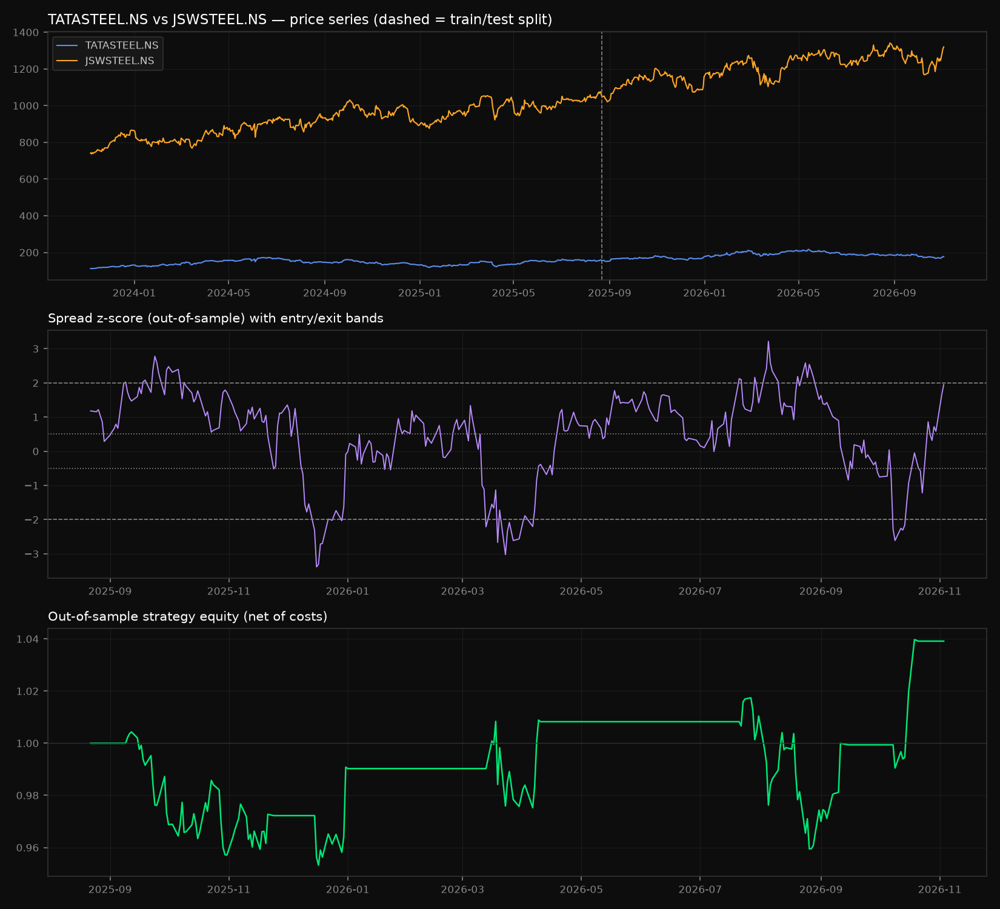

---

### SUNPHARMA.NS / CIPLA.NS

- **Latest prices:** SUNPHARMA.NS ₹1,769.90 · CIPLA.NS ₹1,396.90
- **Hedge ratio (train-fitted):** 0.4735
- **Cointegration (train):** PASS at 5% — ADF -2.95, p=0.0399
- **Persistence:** passed 5% in 90 of 90 real-data runs (strict tier: 5/90)
- **Spread half-life:** 12.2 days
- **Current z-score:** +2.12
- **Signal today:** SHORT spread (short CIPLA.NS, long SUNPHARMA.NS)

**Out-of-sample backtest** (beta frozen from train window):

| Metric | Value |
|---|---|
| Sharpe | 0.31 |
| Sortino | 0.34 |
| Annualised return | 1.96% |
| Annualised vol | 7.18% |
| Max drawdown | -9.97% |
| Round-trip trades | 5 |

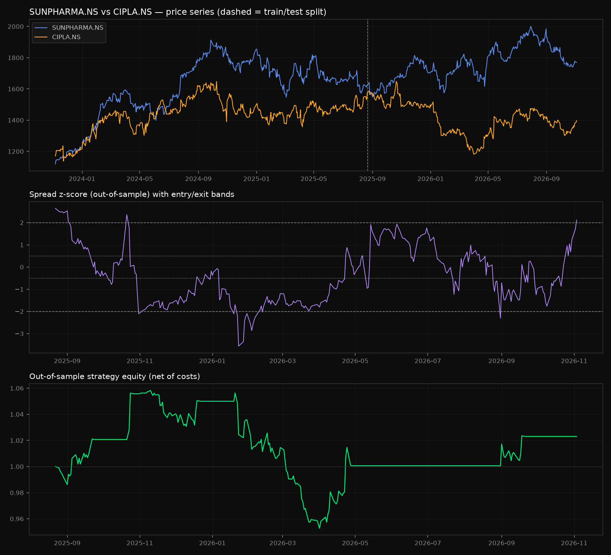

---

_Generated 2026-11-04 · pairs mean-reversion scanner · out-of-sample backtest · multiple-testing-aware · not investment advice._
