# Indian Pairs-Trading Scanner — 2026-11-05

> **What this is:** a market-neutral *pairs mean-reversion* scanner. It flags when two related NSE stocks have drifted apart far enough that their historical relationship signals a possible convergence trade. It does **not** forecast growth, rank "best" stocks, or predict company performance. A signal means the *spread between two stocks* is stretched — nothing about either stock being a good investment. Not investment advice; do your own research.

## Methodology (fixed in advance)

- **Universe:** 16 declared sector-mate pairs. Parameters (3y window, 60/40 train-test, z-entry 2.0, z-exit 0.5, 5 bps costs) are pre-registered; changes are logged in the README changelog *before* looking at results.
- **Multiple testing:** at the 5% level across 16 pairs, **≈0.8 false positives per run are expected by chance alone** even if nothing truly cointegrates. A single-day pass is a candidate, not a discovery.
- **Strict tier:** Bonferroni-corrected threshold p < 0.0031 (marked ✓✓).
- **Evidence = persistence:** the Persistence column counts how often each pair has passed the 5% test across all *real-data* daily runs recorded in `reports/history.csv`. Pairs deserve attention only when they pass persistently.

## Summary

| Pair | p-value | Coint. | Persistence | Current z | Signal | OOS Sharpe |
|---|---|---|---|---|---|---|
| HDFCBANK.NS/ICICIBANK.NS | 0.0702 | ✗ | 1/75 | +0.10 | flat / no stretch | -0.55 |
| AXISBANK.NS/ICICIBANK.NS | 0.9025 | ✗ | 0/91 | +1.18 | watch | -0.02 |
| KOTAKBANK.NS/HDFCBANK.NS | 0.1837 | ✗ | 0/91 | -1.13 | watch | 1.51 |
| SBIN.NS/BANKBARODA.NS | 0.1130 | ✗ | 0/91 | +2.35 | SHORT spread | 0.43 |
| TCS.NS/INFY.NS | 0.6388 | ✗ | 0/91 | -0.29 | flat / no stretch | 2.26 |
| INFY.NS/WIPRO.NS | 0.0903 | ✗ | 0/91 | +2.44 | SHORT spread | 2.17 |
| HCLTECH.NS/TECHM.NS | 0.1980 | ✗ | 0/91 | +1.73 | watch | -0.00 |
| ACC.NS/AMBUJACEM.NS | 0.2651 | ✗ | 0/91 | -0.09 | flat / no stretch | -0.07 |
| ULTRACEMCO.NS/SHREECEM.NS | 0.2676 | ✗ | 0/91 | +0.35 | flat / no stretch | -0.20 |
| IOC.NS/BPCL.NS | 0.6540 | ✗ | 0/91 | -1.66 | watch | -0.03 |
| BPCL.NS/HINDPETRO.NS | 0.2060 | ✗ | 0/91 | +1.56 | watch | -0.14 |
| ONGC.NS/COALINDIA.NS | 0.0058 | ✓ | 83/91 | -0.40 | flat / no stretch | 0.83 |
| NTPC.NS/POWERGRID.NS | 0.1042 | ✗ | 0/91 | +0.43 | flat / no stretch | 0.82 |
| BAJAJ-AUTO.NS/HEROMOTOCO.NS | 0.3037 | ✗ | 0/91 | +1.14 | watch | -0.06 |
| TATASTEEL.NS/JSWSTEEL.NS | 0.6305 | ✗ | 0/91 | +2.21 | SHORT spread | 0.42 |
| SUNPHARMA.NS/CIPLA.NS | 0.0437 | ✓ | 91/91 | +2.19 | SHORT spread | 0.29 |

_Legend: ✓✓ passes strict Bonferroni tier · ✓ passes 5% only · ✗ fails. Persistence = 5%-passes / real-data runs recorded. \*no real-data history yet._

---

### HDFCBANK.NS / ICICIBANK.NS

- **Latest prices:** HDFCBANK.NS ₹736.70 · ICICIBANK.NS ₹1,424.10
- **Hedge ratio (train-fitted):** 1.5441
- **Cointegration (train):** FAIL at 5% — ADF -2.72, p=0.0702
- **Persistence:** passed 5% in 1 of 75 real-data runs (strict tier: 0/75)
- **Spread half-life:** 23.5 days
- **Current z-score:** +0.10
- **Signal today:** flat / no stretch
- ⚠️ _Pair did not cointegrate on training data. Any signal here is not statistically justified — observation only._

**Out-of-sample backtest** (beta frozen from train window):

| Metric | Value |
|---|---|
| Sharpe | -0.55 |
| Sortino | -0.59 |
| Annualised return | -3.77% |
| Annualised vol | 6.54% |
| Max drawdown | -7.94% |
| Round-trip trades | 4 |

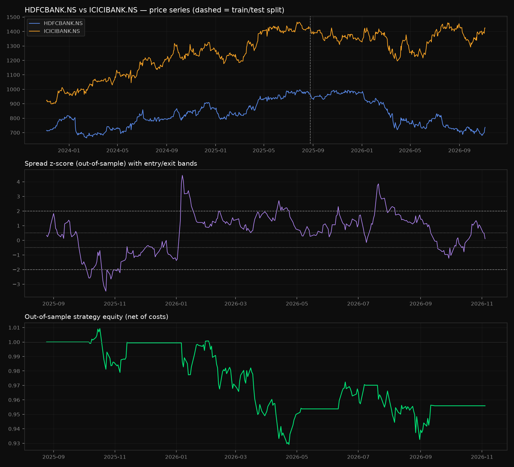

---

### AXISBANK.NS / ICICIBANK.NS

- **Latest prices:** AXISBANK.NS ₹1,232.00 · ICICIBANK.NS ₹1,424.10
- **Hedge ratio (train-fitted):** 0.6718
- **Cointegration (train):** FAIL at 5% — ADF -0.44, p=0.9025
- **Persistence:** passed 5% in 0 of 91 real-data runs (strict tier: 0/91)
- **Spread half-life:** 346.9 days
- **Current z-score:** +1.18
- **Signal today:** watch (approaching band)
- ⚠️ _Pair did not cointegrate on training data. Any signal here is not statistically justified — observation only._

**Out-of-sample backtest** (beta frozen from train window):

| Metric | Value |
|---|---|
| Sharpe | -0.02 |
| Sortino | -0.02 |
| Annualised return | -0.55% |
| Annualised vol | 8.88% |
| Max drawdown | -10.11% |
| Round-trip trades | 5 |

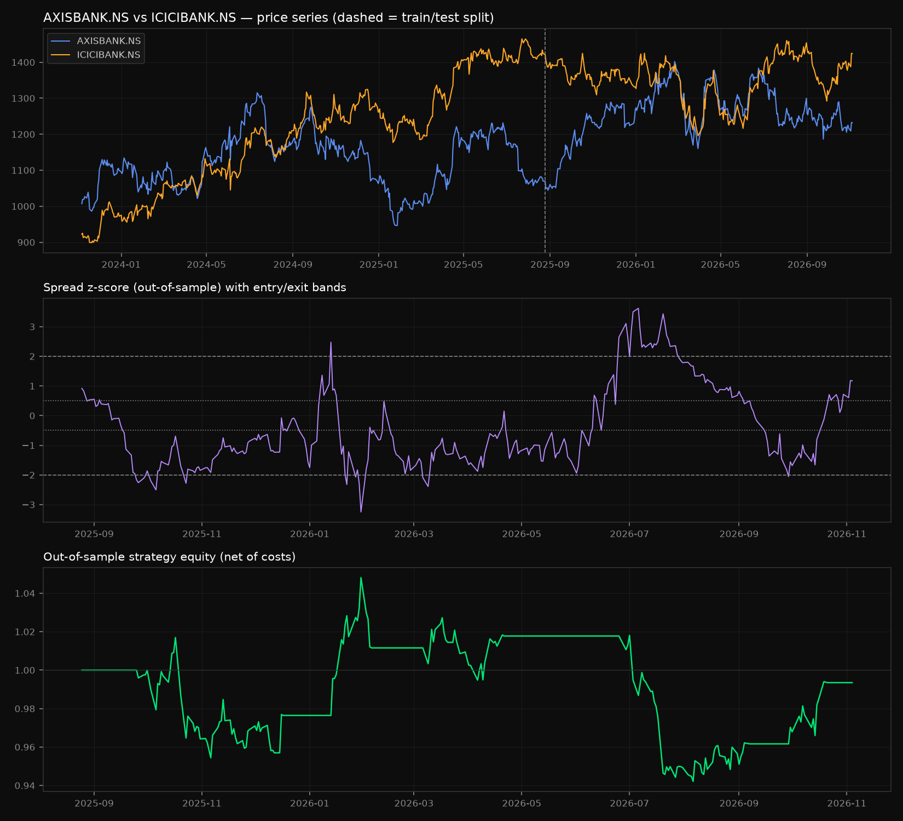

---

### KOTAKBANK.NS / HDFCBANK.NS

- **Latest prices:** KOTAKBANK.NS ₹459.40 · HDFCBANK.NS ₹736.70
- **Hedge ratio (train-fitted):** 2.2340
- **Cointegration (train):** FAIL at 5% — ADF -2.26, p=0.1837
- **Persistence:** passed 5% in 0 of 91 real-data runs (strict tier: 0/91)
- **Spread half-life:** 27.5 days
- **Current z-score:** -1.13
- **Signal today:** watch (approaching band)
- ⚠️ _Pair did not cointegrate on training data. Any signal here is not statistically justified — observation only._

**Out-of-sample backtest** (beta frozen from train window):

| Metric | Value |
|---|---|
| Sharpe | 1.51 |
| Sortino | 1.51 |
| Annualised return | 9.21% |
| Annualised vol | 5.95% |
| Max drawdown | -2.82% |
| Round-trip trades | 5 |

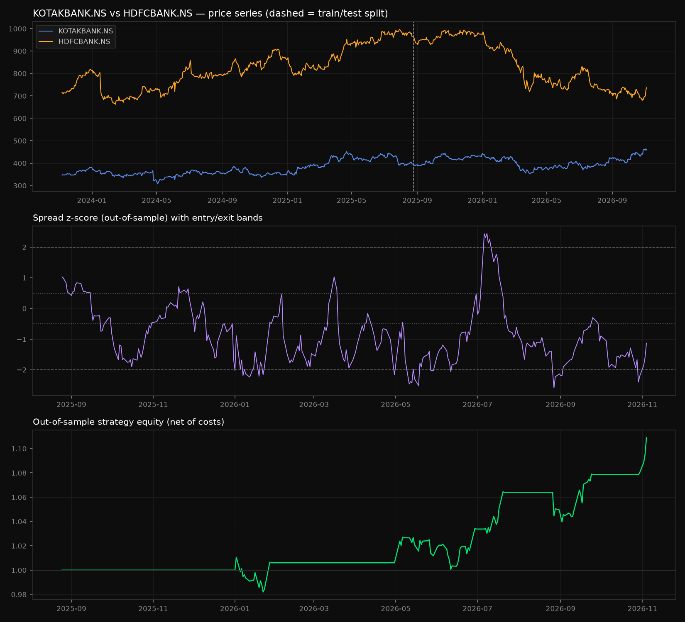

---

### SBIN.NS / BANKBARODA.NS

- **Latest prices:** SBIN.NS ₹979.00 · BANKBARODA.NS ₹245.37
- **Hedge ratio (train-fitted):** 0.1842
- **Cointegration (train):** FAIL at 5% — ADF -2.51, p=0.1130
- **Persistence:** passed 5% in 0 of 91 real-data runs (strict tier: 0/91)
- **Spread half-life:** 20.7 days
- **Current z-score:** +2.35
- **Signal today:** SHORT spread (short BANKBARODA.NS, long SBIN.NS)
- ⚠️ _Pair did not cointegrate on training data. Any signal here is not statistically justified — observation only._

**Out-of-sample backtest** (beta frozen from train window):

| Metric | Value |
|---|---|
| Sharpe | 0.43 |
| Sortino | 0.40 |
| Annualised return | 3.81% |
| Annualised vol | 9.80% |
| Max drawdown | -8.67% |
| Round-trip trades | 7 |

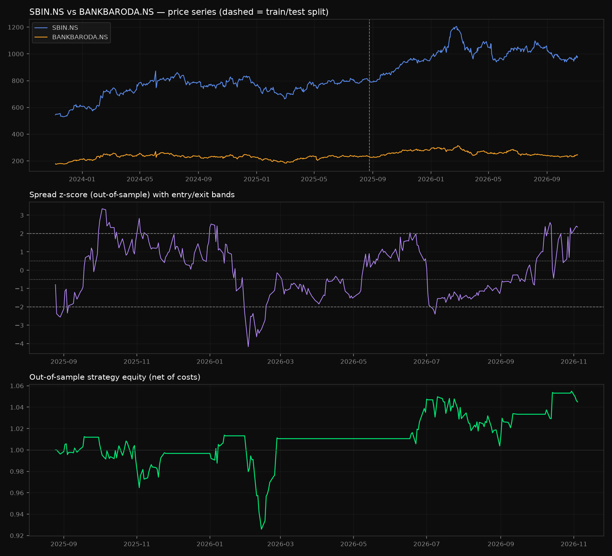

---

### TCS.NS / INFY.NS

- **Latest prices:** TCS.NS ₹2,436.00 · INFY.NS ₹1,128.20
- **Hedge ratio (train-fitted):** 0.3897
- **Cointegration (train):** FAIL at 5% — ADF -1.28, p=0.6388
- **Persistence:** passed 5% in 0 of 91 real-data runs (strict tier: 0/91)
- **Spread half-life:** 73.6 days
- **Current z-score:** -0.29
- **Signal today:** flat / no stretch
- ⚠️ _Pair did not cointegrate on training data. Any signal here is not statistically justified — observation only._

**Out-of-sample backtest** (beta frozen from train window):

| Metric | Value |
|---|---|
| Sharpe | 2.26 |
| Sortino | 2.61 |
| Annualised return | 11.30% |
| Annualised vol | 4.79% |
| Max drawdown | -2.05% |
| Round-trip trades | 8 |

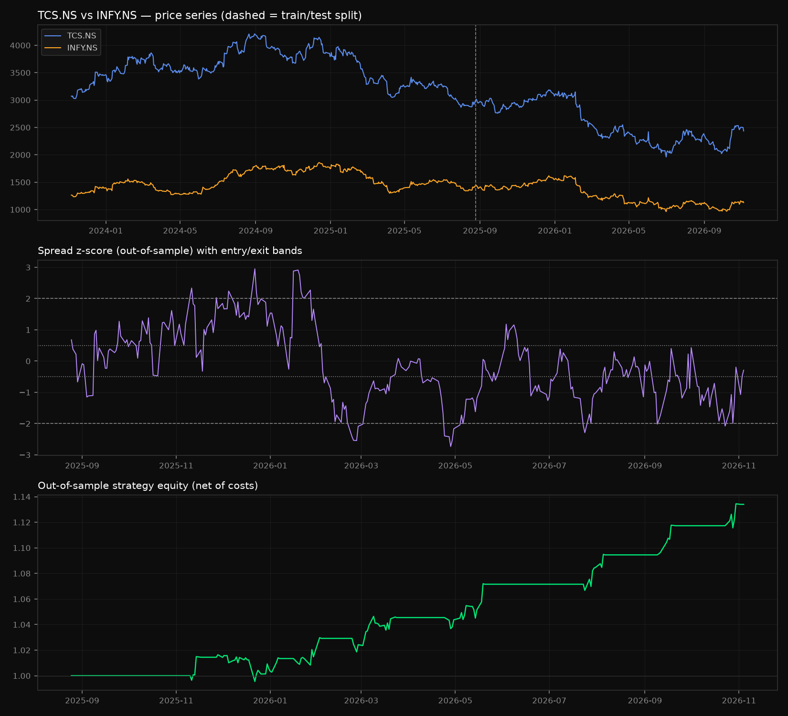

---

### INFY.NS / WIPRO.NS

- **Latest prices:** INFY.NS ₹1,128.20 · WIPRO.NS ₹194.55
- **Hedge ratio (train-fitted):** 0.1215
- **Cointegration (train):** FAIL at 5% — ADF -2.61, p=0.0903
- **Persistence:** passed 5% in 0 of 91 real-data runs (strict tier: 0/91)
- **Spread half-life:** 25.9 days
- **Current z-score:** +2.44
- **Signal today:** SHORT spread (short WIPRO.NS, long INFY.NS)
- ⚠️ _Pair did not cointegrate on training data. Any signal here is not statistically justified — observation only._

**Out-of-sample backtest** (beta frozen from train window):

| Metric | Value |
|---|---|
| Sharpe | 2.17 |
| Sortino | 2.50 |
| Annualised return | 12.16% |
| Annualised vol | 5.35% |
| Max drawdown | -3.16% |
| Round-trip trades | 7 |

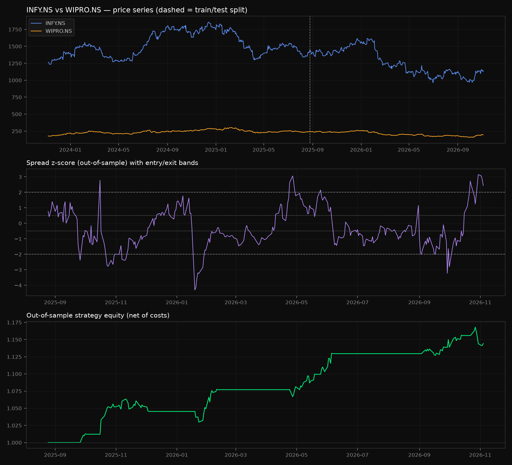

---

### HCLTECH.NS / TECHM.NS

- **Latest prices:** HCLTECH.NS ₹1,405.00 · TECHM.NS ₹1,783.00
- **Hedge ratio (train-fitted):** 0.9428
- **Cointegration (train):** FAIL at 5% — ADF -2.22, p=0.1980
- **Persistence:** passed 5% in 0 of 91 real-data runs (strict tier: 0/91)
- **Spread half-life:** 27.4 days
- **Current z-score:** +1.73
- **Signal today:** watch (approaching band)
- ⚠️ _Pair did not cointegrate on training data. Any signal here is not statistically justified — observation only._

**Out-of-sample backtest** (beta frozen from train window):

| Metric | Value |
|---|---|
| Sharpe | -0.00 |
| Sortino | -0.00 |
| Annualised return | -0.31% |
| Annualised vol | 7.46% |
| Max drawdown | -8.17% |
| Round-trip trades | 5 |

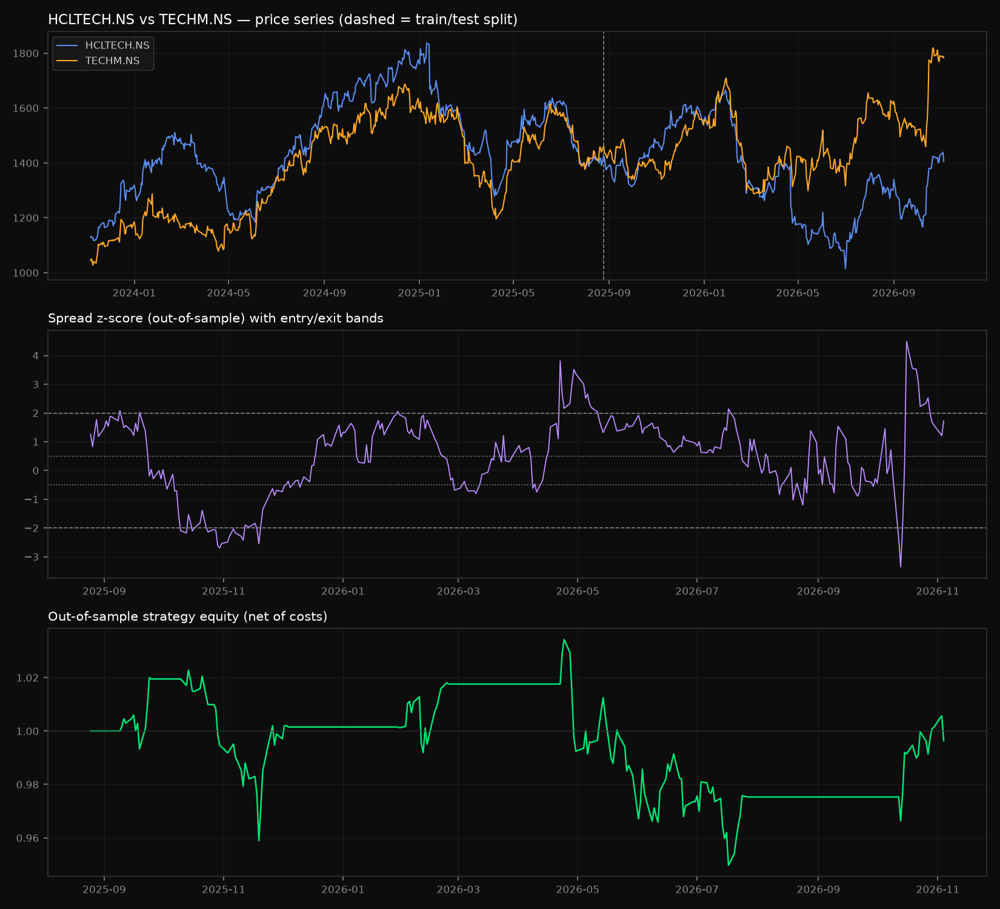

---

### ACC.NS / AMBUJACEM.NS

- **Latest prices:** ACC.NS ₹1,185.30 · AMBUJACEM.NS ₹375.95
- **Hedge ratio (train-fitted):** 0.1469
- **Cointegration (train):** FAIL at 5% — ADF -2.05, p=0.2651
- **Persistence:** passed 5% in 0 of 91 real-data runs (strict tier: 0/91)
- **Spread half-life:** 38.4 days
- **Current z-score:** -0.09
- **Signal today:** flat / no stretch
- ⚠️ _Pair did not cointegrate on training data. Any signal here is not statistically justified — observation only._

**Out-of-sample backtest** (beta frozen from train window):

| Metric | Value |
|---|---|
| Sharpe | -0.07 |
| Sortino | -0.06 |
| Annualised return | -0.76% |
| Annualised vol | 7.00% |
| Max drawdown | -7.29% |
| Round-trip trades | 4 |

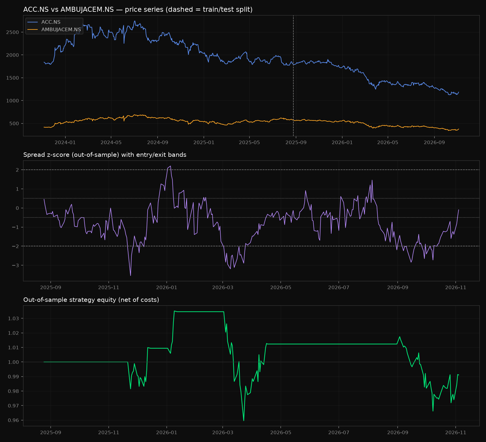

---

### ULTRACEMCO.NS / SHREECEM.NS

- **Latest prices:** ULTRACEMCO.NS ₹11,816.00 · SHREECEM.NS ₹24,175.00
- **Hedge ratio (train-fitted):** 1.1511
- **Cointegration (train):** FAIL at 5% — ADF -2.04, p=0.2676
- **Persistence:** passed 5% in 0 of 91 real-data runs (strict tier: 0/91)
- **Spread half-life:** 38.3 days
- **Current z-score:** +0.35
- **Signal today:** flat / no stretch
- ⚠️ _Pair did not cointegrate on training data. Any signal here is not statistically justified — observation only._

**Out-of-sample backtest** (beta frozen from train window):

| Metric | Value |
|---|---|
| Sharpe | -0.20 |
| Sortino | -0.25 |
| Annualised return | -1.74% |
| Annualised vol | 7.34% |
| Max drawdown | -6.00% |
| Round-trip trades | 6 |

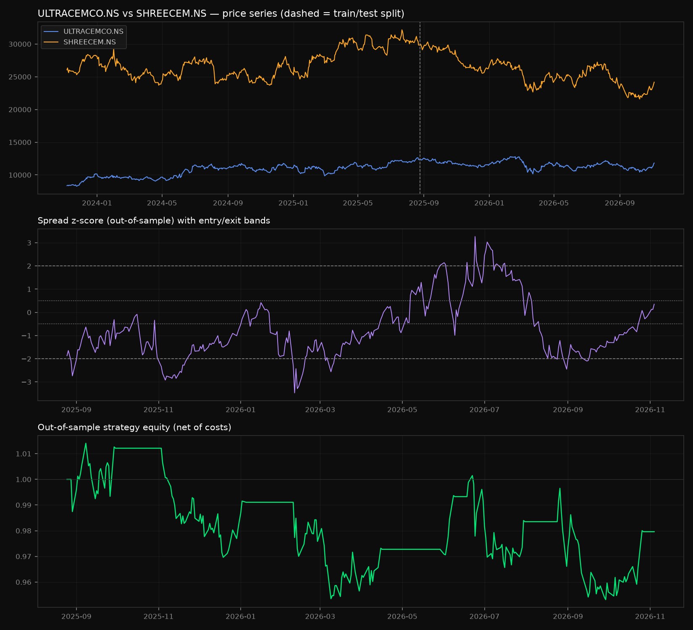

---

### IOC.NS / BPCL.NS

- **Latest prices:** IOC.NS ₹142.03 · BPCL.NS ₹304.70
- **Hedge ratio (train-fitted):** 1.5451
- **Cointegration (train):** FAIL at 5% — ADF -1.24, p=0.6540
- **Persistence:** passed 5% in 0 of 91 real-data runs (strict tier: 0/91)
- **Spread half-life:** 99.5 days
- **Current z-score:** -1.66
- **Signal today:** watch (approaching band)
- ⚠️ _Pair did not cointegrate on training data. Any signal here is not statistically justified — observation only._

**Out-of-sample backtest** (beta frozen from train window):

| Metric | Value |
|---|---|
| Sharpe | -0.03 |
| Sortino | -0.03 |
| Annualised return | -0.48% |
| Annualised vol | 7.17% |
| Max drawdown | -7.37% |
| Round-trip trades | 5 |

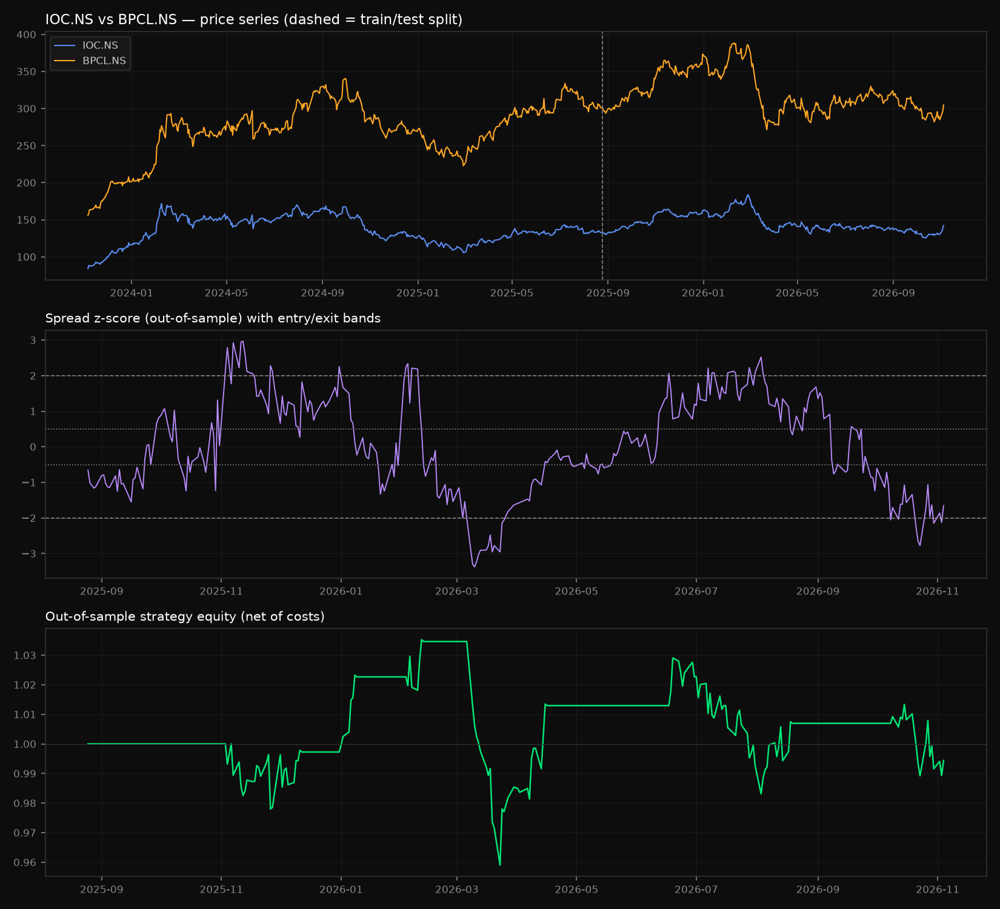

---

### BPCL.NS / HINDPETRO.NS

- **Latest prices:** BPCL.NS ₹304.70 · HINDPETRO.NS ₹366.35
- **Hedge ratio (train-fitted):** 1.2941
- **Cointegration (train):** FAIL at 5% — ADF -2.20, p=0.2060
- **Persistence:** passed 5% in 0 of 91 real-data runs (strict tier: 0/91)
- **Spread half-life:** 34.1 days
- **Current z-score:** +1.56
- **Signal today:** watch (approaching band)
- ⚠️ _Pair did not cointegrate on training data. Any signal here is not statistically justified — observation only._

**Out-of-sample backtest** (beta frozen from train window):

| Metric | Value |
|---|---|
| Sharpe | -0.14 |
| Sortino | -0.15 |
| Annualised return | -1.17% |
| Annualised vol | 6.64% |
| Max drawdown | -6.99% |
| Round-trip trades | 5 |

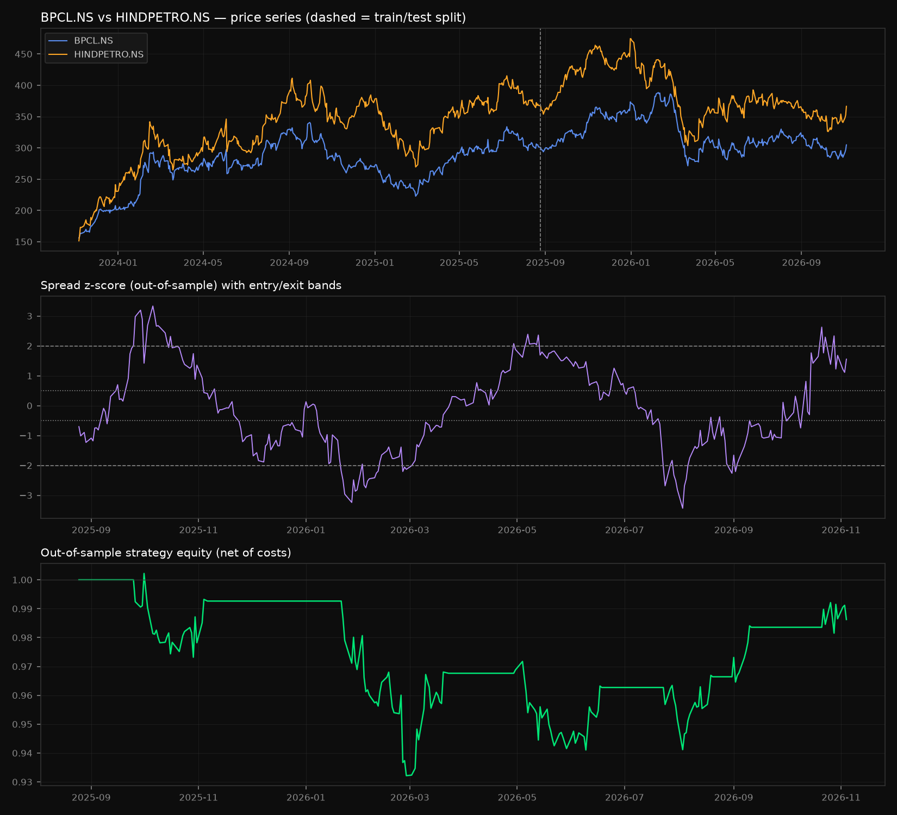

---

### ONGC.NS / COALINDIA.NS

- **Latest prices:** ONGC.NS ₹235.00 · COALINDIA.NS ₹399.65
- **Hedge ratio (train-fitted):** 1.3180
- **Cointegration (train):** PASS at 5% — ADF -3.60, p=0.0058
- **Persistence:** passed 5% in 83 of 91 real-data runs (strict tier: 1/91)
- **Spread half-life:** 12.5 days
- **Current z-score:** -0.40
- **Signal today:** flat / no stretch

**Out-of-sample backtest** (beta frozen from train window):

| Metric | Value |
|---|---|
| Sharpe | 0.83 |
| Sortino | 0.71 |
| Annualised return | 6.62% |
| Annualised vol | 8.12% |
| Max drawdown | -6.40% |
| Round-trip trades | 6 |

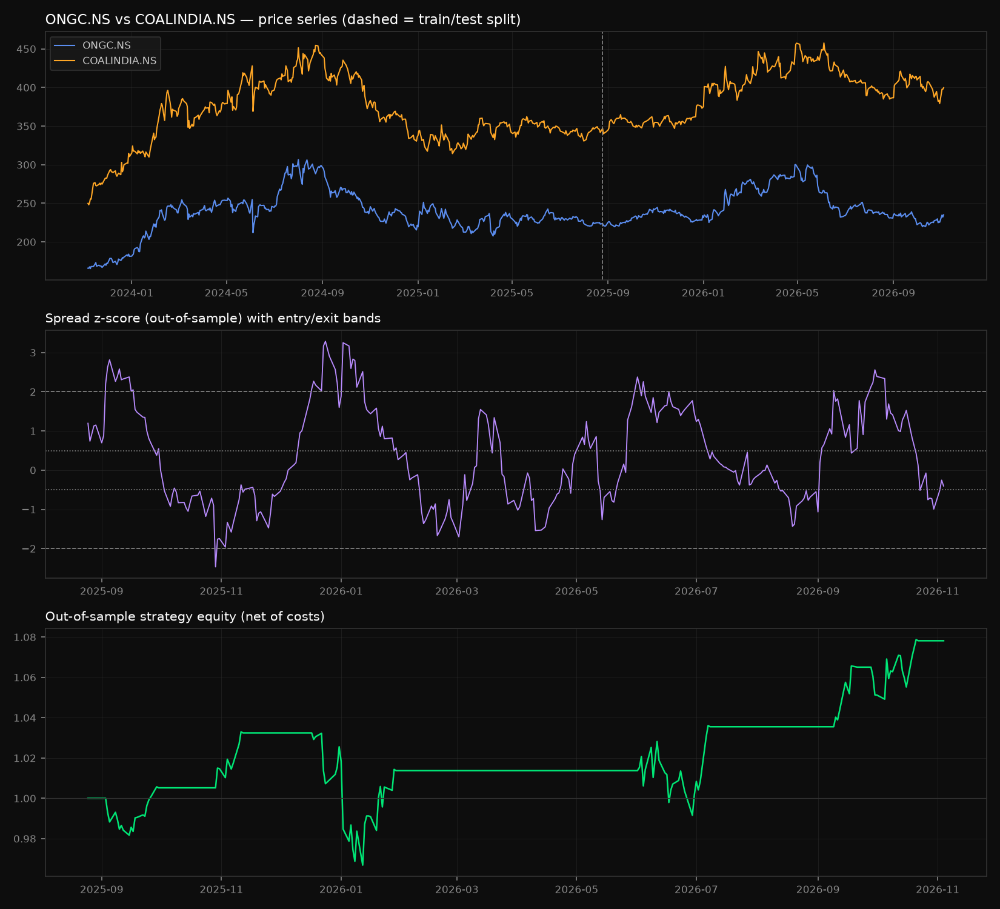

---

### NTPC.NS / POWERGRID.NS

- **Latest prices:** NTPC.NS ₹321.95 · POWERGRID.NS ₹262.05
- **Hedge ratio (train-fitted):** 0.7993
- **Cointegration (train):** FAIL at 5% — ADF -2.55, p=0.1042
- **Persistence:** passed 5% in 0 of 91 real-data runs (strict tier: 0/91)
- **Spread half-life:** 23.9 days
- **Current z-score:** +0.43
- **Signal today:** flat / no stretch
- ⚠️ _Pair did not cointegrate on training data. Any signal here is not statistically justified — observation only._

**Out-of-sample backtest** (beta frozen from train window):

| Metric | Value |
|---|---|
| Sharpe | 0.82 |
| Sortino | 0.63 |
| Annualised return | 4.55% |
| Annualised vol | 5.59% |
| Max drawdown | -5.28% |
| Round-trip trades | 7 |

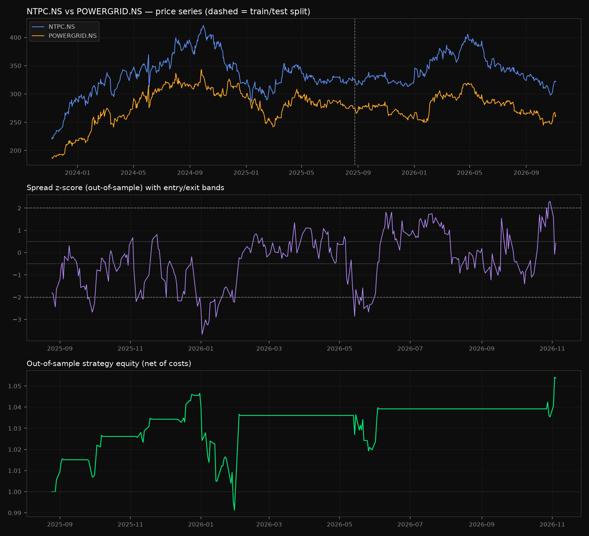

---

### BAJAJ-AUTO.NS / HEROMOTOCO.NS

- **Latest prices:** BAJAJ-AUTO.NS ₹10,608.00 · HEROMOTOCO.NS ₹5,399.50
- **Hedge ratio (train-fitted):** 0.4055
- **Cointegration (train):** FAIL at 5% — ADF -1.96, p=0.3037
- **Persistence:** passed 5% in 0 of 91 real-data runs (strict tier: 0/91)
- **Spread half-life:** 34.7 days
- **Current z-score:** +1.14
- **Signal today:** watch (approaching band)
- ⚠️ _Pair did not cointegrate on training data. Any signal here is not statistically justified — observation only._

**Out-of-sample backtest** (beta frozen from train window):

| Metric | Value |
|---|---|
| Sharpe | -0.06 |
| Sortino | -0.06 |
| Annualised return | -0.88% |
| Annualised vol | 8.83% |
| Max drawdown | -12.71% |
| Round-trip trades | 6 |

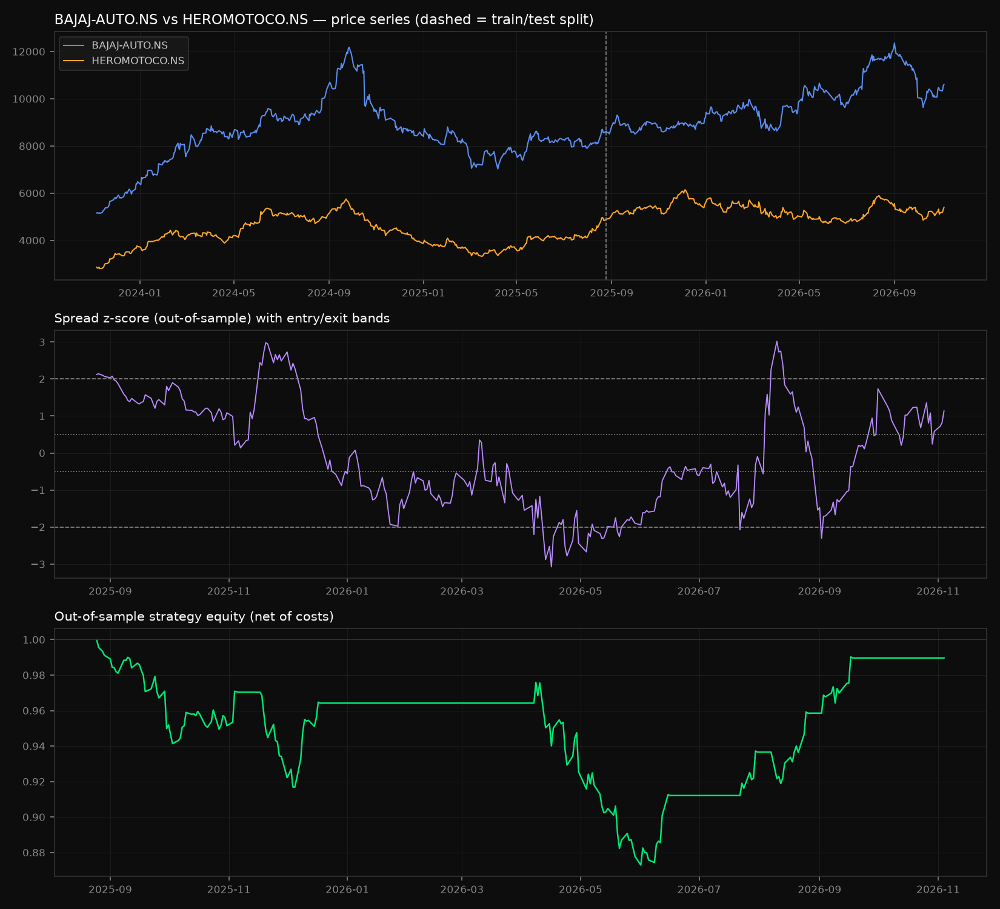

---

### TATASTEEL.NS / JSWSTEEL.NS

- **Latest prices:** TATASTEEL.NS ₹179.93 · JSWSTEEL.NS ₹1,343.00
- **Hedge ratio (train-fitted):** 2.8250
- **Cointegration (train):** FAIL at 5% — ADF -1.30, p=0.6305
- **Persistence:** passed 5% in 0 of 91 real-data runs (strict tier: 0/91)
- **Spread half-life:** 65.3 days
- **Current z-score:** +2.21
- **Signal today:** SHORT spread (short JSWSTEEL.NS, long TATASTEEL.NS)
- ⚠️ _Pair did not cointegrate on training data. Any signal here is not statistically justified — observation only._

**Out-of-sample backtest** (beta frozen from train window):

| Metric | Value |
|---|---|
| Sharpe | 0.42 |
| Sortino | 0.41 |
| Annualised return | 3.28% |
| Annualised vol | 8.66% |
| Max drawdown | -5.66% |
| Round-trip trades | 5 |

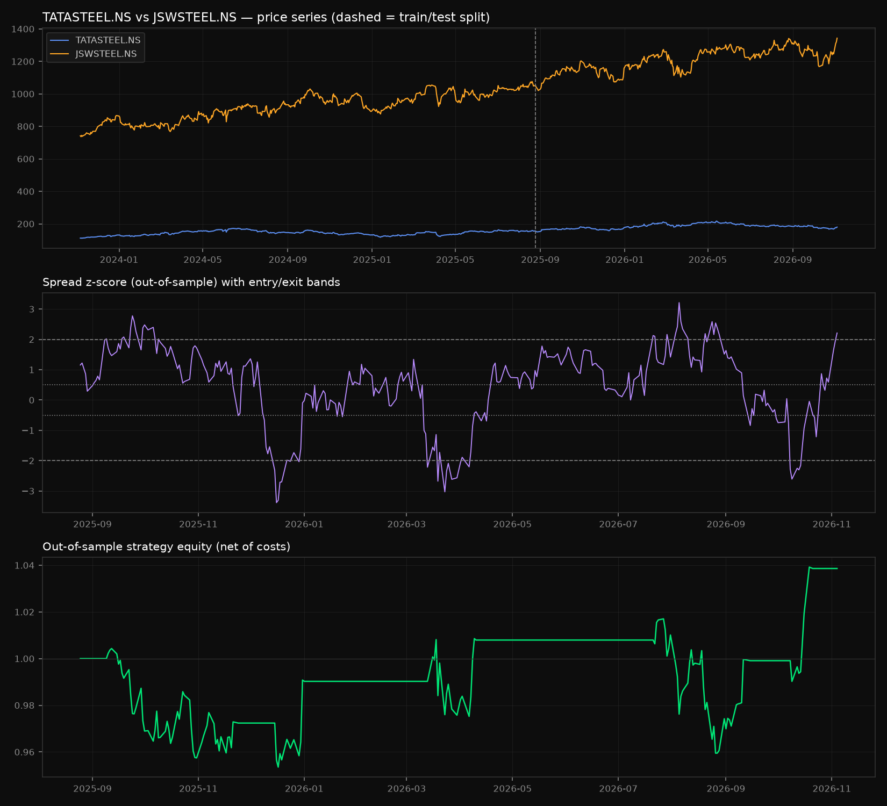

---

### SUNPHARMA.NS / CIPLA.NS

- **Latest prices:** SUNPHARMA.NS ₹1,773.40 · CIPLA.NS ₹1,402.00
- **Hedge ratio (train-fitted):** 0.4737
- **Cointegration (train):** PASS at 5% — ADF -2.91, p=0.0437
- **Persistence:** passed 5% in 91 of 91 real-data runs (strict tier: 5/91)
- **Spread half-life:** 12.3 days
- **Current z-score:** +2.19
- **Signal today:** SHORT spread (short CIPLA.NS, long SUNPHARMA.NS)

**Out-of-sample backtest** (beta frozen from train window):

| Metric | Value |
|---|---|
| Sharpe | 0.29 |
| Sortino | 0.32 |
| Annualised return | 1.83% |
| Annualised vol | 7.13% |
| Max drawdown | -9.90% |
| Round-trip trades | 5 |

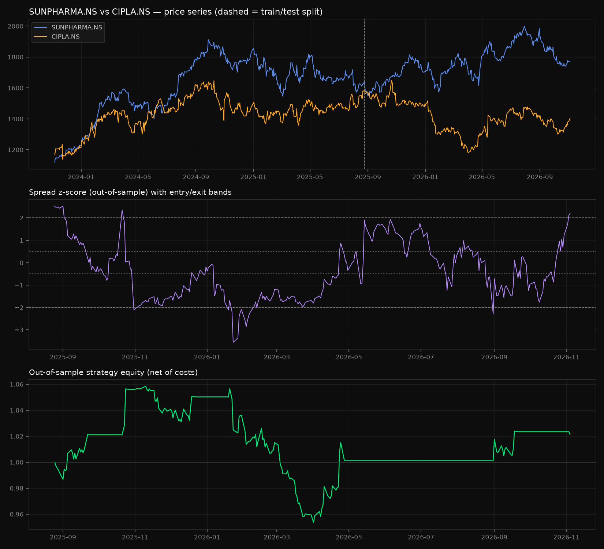

---

_Generated 2026-11-05 · pairs mean-reversion scanner · out-of-sample backtest · multiple-testing-aware · not investment advice._
