# Indian Pairs-Trading Scanner — 2026-11-10

> **What this is:** a market-neutral *pairs mean-reversion* scanner. It flags when two related NSE stocks have drifted apart far enough that their historical relationship signals a possible convergence trade. It does **not** forecast growth, rank "best" stocks, or predict company performance. A signal means the *spread between two stocks* is stretched — nothing about either stock being a good investment. Not investment advice; do your own research.

## Methodology (fixed in advance)

- **Universe:** 16 declared sector-mate pairs. Parameters (3y window, 60/40 train-test, z-entry 2.0, z-exit 0.5, 5 bps costs) are pre-registered; changes are logged in the README changelog *before* looking at results.
- **Multiple testing:** at the 5% level across 16 pairs, **≈0.8 false positives per run are expected by chance alone** even if nothing truly cointegrates. A single-day pass is a candidate, not a discovery.
- **Strict tier:** Bonferroni-corrected threshold p < 0.0031 (marked ✓✓).
- **Evidence = persistence:** the Persistence column counts how often each pair has passed the 5% test across all *real-data* daily runs recorded in `reports/history.csv`. Pairs deserve attention only when they pass persistently.

## Summary

| Pair | p-value | Coint. | Persistence | Current z | Signal | OOS Sharpe |
|---|---|---|---|---|---|---|
| HDFCBANK.NS/ICICIBANK.NS | 0.0648 | ✗ | 1/78 | +1.51 | watch | -0.55 |
| AXISBANK.NS/ICICIBANK.NS | 0.8377 | ✗ | 0/94 | +3.35 | SHORT spread | -0.30 |
| KOTAKBANK.NS/HDFCBANK.NS | 0.1669 | ✗ | 0/94 | -0.74 | watch | 1.63 |
| SBIN.NS/BANKBARODA.NS | 0.1227 | ✗ | 0/94 | +2.62 | SHORT spread | 0.38 |
| TCS.NS/INFY.NS | 0.6347 | ✗ | 0/94 | +0.25 | flat / no stretch | 1.83 |
| INFY.NS/WIPRO.NS | 0.0869 | ✗ | 0/94 | +2.30 | SHORT spread | 2.06 |
| HCLTECH.NS/TECHM.NS | 0.2081 | ✗ | 0/94 | +1.87 | watch | -0.08 |
| ACC.NS/AMBUJACEM.NS | 0.1863 | ✗ | 0/94 | +0.40 | flat / no stretch | -0.09 |
| ULTRACEMCO.NS/SHREECEM.NS | 0.2771 | ✗ | 0/94 | +0.82 | watch | -0.12 |
| IOC.NS/BPCL.NS | 0.6148 | ✗ | 0/94 | -0.94 | watch | 0.54 |
| BPCL.NS/HINDPETRO.NS | 0.2454 | ✗ | 0/94 | +1.99 | watch | -0.14 |
| ONGC.NS/COALINDIA.NS | 0.0066 | ✓ | 86/94 | -0.15 | flat / no stretch | 0.88 |
| NTPC.NS/POWERGRID.NS | 0.1048 | ✗ | 0/94 | -1.74 | watch | 0.71 |
| BAJAJ-AUTO.NS/HEROMOTOCO.NS | 0.3643 | ✗ | 0/94 | +0.51 | watch | 0.03 |
| TATASTEEL.NS/JSWSTEEL.NS | 0.6068 | ✗ | 0/94 | +1.65 | watch | 0.47 |
| SUNPHARMA.NS/CIPLA.NS | 0.0665 | ✗ | 92/94 | -0.25 | flat / no stretch | 0.67 |

_Legend: ✓✓ passes strict Bonferroni tier · ✓ passes 5% only · ✗ fails. Persistence = 5%-passes / real-data runs recorded. \*no real-data history yet._

---

### HDFCBANK.NS / ICICIBANK.NS

- **Latest prices:** HDFCBANK.NS ₹798.15 · ICICIBANK.NS ₹1,589.00
- **Hedge ratio (train-fitted):** 1.5333
- **Cointegration (train):** FAIL at 5% — ADF -2.76, p=0.0648
- **Persistence:** passed 5% in 1 of 78 real-data runs (strict tier: 0/78)
- **Spread half-life:** 23.1 days
- **Current z-score:** +1.51
- **Signal today:** watch (approaching band)
- ⚠️ _Pair did not cointegrate on training data. Any signal here is not statistically justified — observation only._

**Out-of-sample backtest** (beta frozen from train window):

| Metric | Value |
|---|---|
| Sharpe | -0.55 |
| Sortino | -0.58 |
| Annualised return | -3.84% |
| Annualised vol | 6.73% |
| Max drawdown | -8.13% |
| Round-trip trades | 4 |

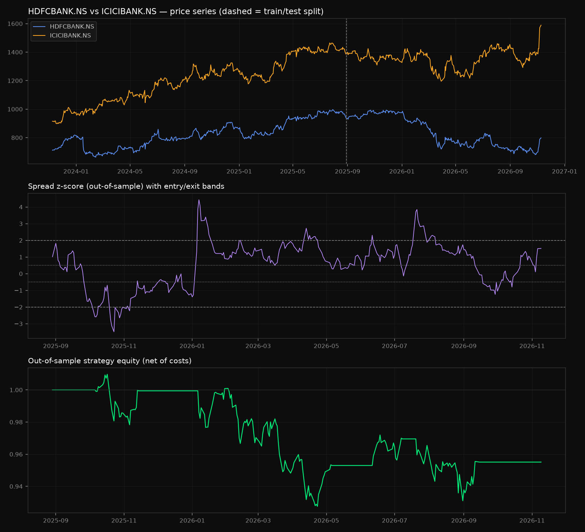

---

### AXISBANK.NS / ICICIBANK.NS

- **Latest prices:** AXISBANK.NS ₹1,310.70 · ICICIBANK.NS ₹1,589.00
- **Hedge ratio (train-fitted):** 0.6257
- **Cointegration (train):** FAIL at 5% — ADF -0.73, p=0.8377
- **Persistence:** passed 5% in 0 of 94 real-data runs (strict tier: 0/94)
- **Spread half-life:** 210.4 days
- **Current z-score:** +3.35
- **Signal today:** SHORT spread (short ICICIBANK.NS, long AXISBANK.NS)
- ⚠️ _Pair did not cointegrate on training data. Any signal here is not statistically justified — observation only._

**Out-of-sample backtest** (beta frozen from train window):

| Metric | Value |
|---|---|
| Sharpe | -0.30 |
| Sortino | -0.32 |
| Annualised return | -3.24% |
| Annualised vol | 9.41% |
| Max drawdown | -10.19% |
| Round-trip trades | 5 |

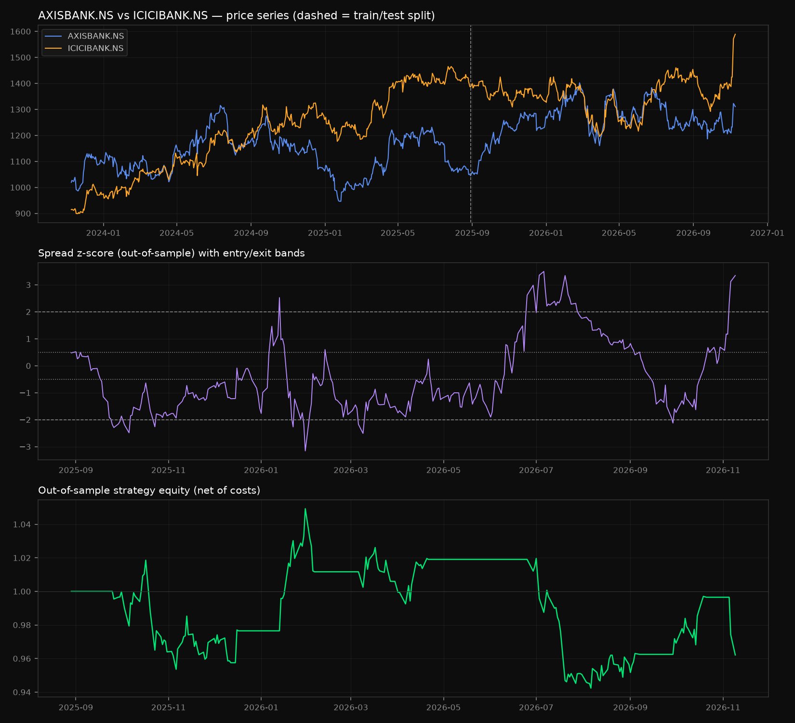

---

### KOTAKBANK.NS / HDFCBANK.NS

- **Latest prices:** KOTAKBANK.NS ₹479.50 · HDFCBANK.NS ₹798.15
- **Hedge ratio (train-fitted):** 2.2368
- **Cointegration (train):** FAIL at 5% — ADF -2.32, p=0.1669
- **Persistence:** passed 5% in 0 of 94 real-data runs (strict tier: 0/94)
- **Spread half-life:** 27.1 days
- **Current z-score:** -0.74
- **Signal today:** watch (approaching band)
- ⚠️ _Pair did not cointegrate on training data. Any signal here is not statistically justified — observation only._

**Out-of-sample backtest** (beta frozen from train window):

| Metric | Value |
|---|---|
| Sharpe | 1.63 |
| Sortino | 1.64 |
| Annualised return | 10.26% |
| Annualised vol | 6.12% |
| Max drawdown | -2.88% |
| Round-trip trades | 5 |

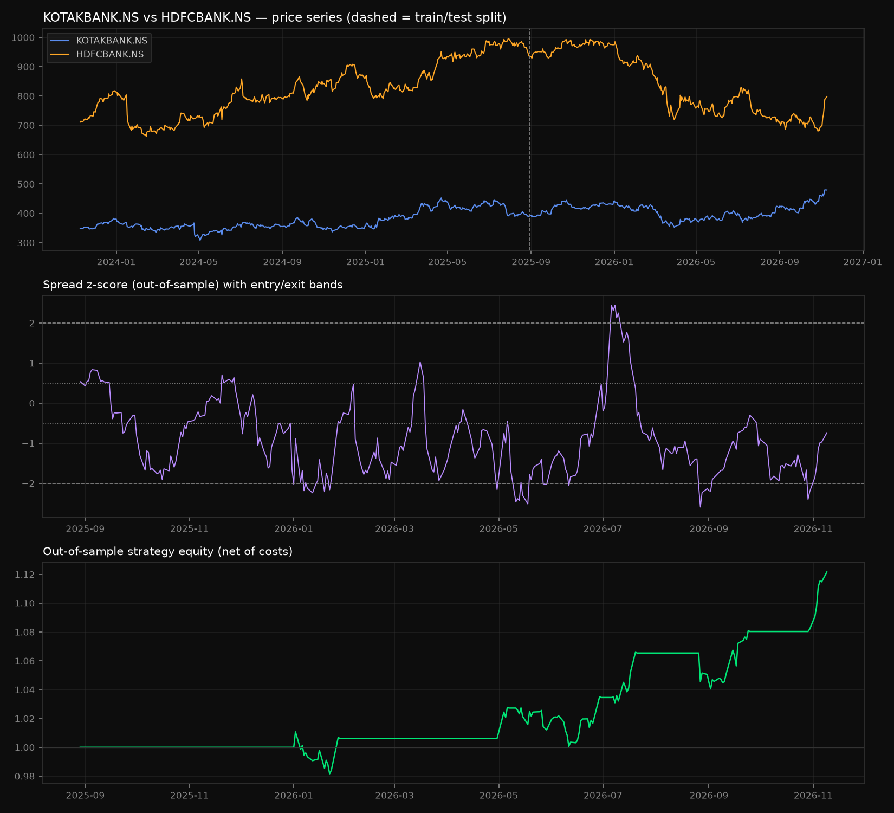

---

### SBIN.NS / BANKBARODA.NS

- **Latest prices:** SBIN.NS ₹1,042.00 · BANKBARODA.NS ₹260.01
- **Hedge ratio (train-fitted):** 0.1804
- **Cointegration (train):** FAIL at 5% — ADF -2.47, p=0.1227
- **Persistence:** passed 5% in 0 of 94 real-data runs (strict tier: 0/94)
- **Spread half-life:** 20.1 days
- **Current z-score:** +2.62
- **Signal today:** SHORT spread (short BANKBARODA.NS, long SBIN.NS)
- ⚠️ _Pair did not cointegrate on training data. Any signal here is not statistically justified — observation only._

**Out-of-sample backtest** (beta frozen from train window):

| Metric | Value |
|---|---|
| Sharpe | 0.38 |
| Sortino | 0.35 |
| Annualised return | 3.42% |
| Annualised vol | 10.24% |
| Max drawdown | -8.87% |
| Round-trip trades | 7 |

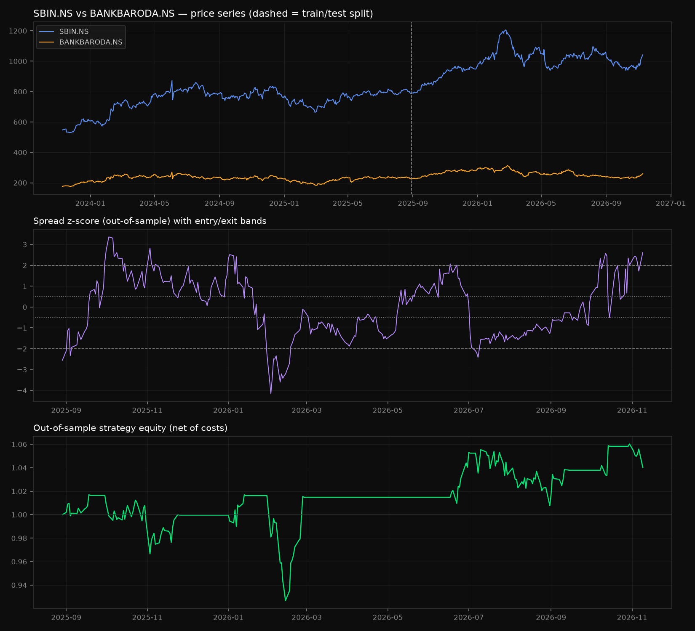

---

### TCS.NS / INFY.NS

- **Latest prices:** TCS.NS ₹2,475.40 · INFY.NS ₹1,154.10
- **Hedge ratio (train-fitted):** 0.3828
- **Cointegration (train):** FAIL at 5% — ADF -1.29, p=0.6347
- **Persistence:** passed 5% in 0 of 94 real-data runs (strict tier: 0/94)
- **Spread half-life:** 71.2 days
- **Current z-score:** +0.25
- **Signal today:** flat / no stretch
- ⚠️ _Pair did not cointegrate on training data. Any signal here is not statistically justified — observation only._

**Out-of-sample backtest** (beta frozen from train window):

| Metric | Value |
|---|---|
| Sharpe | 1.83 |
| Sortino | 2.11 |
| Annualised return | 9.26% |
| Annualised vol | 4.91% |
| Max drawdown | -2.82% |
| Round-trip trades | 7 |

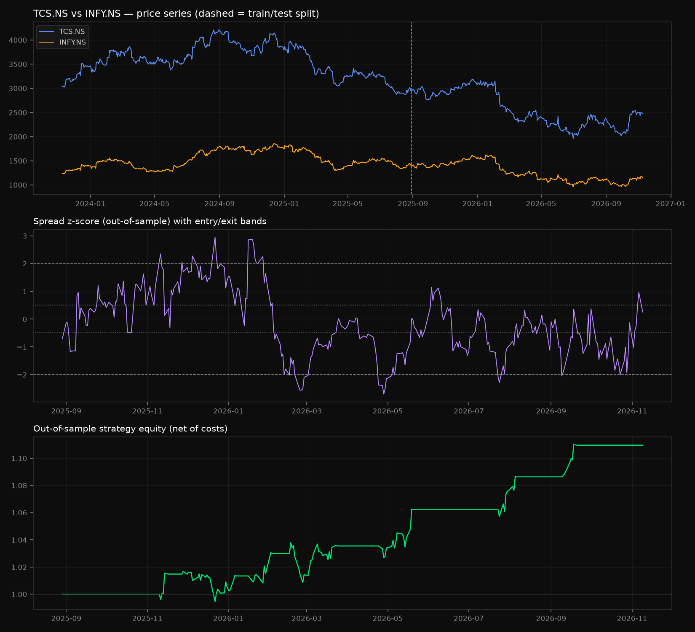

---

### INFY.NS / WIPRO.NS

- **Latest prices:** INFY.NS ₹1,154.10 · WIPRO.NS ₹199.00
- **Hedge ratio (train-fitted):** 0.1193
- **Cointegration (train):** FAIL at 5% — ADF -2.63, p=0.0869
- **Persistence:** passed 5% in 0 of 94 real-data runs (strict tier: 0/94)
- **Spread half-life:** 25.5 days
- **Current z-score:** +2.30
- **Signal today:** SHORT spread (short WIPRO.NS, long INFY.NS)
- ⚠️ _Pair did not cointegrate on training data. Any signal here is not statistically justified — observation only._

**Out-of-sample backtest** (beta frozen from train window):

| Metric | Value |
|---|---|
| Sharpe | 2.06 |
| Sortino | 2.37 |
| Annualised return | 12.27% |
| Annualised vol | 5.69% |
| Max drawdown | -3.30% |
| Round-trip trades | 7 |

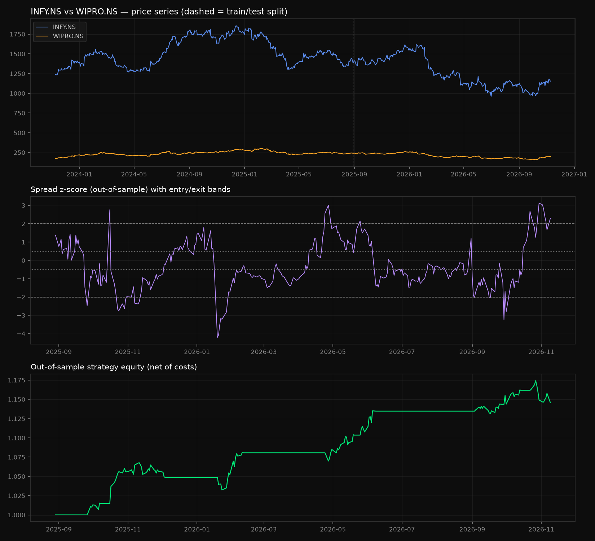

---

### HCLTECH.NS / TECHM.NS

- **Latest prices:** HCLTECH.NS ₹1,407.00 · TECHM.NS ₹1,805.00
- **Hedge ratio (train-fitted):** 0.9400
- **Cointegration (train):** FAIL at 5% — ADF -2.19, p=0.2081
- **Persistence:** passed 5% in 0 of 94 real-data runs (strict tier: 0/94)
- **Spread half-life:** 27.9 days
- **Current z-score:** +1.87
- **Signal today:** watch (approaching band)
- ⚠️ _Pair did not cointegrate on training data. Any signal here is not statistically justified — observation only._

**Out-of-sample backtest** (beta frozen from train window):

| Metric | Value |
|---|---|
| Sharpe | -0.08 |
| Sortino | -0.08 |
| Annualised return | -0.91% |
| Annualised vol | 7.73% |
| Max drawdown | -8.44% |
| Round-trip trades | 5 |

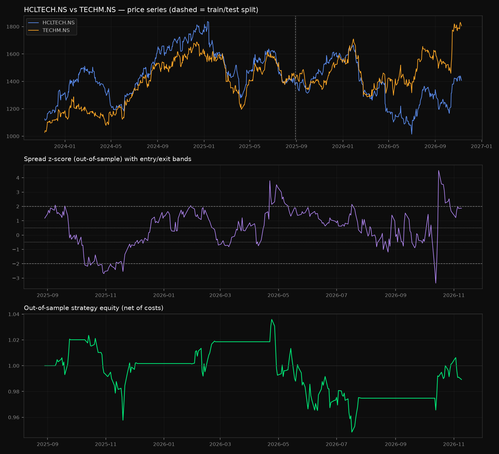

---

### ACC.NS / AMBUJACEM.NS

- **Latest prices:** ACC.NS ₹1,234.90 · AMBUJACEM.NS ₹389.55
- **Hedge ratio (train-fitted):** 0.1418
- **Cointegration (train):** FAIL at 5% — ADF -2.26, p=0.1863
- **Persistence:** passed 5% in 0 of 94 real-data runs (strict tier: 0/94)
- **Spread half-life:** 33.7 days
- **Current z-score:** +0.40
- **Signal today:** flat / no stretch
- ⚠️ _Pair did not cointegrate on training data. Any signal here is not statistically justified — observation only._

**Out-of-sample backtest** (beta frozen from train window):

| Metric | Value |
|---|---|
| Sharpe | -0.09 |
| Sortino | -0.07 |
| Annualised return | -0.92% |
| Annualised vol | 7.30% |
| Max drawdown | -7.66% |
| Round-trip trades | 4 |

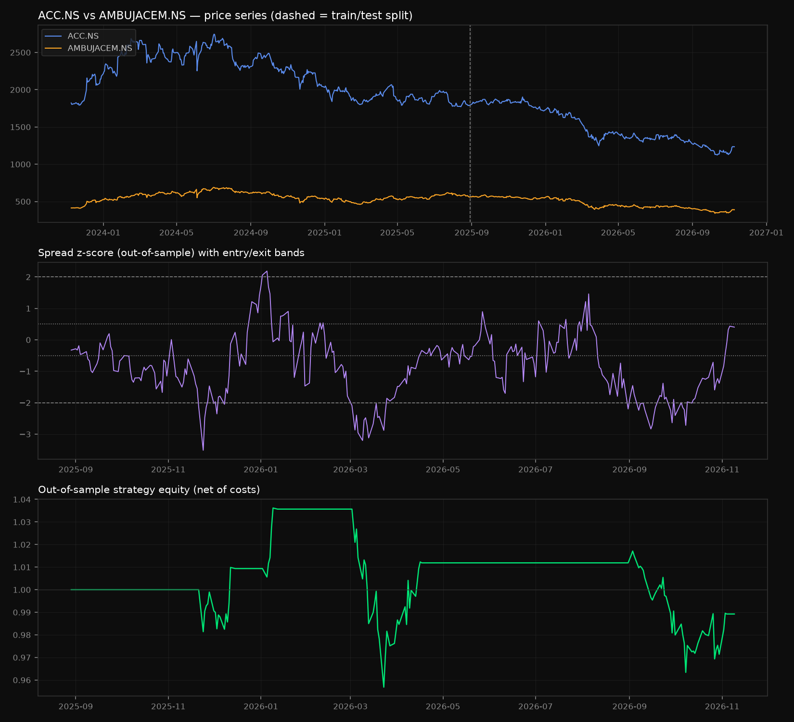

---

### ULTRACEMCO.NS / SHREECEM.NS

- **Latest prices:** ULTRACEMCO.NS ₹12,275.00 · SHREECEM.NS ₹24,920.00
- **Hedge ratio (train-fitted):** 1.1862
- **Cointegration (train):** FAIL at 5% — ADF -2.02, p=0.2771
- **Persistence:** passed 5% in 0 of 94 real-data runs (strict tier: 0/94)
- **Spread half-life:** 38.7 days
- **Current z-score:** +0.82
- **Signal today:** watch (approaching band)
- ⚠️ _Pair did not cointegrate on training data. Any signal here is not statistically justified — observation only._

**Out-of-sample backtest** (beta frozen from train window):

| Metric | Value |
|---|---|
| Sharpe | -0.12 |
| Sortino | -0.16 |
| Annualised return | -1.17% |
| Annualised vol | 7.33% |
| Max drawdown | -6.51% |
| Round-trip trades | 6 |

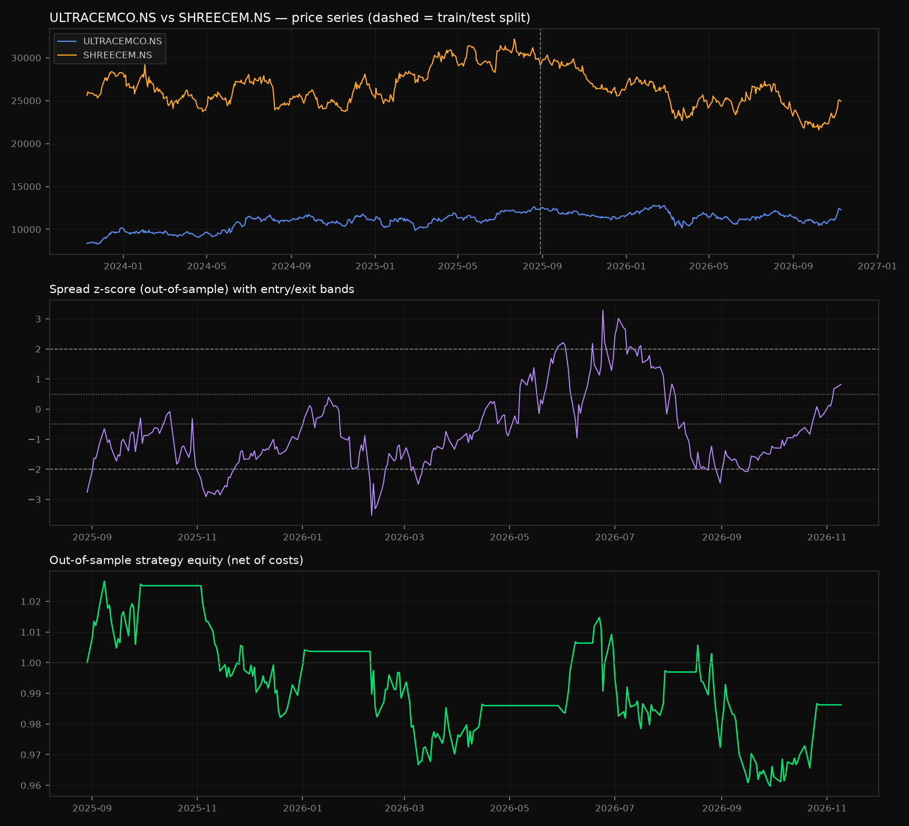

---

### IOC.NS / BPCL.NS

- **Latest prices:** IOC.NS ₹146.85 · BPCL.NS ₹316.00
- **Hedge ratio (train-fitted):** 1.5061
- **Cointegration (train):** FAIL at 5% — ADF -1.33, p=0.6148
- **Persistence:** passed 5% in 0 of 94 real-data runs (strict tier: 0/94)
- **Spread half-life:** 93.1 days
- **Current z-score:** -0.94
- **Signal today:** watch (approaching band)
- ⚠️ _Pair did not cointegrate on training data. Any signal here is not statistically justified — observation only._

**Out-of-sample backtest** (beta frozen from train window):

| Metric | Value |
|---|---|
| Sharpe | 0.54 |
| Sortino | 0.56 |
| Annualised return | 3.80% |
| Annualised vol | 7.47% |
| Max drawdown | -5.78% |
| Round-trip trades | 6 |

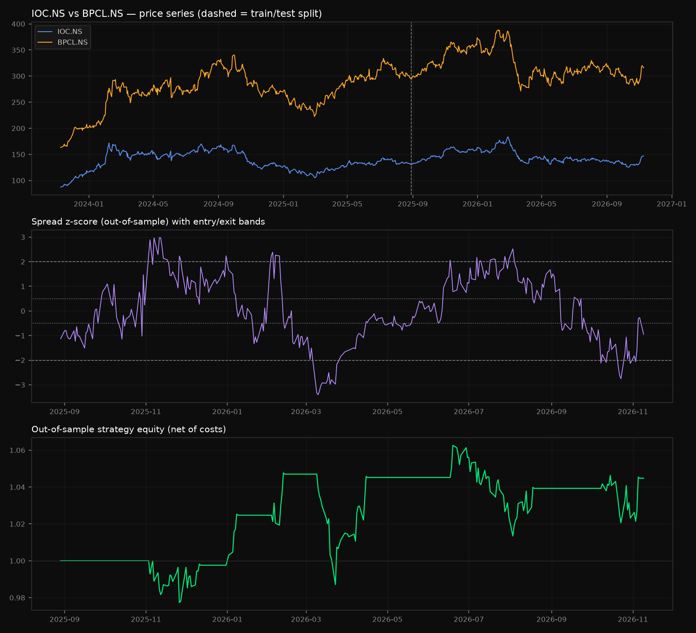

---

### BPCL.NS / HINDPETRO.NS

- **Latest prices:** BPCL.NS ₹316.00 · HINDPETRO.NS ₹385.75
- **Hedge ratio (train-fitted):** 1.2844
- **Cointegration (train):** FAIL at 5% — ADF -2.10, p=0.2454
- **Persistence:** passed 5% in 0 of 94 real-data runs (strict tier: 0/94)
- **Spread half-life:** 35.8 days
- **Current z-score:** +1.99
- **Signal today:** watch (approaching band)
- ⚠️ _Pair did not cointegrate on training data. Any signal here is not statistically justified — observation only._

**Out-of-sample backtest** (beta frozen from train window):

| Metric | Value |
|---|---|
| Sharpe | -0.14 |
| Sortino | -0.16 |
| Annualised return | -1.21% |
| Annualised vol | 7.04% |
| Max drawdown | -7.22% |
| Round-trip trades | 5 |

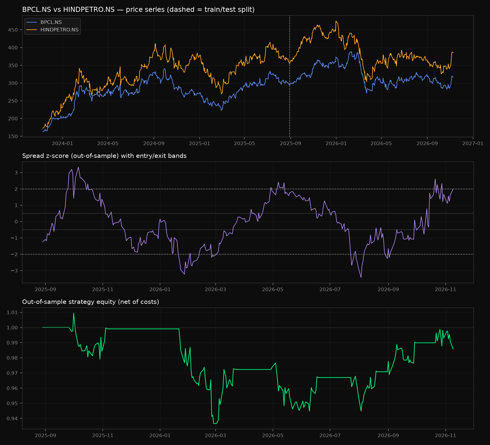

---

### ONGC.NS / COALINDIA.NS

- **Latest prices:** ONGC.NS ₹233.50 · COALINDIA.NS ₹401.50
- **Hedge ratio (train-fitted):** 1.3056
- **Cointegration (train):** PASS at 5% — ADF -3.56, p=0.0066
- **Persistence:** passed 5% in 86 of 94 real-data runs (strict tier: 1/94)
- **Spread half-life:** 12.6 days
- **Current z-score:** -0.15
- **Signal today:** flat / no stretch

**Out-of-sample backtest** (beta frozen from train window):

| Metric | Value |
|---|---|
| Sharpe | 0.88 |
| Sortino | 0.76 |
| Annualised return | 7.22% |
| Annualised vol | 8.30% |
| Max drawdown | -6.52% |
| Round-trip trades | 6 |

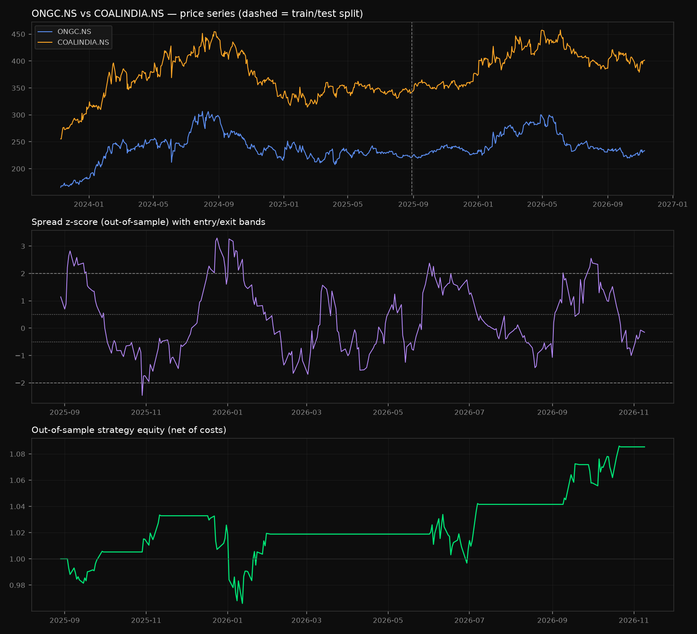

---

### NTPC.NS / POWERGRID.NS

- **Latest prices:** NTPC.NS ₹328.75 · POWERGRID.NS ₹257.95
- **Hedge ratio (train-fitted):** 0.7957
- **Cointegration (train):** FAIL at 5% — ADF -2.55, p=0.1048
- **Persistence:** passed 5% in 0 of 94 real-data runs (strict tier: 0/94)
- **Spread half-life:** 23.9 days
- **Current z-score:** -1.74
- **Signal today:** watch (approaching band)
- ⚠️ _Pair did not cointegrate on training data. Any signal here is not statistically justified — observation only._

**Out-of-sample backtest** (beta frozen from train window):

| Metric | Value |
|---|---|
| Sharpe | 0.71 |
| Sortino | 0.53 |
| Annualised return | 3.95% |
| Annualised vol | 5.69% |
| Max drawdown | -5.44% |
| Round-trip trades | 6 |

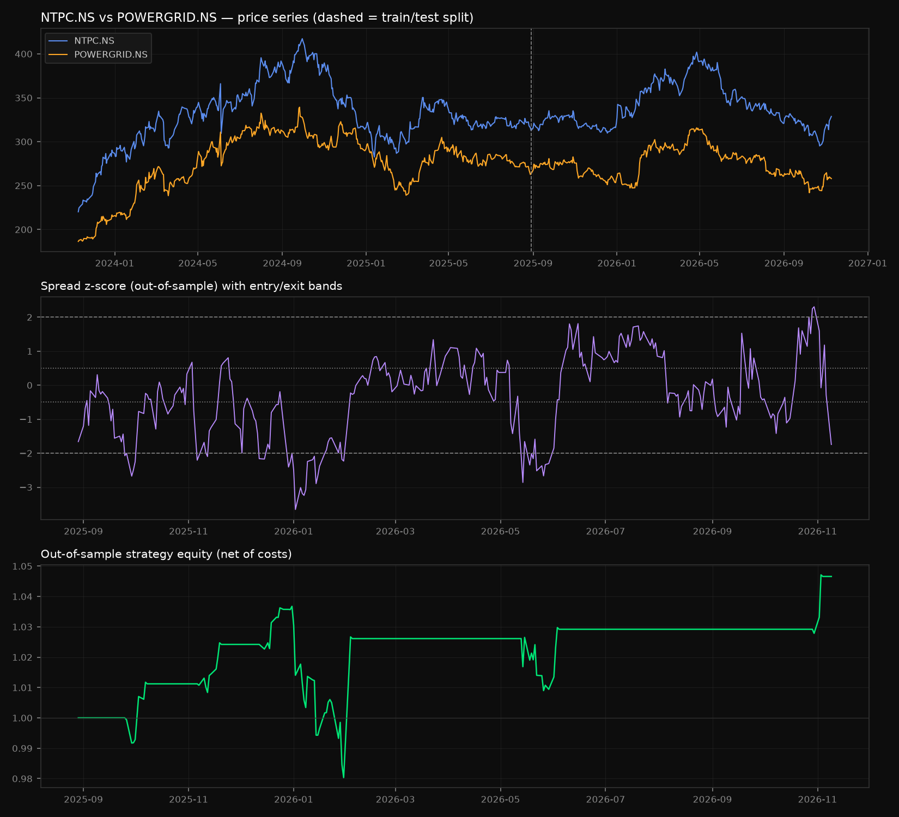

---

### BAJAJ-AUTO.NS / HEROMOTOCO.NS

- **Latest prices:** BAJAJ-AUTO.NS ₹10,979.00 · HEROMOTOCO.NS ₹5,410.50
- **Hedge ratio (train-fitted):** 0.4046
- **Cointegration (train):** FAIL at 5% — ADF -1.83, p=0.3643
- **Persistence:** passed 5% in 0 of 94 real-data runs (strict tier: 0/94)
- **Spread half-life:** 37.5 days
- **Current z-score:** +0.51
- **Signal today:** watch (approaching band)
- ⚠️ _Pair did not cointegrate on training data. Any signal here is not statistically justified — observation only._

**Out-of-sample backtest** (beta frozen from train window):

| Metric | Value |
|---|---|
| Sharpe | 0.03 |
| Sortino | 0.02 |
| Annualised return | -0.17% |
| Annualised vol | 8.85% |
| Max drawdown | -12.01% |
| Round-trip trades | 6 |

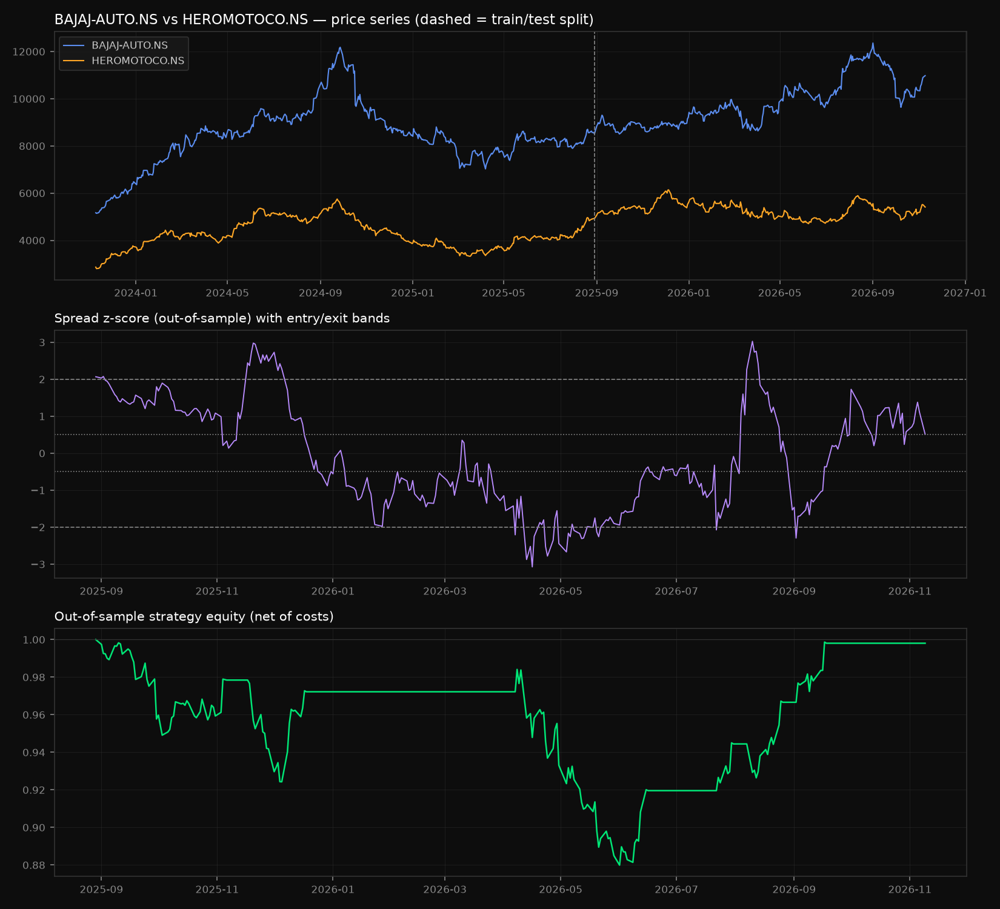

---

### TATASTEEL.NS / JSWSTEEL.NS

- **Latest prices:** TATASTEEL.NS ₹184.85 · JSWSTEEL.NS ₹1,347.00
- **Hedge ratio (train-fitted):** 2.7515
- **Cointegration (train):** FAIL at 5% — ADF -1.35, p=0.6068
- **Persistence:** passed 5% in 0 of 94 real-data runs (strict tier: 0/94)
- **Spread half-life:** 61.7 days
- **Current z-score:** +1.65
- **Signal today:** watch (approaching band)
- ⚠️ _Pair did not cointegrate on training data. Any signal here is not statistically justified — observation only._

**Out-of-sample backtest** (beta frozen from train window):

| Metric | Value |
|---|---|
| Sharpe | 0.47 |
| Sortino | 0.46 |
| Annualised return | 3.94% |
| Annualised vol | 9.11% |
| Max drawdown | -5.90% |
| Round-trip trades | 5 |

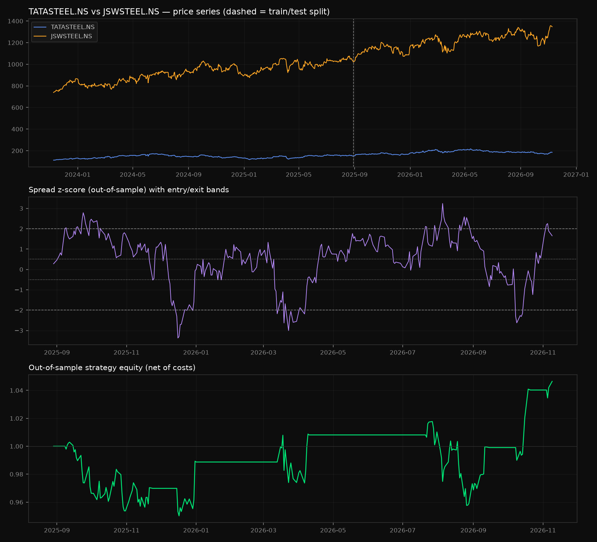

---

### SUNPHARMA.NS / CIPLA.NS

- **Latest prices:** SUNPHARMA.NS ₹1,904.50 · CIPLA.NS ₹1,403.80
- **Hedge ratio (train-fitted):** 0.4709
- **Cointegration (train):** FAIL at 5% — ADF -2.75, p=0.0665
- **Persistence:** passed 5% in 92 of 94 real-data runs (strict tier: 5/94)
- **Spread half-life:** 13.2 days
- **Current z-score:** -0.25
- **Signal today:** flat / no stretch
- ⚠️ _Pair did not cointegrate on training data. Any signal here is not statistically justified — observation only._

**Out-of-sample backtest** (beta frozen from train window):

| Metric | Value |
|---|---|
| Sharpe | 0.67 |
| Sortino | 0.73 |
| Annualised return | 4.78% |
| Annualised vol | 7.40% |
| Max drawdown | -10.08% |
| Round-trip trades | 5 |

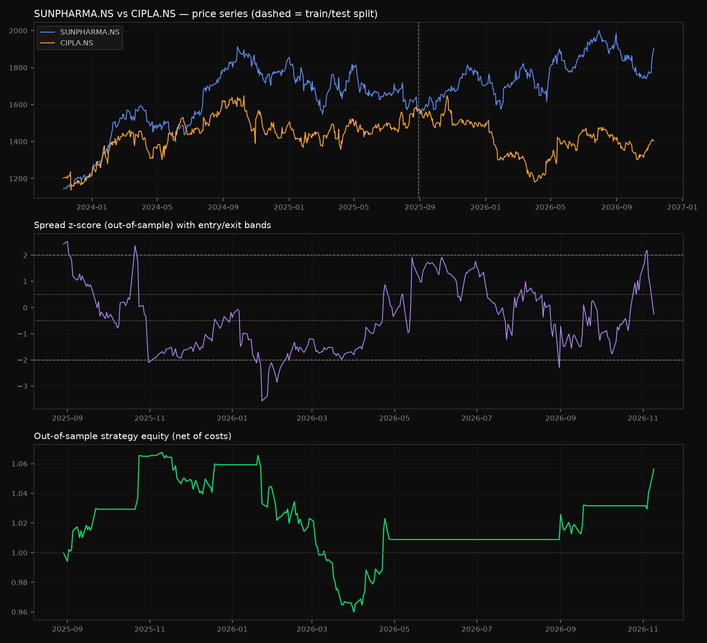

---

_Generated 2026-11-10 · pairs mean-reversion scanner · out-of-sample backtest · multiple-testing-aware · not investment advice._
