# Indian Pairs-Trading Scanner — 2026-11-11

> **What this is:** a market-neutral *pairs mean-reversion* scanner. It flags when two related NSE stocks have drifted apart far enough that their historical relationship signals a possible convergence trade. It does **not** forecast growth, rank "best" stocks, or predict company performance. A signal means the *spread between two stocks* is stretched — nothing about either stock being a good investment. Not investment advice; do your own research.

## Methodology (fixed in advance)

- **Universe:** 16 declared sector-mate pairs. Parameters (3y window, 60/40 train-test, z-entry 2.0, z-exit 0.5, 5 bps costs) are pre-registered; changes are logged in the README changelog *before* looking at results.
- **Multiple testing:** at the 5% level across 16 pairs, **≈0.8 false positives per run are expected by chance alone** even if nothing truly cointegrates. A single-day pass is a candidate, not a discovery.
- **Strict tier:** Bonferroni-corrected threshold p < 0.0031 (marked ✓✓).
- **Evidence = persistence:** the Persistence column counts how often each pair has passed the 5% test across all *real-data* daily runs recorded in `reports/history.csv`. Pairs deserve attention only when they pass persistently.

> ⚠️ **Some results use SIMULATED fallback data** (real data was unreachable this run) and are not real market results. These are marked below and are EXCLUDED from persistence counts.

## Summary

| Pair | p-value | Coint. | Persistence | Current z | Signal | OOS Sharpe |
|---|---|---|---|---|---|---|
| HDFCBANK.NS/ICICIBANK.NS *(sim)* | 0.0030 | ✓✓ | 1/78 | -1.55 | watch | 1.13 |
| AXISBANK.NS/ICICIBANK.NS | 0.8282 | ✗ | 0/95 | +3.36 | SHORT spread | -0.30 |
| KOTAKBANK.NS/HDFCBANK.NS | 0.1679 | ✗ | 0/95 | -0.73 | watch | 1.63 |
| SBIN.NS/BANKBARODA.NS | 0.1265 | ✗ | 0/95 | +2.66 | SHORT spread | 0.37 |
| TCS.NS/INFY.NS | 0.6239 | ✗ | 0/95 | +0.27 | flat / no stretch | 1.79 |
| INFY.NS/WIPRO.NS | 0.0828 | ✗ | 0/95 | +2.29 | SHORT spread | 2.80 |
| HCLTECH.NS/TECHM.NS | 0.2140 | ✗ | 0/95 | +1.87 | watch | -0.08 |
| ACC.NS/AMBUJACEM.NS | 0.1585 | ✗ | 0/95 | +0.40 | flat / no stretch | -0.10 |
| ULTRACEMCO.NS/SHREECEM.NS | 0.2681 | ✗ | 0/95 | +0.80 | watch | -0.18 |
| IOC.NS/BPCL.NS | 0.5961 | ✗ | 0/95 | -0.89 | watch | 0.54 |
| BPCL.NS/HINDPETRO.NS | 0.2470 | ✗ | 0/95 | +2.00 | SHORT spread | -0.15 |
| ONGC.NS/COALINDIA.NS | 0.0100 | ✓ | 87/95 | -0.15 | flat / no stretch | 0.88 |
| NTPC.NS/POWERGRID.NS | 0.1039 | ✗ | 0/95 | -1.74 | watch | 0.71 |
| BAJAJ-AUTO.NS/HEROMOTOCO.NS | 0.3605 | ✗ | 0/95 | +0.51 | watch | 0.03 |
| TATASTEEL.NS/JSWSTEEL.NS | 0.6174 | ✗ | 0/95 | +1.65 | watch | 0.48 |
| SUNPHARMA.NS/CIPLA.NS | 0.0674 | ✗ | 92/95 | -0.25 | flat / no stretch | 0.67 |

_Legend: ✓✓ passes strict Bonferroni tier · ✓ passes 5% only · ✗ fails. Persistence = 5%-passes / real-data runs recorded. \*no real-data history yet._

---

### HDFCBANK.NS / ICICIBANK.NS · _SIMULATED_

- **Latest prices:** HDFCBANK.NS ₹77.27 · ICICIBANK.NS ₹113.78
- **Hedge ratio (train-fitted):** 1.5557
- **Cointegration (train):** PASS at 5% — ADF -3.79, p=0.0030 · **passes strict Bonferroni tier**
- **Persistence:** passed 5% in 1 of 78 real-data runs (strict tier: 0/78)
- **Spread half-life:** 14.0 days
- **Current z-score:** -1.55
- **Signal today:** watch (approaching band)

**Out-of-sample backtest** (beta frozen from train window):

| Metric | Value |
|---|---|
| Sharpe | 1.13 |
| Sortino | 0.86 |
| Annualised return | 1.88% |
| Annualised vol | 1.66% |
| Max drawdown | -1.19% |
| Round-trip trades | 5 |

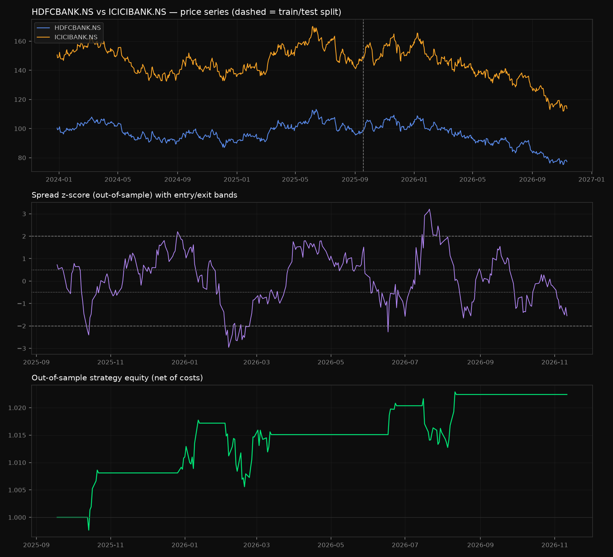

---

### AXISBANK.NS / ICICIBANK.NS

- **Latest prices:** AXISBANK.NS ₹1,310.70 · ICICIBANK.NS ₹1,589.00
- **Hedge ratio (train-fitted):** 0.6077
- **Cointegration (train):** FAIL at 5% — ADF -0.77, p=0.8282
- **Persistence:** passed 5% in 0 of 95 real-data runs (strict tier: 0/95)
- **Spread half-life:** 194.8 days
- **Current z-score:** +3.36
- **Signal today:** SHORT spread (short ICICIBANK.NS, long AXISBANK.NS)
- ⚠️ _Pair did not cointegrate on training data. Any signal here is not statistically justified — observation only._

**Out-of-sample backtest** (beta frozen from train window):

| Metric | Value |
|---|---|
| Sharpe | -0.30 |
| Sortino | -0.31 |
| Annualised return | -3.18% |
| Annualised vol | 9.43% |
| Max drawdown | -10.12% |
| Round-trip trades | 5 |

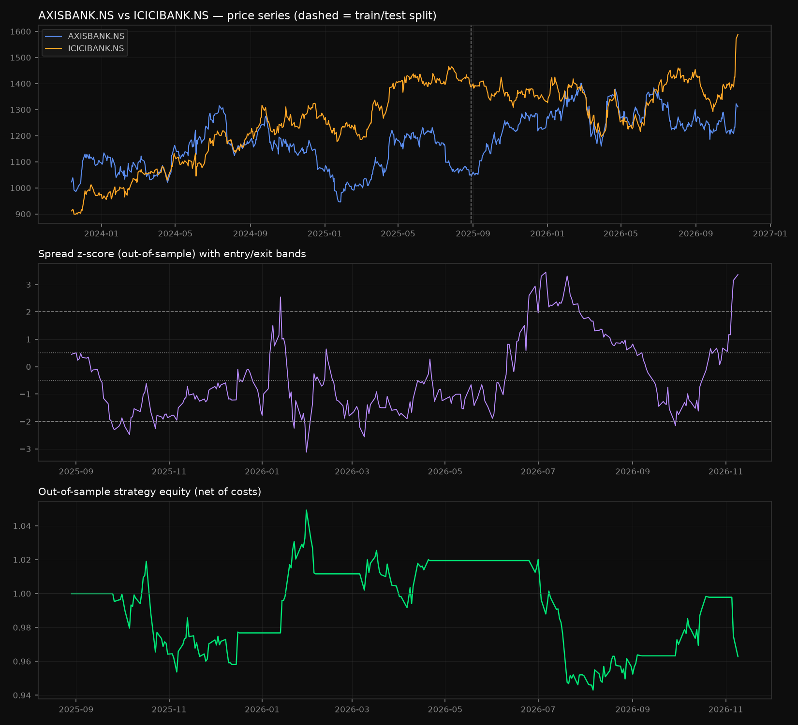

---

### KOTAKBANK.NS / HDFCBANK.NS

- **Latest prices:** KOTAKBANK.NS ₹479.50 · HDFCBANK.NS ₹798.15
- **Hedge ratio (train-fitted):** 2.2304
- **Cointegration (train):** FAIL at 5% — ADF -2.31, p=0.1679
- **Persistence:** passed 5% in 0 of 95 real-data runs (strict tier: 0/95)
- **Spread half-life:** 27.1 days
- **Current z-score:** -0.73
- **Signal today:** watch (approaching band)
- ⚠️ _Pair did not cointegrate on training data. Any signal here is not statistically justified — observation only._

**Out-of-sample backtest** (beta frozen from train window):

| Metric | Value |
|---|---|
| Sharpe | 1.63 |
| Sortino | 1.65 |
| Annualised return | 10.27% |
| Annualised vol | 6.11% |
| Max drawdown | -2.89% |
| Round-trip trades | 5 |

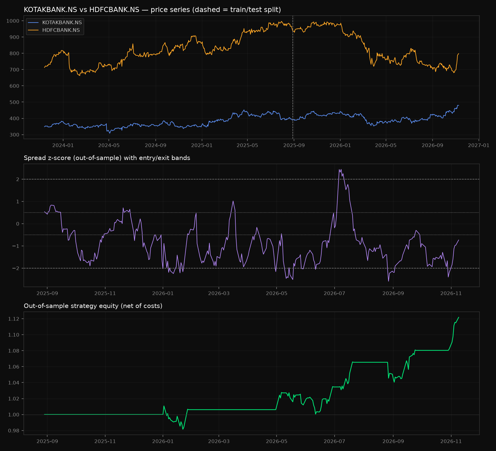

---

### SBIN.NS / BANKBARODA.NS

- **Latest prices:** SBIN.NS ₹1,042.00 · BANKBARODA.NS ₹260.01
- **Hedge ratio (train-fitted):** 0.1781
- **Cointegration (train):** FAIL at 5% — ADF -2.46, p=0.1265
- **Persistence:** passed 5% in 0 of 95 real-data runs (strict tier: 0/95)
- **Spread half-life:** 20.1 days
- **Current z-score:** +2.66
- **Signal today:** SHORT spread (short BANKBARODA.NS, long SBIN.NS)
- ⚠️ _Pair did not cointegrate on training data. Any signal here is not statistically justified — observation only._

**Out-of-sample backtest** (beta frozen from train window):

| Metric | Value |
|---|---|
| Sharpe | 0.37 |
| Sortino | 0.35 |
| Annualised return | 3.38% |
| Annualised vol | 10.29% |
| Max drawdown | -8.92% |
| Round-trip trades | 7 |

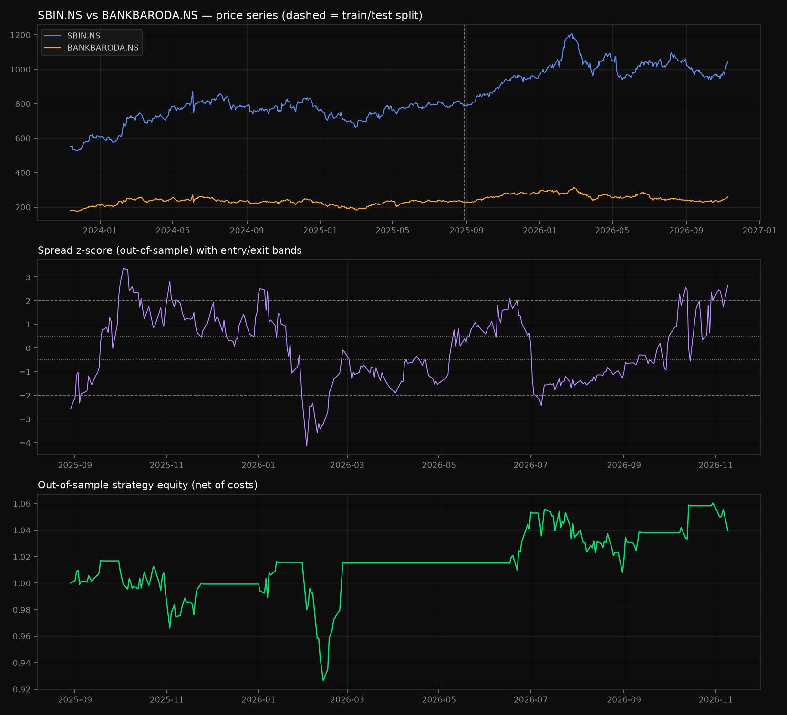

---

### TCS.NS / INFY.NS

- **Latest prices:** TCS.NS ₹2,475.40 · INFY.NS ₹1,154.10
- **Hedge ratio (train-fitted):** 0.3808
- **Cointegration (train):** FAIL at 5% — ADF -1.31, p=0.6239
- **Persistence:** passed 5% in 0 of 95 real-data runs (strict tier: 0/95)
- **Spread half-life:** 71.1 days
- **Current z-score:** +0.27
- **Signal today:** flat / no stretch
- ⚠️ _Pair did not cointegrate on training data. Any signal here is not statistically justified — observation only._

**Out-of-sample backtest** (beta frozen from train window):

| Metric | Value |
|---|---|
| Sharpe | 1.79 |
| Sortino | 2.09 |
| Annualised return | 9.12% |
| Annualised vol | 4.95% |
| Max drawdown | -2.83% |
| Round-trip trades | 7 |

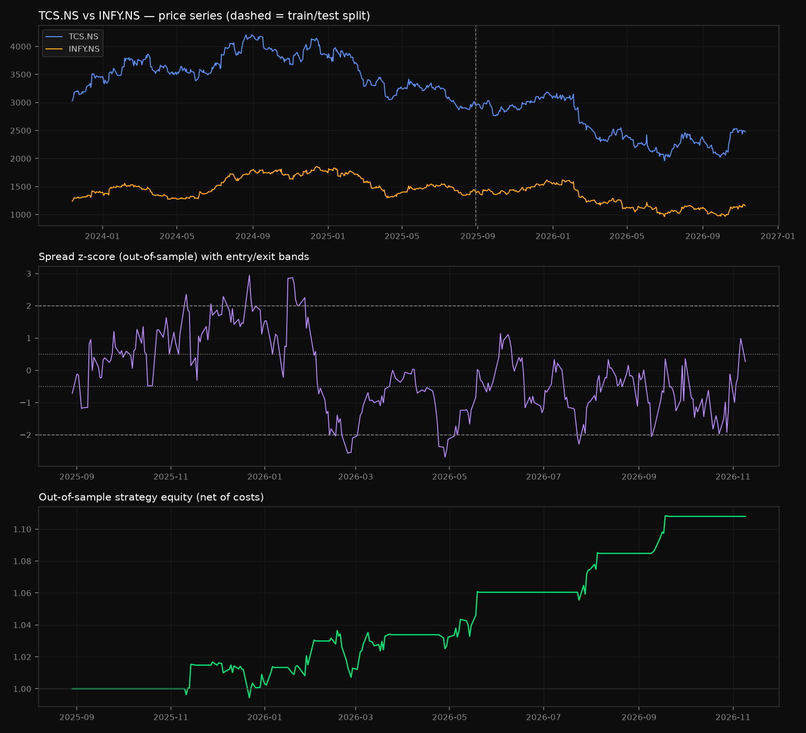

---

### INFY.NS / WIPRO.NS

- **Latest prices:** INFY.NS ₹1,154.10 · WIPRO.NS ₹199.00
- **Hedge ratio (train-fitted):** 0.1179
- **Cointegration (train):** FAIL at 5% — ADF -2.65, p=0.0828
- **Persistence:** passed 5% in 0 of 95 real-data runs (strict tier: 0/95)
- **Spread half-life:** 25.0 days
- **Current z-score:** +2.29
- **Signal today:** SHORT spread (short WIPRO.NS, long INFY.NS)
- ⚠️ _Pair did not cointegrate on training data. Any signal here is not statistically justified — observation only._

**Out-of-sample backtest** (beta frozen from train window):

| Metric | Value |
|---|---|
| Sharpe | 2.80 |
| Sortino | 3.71 |
| Annualised return | 17.53% |
| Annualised vol | 5.82% |
| Max drawdown | -3.33% |
| Round-trip trades | 6 |

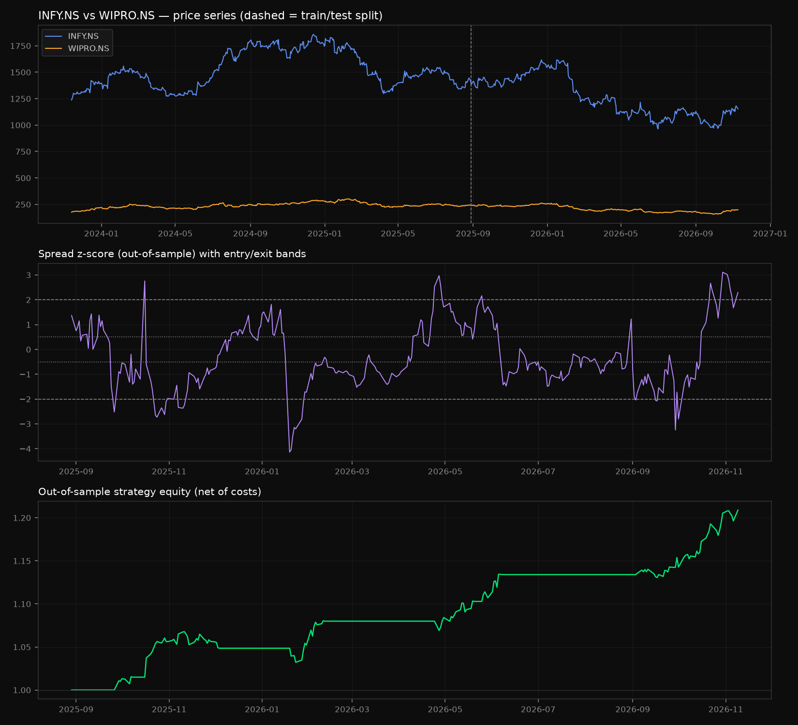

---

### HCLTECH.NS / TECHM.NS

- **Latest prices:** HCLTECH.NS ₹1,407.00 · TECHM.NS ₹1,805.00
- **Hedge ratio (train-fitted):** 0.9394
- **Cointegration (train):** FAIL at 5% — ADF -2.18, p=0.2140
- **Persistence:** passed 5% in 0 of 95 real-data runs (strict tier: 0/95)
- **Spread half-life:** 28.1 days
- **Current z-score:** +1.87
- **Signal today:** watch (approaching band)
- ⚠️ _Pair did not cointegrate on training data. Any signal here is not statistically justified — observation only._

**Out-of-sample backtest** (beta frozen from train window):

| Metric | Value |
|---|---|
| Sharpe | -0.08 |
| Sortino | -0.08 |
| Annualised return | -0.91% |
| Annualised vol | 7.73% |
| Max drawdown | -8.44% |
| Round-trip trades | 5 |

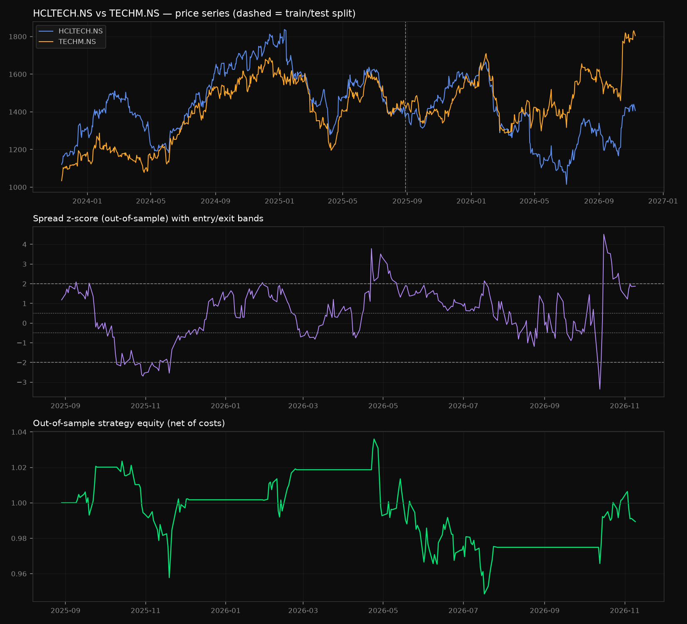

---

### ACC.NS / AMBUJACEM.NS

- **Latest prices:** ACC.NS ₹1,234.90 · AMBUJACEM.NS ₹389.55
- **Hedge ratio (train-fitted):** 0.1397
- **Cointegration (train):** FAIL at 5% — ADF -2.34, p=0.1585
- **Persistence:** passed 5% in 0 of 95 real-data runs (strict tier: 0/95)
- **Spread half-life:** 32.7 days
- **Current z-score:** +0.40
- **Signal today:** flat / no stretch
- ⚠️ _Pair did not cointegrate on training data. Any signal here is not statistically justified — observation only._

**Out-of-sample backtest** (beta frozen from train window):

| Metric | Value |
|---|---|
| Sharpe | -0.10 |
| Sortino | -0.08 |
| Annualised return | -0.97% |
| Annualised vol | 7.37% |
| Max drawdown | -7.75% |
| Round-trip trades | 4 |

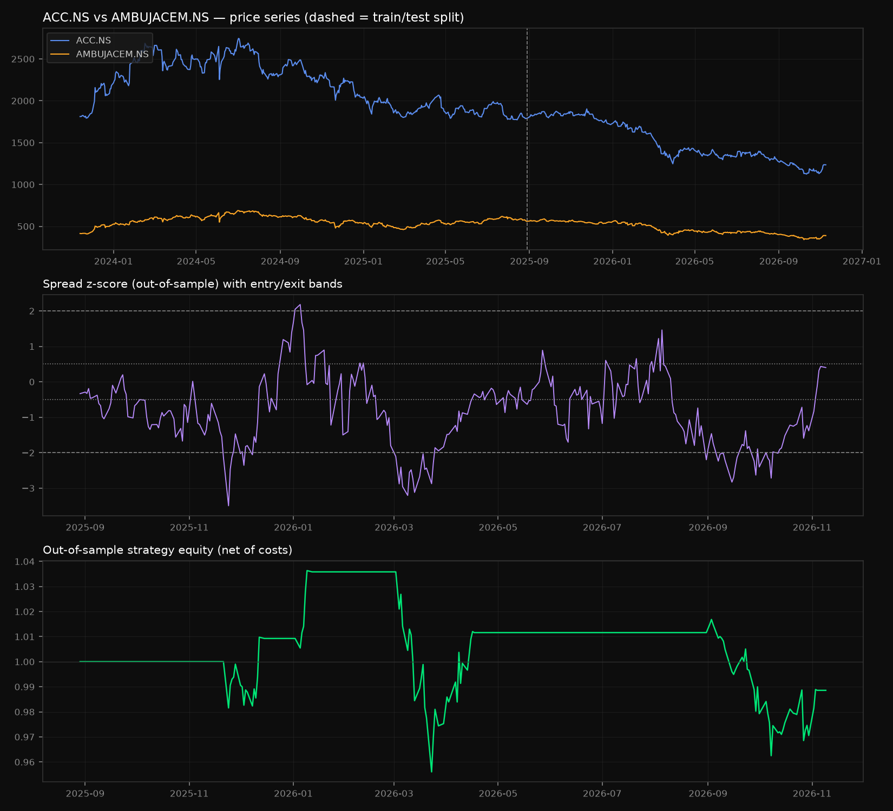

---

### ULTRACEMCO.NS / SHREECEM.NS

- **Latest prices:** ULTRACEMCO.NS ₹12,275.00 · SHREECEM.NS ₹24,920.00
- **Hedge ratio (train-fitted):** 1.2019
- **Cointegration (train):** FAIL at 5% — ADF -2.04, p=0.2681
- **Persistence:** passed 5% in 0 of 95 real-data runs (strict tier: 0/95)
- **Spread half-life:** 38.2 days
- **Current z-score:** +0.80
- **Signal today:** watch (approaching band)
- ⚠️ _Pair did not cointegrate on training data. Any signal here is not statistically justified — observation only._

**Out-of-sample backtest** (beta frozen from train window):

| Metric | Value |
|---|---|
| Sharpe | -0.18 |
| Sortino | -0.23 |
| Annualised return | -1.59% |
| Annualised vol | 7.39% |
| Max drawdown | -6.95% |
| Round-trip trades | 6 |

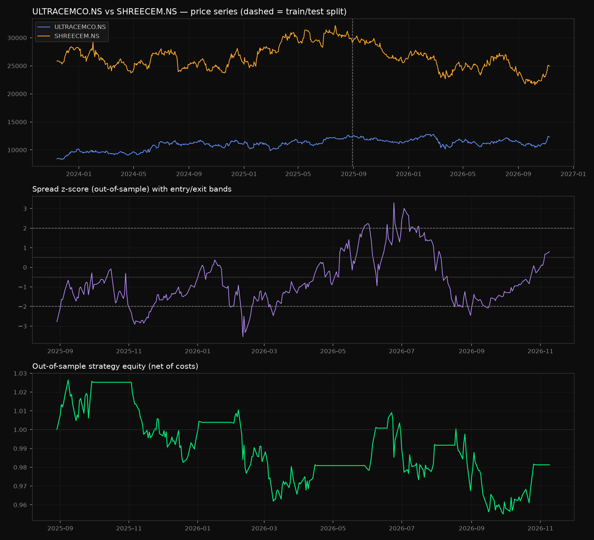

---

### IOC.NS / BPCL.NS

- **Latest prices:** IOC.NS ₹146.85 · BPCL.NS ₹316.00
- **Hedge ratio (train-fitted):** 1.4817
- **Cointegration (train):** FAIL at 5% — ADF -1.37, p=0.5961
- **Persistence:** passed 5% in 0 of 95 real-data runs (strict tier: 0/95)
- **Spread half-life:** 89.5 days
- **Current z-score:** -0.89
- **Signal today:** watch (approaching band)
- ⚠️ _Pair did not cointegrate on training data. Any signal here is not statistically justified — observation only._

**Out-of-sample backtest** (beta frozen from train window):

| Metric | Value |
|---|---|
| Sharpe | 0.54 |
| Sortino | 0.57 |
| Annualised return | 3.90% |
| Annualised vol | 7.57% |
| Max drawdown | -5.92% |
| Round-trip trades | 6 |

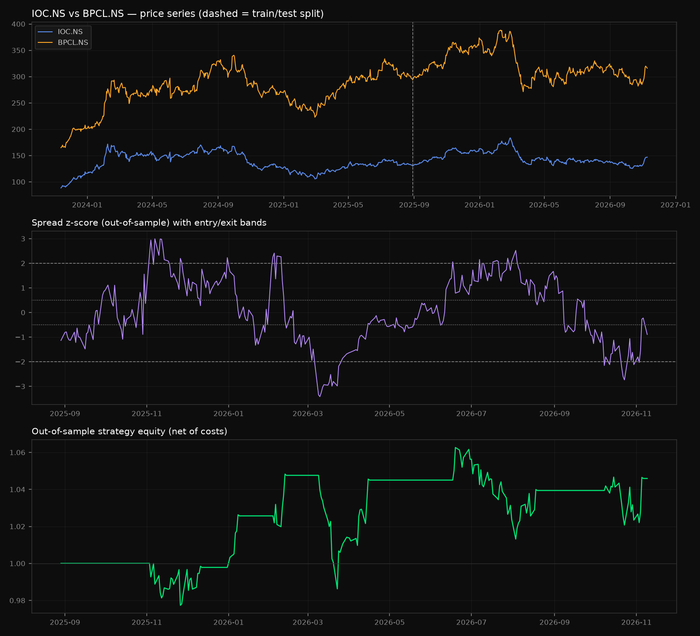

---

### BPCL.NS / HINDPETRO.NS

- **Latest prices:** BPCL.NS ₹316.00 · HINDPETRO.NS ₹385.75
- **Hedge ratio (train-fitted):** 1.2795
- **Cointegration (train):** FAIL at 5% — ADF -2.09, p=0.2470
- **Persistence:** passed 5% in 0 of 95 real-data runs (strict tier: 0/95)
- **Spread half-life:** 35.8 days
- **Current z-score:** +2.00
- **Signal today:** SHORT spread (short HINDPETRO.NS, long BPCL.NS)
- ⚠️ _Pair did not cointegrate on training data. Any signal here is not statistically justified — observation only._

**Out-of-sample backtest** (beta frozen from train window):

| Metric | Value |
|---|---|
| Sharpe | -0.15 |
| Sortino | -0.17 |
| Annualised return | -1.31% |
| Annualised vol | 7.04% |
| Max drawdown | -7.22% |
| Round-trip trades | 5 |

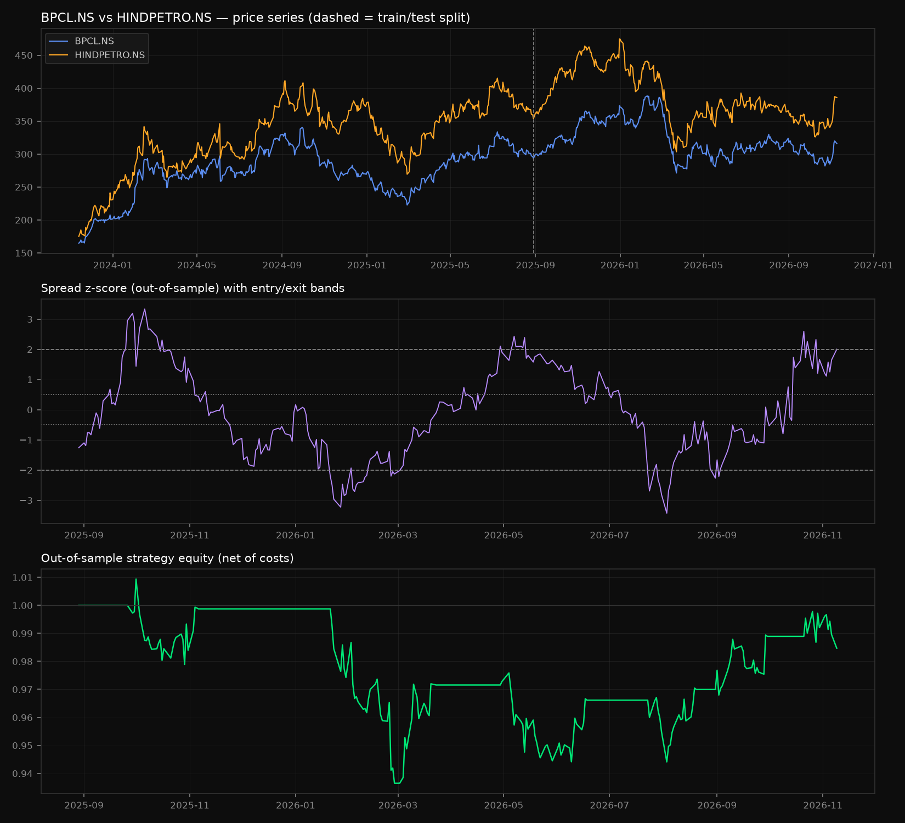

---

### ONGC.NS / COALINDIA.NS

- **Latest prices:** ONGC.NS ₹233.50 · COALINDIA.NS ₹401.50
- **Hedge ratio (train-fitted):** 1.2988
- **Cointegration (train):** PASS at 5% — ADF -3.43, p=0.0100
- **Persistence:** passed 5% in 87 of 95 real-data runs (strict tier: 1/95)
- **Spread half-life:** 13.3 days
- **Current z-score:** -0.15
- **Signal today:** flat / no stretch

**Out-of-sample backtest** (beta frozen from train window):

| Metric | Value |
|---|---|
| Sharpe | 0.88 |
| Sortino | 0.76 |
| Annualised return | 7.23% |
| Annualised vol | 8.31% |
| Max drawdown | -6.54% |
| Round-trip trades | 6 |

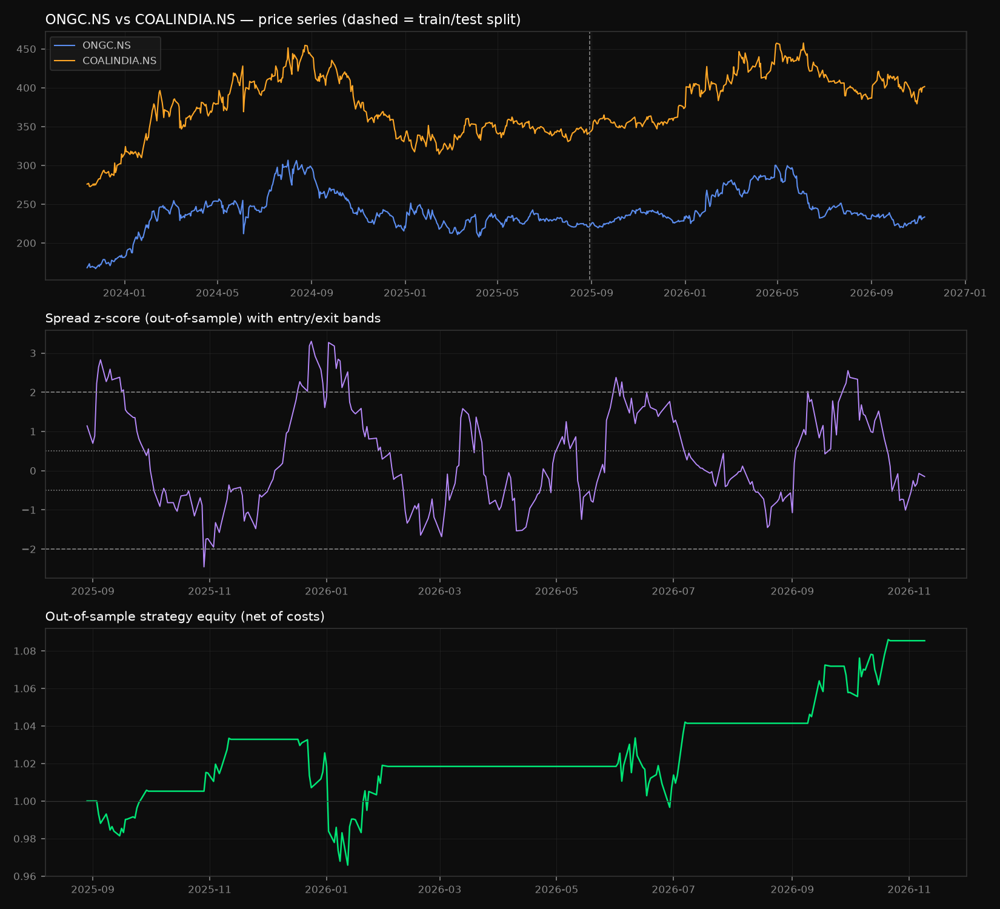

---

### NTPC.NS / POWERGRID.NS

- **Latest prices:** NTPC.NS ₹328.75 · POWERGRID.NS ₹257.95
- **Hedge ratio (train-fitted):** 0.7943
- **Cointegration (train):** FAIL at 5% — ADF -2.55, p=0.1039
- **Persistence:** passed 5% in 0 of 95 real-data runs (strict tier: 0/95)
- **Spread half-life:** 23.9 days
- **Current z-score:** -1.74
- **Signal today:** watch (approaching band)
- ⚠️ _Pair did not cointegrate on training data. Any signal here is not statistically justified — observation only._

**Out-of-sample backtest** (beta frozen from train window):

| Metric | Value |
|---|---|
| Sharpe | 0.71 |
| Sortino | 0.53 |
| Annualised return | 3.96% |
| Annualised vol | 5.70% |
| Max drawdown | -5.44% |
| Round-trip trades | 6 |

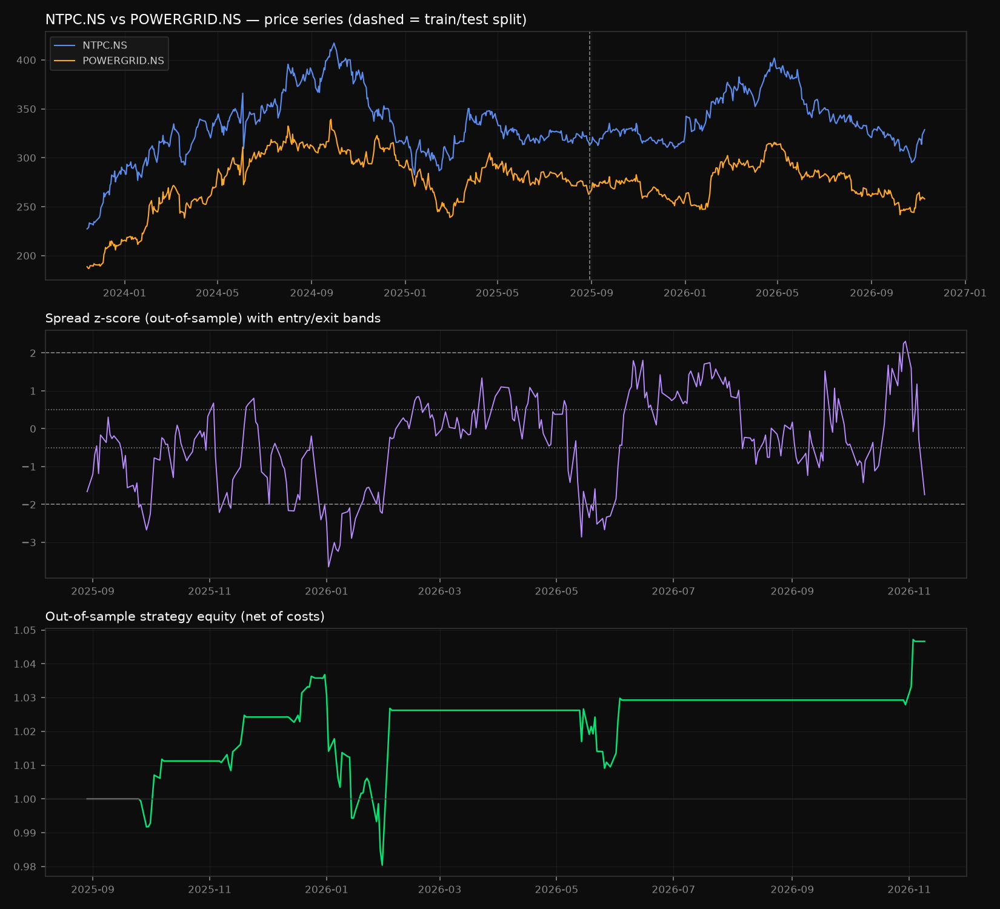

---

### BAJAJ-AUTO.NS / HEROMOTOCO.NS

- **Latest prices:** BAJAJ-AUTO.NS ₹10,979.00 · HEROMOTOCO.NS ₹5,410.50
- **Hedge ratio (train-fitted):** 0.4035
- **Cointegration (train):** FAIL at 5% — ADF -1.84, p=0.3605
- **Persistence:** passed 5% in 0 of 95 real-data runs (strict tier: 0/95)
- **Spread half-life:** 37.3 days
- **Current z-score:** +0.51
- **Signal today:** watch (approaching band)
- ⚠️ _Pair did not cointegrate on training data. Any signal here is not statistically justified — observation only._

**Out-of-sample backtest** (beta frozen from train window):

| Metric | Value |
|---|---|
| Sharpe | 0.03 |
| Sortino | 0.03 |
| Annualised return | -0.16% |
| Annualised vol | 8.86% |
| Max drawdown | -12.00% |
| Round-trip trades | 6 |

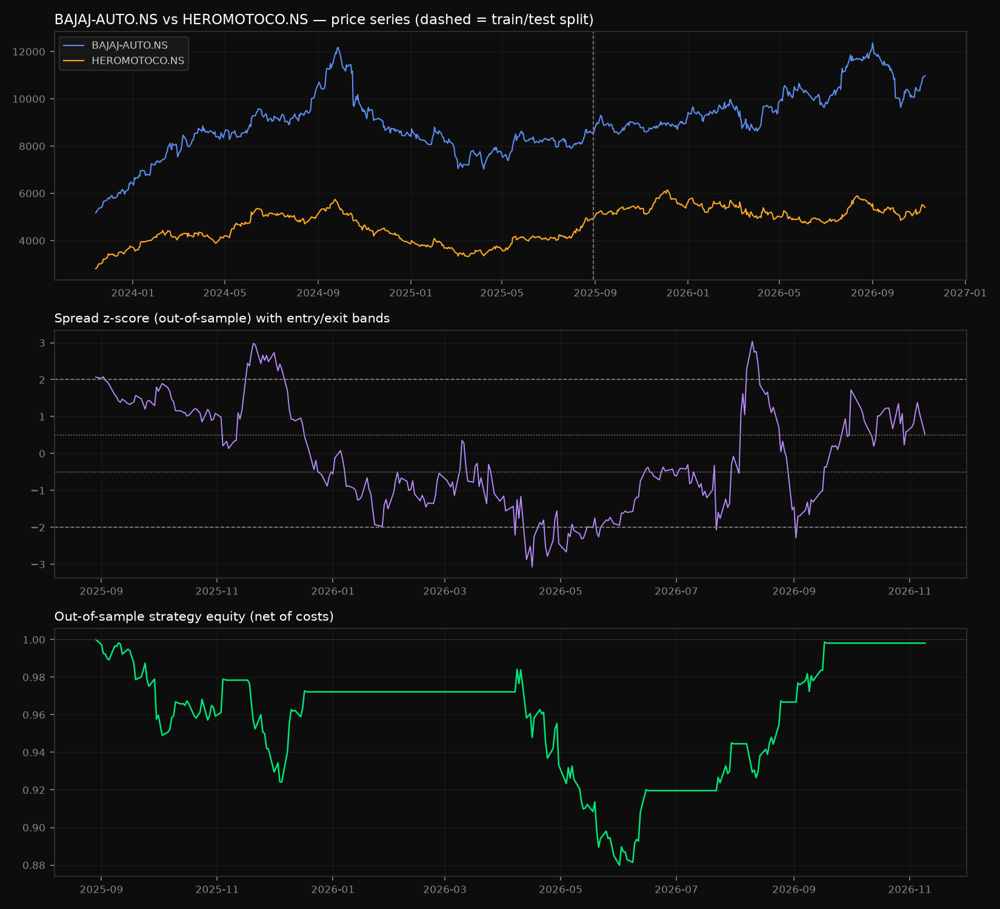

---

### TATASTEEL.NS / JSWSTEEL.NS

- **Latest prices:** TATASTEEL.NS ₹184.85 · JSWSTEEL.NS ₹1,347.00
- **Hedge ratio (train-fitted):** 2.6761
- **Cointegration (train):** FAIL at 5% — ADF -1.33, p=0.6174
- **Persistence:** passed 5% in 0 of 95 real-data runs (strict tier: 0/95)
- **Spread half-life:** 61.3 days
- **Current z-score:** +1.65
- **Signal today:** watch (approaching band)
- ⚠️ _Pair did not cointegrate on training data. Any signal here is not statistically justified — observation only._

**Out-of-sample backtest** (beta frozen from train window):

| Metric | Value |
|---|---|
| Sharpe | 0.48 |
| Sortino | 0.47 |
| Annualised return | 4.11% |
| Annualised vol | 9.25% |
| Max drawdown | -5.96% |
| Round-trip trades | 5 |

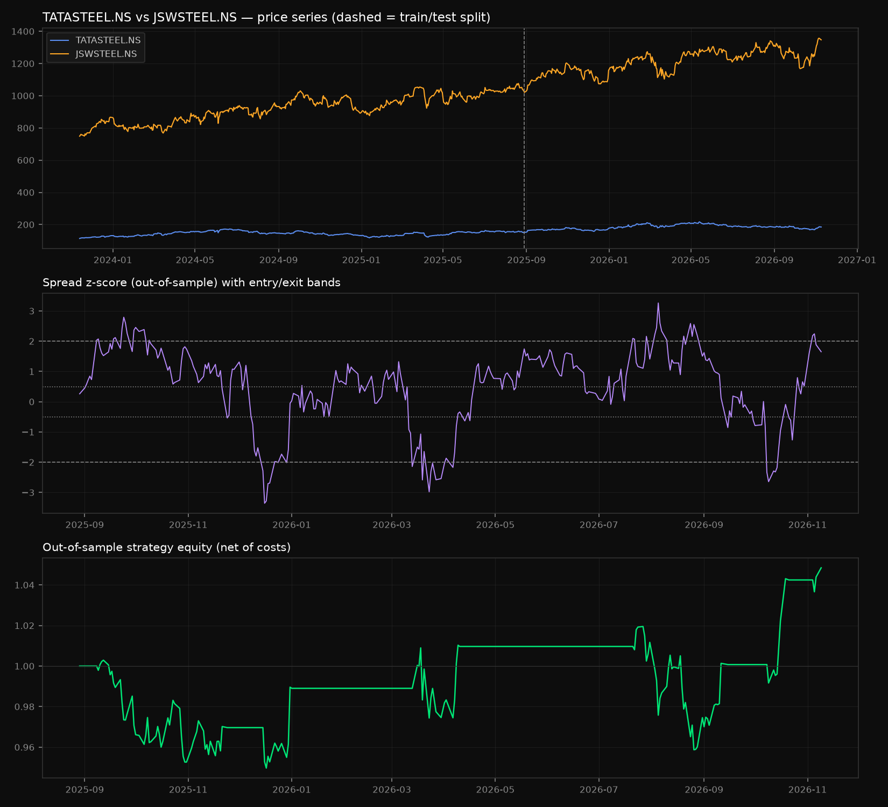

---

### SUNPHARMA.NS / CIPLA.NS

- **Latest prices:** SUNPHARMA.NS ₹1,904.50 · CIPLA.NS ₹1,403.80
- **Hedge ratio (train-fitted):** 0.4698
- **Cointegration (train):** FAIL at 5% — ADF -2.74, p=0.0674
- **Persistence:** passed 5% in 92 of 95 real-data runs (strict tier: 5/95)
- **Spread half-life:** 13.2 days
- **Current z-score:** -0.25
- **Signal today:** flat / no stretch
- ⚠️ _Pair did not cointegrate on training data. Any signal here is not statistically justified — observation only._

**Out-of-sample backtest** (beta frozen from train window):

| Metric | Value |
|---|---|
| Sharpe | 0.67 |
| Sortino | 0.73 |
| Annualised return | 4.78% |
| Annualised vol | 7.40% |
| Max drawdown | -10.08% |
| Round-trip trades | 5 |

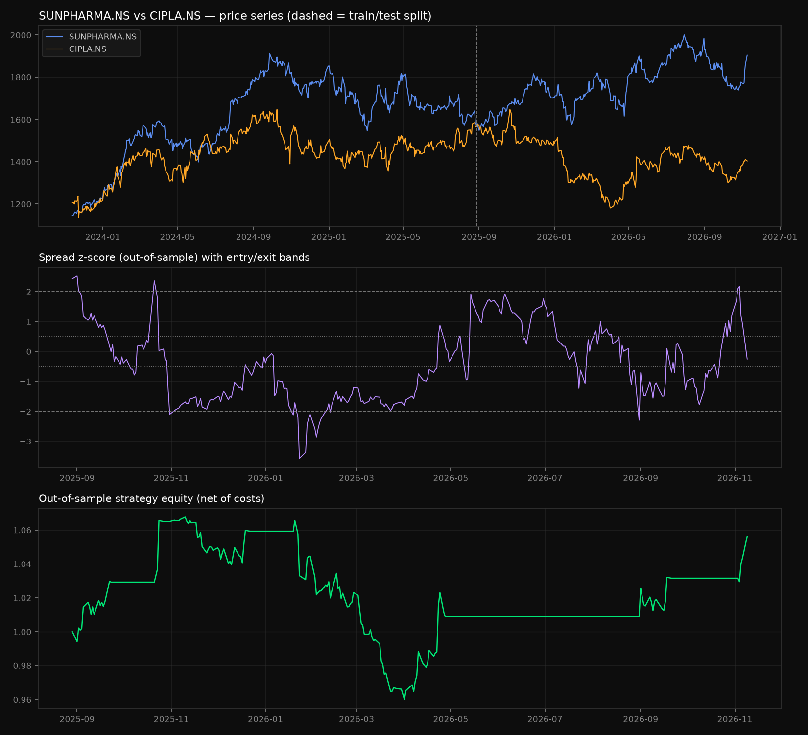

---

_Generated 2026-11-11 · pairs mean-reversion scanner · out-of-sample backtest · multiple-testing-aware · not investment advice._
