# Indian Pairs-Trading Scanner — 2026-11-12

> **What this is:** a market-neutral *pairs mean-reversion* scanner. It flags when two related NSE stocks have drifted apart far enough that their historical relationship signals a possible convergence trade. It does **not** forecast growth, rank "best" stocks, or predict company performance. A signal means the *spread between two stocks* is stretched — nothing about either stock being a good investment. Not investment advice; do your own research.

## Methodology (fixed in advance)

- **Universe:** 16 declared sector-mate pairs. Parameters (3y window, 60/40 train-test, z-entry 2.0, z-exit 0.5, 5 bps costs) are pre-registered; changes are logged in the README changelog *before* looking at results.
- **Multiple testing:** at the 5% level across 16 pairs, **≈0.8 false positives per run are expected by chance alone** even if nothing truly cointegrates. A single-day pass is a candidate, not a discovery.
- **Strict tier:** Bonferroni-corrected threshold p < 0.0031 (marked ✓✓).
- **Evidence = persistence:** the Persistence column counts how often each pair has passed the 5% test across all *real-data* daily runs recorded in `reports/history.csv`. Pairs deserve attention only when they pass persistently.

## Summary

| Pair | p-value | Coint. | Persistence | Current z | Signal | OOS Sharpe |
|---|---|---|---|---|---|---|
| HDFCBANK.NS/ICICIBANK.NS | 0.0579 | ✗ | 1/79 | +0.88 | watch | 0.11 |
| AXISBANK.NS/ICICIBANK.NS | 0.8264 | ✗ | 0/96 | +2.49 | SHORT spread | -0.16 |
| KOTAKBANK.NS/HDFCBANK.NS | 0.1453 | ✗ | 0/96 | -0.90 | watch | 1.55 |
| SBIN.NS/BANKBARODA.NS | 0.1272 | ✗ | 0/96 | +4.09 | SHORT spread | 0.09 |
| TCS.NS/INFY.NS | 0.5844 | ✗ | 0/96 | +0.41 | flat / no stretch | 1.88 |
| INFY.NS/WIPRO.NS | 0.0880 | ✗ | 0/96 | +1.99 | watch | 2.76 |
| HCLTECH.NS/TECHM.NS | 0.1877 | ✗ | 0/96 | +1.69 | watch | -0.06 |
| ACC.NS/AMBUJACEM.NS | 0.1541 | ✗ | 0/96 | +0.42 | flat / no stretch | -0.10 |
| ULTRACEMCO.NS/SHREECEM.NS | 0.2614 | ✗ | 0/96 | +1.29 | watch | -0.28 |
| IOC.NS/BPCL.NS | 0.5964 | ✗ | 0/96 | -1.29 | watch | 0.54 |
| BPCL.NS/HINDPETRO.NS | 0.2450 | ✗ | 0/96 | +3.45 | SHORT spread | -0.39 |
| ONGC.NS/COALINDIA.NS | 0.0099 | ✓ | 88/96 | +0.08 | flat / no stretch | 0.88 |
| NTPC.NS/POWERGRID.NS | 0.1023 | ✗ | 0/96 | -0.06 | flat / no stretch | 0.71 |
| BAJAJ-AUTO.NS/HEROMOTOCO.NS | 0.3752 | ✗ | 0/96 | +0.11 | flat / no stretch | 0.05 |
| TATASTEEL.NS/JSWSTEEL.NS | 0.5844 | ✗ | 0/96 | +1.46 | watch | 0.52 |
| SUNPHARMA.NS/CIPLA.NS | 0.0762 | ✗ | 92/96 | +0.51 | watch | 0.72 |

_Legend: ✓✓ passes strict Bonferroni tier · ✓ passes 5% only · ✗ fails. Persistence = 5%-passes / real-data runs recorded. \*no real-data history yet._

---

### HDFCBANK.NS / ICICIBANK.NS

- **Latest prices:** HDFCBANK.NS ₹806.60 · ICICIBANK.NS ₹1,571.60
- **Hedge ratio (train-fitted):** 1.5261
- **Cointegration (train):** FAIL at 5% — ADF -2.80, p=0.0579
- **Persistence:** passed 5% in 1 of 79 real-data runs (strict tier: 0/79)
- **Spread half-life:** 22.6 days
- **Current z-score:** +0.88
- **Signal today:** watch (approaching band)
- ⚠️ _Pair did not cointegrate on training data. Any signal here is not statistically justified — observation only._

**Out-of-sample backtest** (beta frozen from train window):

| Metric | Value |
|---|---|
| Sharpe | 0.11 |
| Sortino | 0.12 |
| Annualised return | 0.51% |
| Annualised vol | 6.14% |
| Max drawdown | -4.39% |
| Round-trip trades | 5 |

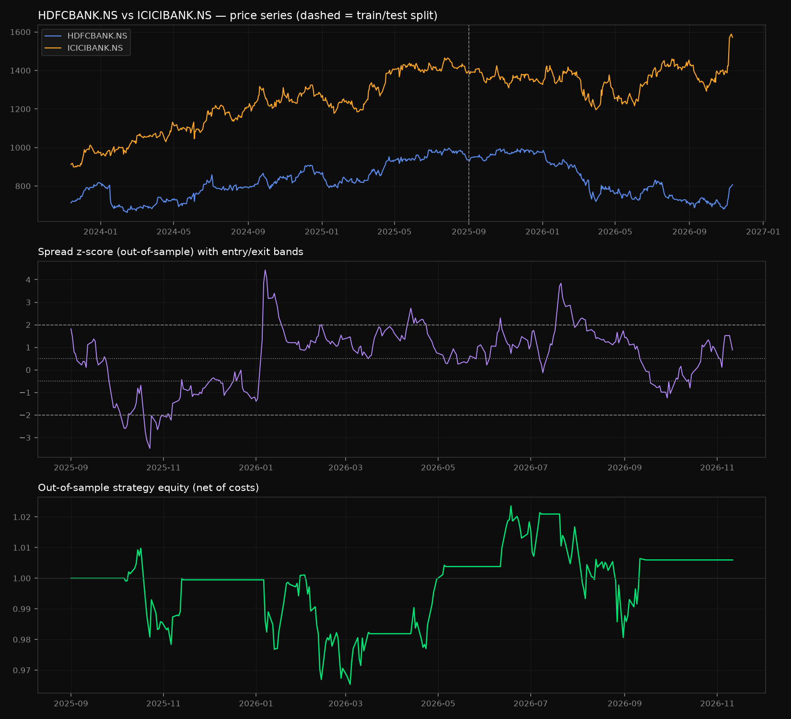

---

### AXISBANK.NS / ICICIBANK.NS

- **Latest prices:** AXISBANK.NS ₹1,336.40 · ICICIBANK.NS ₹1,571.60
- **Hedge ratio (train-fitted):** 0.6005
- **Cointegration (train):** FAIL at 5% — ADF -0.77, p=0.8264
- **Persistence:** passed 5% in 0 of 96 real-data runs (strict tier: 0/96)
- **Spread half-life:** 197.0 days
- **Current z-score:** +2.49
- **Signal today:** SHORT spread (short ICICIBANK.NS, long AXISBANK.NS)
- ⚠️ _Pair did not cointegrate on training data. Any signal here is not statistically justified — observation only._

**Out-of-sample backtest** (beta frozen from train window):

| Metric | Value |
|---|---|
| Sharpe | -0.16 |
| Sortino | -0.17 |
| Annualised return | -1.96% |
| Annualised vol | 9.44% |
| Max drawdown | -10.18% |
| Round-trip trades | 5 |

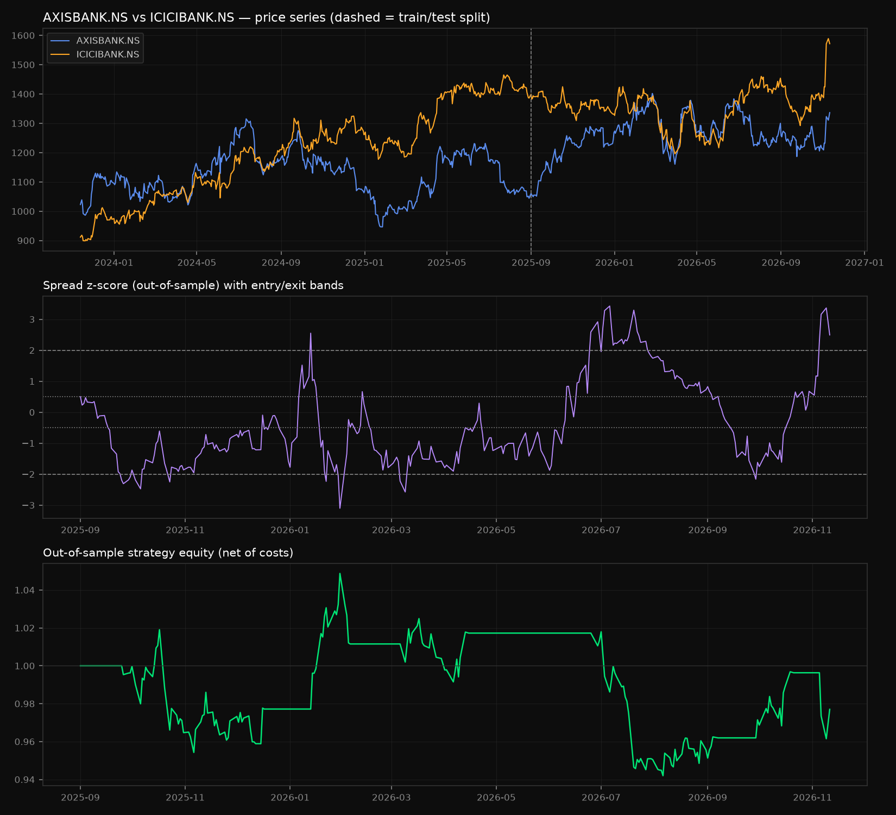

---

### KOTAKBANK.NS / HDFCBANK.NS

- **Latest prices:** KOTAKBANK.NS ₹487.70 · HDFCBANK.NS ₹806.60
- **Hedge ratio (train-fitted):** 2.2334
- **Cointegration (train):** FAIL at 5% — ADF -2.39, p=0.1453
- **Persistence:** passed 5% in 0 of 96 real-data runs (strict tier: 0/96)
- **Spread half-life:** 26.3 days
- **Current z-score:** -0.90
- **Signal today:** watch (approaching band)
- ⚠️ _Pair did not cointegrate on training data. Any signal here is not statistically justified — observation only._

**Out-of-sample backtest** (beta frozen from train window):

| Metric | Value |
|---|---|
| Sharpe | 1.55 |
| Sortino | 1.58 |
| Annualised return | 9.74% |
| Annualised vol | 6.13% |
| Max drawdown | -2.88% |
| Round-trip trades | 5 |

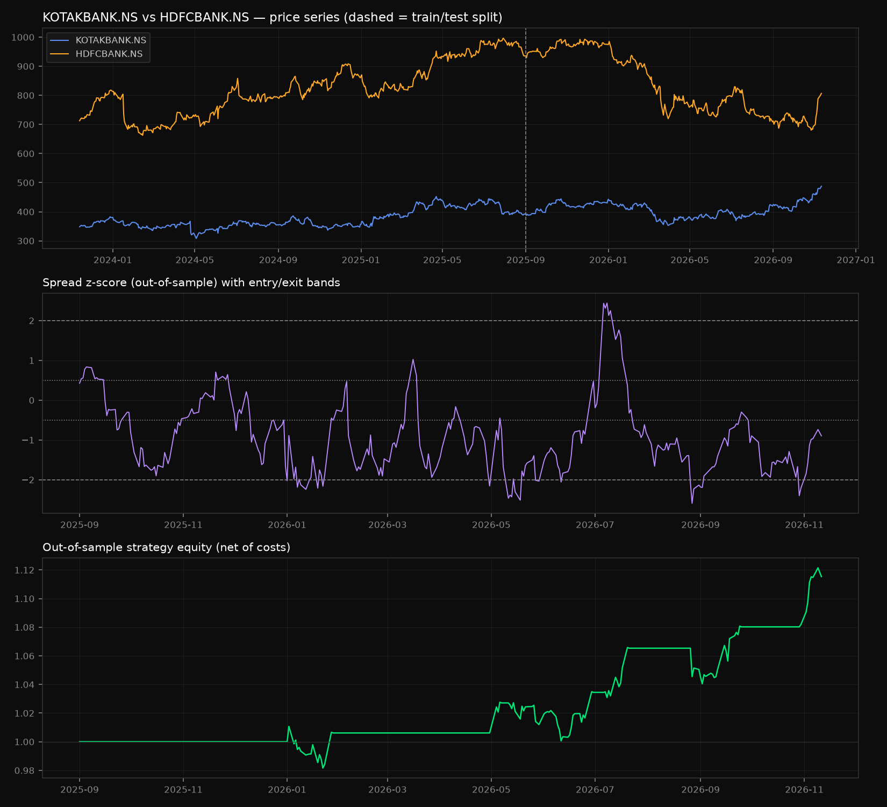

---

### SBIN.NS / BANKBARODA.NS

- **Latest prices:** SBIN.NS ₹1,061.20 · BANKBARODA.NS ₹275.00
- **Hedge ratio (train-fitted):** 0.1779
- **Cointegration (train):** FAIL at 5% — ADF -2.45, p=0.1272
- **Persistence:** passed 5% in 0 of 96 real-data runs (strict tier: 0/96)
- **Spread half-life:** 20.1 days
- **Current z-score:** +4.09
- **Signal today:** SHORT spread (short BANKBARODA.NS, long SBIN.NS)
- ⚠️ _Pair did not cointegrate on training data. Any signal here is not statistically justified — observation only._

**Out-of-sample backtest** (beta frozen from train window):

| Metric | Value |
|---|---|
| Sharpe | 0.09 |
| Sortino | 0.08 |
| Annualised return | 0.37% |
| Annualised vol | 10.63% |
| Max drawdown | -8.87% |
| Round-trip trades | 7 |

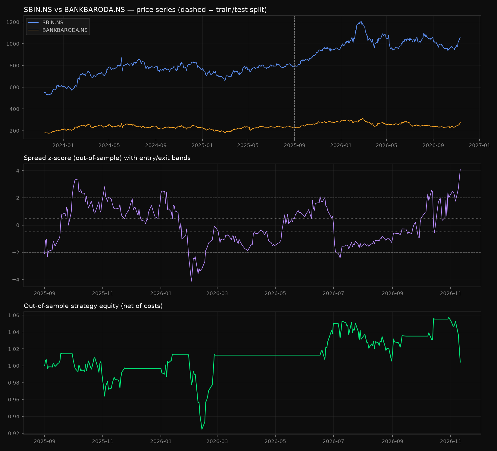

---

### TCS.NS / INFY.NS

- **Latest prices:** TCS.NS ₹2,472.10 · INFY.NS ₹1,155.00
- **Hedge ratio (train-fitted):** 0.3796
- **Cointegration (train):** FAIL at 5% — ADF -1.40, p=0.5844
- **Persistence:** passed 5% in 0 of 96 real-data runs (strict tier: 0/96)
- **Spread half-life:** 67.6 days
- **Current z-score:** +0.41
- **Signal today:** flat / no stretch
- ⚠️ _Pair did not cointegrate on training data. Any signal here is not statistically justified — observation only._

**Out-of-sample backtest** (beta frozen from train window):

| Metric | Value |
|---|---|
| Sharpe | 1.88 |
| Sortino | 2.21 |
| Annualised return | 9.52% |
| Annualised vol | 4.90% |
| Max drawdown | -2.80% |
| Round-trip trades | 7 |

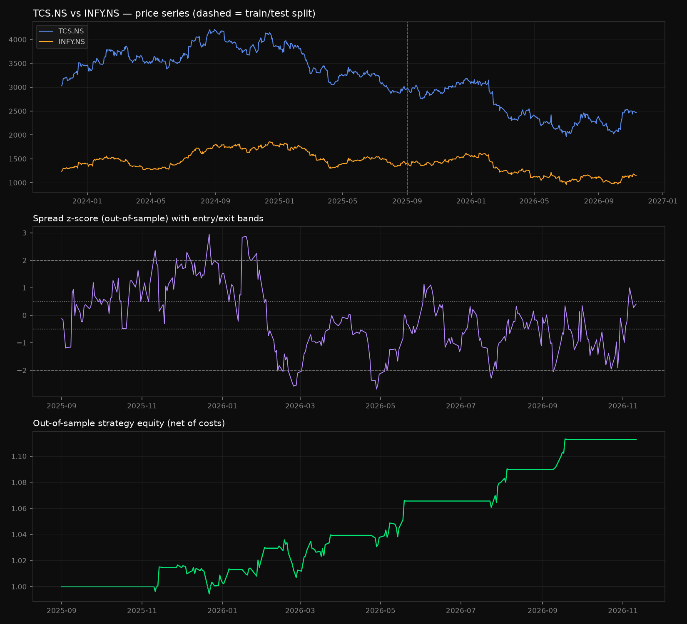

---

### INFY.NS / WIPRO.NS

- **Latest prices:** INFY.NS ₹1,155.00 · WIPRO.NS ₹197.99
- **Hedge ratio (train-fitted):** 0.1177
- **Cointegration (train):** FAIL at 5% — ADF -2.62, p=0.0880
- **Persistence:** passed 5% in 0 of 96 real-data runs (strict tier: 0/96)
- **Spread half-life:** 25.3 days
- **Current z-score:** +1.99
- **Signal today:** watch (approaching band)
- ⚠️ _Pair did not cointegrate on training data. Any signal here is not statistically justified — observation only._

**Out-of-sample backtest** (beta frozen from train window):

| Metric | Value |
|---|---|
| Sharpe | 2.76 |
| Sortino | 3.69 |
| Annualised return | 17.06% |
| Annualised vol | 5.77% |
| Max drawdown | -3.30% |
| Round-trip trades | 6 |

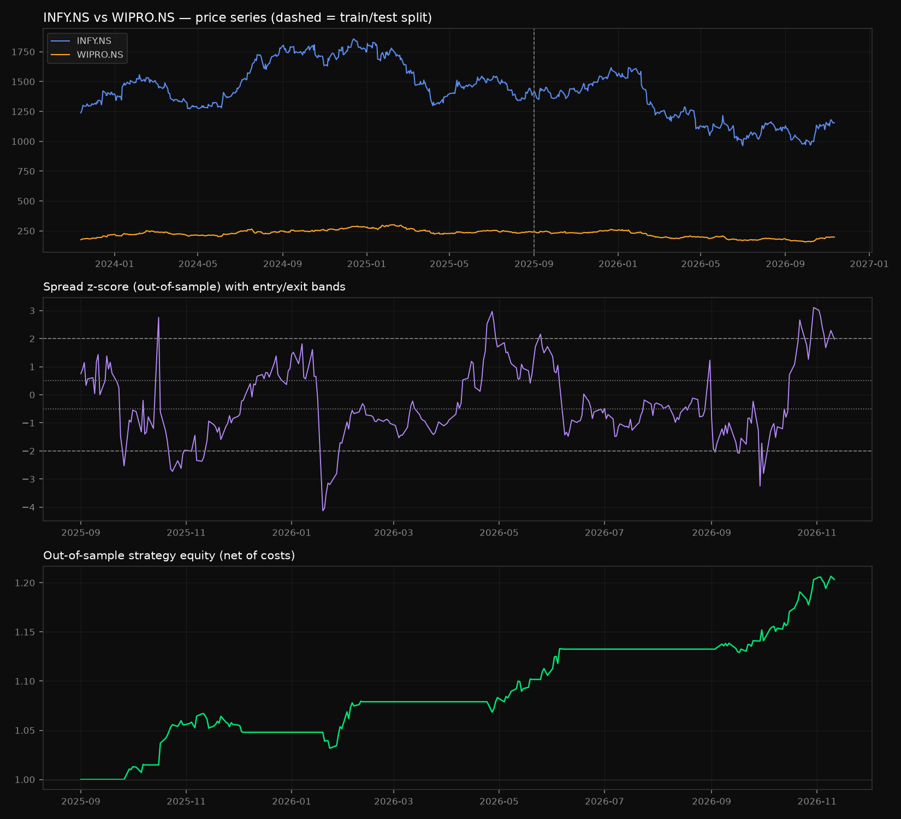

---

### HCLTECH.NS / TECHM.NS

- **Latest prices:** HCLTECH.NS ₹1,395.00 · TECHM.NS ₹1,788.50
- **Hedge ratio (train-fitted):** 0.9383
- **Cointegration (train):** FAIL at 5% — ADF -2.25, p=0.1877
- **Persistence:** passed 5% in 0 of 96 real-data runs (strict tier: 0/96)
- **Spread half-life:** 27.3 days
- **Current z-score:** +1.69
- **Signal today:** watch (approaching band)
- ⚠️ _Pair did not cointegrate on training data. Any signal here is not statistically justified — observation only._

**Out-of-sample backtest** (beta frozen from train window):

| Metric | Value |
|---|---|
| Sharpe | -0.06 |
| Sortino | -0.06 |
| Annualised return | -0.71% |
| Annualised vol | 7.64% |
| Max drawdown | -8.34% |
| Round-trip trades | 5 |

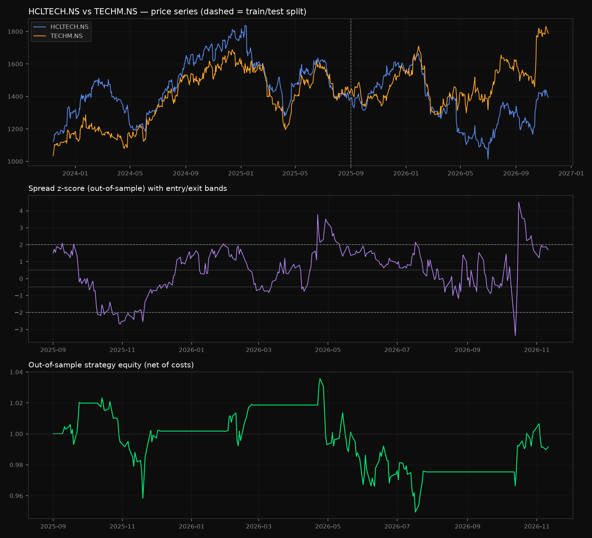

---

### ACC.NS / AMBUJACEM.NS

- **Latest prices:** ACC.NS ₹1,238.20 · AMBUJACEM.NS ₹389.80
- **Hedge ratio (train-fitted):** 0.1391
- **Cointegration (train):** FAIL at 5% — ADF -2.36, p=0.1541
- **Persistence:** passed 5% in 0 of 96 real-data runs (strict tier: 0/96)
- **Spread half-life:** 32.7 days
- **Current z-score:** +0.42
- **Signal today:** flat / no stretch
- ⚠️ _Pair did not cointegrate on training data. Any signal here is not statistically justified — observation only._

**Out-of-sample backtest** (beta frozen from train window):

| Metric | Value |
|---|---|
| Sharpe | -0.10 |
| Sortino | -0.08 |
| Annualised return | -0.98% |
| Annualised vol | 7.33% |
| Max drawdown | -7.71% |
| Round-trip trades | 4 |

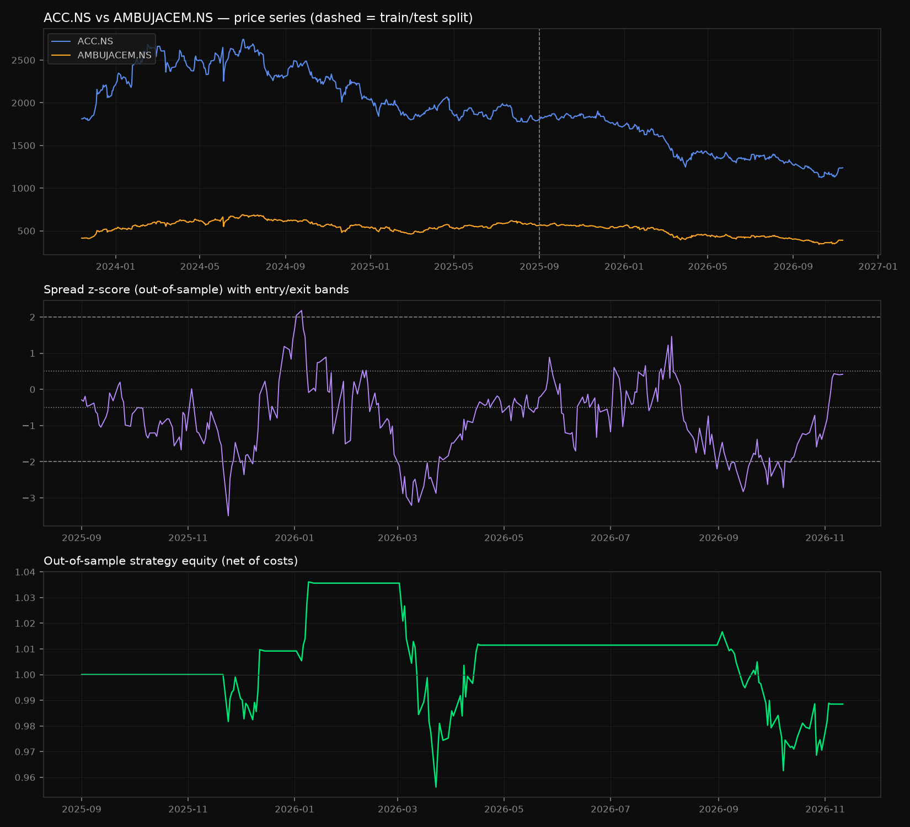

---

### ULTRACEMCO.NS / SHREECEM.NS

- **Latest prices:** ULTRACEMCO.NS ₹12,362.00 · SHREECEM.NS ₹25,270.00
- **Hedge ratio (train-fitted):** 1.2016
- **Cointegration (train):** FAIL at 5% — ADF -2.06, p=0.2614
- **Persistence:** passed 5% in 0 of 96 real-data runs (strict tier: 0/96)
- **Spread half-life:** 37.9 days
- **Current z-score:** +1.29
- **Signal today:** watch (approaching band)
- ⚠️ _Pair did not cointegrate on training data. Any signal here is not statistically justified — observation only._

**Out-of-sample backtest** (beta frozen from train window):

| Metric | Value |
|---|---|
| Sharpe | -0.28 |
| Sortino | -0.35 |
| Annualised return | -2.25% |
| Annualised vol | 7.21% |
| Max drawdown | -6.82% |
| Round-trip trades | 6 |

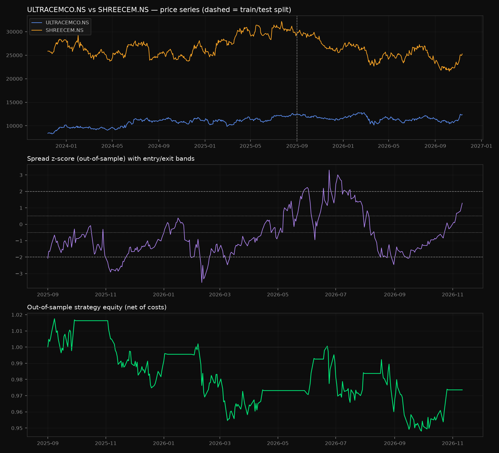

---

### IOC.NS / BPCL.NS

- **Latest prices:** IOC.NS ₹148.38 · BPCL.NS ₹315.25
- **Hedge ratio (train-fitted):** 1.4803
- **Cointegration (train):** FAIL at 5% — ADF -1.37, p=0.5964
- **Persistence:** passed 5% in 0 of 96 real-data runs (strict tier: 0/96)
- **Spread half-life:** 89.8 days
- **Current z-score:** -1.29
- **Signal today:** watch (approaching band)
- ⚠️ _Pair did not cointegrate on training data. Any signal here is not statistically justified — observation only._

**Out-of-sample backtest** (beta frozen from train window):

| Metric | Value |
|---|---|
| Sharpe | 0.54 |
| Sortino | 0.57 |
| Annualised return | 3.82% |
| Annualised vol | 7.42% |
| Max drawdown | -5.80% |
| Round-trip trades | 6 |

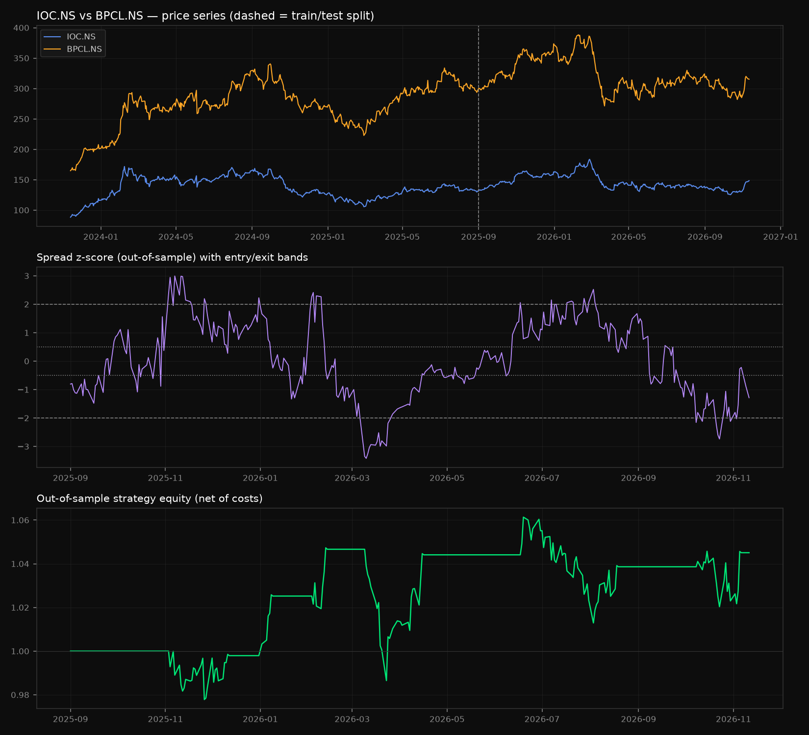

---

### BPCL.NS / HINDPETRO.NS

- **Latest prices:** BPCL.NS ₹315.25 · HINDPETRO.NS ₹400.15
- **Hedge ratio (train-fitted):** 1.2795
- **Cointegration (train):** FAIL at 5% — ADF -2.10, p=0.2450
- **Persistence:** passed 5% in 0 of 96 real-data runs (strict tier: 0/96)
- **Spread half-life:** 35.8 days
- **Current z-score:** +3.45
- **Signal today:** SHORT spread (short HINDPETRO.NS, long BPCL.NS)
- ⚠️ _Pair did not cointegrate on training data. Any signal here is not statistically justified — observation only._

**Out-of-sample backtest** (beta frozen from train window):

| Metric | Value |
|---|---|
| Sharpe | -0.39 |
| Sortino | -0.42 |
| Annualised return | -3.00% |
| Annualised vol | 7.14% |
| Max drawdown | -7.06% |
| Round-trip trades | 5 |

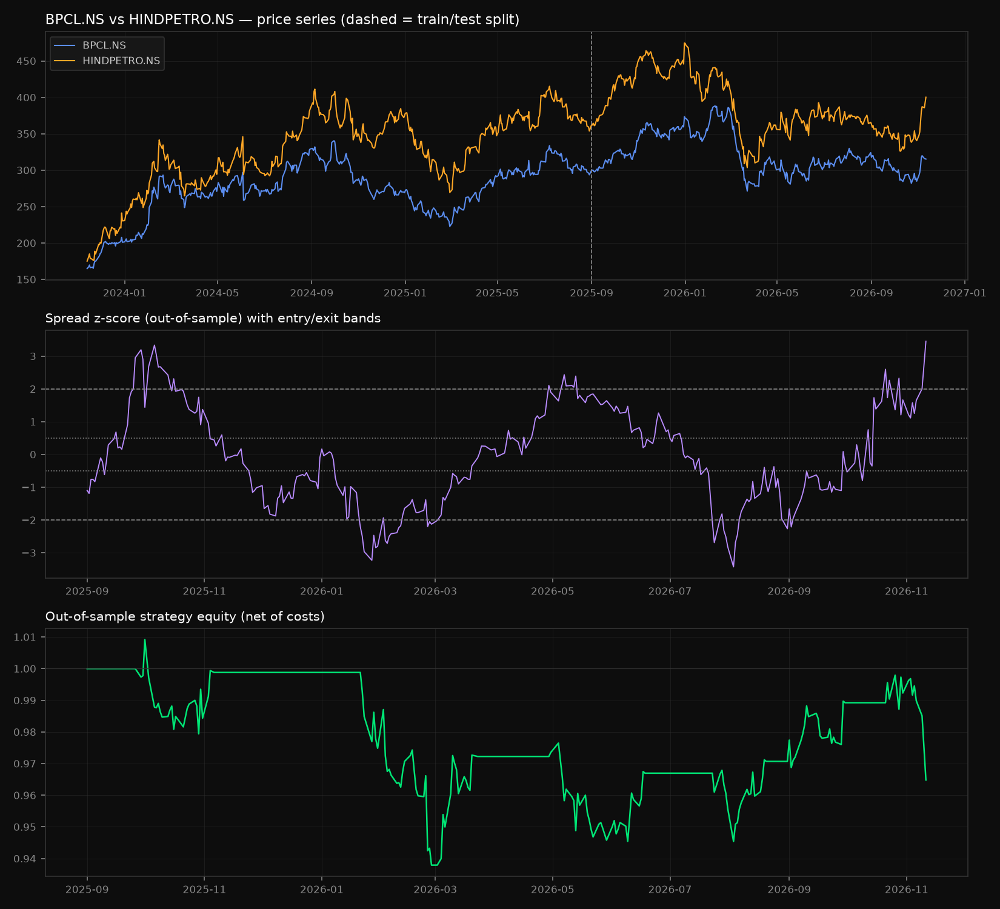

---

### ONGC.NS / COALINDIA.NS

- **Latest prices:** ONGC.NS ₹226.80 · COALINDIA.NS ₹406.30
- **Hedge ratio (train-fitted):** 1.3446
- **Cointegration (train):** PASS at 5% — ADF -3.43, p=0.0099
- **Persistence:** passed 5% in 88 of 96 real-data runs (strict tier: 1/96)
- **Spread half-life:** 13.3 days
- **Current z-score:** +0.08
- **Signal today:** flat / no stretch

**Out-of-sample backtest** (beta frozen from train window):

| Metric | Value |
|---|---|
| Sharpe | 0.88 |
| Sortino | 0.76 |
| Annualised return | 7.13% |
| Annualised vol | 8.19% |
| Max drawdown | -6.45% |
| Round-trip trades | 6 |

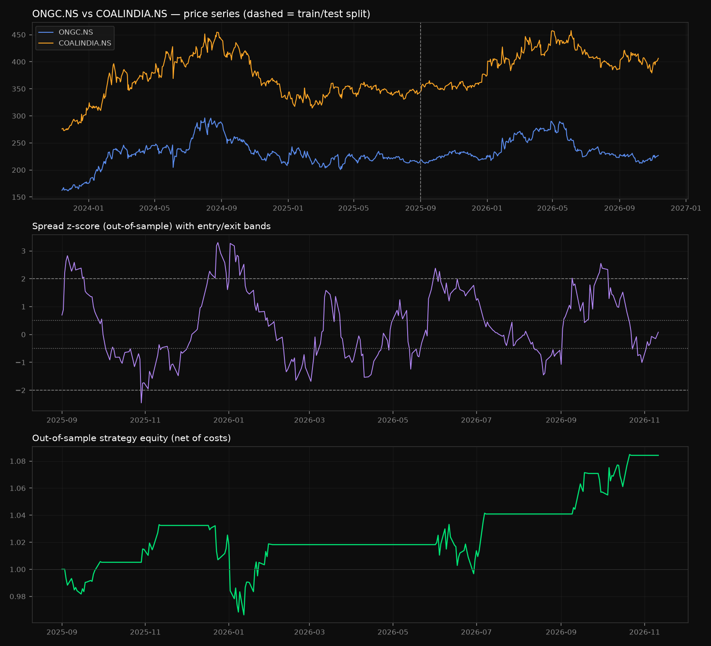

---

### NTPC.NS / POWERGRID.NS

- **Latest prices:** NTPC.NS ₹327.00 · POWERGRID.NS ₹263.75
- **Hedge ratio (train-fitted):** 0.7943
- **Cointegration (train):** FAIL at 5% — ADF -2.56, p=0.1023
- **Persistence:** passed 5% in 0 of 96 real-data runs (strict tier: 0/96)
- **Spread half-life:** 23.8 days
- **Current z-score:** -0.06
- **Signal today:** flat / no stretch
- ⚠️ _Pair did not cointegrate on training data. Any signal here is not statistically justified — observation only._

**Out-of-sample backtest** (beta frozen from train window):

| Metric | Value |
|---|---|
| Sharpe | 0.71 |
| Sortino | 0.53 |
| Annualised return | 3.91% |
| Annualised vol | 5.62% |
| Max drawdown | -5.37% |
| Round-trip trades | 6 |

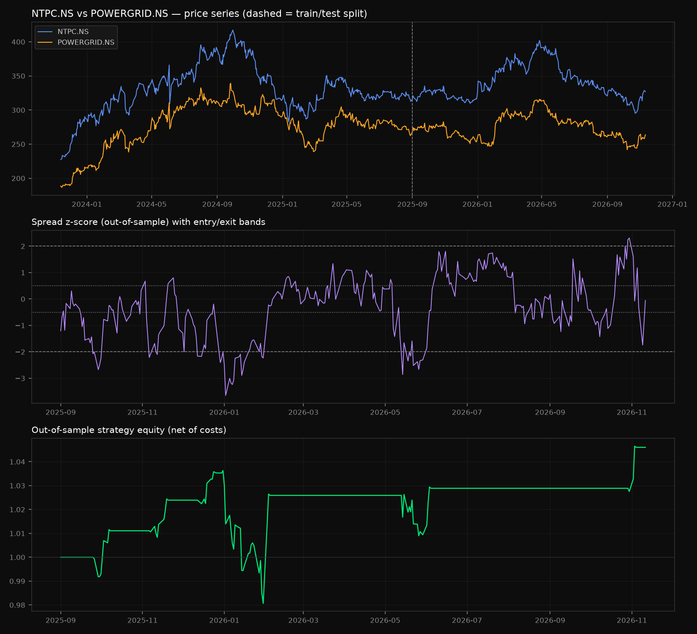

---

### BAJAJ-AUTO.NS / HEROMOTOCO.NS

- **Latest prices:** BAJAJ-AUTO.NS ₹11,040.00 · HEROMOTOCO.NS ₹5,345.00
- **Hedge ratio (train-fitted):** 0.4036
- **Cointegration (train):** FAIL at 5% — ADF -1.81, p=0.3752
- **Persistence:** passed 5% in 0 of 96 real-data runs (strict tier: 0/96)
- **Spread half-life:** 38.2 days
- **Current z-score:** +0.11
- **Signal today:** flat / no stretch
- ⚠️ _Pair did not cointegrate on training data. Any signal here is not statistically justified — observation only._

**Out-of-sample backtest** (beta frozen from train window):

| Metric | Value |
|---|---|
| Sharpe | 0.05 |
| Sortino | 0.05 |
| Annualised return | 0.03% |
| Annualised vol | 8.56% |
| Max drawdown | -11.47% |
| Round-trip trades | 6 |

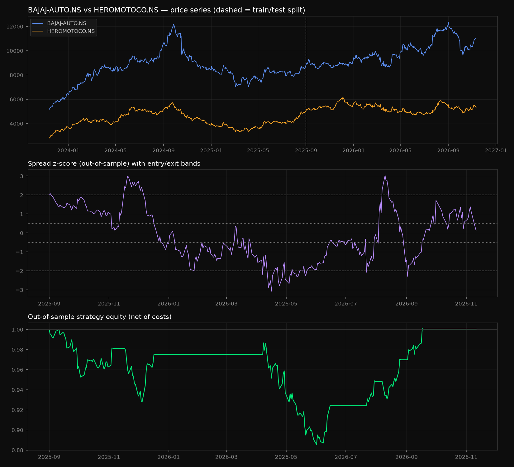

---

### TATASTEEL.NS / JSWSTEEL.NS

- **Latest prices:** TATASTEEL.NS ₹189.28 · JSWSTEEL.NS ₹1,353.30
- **Hedge ratio (train-fitted):** 2.6834
- **Cointegration (train):** FAIL at 5% — ADF -1.40, p=0.5844
- **Persistence:** passed 5% in 0 of 96 real-data runs (strict tier: 0/96)
- **Spread half-life:** 59.2 days
- **Current z-score:** +1.46
- **Signal today:** watch (approaching band)
- ⚠️ _Pair did not cointegrate on training data. Any signal here is not statistically justified — observation only._

**Out-of-sample backtest** (beta frozen from train window):

| Metric | Value |
|---|---|
| Sharpe | 0.52 |
| Sortino | 0.51 |
| Annualised return | 4.40% |
| Annualised vol | 9.16% |
| Max drawdown | -5.90% |
| Round-trip trades | 5 |

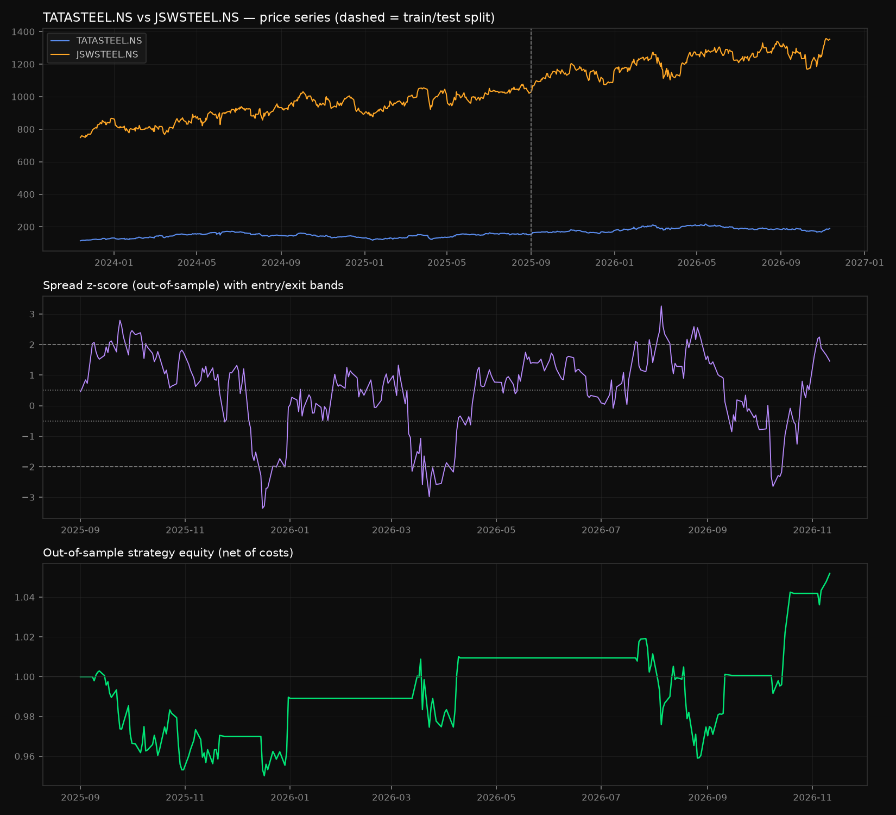

---

### SUNPHARMA.NS / CIPLA.NS

- **Latest prices:** SUNPHARMA.NS ₹1,902.30 · CIPLA.NS ₹1,419.90
- **Hedge ratio (train-fitted):** 0.4695
- **Cointegration (train):** FAIL at 5% — ADF -2.69, p=0.0762
- **Persistence:** passed 5% in 92 of 96 real-data runs (strict tier: 5/96)
- **Spread half-life:** 13.5 days
- **Current z-score:** +0.51
- **Signal today:** watch (approaching band)
- ⚠️ _Pair did not cointegrate on training data. Any signal here is not statistically justified — observation only._

**Out-of-sample backtest** (beta frozen from train window):

| Metric | Value |
|---|---|
| Sharpe | 0.72 |
| Sortino | 0.79 |
| Annualised return | 5.24% |
| Annualised vol | 7.43% |
| Max drawdown | -10.15% |
| Round-trip trades | 6 |

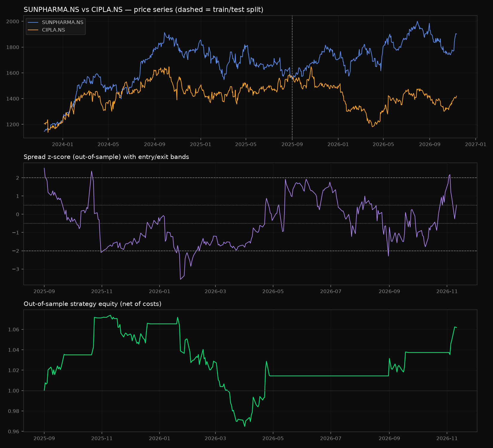

---

_Generated 2026-11-12 · pairs mean-reversion scanner · out-of-sample backtest · multiple-testing-aware · not investment advice._
