# Indian Pairs-Trading Scanner — 2026-11-13

> **What this is:** a market-neutral *pairs mean-reversion* scanner. It flags when two related NSE stocks have drifted apart far enough that their historical relationship signals a possible convergence trade. It does **not** forecast growth, rank "best" stocks, or predict company performance. A signal means the *spread between two stocks* is stretched — nothing about either stock being a good investment. Not investment advice; do your own research.

## Methodology (fixed in advance)

- **Universe:** 16 declared sector-mate pairs. Parameters (3y window, 60/40 train-test, z-entry 2.0, z-exit 0.5, 5 bps costs) are pre-registered; changes are logged in the README changelog *before* looking at results.
- **Multiple testing:** at the 5% level across 16 pairs, **≈0.8 false positives per run are expected by chance alone** even if nothing truly cointegrates. A single-day pass is a candidate, not a discovery.
- **Strict tier:** Bonferroni-corrected threshold p < 0.0031 (marked ✓✓).
- **Evidence = persistence:** the Persistence column counts how often each pair has passed the 5% test across all *real-data* daily runs recorded in `reports/history.csv`. Pairs deserve attention only when they pass persistently.

## Summary

| Pair | p-value | Coint. | Persistence | Current z | Signal | OOS Sharpe |
|---|---|---|---|---|---|---|
| HDFCBANK.NS/ICICIBANK.NS | 0.0589 | ✗ | 1/80 | +1.06 | watch | 0.11 |
| AXISBANK.NS/ICICIBANK.NS | 0.8265 | ✗ | 0/97 | +2.61 | SHORT spread | -0.22 |
| KOTAKBANK.NS/HDFCBANK.NS | 0.1384 | ✗ | 0/97 | -0.88 | watch | 1.54 |
| SBIN.NS/BANKBARODA.NS | 0.1245 | ✗ | 0/97 | +3.17 | SHORT spread | 0.18 |
| TCS.NS/INFY.NS | 0.6050 | ✗ | 0/97 | +0.79 | watch | 1.89 |
| INFY.NS/WIPRO.NS | 0.0809 | ✗ | 0/97 | +1.69 | watch | 2.71 |
| HCLTECH.NS/TECHM.NS | 0.2044 | ✗ | 0/97 | +1.60 | watch | -0.05 |
| ACC.NS/AMBUJACEM.NS | 0.1556 | ✗ | 0/97 | +0.39 | flat / no stretch | -0.10 |
| ULTRACEMCO.NS/SHREECEM.NS | 0.2606 | ✗ | 0/97 | +1.26 | watch | -0.52 |
| IOC.NS/BPCL.NS | 0.6142 | ✗ | 0/97 | -1.31 | watch | 0.54 |
| BPCL.NS/HINDPETRO.NS | 0.2441 | ✗ | 0/97 | +2.69 | SHORT spread | -0.31 |
| ONGC.NS/COALINDIA.NS | 0.0098 | ✓ | 89/97 | +0.15 | flat / no stretch | 0.88 |
| NTPC.NS/POWERGRID.NS | 0.1021 | ✗ | 0/97 | -0.36 | flat / no stretch | 0.71 |
| BAJAJ-AUTO.NS/HEROMOTOCO.NS | 0.3891 | ✗ | 0/97 | +0.29 | flat / no stretch | 0.09 |
| TATASTEEL.NS/JSWSTEEL.NS | 0.5906 | ✗ | 0/97 | +1.46 | watch | 0.50 |
| SUNPHARMA.NS/CIPLA.NS | 0.0961 | ✗ | 92/97 | +0.38 | flat / no stretch | 0.63 |

_Legend: ✓✓ passes strict Bonferroni tier · ✓ passes 5% only · ✗ fails. Persistence = 5%-passes / real-data runs recorded. \*no real-data history yet._

---

### HDFCBANK.NS / ICICIBANK.NS

- **Latest prices:** HDFCBANK.NS ₹812.30 · ICICIBANK.NS ₹1,590.00
- **Hedge ratio (train-fitted):** 1.5270
- **Cointegration (train):** FAIL at 5% — ADF -2.80, p=0.0589
- **Persistence:** passed 5% in 1 of 80 real-data runs (strict tier: 0/80)
- **Spread half-life:** 22.7 days
- **Current z-score:** +1.06
- **Signal today:** watch (approaching band)
- ⚠️ _Pair did not cointegrate on training data. Any signal here is not statistically justified — observation only._

**Out-of-sample backtest** (beta frozen from train window):

| Metric | Value |
|---|---|
| Sharpe | 0.11 |
| Sortino | 0.12 |
| Annualised return | 0.51% |
| Annualised vol | 6.19% |
| Max drawdown | -4.44% |
| Round-trip trades | 5 |

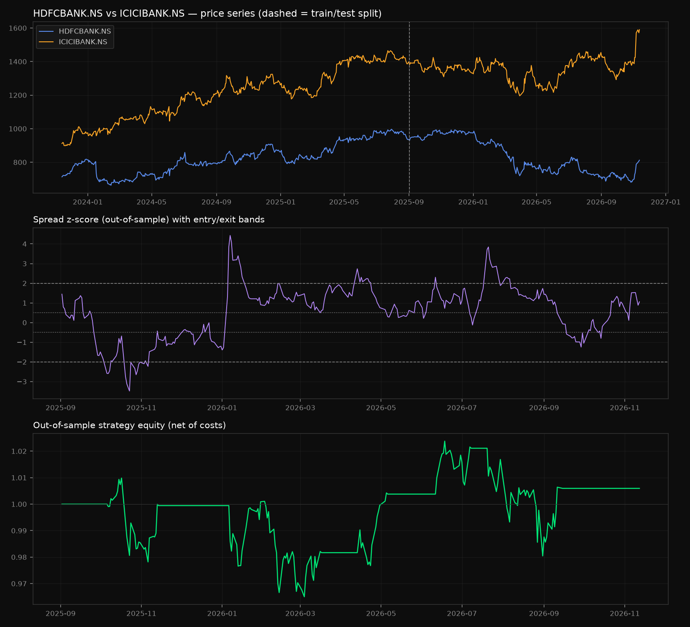

---

### AXISBANK.NS / ICICIBANK.NS

- **Latest prices:** AXISBANK.NS ₹1,342.90 · ICICIBANK.NS ₹1,590.00
- **Hedge ratio (train-fitted):** 0.5947
- **Cointegration (train):** FAIL at 5% — ADF -0.77, p=0.8265
- **Persistence:** passed 5% in 0 of 97 real-data runs (strict tier: 0/97)
- **Spread half-life:** 200.5 days
- **Current z-score:** +2.61
- **Signal today:** SHORT spread (short ICICIBANK.NS, long AXISBANK.NS)
- ⚠️ _Pair did not cointegrate on training data. Any signal here is not statistically justified — observation only._

**Out-of-sample backtest** (beta frozen from train window):

| Metric | Value |
|---|---|
| Sharpe | -0.22 |
| Sortino | -0.24 |
| Annualised return | -2.57% |
| Annualised vol | 9.56% |
| Max drawdown | -10.26% |
| Round-trip trades | 5 |

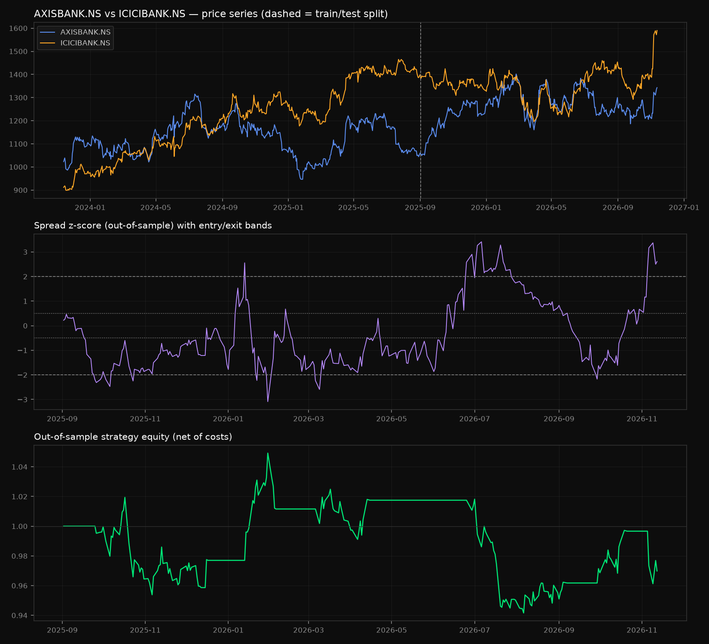

---

### KOTAKBANK.NS / HDFCBANK.NS

- **Latest prices:** KOTAKBANK.NS ₹490.40 · HDFCBANK.NS ₹812.30
- **Hedge ratio (train-fitted):** 2.2364
- **Cointegration (train):** FAIL at 5% — ADF -2.41, p=0.1384
- **Persistence:** passed 5% in 0 of 97 real-data runs (strict tier: 0/97)
- **Spread half-life:** 26.1 days
- **Current z-score:** -0.88
- **Signal today:** watch (approaching band)
- ⚠️ _Pair did not cointegrate on training data. Any signal here is not statistically justified — observation only._

**Out-of-sample backtest** (beta frozen from train window):

| Metric | Value |
|---|---|
| Sharpe | 1.54 |
| Sortino | 1.58 |
| Annualised return | 9.82% |
| Annualised vol | 6.19% |
| Max drawdown | -2.90% |
| Round-trip trades | 5 |

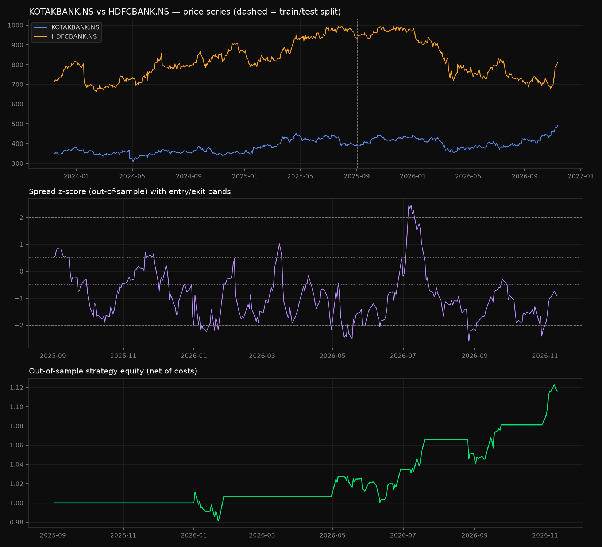

---

### SBIN.NS / BANKBARODA.NS

- **Latest prices:** SBIN.NS ₹1,086.50 · BANKBARODA.NS ₹276.15
- **Hedge ratio (train-fitted):** 0.1777
- **Cointegration (train):** FAIL at 5% — ADF -2.46, p=0.1245
- **Persistence:** passed 5% in 0 of 97 real-data runs (strict tier: 0/97)
- **Spread half-life:** 20.1 days
- **Current z-score:** +3.17
- **Signal today:** SHORT spread (short BANKBARODA.NS, long SBIN.NS)
- ⚠️ _Pair did not cointegrate on training data. Any signal here is not statistically justified — observation only._

**Out-of-sample backtest** (beta frozen from train window):

| Metric | Value |
|---|---|
| Sharpe | 0.18 |
| Sortino | 0.16 |
| Annualised return | 1.39% |
| Annualised vol | 10.56% |
| Max drawdown | -8.83% |
| Round-trip trades | 7 |

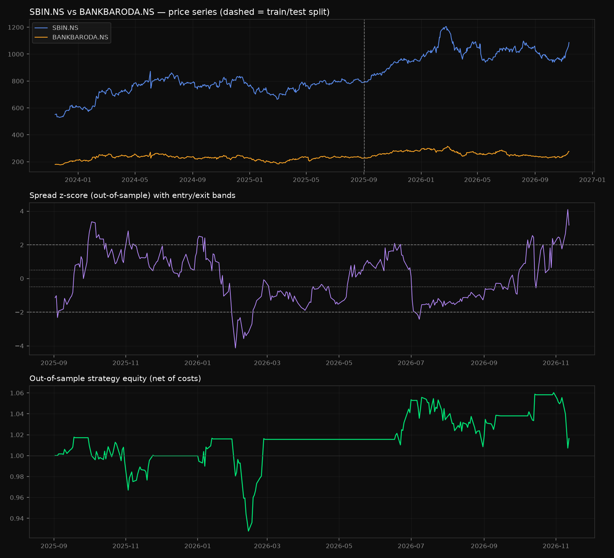

---

### TCS.NS / INFY.NS

- **Latest prices:** TCS.NS ₹2,442.40 · INFY.NS ₹1,151.20
- **Hedge ratio (train-fitted):** 0.3783
- **Cointegration (train):** FAIL at 5% — ADF -1.35, p=0.6050
- **Persistence:** passed 5% in 0 of 97 real-data runs (strict tier: 0/97)
- **Spread half-life:** 69.4 days
- **Current z-score:** +0.79
- **Signal today:** watch (approaching band)
- ⚠️ _Pair did not cointegrate on training data. Any signal here is not statistically justified — observation only._

**Out-of-sample backtest** (beta frozen from train window):

| Metric | Value |
|---|---|
| Sharpe | 1.89 |
| Sortino | 2.32 |
| Annualised return | 9.87% |
| Annualised vol | 5.05% |
| Max drawdown | -2.81% |
| Round-trip trades | 7 |

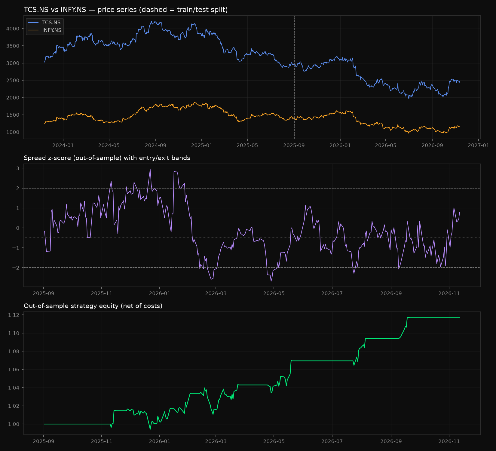

---

### INFY.NS / WIPRO.NS

- **Latest prices:** INFY.NS ₹1,151.20 · WIPRO.NS ₹196.20
- **Hedge ratio (train-fitted):** 0.1176
- **Cointegration (train):** FAIL at 5% — ADF -2.66, p=0.0809
- **Persistence:** passed 5% in 0 of 97 real-data runs (strict tier: 0/97)
- **Spread half-life:** 25.0 days
- **Current z-score:** +1.69
- **Signal today:** watch (approaching band)
- ⚠️ _Pair did not cointegrate on training data. Any signal here is not statistically justified — observation only._

**Out-of-sample backtest** (beta frozen from train window):

| Metric | Value |
|---|---|
| Sharpe | 2.71 |
| Sortino | 3.66 |
| Annualised return | 16.71% |
| Annualised vol | 5.77% |
| Max drawdown | -3.30% |
| Round-trip trades | 6 |

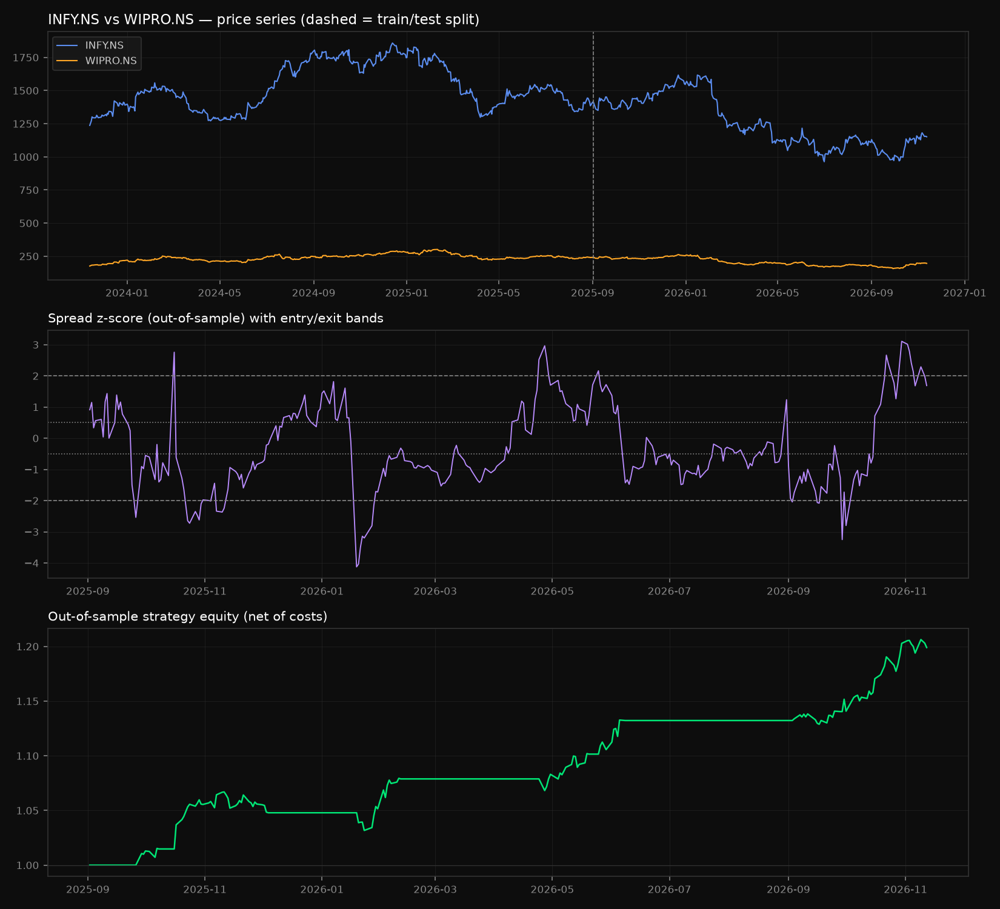

---

### HCLTECH.NS / TECHM.NS

- **Latest prices:** HCLTECH.NS ₹1,380.80 · TECHM.NS ₹1,774.00
- **Hedge ratio (train-fitted):** 0.9373
- **Cointegration (train):** FAIL at 5% — ADF -2.21, p=0.2044
- **Persistence:** passed 5% in 0 of 97 real-data runs (strict tier: 0/97)
- **Spread half-life:** 28.0 days
- **Current z-score:** +1.60
- **Signal today:** watch (approaching band)
- ⚠️ _Pair did not cointegrate on training data. Any signal here is not statistically justified — observation only._

**Out-of-sample backtest** (beta frozen from train window):

| Metric | Value |
|---|---|
| Sharpe | -0.05 |
| Sortino | -0.05 |
| Annualised return | -0.66% |
| Annualised vol | 7.63% |
| Max drawdown | -8.33% |
| Round-trip trades | 5 |

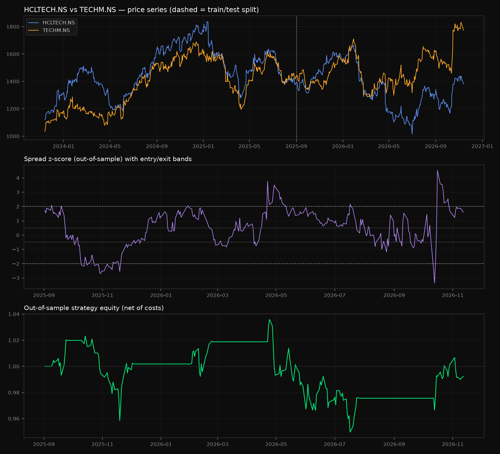

---

### ACC.NS / AMBUJACEM.NS

- **Latest prices:** ACC.NS ₹1,240.60 · AMBUJACEM.NS ₹389.40
- **Hedge ratio (train-fitted):** 0.1386
- **Cointegration (train):** FAIL at 5% — ADF -2.35, p=0.1556
- **Persistence:** passed 5% in 0 of 97 real-data runs (strict tier: 0/97)
- **Spread half-life:** 32.8 days
- **Current z-score:** +0.39
- **Signal today:** flat / no stretch
- ⚠️ _Pair did not cointegrate on training data. Any signal here is not statistically justified — observation only._

**Out-of-sample backtest** (beta frozen from train window):

| Metric | Value |
|---|---|
| Sharpe | -0.10 |
| Sortino | -0.08 |
| Annualised return | -0.99% |
| Annualised vol | 7.34% |
| Max drawdown | -7.73% |
| Round-trip trades | 4 |

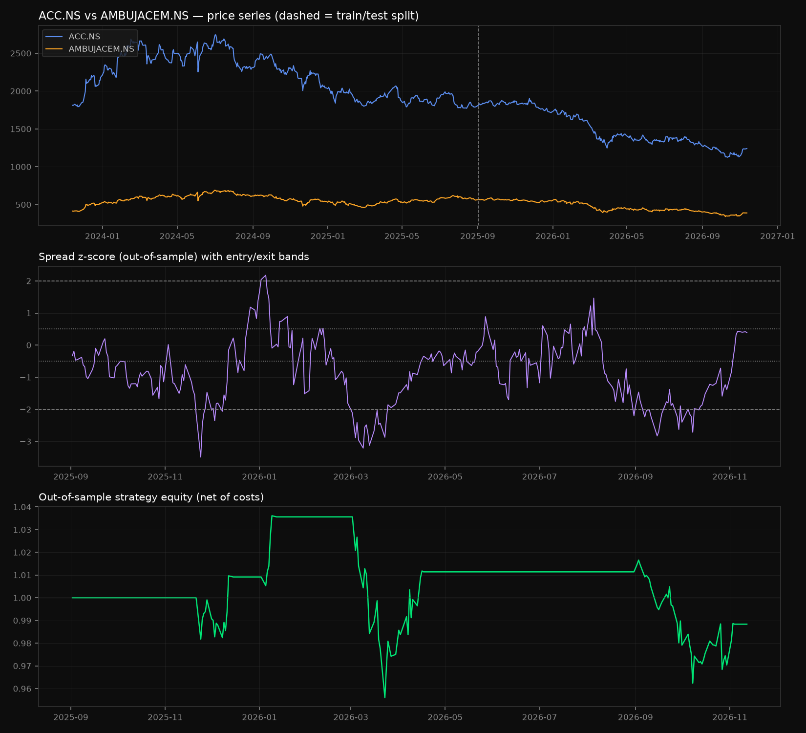

---

### ULTRACEMCO.NS / SHREECEM.NS

- **Latest prices:** ULTRACEMCO.NS ₹12,337.00 · SHREECEM.NS ₹25,205.00
- **Hedge ratio (train-fitted):** 1.2030
- **Cointegration (train):** FAIL at 5% — ADF -2.06, p=0.2606
- **Persistence:** passed 5% in 0 of 97 real-data runs (strict tier: 0/97)
- **Spread half-life:** 37.8 days
- **Current z-score:** +1.26
- **Signal today:** watch (approaching band)
- ⚠️ _Pair did not cointegrate on training data. Any signal here is not statistically justified — observation only._

**Out-of-sample backtest** (beta frozen from train window):

| Metric | Value |
|---|---|
| Sharpe | -0.52 |
| Sortino | -0.59 |
| Annualised return | -3.58% |
| Annualised vol | 6.61% |
| Max drawdown | -6.70% |
| Round-trip trades | 5 |

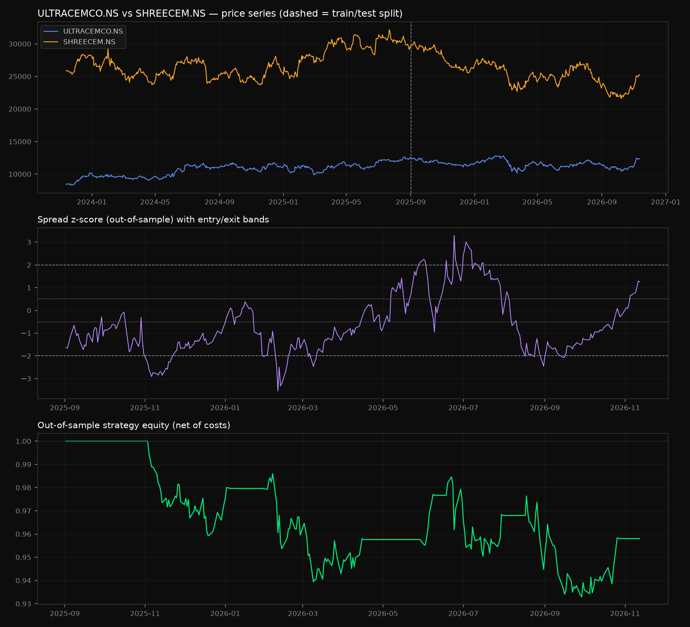

---

### IOC.NS / BPCL.NS

- **Latest prices:** IOC.NS ₹146.17 · BPCL.NS ₹311.50
- **Hedge ratio (train-fitted):** 1.4794
- **Cointegration (train):** FAIL at 5% — ADF -1.33, p=0.6142
- **Persistence:** passed 5% in 0 of 97 real-data runs (strict tier: 0/97)
- **Spread half-life:** 92.5 days
- **Current z-score:** -1.31
- **Signal today:** watch (approaching band)
- ⚠️ _Pair did not cointegrate on training data. Any signal here is not statistically justified — observation only._

**Out-of-sample backtest** (beta frozen from train window):

| Metric | Value |
|---|---|
| Sharpe | 0.54 |
| Sortino | 0.57 |
| Annualised return | 3.82% |
| Annualised vol | 7.42% |
| Max drawdown | -5.81% |
| Round-trip trades | 6 |

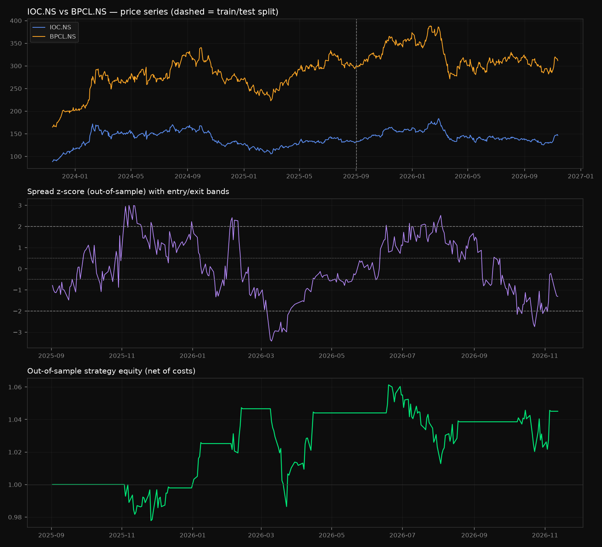

---

### BPCL.NS / HINDPETRO.NS

- **Latest prices:** BPCL.NS ₹311.50 · HINDPETRO.NS ₹390.60
- **Hedge ratio (train-fitted):** 1.2795
- **Cointegration (train):** FAIL at 5% — ADF -2.10, p=0.2441
- **Persistence:** passed 5% in 0 of 97 real-data runs (strict tier: 0/97)
- **Spread half-life:** 35.8 days
- **Current z-score:** +2.69
- **Signal today:** SHORT spread (short HINDPETRO.NS, long BPCL.NS)
- ⚠️ _Pair did not cointegrate on training data. Any signal here is not statistically justified — observation only._

**Out-of-sample backtest** (beta frozen from train window):

| Metric | Value |
|---|---|
| Sharpe | -0.31 |
| Sortino | -0.34 |
| Annualised return | -2.48% |
| Annualised vol | 7.17% |
| Max drawdown | -7.07% |
| Round-trip trades | 5 |

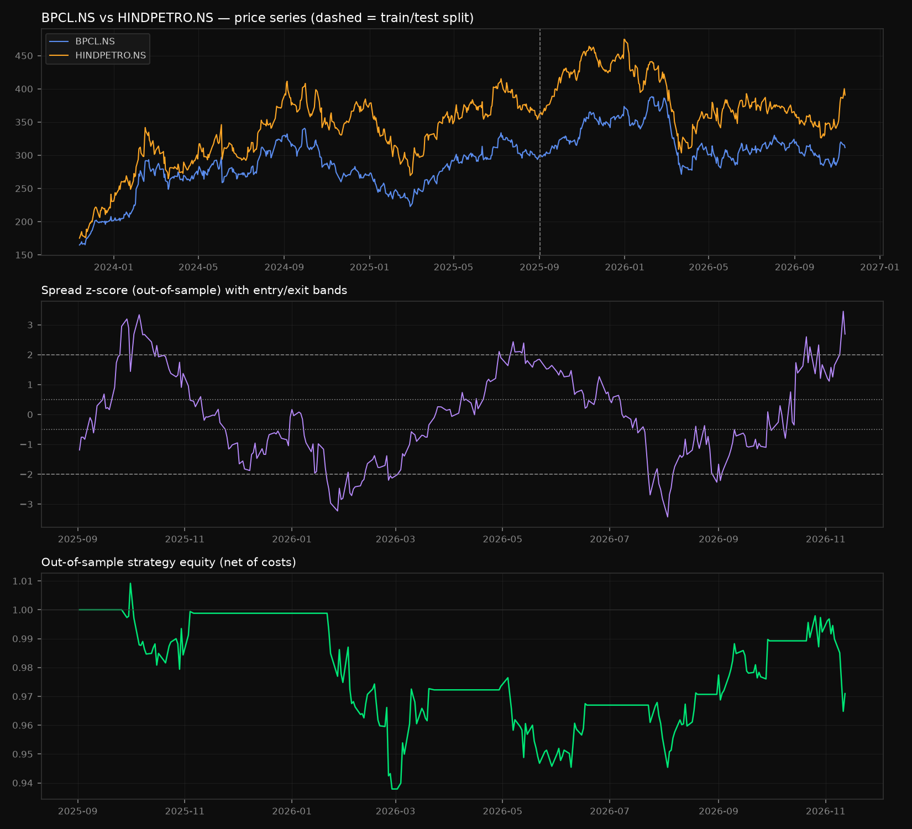

---

### ONGC.NS / COALINDIA.NS

- **Latest prices:** ONGC.NS ₹224.50 · COALINDIA.NS ₹404.30
- **Hedge ratio (train-fitted):** 1.3447
- **Cointegration (train):** PASS at 5% — ADF -3.43, p=0.0098
- **Persistence:** passed 5% in 89 of 97 real-data runs (strict tier: 1/97)
- **Spread half-life:** 13.3 days
- **Current z-score:** +0.15
- **Signal today:** flat / no stretch

**Out-of-sample backtest** (beta frozen from train window):

| Metric | Value |
|---|---|
| Sharpe | 0.88 |
| Sortino | 0.76 |
| Annualised return | 7.09% |
| Annualised vol | 8.15% |
| Max drawdown | -6.42% |
| Round-trip trades | 6 |

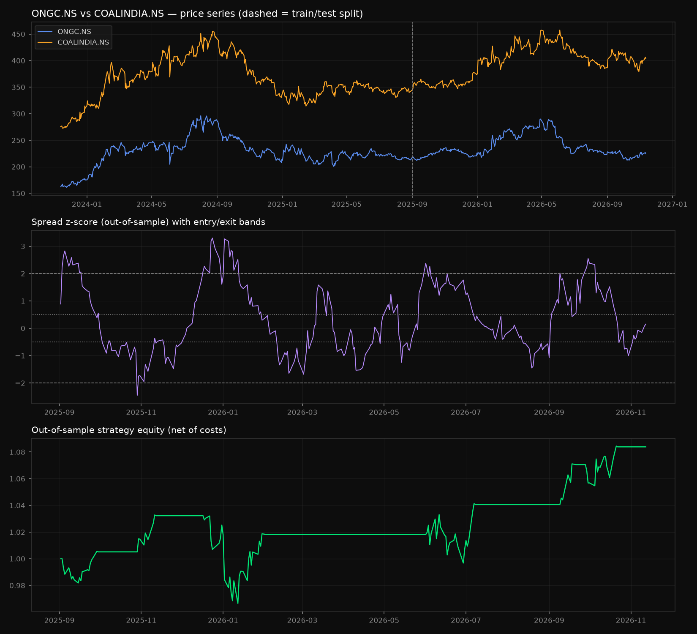

---

### NTPC.NS / POWERGRID.NS

- **Latest prices:** NTPC.NS ₹323.00 · POWERGRID.NS ₹259.45
- **Hedge ratio (train-fitted):** 0.7942
- **Cointegration (train):** FAIL at 5% — ADF -2.56, p=0.1021
- **Persistence:** passed 5% in 0 of 97 real-data runs (strict tier: 0/97)
- **Spread half-life:** 23.8 days
- **Current z-score:** -0.36
- **Signal today:** flat / no stretch
- ⚠️ _Pair did not cointegrate on training data. Any signal here is not statistically justified — observation only._

**Out-of-sample backtest** (beta frozen from train window):

| Metric | Value |
|---|---|
| Sharpe | 0.71 |
| Sortino | 0.53 |
| Annualised return | 3.83% |
| Annualised vol | 5.51% |
| Max drawdown | -5.26% |
| Round-trip trades | 6 |

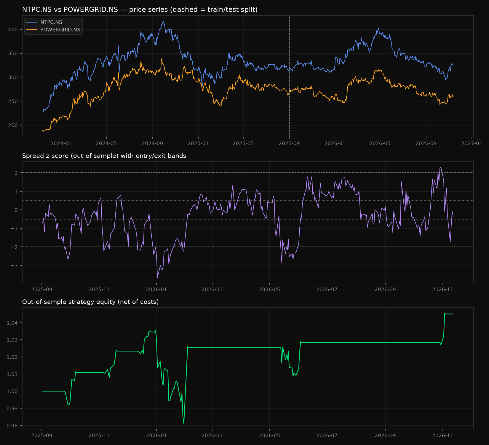

---

### BAJAJ-AUTO.NS / HEROMOTOCO.NS

- **Latest prices:** BAJAJ-AUTO.NS ₹10,945.00 · HEROMOTOCO.NS ₹5,342.00
- **Hedge ratio (train-fitted):** 0.4040
- **Cointegration (train):** FAIL at 5% — ADF -1.78, p=0.3891
- **Persistence:** passed 5% in 0 of 97 real-data runs (strict tier: 0/97)
- **Spread half-life:** 38.9 days
- **Current z-score:** +0.29
- **Signal today:** flat / no stretch
- ⚠️ _Pair did not cointegrate on training data. Any signal here is not statistically justified — observation only._

**Out-of-sample backtest** (beta frozen from train window):

| Metric | Value |
|---|---|
| Sharpe | 0.09 |
| Sortino | 0.09 |
| Annualised return | 0.43% |
| Annualised vol | 8.46% |
| Max drawdown | -11.36% |
| Round-trip trades | 6 |

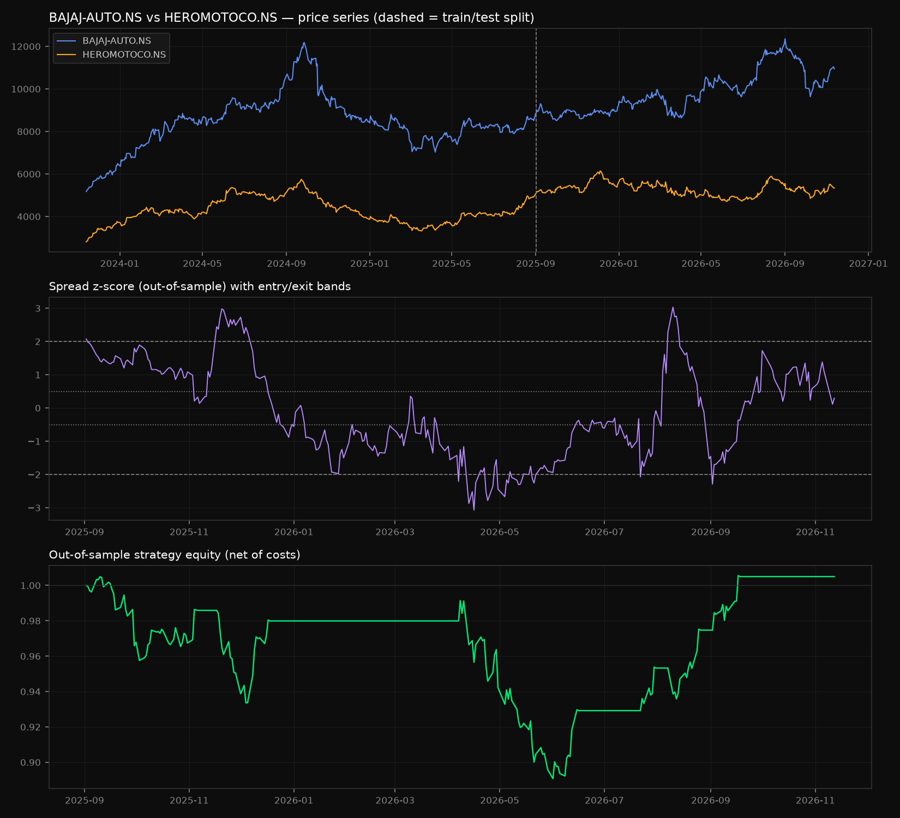

---

### TATASTEEL.NS / JSWSTEEL.NS

- **Latest prices:** TATASTEEL.NS ₹188.00 · JSWSTEEL.NS ₹1,352.10
- **Hedge ratio (train-fitted):** 2.6927
- **Cointegration (train):** FAIL at 5% — ADF -1.38, p=0.5906
- **Persistence:** passed 5% in 0 of 97 real-data runs (strict tier: 0/97)
- **Spread half-life:** 60.2 days
- **Current z-score:** +1.46
- **Signal today:** watch (approaching band)
- ⚠️ _Pair did not cointegrate on training data. Any signal here is not statistically justified — observation only._

**Out-of-sample backtest** (beta frozen from train window):

| Metric | Value |
|---|---|
| Sharpe | 0.50 |
| Sortino | 0.49 |
| Annualised return | 4.21% |
| Annualised vol | 9.05% |
| Max drawdown | -5.84% |
| Round-trip trades | 5 |

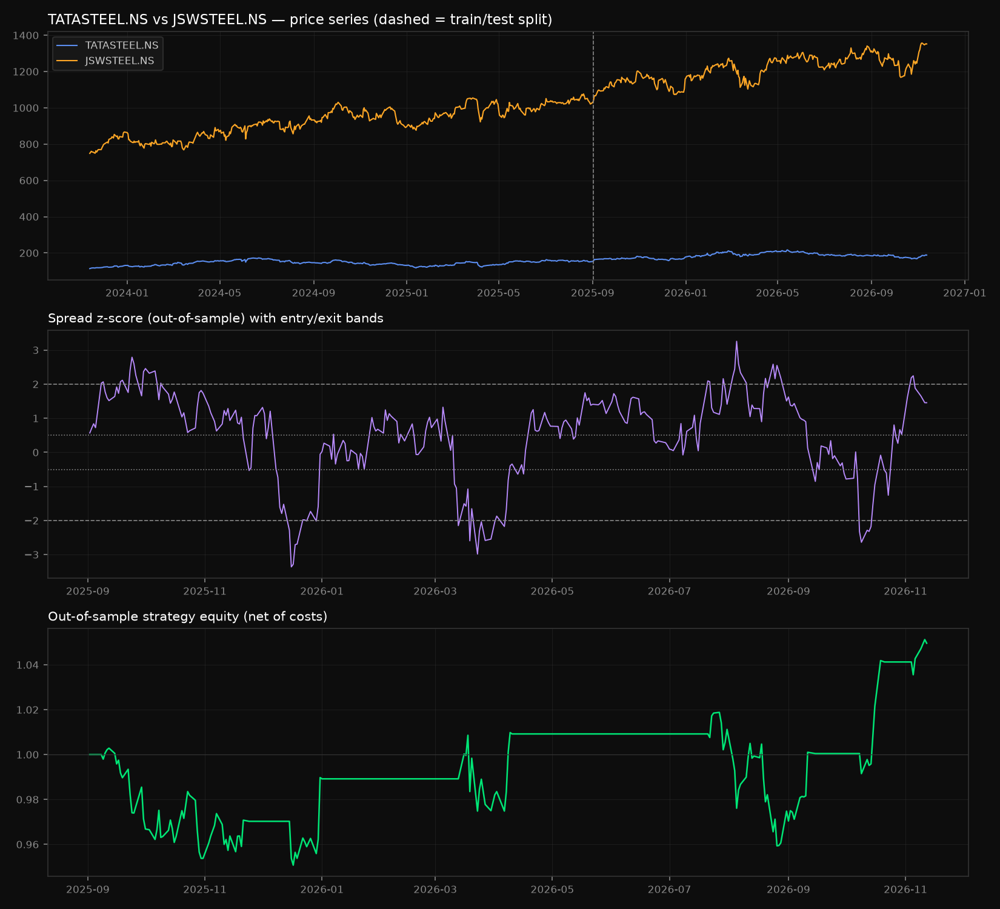

---

### SUNPHARMA.NS / CIPLA.NS

- **Latest prices:** SUNPHARMA.NS ₹1,885.00 · CIPLA.NS ₹1,408.30
- **Hedge ratio (train-fitted):** 0.4689
- **Cointegration (train):** FAIL at 5% — ADF -2.58, p=0.0961
- **Persistence:** passed 5% in 92 of 97 real-data runs (strict tier: 5/97)
- **Spread half-life:** 14.1 days
- **Current z-score:** +0.38
- **Signal today:** flat / no stretch
- ⚠️ _Pair did not cointegrate on training data. Any signal here is not statistically justified — observation only._

**Out-of-sample backtest** (beta frozen from train window):

| Metric | Value |
|---|---|
| Sharpe | 0.63 |
| Sortino | 0.69 |
| Annualised return | 4.55% |
| Annualised vol | 7.46% |
| Max drawdown | -10.22% |
| Round-trip trades | 6 |

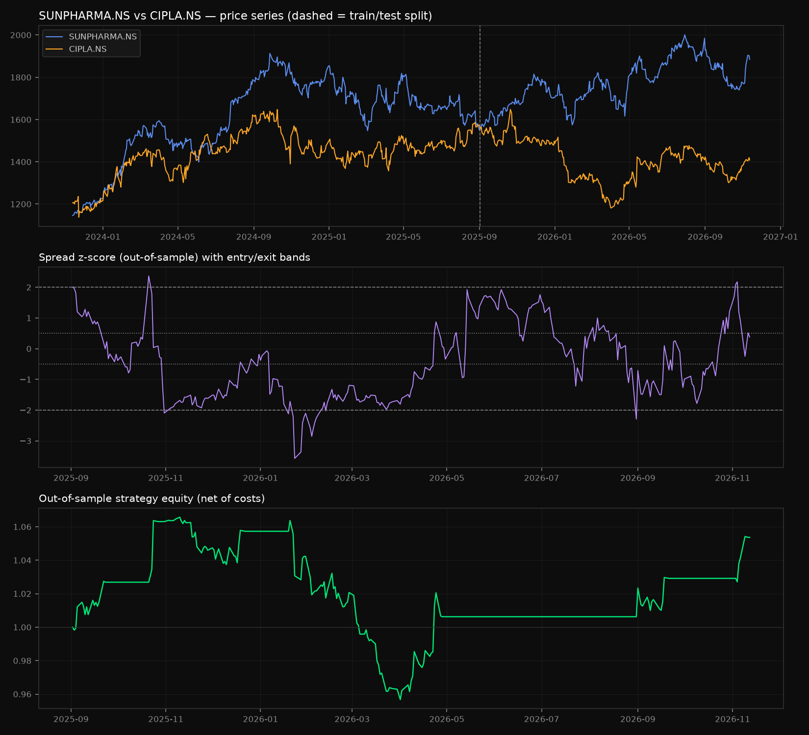

---

_Generated 2026-11-13 · pairs mean-reversion scanner · out-of-sample backtest · multiple-testing-aware · not investment advice._
