# Indian Pairs-Trading Scanner — 2026-11-16

> **What this is:** a market-neutral *pairs mean-reversion* scanner. It flags when two related NSE stocks have drifted apart far enough that their historical relationship signals a possible convergence trade. It does **not** forecast growth, rank "best" stocks, or predict company performance. A signal means the *spread between two stocks* is stretched — nothing about either stock being a good investment. Not investment advice; do your own research.

## Methodology (fixed in advance)

- **Universe:** 16 declared sector-mate pairs. Parameters (3y window, 60/40 train-test, z-entry 2.0, z-exit 0.5, 5 bps costs) are pre-registered; changes are logged in the README changelog *before* looking at results.
- **Multiple testing:** at the 5% level across 16 pairs, **≈0.8 false positives per run are expected by chance alone** even if nothing truly cointegrates. A single-day pass is a candidate, not a discovery.
- **Strict tier:** Bonferroni-corrected threshold p < 0.0031 (marked ✓✓).
- **Evidence = persistence:** the Persistence column counts how often each pair has passed the 5% test across all *real-data* daily runs recorded in `reports/history.csv`. Pairs deserve attention only when they pass persistently.

## Summary

| Pair | p-value | Coint. | Persistence | Current z | Signal | OOS Sharpe |
|---|---|---|---|---|---|---|
| HDFCBANK.NS/ICICIBANK.NS | 0.0445 | ✓ | 2/81 | +1.16 | watch | 0.12 |
| AXISBANK.NS/ICICIBANK.NS | 0.8024 | ✗ | 0/98 | +2.47 | SHORT spread | -0.27 |
| KOTAKBANK.NS/HDFCBANK.NS | 0.1442 | ✗ | 0/98 | -0.93 | watch | 1.51 |
| SBIN.NS/BANKBARODA.NS | 0.1243 | ✗ | 0/98 | +2.77 | SHORT spread | 0.20 |
| TCS.NS/INFY.NS | 0.5973 | ✗ | 0/98 | +1.00 | watch | 1.88 |
| INFY.NS/WIPRO.NS | 0.0738 | ✗ | 0/98 | +1.55 | watch | 2.59 |
| HCLTECH.NS/TECHM.NS | 0.2241 | ✗ | 0/98 | +1.40 | watch | -0.02 |
| ACC.NS/AMBUJACEM.NS | 0.1376 | ✗ | 0/98 | +0.06 | flat / no stretch | -0.21 |
| ULTRACEMCO.NS/SHREECEM.NS | 0.2670 | ✗ | 0/98 | +0.79 | watch | -0.51 |
| IOC.NS/BPCL.NS | 0.5716 | ✗ | 0/98 | -2.06 | LONG spread | 0.55 |
| BPCL.NS/HINDPETRO.NS | 0.2527 | ✗ | 0/98 | +2.76 | SHORT spread | -0.37 |
| ONGC.NS/COALINDIA.NS | 0.0096 | ✓ | 90/98 | +0.01 | flat / no stretch | 0.88 |
| NTPC.NS/POWERGRID.NS | 0.0954 | ✗ | 0/98 | -0.10 | flat / no stretch | 0.71 |
| BAJAJ-AUTO.NS/HEROMOTOCO.NS | 0.4375 | ✗ | 0/98 | +0.69 | watch | 0.25 |
| TATASTEEL.NS/JSWSTEEL.NS | 0.5670 | ✗ | 0/98 | +1.39 | watch | 0.51 |
| SUNPHARMA.NS/CIPLA.NS | 0.0772 | ✗ | 92/98 | -0.22 | flat / no stretch | 0.34 |

_Legend: ✓✓ passes strict Bonferroni tier · ✓ passes 5% only · ✗ fails. Persistence = 5%-passes / real-data runs recorded. \*no real-data history yet._

---

### HDFCBANK.NS / ICICIBANK.NS

- **Latest prices:** HDFCBANK.NS ₹804.00 · ICICIBANK.NS ₹1,583.60
- **Hedge ratio (train-fitted):** 1.5197
- **Cointegration (train):** PASS at 5% — ADF -2.91, p=0.0445
- **Persistence:** passed 5% in 2 of 81 real-data runs (strict tier: 0/81)
- **Spread half-life:** 21.7 days
- **Current z-score:** +1.16
- **Signal today:** watch (approaching band)

**Out-of-sample backtest** (beta frozen from train window):

| Metric | Value |
|---|---|
| Sharpe | 0.12 |
| Sortino | 0.12 |
| Annualised return | 0.53% |
| Annualised vol | 6.16% |
| Max drawdown | -4.40% |
| Round-trip trades | 5 |

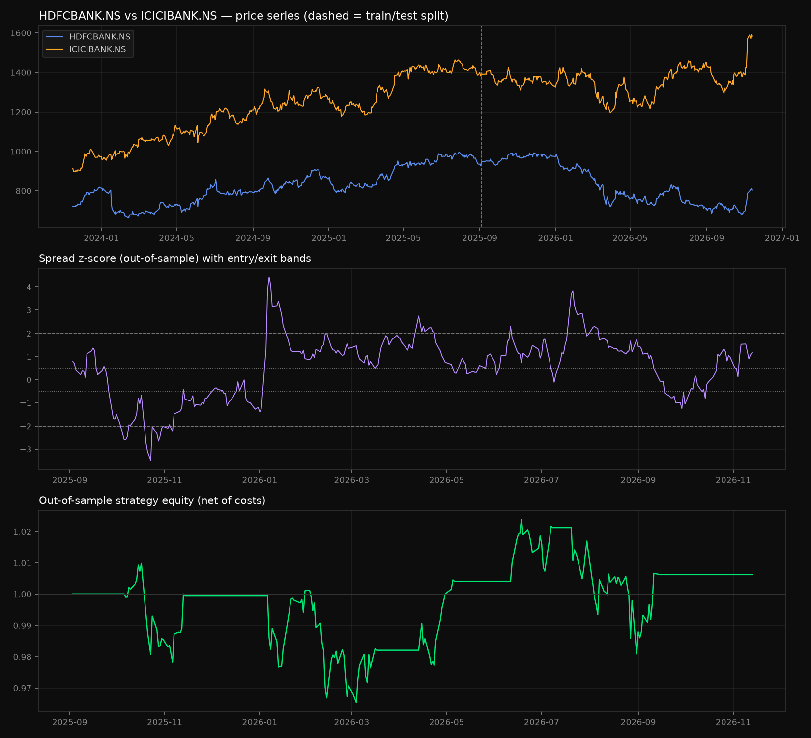

---

### AXISBANK.NS / ICICIBANK.NS

- **Latest prices:** AXISBANK.NS ₹1,331.00 · ICICIBANK.NS ₹1,583.60
- **Hedge ratio (train-fitted):** 0.5714
- **Cointegration (train):** FAIL at 5% — ADF -0.86, p=0.8024
- **Persistence:** passed 5% in 0 of 98 real-data runs (strict tier: 0/98)
- **Spread half-life:** 175.3 days
- **Current z-score:** +2.47
- **Signal today:** SHORT spread (short ICICIBANK.NS, long AXISBANK.NS)
- ⚠️ _Pair did not cointegrate on training data. Any signal here is not statistically justified — observation only._

**Out-of-sample backtest** (beta frozen from train window):

| Metric | Value |
|---|---|
| Sharpe | -0.27 |
| Sortino | -0.29 |
| Annualised return | -3.00% |
| Annualised vol | 9.62% |
| Max drawdown | -10.16% |
| Round-trip trades | 5 |

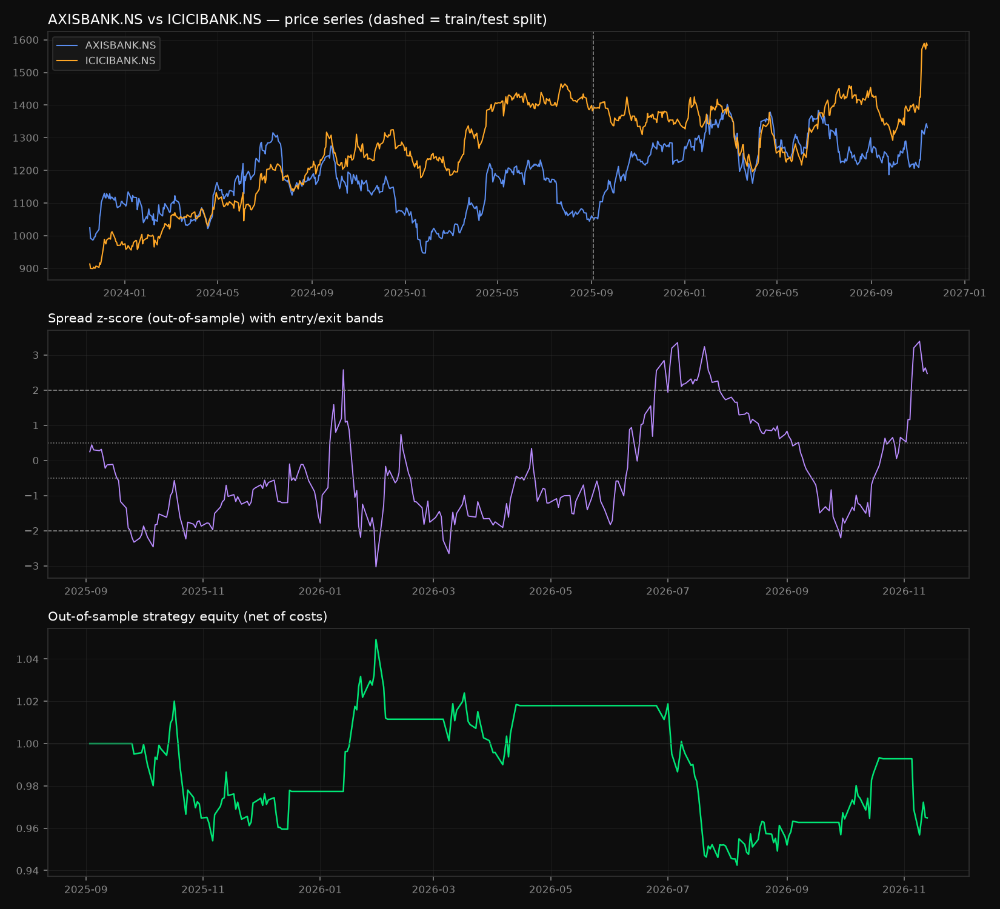

---

### KOTAKBANK.NS / HDFCBANK.NS

- **Latest prices:** KOTAKBANK.NS ₹488.55 · HDFCBANK.NS ₹804.00
- **Hedge ratio (train-fitted):** 2.2327
- **Cointegration (train):** FAIL at 5% — ADF -2.39, p=0.1442
- **Persistence:** passed 5% in 0 of 98 real-data runs (strict tier: 0/98)
- **Spread half-life:** 26.3 days
- **Current z-score:** -0.93
- **Signal today:** watch (approaching band)
- ⚠️ _Pair did not cointegrate on training data. Any signal here is not statistically justified — observation only._

**Out-of-sample backtest** (beta frozen from train window):

| Metric | Value |
|---|---|
| Sharpe | 1.51 |
| Sortino | 1.56 |
| Annualised return | 9.51% |
| Annualised vol | 6.13% |
| Max drawdown | -2.88% |
| Round-trip trades | 5 |

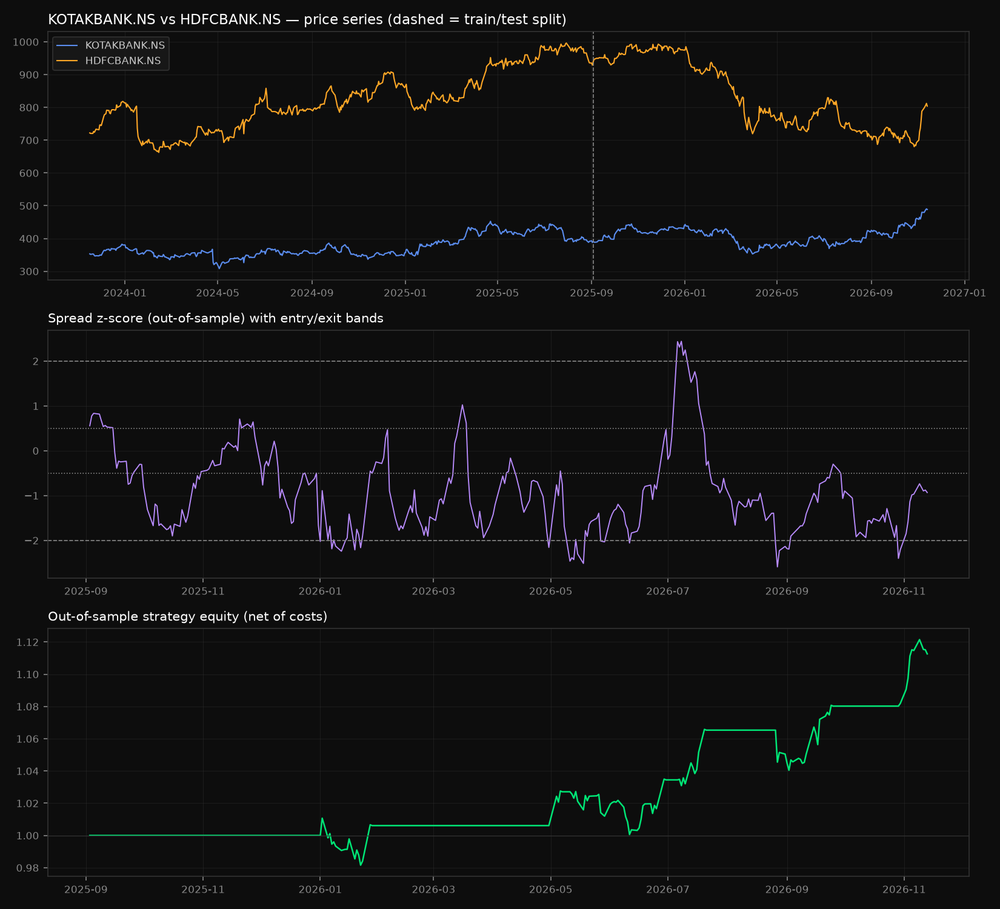

---

### SBIN.NS / BANKBARODA.NS

- **Latest prices:** SBIN.NS ₹1,080.00 · BANKBARODA.NS ₹273.84
- **Hedge ratio (train-fitted):** 0.1755
- **Cointegration (train):** FAIL at 5% — ADF -2.46, p=0.1243
- **Persistence:** passed 5% in 0 of 98 real-data runs (strict tier: 0/98)
- **Spread half-life:** 19.7 days
- **Current z-score:** +2.77
- **Signal today:** SHORT spread (short BANKBARODA.NS, long SBIN.NS)
- ⚠️ _Pair did not cointegrate on training data. Any signal here is not statistically justified — observation only._

**Out-of-sample backtest** (beta frozen from train window):

| Metric | Value |
|---|---|
| Sharpe | 0.20 |
| Sortino | 0.18 |
| Annualised return | 1.58% |
| Annualised vol | 10.52% |
| Max drawdown | -8.81% |
| Round-trip trades | 7 |

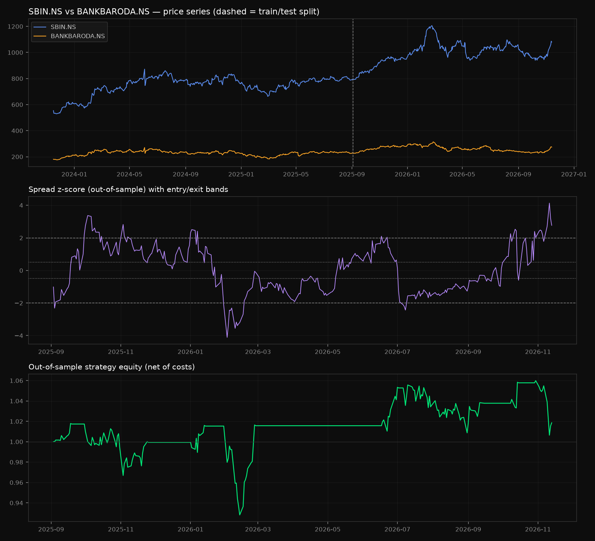

---

### TCS.NS / INFY.NS

- **Latest prices:** TCS.NS ₹2,407.50 · INFY.NS ₹1,141.50
- **Hedge ratio (train-fitted):** 0.3752
- **Cointegration (train):** FAIL at 5% — ADF -1.37, p=0.5973
- **Persistence:** passed 5% in 0 of 98 real-data runs (strict tier: 0/98)
- **Spread half-life:** 69.7 days
- **Current z-score:** +1.00
- **Signal today:** watch (approaching band)
- ⚠️ _Pair did not cointegrate on training data. Any signal here is not statistically justified — observation only._

**Out-of-sample backtest** (beta frozen from train window):

| Metric | Value |
|---|---|
| Sharpe | 1.88 |
| Sortino | 2.31 |
| Annualised return | 9.95% |
| Annualised vol | 5.12% |
| Max drawdown | -2.85% |
| Round-trip trades | 7 |

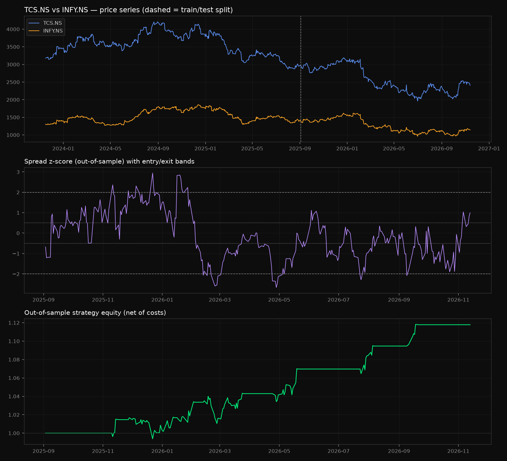

---

### INFY.NS / WIPRO.NS

- **Latest prices:** INFY.NS ₹1,141.50 · WIPRO.NS ₹194.60
- **Hedge ratio (train-fitted):** 0.1162
- **Cointegration (train):** FAIL at 5% — ADF -2.70, p=0.0738
- **Persistence:** passed 5% in 0 of 98 real-data runs (strict tier: 0/98)
- **Spread half-life:** 24.5 days
- **Current z-score:** +1.55
- **Signal today:** watch (approaching band)
- ⚠️ _Pair did not cointegrate on training data. Any signal here is not statistically justified — observation only._

**Out-of-sample backtest** (beta frozen from train window):

| Metric | Value |
|---|---|
| Sharpe | 2.59 |
| Sortino | 3.55 |
| Annualised return | 16.21% |
| Annualised vol | 5.87% |
| Max drawdown | -3.36% |
| Round-trip trades | 6 |

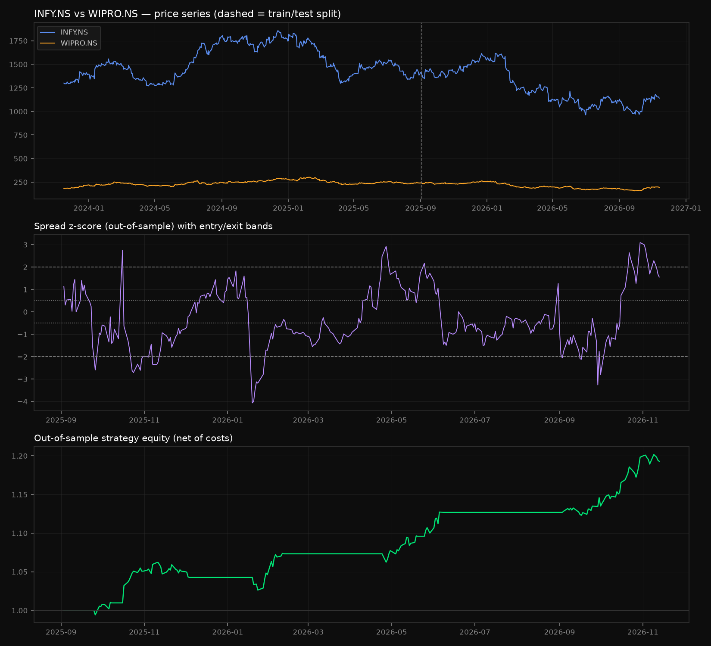

---

### HCLTECH.NS / TECHM.NS

- **Latest prices:** HCLTECH.NS ₹1,378.00 · TECHM.NS ₹1,764.00
- **Hedge ratio (train-fitted):** 0.9363
- **Cointegration (train):** FAIL at 5% — ADF -2.15, p=0.2241
- **Persistence:** passed 5% in 0 of 98 real-data runs (strict tier: 0/98)
- **Spread half-life:** 28.8 days
- **Current z-score:** +1.40
- **Signal today:** watch (approaching band)
- ⚠️ _Pair did not cointegrate on training data. Any signal here is not statistically justified — observation only._

**Out-of-sample backtest** (beta frozen from train window):

| Metric | Value |
|---|---|
| Sharpe | -0.02 |
| Sortino | -0.02 |
| Annualised return | -0.41% |
| Annualised vol | 7.64% |
| Max drawdown | -8.35% |
| Round-trip trades | 5 |

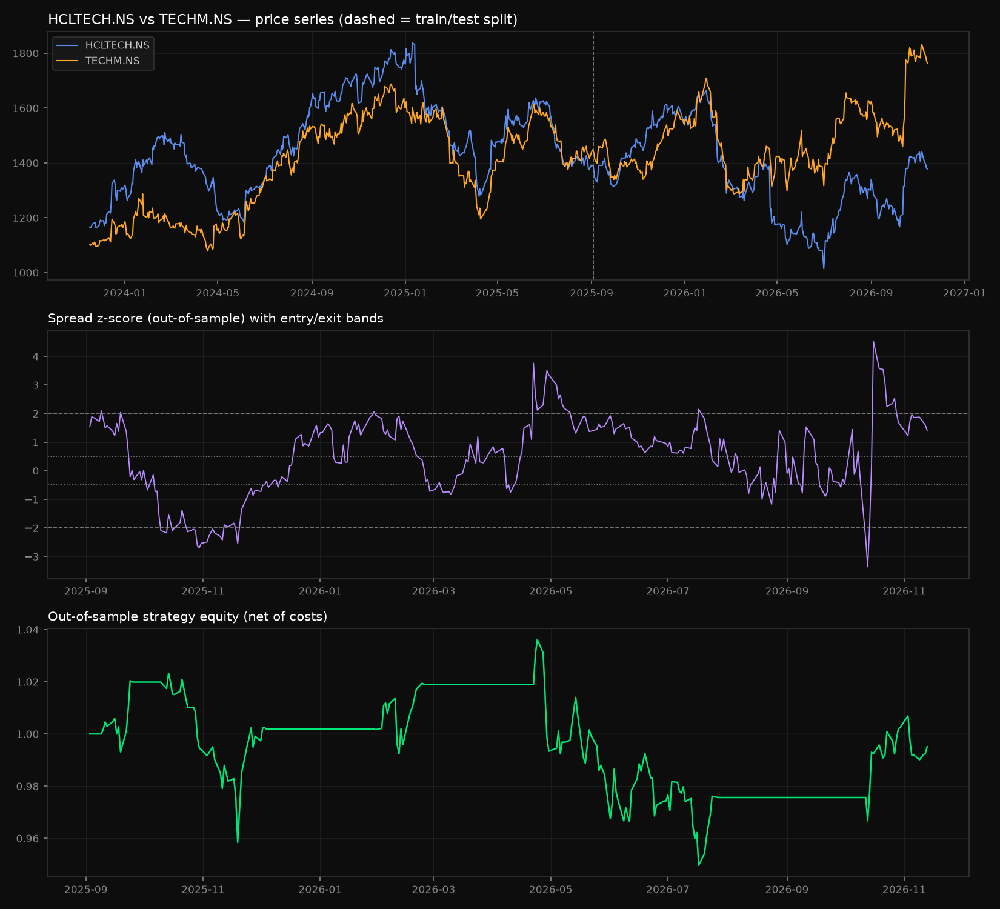

---

### ACC.NS / AMBUJACEM.NS

- **Latest prices:** ACC.NS ₹1,220.10 · AMBUJACEM.NS ₹381.45
- **Hedge ratio (train-fitted):** 0.1359
- **Cointegration (train):** FAIL at 5% — ADF -2.41, p=0.1376
- **Persistence:** passed 5% in 0 of 98 real-data runs (strict tier: 0/98)
- **Spread half-life:** 31.0 days
- **Current z-score:** +0.06
- **Signal today:** flat / no stretch
- ⚠️ _Pair did not cointegrate on training data. Any signal here is not statistically justified — observation only._

**Out-of-sample backtest** (beta frozen from train window):

| Metric | Value |
|---|---|
| Sharpe | -0.21 |
| Sortino | -0.16 |
| Annualised return | -1.76% |
| Annualised vol | 7.30% |
| Max drawdown | -7.76% |
| Round-trip trades | 4 |

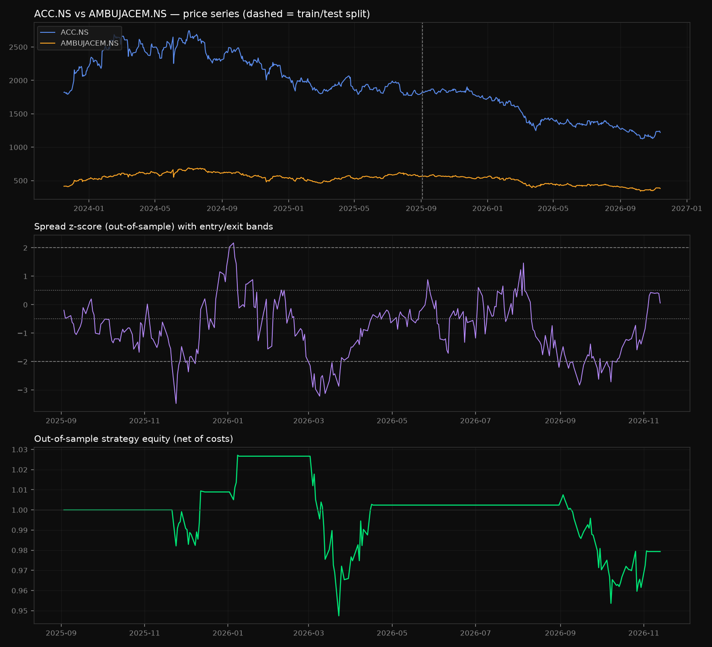

---

### ULTRACEMCO.NS / SHREECEM.NS

- **Latest prices:** ULTRACEMCO.NS ₹12,100.00 · SHREECEM.NS ₹24,655.00
- **Hedge ratio (train-fitted):** 1.2212
- **Cointegration (train):** FAIL at 5% — ADF -2.05, p=0.2670
- **Persistence:** passed 5% in 0 of 98 real-data runs (strict tier: 0/98)
- **Spread half-life:** 38.0 days
- **Current z-score:** +0.79
- **Signal today:** watch (approaching band)
- ⚠️ _Pair did not cointegrate on training data. Any signal here is not statistically justified — observation only._

**Out-of-sample backtest** (beta frozen from train window):

| Metric | Value |
|---|---|
| Sharpe | -0.51 |
| Sortino | -0.59 |
| Annualised return | -3.52% |
| Annualised vol | 6.56% |
| Max drawdown | -6.61% |
| Round-trip trades | 5 |

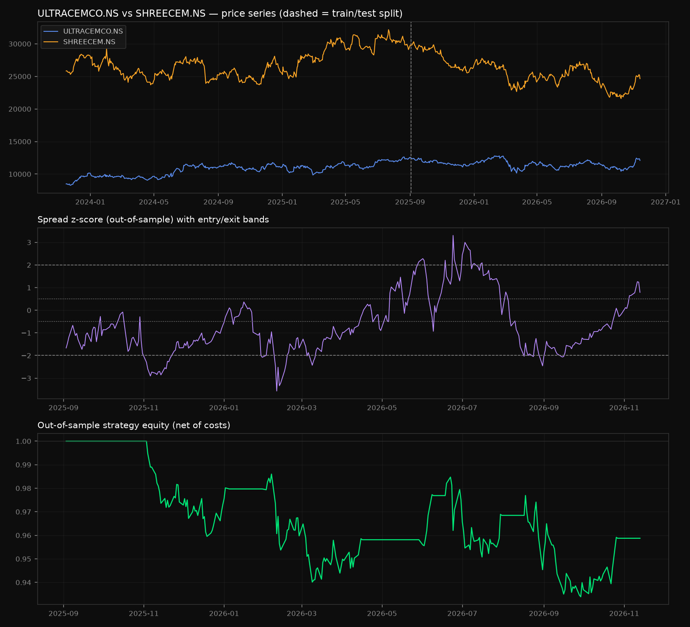

---

### IOC.NS / BPCL.NS

- **Latest prices:** IOC.NS ₹144.04 · BPCL.NS ₹302.00
- **Hedge ratio (train-fitted):** 1.4528
- **Cointegration (train):** FAIL at 5% — ADF -1.42, p=0.5716
- **Persistence:** passed 5% in 0 of 98 real-data runs (strict tier: 0/98)
- **Spread half-life:** 86.0 days
- **Current z-score:** -2.06
- **Signal today:** LONG spread (long BPCL.NS, short IOC.NS)
- ⚠️ _Pair did not cointegrate on training data. Any signal here is not statistically justified — observation only._

**Out-of-sample backtest** (beta frozen from train window):

| Metric | Value |
|---|---|
| Sharpe | 0.55 |
| Sortino | 0.57 |
| Annualised return | 3.92% |
| Annualised vol | 7.51% |
| Max drawdown | -5.94% |
| Round-trip trades | 6 |

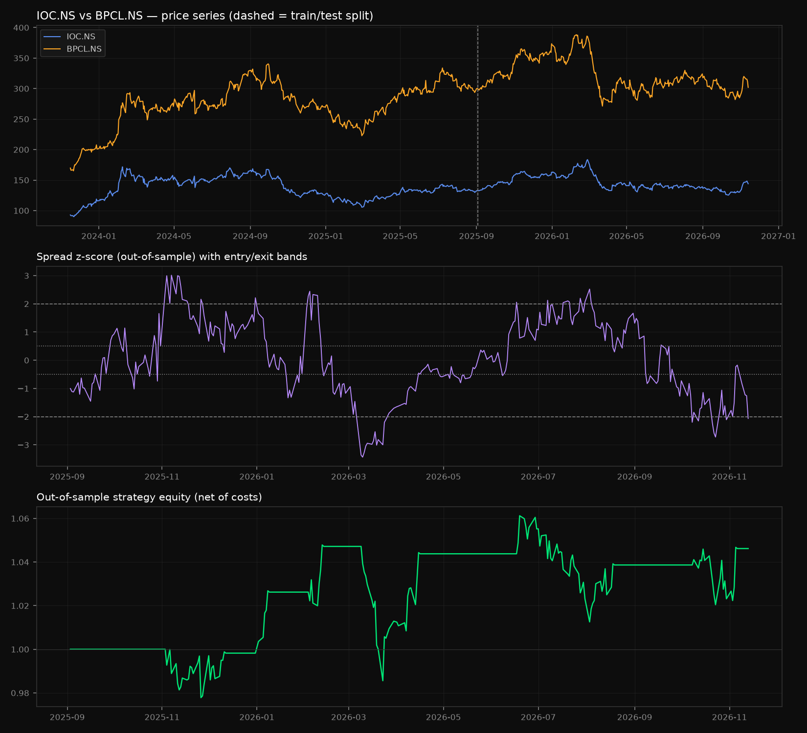

---

### BPCL.NS / HINDPETRO.NS

- **Latest prices:** BPCL.NS ₹302.00 · HINDPETRO.NS ₹381.50
- **Hedge ratio (train-fitted):** 1.2750
- **Cointegration (train):** FAIL at 5% — ADF -2.08, p=0.2527
- **Persistence:** passed 5% in 0 of 98 real-data runs (strict tier: 0/98)
- **Spread half-life:** 36.1 days
- **Current z-score:** +2.76
- **Signal today:** SHORT spread (short HINDPETRO.NS, long BPCL.NS)
- ⚠️ _Pair did not cointegrate on training data. Any signal here is not statistically justified — observation only._

**Out-of-sample backtest** (beta frozen from train window):

| Metric | Value |
|---|---|
| Sharpe | -0.37 |
| Sortino | -0.41 |
| Annualised return | -2.89% |
| Annualised vol | 7.16% |
| Max drawdown | -7.05% |
| Round-trip trades | 5 |

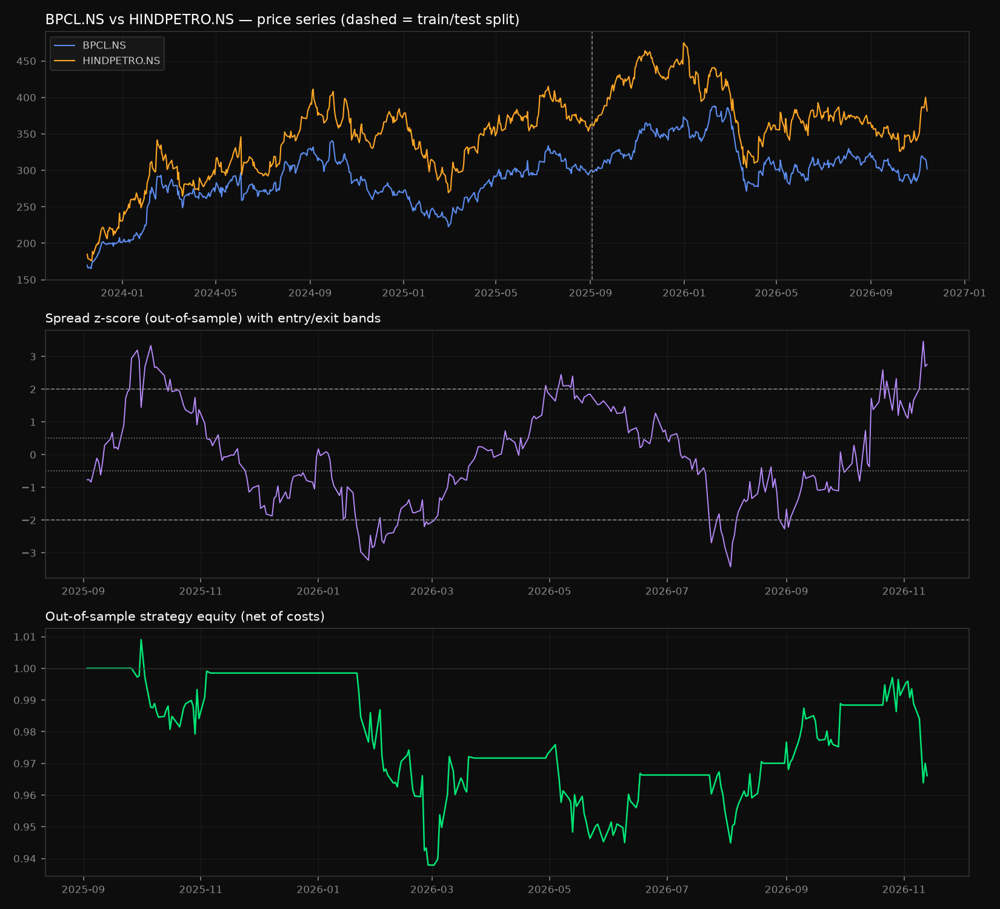

---

### ONGC.NS / COALINDIA.NS

- **Latest prices:** ONGC.NS ₹225.00 · COALINDIA.NS ₹403.50
- **Hedge ratio (train-fitted):** 1.3448
- **Cointegration (train):** PASS at 5% — ADF -3.44, p=0.0096
- **Persistence:** passed 5% in 90 of 98 real-data runs (strict tier: 1/98)
- **Spread half-life:** 13.3 days
- **Current z-score:** +0.01
- **Signal today:** flat / no stretch

**Out-of-sample backtest** (beta frozen from train window):

| Metric | Value |
|---|---|
| Sharpe | 0.88 |
| Sortino | 0.76 |
| Annualised return | 7.00% |
| Annualised vol | 8.05% |
| Max drawdown | -6.34% |
| Round-trip trades | 6 |

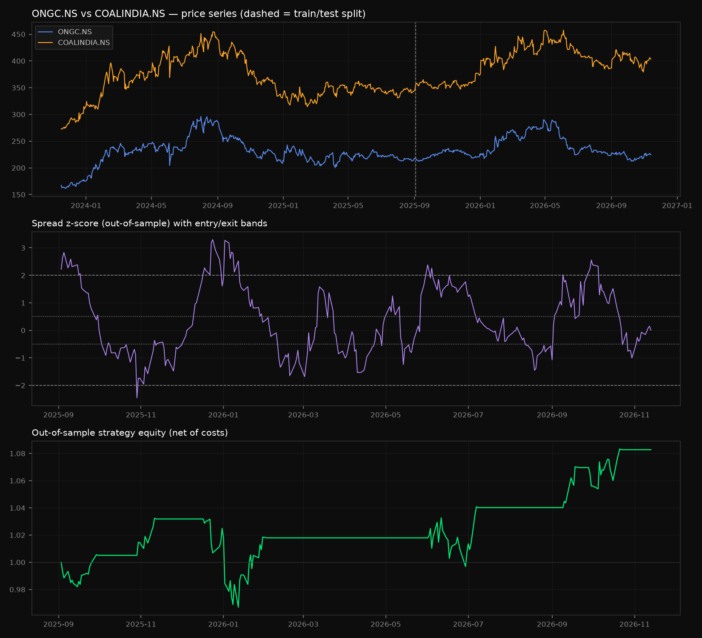

---

### NTPC.NS / POWERGRID.NS

- **Latest prices:** NTPC.NS ₹319.10 · POWERGRID.NS ₹257.45
- **Hedge ratio (train-fitted):** 0.7913
- **Cointegration (train):** FAIL at 5% — ADF -2.59, p=0.0954
- **Persistence:** passed 5% in 0 of 98 real-data runs (strict tier: 0/98)
- **Spread half-life:** 23.6 days
- **Current z-score:** -0.10
- **Signal today:** flat / no stretch
- ⚠️ _Pair did not cointegrate on training data. Any signal here is not statistically justified — observation only._

**Out-of-sample backtest** (beta frozen from train window):

| Metric | Value |
|---|---|
| Sharpe | 0.71 |
| Sortino | 0.53 |
| Annualised return | 3.85% |
| Annualised vol | 5.53% |
| Max drawdown | -5.28% |
| Round-trip trades | 6 |

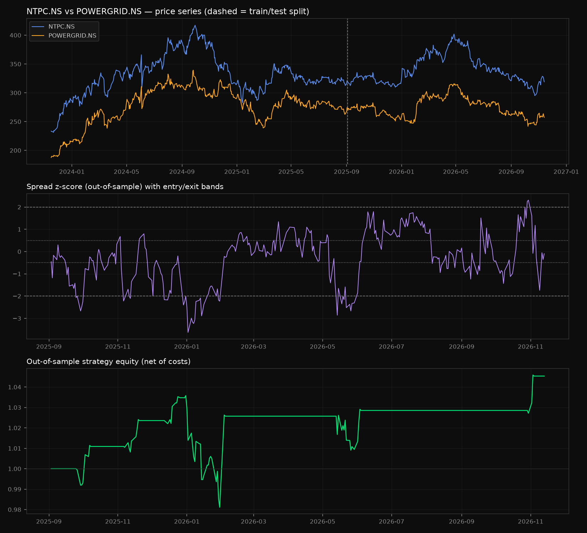

---

### BAJAJ-AUTO.NS / HEROMOTOCO.NS

- **Latest prices:** BAJAJ-AUTO.NS ₹10,850.00 · HEROMOTOCO.NS ₹5,385.00
- **Hedge ratio (train-fitted):** 0.4032
- **Cointegration (train):** FAIL at 5% — ADF -1.69, p=0.4375
- **Persistence:** passed 5% in 0 of 98 real-data runs (strict tier: 0/98)
- **Spread half-life:** 41.3 days
- **Current z-score:** +0.69
- **Signal today:** watch (approaching band)
- ⚠️ _Pair did not cointegrate on training data. Any signal here is not statistically justified — observation only._

**Out-of-sample backtest** (beta frozen from train window):

| Metric | Value |
|---|---|
| Sharpe | 0.25 |
| Sortino | 0.21 |
| Annualised return | 1.64% |
| Annualised vol | 7.57% |
| Max drawdown | -10.07% |
| Round-trip trades | 5 |

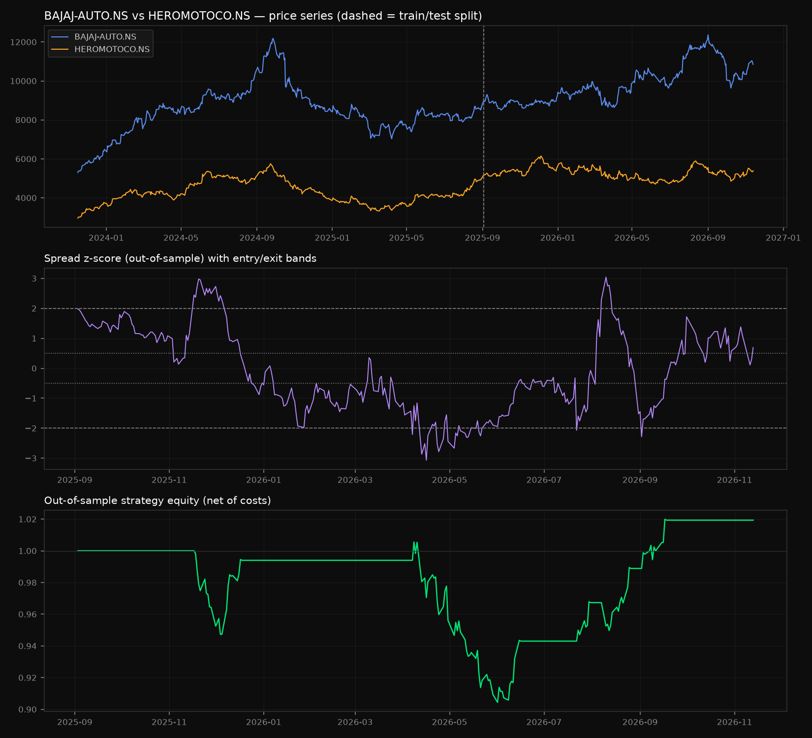

---

### TATASTEEL.NS / JSWSTEEL.NS

- **Latest prices:** TATASTEEL.NS ₹186.68 · JSWSTEEL.NS ₹1,348.00
- **Hedge ratio (train-fitted):** 2.6369
- **Cointegration (train):** FAIL at 5% — ADF -1.43, p=0.5670
- **Persistence:** passed 5% in 0 of 98 real-data runs (strict tier: 0/98)
- **Spread half-life:** 59.1 days
- **Current z-score:** +1.39
- **Signal today:** watch (approaching band)
- ⚠️ _Pair did not cointegrate on training data. Any signal here is not statistically justified — observation only._

**Out-of-sample backtest** (beta frozen from train window):

| Metric | Value |
|---|---|
| Sharpe | 0.51 |
| Sortino | 0.50 |
| Annualised return | 4.22% |
| Annualised vol | 8.84% |
| Max drawdown | -5.68% |
| Round-trip trades | 5 |

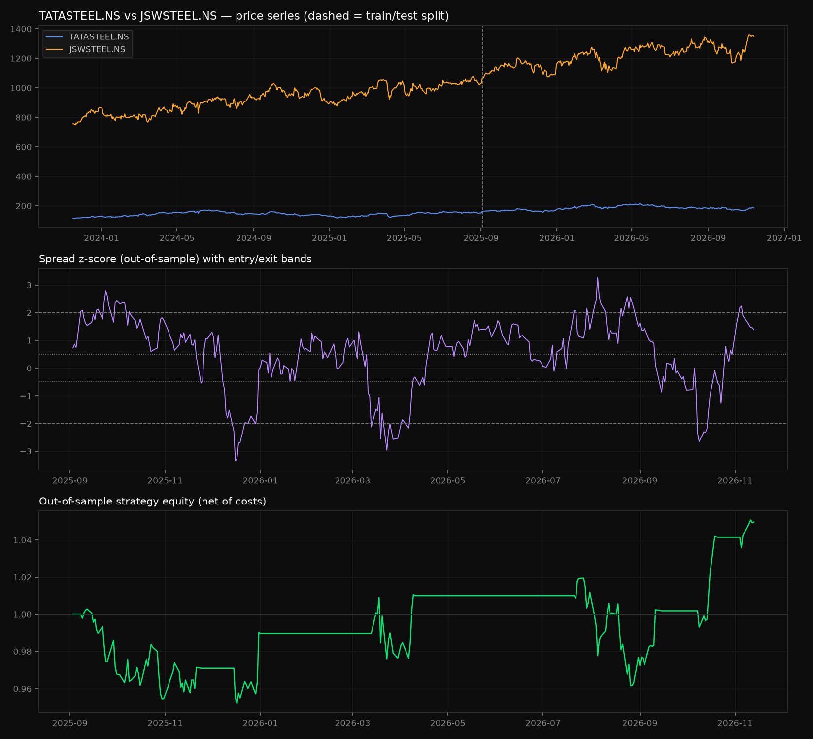

---

### SUNPHARMA.NS / CIPLA.NS

- **Latest prices:** SUNPHARMA.NS ₹1,880.00 · CIPLA.NS ₹1,391.80
- **Hedge ratio (train-fitted):** 0.4671
- **Cointegration (train):** FAIL at 5% — ADF -2.68, p=0.0772
- **Persistence:** passed 5% in 92 of 98 real-data runs (strict tier: 5/98)
- **Spread half-life:** 13.7 days
- **Current z-score:** -0.22
- **Signal today:** flat / no stretch
- ⚠️ _Pair did not cointegrate on training data. Any signal here is not statistically justified — observation only._

**Out-of-sample backtest** (beta frozen from train window):

| Metric | Value |
|---|---|
| Sharpe | 0.34 |
| Sortino | 0.34 |
| Annualised return | 2.19% |
| Annualised vol | 7.13% |
| Max drawdown | -10.16% |
| Round-trip trades | 5 |

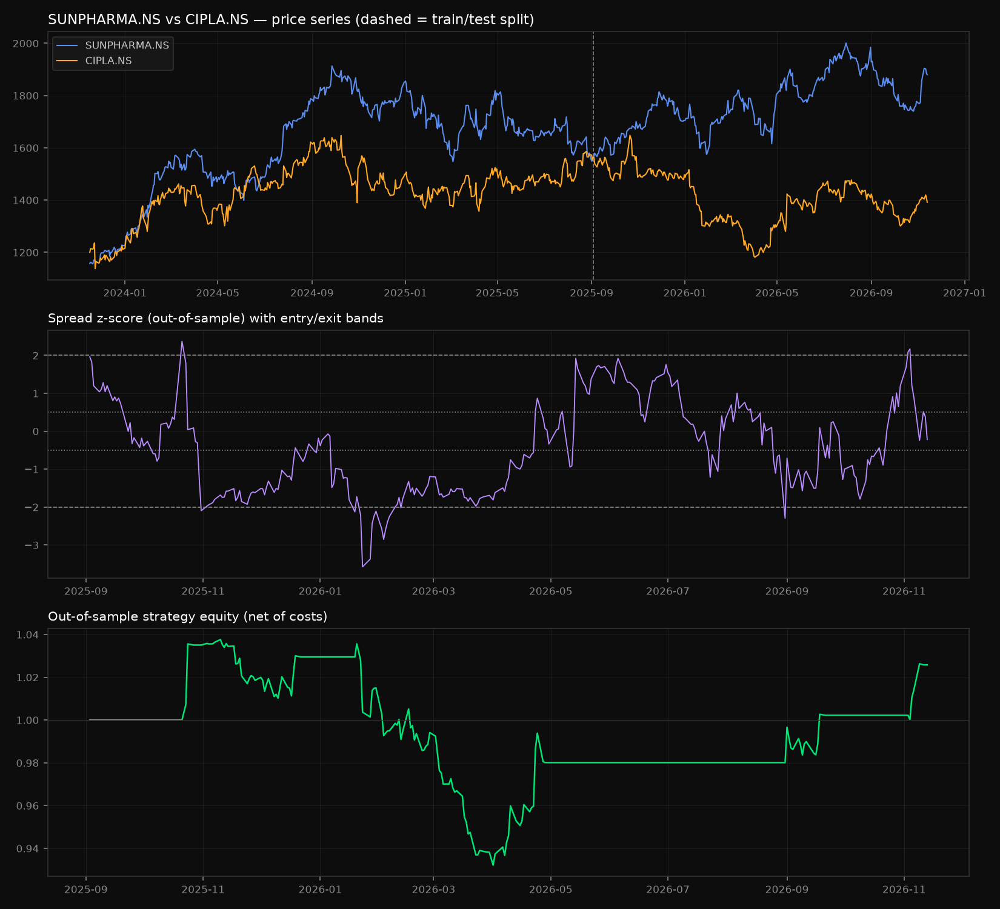

---

_Generated 2026-11-16 · pairs mean-reversion scanner · out-of-sample backtest · multiple-testing-aware · not investment advice._
