# Indian Pairs-Trading Scanner — 2026-11-17

> **What this is:** a market-neutral *pairs mean-reversion* scanner. It flags when two related NSE stocks have drifted apart far enough that their historical relationship signals a possible convergence trade. It does **not** forecast growth, rank "best" stocks, or predict company performance. A signal means the *spread between two stocks* is stretched — nothing about either stock being a good investment. Not investment advice; do your own research.

## Methodology (fixed in advance)

- **Universe:** 16 declared sector-mate pairs. Parameters (3y window, 60/40 train-test, z-entry 2.0, z-exit 0.5, 5 bps costs) are pre-registered; changes are logged in the README changelog *before* looking at results.
- **Multiple testing:** at the 5% level across 16 pairs, **≈0.8 false positives per run are expected by chance alone** even if nothing truly cointegrates. A single-day pass is a candidate, not a discovery.
- **Strict tier:** Bonferroni-corrected threshold p < 0.0031 (marked ✓✓).
- **Evidence = persistence:** the Persistence column counts how often each pair has passed the 5% test across all *real-data* daily runs recorded in `reports/history.csv`. Pairs deserve attention only when they pass persistently.

## Summary

| Pair | p-value | Coint. | Persistence | Current z | Signal | OOS Sharpe |
|---|---|---|---|---|---|---|
| HDFCBANK.NS/ICICIBANK.NS | 0.0338 | ✓ | 3/82 | +0.80 | watch | 0.12 |
| AXISBANK.NS/ICICIBANK.NS | 0.8037 | ✗ | 0/99 | +2.25 | SHORT spread | -0.24 |
| KOTAKBANK.NS/HDFCBANK.NS | 0.1491 | ✗ | 0/99 | -0.91 | watch | 1.51 |
| SBIN.NS/BANKBARODA.NS | 0.1238 | ✗ | 0/99 | +1.91 | watch | 0.31 |
| TCS.NS/INFY.NS | 0.5939 | ✗ | 0/99 | +1.21 | watch | 1.87 |
| INFY.NS/WIPRO.NS | 0.0721 | ✗ | 0/99 | +1.28 | watch | 2.53 |
| HCLTECH.NS/TECHM.NS | 0.2194 | ✗ | 0/99 | +1.46 | watch | -0.04 |
| ACC.NS/AMBUJACEM.NS | 0.1477 | ✗ | 0/99 | +0.09 | flat / no stretch | -0.21 |
| ULTRACEMCO.NS/SHREECEM.NS | 0.2639 | ✗ | 0/99 | +0.85 | watch | -0.52 |
| IOC.NS/BPCL.NS | 0.5227 | ✗ | 0/99 | -1.52 | watch | 0.62 |
| BPCL.NS/HINDPETRO.NS | 0.2495 | ✗ | 0/99 | +2.66 | SHORT spread | -0.40 |
| ONGC.NS/COALINDIA.NS | 0.0102 | ✓ | 91/99 | -0.76 | watch | 0.95 |
| NTPC.NS/POWERGRID.NS | 0.1013 | ✗ | 0/99 | +0.66 | watch | 0.71 |
| BAJAJ-AUTO.NS/HEROMOTOCO.NS | 0.4426 | ✗ | 0/99 | +0.80 | watch | 0.25 |
| TATASTEEL.NS/JSWSTEEL.NS | 0.5576 | ✗ | 0/99 | +1.30 | watch | 0.52 |
| SUNPHARMA.NS/CIPLA.NS | 0.0814 | ✗ | 92/99 | +0.20 | flat / no stretch | 0.34 |

_Legend: ✓✓ passes strict Bonferroni tier · ✓ passes 5% only · ✗ fails. Persistence = 5%-passes / real-data runs recorded. \*no real-data history yet._

---

### HDFCBANK.NS / ICICIBANK.NS

- **Latest prices:** HDFCBANK.NS ₹816.50 · ICICIBANK.NS ₹1,585.00
- **Hedge ratio (train-fitted):** 1.5158
- **Cointegration (train):** PASS at 5% — ADF -3.01, p=0.0338
- **Persistence:** passed 5% in 3 of 82 real-data runs (strict tier: 0/82)
- **Spread half-life:** 20.9 days
- **Current z-score:** +0.80
- **Signal today:** watch (approaching band)

**Out-of-sample backtest** (beta frozen from train window):

| Metric | Value |
|---|---|
| Sharpe | 0.12 |
| Sortino | 0.13 |
| Annualised return | 0.55% |
| Annualised vol | 6.12% |
| Max drawdown | -4.37% |
| Round-trip trades | 5 |

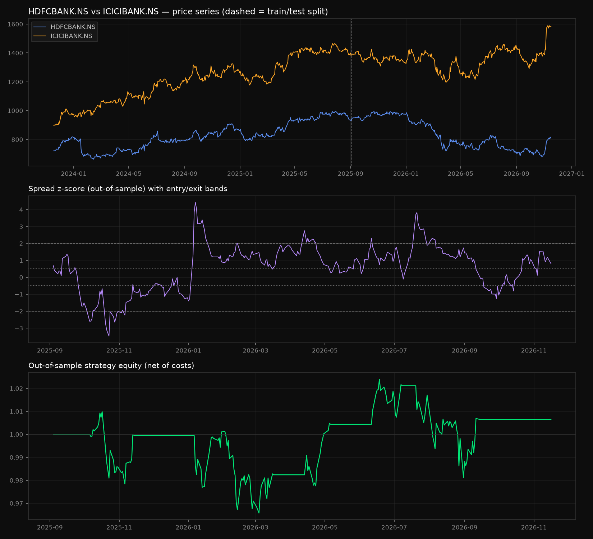

---

### AXISBANK.NS / ICICIBANK.NS

- **Latest prices:** AXISBANK.NS ₹1,342.40 · ICICIBANK.NS ₹1,585.00
- **Hedge ratio (train-fitted):** 0.5559
- **Cointegration (train):** FAIL at 5% — ADF -0.85, p=0.8037
- **Persistence:** passed 5% in 0 of 99 real-data runs (strict tier: 0/99)
- **Spread half-life:** 178.9 days
- **Current z-score:** +2.25
- **Signal today:** SHORT spread (short ICICIBANK.NS, long AXISBANK.NS)
- ⚠️ _Pair did not cointegrate on training data. Any signal here is not statistically justified — observation only._

**Out-of-sample backtest** (beta frozen from train window):

| Metric | Value |
|---|---|
| Sharpe | -0.24 |
| Sortino | -0.26 |
| Annualised return | -2.74% |
| Annualised vol | 9.63% |
| Max drawdown | -10.08% |
| Round-trip trades | 5 |

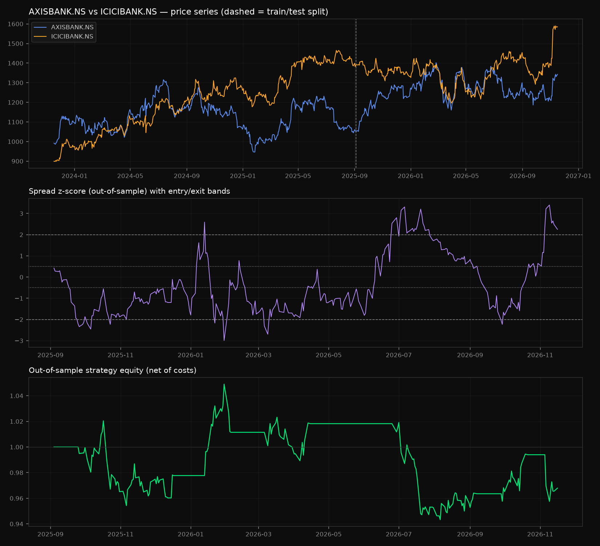

---

### KOTAKBANK.NS / HDFCBANK.NS

- **Latest prices:** KOTAKBANK.NS ₹494.20 · HDFCBANK.NS ₹816.50
- **Hedge ratio (train-fitted):** 2.2330
- **Cointegration (train):** FAIL at 5% — ADF -2.37, p=0.1491
- **Persistence:** passed 5% in 0 of 99 real-data runs (strict tier: 0/99)
- **Spread half-life:** 26.5 days
- **Current z-score:** -0.91
- **Signal today:** watch (approaching band)
- ⚠️ _Pair did not cointegrate on training data. Any signal here is not statistically justified — observation only._

**Out-of-sample backtest** (beta frozen from train window):

| Metric | Value |
|---|---|
| Sharpe | 1.51 |
| Sortino | 1.56 |
| Annualised return | 9.50% |
| Annualised vol | 6.13% |
| Max drawdown | -2.88% |
| Round-trip trades | 5 |

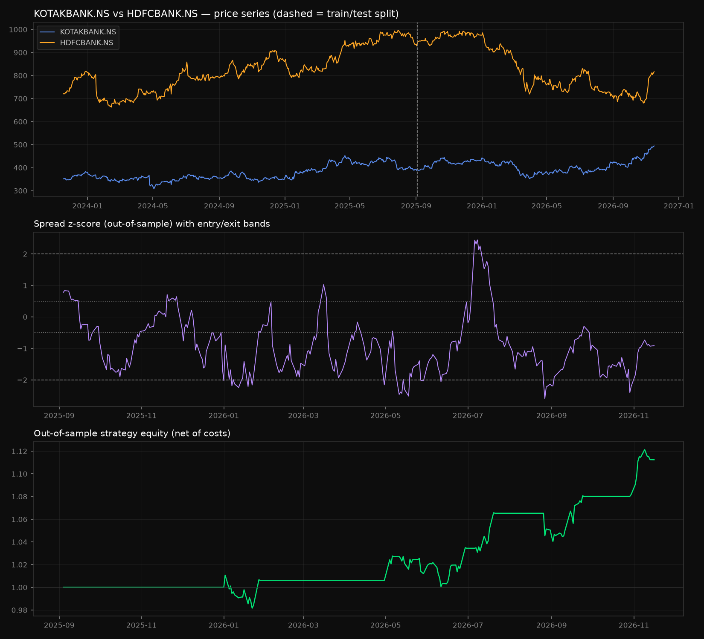

---

### SBIN.NS / BANKBARODA.NS

- **Latest prices:** SBIN.NS ₹1,090.50 · BANKBARODA.NS ₹270.20
- **Hedge ratio (train-fitted):** 0.1744
- **Cointegration (train):** FAIL at 5% — ADF -2.47, p=0.1238
- **Persistence:** passed 5% in 0 of 99 real-data runs (strict tier: 0/99)
- **Spread half-life:** 19.8 days
- **Current z-score:** +1.91
- **Signal today:** watch (approaching band)
- ⚠️ _Pair did not cointegrate on training data. Any signal here is not statistically justified — observation only._

**Out-of-sample backtest** (beta frozen from train window):

| Metric | Value |
|---|---|
| Sharpe | 0.31 |
| Sortino | 0.28 |
| Annualised return | 2.85% |
| Annualised vol | 10.77% |
| Max drawdown | -8.95% |
| Round-trip trades | 7 |

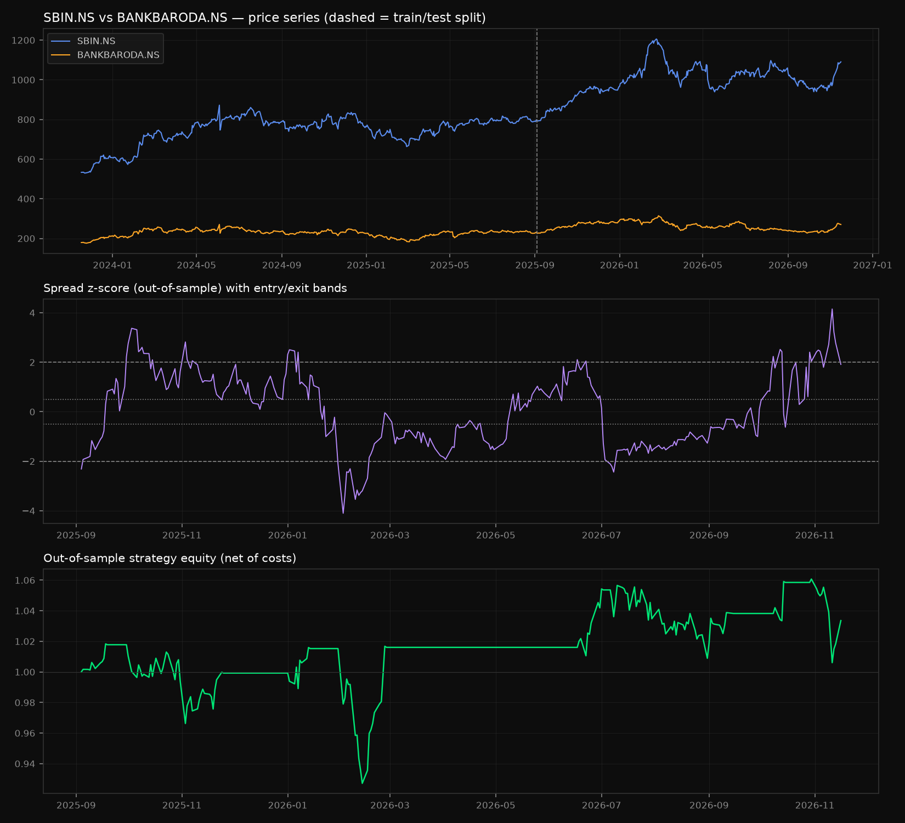

---

### TCS.NS / INFY.NS

- **Latest prices:** TCS.NS ₹2,405.00 · INFY.NS ₹1,145.10
- **Hedge ratio (train-fitted):** 0.3734
- **Cointegration (train):** FAIL at 5% — ADF -1.38, p=0.5939
- **Persistence:** passed 5% in 0 of 99 real-data runs (strict tier: 0/99)
- **Spread half-life:** 67.1 days
- **Current z-score:** +1.21
- **Signal today:** watch (approaching band)
- ⚠️ _Pair did not cointegrate on training data. Any signal here is not statistically justified — observation only._

**Out-of-sample backtest** (beta frozen from train window):

| Metric | Value |
|---|---|
| Sharpe | 1.87 |
| Sortino | 2.31 |
| Annualised return | 10.00% |
| Annualised vol | 5.16% |
| Max drawdown | -2.88% |
| Round-trip trades | 7 |

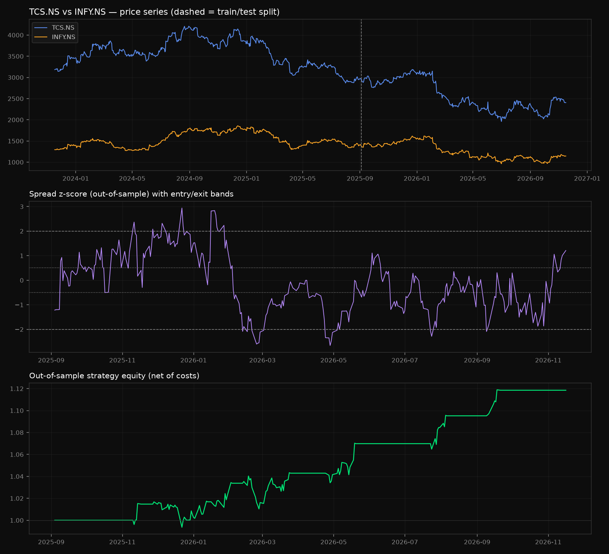

---

### INFY.NS / WIPRO.NS

- **Latest prices:** INFY.NS ₹1,145.10 · WIPRO.NS ₹193.54
- **Hedge ratio (train-fitted):** 0.1154
- **Cointegration (train):** FAIL at 5% — ADF -2.71, p=0.0721
- **Persistence:** passed 5% in 0 of 99 real-data runs (strict tier: 0/99)
- **Spread half-life:** 24.3 days
- **Current z-score:** +1.28
- **Signal today:** watch (approaching band)
- ⚠️ _Pair did not cointegrate on training data. Any signal here is not statistically justified — observation only._

**Out-of-sample backtest** (beta frozen from train window):

| Metric | Value |
|---|---|
| Sharpe | 2.53 |
| Sortino | 3.50 |
| Annualised return | 16.09% |
| Annualised vol | 5.98% |
| Max drawdown | -3.43% |
| Round-trip trades | 6 |

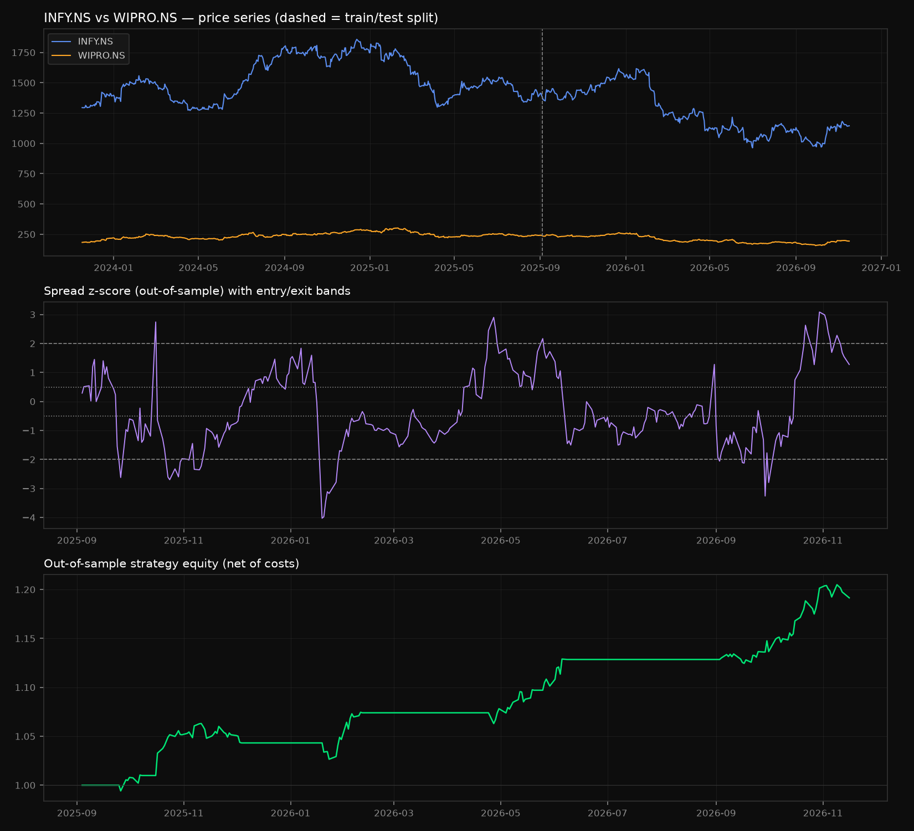

---

### HCLTECH.NS / TECHM.NS

- **Latest prices:** HCLTECH.NS ₹1,384.60 · TECHM.NS ₹1,776.40
- **Hedge ratio (train-fitted):** 0.9356
- **Cointegration (train):** FAIL at 5% — ADF -2.16, p=0.2194
- **Persistence:** passed 5% in 0 of 99 real-data runs (strict tier: 0/99)
- **Spread half-life:** 28.8 days
- **Current z-score:** +1.46
- **Signal today:** watch (approaching band)
- ⚠️ _Pair did not cointegrate on training data. Any signal here is not statistically justified — observation only._

**Out-of-sample backtest** (beta frozen from train window):

| Metric | Value |
|---|---|
| Sharpe | -0.04 |
| Sortino | -0.04 |
| Annualised return | -0.60% |
| Annualised vol | 7.73% |
| Max drawdown | -8.43% |
| Round-trip trades | 5 |

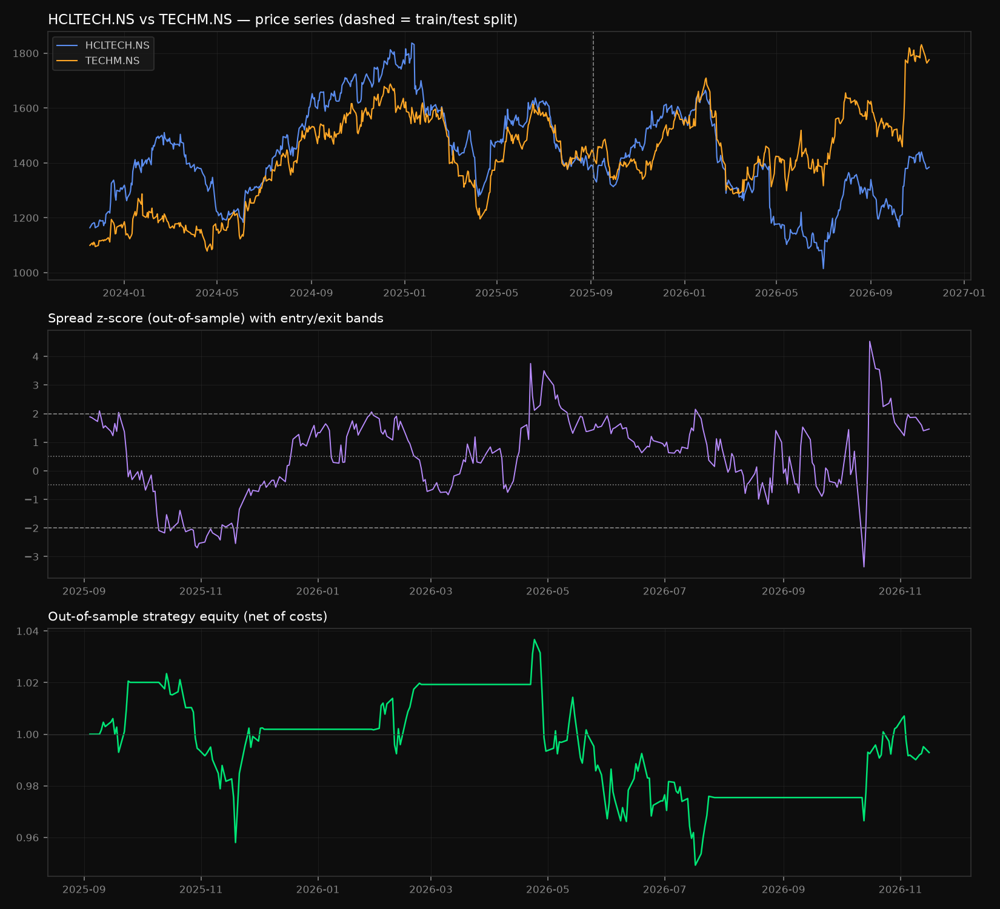

---

### ACC.NS / AMBUJACEM.NS

- **Latest prices:** ACC.NS ₹1,222.90 · AMBUJACEM.NS ₹382.00
- **Hedge ratio (train-fitted):** 0.1343
- **Cointegration (train):** FAIL at 5% — ADF -2.38, p=0.1477
- **Persistence:** passed 5% in 0 of 99 real-data runs (strict tier: 0/99)
- **Spread half-life:** 30.6 days
- **Current z-score:** +0.09
- **Signal today:** flat / no stretch
- ⚠️ _Pair did not cointegrate on training data. Any signal here is not statistically justified — observation only._

**Out-of-sample backtest** (beta frozen from train window):

| Metric | Value |
|---|---|
| Sharpe | -0.21 |
| Sortino | -0.17 |
| Annualised return | -1.83% |
| Annualised vol | 7.40% |
| Max drawdown | -7.89% |
| Round-trip trades | 4 |

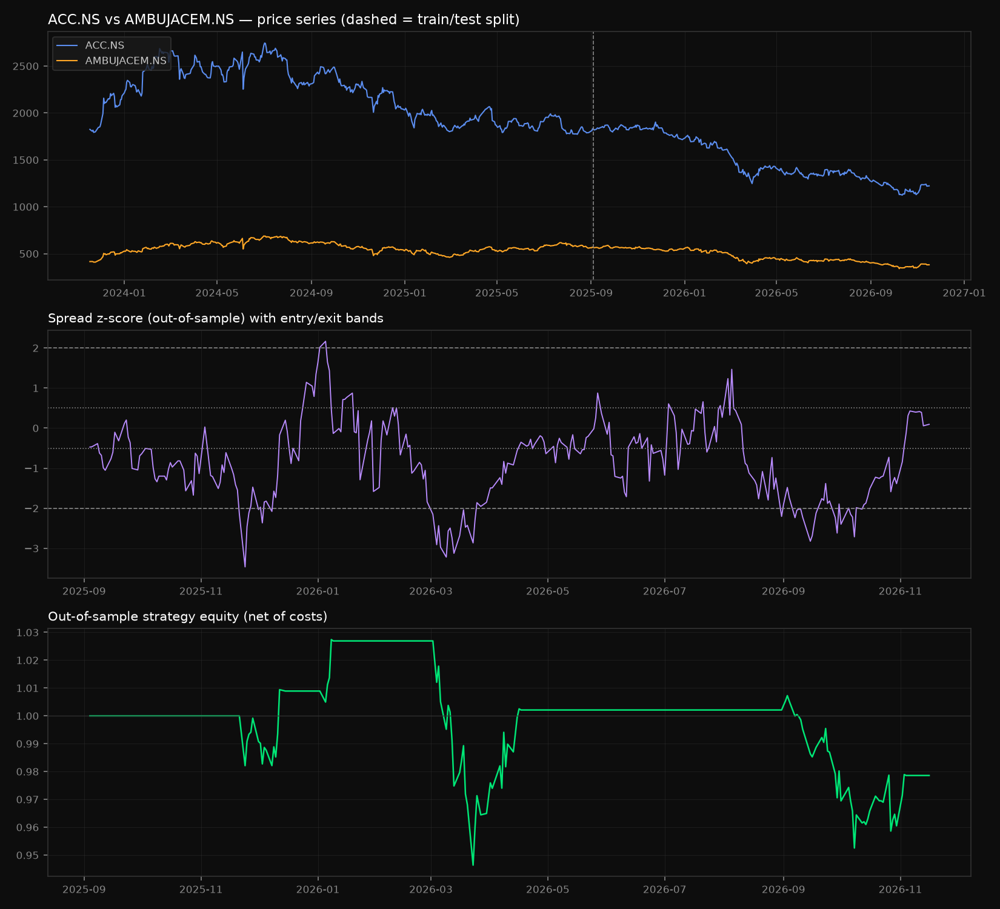

---

### ULTRACEMCO.NS / SHREECEM.NS

- **Latest prices:** ULTRACEMCO.NS ₹12,270.00 · SHREECEM.NS ₹24,870.00
- **Hedge ratio (train-fitted):** 1.2308
- **Cointegration (train):** FAIL at 5% — ADF -2.05, p=0.2639
- **Persistence:** passed 5% in 0 of 99 real-data runs (strict tier: 0/99)
- **Spread half-life:** 37.8 days
- **Current z-score:** +0.85
- **Signal today:** watch (approaching band)
- ⚠️ _Pair did not cointegrate on training data. Any signal here is not statistically justified — observation only._

**Out-of-sample backtest** (beta frozen from train window):

| Metric | Value |
|---|---|
| Sharpe | -0.52 |
| Sortino | -0.60 |
| Annualised return | -3.57% |
| Annualised vol | 6.55% |
| Max drawdown | -6.66% |
| Round-trip trades | 5 |

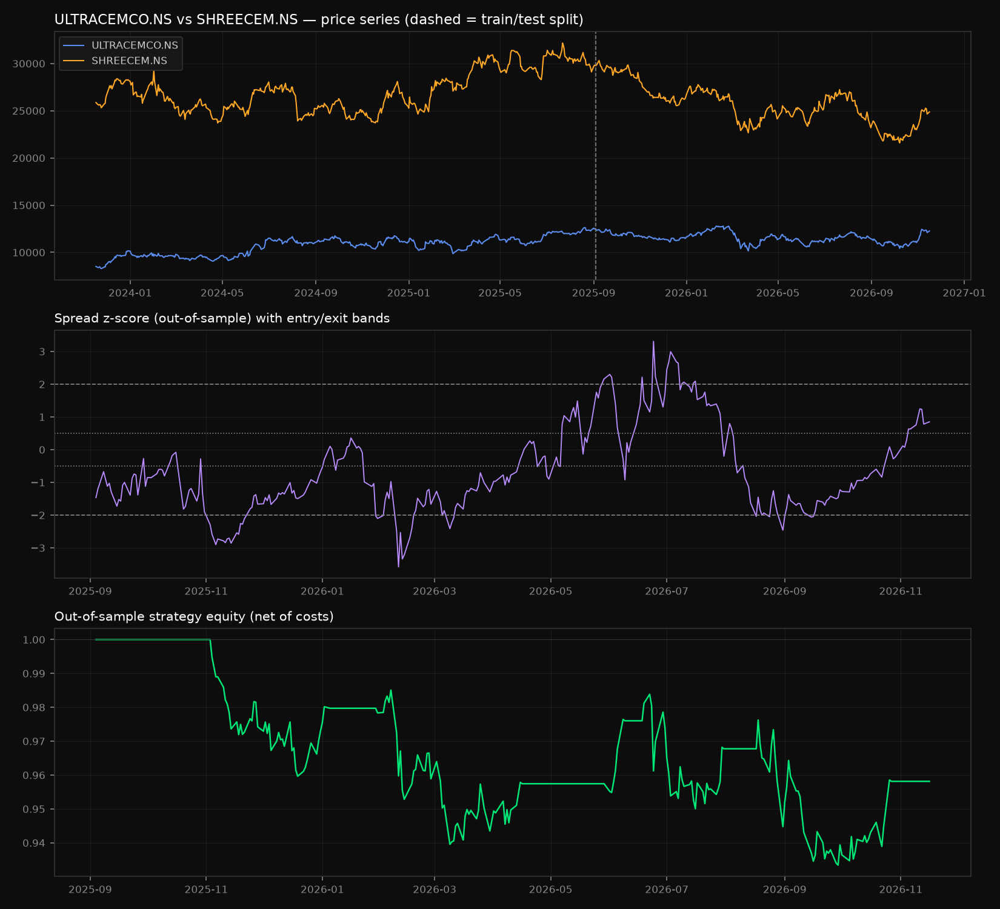

---

### IOC.NS / BPCL.NS

- **Latest prices:** IOC.NS ₹144.03 · BPCL.NS ₹305.30
- **Hedge ratio (train-fitted):** 1.4391
- **Cointegration (train):** FAIL at 5% — ADF -1.52, p=0.5227
- **Persistence:** passed 5% in 0 of 99 real-data runs (strict tier: 0/99)
- **Spread half-life:** 80.2 days
- **Current z-score:** -1.52
- **Signal today:** watch (approaching band)
- ⚠️ _Pair did not cointegrate on training data. Any signal here is not statistically justified — observation only._

**Out-of-sample backtest** (beta frozen from train window):

| Metric | Value |
|---|---|
| Sharpe | 0.62 |
| Sortino | 0.65 |
| Annualised return | 4.55% |
| Annualised vol | 7.64% |
| Max drawdown | -6.05% |
| Round-trip trades | 6 |

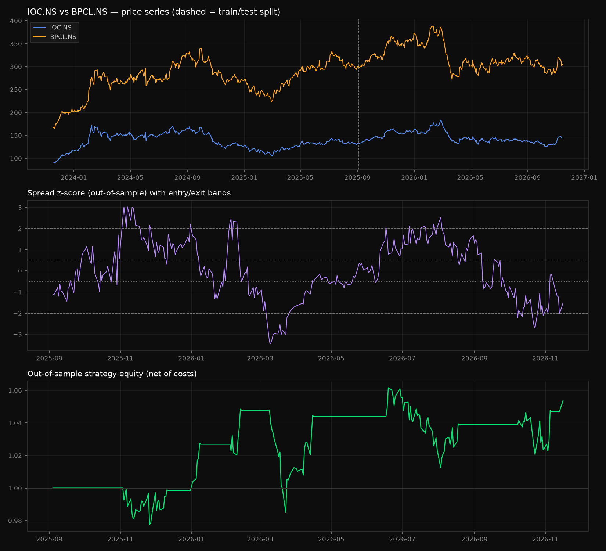

---

### BPCL.NS / HINDPETRO.NS

- **Latest prices:** BPCL.NS ₹305.30 · HINDPETRO.NS ₹386.95
- **Hedge ratio (train-fitted):** 1.2732
- **Cointegration (train):** FAIL at 5% — ADF -2.09, p=0.2495
- **Persistence:** passed 5% in 0 of 99 real-data runs (strict tier: 0/99)
- **Spread half-life:** 35.9 days
- **Current z-score:** +2.66
- **Signal today:** SHORT spread (short HINDPETRO.NS, long BPCL.NS)
- ⚠️ _Pair did not cointegrate on training data. Any signal here is not statistically justified — observation only._

**Out-of-sample backtest** (beta frozen from train window):

| Metric | Value |
|---|---|
| Sharpe | -0.40 |
| Sortino | -0.43 |
| Annualised return | -3.09% |
| Annualised vol | 7.21% |
| Max drawdown | -7.10% |
| Round-trip trades | 5 |

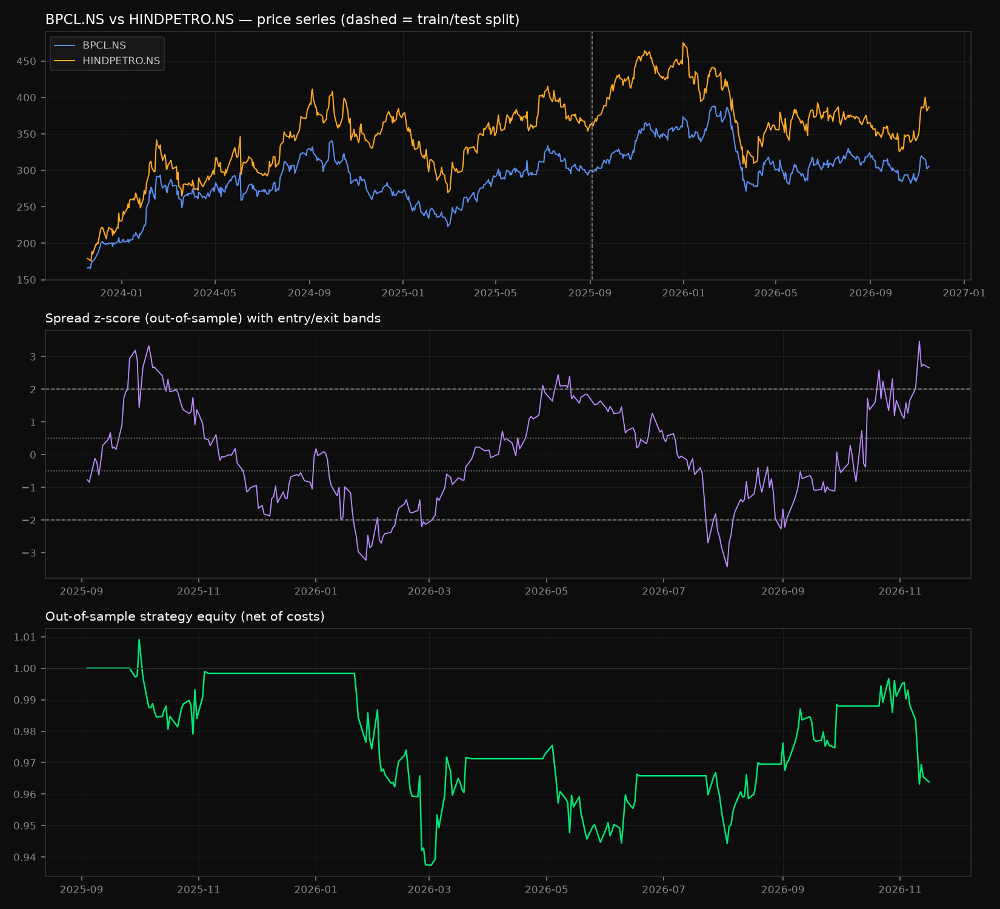

---

### ONGC.NS / COALINDIA.NS

- **Latest prices:** ONGC.NS ₹226.99 · COALINDIA.NS ₹397.50
- **Hedge ratio (train-fitted):** 1.3430
- **Cointegration (train):** PASS at 5% — ADF -3.42, p=0.0102
- **Persistence:** passed 5% in 91 of 99 real-data runs (strict tier: 1/99)
- **Spread half-life:** 13.3 days
- **Current z-score:** -0.76
- **Signal today:** watch (approaching band)

**Out-of-sample backtest** (beta frozen from train window):

| Metric | Value |
|---|---|
| Sharpe | 0.95 |
| Sortino | 0.81 |
| Annualised return | 7.60% |
| Annualised vol | 8.04% |
| Max drawdown | -6.35% |
| Round-trip trades | 6 |

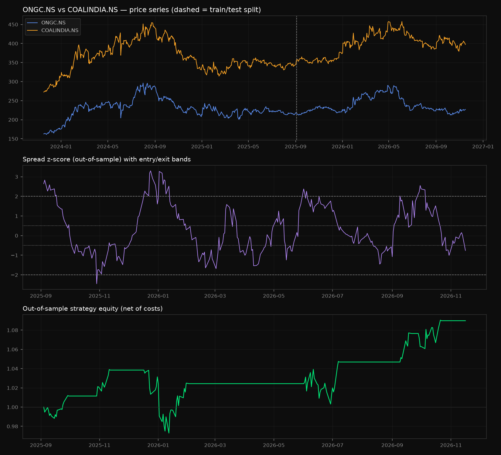

---

### NTPC.NS / POWERGRID.NS

- **Latest prices:** NTPC.NS ₹321.25 · POWERGRID.NS ₹262.20
- **Hedge ratio (train-fitted):** 0.7889
- **Cointegration (train):** FAIL at 5% — ADF -2.56, p=0.1013
- **Persistence:** passed 5% in 0 of 99 real-data runs (strict tier: 0/99)
- **Spread half-life:** 23.8 days
- **Current z-score:** +0.66
- **Signal today:** watch (approaching band)
- ⚠️ _Pair did not cointegrate on training data. Any signal here is not statistically justified — observation only._

**Out-of-sample backtest** (beta frozen from train window):

| Metric | Value |
|---|---|
| Sharpe | 0.71 |
| Sortino | 0.53 |
| Annualised return | 3.89% |
| Annualised vol | 5.58% |
| Max drawdown | -5.32% |
| Round-trip trades | 6 |

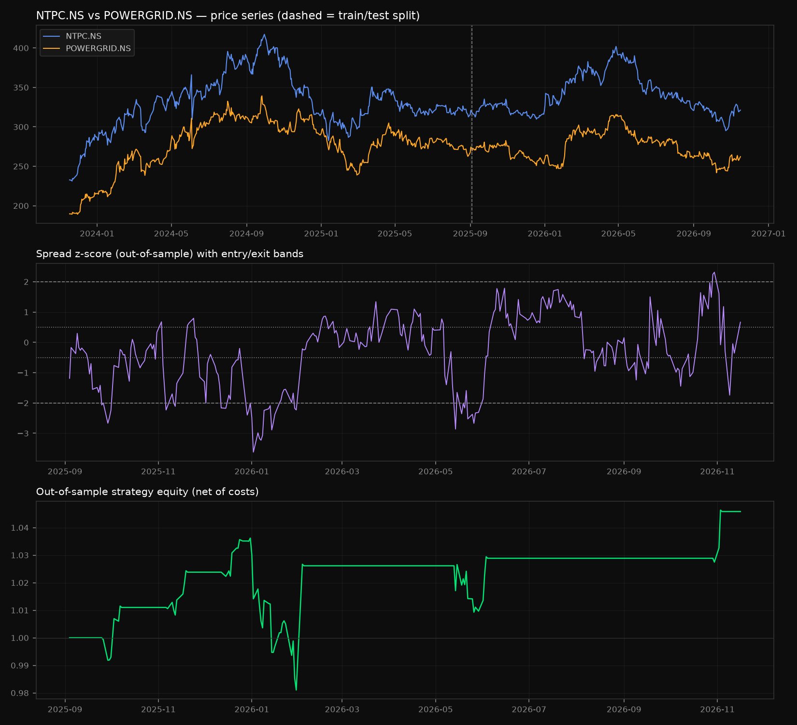

---

### BAJAJ-AUTO.NS / HEROMOTOCO.NS

- **Latest prices:** BAJAJ-AUTO.NS ₹10,734.00 · HEROMOTOCO.NS ₹5,359.50
- **Hedge ratio (train-fitted):** 0.4035
- **Cointegration (train):** FAIL at 5% — ADF -1.68, p=0.4426
- **Persistence:** passed 5% in 0 of 99 real-data runs (strict tier: 0/99)
- **Spread half-life:** 41.8 days
- **Current z-score:** +0.80
- **Signal today:** watch (approaching band)
- ⚠️ _Pair did not cointegrate on training data. Any signal here is not statistically justified — observation only._

**Out-of-sample backtest** (beta frozen from train window):

| Metric | Value |
|---|---|
| Sharpe | 0.25 |
| Sortino | 0.21 |
| Annualised return | 1.64% |
| Annualised vol | 7.58% |
| Max drawdown | -10.09% |
| Round-trip trades | 5 |

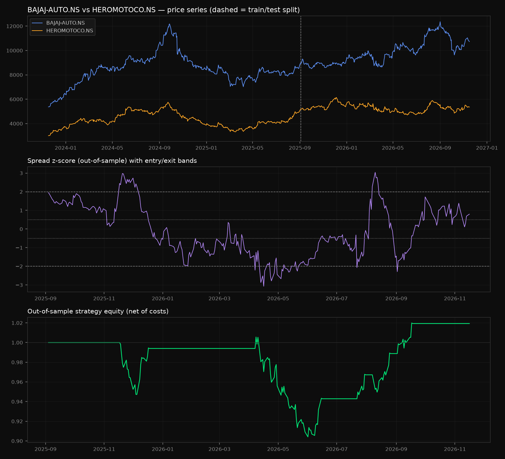

---

### TATASTEEL.NS / JSWSTEEL.NS

- **Latest prices:** TATASTEEL.NS ₹182.26 · JSWSTEEL.NS ₹1,334.60
- **Hedge ratio (train-fitted):** 2.6260
- **Cointegration (train):** FAIL at 5% — ADF -1.45, p=0.5576
- **Persistence:** passed 5% in 0 of 99 real-data runs (strict tier: 0/99)
- **Spread half-life:** 59.0 days
- **Current z-score:** +1.30
- **Signal today:** watch (approaching band)
- ⚠️ _Pair did not cointegrate on training data. Any signal here is not statistically justified — observation only._

**Out-of-sample backtest** (beta frozen from train window):

| Metric | Value |
|---|---|
| Sharpe | 0.52 |
| Sortino | 0.52 |
| Annualised return | 4.36% |
| Annualised vol | 8.87% |
| Max drawdown | -5.70% |
| Round-trip trades | 5 |

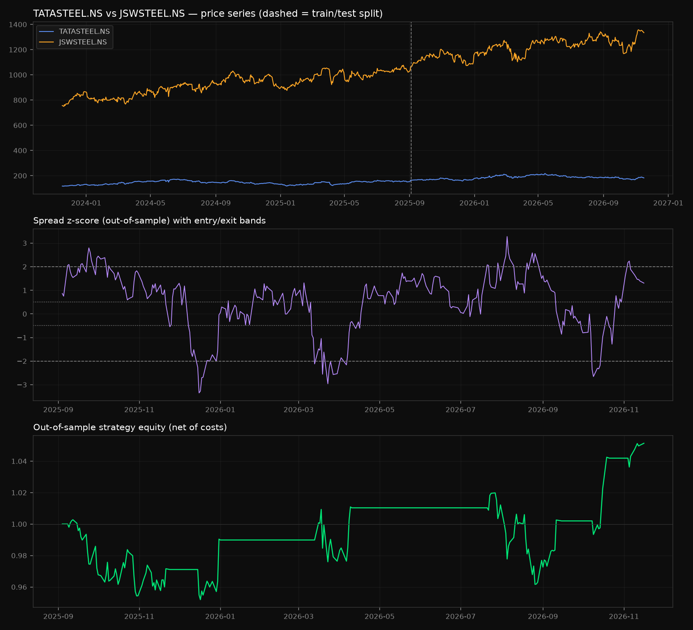

---

### SUNPHARMA.NS / CIPLA.NS

- **Latest prices:** SUNPHARMA.NS ₹1,867.50 · CIPLA.NS ₹1,394.50
- **Hedge ratio (train-fitted):** 0.4657
- **Cointegration (train):** FAIL at 5% — ADF -2.66, p=0.0814
- **Persistence:** passed 5% in 92 of 99 real-data runs (strict tier: 5/99)
- **Spread half-life:** 14.0 days
- **Current z-score:** +0.20
- **Signal today:** flat / no stretch
- ⚠️ _Pair did not cointegrate on training data. Any signal here is not statistically justified — observation only._

**Out-of-sample backtest** (beta frozen from train window):

| Metric | Value |
|---|---|
| Sharpe | 0.34 |
| Sortino | 0.34 |
| Annualised return | 2.19% |
| Annualised vol | 7.13% |
| Max drawdown | -10.16% |
| Round-trip trades | 5 |

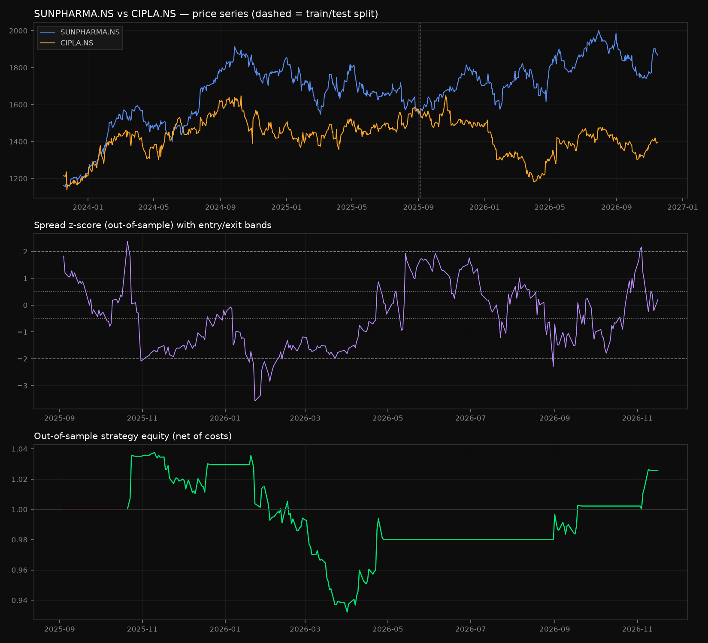

---

_Generated 2026-11-17 · pairs mean-reversion scanner · out-of-sample backtest · multiple-testing-aware · not investment advice._
