# Indian Pairs-Trading Scanner — 2026-11-18

> **What this is:** a market-neutral *pairs mean-reversion* scanner. It flags when two related NSE stocks have drifted apart far enough that their historical relationship signals a possible convergence trade. It does **not** forecast growth, rank "best" stocks, or predict company performance. A signal means the *spread between two stocks* is stretched — nothing about either stock being a good investment. Not investment advice; do your own research.

## Methodology (fixed in advance)

- **Universe:** 16 declared sector-mate pairs. Parameters (3y window, 60/40 train-test, z-entry 2.0, z-exit 0.5, 5 bps costs) are pre-registered; changes are logged in the README changelog *before* looking at results.
- **Multiple testing:** at the 5% level across 16 pairs, **≈0.8 false positives per run are expected by chance alone** even if nothing truly cointegrates. A single-day pass is a candidate, not a discovery.
- **Strict tier:** Bonferroni-corrected threshold p < 0.0031 (marked ✓✓).
- **Evidence = persistence:** the Persistence column counts how often each pair has passed the 5% test across all *real-data* daily runs recorded in `reports/history.csv`. Pairs deserve attention only when they pass persistently.

## Summary

| Pair | p-value | Coint. | Persistence | Current z | Signal | OOS Sharpe |
|---|---|---|---|---|---|---|
| HDFCBANK.NS/ICICIBANK.NS | 0.0316 | ✓ | 4/83 | +1.10 | watch | 0.12 |
| AXISBANK.NS/ICICIBANK.NS | 0.7963 | ✗ | 0/100 | +2.13 | SHORT spread | -0.34 |
| KOTAKBANK.NS/HDFCBANK.NS | 0.1641 | ✗ | 0/100 | -1.06 | watch | 1.44 |
| SBIN.NS/BANKBARODA.NS | 0.1240 | ✗ | 0/100 | +2.02 | SHORT spread | 0.14 |
| TCS.NS/INFY.NS | 0.5748 | ✗ | 0/100 | +0.51 | watch | 1.87 |
| INFY.NS/WIPRO.NS | 0.0741 | ✗ | 0/100 | +0.96 | watch | 2.44 |
| HCLTECH.NS/TECHM.NS | 0.2450 | ✗ | 0/100 | +1.63 | watch | -0.09 |
| ACC.NS/AMBUJACEM.NS | 0.1151 | ✗ | 0/100 | +0.46 | flat / no stretch | -0.22 |
| ULTRACEMCO.NS/SHREECEM.NS | 0.2676 | ✗ | 0/100 | +0.88 | watch | -0.52 |
| IOC.NS/BPCL.NS | 0.5067 | ✗ | 0/100 | -1.65 | watch | 0.59 |
| BPCL.NS/HINDPETRO.NS | 0.2418 | ✗ | 0/100 | +2.64 | SHORT spread | -0.44 |
| ONGC.NS/COALINDIA.NS | 0.0108 | ✓ | 92/100 | -0.92 | watch | 1.00 |
| NTPC.NS/POWERGRID.NS | 0.0987 | ✗ | 0/100 | -0.55 | watch | 0.87 |
| BAJAJ-AUTO.NS/HEROMOTOCO.NS | 0.4457 | ✗ | 0/100 | +0.58 | watch | 0.25 |
| TATASTEEL.NS/JSWSTEEL.NS | 0.5872 | ✗ | 0/100 | +1.25 | watch | 0.53 |
| SUNPHARMA.NS/CIPLA.NS | 0.0820 | ✗ | 92/100 | -0.14 | flat / no stretch | 0.34 |

_Legend: ✓✓ passes strict Bonferroni tier · ✓ passes 5% only · ✗ fails. Persistence = 5%-passes / real-data runs recorded. \*no real-data history yet._

---

### HDFCBANK.NS / ICICIBANK.NS

- **Latest prices:** HDFCBANK.NS ₹814.95 · ICICIBANK.NS ₹1,598.70
- **Hedge ratio (train-fitted):** 1.5115
- **Cointegration (train):** PASS at 5% — ADF -3.04, p=0.0316
- **Persistence:** passed 5% in 4 of 83 real-data runs (strict tier: 0/83)
- **Spread half-life:** 20.6 days
- **Current z-score:** +1.10
- **Signal today:** watch (approaching band)

**Out-of-sample backtest** (beta frozen from train window):

| Metric | Value |
|---|---|
| Sharpe | 0.12 |
| Sortino | 0.13 |
| Annualised return | 0.57% |
| Annualised vol | 6.12% |
| Max drawdown | -4.36% |
| Round-trip trades | 5 |

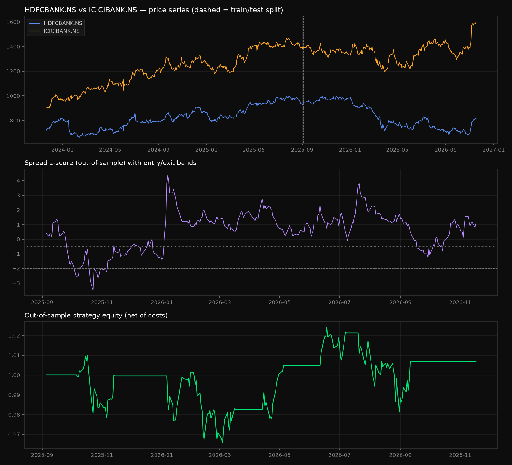

---

### AXISBANK.NS / ICICIBANK.NS

- **Latest prices:** AXISBANK.NS ₹1,369.00 · ICICIBANK.NS ₹1,598.70
- **Hedge ratio (train-fitted):** 0.5368
- **Cointegration (train):** FAIL at 5% — ADF -0.87, p=0.7963
- **Persistence:** passed 5% in 0 of 100 real-data runs (strict tier: 0/100)
- **Spread half-life:** 187.7 days
- **Current z-score:** +2.13
- **Signal today:** SHORT spread (short ICICIBANK.NS, long AXISBANK.NS)
- ⚠️ _Pair did not cointegrate on training data. Any signal here is not statistically justified — observation only._

**Out-of-sample backtest** (beta frozen from train window):

| Metric | Value |
|---|---|
| Sharpe | -0.34 |
| Sortino | -0.37 |
| Annualised return | -3.68% |
| Annualised vol | 9.67% |
| Max drawdown | -10.01% |
| Round-trip trades | 5 |

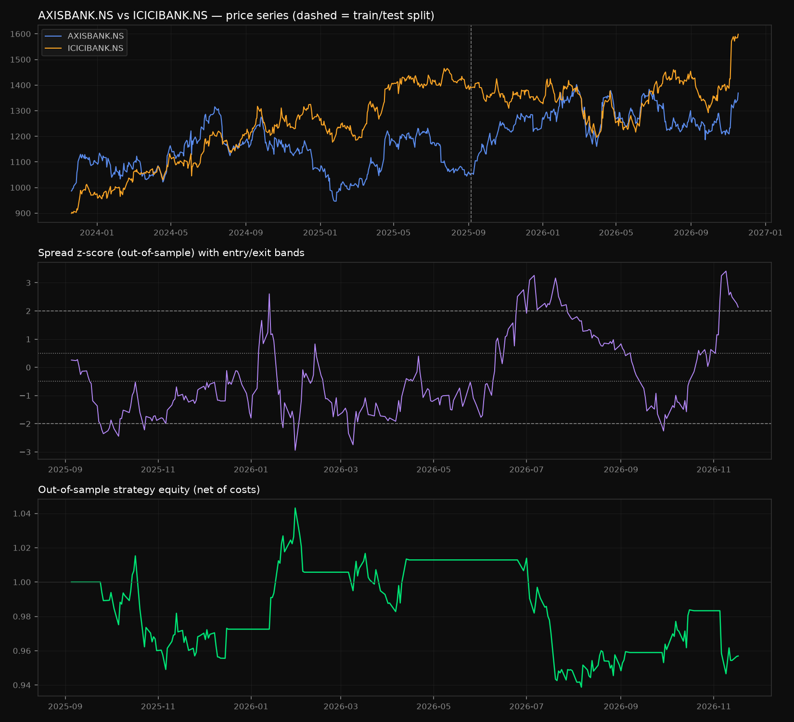

---

### KOTAKBANK.NS / HDFCBANK.NS

- **Latest prices:** KOTAKBANK.NS ₹497.25 · HDFCBANK.NS ₹814.95
- **Hedge ratio (train-fitted):** 2.2332
- **Cointegration (train):** FAIL at 5% — ADF -2.32, p=0.1641
- **Persistence:** passed 5% in 0 of 100 real-data runs (strict tier: 0/100)
- **Spread half-life:** 27.0 days
- **Current z-score:** -1.06
- **Signal today:** watch (approaching band)
- ⚠️ _Pair did not cointegrate on training data. Any signal here is not statistically justified — observation only._

**Out-of-sample backtest** (beta frozen from train window):

| Metric | Value |
|---|---|
| Sharpe | 1.44 |
| Sortino | 1.51 |
| Annualised return | 9.06% |
| Annualised vol | 6.14% |
| Max drawdown | -2.88% |
| Round-trip trades | 5 |

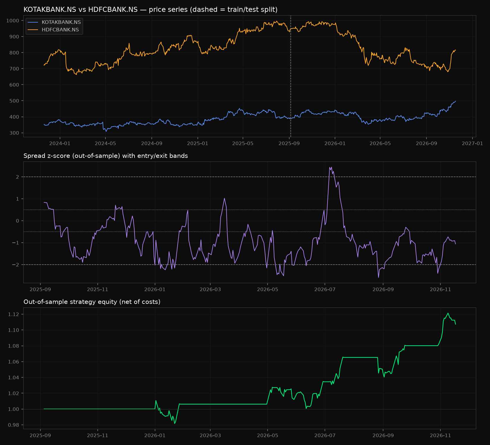

---

### SBIN.NS / BANKBARODA.NS

- **Latest prices:** SBIN.NS ₹1,108.60 · BANKBARODA.NS ₹274.89
- **Hedge ratio (train-fitted):** 0.1732
- **Cointegration (train):** FAIL at 5% — ADF -2.47, p=0.1240
- **Persistence:** passed 5% in 0 of 100 real-data runs (strict tier: 0/100)
- **Spread half-life:** 19.9 days
- **Current z-score:** +2.02
- **Signal today:** SHORT spread (short BANKBARODA.NS, long SBIN.NS)
- ⚠️ _Pair did not cointegrate on training data. Any signal here is not statistically justified — observation only._

**Out-of-sample backtest** (beta frozen from train window):

| Metric | Value |
|---|---|
| Sharpe | 0.14 |
| Sortino | 0.12 |
| Annualised return | 0.90% |
| Annualised vol | 10.76% |
| Max drawdown | -8.94% |
| Round-trip trades | 6 |

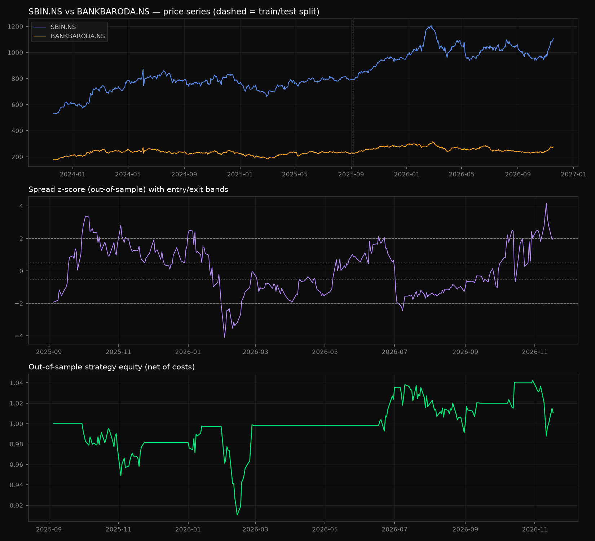

---

### TCS.NS / INFY.NS

- **Latest prices:** TCS.NS ₹2,406.60 · INFY.NS ₹1,130.00
- **Hedge ratio (train-fitted):** 0.3717
- **Cointegration (train):** FAIL at 5% — ADF -1.42, p=0.5748
- **Persistence:** passed 5% in 0 of 100 real-data runs (strict tier: 0/100)
- **Spread half-life:** 64.9 days
- **Current z-score:** +0.51
- **Signal today:** watch (approaching band)
- ⚠️ _Pair did not cointegrate on training data. Any signal here is not statistically justified — observation only._

**Out-of-sample backtest** (beta frozen from train window):

| Metric | Value |
|---|---|
| Sharpe | 1.87 |
| Sortino | 2.30 |
| Annualised return | 10.14% |
| Annualised vol | 5.24% |
| Max drawdown | -2.93% |
| Round-trip trades | 7 |

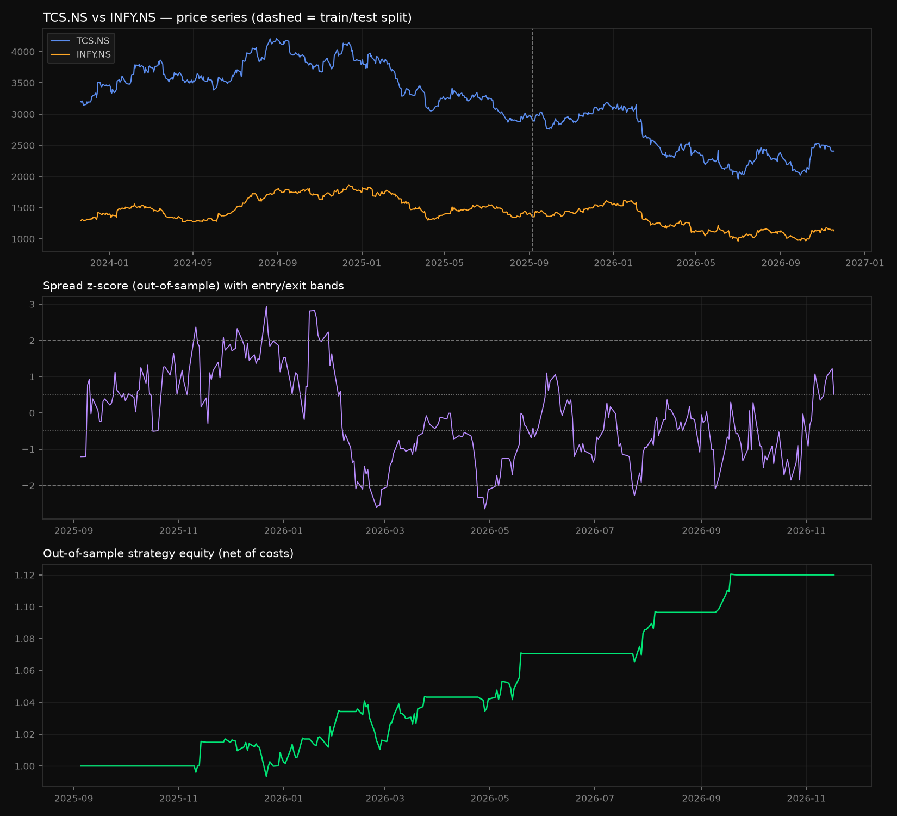

---

### INFY.NS / WIPRO.NS

- **Latest prices:** INFY.NS ₹1,130.00 · WIPRO.NS ₹189.89
- **Hedge ratio (train-fitted):** 0.1147
- **Cointegration (train):** FAIL at 5% — ADF -2.70, p=0.0741
- **Persistence:** passed 5% in 0 of 100 real-data runs (strict tier: 0/100)
- **Spread half-life:** 24.3 days
- **Current z-score:** +0.96
- **Signal today:** watch (approaching band)
- ⚠️ _Pair did not cointegrate on training data. Any signal here is not statistically justified — observation only._

**Out-of-sample backtest** (beta frozen from train window):

| Metric | Value |
|---|---|
| Sharpe | 2.44 |
| Sortino | 3.42 |
| Annualised return | 15.72% |
| Annualised vol | 6.05% |
| Max drawdown | -3.48% |
| Round-trip trades | 6 |

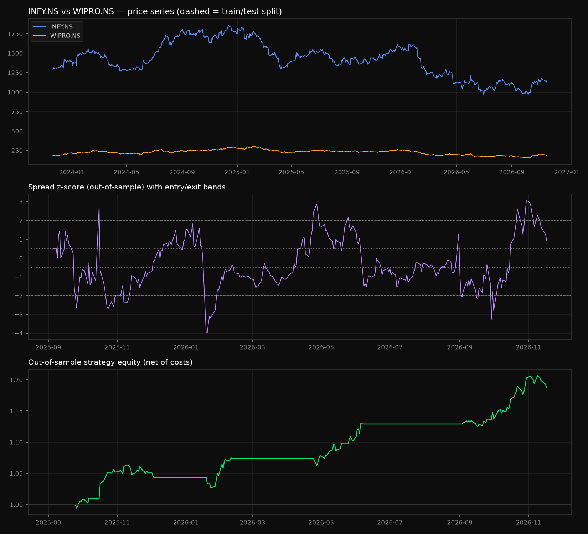

---

### HCLTECH.NS / TECHM.NS

- **Latest prices:** HCLTECH.NS ₹1,355.70 · TECHM.NS ₹1,762.00
- **Hedge ratio (train-fitted):** 0.9344
- **Cointegration (train):** FAIL at 5% — ADF -2.10, p=0.2450
- **Persistence:** passed 5% in 0 of 100 real-data runs (strict tier: 0/100)
- **Spread half-life:** 29.8 days
- **Current z-score:** +1.63
- **Signal today:** watch (approaching band)
- ⚠️ _Pair did not cointegrate on training data. Any signal here is not statistically justified — observation only._

**Out-of-sample backtest** (beta frozen from train window):

| Metric | Value |
|---|---|
| Sharpe | -0.09 |
| Sortino | -0.09 |
| Annualised return | -1.00% |
| Annualised vol | 7.87% |
| Max drawdown | -8.57% |
| Round-trip trades | 5 |

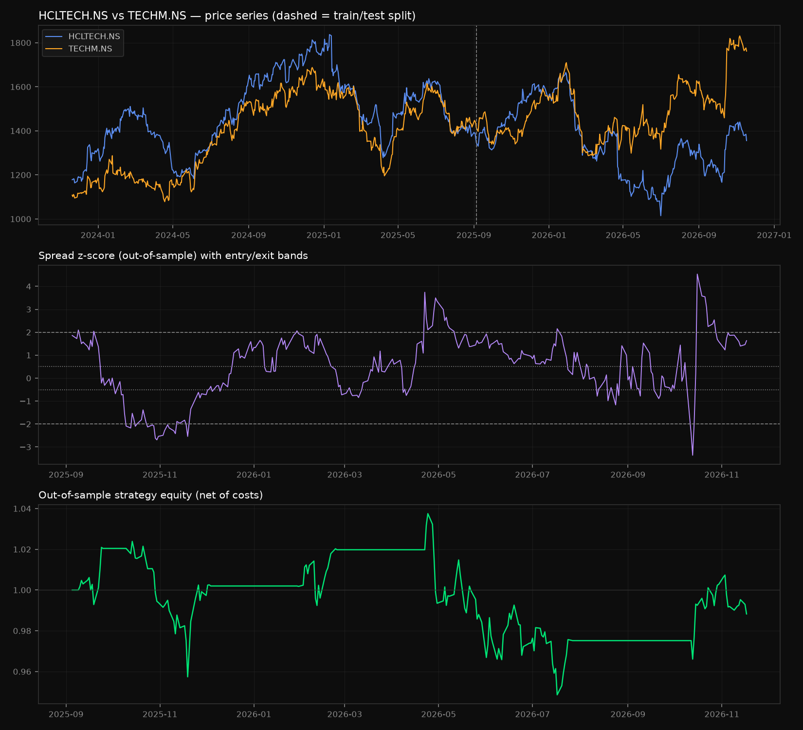

---

### ACC.NS / AMBUJACEM.NS

- **Latest prices:** ACC.NS ₹1,248.20 · AMBUJACEM.NS ₹390.20
- **Hedge ratio (train-fitted):** 0.1328
- **Cointegration (train):** FAIL at 5% — ADF -2.50, p=0.1151
- **Persistence:** passed 5% in 0 of 100 real-data runs (strict tier: 0/100)
- **Spread half-life:** 29.8 days
- **Current z-score:** +0.46
- **Signal today:** flat / no stretch
- ⚠️ _Pair did not cointegrate on training data. Any signal here is not statistically justified — observation only._

**Out-of-sample backtest** (beta frozen from train window):

| Metric | Value |
|---|---|
| Sharpe | -0.22 |
| Sortino | -0.17 |
| Annualised return | -1.88% |
| Annualised vol | 7.47% |
| Max drawdown | -7.97% |
| Round-trip trades | 4 |

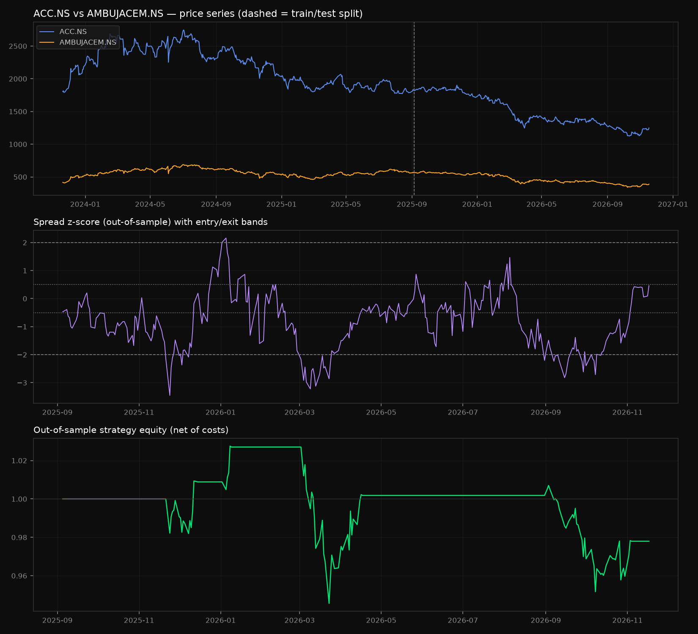

---

### ULTRACEMCO.NS / SHREECEM.NS

- **Latest prices:** ULTRACEMCO.NS ₹12,290.00 · SHREECEM.NS ₹24,900.00
- **Hedge ratio (train-fitted):** 1.2408
- **Cointegration (train):** FAIL at 5% — ADF -2.04, p=0.2676
- **Persistence:** passed 5% in 0 of 100 real-data runs (strict tier: 0/100)
- **Spread half-life:** 38.0 days
- **Current z-score:** +0.88
- **Signal today:** watch (approaching band)
- ⚠️ _Pair did not cointegrate on training data. Any signal here is not statistically justified — observation only._

**Out-of-sample backtest** (beta frozen from train window):

| Metric | Value |
|---|---|
| Sharpe | -0.52 |
| Sortino | -0.60 |
| Annualised return | -3.54% |
| Annualised vol | 6.51% |
| Max drawdown | -6.60% |
| Round-trip trades | 5 |

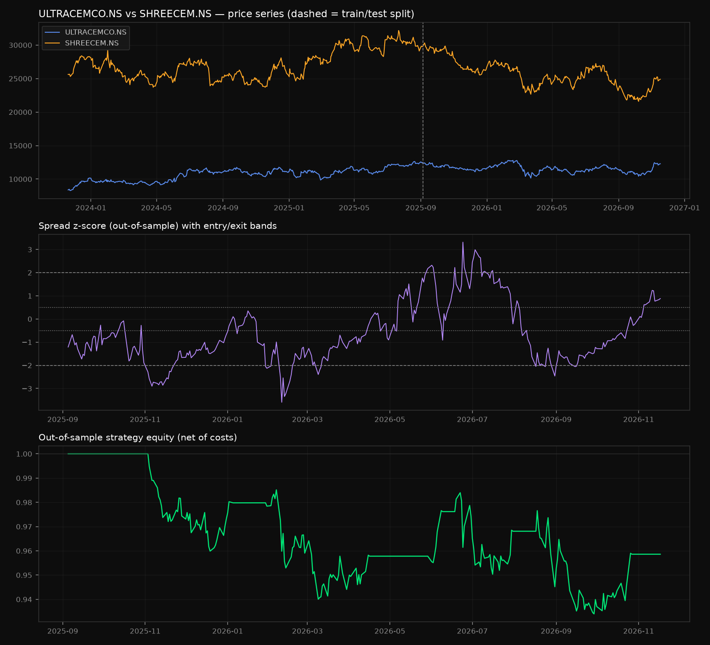

---

### IOC.NS / BPCL.NS

- **Latest prices:** IOC.NS ₹145.56 · BPCL.NS ₹305.80
- **Hedge ratio (train-fitted):** 1.4238
- **Cointegration (train):** FAIL at 5% — ADF -1.55, p=0.5067
- **Persistence:** passed 5% in 0 of 100 real-data runs (strict tier: 0/100)
- **Spread half-life:** 78.2 days
- **Current z-score:** -1.65
- **Signal today:** watch (approaching band)
- ⚠️ _Pair did not cointegrate on training data. Any signal here is not statistically justified — observation only._

**Out-of-sample backtest** (beta frozen from train window):

| Metric | Value |
|---|---|
| Sharpe | 0.59 |
| Sortino | 0.61 |
| Annualised return | 4.31% |
| Annualised vol | 7.72% |
| Max drawdown | -6.14% |
| Round-trip trades | 6 |

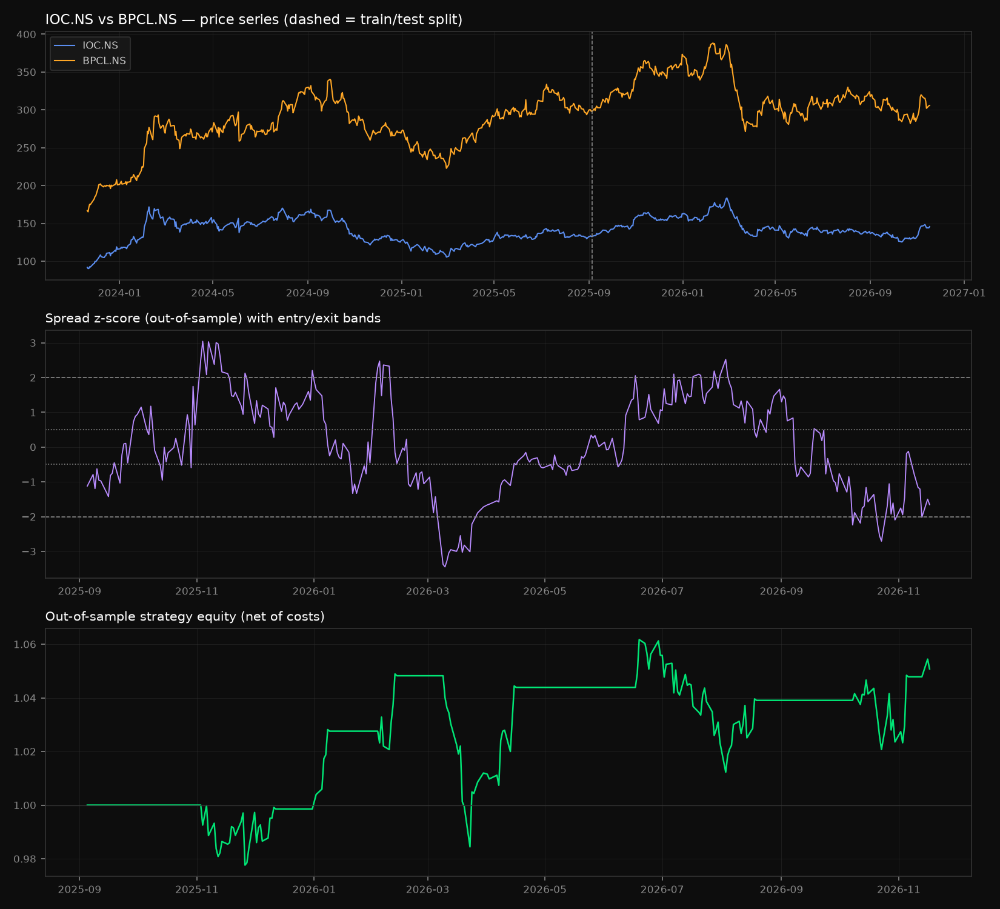

---

### BPCL.NS / HINDPETRO.NS

- **Latest prices:** BPCL.NS ₹305.80 · HINDPETRO.NS ₹389.55
- **Hedge ratio (train-fitted):** 1.2709
- **Cointegration (train):** FAIL at 5% — ADF -2.11, p=0.2418
- **Persistence:** passed 5% in 0 of 100 real-data runs (strict tier: 0/100)
- **Spread half-life:** 35.6 days
- **Current z-score:** +2.64
- **Signal today:** SHORT spread (short HINDPETRO.NS, long BPCL.NS)
- ⚠️ _Pair did not cointegrate on training data. Any signal here is not statistically justified — observation only._

**Out-of-sample backtest** (beta frozen from train window):

| Metric | Value |
|---|---|
| Sharpe | -0.44 |
| Sortino | -0.48 |
| Annualised return | -3.35% |
| Annualised vol | 7.23% |
| Max drawdown | -7.12% |
| Round-trip trades | 5 |

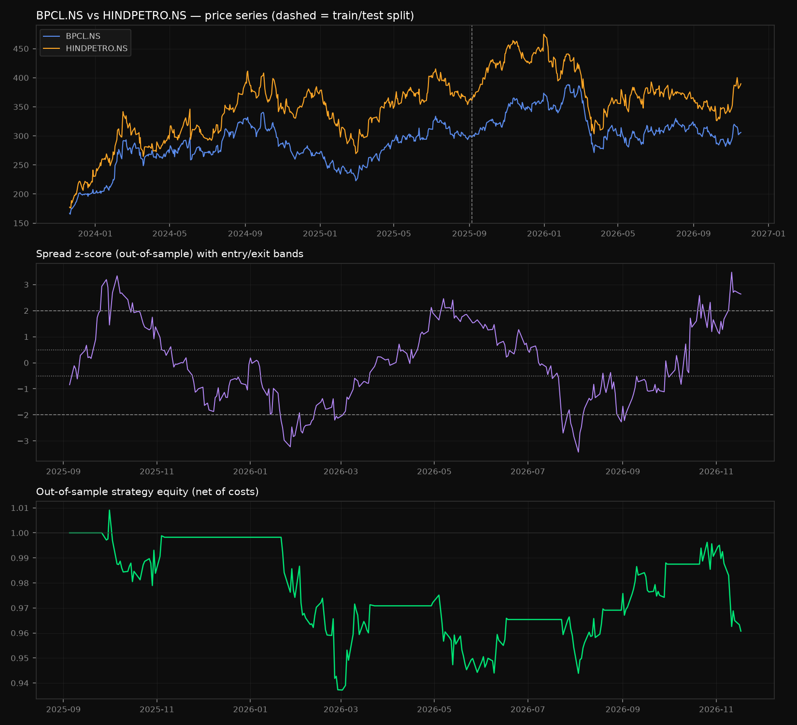

---

### ONGC.NS / COALINDIA.NS

- **Latest prices:** ONGC.NS ₹223.52 · COALINDIA.NS ₹391.55
- **Hedge ratio (train-fitted):** 1.3420
- **Cointegration (train):** PASS at 5% — ADF -3.41, p=0.0108
- **Persistence:** passed 5% in 92 of 100 real-data runs (strict tier: 1/100)
- **Spread half-life:** 13.4 days
- **Current z-score:** -0.92
- **Signal today:** watch (approaching band)

**Out-of-sample backtest** (beta frozen from train window):

| Metric | Value |
|---|---|
| Sharpe | 1.00 |
| Sortino | 0.84 |
| Annualised return | 8.04% |
| Annualised vol | 8.03% |
| Max drawdown | -6.36% |
| Round-trip trades | 6 |

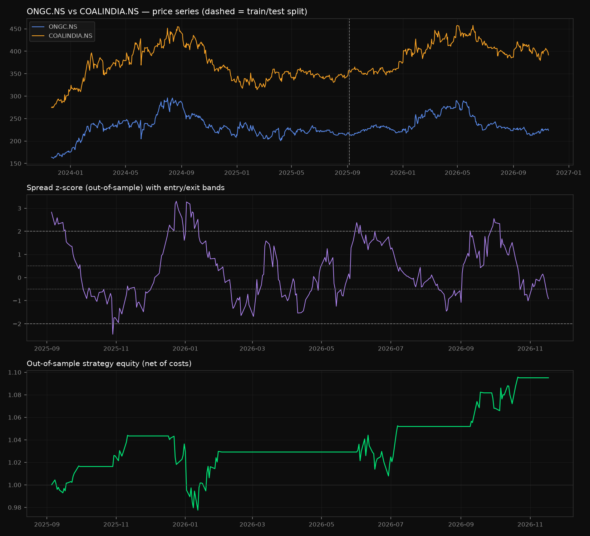

---

### NTPC.NS / POWERGRID.NS

- **Latest prices:** NTPC.NS ₹321.80 · POWERGRID.NS ₹258.00
- **Hedge ratio (train-fitted):** 0.7870
- **Cointegration (train):** FAIL at 5% — ADF -2.57, p=0.0987
- **Persistence:** passed 5% in 0 of 100 real-data runs (strict tier: 0/100)
- **Spread half-life:** 23.7 days
- **Current z-score:** -0.55
- **Signal today:** watch (approaching band)
- ⚠️ _Pair did not cointegrate on training data. Any signal here is not statistically justified — observation only._

**Out-of-sample backtest** (beta frozen from train window):

| Metric | Value |
|---|---|
| Sharpe | 0.87 |
| Sortino | 0.67 |
| Annualised return | 4.86% |
| Annualised vol | 5.63% |
| Max drawdown | -5.30% |
| Round-trip trades | 7 |

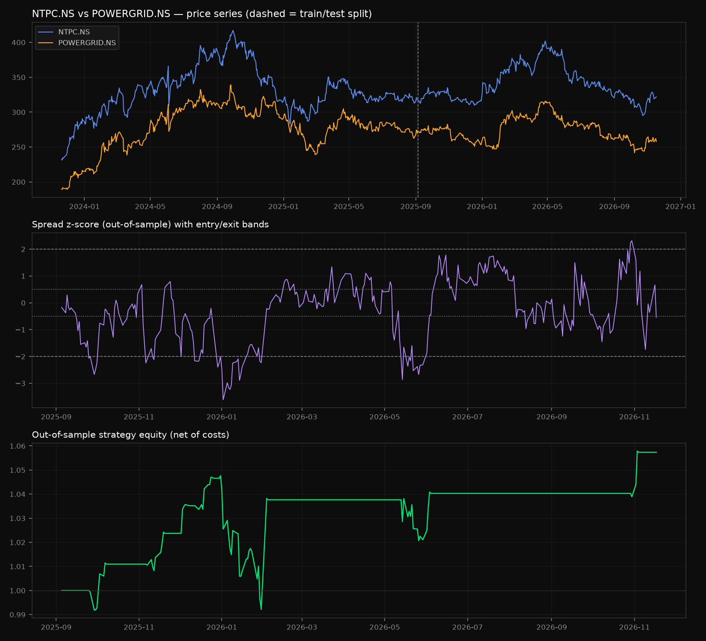

---

### BAJAJ-AUTO.NS / HEROMOTOCO.NS

- **Latest prices:** BAJAJ-AUTO.NS ₹10,770.00 · HEROMOTOCO.NS ₹5,329.00
- **Hedge ratio (train-fitted):** 0.4039
- **Cointegration (train):** FAIL at 5% — ADF -1.67, p=0.4457
- **Persistence:** passed 5% in 0 of 100 real-data runs (strict tier: 0/100)
- **Spread half-life:** 42.9 days
- **Current z-score:** +0.58
- **Signal today:** watch (approaching band)
- ⚠️ _Pair did not cointegrate on training data. Any signal here is not statistically justified — observation only._

**Out-of-sample backtest** (beta frozen from train window):

| Metric | Value |
|---|---|
| Sharpe | 0.25 |
| Sortino | 0.21 |
| Annualised return | 1.64% |
| Annualised vol | 7.57% |
| Max drawdown | -10.07% |
| Round-trip trades | 5 |

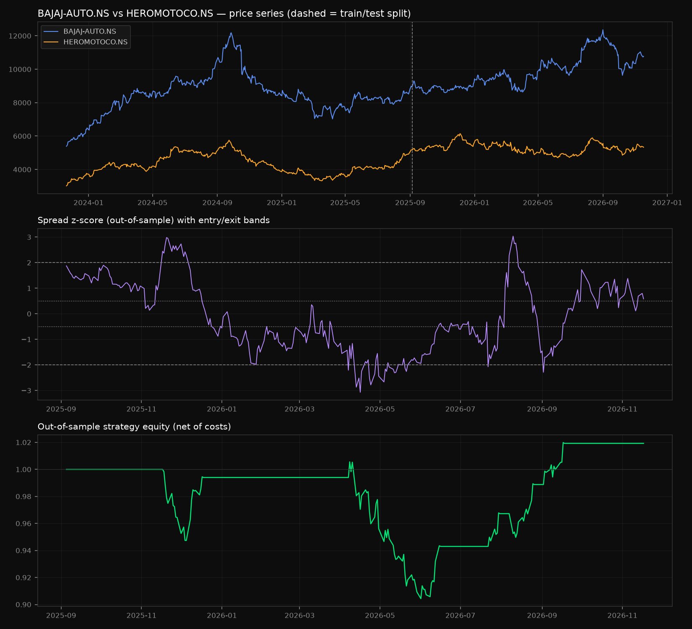

---

### TATASTEEL.NS / JSWSTEEL.NS

- **Latest prices:** TATASTEEL.NS ₹181.50 · JSWSTEEL.NS ₹1,332.00
- **Hedge ratio (train-fitted):** 2.6141
- **Cointegration (train):** FAIL at 5% — ADF -1.39, p=0.5872
- **Persistence:** passed 5% in 0 of 100 real-data runs (strict tier: 0/100)
- **Spread half-life:** 58.2 days
- **Current z-score:** +1.25
- **Signal today:** watch (approaching band)
- ⚠️ _Pair did not cointegrate on training data. Any signal here is not statistically justified — observation only._

**Out-of-sample backtest** (beta frozen from train window):

| Metric | Value |
|---|---|
| Sharpe | 0.53 |
| Sortino | 0.52 |
| Annualised return | 4.41% |
| Annualised vol | 8.88% |
| Max drawdown | -5.70% |
| Round-trip trades | 5 |

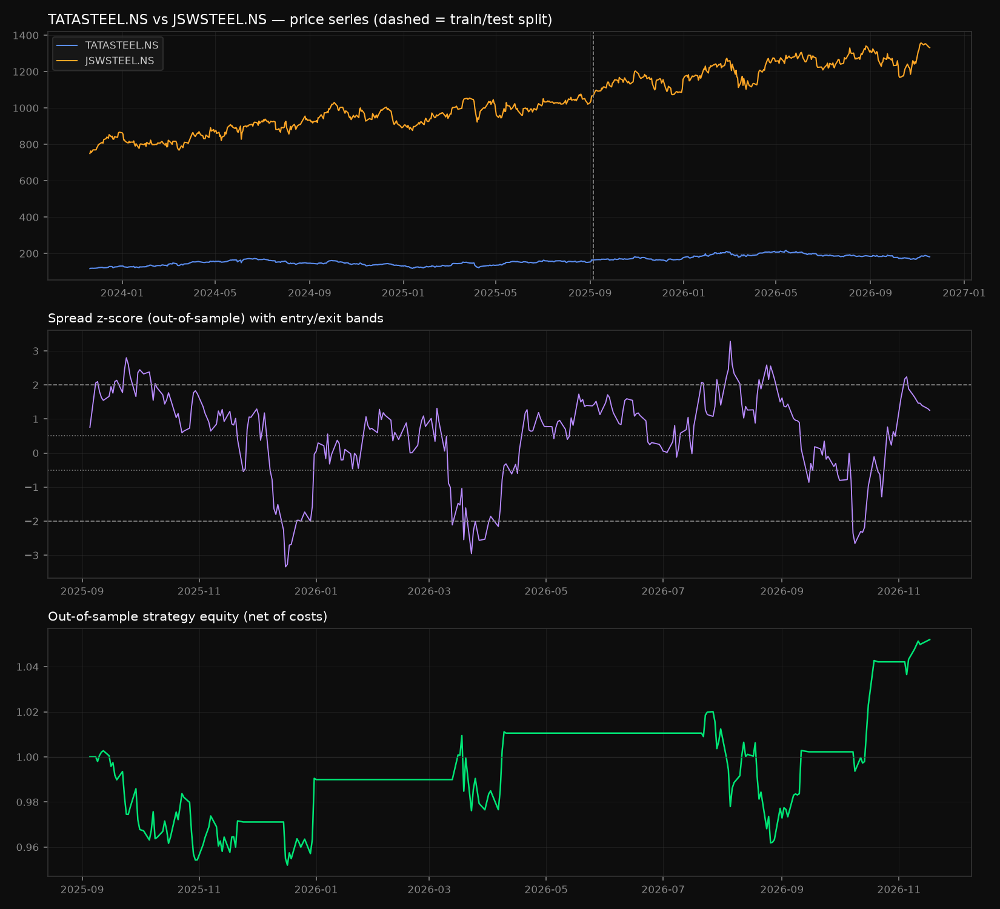

---

### SUNPHARMA.NS / CIPLA.NS

- **Latest prices:** SUNPHARMA.NS ₹1,870.00 · CIPLA.NS ₹1,388.00
- **Hedge ratio (train-fitted):** 0.4646
- **Cointegration (train):** FAIL at 5% — ADF -2.66, p=0.0820
- **Persistence:** passed 5% in 92 of 100 real-data runs (strict tier: 5/100)
- **Spread half-life:** 14.1 days
- **Current z-score:** -0.14
- **Signal today:** flat / no stretch
- ⚠️ _Pair did not cointegrate on training data. Any signal here is not statistically justified — observation only._

**Out-of-sample backtest** (beta frozen from train window):

| Metric | Value |
|---|---|
| Sharpe | 0.34 |
| Sortino | 0.34 |
| Annualised return | 2.20% |
| Annualised vol | 7.19% |
| Max drawdown | -10.24% |
| Round-trip trades | 5 |

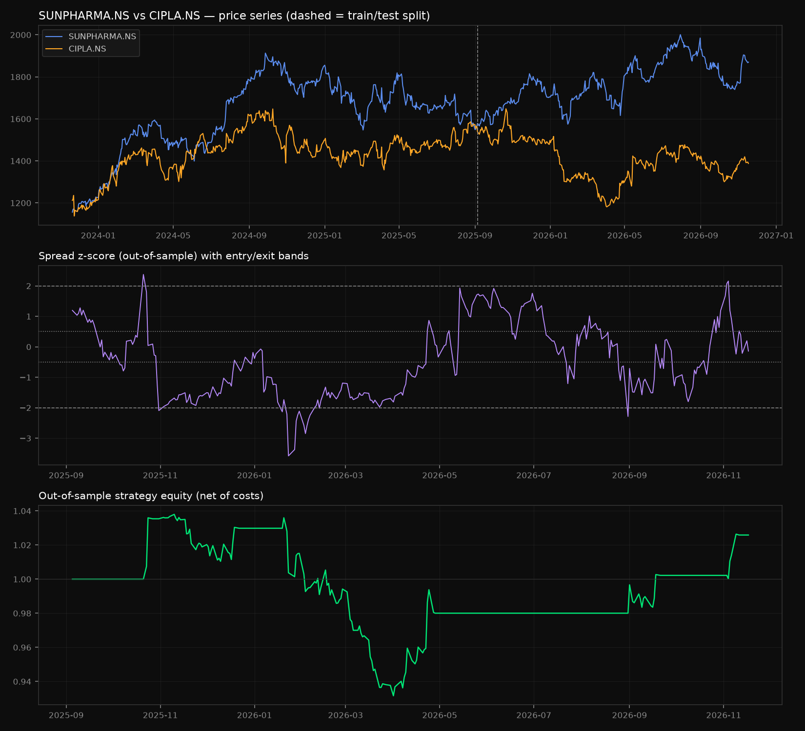

---

_Generated 2026-11-18 · pairs mean-reversion scanner · out-of-sample backtest · multiple-testing-aware · not investment advice._
