# Indian Pairs-Trading Scanner — 2026-11-19

> **What this is:** a market-neutral *pairs mean-reversion* scanner. It flags when two related NSE stocks have drifted apart far enough that their historical relationship signals a possible convergence trade. It does **not** forecast growth, rank "best" stocks, or predict company performance. A signal means the *spread between two stocks* is stretched — nothing about either stock being a good investment. Not investment advice; do your own research.

## Methodology (fixed in advance)

- **Universe:** 16 declared sector-mate pairs. Parameters (3y window, 60/40 train-test, z-entry 2.0, z-exit 0.5, 5 bps costs) are pre-registered; changes are logged in the README changelog *before* looking at results.
- **Multiple testing:** at the 5% level across 16 pairs, **≈0.8 false positives per run are expected by chance alone** even if nothing truly cointegrates. A single-day pass is a candidate, not a discovery.
- **Strict tier:** Bonferroni-corrected threshold p < 0.0031 (marked ✓✓).
- **Evidence = persistence:** the Persistence column counts how often each pair has passed the 5% test across all *real-data* daily runs recorded in `reports/history.csv`. Pairs deserve attention only when they pass persistently.

## Summary

| Pair | p-value | Coint. | Persistence | Current z | Signal | OOS Sharpe |
|---|---|---|---|---|---|---|
| HDFCBANK.NS/ICICIBANK.NS | 0.0312 | ✓ | 5/84 | +1.31 | watch | 0.12 |
| AXISBANK.NS/ICICIBANK.NS | 0.7822 | ✗ | 0/101 | +2.13 | SHORT spread | -0.37 |
| KOTAKBANK.NS/HDFCBANK.NS | 0.1715 | ✗ | 0/101 | -1.06 | watch | 1.43 |
| SBIN.NS/BANKBARODA.NS | 0.1227 | ✗ | 0/101 | +1.32 | watch | 0.24 |
| TCS.NS/INFY.NS | 0.5701 | ✗ | 0/101 | +0.02 | flat / no stretch | 1.86 |
| INFY.NS/WIPRO.NS | 0.0749 | ✗ | 0/101 | +0.59 | watch | 2.36 |
| HCLTECH.NS/TECHM.NS | 0.2476 | ✗ | 0/101 | +1.53 | watch | -0.08 |
| ACC.NS/AMBUJACEM.NS | 0.1123 | ✗ | 0/101 | +0.27 | flat / no stretch | -0.22 |
| ULTRACEMCO.NS/SHREECEM.NS | 0.2693 | ✗ | 0/101 | +0.43 | flat / no stretch | -0.52 |
| IOC.NS/BPCL.NS | 0.5017 | ✗ | 0/101 | -1.32 | watch | 0.63 |
| BPCL.NS/HINDPETRO.NS | 0.2406 | ✗ | 0/101 | +2.26 | SHORT spread | -0.39 |
| ONGC.NS/COALINDIA.NS | 0.0114 | ✓ | 93/101 | -1.44 | watch | 0.95 |
| NTPC.NS/POWERGRID.NS | 0.1008 | ✗ | 0/101 | +0.00 | flat / no stretch | 0.87 |
| BAJAJ-AUTO.NS/HEROMOTOCO.NS | 0.4495 | ✗ | 0/101 | +0.61 | watch | 0.25 |
| TATASTEEL.NS/JSWSTEEL.NS | 0.5856 | ✗ | 0/101 | +1.02 | watch | 0.59 |
| SUNPHARMA.NS/CIPLA.NS | 0.0552 | ✗ | 92/101 | +1.18 | watch | 0.34 |

_Legend: ✓✓ passes strict Bonferroni tier · ✓ passes 5% only · ✗ fails. Persistence = 5%-passes / real-data runs recorded. \*no real-data history yet._

---

### HDFCBANK.NS / ICICIBANK.NS

- **Latest prices:** HDFCBANK.NS ₹808.15 · ICICIBANK.NS ₹1,601.30
- **Hedge ratio (train-fitted):** 1.5114
- **Cointegration (train):** PASS at 5% — ADF -3.04, p=0.0312
- **Persistence:** passed 5% in 5 of 84 real-data runs (strict tier: 0/84)
- **Spread half-life:** 20.6 days
- **Current z-score:** +1.31
- **Signal today:** watch (approaching band)

**Out-of-sample backtest** (beta frozen from train window):

| Metric | Value |
|---|---|
| Sharpe | 0.12 |
| Sortino | 0.13 |
| Annualised return | 0.57% |
| Annualised vol | 6.12% |
| Max drawdown | -4.35% |
| Round-trip trades | 5 |

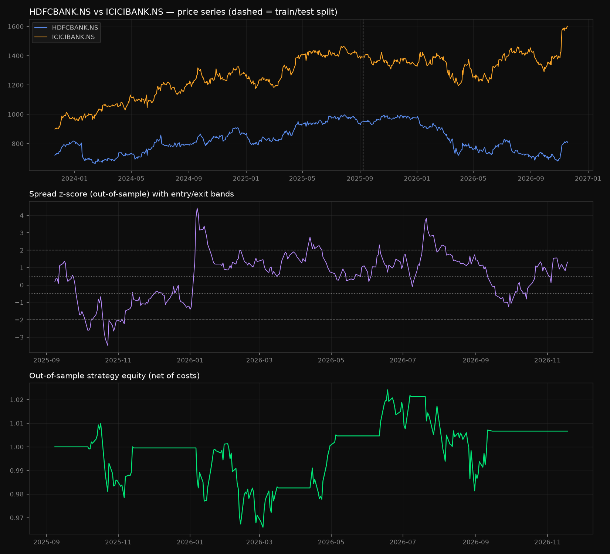

---

### AXISBANK.NS / ICICIBANK.NS

- **Latest prices:** AXISBANK.NS ₹1,360.00 · ICICIBANK.NS ₹1,601.30
- **Hedge ratio (train-fitted):** 0.5307
- **Cointegration (train):** FAIL at 5% — ADF -0.92, p=0.7822
- **Persistence:** passed 5% in 0 of 101 real-data runs (strict tier: 0/101)
- **Spread half-life:** 179.3 days
- **Current z-score:** +2.13
- **Signal today:** SHORT spread (short ICICIBANK.NS, long AXISBANK.NS)
- ⚠️ _Pair did not cointegrate on training data. Any signal here is not statistically justified — observation only._

**Out-of-sample backtest** (beta frozen from train window):

| Metric | Value |
|---|---|
| Sharpe | -0.37 |
| Sortino | -0.41 |
| Annualised return | -3.97% |
| Annualised vol | 9.70% |
| Max drawdown | -9.99% |
| Round-trip trades | 5 |

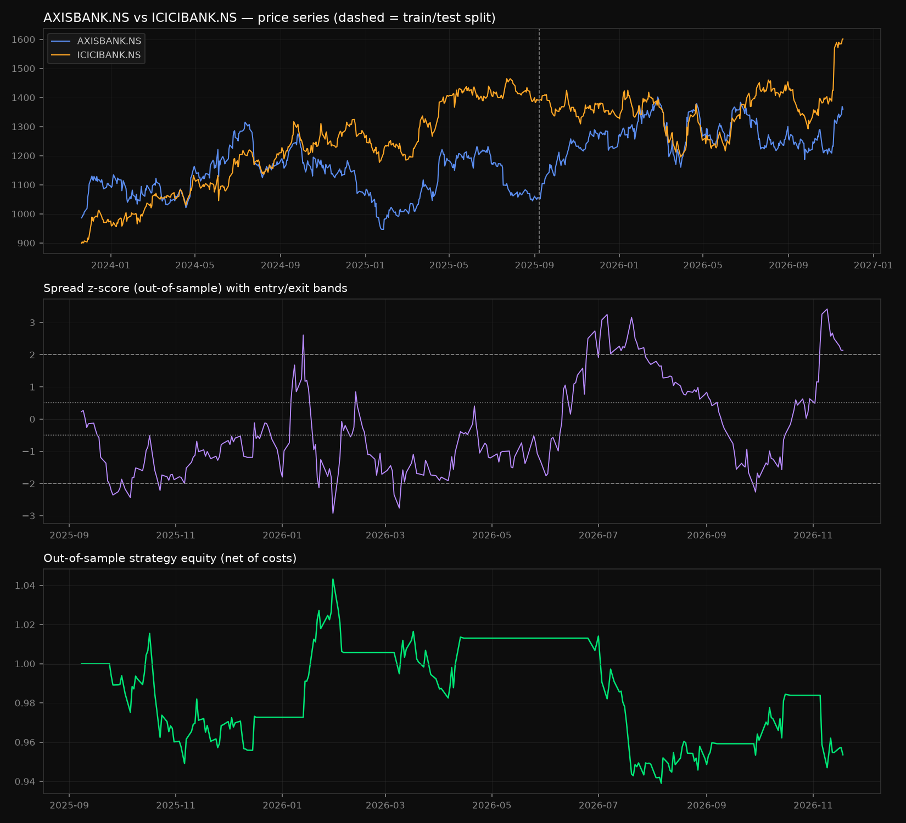

---

### KOTAKBANK.NS / HDFCBANK.NS

- **Latest prices:** KOTAKBANK.NS ₹494.85 · HDFCBANK.NS ₹808.15
- **Hedge ratio (train-fitted):** 2.2362
- **Cointegration (train):** FAIL at 5% — ADF -2.30, p=0.1715
- **Persistence:** passed 5% in 0 of 101 real-data runs (strict tier: 0/101)
- **Spread half-life:** 27.4 days
- **Current z-score:** -1.06
- **Signal today:** watch (approaching band)
- ⚠️ _Pair did not cointegrate on training data. Any signal here is not statistically justified — observation only._

**Out-of-sample backtest** (beta frozen from train window):

| Metric | Value |
|---|---|
| Sharpe | 1.43 |
| Sortino | 1.50 |
| Annualised return | 8.96% |
| Annualised vol | 6.13% |
| Max drawdown | -2.86% |
| Round-trip trades | 5 |

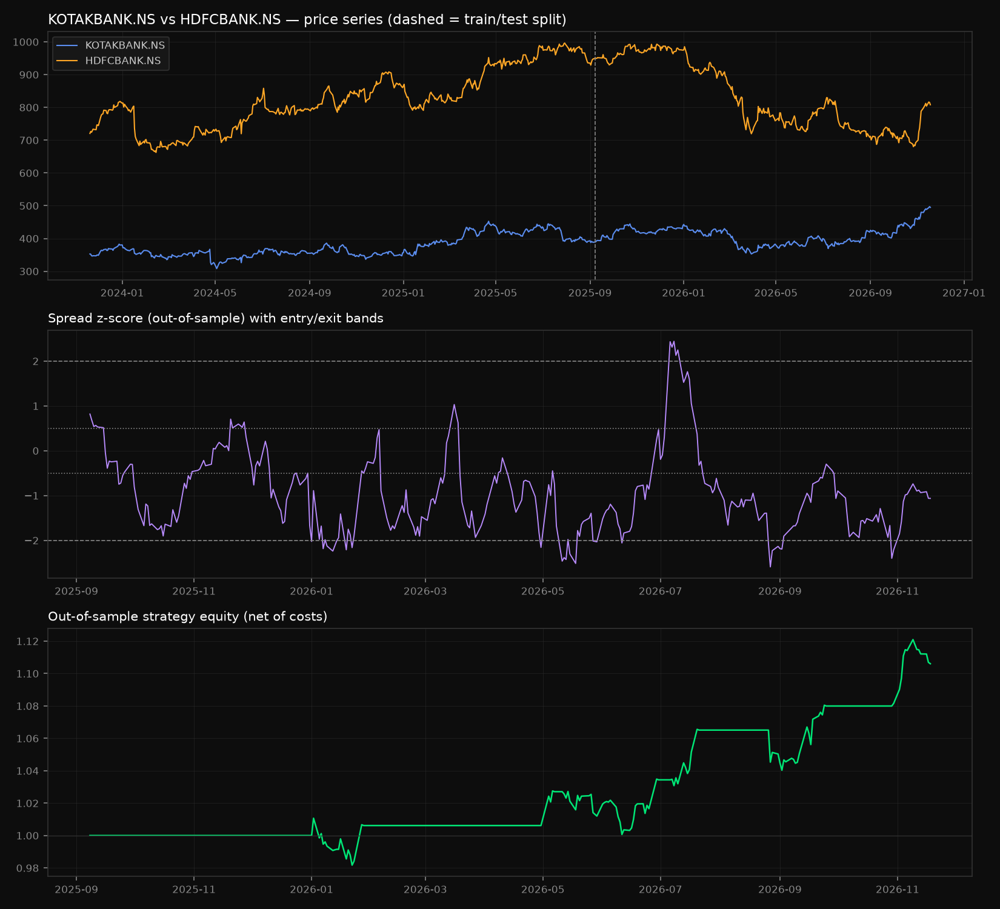

---

### SBIN.NS / BANKBARODA.NS

- **Latest prices:** SBIN.NS ₹1,135.00 · BANKBARODA.NS ₹274.50
- **Hedge ratio (train-fitted):** 0.1730
- **Cointegration (train):** FAIL at 5% — ADF -2.47, p=0.1227
- **Persistence:** passed 5% in 0 of 101 real-data runs (strict tier: 0/101)
- **Spread half-life:** 19.8 days
- **Current z-score:** +1.32
- **Signal today:** watch (approaching band)
- ⚠️ _Pair did not cointegrate on training data. Any signal here is not statistically justified — observation only._

**Out-of-sample backtest** (beta frozen from train window):

| Metric | Value |
|---|---|
| Sharpe | 0.24 |
| Sortino | 0.22 |
| Annualised return | 2.05% |
| Annualised vol | 10.81% |
| Max drawdown | -8.92% |
| Round-trip trades | 6 |

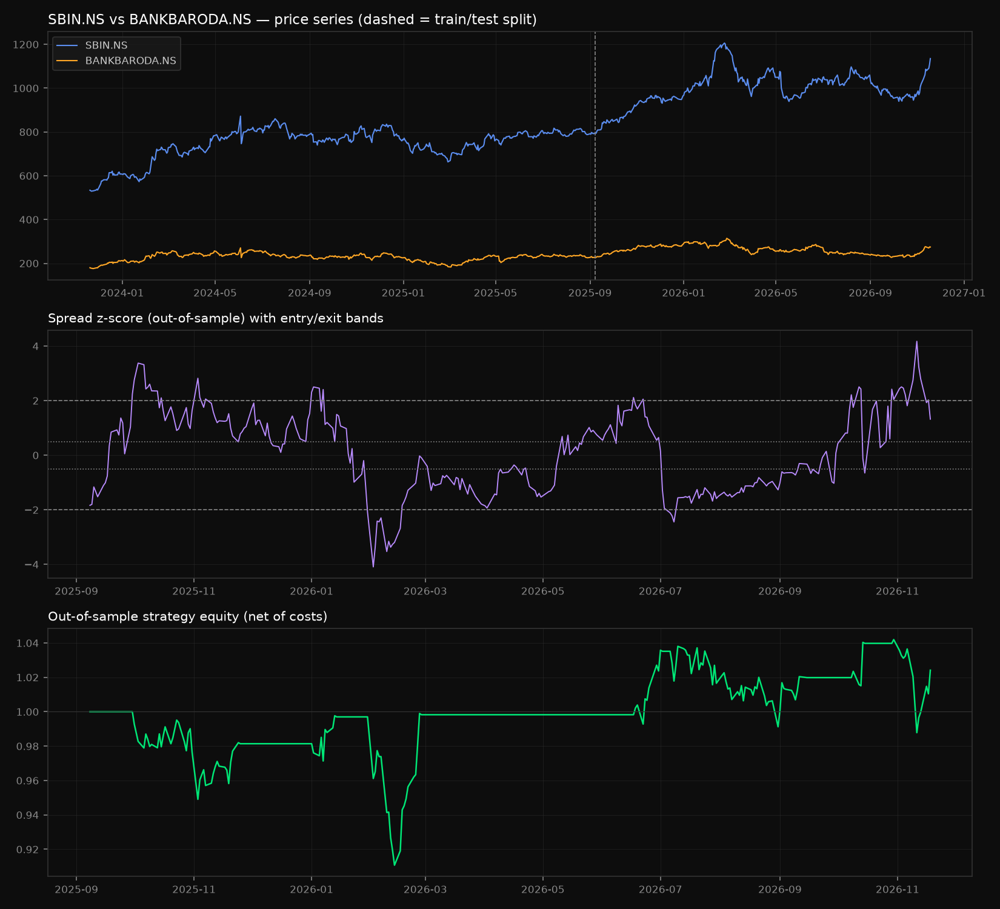

---

### TCS.NS / INFY.NS

- **Latest prices:** TCS.NS ₹2,379.50 · INFY.NS ₹1,108.80
- **Hedge ratio (train-fitted):** 0.3707
- **Cointegration (train):** FAIL at 5% — ADF -1.43, p=0.5701
- **Persistence:** passed 5% in 0 of 101 real-data runs (strict tier: 0/101)
- **Spread half-life:** 64.8 days
- **Current z-score:** +0.02
- **Signal today:** flat / no stretch
- ⚠️ _Pair did not cointegrate on training data. Any signal here is not statistically justified — observation only._

**Out-of-sample backtest** (beta frozen from train window):

| Metric | Value |
|---|---|
| Sharpe | 1.86 |
| Sortino | 2.29 |
| Annualised return | 10.22% |
| Annualised vol | 5.30% |
| Max drawdown | -2.96% |
| Round-trip trades | 7 |

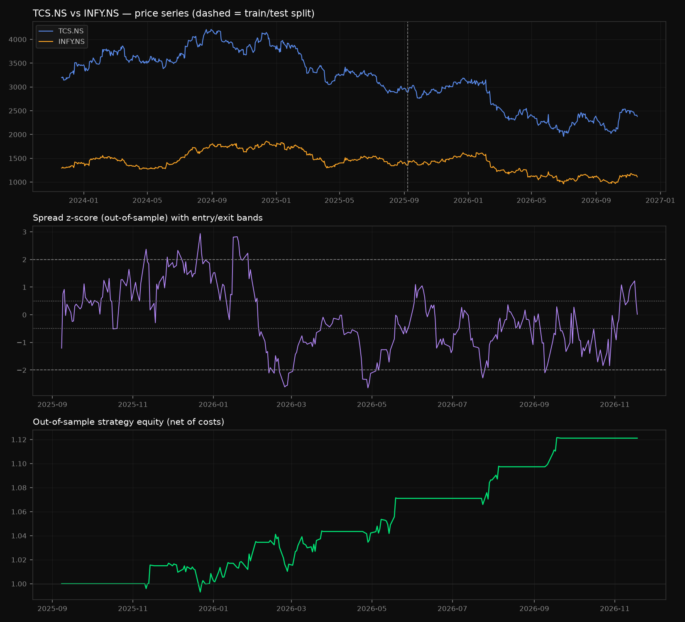

---

### INFY.NS / WIPRO.NS

- **Latest prices:** INFY.NS ₹1,108.80 · WIPRO.NS ₹185.14
- **Hedge ratio (train-fitted):** 0.1145
- **Cointegration (train):** FAIL at 5% — ADF -2.69, p=0.0749
- **Persistence:** passed 5% in 0 of 101 real-data runs (strict tier: 0/101)
- **Spread half-life:** 24.4 days
- **Current z-score:** +0.59
- **Signal today:** watch (approaching band)
- ⚠️ _Pair did not cointegrate on training data. Any signal here is not statistically justified — observation only._

**Out-of-sample backtest** (beta frozen from train window):

| Metric | Value |
|---|---|
| Sharpe | 2.36 |
| Sortino | 3.38 |
| Annualised return | 15.07% |
| Annualised vol | 6.02% |
| Max drawdown | -3.51% |
| Round-trip trades | 6 |

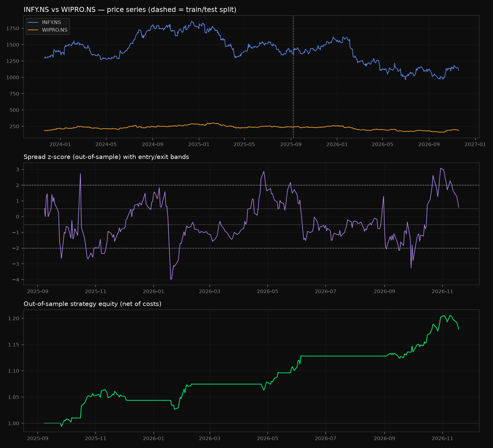

---

### HCLTECH.NS / TECHM.NS

- **Latest prices:** HCLTECH.NS ₹1,344.70 · TECHM.NS ₹1,750.00
- **Hedge ratio (train-fitted):** 0.9326
- **Cointegration (train):** FAIL at 5% — ADF -2.09, p=0.2476
- **Persistence:** passed 5% in 0 of 101 real-data runs (strict tier: 0/101)
- **Spread half-life:** 30.0 days
- **Current z-score:** +1.53
- **Signal today:** watch (approaching band)
- ⚠️ _Pair did not cointegrate on training data. Any signal here is not statistically justified — observation only._

**Out-of-sample backtest** (beta frozen from train window):

| Metric | Value |
|---|---|
| Sharpe | -0.08 |
| Sortino | -0.08 |
| Annualised return | -0.93% |
| Annualised vol | 7.96% |
| Max drawdown | -8.67% |
| Round-trip trades | 5 |

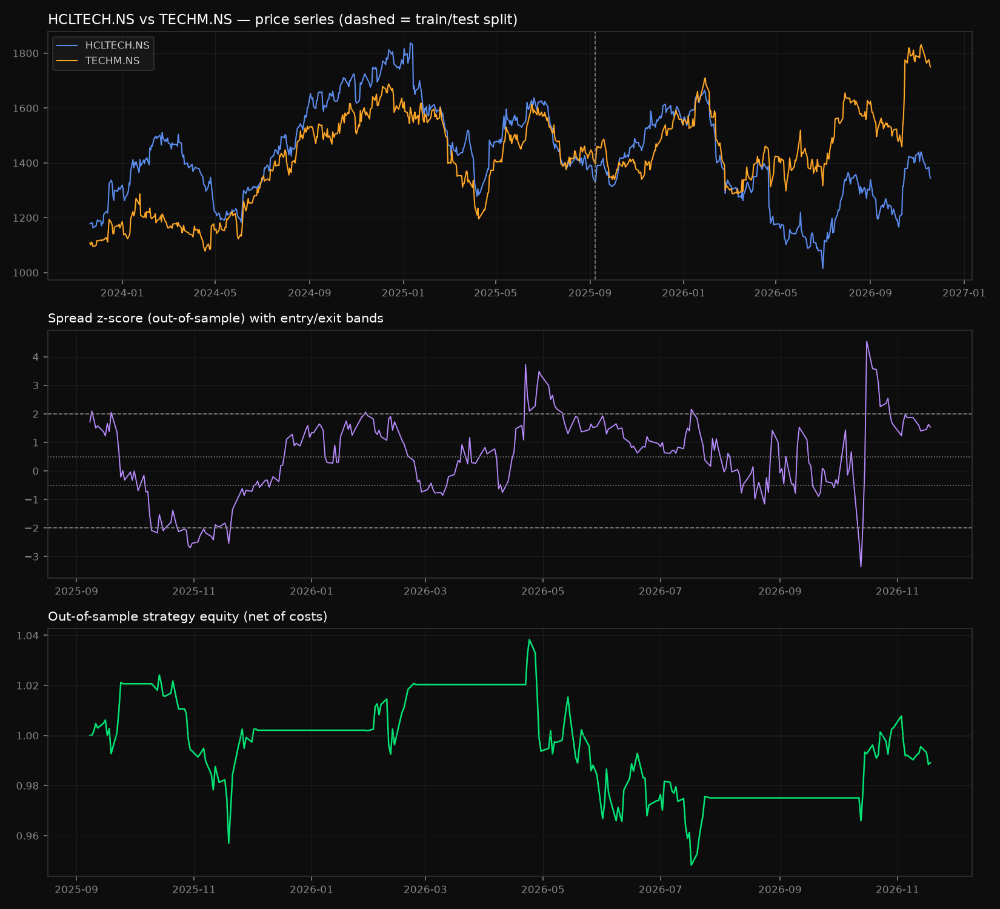

---

### ACC.NS / AMBUJACEM.NS

- **Latest prices:** ACC.NS ₹1,229.80 · AMBUJACEM.NS ₹384.80
- **Hedge ratio (train-fitted):** 0.1323
- **Cointegration (train):** FAIL at 5% — ADF -2.51, p=0.1123
- **Persistence:** passed 5% in 0 of 101 real-data runs (strict tier: 0/101)
- **Spread half-life:** 29.8 days
- **Current z-score:** +0.27
- **Signal today:** flat / no stretch
- ⚠️ _Pair did not cointegrate on training data. Any signal here is not statistically justified — observation only._

**Out-of-sample backtest** (beta frozen from train window):

| Metric | Value |
|---|---|
| Sharpe | -0.22 |
| Sortino | -0.17 |
| Annualised return | -1.88% |
| Annualised vol | 7.44% |
| Max drawdown | -7.95% |
| Round-trip trades | 4 |

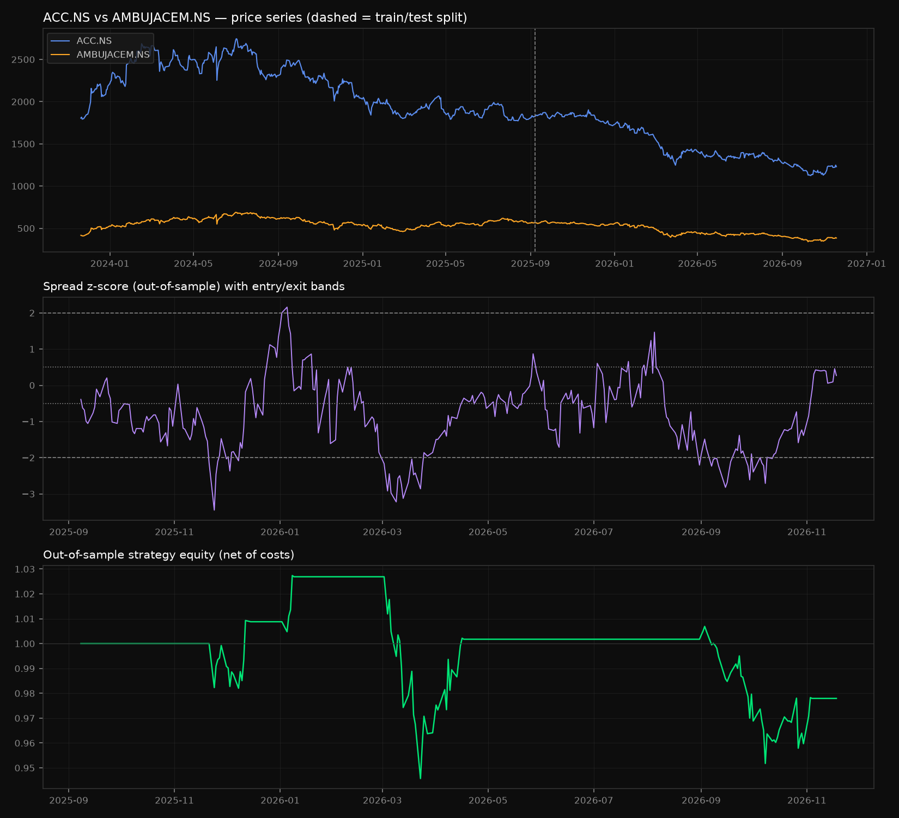

---

### ULTRACEMCO.NS / SHREECEM.NS

- **Latest prices:** ULTRACEMCO.NS ₹12,428.00 · SHREECEM.NS ₹24,835.00
- **Hedge ratio (train-fitted):** 1.2436
- **Cointegration (train):** FAIL at 5% — ADF -2.04, p=0.2693
- **Persistence:** passed 5% in 0 of 101 real-data runs (strict tier: 0/101)
- **Spread half-life:** 38.1 days
- **Current z-score:** +0.43
- **Signal today:** flat / no stretch
- ⚠️ _Pair did not cointegrate on training data. Any signal here is not statistically justified — observation only._

**Out-of-sample backtest** (beta frozen from train window):

| Metric | Value |
|---|---|
| Sharpe | -0.52 |
| Sortino | -0.60 |
| Annualised return | -3.48% |
| Annualised vol | 6.43% |
| Max drawdown | -6.51% |
| Round-trip trades | 5 |

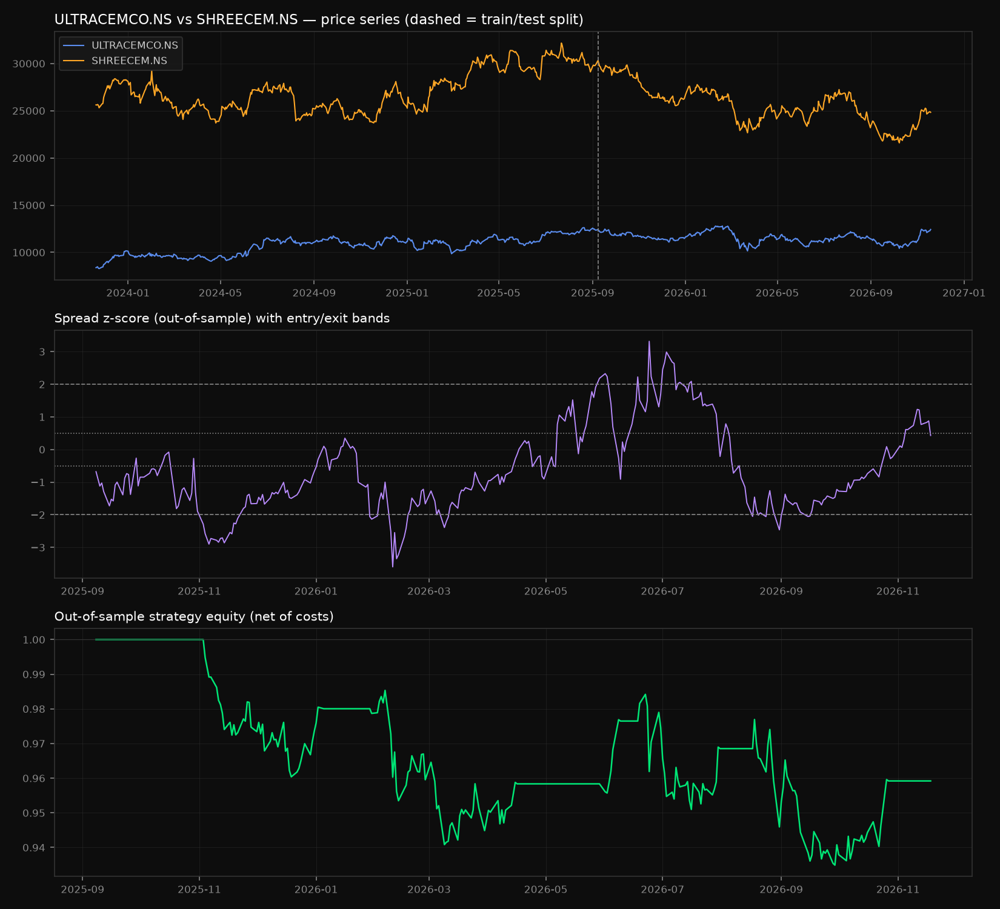

---

### IOC.NS / BPCL.NS

- **Latest prices:** IOC.NS ₹143.82 · BPCL.NS ₹305.50
- **Hedge ratio (train-fitted):** 1.4229
- **Cointegration (train):** FAIL at 5% — ADF -1.56, p=0.5017
- **Persistence:** passed 5% in 0 of 101 real-data runs (strict tier: 0/101)
- **Spread half-life:** 77.9 days
- **Current z-score:** -1.32
- **Signal today:** watch (approaching band)
- ⚠️ _Pair did not cointegrate on training data. Any signal here is not statistically justified — observation only._

**Out-of-sample backtest** (beta frozen from train window):

| Metric | Value |
|---|---|
| Sharpe | 0.63 |
| Sortino | 0.67 |
| Annualised return | 4.66% |
| Annualised vol | 7.64% |
| Max drawdown | -6.08% |
| Round-trip trades | 6 |

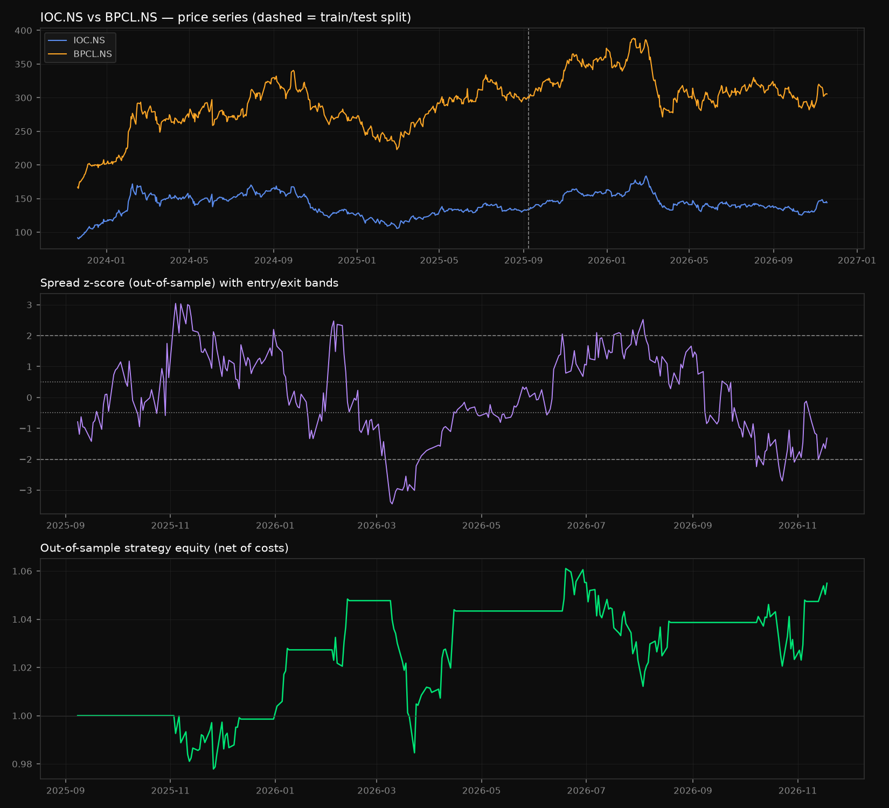

---

### BPCL.NS / HINDPETRO.NS

- **Latest prices:** BPCL.NS ₹305.50 · HINDPETRO.NS ₹386.45
- **Hedge ratio (train-fitted):** 1.2710
- **Cointegration (train):** FAIL at 5% — ADF -2.11, p=0.2406
- **Persistence:** passed 5% in 0 of 101 real-data runs (strict tier: 0/101)
- **Spread half-life:** 35.6 days
- **Current z-score:** +2.26
- **Signal today:** SHORT spread (short HINDPETRO.NS, long BPCL.NS)
- ⚠️ _Pair did not cointegrate on training data. Any signal here is not statistically justified — observation only._

**Out-of-sample backtest** (beta frozen from train window):

| Metric | Value |
|---|---|
| Sharpe | -0.39 |
| Sortino | -0.43 |
| Annualised return | -2.99% |
| Annualised vol | 7.10% |
| Max drawdown | -6.99% |
| Round-trip trades | 5 |

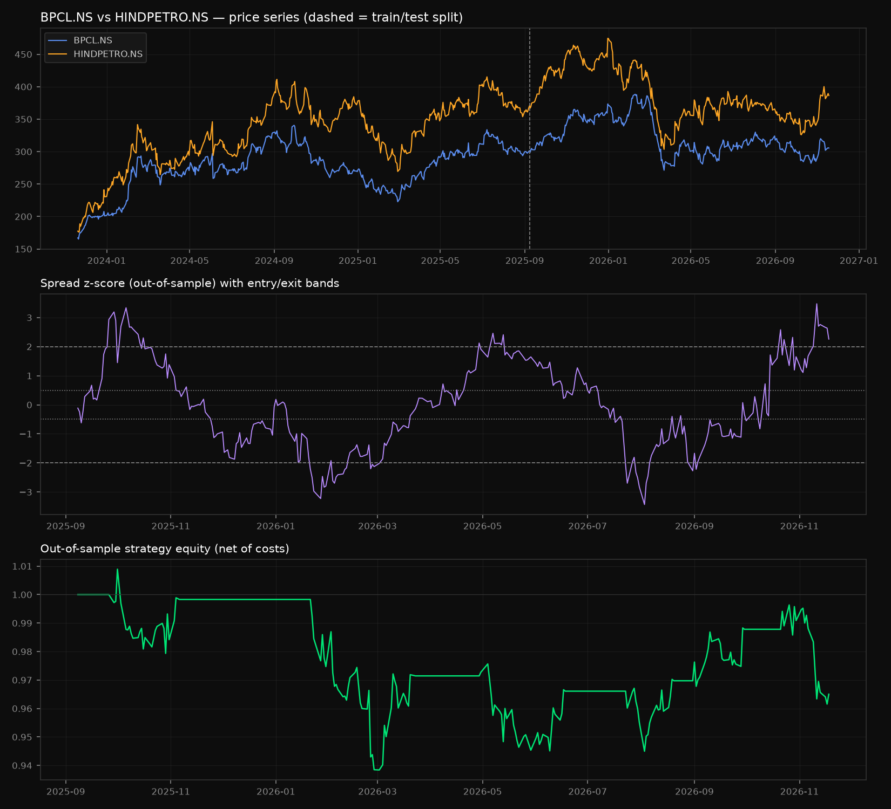

---

### ONGC.NS / COALINDIA.NS

- **Latest prices:** ONGC.NS ₹225.00 · COALINDIA.NS ₹388.00
- **Hedge ratio (train-fitted):** 1.3414
- **Cointegration (train):** PASS at 5% — ADF -3.39, p=0.0114
- **Persistence:** passed 5% in 93 of 101 real-data runs (strict tier: 1/101)
- **Spread half-life:** 13.5 days
- **Current z-score:** -1.44
- **Signal today:** watch (approaching band)

**Out-of-sample backtest** (beta frozen from train window):

| Metric | Value |
|---|---|
| Sharpe | 0.95 |
| Sortino | 0.80 |
| Annualised return | 7.68% |
| Annualised vol | 8.12% |
| Max drawdown | -6.43% |
| Round-trip trades | 6 |

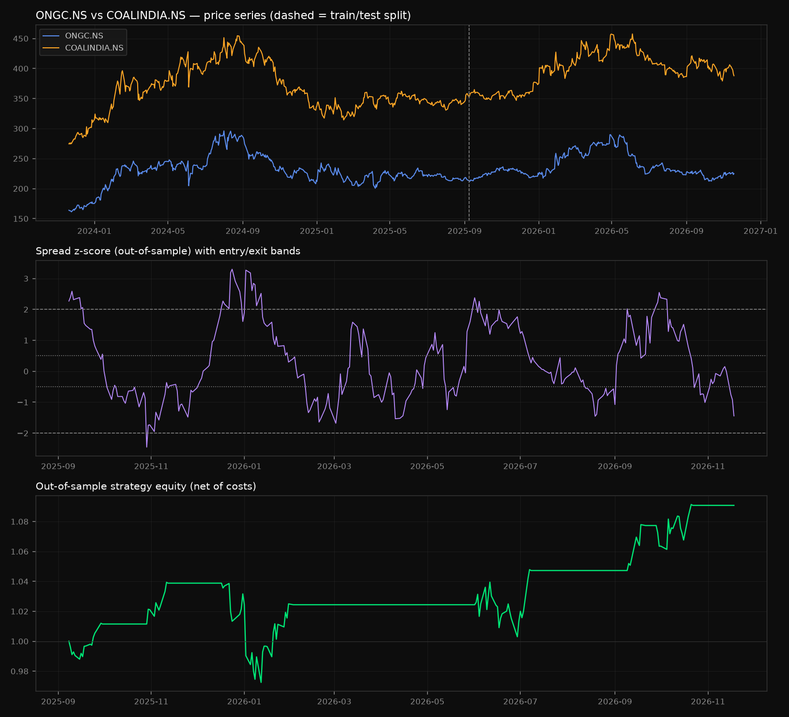

---

### NTPC.NS / POWERGRID.NS

- **Latest prices:** NTPC.NS ₹320.40 · POWERGRID.NS ₹259.10
- **Hedge ratio (train-fitted):** 0.7869
- **Cointegration (train):** FAIL at 5% — ADF -2.56, p=0.1008
- **Persistence:** passed 5% in 0 of 101 real-data runs (strict tier: 0/101)
- **Spread half-life:** 23.8 days
- **Current z-score:** +0.00
- **Signal today:** flat / no stretch
- ⚠️ _Pair did not cointegrate on training data. Any signal here is not statistically justified — observation only._

**Out-of-sample backtest** (beta frozen from train window):

| Metric | Value |
|---|---|
| Sharpe | 0.87 |
| Sortino | 0.67 |
| Annualised return | 4.90% |
| Annualised vol | 5.67% |
| Max drawdown | -5.33% |
| Round-trip trades | 7 |

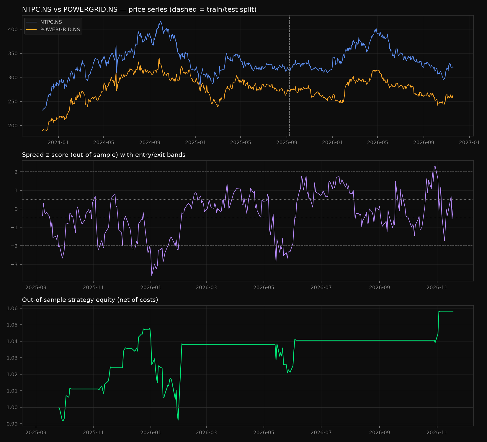

---

### BAJAJ-AUTO.NS / HEROMOTOCO.NS

- **Latest prices:** BAJAJ-AUTO.NS ₹10,570.00 · HEROMOTOCO.NS ₹5,253.00
- **Hedge ratio (train-fitted):** 0.4044
- **Cointegration (train):** FAIL at 5% — ADF -1.66, p=0.4495
- **Persistence:** passed 5% in 0 of 101 real-data runs (strict tier: 0/101)
- **Spread half-life:** 43.5 days
- **Current z-score:** +0.61
- **Signal today:** watch (approaching band)
- ⚠️ _Pair did not cointegrate on training data. Any signal here is not statistically justified — observation only._

**Out-of-sample backtest** (beta frozen from train window):

| Metric | Value |
|---|---|
| Sharpe | 0.25 |
| Sortino | 0.21 |
| Annualised return | 1.60% |
| Annualised vol | 7.38% |
| Max drawdown | -9.84% |
| Round-trip trades | 5 |

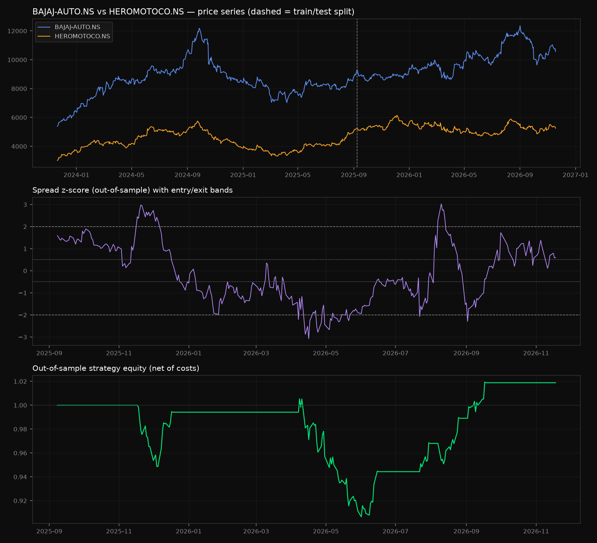

---

### TATASTEEL.NS / JSWSTEEL.NS

- **Latest prices:** TATASTEEL.NS ₹179.00 · JSWSTEEL.NS ₹1,315.90
- **Hedge ratio (train-fitted):** 2.6366
- **Cointegration (train):** FAIL at 5% — ADF -1.39, p=0.5856
- **Persistence:** passed 5% in 0 of 101 real-data runs (strict tier: 0/101)
- **Spread half-life:** 58.3 days
- **Current z-score:** +1.02
- **Signal today:** watch (approaching band)
- ⚠️ _Pair did not cointegrate on training data. Any signal here is not statistically justified — observation only._

**Out-of-sample backtest** (beta frozen from train window):

| Metric | Value |
|---|---|
| Sharpe | 0.59 |
| Sortino | 0.58 |
| Annualised return | 4.83% |
| Annualised vol | 8.67% |
| Max drawdown | -5.57% |
| Round-trip trades | 5 |

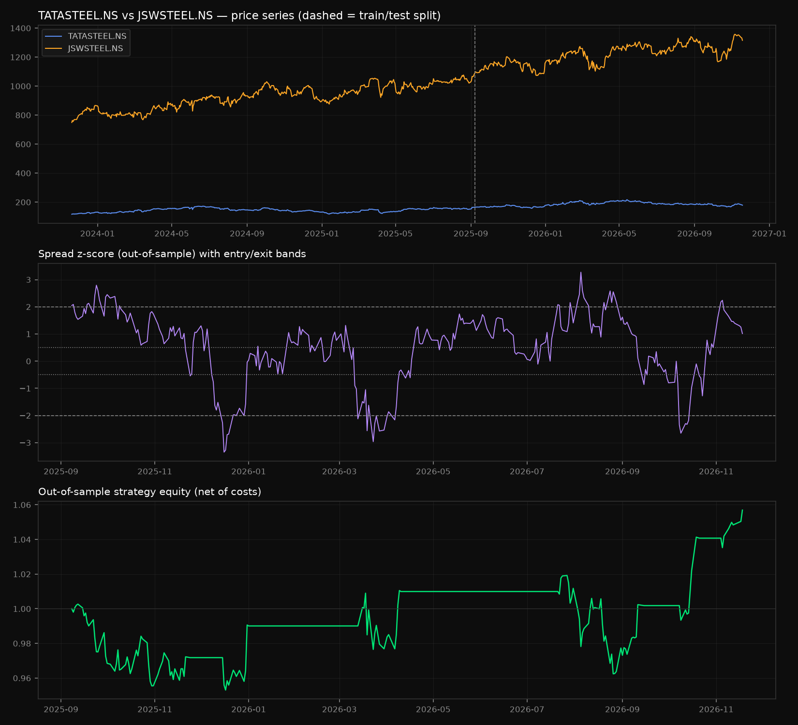

---

### SUNPHARMA.NS / CIPLA.NS

- **Latest prices:** SUNPHARMA.NS ₹1,871.50 · CIPLA.NS ₹1,417.00
- **Hedge ratio (train-fitted):** 0.4644
- **Cointegration (train):** FAIL at 5% — ADF -2.82, p=0.0552
- **Persistence:** passed 5% in 92 of 101 real-data runs (strict tier: 5/101)
- **Spread half-life:** 13.5 days
- **Current z-score:** +1.18
- **Signal today:** watch (approaching band)
- ⚠️ _Pair did not cointegrate on training data. Any signal here is not statistically justified — observation only._

**Out-of-sample backtest** (beta frozen from train window):

| Metric | Value |
|---|---|
| Sharpe | 0.34 |
| Sortino | 0.34 |
| Annualised return | 2.21% |
| Annualised vol | 7.24% |
| Max drawdown | -10.32% |
| Round-trip trades | 5 |

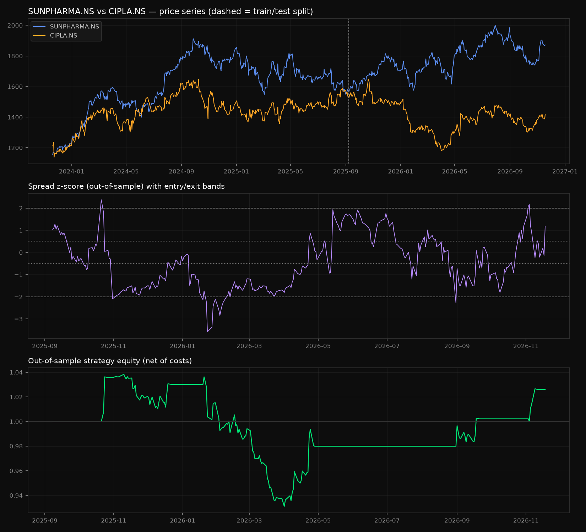

---

_Generated 2026-11-19 · pairs mean-reversion scanner · out-of-sample backtest · multiple-testing-aware · not investment advice._
