# Indian Pairs-Trading Scanner — 2026-11-20

> **What this is:** a market-neutral *pairs mean-reversion* scanner. It flags when two related NSE stocks have drifted apart far enough that their historical relationship signals a possible convergence trade. It does **not** forecast growth, rank "best" stocks, or predict company performance. A signal means the *spread between two stocks* is stretched — nothing about either stock being a good investment. Not investment advice; do your own research.

## Methodology (fixed in advance)

- **Universe:** 16 declared sector-mate pairs. Parameters (3y window, 60/40 train-test, z-entry 2.0, z-exit 0.5, 5 bps costs) are pre-registered; changes are logged in the README changelog *before* looking at results.
- **Multiple testing:** at the 5% level across 16 pairs, **≈0.8 false positives per run are expected by chance alone** even if nothing truly cointegrates. A single-day pass is a candidate, not a discovery.
- **Strict tier:** Bonferroni-corrected threshold p < 0.0031 (marked ✓✓).
- **Evidence = persistence:** the Persistence column counts how often each pair has passed the 5% test across all *real-data* daily runs recorded in `reports/history.csv`. Pairs deserve attention only when they pass persistently.

> ⚠️ **Some results use SIMULATED fallback data** (real data was unreachable this run) and are not real market results. These are marked below and are EXCLUDED from persistence counts.

## Summary

| Pair | p-value | Coint. | Persistence | Current z | Signal | OOS Sharpe |
|---|---|---|---|---|---|---|
| HDFCBANK.NS/ICICIBANK.NS *(sim)* | 0.0030 | ✓✓ | 5/84 | -1.55 | watch | 1.13 |
| AXISBANK.NS/ICICIBANK.NS | 0.7822 | ✗ | 0/102 | +1.98 | watch | -0.35 |
| KOTAKBANK.NS/HDFCBANK.NS | 0.1715 | ✗ | 0/102 | -1.13 | watch | 1.39 |
| SBIN.NS/BANKBARODA.NS | 0.1227 | ✗ | 0/102 | +2.20 | SHORT spread | 0.07 |
| TCS.NS/INFY.NS | 0.5701 | ✗ | 0/102 | -0.12 | flat / no stretch | 1.86 |
| INFY.NS/WIPRO.NS | 0.0749 | ✗ | 0/102 | +0.69 | watch | 2.38 |
| HCLTECH.NS/TECHM.NS | 0.2476 | ✗ | 0/102 | +1.20 | watch | -0.01 |
| ACC.NS/AMBUJACEM.NS | 0.1123 | ✗ | 0/102 | +0.81 | watch | -0.22 |
| ULTRACEMCO.NS/SHREECEM.NS | 0.2693 | ✗ | 0/102 | +0.69 | watch | -0.52 |
| IOC.NS/BPCL.NS | 0.5017 | ✗ | 0/102 | -1.65 | watch | 0.56 |
| BPCL.NS/HINDPETRO.NS | 0.2406 | ✗ | 0/102 | +2.15 | SHORT spread | -0.39 |
| ONGC.NS/COALINDIA.NS | 0.0114 | ✓ | 94/102 | -1.09 | watch | 0.95 |
| NTPC.NS/POWERGRID.NS | 0.1008 | ✗ | 0/102 | +0.47 | flat / no stretch | 0.87 |
| BAJAJ-AUTO.NS/HEROMOTOCO.NS | 0.4495 | ✗ | 0/102 | +1.54 | watch | 0.25 |
| TATASTEEL.NS/JSWSTEEL.NS | 0.5856 | ✗ | 0/102 | +1.34 | watch | 0.48 |
| SUNPHARMA.NS/CIPLA.NS | 0.0552 | ✗ | 92/102 | +0.65 | watch | 0.34 |

_Legend: ✓✓ passes strict Bonferroni tier · ✓ passes 5% only · ✗ fails. Persistence = 5%-passes / real-data runs recorded. \*no real-data history yet._

---

### HDFCBANK.NS / ICICIBANK.NS · _SIMULATED_

- **Latest prices:** HDFCBANK.NS ₹77.27 · ICICIBANK.NS ₹113.78
- **Hedge ratio (train-fitted):** 1.5557
- **Cointegration (train):** PASS at 5% — ADF -3.79, p=0.0030 · **passes strict Bonferroni tier**
- **Persistence:** passed 5% in 5 of 84 real-data runs (strict tier: 0/84)
- **Spread half-life:** 14.0 days
- **Current z-score:** -1.55
- **Signal today:** watch (approaching band)

**Out-of-sample backtest** (beta frozen from train window):

| Metric | Value |
|---|---|
| Sharpe | 1.13 |
| Sortino | 0.86 |
| Annualised return | 1.88% |
| Annualised vol | 1.66% |
| Max drawdown | -1.19% |
| Round-trip trades | 5 |

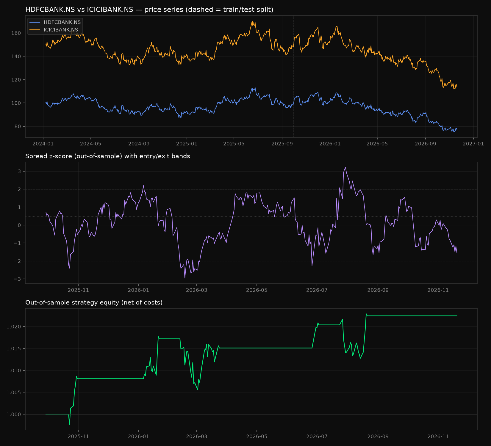

---

### AXISBANK.NS / ICICIBANK.NS

- **Latest prices:** AXISBANK.NS ₹1,380.80 · ICICIBANK.NS ₹1,608.90
- **Hedge ratio (train-fitted):** 0.5307
- **Cointegration (train):** FAIL at 5% — ADF -0.92, p=0.7822
- **Persistence:** passed 5% in 0 of 102 real-data runs (strict tier: 0/102)
- **Spread half-life:** 179.3 days
- **Current z-score:** +1.98
- **Signal today:** watch (approaching band)
- ⚠️ _Pair did not cointegrate on training data. Any signal here is not statistically justified — observation only._

**Out-of-sample backtest** (beta frozen from train window):

| Metric | Value |
|---|---|
| Sharpe | -0.35 |
| Sortino | -0.39 |
| Annualised return | -3.81% |
| Annualised vol | 9.68% |
| Max drawdown | -9.99% |
| Round-trip trades | 5 |

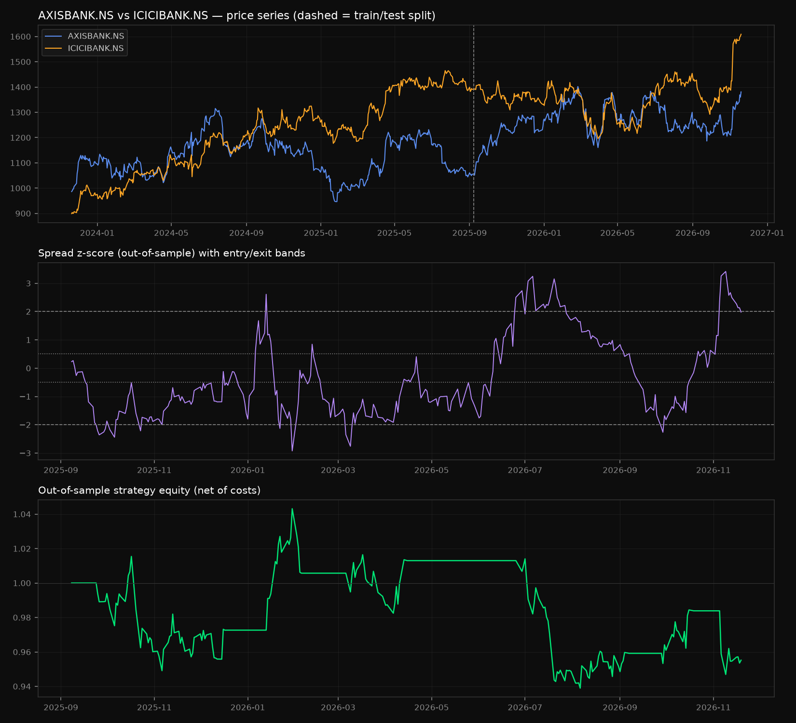

---

### KOTAKBANK.NS / HDFCBANK.NS

- **Latest prices:** KOTAKBANK.NS ₹503.00 · HDFCBANK.NS ₹821.80
- **Hedge ratio (train-fitted):** 2.2362
- **Cointegration (train):** FAIL at 5% — ADF -2.30, p=0.1715
- **Persistence:** passed 5% in 0 of 102 real-data runs (strict tier: 0/102)
- **Spread half-life:** 27.4 days
- **Current z-score:** -1.13
- **Signal today:** watch (approaching band)
- ⚠️ _Pair did not cointegrate on training data. Any signal here is not statistically justified — observation only._

**Out-of-sample backtest** (beta frozen from train window):

| Metric | Value |
|---|---|
| Sharpe | 1.39 |
| Sortino | 1.48 |
| Annualised return | 8.70% |
| Annualised vol | 6.12% |
| Max drawdown | -2.86% |
| Round-trip trades | 5 |

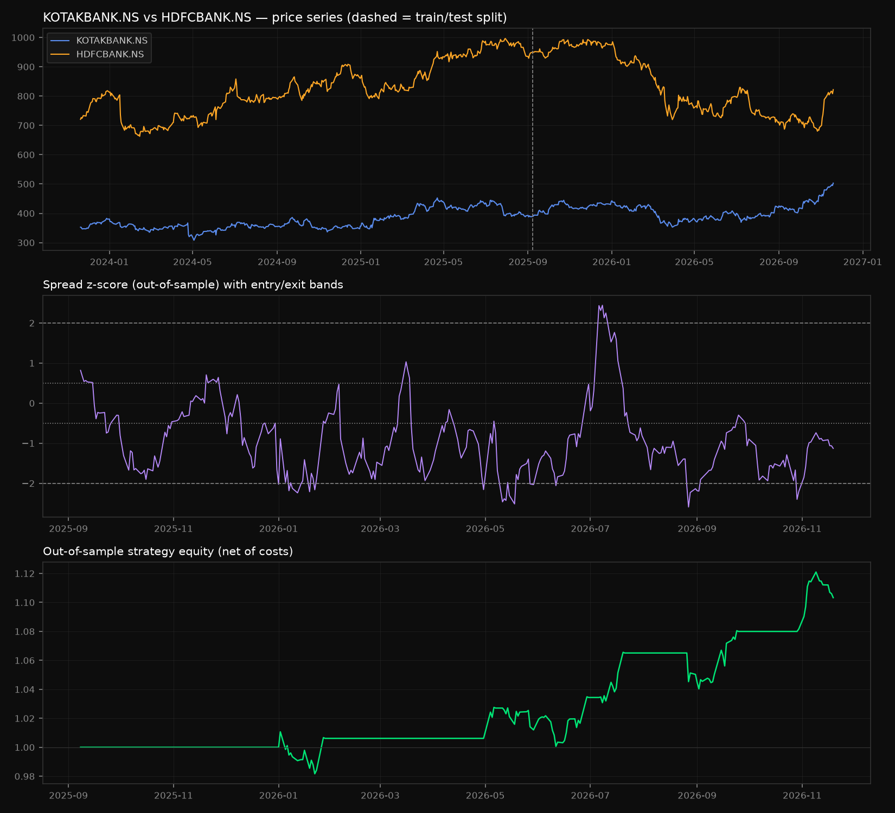

---

### SBIN.NS / BANKBARODA.NS

- **Latest prices:** SBIN.NS ₹1,156.00 · BANKBARODA.NS ₹285.90
- **Hedge ratio (train-fitted):** 0.1730
- **Cointegration (train):** FAIL at 5% — ADF -2.47, p=0.1227
- **Persistence:** passed 5% in 0 of 102 real-data runs (strict tier: 0/102)
- **Spread half-life:** 19.8 days
- **Current z-score:** +2.20
- **Signal today:** SHORT spread (short BANKBARODA.NS, long SBIN.NS)
- ⚠️ _Pair did not cointegrate on training data. Any signal here is not statistically justified — observation only._

**Out-of-sample backtest** (beta frozen from train window):

| Metric | Value |
|---|---|
| Sharpe | 0.07 |
| Sortino | 0.07 |
| Annualised return | 0.20% |
| Annualised vol | 10.97% |
| Max drawdown | -8.92% |
| Round-trip trades | 6 |

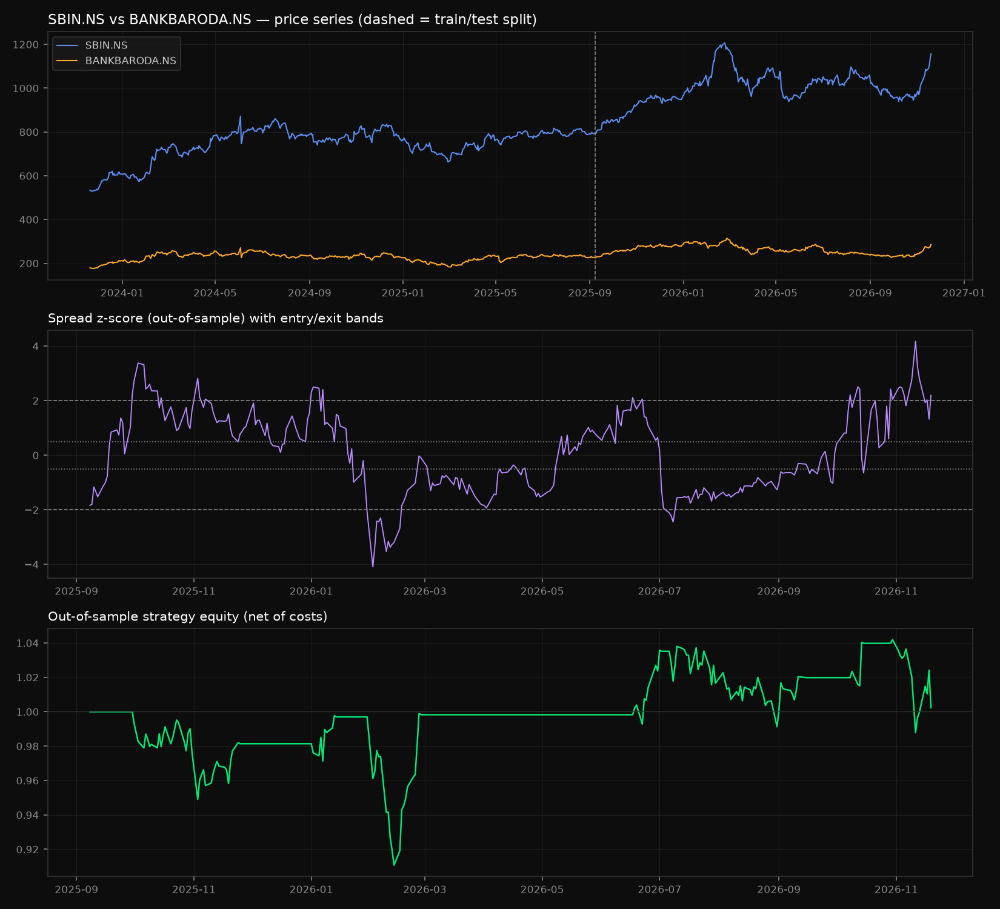

---

### TCS.NS / INFY.NS

- **Latest prices:** TCS.NS ₹2,342.70 · INFY.NS ₹1,091.90
- **Hedge ratio (train-fitted):** 0.3707
- **Cointegration (train):** FAIL at 5% — ADF -1.43, p=0.5701
- **Persistence:** passed 5% in 0 of 102 real-data runs (strict tier: 0/102)
- **Spread half-life:** 64.8 days
- **Current z-score:** -0.12
- **Signal today:** flat / no stretch
- ⚠️ _Pair did not cointegrate on training data. Any signal here is not statistically justified — observation only._

**Out-of-sample backtest** (beta frozen from train window):

| Metric | Value |
|---|---|
| Sharpe | 1.86 |
| Sortino | 2.28 |
| Annualised return | 10.19% |
| Annualised vol | 5.29% |
| Max drawdown | -2.96% |
| Round-trip trades | 7 |

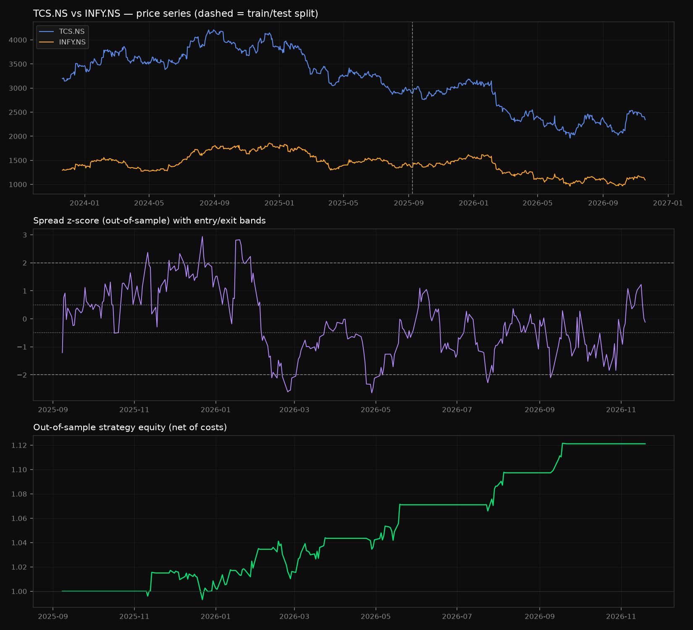

---

### INFY.NS / WIPRO.NS

- **Latest prices:** INFY.NS ₹1,091.90 · WIPRO.NS ₹183.93
- **Hedge ratio (train-fitted):** 0.1145
- **Cointegration (train):** FAIL at 5% — ADF -2.69, p=0.0749
- **Persistence:** passed 5% in 0 of 102 real-data runs (strict tier: 0/102)
- **Spread half-life:** 24.4 days
- **Current z-score:** +0.69
- **Signal today:** watch (approaching band)
- ⚠️ _Pair did not cointegrate on training data. Any signal here is not statistically justified — observation only._

**Out-of-sample backtest** (beta frozen from train window):

| Metric | Value |
|---|---|
| Sharpe | 2.38 |
| Sortino | 3.41 |
| Annualised return | 15.20% |
| Annualised vol | 6.01% |
| Max drawdown | -3.51% |
| Round-trip trades | 6 |

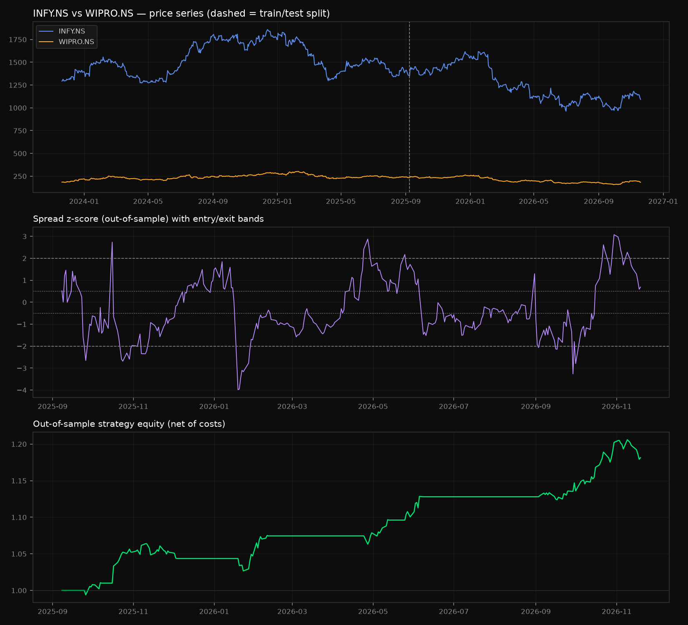

---

### HCLTECH.NS / TECHM.NS

- **Latest prices:** HCLTECH.NS ₹1,332.90 · TECHM.NS ₹1,723.00
- **Hedge ratio (train-fitted):** 0.9326
- **Cointegration (train):** FAIL at 5% — ADF -2.09, p=0.2476
- **Persistence:** passed 5% in 0 of 102 real-data runs (strict tier: 0/102)
- **Spread half-life:** 30.0 days
- **Current z-score:** +1.20
- **Signal today:** watch (approaching band)
- ⚠️ _Pair did not cointegrate on training data. Any signal here is not statistically justified — observation only._

**Out-of-sample backtest** (beta frozen from train window):

| Metric | Value |
|---|---|
| Sharpe | -0.01 |
| Sortino | -0.01 |
| Annualised return | -0.41% |
| Annualised vol | 7.97% |
| Max drawdown | -8.67% |
| Round-trip trades | 5 |

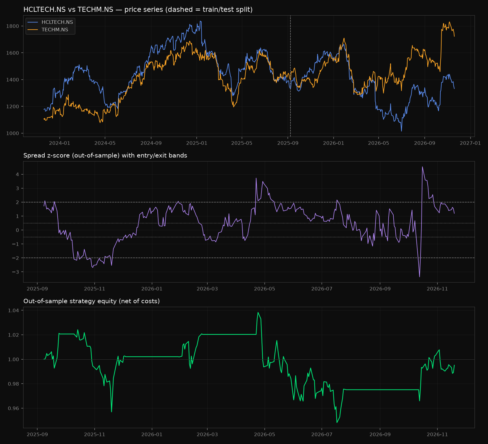

---

### ACC.NS / AMBUJACEM.NS

- **Latest prices:** ACC.NS ₹1,268.60 · AMBUJACEM.NS ₹396.80
- **Hedge ratio (train-fitted):** 0.1323
- **Cointegration (train):** FAIL at 5% — ADF -2.51, p=0.1123
- **Persistence:** passed 5% in 0 of 102 real-data runs (strict tier: 0/102)
- **Spread half-life:** 29.8 days
- **Current z-score:** +0.81
- **Signal today:** watch (approaching band)
- ⚠️ _Pair did not cointegrate on training data. Any signal here is not statistically justified — observation only._

**Out-of-sample backtest** (beta frozen from train window):

| Metric | Value |
|---|---|
| Sharpe | -0.22 |
| Sortino | -0.17 |
| Annualised return | -1.88% |
| Annualised vol | 7.43% |
| Max drawdown | -7.95% |
| Round-trip trades | 4 |

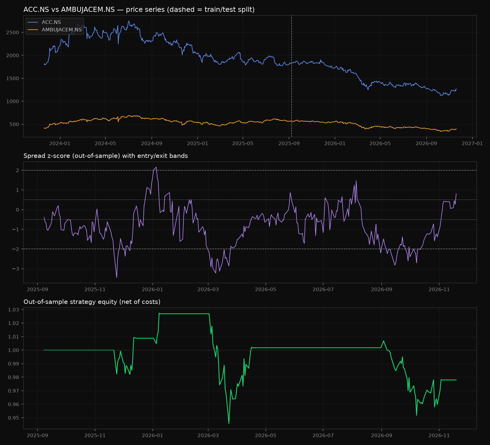

---

### ULTRACEMCO.NS / SHREECEM.NS

- **Latest prices:** ULTRACEMCO.NS ₹12,560.00 · SHREECEM.NS ₹25,115.00
- **Hedge ratio (train-fitted):** 1.2436
- **Cointegration (train):** FAIL at 5% — ADF -2.04, p=0.2693
- **Persistence:** passed 5% in 0 of 102 real-data runs (strict tier: 0/102)
- **Spread half-life:** 38.1 days
- **Current z-score:** +0.69
- **Signal today:** watch (approaching band)
- ⚠️ _Pair did not cointegrate on training data. Any signal here is not statistically justified — observation only._

**Out-of-sample backtest** (beta frozen from train window):

| Metric | Value |
|---|---|
| Sharpe | -0.52 |
| Sortino | -0.59 |
| Annualised return | -3.47% |
| Annualised vol | 6.42% |
| Max drawdown | -6.51% |
| Round-trip trades | 5 |

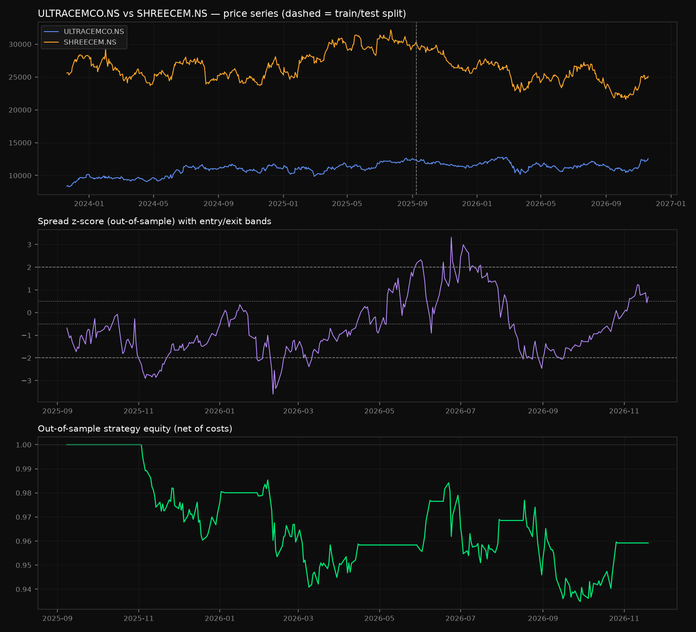

---

### IOC.NS / BPCL.NS

- **Latest prices:** IOC.NS ₹147.80 · BPCL.NS ₹308.10
- **Hedge ratio (train-fitted):** 1.4229
- **Cointegration (train):** FAIL at 5% — ADF -1.56, p=0.5017
- **Persistence:** passed 5% in 0 of 102 real-data runs (strict tier: 0/102)
- **Spread half-life:** 77.9 days
- **Current z-score:** -1.65
- **Signal today:** watch (approaching band)
- ⚠️ _Pair did not cointegrate on training data. Any signal here is not statistically justified — observation only._

**Out-of-sample backtest** (beta frozen from train window):

| Metric | Value |
|---|---|
| Sharpe | 0.56 |
| Sortino | 0.60 |
| Annualised return | 4.09% |
| Annualised vol | 7.65% |
| Max drawdown | -6.08% |
| Round-trip trades | 6 |

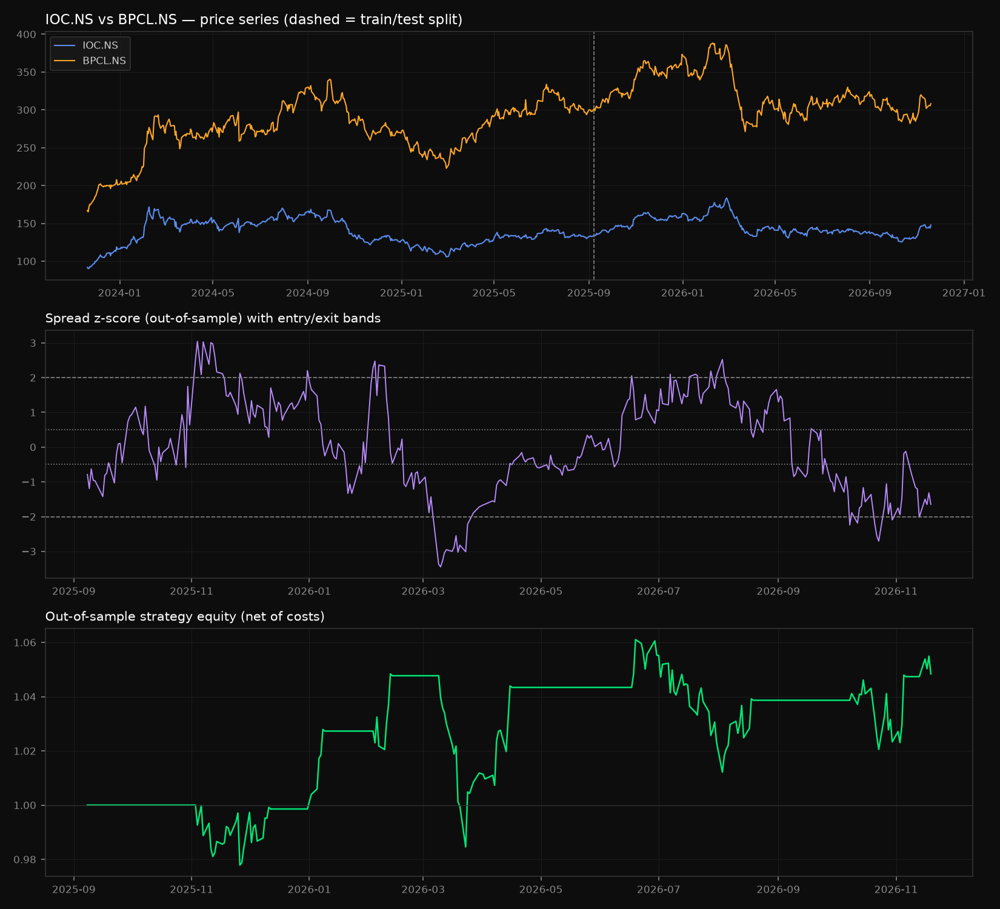

---

### BPCL.NS / HINDPETRO.NS

- **Latest prices:** BPCL.NS ₹308.10 · HINDPETRO.NS ₹390.00
- **Hedge ratio (train-fitted):** 1.2710
- **Cointegration (train):** FAIL at 5% — ADF -2.11, p=0.2406
- **Persistence:** passed 5% in 0 of 102 real-data runs (strict tier: 0/102)
- **Spread half-life:** 35.6 days
- **Current z-score:** +2.15
- **Signal today:** SHORT spread (short HINDPETRO.NS, long BPCL.NS)
- ⚠️ _Pair did not cointegrate on training data. Any signal here is not statistically justified — observation only._

**Out-of-sample backtest** (beta frozen from train window):

| Metric | Value |
|---|---|
| Sharpe | -0.39 |
| Sortino | -0.43 |
| Annualised return | -3.00% |
| Annualised vol | 7.09% |
| Max drawdown | -6.99% |
| Round-trip trades | 5 |

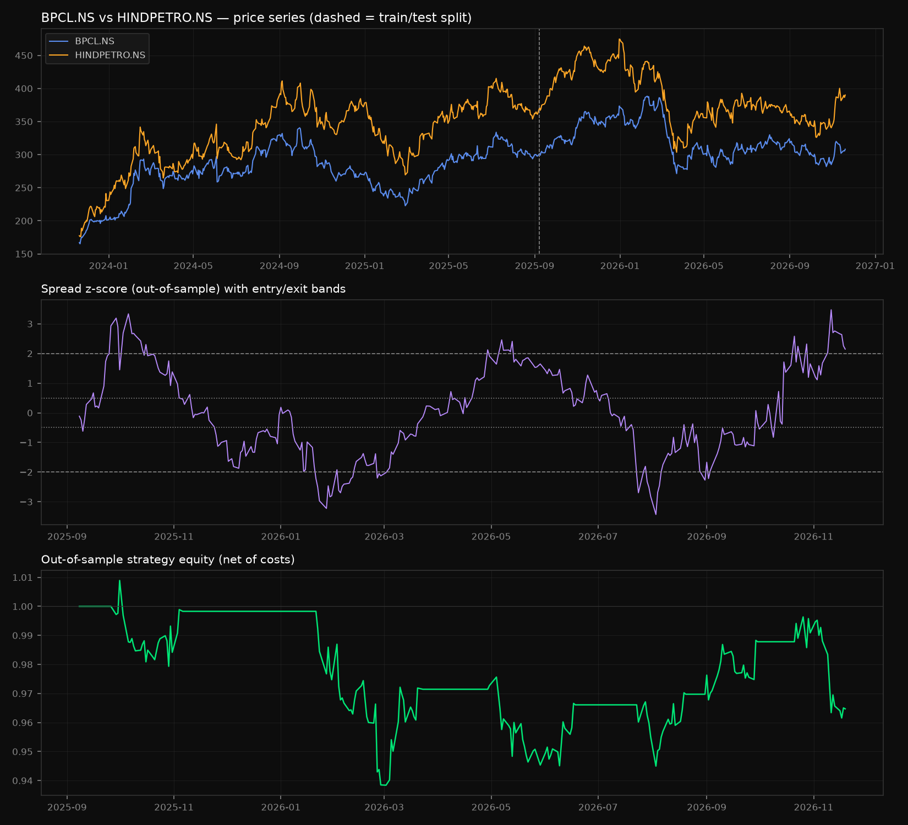

---

### ONGC.NS / COALINDIA.NS

- **Latest prices:** ONGC.NS ₹224.52 · COALINDIA.NS ₹391.50
- **Hedge ratio (train-fitted):** 1.3414
- **Cointegration (train):** PASS at 5% — ADF -3.39, p=0.0114
- **Persistence:** passed 5% in 94 of 102 real-data runs (strict tier: 1/102)
- **Spread half-life:** 13.5 days
- **Current z-score:** -1.09
- **Signal today:** watch (approaching band)

**Out-of-sample backtest** (beta frozen from train window):

| Metric | Value |
|---|---|
| Sharpe | 0.95 |
| Sortino | 0.80 |
| Annualised return | 7.65% |
| Annualised vol | 8.10% |
| Max drawdown | -6.43% |
| Round-trip trades | 6 |

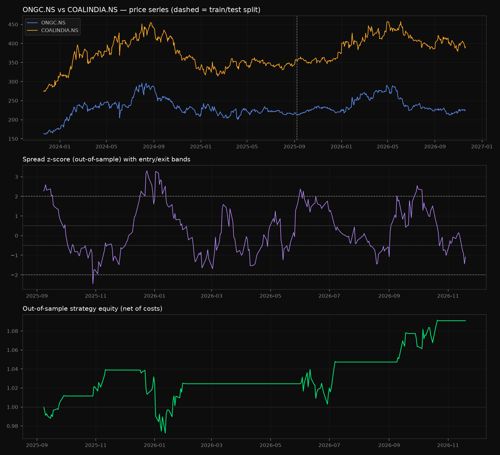

---

### NTPC.NS / POWERGRID.NS

- **Latest prices:** NTPC.NS ₹325.00 · POWERGRID.NS ₹264.50
- **Hedge ratio (train-fitted):** 0.7869
- **Cointegration (train):** FAIL at 5% — ADF -2.56, p=0.1008
- **Persistence:** passed 5% in 0 of 102 real-data runs (strict tier: 0/102)
- **Spread half-life:** 23.8 days
- **Current z-score:** +0.47
- **Signal today:** flat / no stretch
- ⚠️ _Pair did not cointegrate on training data. Any signal here is not statistically justified — observation only._

**Out-of-sample backtest** (beta frozen from train window):

| Metric | Value |
|---|---|
| Sharpe | 0.87 |
| Sortino | 0.67 |
| Annualised return | 4.88% |
| Annualised vol | 5.66% |
| Max drawdown | -5.33% |
| Round-trip trades | 7 |

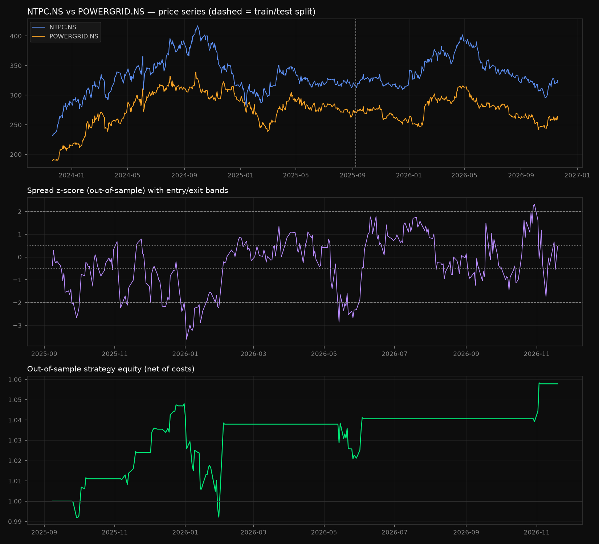

---

### BAJAJ-AUTO.NS / HEROMOTOCO.NS

- **Latest prices:** BAJAJ-AUTO.NS ₹10,817.00 · HEROMOTOCO.NS ₹5,556.00
- **Hedge ratio (train-fitted):** 0.4044
- **Cointegration (train):** FAIL at 5% — ADF -1.66, p=0.4495
- **Persistence:** passed 5% in 0 of 102 real-data runs (strict tier: 0/102)
- **Spread half-life:** 43.5 days
- **Current z-score:** +1.54
- **Signal today:** watch (approaching band)
- ⚠️ _Pair did not cointegrate on training data. Any signal here is not statistically justified — observation only._

**Out-of-sample backtest** (beta frozen from train window):

| Metric | Value |
|---|---|
| Sharpe | 0.25 |
| Sortino | 0.21 |
| Annualised return | 1.60% |
| Annualised vol | 7.37% |
| Max drawdown | -9.84% |
| Round-trip trades | 5 |

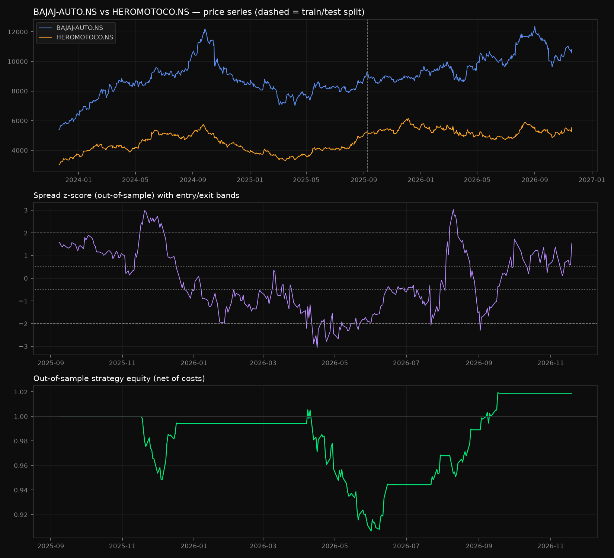

---

### TATASTEEL.NS / JSWSTEEL.NS

- **Latest prices:** TATASTEEL.NS ₹180.89 · JSWSTEEL.NS ₹1,336.80
- **Hedge ratio (train-fitted):** 2.6366
- **Cointegration (train):** FAIL at 5% — ADF -1.39, p=0.5856
- **Persistence:** passed 5% in 0 of 102 real-data runs (strict tier: 0/102)
- **Spread half-life:** 58.3 days
- **Current z-score:** +1.34
- **Signal today:** watch (approaching band)
- ⚠️ _Pair did not cointegrate on training data. Any signal here is not statistically justified — observation only._

**Out-of-sample backtest** (beta frozen from train window):

| Metric | Value |
|---|---|
| Sharpe | 0.48 |
| Sortino | 0.48 |
| Annualised return | 3.89% |
| Annualised vol | 8.71% |
| Max drawdown | -5.57% |
| Round-trip trades | 5 |

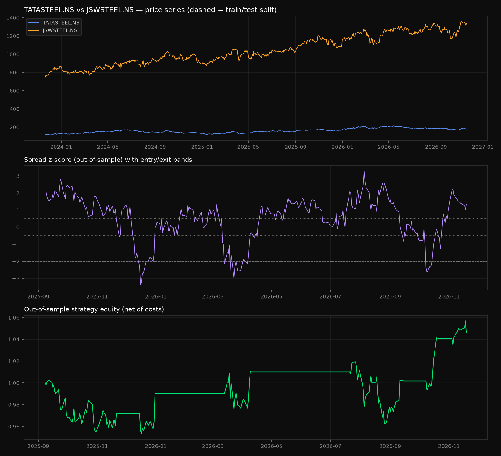

---

### SUNPHARMA.NS / CIPLA.NS

- **Latest prices:** SUNPHARMA.NS ₹1,900.00 · CIPLA.NS ₹1,418.50
- **Hedge ratio (train-fitted):** 0.4644
- **Cointegration (train):** FAIL at 5% — ADF -2.82, p=0.0552
- **Persistence:** passed 5% in 92 of 102 real-data runs (strict tier: 5/102)
- **Spread half-life:** 13.5 days
- **Current z-score:** +0.65
- **Signal today:** watch (approaching band)
- ⚠️ _Pair did not cointegrate on training data. Any signal here is not statistically justified — observation only._

**Out-of-sample backtest** (beta frozen from train window):

| Metric | Value |
|---|---|
| Sharpe | 0.34 |
| Sortino | 0.34 |
| Annualised return | 2.20% |
| Annualised vol | 7.23% |
| Max drawdown | -10.32% |
| Round-trip trades | 5 |

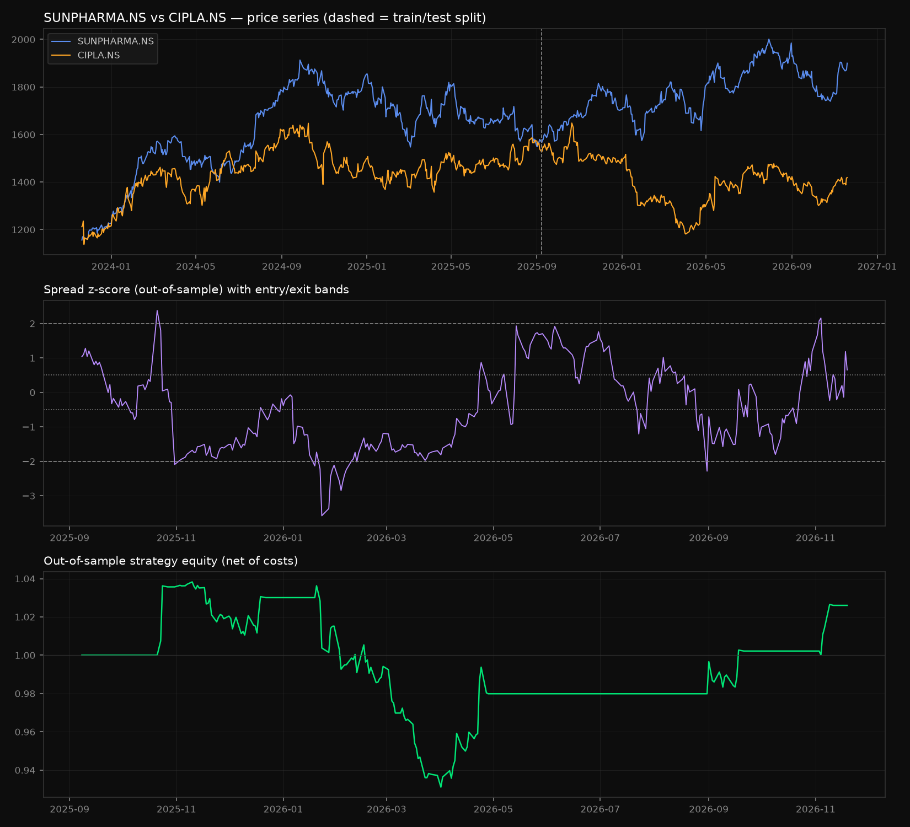

---

_Generated 2026-11-20 · pairs mean-reversion scanner · out-of-sample backtest · multiple-testing-aware · not investment advice._
