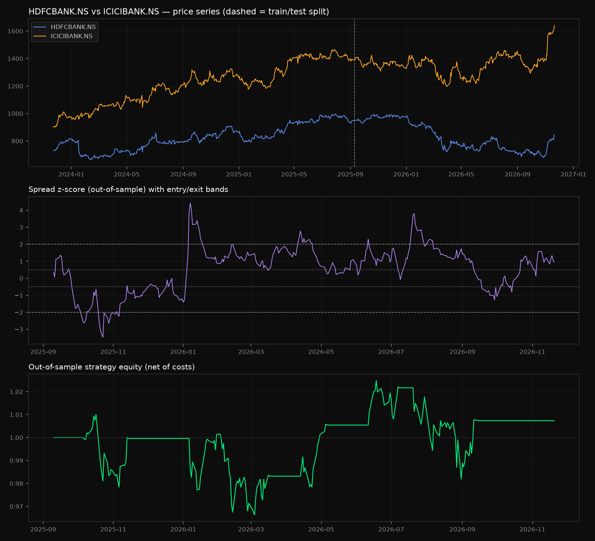
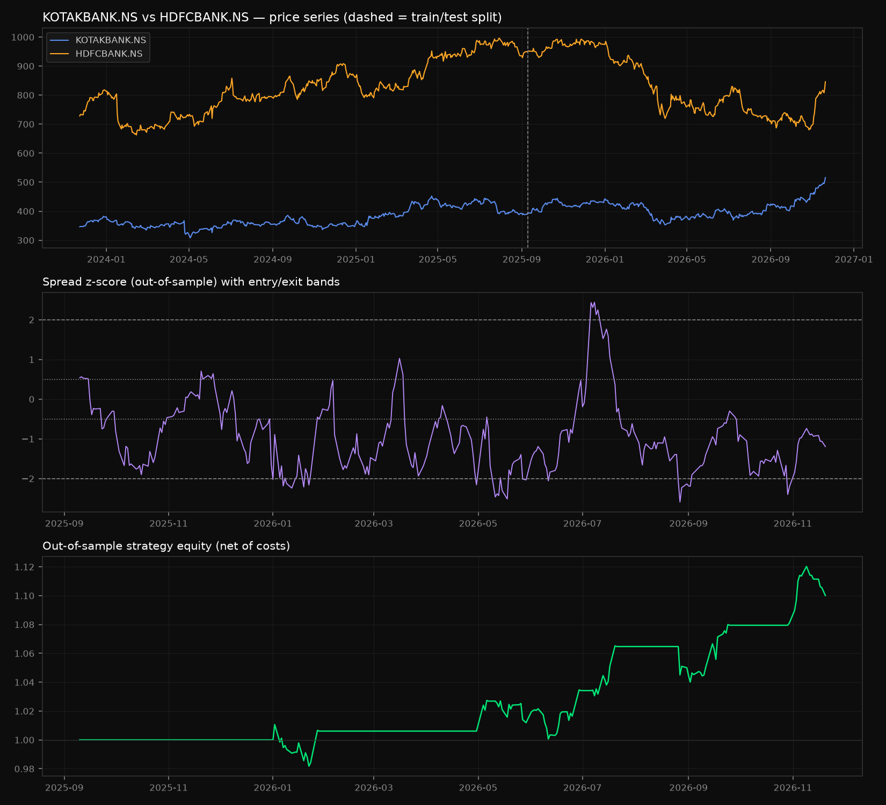
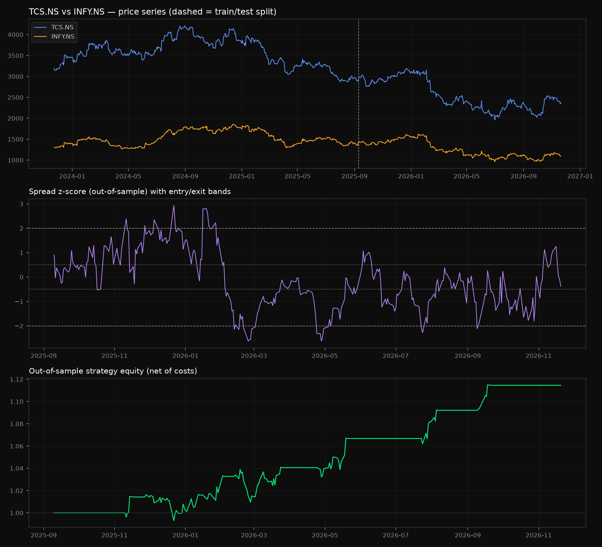
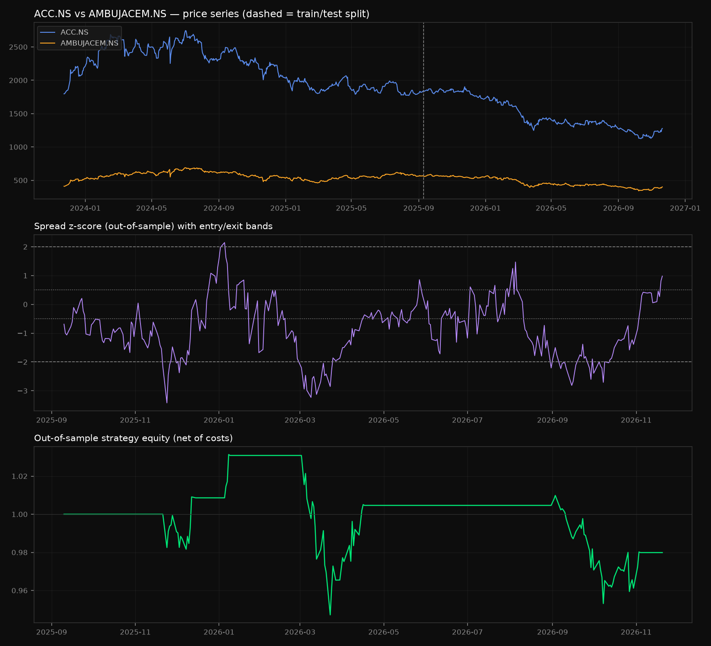
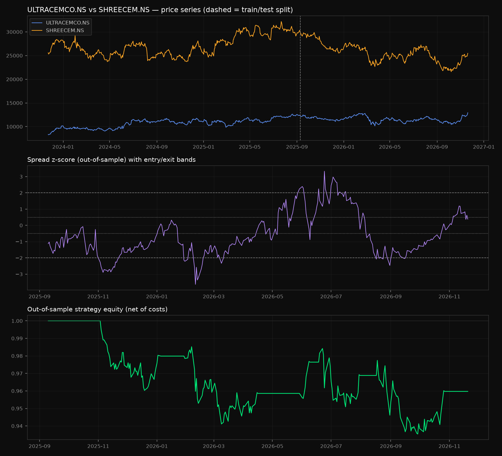
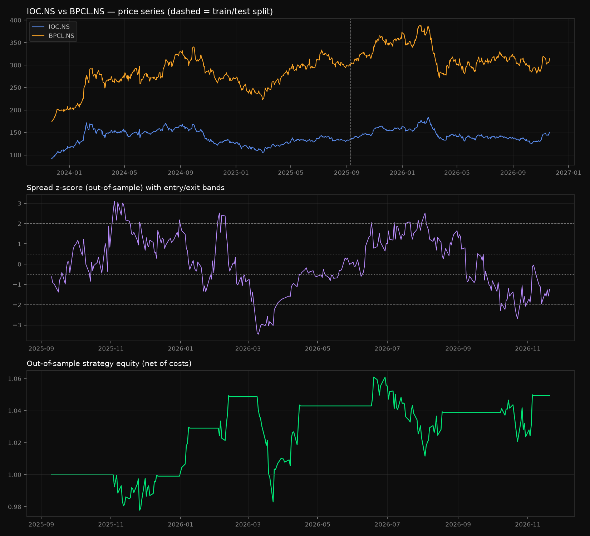
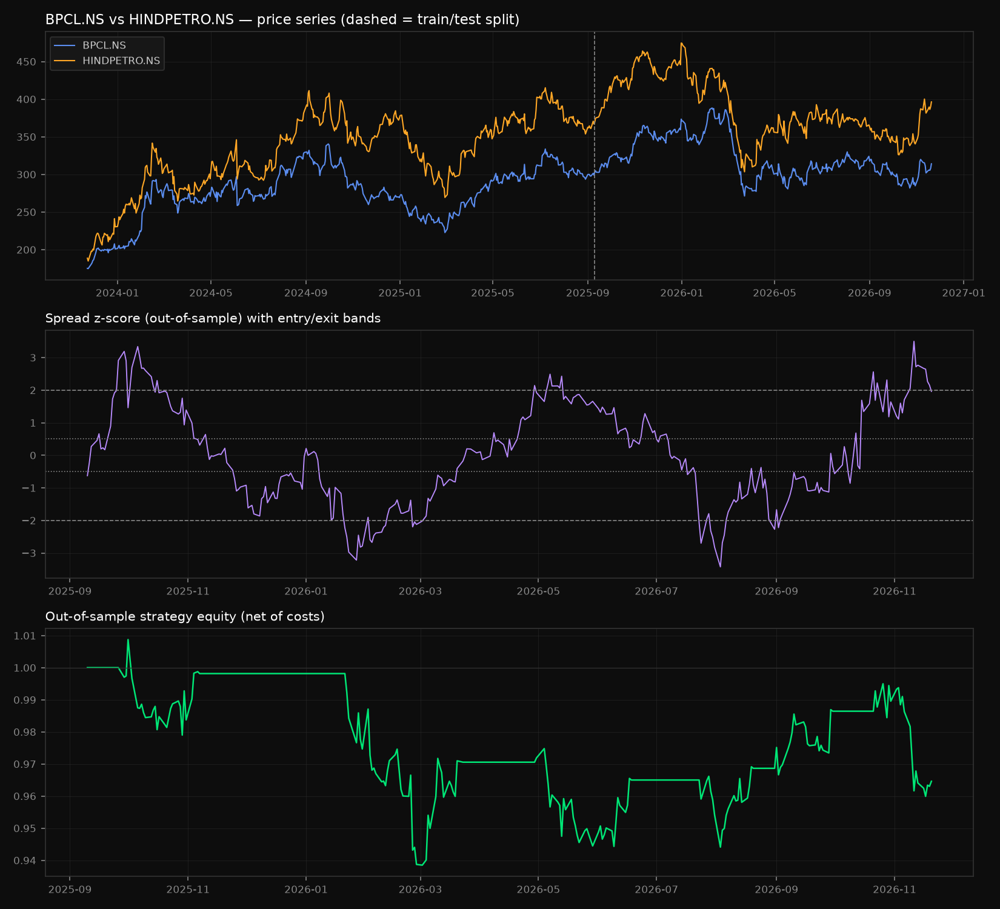
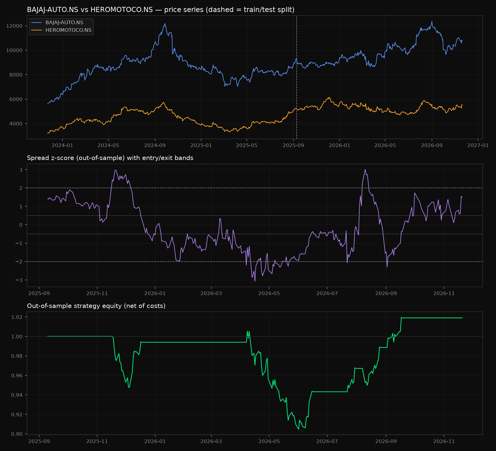

# Indian Pairs-Trading Scanner — 2026-11-24

> **What this is:** a market-neutral *pairs mean-reversion* scanner. It flags when two related NSE stocks have drifted apart far enough that their historical relationship signals a possible convergence trade. It does **not** forecast growth, rank "best" stocks, or predict company performance. A signal means the *spread between two stocks* is stretched — nothing about either stock being a good investment. Not investment advice; do your own research.

## Methodology (fixed in advance)

- **Universe:** 16 declared sector-mate pairs. Parameters (3y window, 60/40 train-test, z-entry 2.0, z-exit 0.5, 5 bps costs) are pre-registered; changes are logged in the README changelog *before* looking at results.
- **Multiple testing:** at the 5% level across 16 pairs, **≈0.8 false positives per run are expected by chance alone** even if nothing truly cointegrates. A single-day pass is a candidate, not a discovery.
- **Strict tier:** Bonferroni-corrected threshold p < 0.0031 (marked ✓✓).
- **Evidence = persistence:** the Persistence column counts how often each pair has passed the 5% test across all *real-data* daily runs recorded in `reports/history.csv`. Pairs deserve attention only when they pass persistently.

## Summary

| Pair | p-value | Coint. | Persistence | Current z | Signal | OOS Sharpe |
|---|---|---|---|---|---|---|
| HDFCBANK.NS/ICICIBANK.NS | 0.0206 | ✓ | 6/85 | +0.94 | watch | 0.13 |
| AXISBANK.NS/ICICIBANK.NS | 0.7196 | ✗ | 0/103 | +1.93 | watch | 0.13 |
| KOTAKBANK.NS/HDFCBANK.NS | 0.1875 | ✗ | 0/103 | -1.19 | watch | 1.36 |
| SBIN.NS/BANKBARODA.NS | 0.1061 | ✗ | 0/103 | +2.07 | SHORT spread | 0.13 |
| TCS.NS/INFY.NS | 0.6339 | ✗ | 0/103 | -0.38 | flat / no stretch | 1.85 |
| INFY.NS/WIPRO.NS | 0.0628 | ✗ | 0/103 | +0.83 | watch | 2.45 |
| HCLTECH.NS/TECHM.NS | 0.2800 | ✗ | 0/103 | +1.37 | watch | 0.02 |
| ACC.NS/AMBUJACEM.NS | 0.0680 | ✗ | 0/103 | +0.98 | watch | -0.19 |
| ULTRACEMCO.NS/SHREECEM.NS | 0.2657 | ✗ | 0/103 | +0.38 | flat / no stretch | -0.51 |
| IOC.NS/BPCL.NS | 0.5437 | ✗ | 0/103 | -1.23 | watch | 0.57 |
| BPCL.NS/HINDPETRO.NS | 0.2476 | ✗ | 0/103 | +1.96 | watch | -0.40 |
| ONGC.NS/COALINDIA.NS | 0.0115 | ✓ | 95/103 | -1.11 | watch | 1.04 |
| NTPC.NS/POWERGRID.NS | 0.1038 | ✗ | 0/103 | +2.26 | SHORT spread | 0.87 |
| BAJAJ-AUTO.NS/HEROMOTOCO.NS | 0.4007 | ✗ | 0/103 | +1.49 | watch | 0.25 |
| TATASTEEL.NS/JSWSTEEL.NS | 0.6802 | ✗ | 0/103 | +1.48 | watch | 0.51 |
| SUNPHARMA.NS/CIPLA.NS | 0.0432 | ✓ | 93/103 | +0.84 | watch | 0.34 |

_Legend: ✓✓ passes strict Bonferroni tier · ✓ passes 5% only · ✗ fails. Persistence = 5%-passes / real-data runs recorded. \*no real-data history yet._

---

### HDFCBANK.NS / ICICIBANK.NS

- **Latest prices:** HDFCBANK.NS ₹846.00 · ICICIBANK.NS ₹1,640.00
- **Hedge ratio (train-fitted):** 1.4975
- **Cointegration (train):** PASS at 5% — ADF -3.19, p=0.0206
- **Persistence:** passed 5% in 6 of 85 real-data runs (strict tier: 0/85)
- **Spread half-life:** 19.4 days
- **Current z-score:** +0.94
- **Signal today:** watch (approaching band)

**Out-of-sample backtest** (beta frozen from train window):

| Metric | Value |
|---|---|
| Sharpe | 0.13 |
| Sortino | 0.14 |
| Annualised return | 0.62% |
| Annualised vol | 6.12% |
| Max drawdown | -4.34% |
| Round-trip trades | 5 |

---

### AXISBANK.NS / ICICIBANK.NS

- **Latest prices:** AXISBANK.NS ₹1,446.00 · ICICIBANK.NS ₹1,640.00
- **Hedge ratio (train-fitted):** 0.4793
- **Cointegration (train):** FAIL at 5% — ADF -1.09, p=0.7196
- **Persistence:** passed 5% in 0 of 103 real-data runs (strict tier: 0/103)
- **Spread half-life:** 159.7 days
- **Current z-score:** +1.93
- **Signal today:** watch (approaching band)
- ⚠️ _Pair did not cointegrate on training data. Any signal here is not statistically justified — observation only._

**Out-of-sample backtest** (beta frozen from train window):

| Metric | Value |
|---|---|
| Sharpe | 0.13 |
| Sortino | 0.15 |
| Annualised return | 0.77% |
| Annualised vol | 9.10% |
| Max drawdown | -9.75% |
| Round-trip trades | 6 |

---

### KOTAKBANK.NS / HDFCBANK.NS

- **Latest prices:** KOTAKBANK.NS ₹515.80 · HDFCBANK.NS ₹846.00
- **Hedge ratio (train-fitted):** 2.2345
- **Cointegration (train):** FAIL at 5% — ADF -2.25, p=0.1875
- **Persistence:** passed 5% in 0 of 103 real-data runs (strict tier: 0/103)
- **Spread half-life:** 28.0 days
- **Current z-score:** -1.19
- **Signal today:** watch (approaching band)
- ⚠️ _Pair did not cointegrate on training data. Any signal here is not statistically justified — observation only._

**Out-of-sample backtest** (beta frozen from train window):

| Metric | Value |
|---|---|
| Sharpe | 1.36 |
| Sortino | 1.46 |
| Annualised return | 8.46% |
| Annualised vol | 6.11% |
| Max drawdown | -2.85% |
| Round-trip trades | 5 |

---

### SBIN.NS / BANKBARODA.NS

- **Latest prices:** SBIN.NS ₹1,165.10 · BANKBARODA.NS ₹287.00
- **Hedge ratio (train-fitted):** 0.1692
- **Cointegration (train):** FAIL at 5% — ADF -2.54, p=0.1061
- **Persistence:** passed 5% in 0 of 103 real-data runs (strict tier: 0/103)
- **Spread half-life:** 19.2 days
- **Current z-score:** +2.07
- **Signal today:** SHORT spread (short BANKBARODA.NS, long SBIN.NS)
- ⚠️ _Pair did not cointegrate on training data. Any signal here is not statistically justified — observation only._

**Out-of-sample backtest** (beta frozen from train window):

| Metric | Value |
|---|---|
| Sharpe | 0.13 |
| Sortino | 0.13 |
| Annualised return | 0.82% |
| Annualised vol | 10.93% |
| Max drawdown | -6.65% |
| Round-trip trades | 6 |

---

### TCS.NS / INFY.NS

- **Latest prices:** TCS.NS ₹2,376.20 · INFY.NS ₹1,098.00
- **Hedge ratio (train-fitted):** 0.3659
- **Cointegration (train):** FAIL at 5% — ADF -1.29, p=0.6339
- **Persistence:** passed 5% in 0 of 103 real-data runs (strict tier: 0/103)
- **Spread half-life:** 70.1 days
- **Current z-score:** -0.38
- **Signal today:** flat / no stretch
- ⚠️ _Pair did not cointegrate on training data. Any signal here is not statistically justified — observation only._

**Out-of-sample backtest** (beta frozen from train window):

| Metric | Value |
|---|---|
| Sharpe | 1.85 |
| Sortino | 2.27 |
| Annualised return | 9.68% |
| Annualised vol | 5.07% |
| Max drawdown | -2.84% |
| Round-trip trades | 7 |

---

### INFY.NS / WIPRO.NS

- **Latest prices:** INFY.NS ₹1,098.00 · WIPRO.NS ₹185.70
- **Hedge ratio (train-fitted):** 0.1126
- **Cointegration (train):** FAIL at 5% — ADF -2.77, p=0.0628
- **Persistence:** passed 5% in 0 of 103 real-data runs (strict tier: 0/103)
- **Spread half-life:** 23.4 days
- **Current z-score:** +0.83
- **Signal today:** watch (approaching band)
- ⚠️ _Pair did not cointegrate on training data. Any signal here is not statistically justified — observation only._

**Out-of-sample backtest** (beta frozen from train window):

| Metric | Value |
|---|---|
| Sharpe | 2.45 |
| Sortino | 3.51 |
| Annualised return | 14.81% |
| Annualised vol | 5.70% |
| Max drawdown | -3.35% |
| Round-trip trades | 6 |

---

### HCLTECH.NS / TECHM.NS

- **Latest prices:** HCLTECH.NS ₹1,344.40 · TECHM.NS ₹1,746.20
- **Hedge ratio (train-fitted):** 0.9289
- **Cointegration (train):** FAIL at 5% — ADF -2.02, p=0.2800
- **Persistence:** passed 5% in 0 of 103 real-data runs (strict tier: 0/103)
- **Spread half-life:** 31.4 days
- **Current z-score:** +1.37
- **Signal today:** watch (approaching band)
- ⚠️ _Pair did not cointegrate on training data. Any signal here is not statistically justified — observation only._

**Out-of-sample backtest** (beta frozen from train window):

| Metric | Value |
|---|---|
| Sharpe | 0.02 |
| Sortino | 0.02 |
| Annualised return | -0.15% |
| Annualised vol | 7.58% |
| Max drawdown | -8.33% |
| Round-trip trades | 5 |

---

### ACC.NS / AMBUJACEM.NS

- **Latest prices:** ACC.NS ₹1,277.00 · AMBUJACEM.NS ₹400.00
- **Hedge ratio (train-fitted):** 0.1280
- **Cointegration (train):** FAIL at 5% — ADF -2.74, p=0.0680
- **Persistence:** passed 5% in 0 of 103 real-data runs (strict tier: 0/103)
- **Spread half-life:** 26.5 days
- **Current z-score:** +0.98
- **Signal today:** watch (approaching band)
- ⚠️ _Pair did not cointegrate on training data. Any signal here is not statistically justified — observation only._

**Out-of-sample backtest** (beta frozen from train window):

| Metric | Value |
|---|---|
| Sharpe | -0.19 |
| Sortino | -0.15 |
| Annualised return | -1.72% |
| Annualised vol | 7.59% |
| Max drawdown | -8.16% |
| Round-trip trades | 4 |

---

### ULTRACEMCO.NS / SHREECEM.NS

- **Latest prices:** ULTRACEMCO.NS ₹12,939.00 · SHREECEM.NS ₹25,475.00
- **Hedge ratio (train-fitted):** 1.2744
- **Cointegration (train):** FAIL at 5% — ADF -2.05, p=0.2657
- **Persistence:** passed 5% in 0 of 103 real-data runs (strict tier: 0/103)
- **Spread half-life:** 37.7 days
- **Current z-score:** +0.38
- **Signal today:** flat / no stretch
- ⚠️ _Pair did not cointegrate on training data. Any signal here is not statistically justified — observation only._

**Out-of-sample backtest** (beta frozen from train window):

| Metric | Value |
|---|---|
| Sharpe | -0.51 |
| Sortino | -0.59 |
| Annualised return | -3.44% |
| Annualised vol | 6.46% |
| Max drawdown | -6.46% |
| Round-trip trades | 5 |

---

### IOC.NS / BPCL.NS

- **Latest prices:** IOC.NS ₹150.50 · BPCL.NS ₹314.10
- **Hedge ratio (train-fitted):** 1.3769
- **Cointegration (train):** FAIL at 5% — ADF -1.48, p=0.5437
- **Persistence:** passed 5% in 0 of 103 real-data runs (strict tier: 0/103)
- **Spread half-life:** 81.1 days
- **Current z-score:** -1.23
- **Signal today:** watch (approaching band)
- ⚠️ _Pair did not cointegrate on training data. Any signal here is not statistically justified — observation only._

**Out-of-sample backtest** (beta frozen from train window):

| Metric | Value |
|---|---|
| Sharpe | 0.57 |
| Sortino | 0.59 |
| Annualised return | 4.19% |
| Annualised vol | 7.78% |
| Max drawdown | -6.32% |
| Round-trip trades | 6 |

---

### BPCL.NS / HINDPETRO.NS

- **Latest prices:** BPCL.NS ₹314.10 · HINDPETRO.NS ₹396.35
- **Hedge ratio (train-fitted):** 1.2613
- **Cointegration (train):** FAIL at 5% — ADF -2.09, p=0.2476
- **Persistence:** passed 5% in 0 of 103 real-data runs (strict tier: 0/103)
- **Spread half-life:** 36.0 days
- **Current z-score:** +1.96
- **Signal today:** watch (approaching band)
- ⚠️ _Pair did not cointegrate on training data. Any signal here is not statistically justified — observation only._

**Out-of-sample backtest** (beta frozen from train window):

| Metric | Value |
|---|---|
| Sharpe | -0.40 |
| Sortino | -0.43 |
| Annualised return | -3.02% |
| Annualised vol | 7.11% |
| Max drawdown | -6.97% |
| Round-trip trades | 5 |

---

### ONGC.NS / COALINDIA.NS

- **Latest prices:** ONGC.NS ₹223.46 · COALINDIA.NS ₹390.00
- **Hedge ratio (train-fitted):** 1.3393
- **Cointegration (train):** PASS at 5% — ADF -3.38, p=0.0115
- **Persistence:** passed 5% in 95 of 103 real-data runs (strict tier: 1/103)
- **Spread half-life:** 13.5 days
- **Current z-score:** -1.11
- **Signal today:** watch (approaching band)

**Out-of-sample backtest** (beta frozen from train window):

| Metric | Value |
|---|---|
| Sharpe | 1.04 |
| Sortino | 0.86 |
| Annualised return | 8.41% |
| Annualised vol | 8.05% |
| Max drawdown | -6.40% |
| Round-trip trades | 6 |

---

### NTPC.NS / POWERGRID.NS

- **Latest prices:** NTPC.NS ₹321.50 · POWERGRID.NS ₹269.00
- **Hedge ratio (train-fitted):** 0.7806
- **Cointegration (train):** FAIL at 5% — ADF -2.55, p=0.1038
- **Persistence:** passed 5% in 0 of 103 real-data runs (strict tier: 0/103)
- **Spread half-life:** 23.9 days
- **Current z-score:** +2.26
- **Signal today:** SHORT spread (short POWERGRID.NS, long NTPC.NS)
- ⚠️ _Pair did not cointegrate on training data. Any signal here is not statistically justified — observation only._

**Out-of-sample backtest** (beta frozen from train window):

| Metric | Value |
|---|---|
| Sharpe | 0.87 |
| Sortino | 0.67 |
| Annualised return | 4.92% |
| Annualised vol | 5.68% |
| Max drawdown | -5.33% |
| Round-trip trades | 7 |

---

### BAJAJ-AUTO.NS / HEROMOTOCO.NS

- **Latest prices:** BAJAJ-AUTO.NS ₹10,765.00 · HEROMOTOCO.NS ₹5,536.00
- **Hedge ratio (train-fitted):** 0.4058
- **Cointegration (train):** FAIL at 5% — ADF -1.76, p=0.4007
- **Persistence:** passed 5% in 0 of 103 real-data runs (strict tier: 0/103)
- **Spread half-life:** 41.6 days
- **Current z-score:** +1.49
- **Signal today:** watch (approaching band)
- ⚠️ _Pair did not cointegrate on training data. Any signal here is not statistically justified — observation only._

**Out-of-sample backtest** (beta frozen from train window):

| Metric | Value |
|---|---|
| Sharpe | 0.25 |
| Sortino | 0.21 |
| Annualised return | 1.61% |
| Annualised vol | 7.51% |
| Max drawdown | -10.02% |
| Round-trip trades | 5 |

---

### TATASTEEL.NS / JSWSTEEL.NS

- **Latest prices:** TATASTEEL.NS ₹178.00 · JSWSTEEL.NS ₹1,337.00
- **Hedge ratio (train-fitted):** 2.5942
- **Cointegration (train):** FAIL at 5% — ADF -1.18, p=0.6802
- **Persistence:** passed 5% in 0 of 103 real-data runs (strict tier: 0/103)
- **Spread half-life:** 64.7 days
- **Current z-score:** +1.48
- **Signal today:** watch (approaching band)
- ⚠️ _Pair did not cointegrate on training data. Any signal here is not statistically justified — observation only._

**Out-of-sample backtest** (beta frozen from train window):

| Metric | Value |
|---|---|
| Sharpe | 0.51 |
| Sortino | 0.50 |
| Annualised return | 4.21% |
| Annualised vol | 8.78% |
| Max drawdown | -5.60% |
| Round-trip trades | 5 |

---

### SUNPHARMA.NS / CIPLA.NS

- **Latest prices:** SUNPHARMA.NS ₹1,884.90 · CIPLA.NS ₹1,415.00
- **Hedge ratio (train-fitted):** 0.4623
- **Cointegration (train):** PASS at 5% — ADF -2.92, p=0.0432
- **Persistence:** passed 5% in 93 of 103 real-data runs (strict tier: 5/103)
- **Spread half-life:** 13.7 days
- **Current z-score:** +0.84
- **Signal today:** watch (approaching band)

**Out-of-sample backtest** (beta frozen from train window):

| Metric | Value |
|---|---|
| Sharpe | 0.34 |
| Sortino | 0.34 |
| Annualised return | 2.18% |
| Annualised vol | 7.16% |
| Max drawdown | -10.21% |
| Round-trip trades | 5 |

---

_Generated 2026-11-24 · pairs mean-reversion scanner · out-of-sample backtest · multiple-testing-aware · not investment advice._
