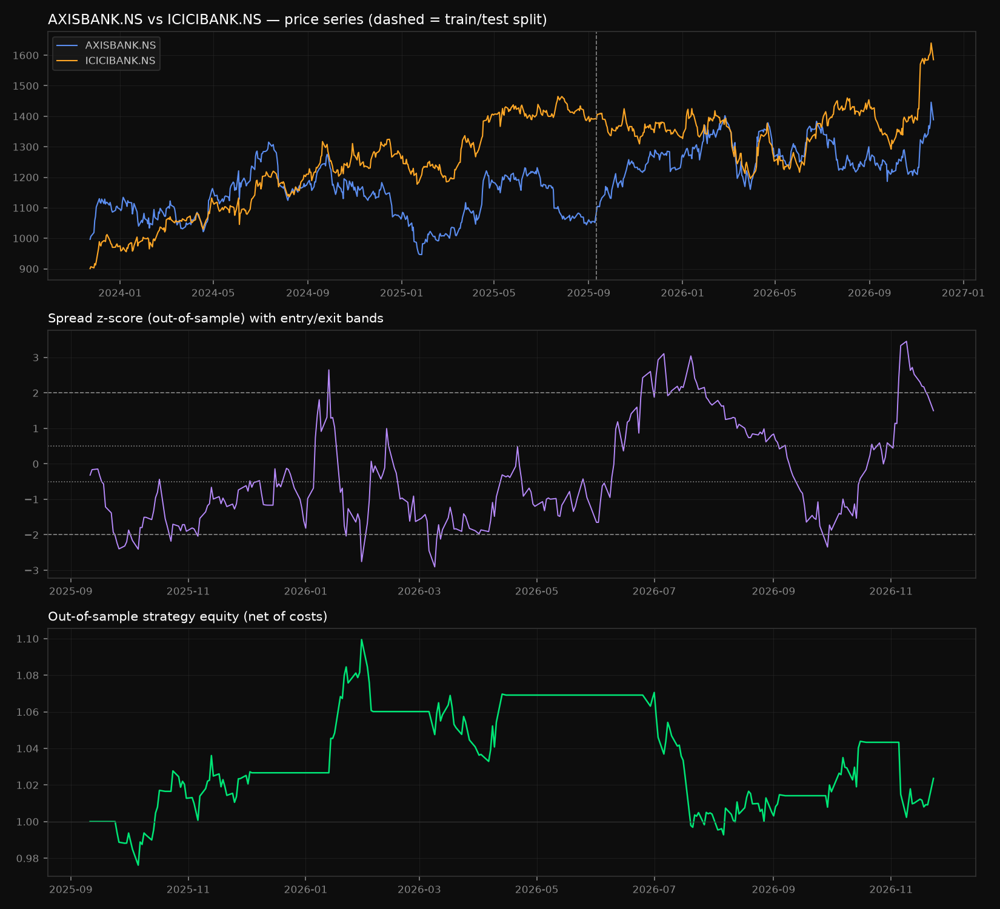
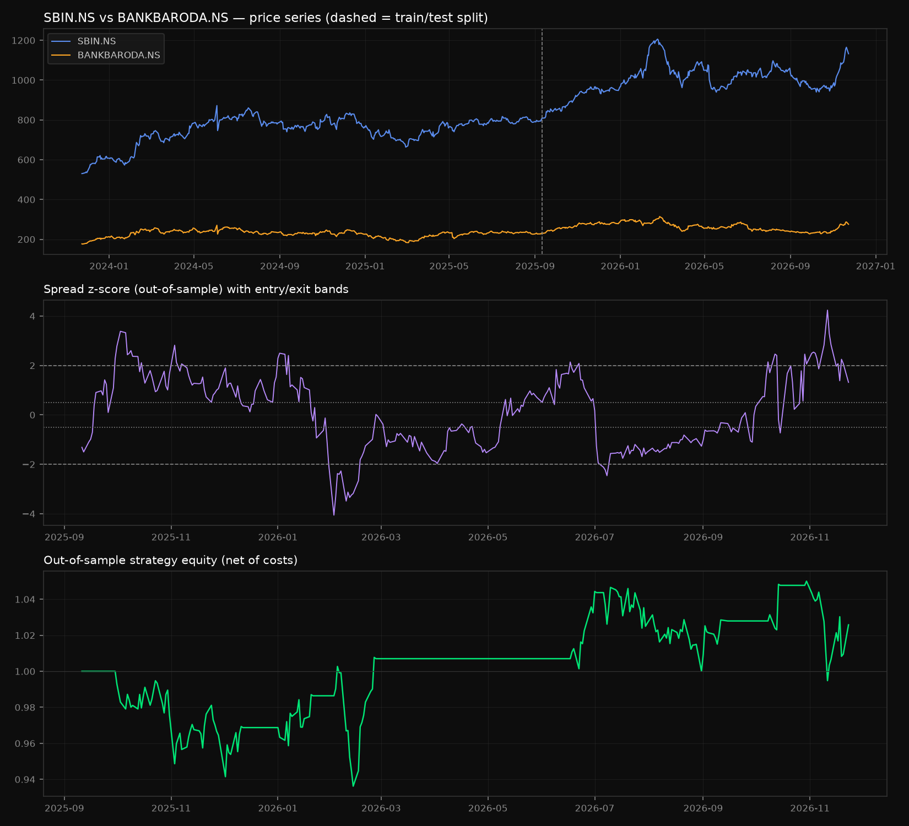
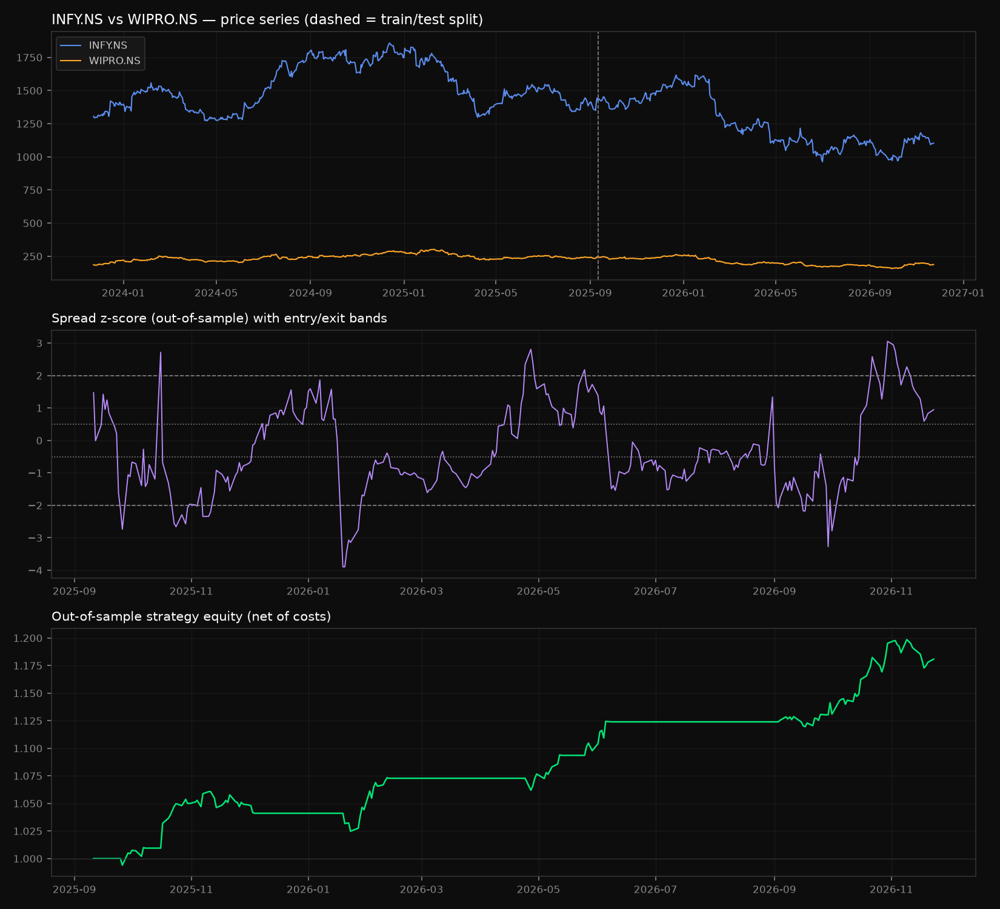
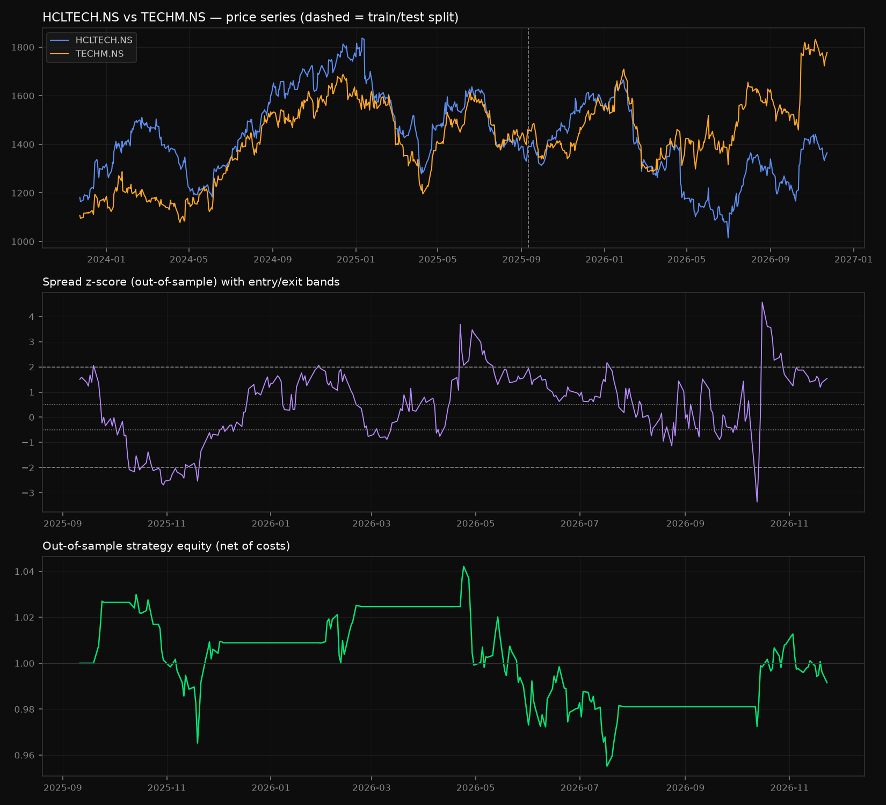
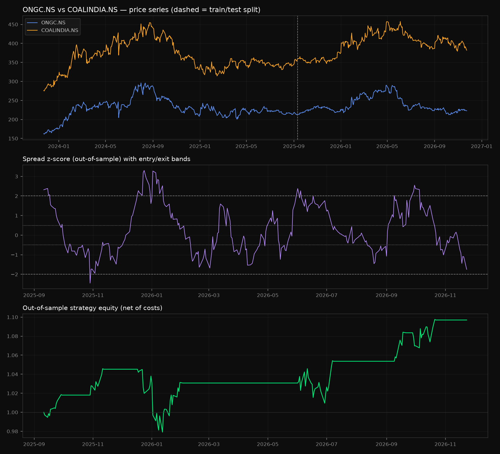
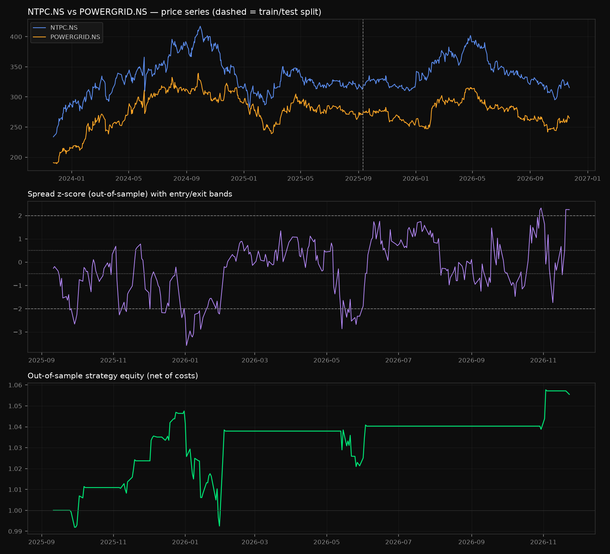
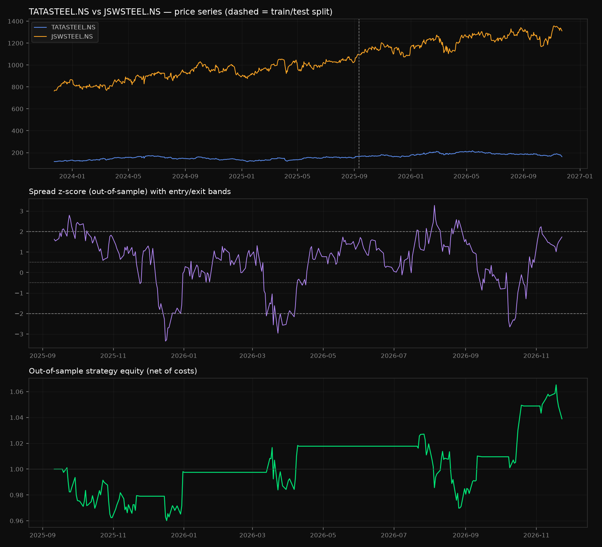
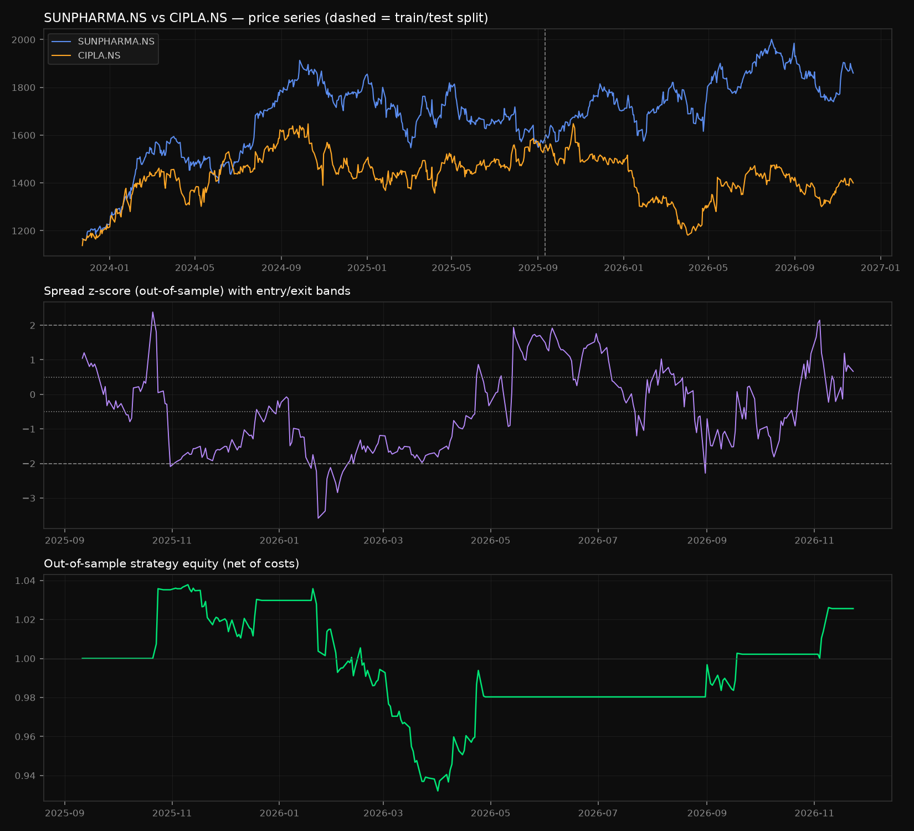

# Indian Pairs-Trading Scanner — 2026-11-24

> **What this is:** a market-neutral *pairs mean-reversion* scanner. It flags when two related NSE stocks have drifted apart far enough that their historical relationship signals a possible convergence trade. It does **not** forecast growth, rank "best" stocks, or predict company performance. A signal means the *spread between two stocks* is stretched — nothing about either stock being a good investment. Not investment advice; do your own research.

## Methodology (fixed in advance)

- **Universe:** 16 declared sector-mate pairs. Parameters (3y window, 60/40 train-test, z-entry 2.0, z-exit 0.5, 5 bps costs) are pre-registered; changes are logged in the README changelog *before* looking at results.
- **Multiple testing:** at the 5% level across 16 pairs, **≈0.8 false positives per run are expected by chance alone** even if nothing truly cointegrates. A single-day pass is a candidate, not a discovery.
- **Strict tier:** Bonferroni-corrected threshold p < 0.0031 (marked ✓✓).
- **Evidence = persistence:** the Persistence column counts how often each pair has passed the 5% test across all *real-data* daily runs recorded in `reports/history.csv`. Pairs deserve attention only when they pass persistently.

## Summary

| Pair | p-value | Coint. | Persistence | Current z | Signal | OOS Sharpe |
|---|---|---|---|---|---|---|
| HDFCBANK.NS/ICICIBANK.NS | 0.0204 | ✓ | 6/85 | +0.69 | watch | 0.13 |
| AXISBANK.NS/ICICIBANK.NS | 0.6947 | ✗ | 0/103 | +1.50 | watch | 0.26 |
| KOTAKBANK.NS/HDFCBANK.NS | 0.1776 | ✗ | 0/103 | -1.15 | watch | 1.36 |
| SBIN.NS/BANKBARODA.NS | 0.1020 | ✗ | 0/103 | +1.32 | watch | 0.25 |
| TCS.NS/INFY.NS | 0.6439 | ✗ | 0/103 | -1.58 | watch | 1.84 |
| INFY.NS/WIPRO.NS | 0.0682 | ✗ | 0/103 | +0.95 | watch | 2.48 |
| HCLTECH.NS/TECHM.NS | 0.5231 | ✗ | 0/103 | +1.54 | watch | -0.06 |
| ACC.NS/AMBUJACEM.NS | 0.0654 | ✗ | 0/103 | +0.62 | watch | -0.19 |
| ULTRACEMCO.NS/SHREECEM.NS | 0.2599 | ✗ | 0/103 | +0.51 | watch | -0.51 |
| IOC.NS/BPCL.NS | 0.5741 | ✗ | 0/103 | -1.34 | watch | 0.57 |
| BPCL.NS/HINDPETRO.NS | 0.2438 | ✗ | 0/103 | +1.85 | watch | -0.39 |
| ONGC.NS/COALINDIA.NS | 0.0123 | ✓ | 95/103 | -1.75 | watch | 1.02 |
| NTPC.NS/POWERGRID.NS | 0.1004 | ✗ | 0/103 | +2.25 | SHORT spread | 0.85 |
| BAJAJ-AUTO.NS/HEROMOTOCO.NS | 0.3875 | ✗ | 0/103 | +1.65 | watch | 0.25 |
| TATASTEEL.NS/JSWSTEEL.NS | 0.6708 | ✗ | 0/103 | +1.74 | watch | 0.41 |
| SUNPHARMA.NS/CIPLA.NS | 0.0508 | ✗ | 92/103 | +0.66 | watch | 0.34 |

_Legend: ✓✓ passes strict Bonferroni tier · ✓ passes 5% only · ✗ fails. Persistence = 5%-passes / real-data runs recorded. \*no real-data history yet._

---

### HDFCBANK.NS / ICICIBANK.NS

- **Latest prices:** HDFCBANK.NS ₹817.80 · ICICIBANK.NS ₹1,585.50
- **Hedge ratio (train-fitted):** 1.4974
- **Cointegration (train):** PASS at 5% — ADF -3.19, p=0.0204
- **Persistence:** passed 5% in 6 of 85 real-data runs (strict tier: 0/85)
- **Spread half-life:** 19.4 days
- **Current z-score:** +0.69
- **Signal today:** watch (approaching band)

**Out-of-sample backtest** (beta frozen from train window):

| Metric | Value |
|---|---|
| Sharpe | 0.13 |
| Sortino | 0.14 |
| Annualised return | 0.63% |
| Annualised vol | 6.12% |
| Max drawdown | -4.33% |
| Round-trip trades | 5 |

---

### AXISBANK.NS / ICICIBANK.NS

- **Latest prices:** AXISBANK.NS ₹1,388.60 · ICICIBANK.NS ₹1,585.50
- **Hedge ratio (train-fitted):** 0.4747
- **Cointegration (train):** FAIL at 5% — ADF -1.15, p=0.6947
- **Persistence:** passed 5% in 0 of 103 real-data runs (strict tier: 0/103)
- **Spread half-life:** 151.8 days
- **Current z-score:** +1.50
- **Signal today:** watch (approaching band)
- ⚠️ _Pair did not cointegrate on training data. Any signal here is not statistically justified — observation only._

**Out-of-sample backtest** (beta frozen from train window):

| Metric | Value |
|---|---|
| Sharpe | 0.26 |
| Sortino | 0.31 |
| Annualised return | 2.00% |
| Annualised vol | 9.19% |
| Max drawdown | -9.70% |
| Round-trip trades | 6 |

---

### KOTAKBANK.NS / HDFCBANK.NS

- **Latest prices:** KOTAKBANK.NS ₹502.85 · HDFCBANK.NS ₹817.80
- **Hedge ratio (train-fitted):** 2.2381
- **Cointegration (train):** FAIL at 5% — ADF -2.28, p=0.1776
- **Persistence:** passed 5% in 0 of 103 real-data runs (strict tier: 0/103)
- **Spread half-life:** 27.8 days
- **Current z-score:** -1.15
- **Signal today:** watch (approaching band)
- ⚠️ _Pair did not cointegrate on training data. Any signal here is not statistically justified — observation only._

**Out-of-sample backtest** (beta frozen from train window):

| Metric | Value |
|---|---|
| Sharpe | 1.36 |
| Sortino | 1.46 |
| Annualised return | 8.48% |
| Annualised vol | 6.10% |
| Max drawdown | -2.84% |
| Round-trip trades | 5 |

---

### SBIN.NS / BANKBARODA.NS

- **Latest prices:** SBIN.NS ₹1,132.65 · BANKBARODA.NS ₹275.58
- **Hedge ratio (train-fitted):** 0.1690
- **Cointegration (train):** FAIL at 5% — ADF -2.56, p=0.1020
- **Persistence:** passed 5% in 0 of 103 real-data runs (strict tier: 0/103)
- **Spread half-life:** 19.1 days
- **Current z-score:** +1.32
- **Signal today:** watch (approaching band)
- ⚠️ _Pair did not cointegrate on training data. Any signal here is not statistically justified — observation only._

**Out-of-sample backtest** (beta frozen from train window):

| Metric | Value |
|---|---|
| Sharpe | 0.25 |
| Sortino | 0.26 |
| Annualised return | 2.19% |
| Annualised vol | 11.00% |
| Max drawdown | -6.63% |
| Round-trip trades | 6 |

---

### TCS.NS / INFY.NS

- **Latest prices:** TCS.NS ₹2,460.00 · INFY.NS ₹1,103.40
- **Hedge ratio (train-fitted):** 0.3644
- **Cointegration (train):** FAIL at 5% — ADF -1.27, p=0.6439
- **Persistence:** passed 5% in 0 of 103 real-data runs (strict tier: 0/103)
- **Spread half-life:** 70.8 days
- **Current z-score:** -1.58
- **Signal today:** watch (approaching band)
- ⚠️ _Pair did not cointegrate on training data. Any signal here is not statistically justified — observation only._

**Out-of-sample backtest** (beta frozen from train window):

| Metric | Value |
|---|---|
| Sharpe | 1.84 |
| Sortino | 2.27 |
| Annualised return | 9.73% |
| Annualised vol | 5.11% |
| Max drawdown | -2.87% |
| Round-trip trades | 7 |

---

### INFY.NS / WIPRO.NS

- **Latest prices:** INFY.NS ₹1,103.40 · WIPRO.NS ₹187.29
- **Hedge ratio (train-fitted):** 0.1125
- **Cointegration (train):** FAIL at 5% — ADF -2.73, p=0.0682
- **Persistence:** passed 5% in 0 of 103 real-data runs (strict tier: 0/103)
- **Spread half-life:** 23.7 days
- **Current z-score:** +0.95
- **Signal today:** watch (approaching band)
- ⚠️ _Pair did not cointegrate on training data. Any signal here is not statistically justified — observation only._

**Out-of-sample backtest** (beta frozen from train window):

| Metric | Value |
|---|---|
| Sharpe | 2.48 |
| Sortino | 3.56 |
| Annualised return | 15.20% |
| Annualised vol | 5.76% |
| Max drawdown | -3.39% |
| Round-trip trades | 6 |

---

### HCLTECH.NS / TECHM.NS

- **Latest prices:** HCLTECH.NS ₹1,364.30 · TECHM.NS ₹1,777.50
- **Hedge ratio (train-fitted):** 0.9275
- **Cointegration (train):** FAIL at 5% — ADF -1.52, p=0.5231
- **Persistence:** passed 5% in 0 of 103 real-data runs (strict tier: 0/103)
- **Spread half-life:** 31.3 days
- **Current z-score:** +1.54
- **Signal today:** watch (approaching band)
- ⚠️ _Pair did not cointegrate on training data. Any signal here is not statistically justified — observation only._

**Out-of-sample backtest** (beta frozen from train window):

| Metric | Value |
|---|---|
| Sharpe | -0.06 |
| Sortino | -0.06 |
| Annualised return | -0.72% |
| Annualised vol | 7.60% |
| Max drawdown | -8.34% |
| Round-trip trades | 5 |

---

### ACC.NS / AMBUJACEM.NS

- **Latest prices:** ACC.NS ₹1,255.80 · AMBUJACEM.NS ₹391.95
- **Hedge ratio (train-fitted):** 0.1276
- **Cointegration (train):** FAIL at 5% — ADF -2.75, p=0.0654
- **Persistence:** passed 5% in 0 of 103 real-data runs (strict tier: 0/103)
- **Spread half-life:** 26.5 days
- **Current z-score:** +0.62
- **Signal today:** watch (approaching band)
- ⚠️ _Pair did not cointegrate on training data. Any signal here is not statistically justified — observation only._

**Out-of-sample backtest** (beta frozen from train window):

| Metric | Value |
|---|---|
| Sharpe | -0.19 |
| Sortino | -0.15 |
| Annualised return | -1.75% |
| Annualised vol | 7.67% |
| Max drawdown | -8.24% |
| Round-trip trades | 4 |

---

### ULTRACEMCO.NS / SHREECEM.NS

- **Latest prices:** ULTRACEMCO.NS ₹12,650.00 · SHREECEM.NS ₹25,150.00
- **Hedge ratio (train-fitted):** 1.2769
- **Cointegration (train):** FAIL at 5% — ADF -2.06, p=0.2599
- **Persistence:** passed 5% in 0 of 103 real-data runs (strict tier: 0/103)
- **Spread half-life:** 37.5 days
- **Current z-score:** +0.51
- **Signal today:** watch (approaching band)
- ⚠️ _Pair did not cointegrate on training data. Any signal here is not statistically justified — observation only._

**Out-of-sample backtest** (beta frozen from train window):

| Metric | Value |
|---|---|
| Sharpe | -0.51 |
| Sortino | -0.58 |
| Annualised return | -3.44% |
| Annualised vol | 6.47% |
| Max drawdown | -6.47% |
| Round-trip trades | 5 |

---

### IOC.NS / BPCL.NS

- **Latest prices:** IOC.NS ₹145.00 · BPCL.NS ₹305.35
- **Hedge ratio (train-fitted):** 1.3761
- **Cointegration (train):** FAIL at 5% — ADF -1.42, p=0.5741
- **Persistence:** passed 5% in 0 of 103 real-data runs (strict tier: 0/103)
- **Spread half-life:** 84.8 days
- **Current z-score:** -1.34
- **Signal today:** watch (approaching band)
- ⚠️ _Pair did not cointegrate on training data. Any signal here is not statistically justified — observation only._

**Out-of-sample backtest** (beta frozen from train window):

| Metric | Value |
|---|---|
| Sharpe | 0.57 |
| Sortino | 0.59 |
| Annualised return | 4.14% |
| Annualised vol | 7.70% |
| Max drawdown | -6.26% |
| Round-trip trades | 6 |

---

### BPCL.NS / HINDPETRO.NS

- **Latest prices:** BPCL.NS ₹305.35 · HINDPETRO.NS ₹385.00
- **Hedge ratio (train-fitted):** 1.2615
- **Cointegration (train):** FAIL at 5% — ADF -2.10, p=0.2438
- **Persistence:** passed 5% in 0 of 103 real-data runs (strict tier: 0/103)
- **Spread half-life:** 35.9 days
- **Current z-score:** +1.85
- **Signal today:** watch (approaching band)
- ⚠️ _Pair did not cointegrate on training data. Any signal here is not statistically justified — observation only._

**Out-of-sample backtest** (beta frozen from train window):

| Metric | Value |
|---|---|
| Sharpe | -0.39 |
| Sortino | -0.43 |
| Annualised return | -2.95% |
| Annualised vol | 7.04% |
| Max drawdown | -6.90% |
| Round-trip trades | 5 |

---

### ONGC.NS / COALINDIA.NS

- **Latest prices:** ONGC.NS ₹222.85 · COALINDIA.NS ₹382.00
- **Hedge ratio (train-fitted):** 1.3385
- **Cointegration (train):** PASS at 5% — ADF -3.36, p=0.0123
- **Persistence:** passed 5% in 95 of 103 real-data runs (strict tier: 1/103)
- **Spread half-life:** 13.6 days
- **Current z-score:** -1.75
- **Signal today:** watch (approaching band)

**Out-of-sample backtest** (beta frozen from train window):

| Metric | Value |
|---|---|
| Sharpe | 1.02 |
| Sortino | 0.84 |
| Annualised return | 8.20% |
| Annualised vol | 8.01% |
| Max drawdown | -6.37% |
| Round-trip trades | 6 |

---

### NTPC.NS / POWERGRID.NS

- **Latest prices:** NTPC.NS ₹315.45 · POWERGRID.NS ₹264.85
- **Hedge ratio (train-fitted):** 0.7804
- **Cointegration (train):** FAIL at 5% — ADF -2.57, p=0.1004
- **Persistence:** passed 5% in 0 of 103 real-data runs (strict tier: 0/103)
- **Spread half-life:** 23.8 days
- **Current z-score:** +2.25
- **Signal today:** SHORT spread (short POWERGRID.NS, long NTPC.NS)
- ⚠️ _Pair did not cointegrate on training data. Any signal here is not statistically justified — observation only._

**Out-of-sample backtest** (beta frozen from train window):

| Metric | Value |
|---|---|
| Sharpe | 0.85 |
| Sortino | 0.66 |
| Annualised return | 4.71% |
| Annualised vol | 5.60% |
| Max drawdown | -5.25% |
| Round-trip trades | 7 |

---

### BAJAJ-AUTO.NS / HEROMOTOCO.NS

- **Latest prices:** BAJAJ-AUTO.NS ₹10,643.00 · HEROMOTOCO.NS ₹5,535.00
- **Hedge ratio (train-fitted):** 0.4064
- **Cointegration (train):** FAIL at 5% — ADF -1.79, p=0.3875
- **Persistence:** passed 5% in 0 of 103 real-data runs (strict tier: 0/103)
- **Spread half-life:** 41.4 days
- **Current z-score:** +1.65
- **Signal today:** watch (approaching band)
- ⚠️ _Pair did not cointegrate on training data. Any signal here is not statistically justified — observation only._

**Out-of-sample backtest** (beta frozen from train window):

| Metric | Value |
|---|---|
| Sharpe | 0.25 |
| Sortino | 0.21 |
| Annualised return | 1.62% |
| Annualised vol | 7.59% |
| Max drawdown | -10.13% |
| Round-trip trades | 5 |

---

### TATASTEEL.NS / JSWSTEEL.NS

- **Latest prices:** TATASTEEL.NS ₹163.00 · JSWSTEEL.NS ₹1,311.90
- **Hedge ratio (train-fitted):** 2.6247
- **Cointegration (train):** FAIL at 5% — ADF -1.21, p=0.6708
- **Persistence:** passed 5% in 0 of 103 real-data runs (strict tier: 0/103)
- **Spread half-life:** 64.1 days
- **Current z-score:** +1.74
- **Signal today:** watch (approaching band)
- ⚠️ _Pair did not cointegrate on training data. Any signal here is not statistically justified — observation only._

**Out-of-sample backtest** (beta frozen from train window):

| Metric | Value |
|---|---|
| Sharpe | 0.41 |
| Sortino | 0.41 |
| Annualised return | 3.31% |
| Annualised vol | 8.78% |
| Max drawdown | -5.58% |
| Round-trip trades | 5 |

---

### SUNPHARMA.NS / CIPLA.NS

- **Latest prices:** SUNPHARMA.NS ₹1,860.00 · CIPLA.NS ₹1,399.90
- **Hedge ratio (train-fitted):** 0.4620
- **Cointegration (train):** FAIL at 5% — ADF -2.86, p=0.0508
- **Persistence:** passed 5% in 92 of 103 real-data runs (strict tier: 5/103)
- **Spread half-life:** 14.0 days
- **Current z-score:** +0.66
- **Signal today:** watch (approaching band)
- ⚠️ _Pair did not cointegrate on training data. Any signal here is not statistically justified — observation only._

**Out-of-sample backtest** (beta frozen from train window):

| Metric | Value |
|---|---|
| Sharpe | 0.34 |
| Sortino | 0.34 |
| Annualised return | 2.17% |
| Annualised vol | 7.14% |
| Max drawdown | -10.19% |
| Round-trip trades | 5 |

---

_Generated 2026-11-24 · pairs mean-reversion scanner · out-of-sample backtest · multiple-testing-aware · not investment advice._
