# Indian Pairs-Trading Scanner — 2026-11-25

> **What this is:** a market-neutral *pairs mean-reversion* scanner. It flags when two related NSE stocks have drifted apart far enough that their historical relationship signals a possible convergence trade. It does **not** forecast growth, rank "best" stocks, or predict company performance. A signal means the *spread between two stocks* is stretched — nothing about either stock being a good investment. Not investment advice; do your own research.

## Methodology (fixed in advance)

- **Universe:** 16 declared sector-mate pairs. Parameters (3y window, 60/40 train-test, z-entry 2.0, z-exit 0.5, 5 bps costs) are pre-registered; changes are logged in the README changelog *before* looking at results.
- **Multiple testing:** at the 5% level across 16 pairs, **≈0.8 false positives per run are expected by chance alone** even if nothing truly cointegrates. A single-day pass is a candidate, not a discovery.
- **Strict tier:** Bonferroni-corrected threshold p < 0.0031 (marked ✓✓).
- **Evidence = persistence:** the Persistence column counts how often each pair has passed the 5% test across all *real-data* daily runs recorded in `reports/history.csv`. Pairs deserve attention only when they pass persistently.

## Summary

| Pair | p-value | Coint. | Persistence | Current z | Signal | OOS Sharpe |
|---|---|---|---|---|---|---|
| HDFCBANK.NS/ICICIBANK.NS | 0.0164 | ✓ | 7/86 | +0.71 | watch | 0.17 |
| AXISBANK.NS/ICICIBANK.NS | 0.6134 | ✗ | 0/104 | +1.52 | watch | 0.27 |
| KOTAKBANK.NS/HDFCBANK.NS | 0.1813 | ✗ | 0/104 | -1.15 | watch | 1.37 |
| SBIN.NS/BANKBARODA.NS | 0.1057 | ✗ | 0/104 | +1.35 | watch | 0.24 |
| TCS.NS/INFY.NS | 0.6367 | ✗ | 0/104 | -1.57 | watch | 1.84 |
| INFY.NS/WIPRO.NS | 0.0540 | ✗ | 0/104 | +0.94 | watch | 2.47 |
| HCLTECH.NS/TECHM.NS | 0.2724 | ✗ | 0/104 | +1.54 | watch | -0.03 |
| ACC.NS/AMBUJACEM.NS | 0.1031 | ✗ | 0/104 | +0.62 | watch | -0.20 |
| ULTRACEMCO.NS/SHREECEM.NS | 0.2588 | ✗ | 0/104 | +0.47 | flat / no stretch | -0.50 |
| IOC.NS/BPCL.NS | 0.5526 | ✗ | 0/104 | -1.31 | watch | 0.57 |
| BPCL.NS/HINDPETRO.NS | 0.2516 | ✗ | 0/104 | +1.85 | watch | -0.41 |
| ONGC.NS/COALINDIA.NS | 0.0125 | ✓ | 96/104 | -1.75 | watch | 1.02 |
| NTPC.NS/POWERGRID.NS | 0.0924 | ✗ | 0/104 | +2.26 | SHORT spread | 0.85 |
| BAJAJ-AUTO.NS/HEROMOTOCO.NS | 0.3842 | ✗ | 0/104 | +1.64 | watch | 0.25 |
| TATASTEEL.NS/JSWSTEEL.NS | 0.6814 | ✗ | 0/104 | +1.71 | watch | 0.44 |
| SUNPHARMA.NS/CIPLA.NS | 0.0489 | ✓ | 93/104 | +0.67 | watch | 0.33 |

_Legend: ✓✓ passes strict Bonferroni tier · ✓ passes 5% only · ✗ fails. Persistence = 5%-passes / real-data runs recorded. \*no real-data history yet._

---

### HDFCBANK.NS / ICICIBANK.NS

- **Latest prices:** HDFCBANK.NS ₹817.80 · ICICIBANK.NS ₹1,585.50
- **Hedge ratio (train-fitted):** 1.4882
- **Cointegration (train):** PASS at 5% — ADF -3.27, p=0.0164
- **Persistence:** passed 5% in 7 of 86 real-data runs (strict tier: 0/86)
- **Spread half-life:** 18.7 days
- **Current z-score:** +0.71
- **Signal today:** watch (approaching band)

**Out-of-sample backtest** (beta frozen from train window):

| Metric | Value |
|---|---|
| Sharpe | 0.17 |
| Sortino | 0.17 |
| Annualised return | 0.83% |
| Annualised vol | 6.13% |
| Max drawdown | -4.32% |
| Round-trip trades | 5 |

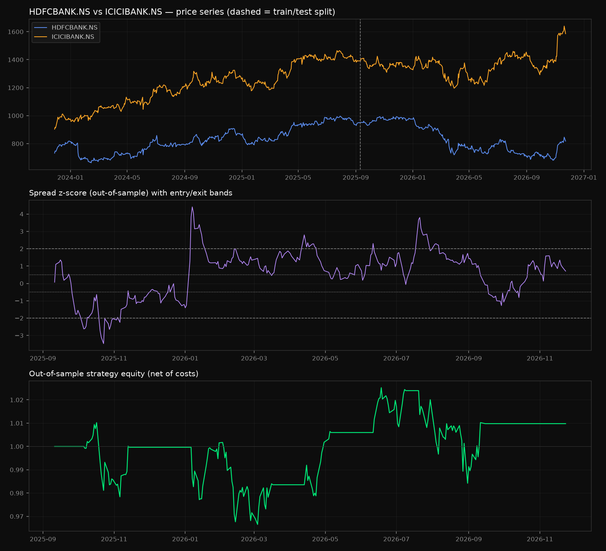

---

### AXISBANK.NS / ICICIBANK.NS

- **Latest prices:** AXISBANK.NS ₹1,388.60 · ICICIBANK.NS ₹1,585.50
- **Hedge ratio (train-fitted):** 0.4493
- **Cointegration (train):** FAIL at 5% — ADF -1.33, p=0.6134
- **Persistence:** passed 5% in 0 of 104 real-data runs (strict tier: 0/104)
- **Spread half-life:** 137.5 days
- **Current z-score:** +1.52
- **Signal today:** watch (approaching band)
- ⚠️ _Pair did not cointegrate on training data. Any signal here is not statistically justified — observation only._

**Out-of-sample backtest** (beta frozen from train window):

| Metric | Value |
|---|---|
| Sharpe | 0.27 |
| Sortino | 0.32 |
| Annualised return | 2.14% |
| Annualised vol | 9.34% |
| Max drawdown | -9.61% |
| Round-trip trades | 6 |

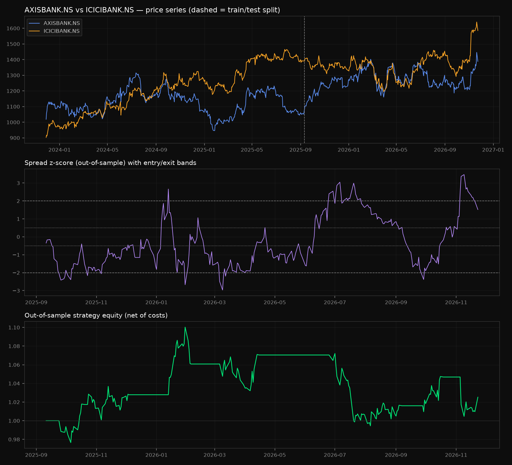

---

### KOTAKBANK.NS / HDFCBANK.NS

- **Latest prices:** KOTAKBANK.NS ₹502.85 · HDFCBANK.NS ₹817.80
- **Hedge ratio (train-fitted):** 2.2334
- **Cointegration (train):** FAIL at 5% — ADF -2.27, p=0.1813
- **Persistence:** passed 5% in 0 of 104 real-data runs (strict tier: 0/104)
- **Spread half-life:** 27.8 days
- **Current z-score:** -1.15
- **Signal today:** watch (approaching band)
- ⚠️ _Pair did not cointegrate on training data. Any signal here is not statistically justified — observation only._

**Out-of-sample backtest** (beta frozen from train window):

| Metric | Value |
|---|---|
| Sharpe | 1.37 |
| Sortino | 1.46 |
| Annualised return | 8.49% |
| Annualised vol | 6.10% |
| Max drawdown | -2.85% |
| Round-trip trades | 5 |

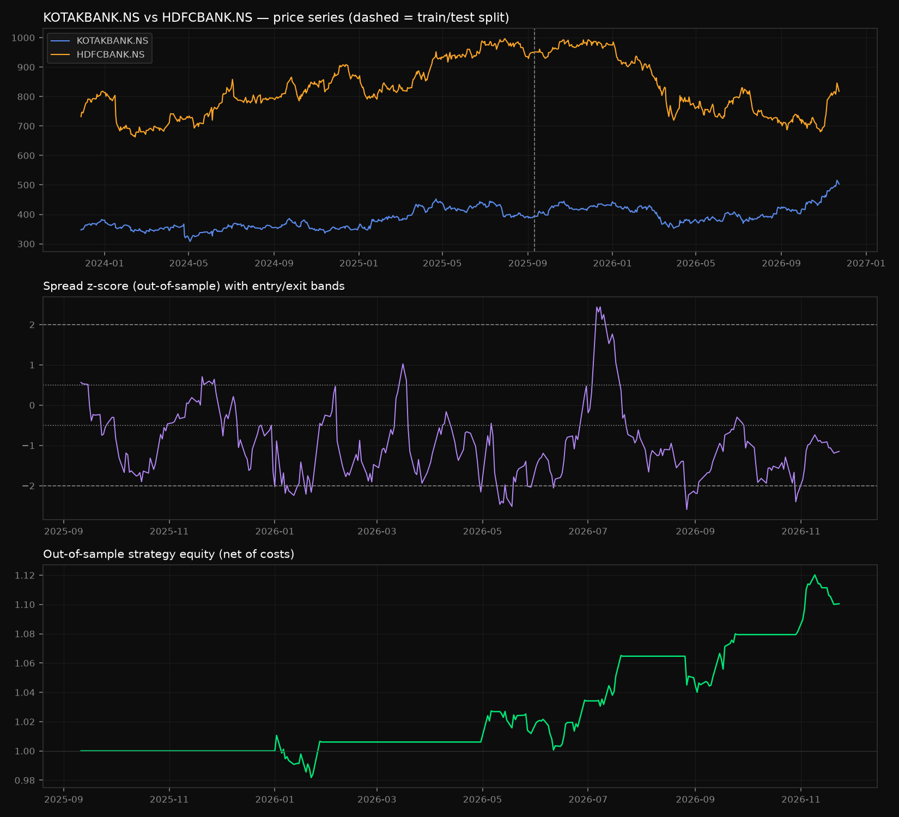

---

### SBIN.NS / BANKBARODA.NS

- **Latest prices:** SBIN.NS ₹1,132.65 · BANKBARODA.NS ₹275.58
- **Hedge ratio (train-fitted):** 0.1660
- **Cointegration (train):** FAIL at 5% — ADF -2.54, p=0.1057
- **Persistence:** passed 5% in 0 of 104 real-data runs (strict tier: 0/104)
- **Spread half-life:** 18.9 days
- **Current z-score:** +1.35
- **Signal today:** watch (approaching band)
- ⚠️ _Pair did not cointegrate on training data. Any signal here is not statistically justified — observation only._

**Out-of-sample backtest** (beta frozen from train window):

| Metric | Value |
|---|---|
| Sharpe | 0.24 |
| Sortino | 0.25 |
| Annualised return | 2.06% |
| Annualised vol | 11.07% |
| Max drawdown | -6.57% |
| Round-trip trades | 6 |

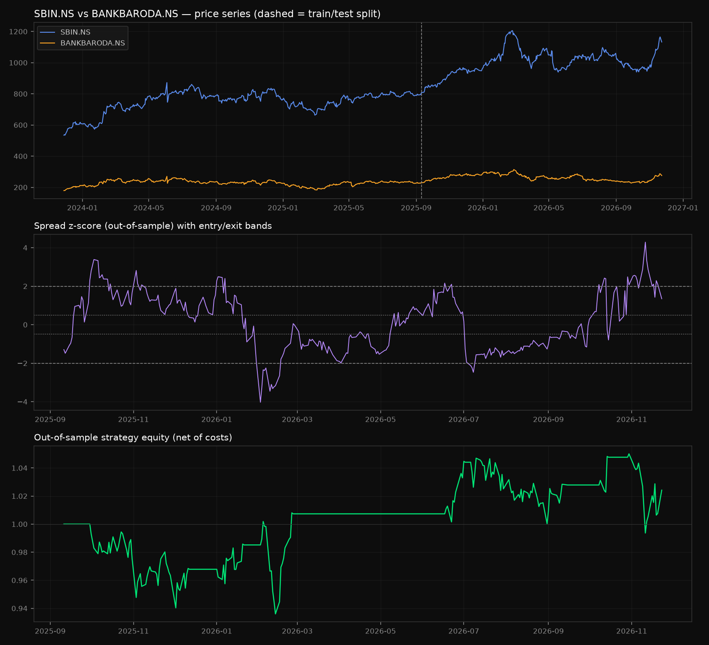

---

### TCS.NS / INFY.NS

- **Latest prices:** TCS.NS ₹2,460.00 · INFY.NS ₹1,103.40
- **Hedge ratio (train-fitted):** 0.3630
- **Cointegration (train):** FAIL at 5% — ADF -1.28, p=0.6367
- **Persistence:** passed 5% in 0 of 104 real-data runs (strict tier: 0/104)
- **Spread half-life:** 71.1 days
- **Current z-score:** -1.57
- **Signal today:** watch (approaching band)
- ⚠️ _Pair did not cointegrate on training data. Any signal here is not statistically justified — observation only._

**Out-of-sample backtest** (beta frozen from train window):

| Metric | Value |
|---|---|
| Sharpe | 1.84 |
| Sortino | 2.26 |
| Annualised return | 9.73% |
| Annualised vol | 5.12% |
| Max drawdown | -2.88% |
| Round-trip trades | 7 |

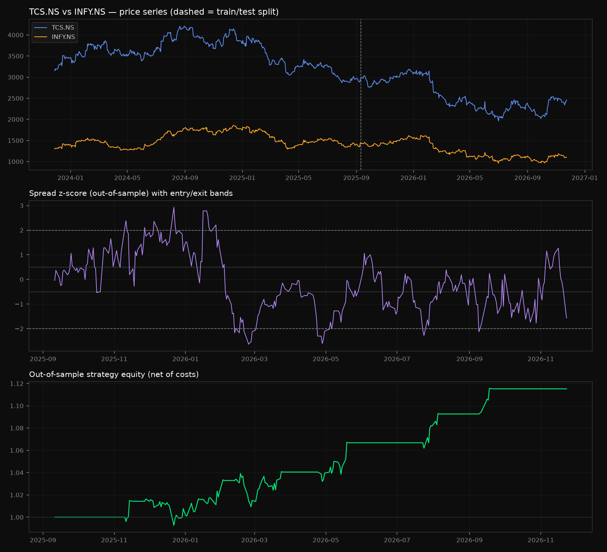

---

### INFY.NS / WIPRO.NS

- **Latest prices:** INFY.NS ₹1,103.40 · WIPRO.NS ₹187.29
- **Hedge ratio (train-fitted):** 0.1113
- **Cointegration (train):** FAIL at 5% — ADF -2.83, p=0.0540
- **Persistence:** passed 5% in 0 of 104 real-data runs (strict tier: 0/104)
- **Spread half-life:** 22.7 days
- **Current z-score:** +0.94
- **Signal today:** watch (approaching band)
- ⚠️ _Pair did not cointegrate on training data. Any signal here is not statistically justified — observation only._

**Out-of-sample backtest** (beta frozen from train window):

| Metric | Value |
|---|---|
| Sharpe | 2.47 |
| Sortino | 3.54 |
| Annualised return | 15.16% |
| Annualised vol | 5.78% |
| Max drawdown | -3.42% |
| Round-trip trades | 6 |

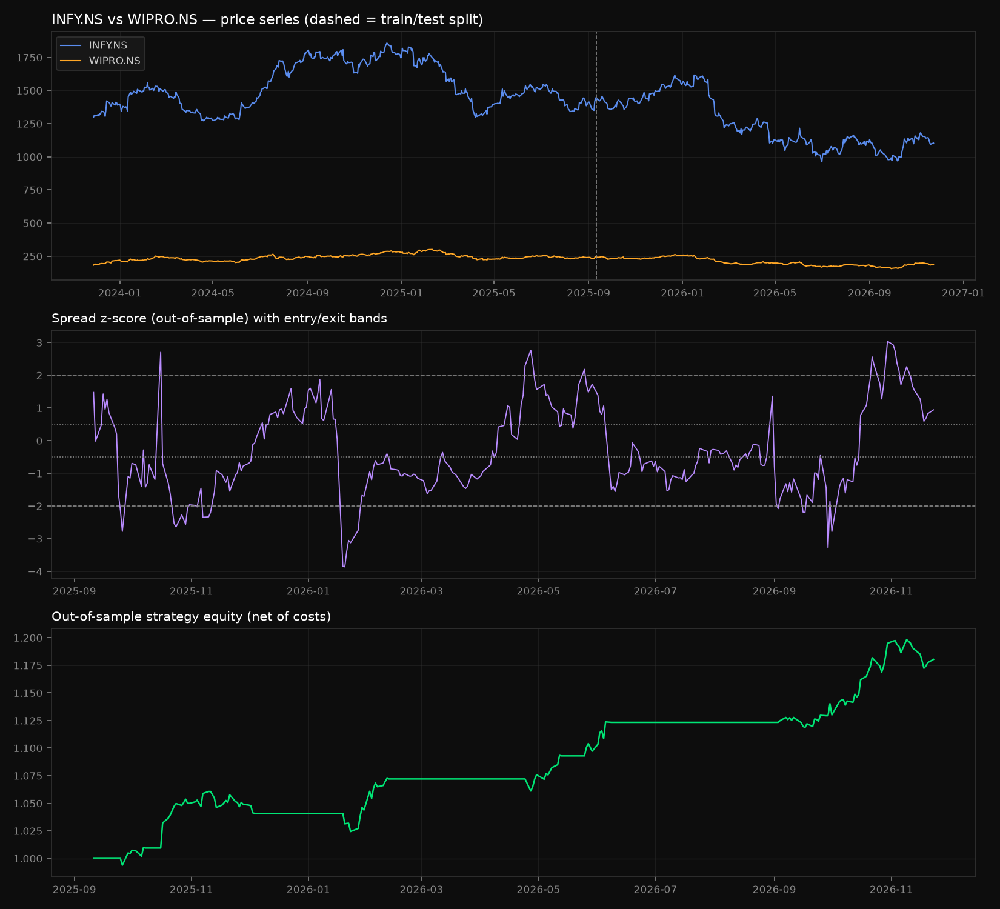

---

### HCLTECH.NS / TECHM.NS

- **Latest prices:** HCLTECH.NS ₹1,364.30 · TECHM.NS ₹1,777.50
- **Hedge ratio (train-fitted):** 0.9277
- **Cointegration (train):** FAIL at 5% — ADF -2.03, p=0.2724
- **Persistence:** passed 5% in 0 of 104 real-data runs (strict tier: 0/104)
- **Spread half-life:** 31.3 days
- **Current z-score:** +1.54
- **Signal today:** watch (approaching band)
- ⚠️ _Pair did not cointegrate on training data. Any signal here is not statistically justified — observation only._

**Out-of-sample backtest** (beta frozen from train window):

| Metric | Value |
|---|---|
| Sharpe | -0.03 |
| Sortino | -0.03 |
| Annualised return | -0.53% |
| Annualised vol | 7.60% |
| Max drawdown | -8.34% |
| Round-trip trades | 5 |

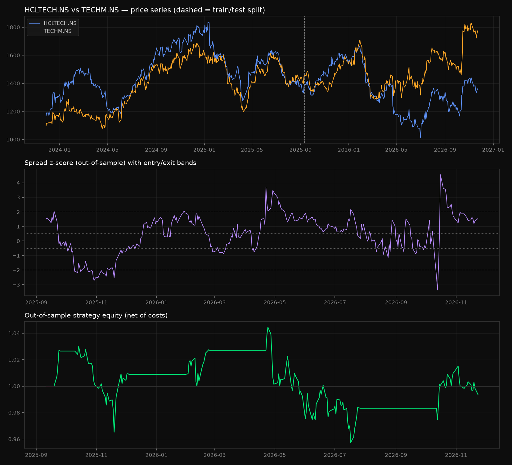

---

### ACC.NS / AMBUJACEM.NS

- **Latest prices:** ACC.NS ₹1,255.80 · AMBUJACEM.NS ₹391.95
- **Hedge ratio (train-fitted):** 0.1251
- **Cointegration (train):** FAIL at 5% — ADF -2.55, p=0.1031
- **Persistence:** passed 5% in 0 of 104 real-data runs (strict tier: 0/104)
- **Spread half-life:** 26.5 days
- **Current z-score:** +0.62
- **Signal today:** watch (approaching band)
- ⚠️ _Pair did not cointegrate on training data. Any signal here is not statistically justified — observation only._

**Out-of-sample backtest** (beta frozen from train window):

| Metric | Value |
|---|---|
| Sharpe | -0.20 |
| Sortino | -0.16 |
| Annualised return | -1.82% |
| Annualised vol | 7.75% |
| Max drawdown | -8.36% |
| Round-trip trades | 4 |

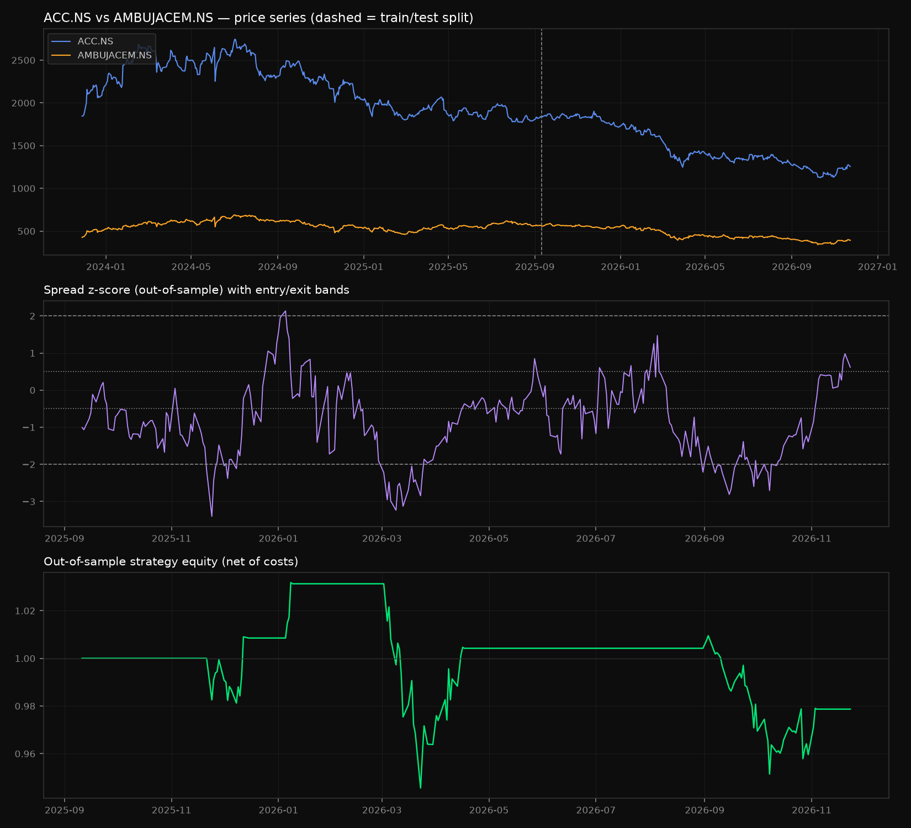

---

### ULTRACEMCO.NS / SHREECEM.NS

- **Latest prices:** ULTRACEMCO.NS ₹12,650.00 · SHREECEM.NS ₹25,150.00
- **Hedge ratio (train-fitted):** 1.2942
- **Cointegration (train):** FAIL at 5% — ADF -2.06, p=0.2588
- **Persistence:** passed 5% in 0 of 104 real-data runs (strict tier: 0/104)
- **Spread half-life:** 37.4 days
- **Current z-score:** +0.47
- **Signal today:** flat / no stretch
- ⚠️ _Pair did not cointegrate on training data. Any signal here is not statistically justified — observation only._

**Out-of-sample backtest** (beta frozen from train window):

| Metric | Value |
|---|---|
| Sharpe | -0.50 |
| Sortino | -0.58 |
| Annualised return | -3.38% |
| Annualised vol | 6.42% |
| Max drawdown | -6.38% |
| Round-trip trades | 5 |

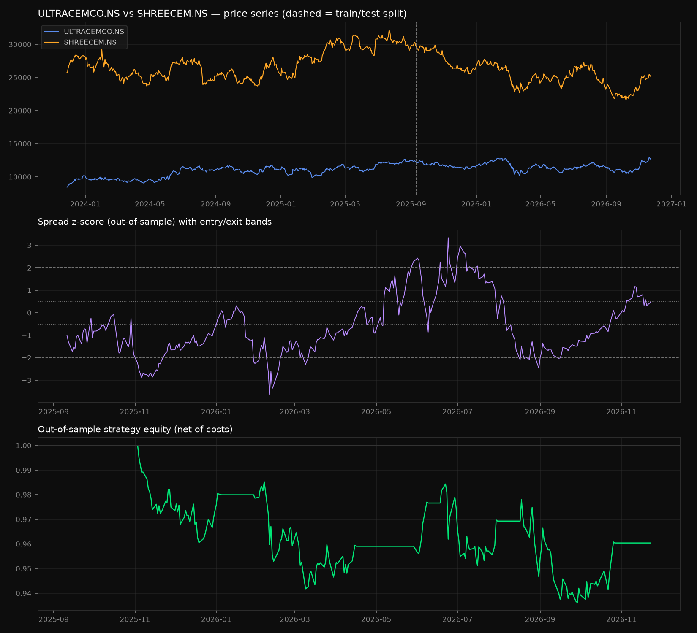

---

### IOC.NS / BPCL.NS

- **Latest prices:** IOC.NS ₹145.00 · BPCL.NS ₹305.35
- **Hedge ratio (train-fitted):** 1.3481
- **Cointegration (train):** FAIL at 5% — ADF -1.46, p=0.5526
- **Persistence:** passed 5% in 0 of 104 real-data runs (strict tier: 0/104)
- **Spread half-life:** 81.0 days
- **Current z-score:** -1.31
- **Signal today:** watch (approaching band)
- ⚠️ _Pair did not cointegrate on training data. Any signal here is not statistically justified — observation only._

**Out-of-sample backtest** (beta frozen from train window):

| Metric | Value |
|---|---|
| Sharpe | 0.57 |
| Sortino | 0.59 |
| Annualised return | 4.25% |
| Annualised vol | 7.82% |
| Max drawdown | -6.42% |
| Round-trip trades | 6 |

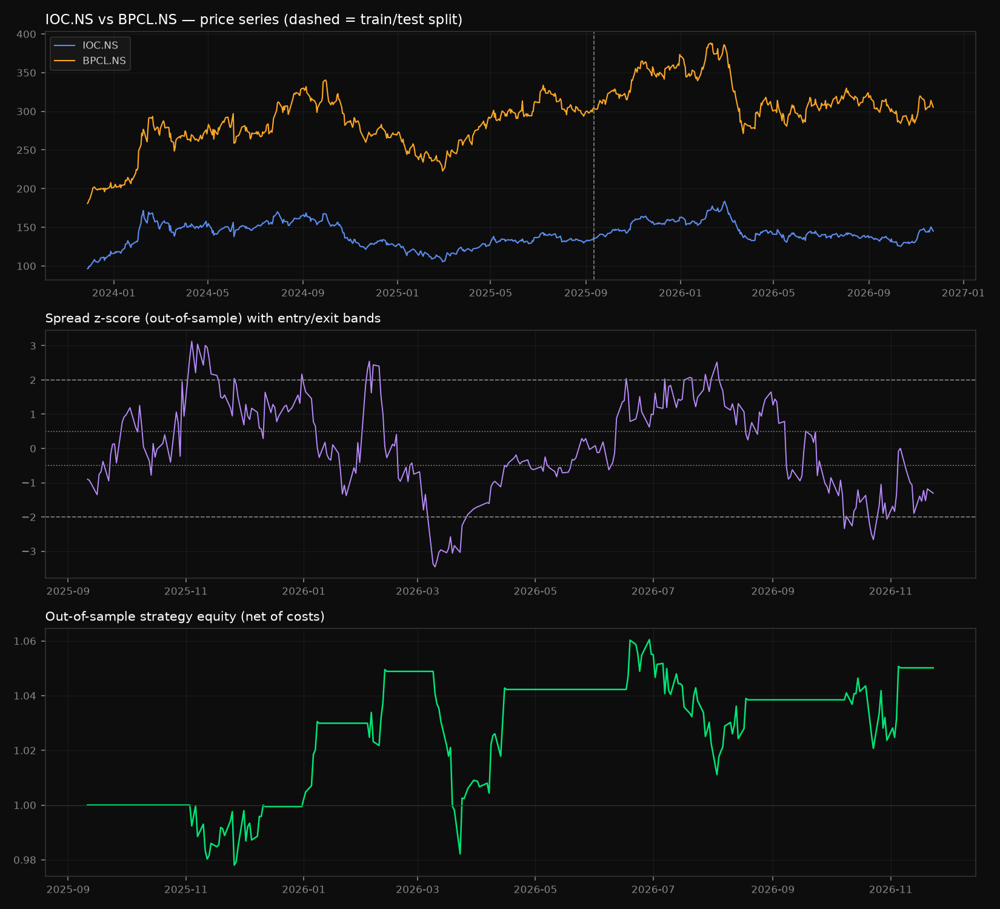

---

### BPCL.NS / HINDPETRO.NS

- **Latest prices:** BPCL.NS ₹305.35 · HINDPETRO.NS ₹385.00
- **Hedge ratio (train-fitted):** 1.2547
- **Cointegration (train):** FAIL at 5% — ADF -2.08, p=0.2516
- **Persistence:** passed 5% in 0 of 104 real-data runs (strict tier: 0/104)
- **Spread half-life:** 36.2 days
- **Current z-score:** +1.85
- **Signal today:** watch (approaching band)
- ⚠️ _Pair did not cointegrate on training data. Any signal here is not statistically justified — observation only._

**Out-of-sample backtest** (beta frozen from train window):

| Metric | Value |
|---|---|
| Sharpe | -0.41 |
| Sortino | -0.45 |
| Annualised return | -3.07% |
| Annualised vol | 7.05% |
| Max drawdown | -6.91% |
| Round-trip trades | 5 |

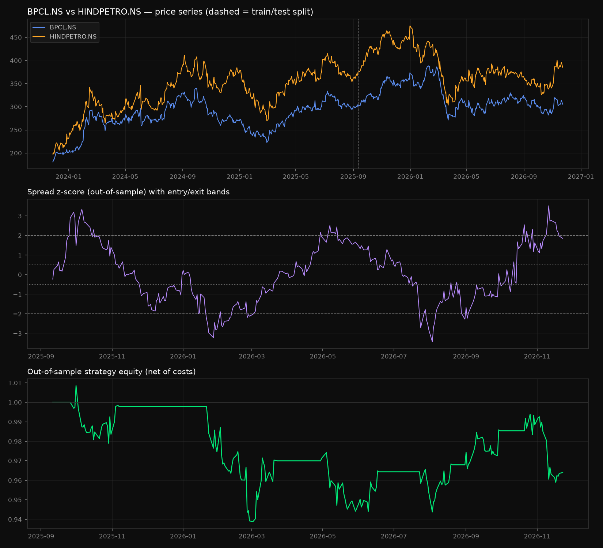

---

### ONGC.NS / COALINDIA.NS

- **Latest prices:** ONGC.NS ₹222.85 · COALINDIA.NS ₹382.00
- **Hedge ratio (train-fitted):** 1.3389
- **Cointegration (train):** PASS at 5% — ADF -3.36, p=0.0125
- **Persistence:** passed 5% in 96 of 104 real-data runs (strict tier: 1/104)
- **Spread half-life:** 13.6 days
- **Current z-score:** -1.75
- **Signal today:** watch (approaching band)

**Out-of-sample backtest** (beta frozen from train window):

| Metric | Value |
|---|---|
| Sharpe | 1.02 |
| Sortino | 0.84 |
| Annualised return | 8.20% |
| Annualised vol | 8.00% |
| Max drawdown | -6.37% |
| Round-trip trades | 6 |

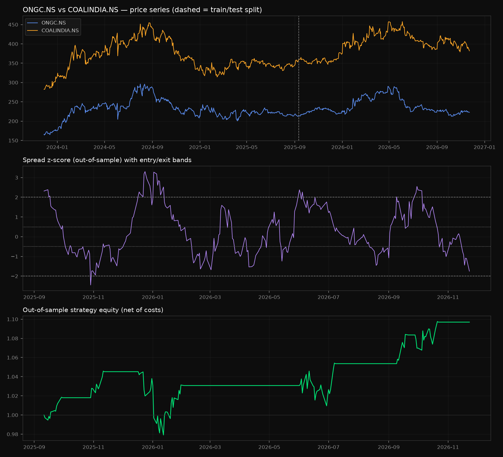

---

### NTPC.NS / POWERGRID.NS

- **Latest prices:** NTPC.NS ₹315.45 · POWERGRID.NS ₹264.85
- **Hedge ratio (train-fitted):** 0.7759
- **Cointegration (train):** FAIL at 5% — ADF -2.60, p=0.0924
- **Persistence:** passed 5% in 0 of 104 real-data runs (strict tier: 0/104)
- **Spread half-life:** 23.5 days
- **Current z-score:** +2.26
- **Signal today:** SHORT spread (short POWERGRID.NS, long NTPC.NS)
- ⚠️ _Pair did not cointegrate on training data. Any signal here is not statistically justified — observation only._

**Out-of-sample backtest** (beta frozen from train window):

| Metric | Value |
|---|---|
| Sharpe | 0.85 |
| Sortino | 0.67 |
| Annualised return | 4.72% |
| Annualised vol | 5.60% |
| Max drawdown | -5.25% |
| Round-trip trades | 7 |

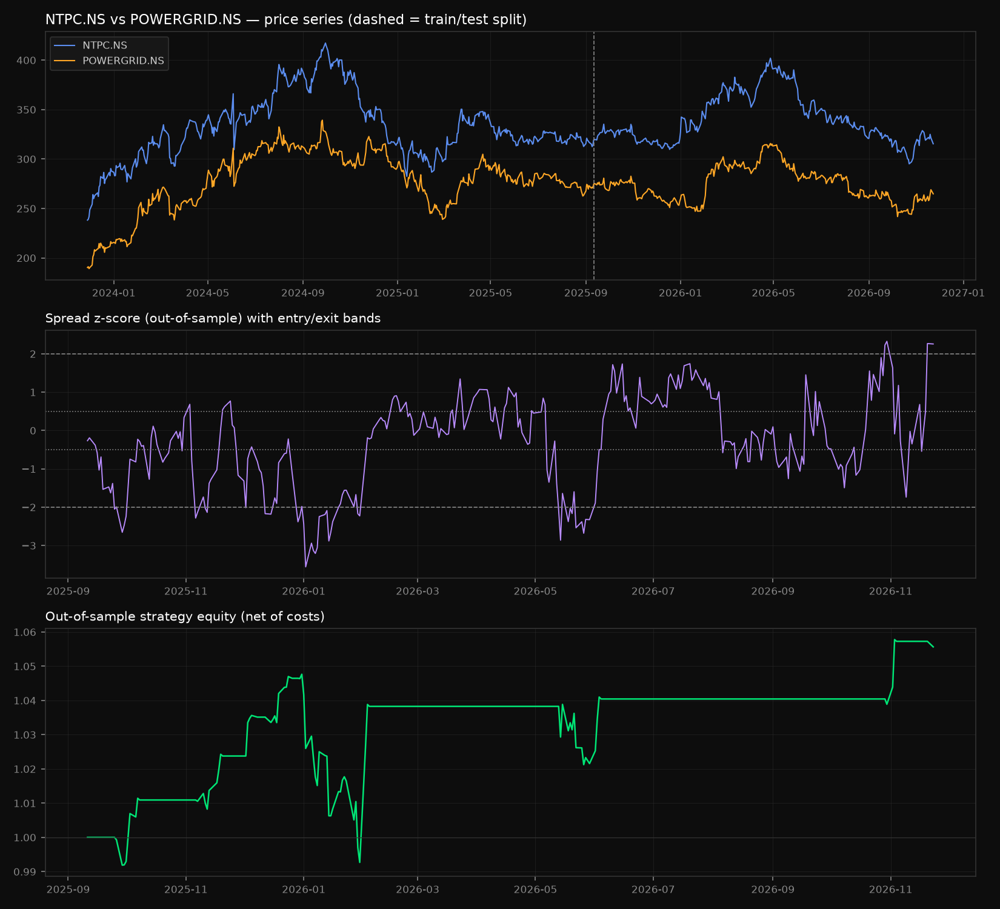

---

### BAJAJ-AUTO.NS / HEROMOTOCO.NS

- **Latest prices:** BAJAJ-AUTO.NS ₹10,643.00 · HEROMOTOCO.NS ₹5,535.00
- **Hedge ratio (train-fitted):** 0.4069
- **Cointegration (train):** FAIL at 5% — ADF -1.79, p=0.3842
- **Persistence:** passed 5% in 0 of 104 real-data runs (strict tier: 0/104)
- **Spread half-life:** 41.3 days
- **Current z-score:** +1.64
- **Signal today:** watch (approaching band)
- ⚠️ _Pair did not cointegrate on training data. Any signal here is not statistically justified — observation only._

**Out-of-sample backtest** (beta frozen from train window):

| Metric | Value |
|---|---|
| Sharpe | 0.25 |
| Sortino | 0.21 |
| Annualised return | 1.62% |
| Annualised vol | 7.59% |
| Max drawdown | -10.13% |
| Round-trip trades | 5 |

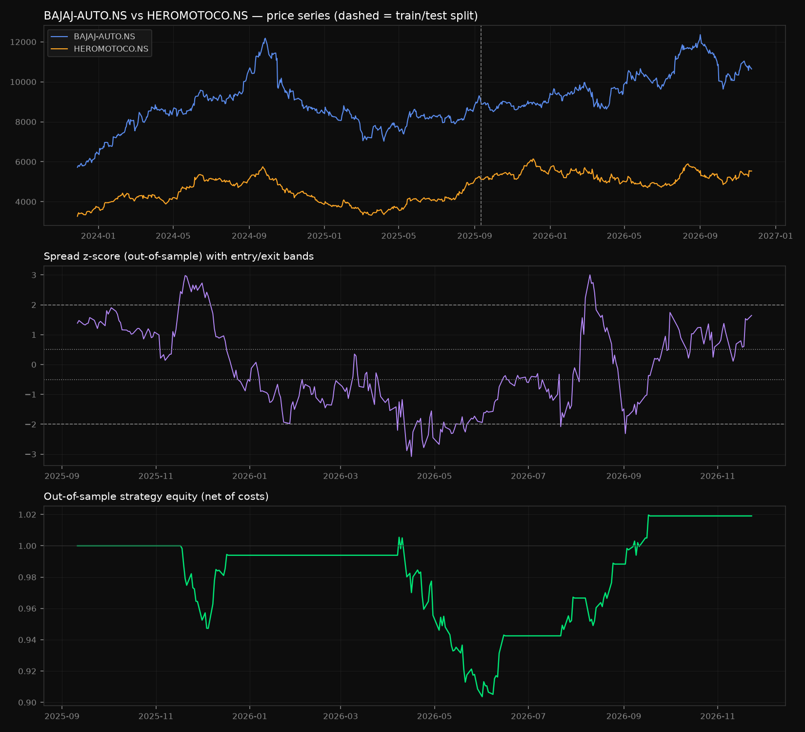

---

### TATASTEEL.NS / JSWSTEEL.NS

- **Latest prices:** TATASTEEL.NS ₹163.00 · JSWSTEEL.NS ₹1,311.90
- **Hedge ratio (train-fitted):** 2.5601
- **Cointegration (train):** FAIL at 5% — ADF -1.18, p=0.6814
- **Persistence:** passed 5% in 0 of 104 real-data runs (strict tier: 0/104)
- **Spread half-life:** 64.2 days
- **Current z-score:** +1.71
- **Signal today:** watch (approaching band)
- ⚠️ _Pair did not cointegrate on training data. Any signal here is not statistically justified — observation only._

**Out-of-sample backtest** (beta frozen from train window):

| Metric | Value |
|---|---|
| Sharpe | 0.44 |
| Sortino | 0.43 |
| Annualised return | 3.54% |
| Annualised vol | 8.89% |
| Max drawdown | -5.64% |
| Round-trip trades | 5 |

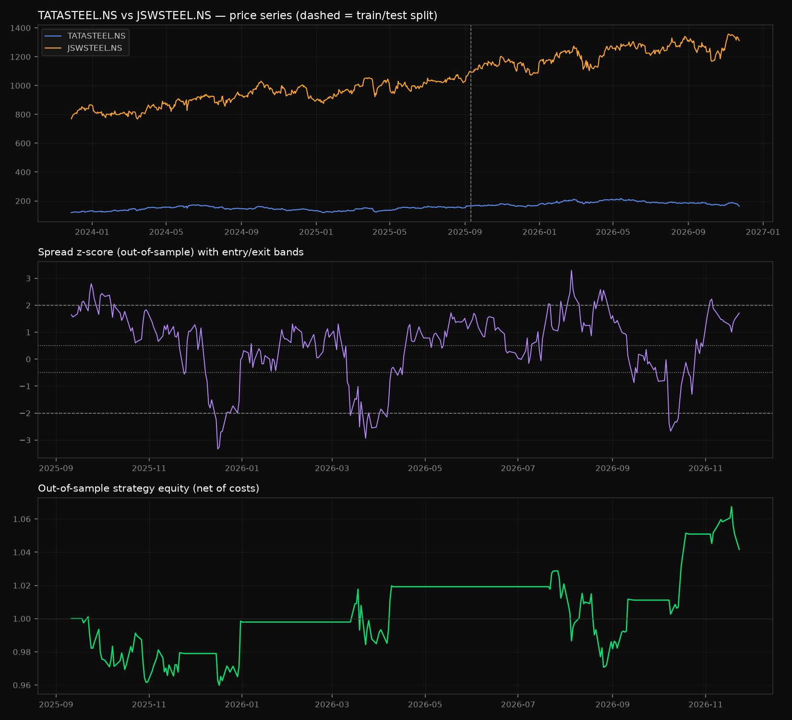

---

### SUNPHARMA.NS / CIPLA.NS

- **Latest prices:** SUNPHARMA.NS ₹1,860.00 · CIPLA.NS ₹1,399.90
- **Hedge ratio (train-fitted):** 0.4559
- **Cointegration (train):** PASS at 5% — ADF -2.87, p=0.0489
- **Persistence:** passed 5% in 93 of 104 real-data runs (strict tier: 5/104)
- **Spread half-life:** 14.3 days
- **Current z-score:** +0.67
- **Signal today:** watch (approaching band)

**Out-of-sample backtest** (beta frozen from train window):

| Metric | Value |
|---|---|
| Sharpe | 0.33 |
| Sortino | 0.33 |
| Annualised return | 2.15% |
| Annualised vol | 7.15% |
| Max drawdown | -10.20% |
| Round-trip trades | 5 |

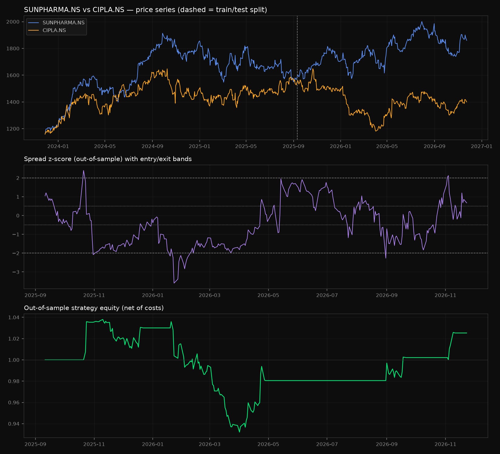

---

_Generated 2026-11-25 · pairs mean-reversion scanner · out-of-sample backtest · multiple-testing-aware · not investment advice._
