# Indian Pairs-Trading Scanner — 2026-11-26

> **What this is:** a market-neutral *pairs mean-reversion* scanner. It flags when two related NSE stocks have drifted apart far enough that their historical relationship signals a possible convergence trade. It does **not** forecast growth, rank "best" stocks, or predict company performance. A signal means the *spread between two stocks* is stretched — nothing about either stock being a good investment. Not investment advice; do your own research.

## Methodology (fixed in advance)

- **Universe:** 16 declared sector-mate pairs. Parameters (3y window, 60/40 train-test, z-entry 2.0, z-exit 0.5, 5 bps costs) are pre-registered; changes are logged in the README changelog *before* looking at results.
- **Multiple testing:** at the 5% level across 16 pairs, **≈0.8 false positives per run are expected by chance alone** even if nothing truly cointegrates. A single-day pass is a candidate, not a discovery.
- **Strict tier:** Bonferroni-corrected threshold p < 0.0031 (marked ✓✓).
- **Evidence = persistence:** the Persistence column counts how often each pair has passed the 5% test across all *real-data* daily runs recorded in `reports/history.csv`. Pairs deserve attention only when they pass persistently.

## Summary

| Pair | p-value | Coint. | Persistence | Current z | Signal | OOS Sharpe |
|---|---|---|---|---|---|---|
| HDFCBANK.NS/ICICIBANK.NS | 0.0162 | ✓ | 8/87 | +0.92 | watch | 0.17 |
| AXISBANK.NS/ICICIBANK.NS | 0.5812 | ✗ | 0/105 | +1.99 | watch | 0.07 |
| KOTAKBANK.NS/HDFCBANK.NS | 0.1849 | ✗ | 0/105 | -0.79 | watch | 1.47 |
| SBIN.NS/BANKBARODA.NS | 0.1056 | ✗ | 0/105 | +1.30 | watch | 0.24 |
| TCS.NS/INFY.NS | 0.6116 | ✗ | 0/105 | -1.23 | watch | 1.84 |
| INFY.NS/WIPRO.NS | 0.0547 | ✗ | 0/105 | +0.74 | watch | 2.42 |
| HCLTECH.NS/TECHM.NS | 0.2591 | ✗ | 0/105 | +1.64 | watch | -0.09 |
| ACC.NS/AMBUJACEM.NS | 0.0939 | ✗ | 0/105 | +0.60 | watch | -0.20 |
| ULTRACEMCO.NS/SHREECEM.NS | 0.2586 | ✗ | 0/105 | +0.29 | flat / no stretch | -0.50 |
| IOC.NS/BPCL.NS | 0.5360 | ✗ | 0/105 | -1.16 | watch | 0.57 |
| BPCL.NS/HINDPETRO.NS | 0.2534 | ✗ | 0/105 | +1.78 | watch | -0.41 |
| ONGC.NS/COALINDIA.NS | 0.0122 | ✓ | 97/105 | -1.36 | watch | 1.05 |
| NTPC.NS/POWERGRID.NS | 0.0915 | ✗ | 0/105 | +2.11 | SHORT spread | 0.85 |
| BAJAJ-AUTO.NS/HEROMOTOCO.NS | 0.3942 | ✗ | 0/105 | +2.09 | SHORT spread | 0.25 |
| TATASTEEL.NS/JSWSTEEL.NS | 0.6745 | ✗ | 0/105 | +1.68 | watch | 0.42 |
| SUNPHARMA.NS/CIPLA.NS | 0.0442 | ✓ | 94/105 | +1.32 | watch | 0.33 |

_Legend: ✓✓ passes strict Bonferroni tier · ✓ passes 5% only · ✗ fails. Persistence = 5%-passes / real-data runs recorded. \*no real-data history yet._

---

### HDFCBANK.NS / ICICIBANK.NS

- **Latest prices:** HDFCBANK.NS ₹846.20 · ICICIBANK.NS ₹1,640.00
- **Hedge ratio (train-fitted):** 1.4880
- **Cointegration (train):** PASS at 5% — ADF -3.27, p=0.0162
- **Persistence:** passed 5% in 8 of 87 real-data runs (strict tier: 0/87)
- **Spread half-life:** 18.7 days
- **Current z-score:** +0.92
- **Signal today:** watch (approaching band)

**Out-of-sample backtest** (beta frozen from train window):

| Metric | Value |
|---|---|
| Sharpe | 0.17 |
| Sortino | 0.17 |
| Annualised return | 0.83% |
| Annualised vol | 6.10% |
| Max drawdown | -4.30% |
| Round-trip trades | 5 |

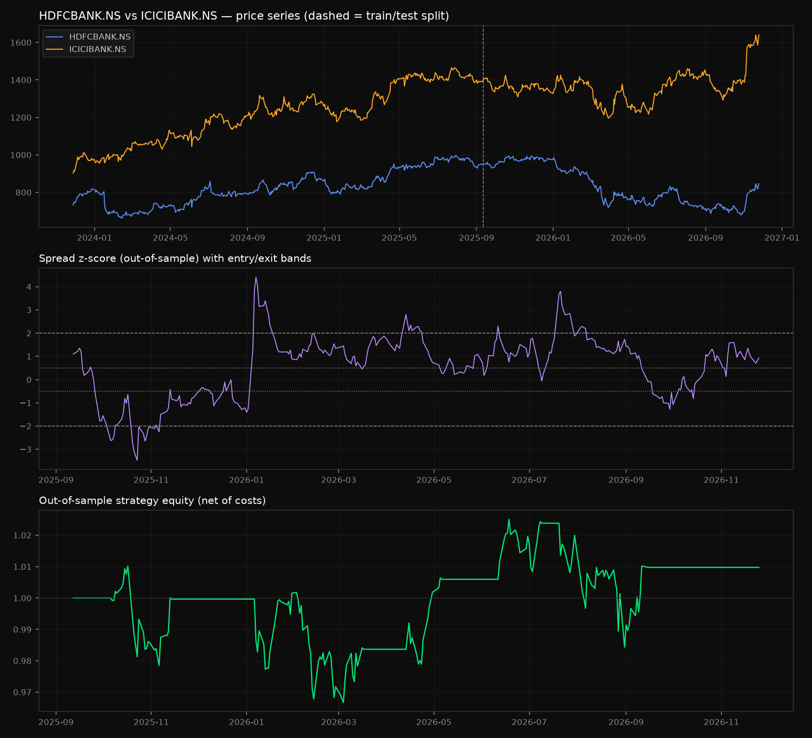

---

### AXISBANK.NS / ICICIBANK.NS

- **Latest prices:** AXISBANK.NS ₹1,418.10 · ICICIBANK.NS ₹1,640.00
- **Hedge ratio (train-fitted):** 0.4462
- **Cointegration (train):** FAIL at 5% — ADF -1.40, p=0.5812
- **Persistence:** passed 5% in 0 of 105 real-data runs (strict tier: 0/105)
- **Spread half-life:** 131.1 days
- **Current z-score:** +1.99
- **Signal today:** watch (approaching band)
- ⚠️ _Pair did not cointegrate on training data. Any signal here is not statistically justified — observation only._

**Out-of-sample backtest** (beta frozen from train window):

| Metric | Value |
|---|---|
| Sharpe | 0.07 |
| Sortino | 0.08 |
| Annualised return | 0.24% |
| Annualised vol | 9.46% |
| Max drawdown | -9.48% |
| Round-trip trades | 6 |

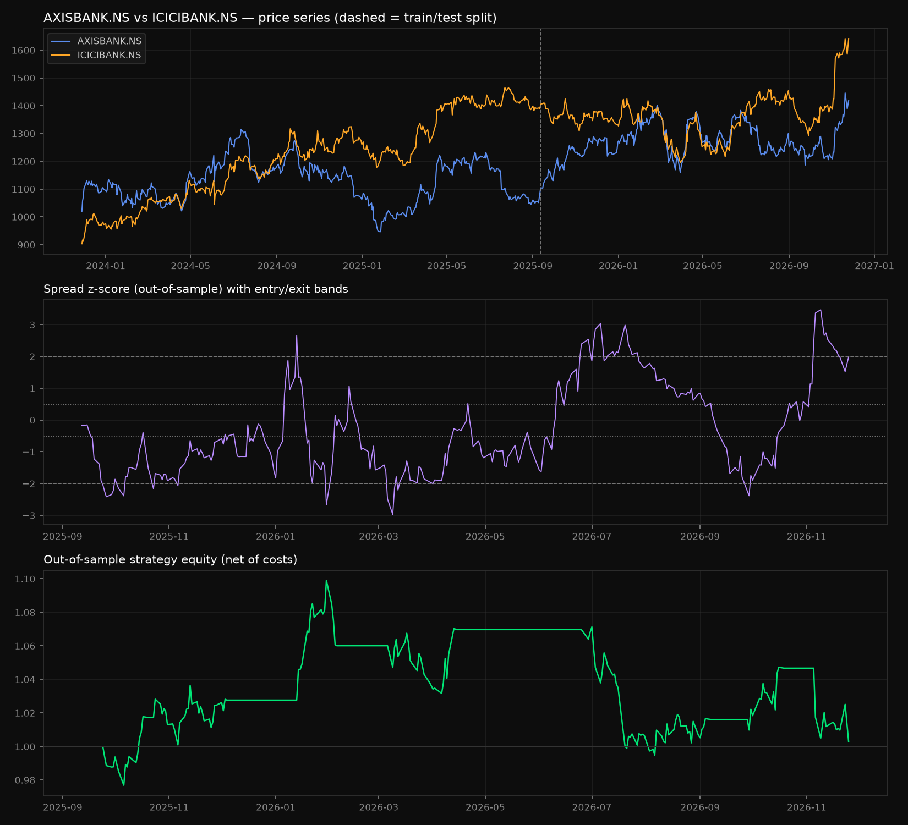

---

### KOTAKBANK.NS / HDFCBANK.NS

- **Latest prices:** KOTAKBANK.NS ₹509.00 · HDFCBANK.NS ₹846.20
- **Hedge ratio (train-fitted):** 2.2371
- **Cointegration (train):** FAIL at 5% — ADF -2.26, p=0.1849
- **Persistence:** passed 5% in 0 of 105 real-data runs (strict tier: 0/105)
- **Spread half-life:** 28.0 days
- **Current z-score:** -0.79
- **Signal today:** watch (approaching band)
- ⚠️ _Pair did not cointegrate on training data. Any signal here is not statistically justified — observation only._

**Out-of-sample backtest** (beta frozen from train window):

| Metric | Value |
|---|---|
| Sharpe | 1.47 |
| Sortino | 1.58 |
| Annualised return | 9.22% |
| Annualised vol | 6.14% |
| Max drawdown | -2.85% |
| Round-trip trades | 5 |

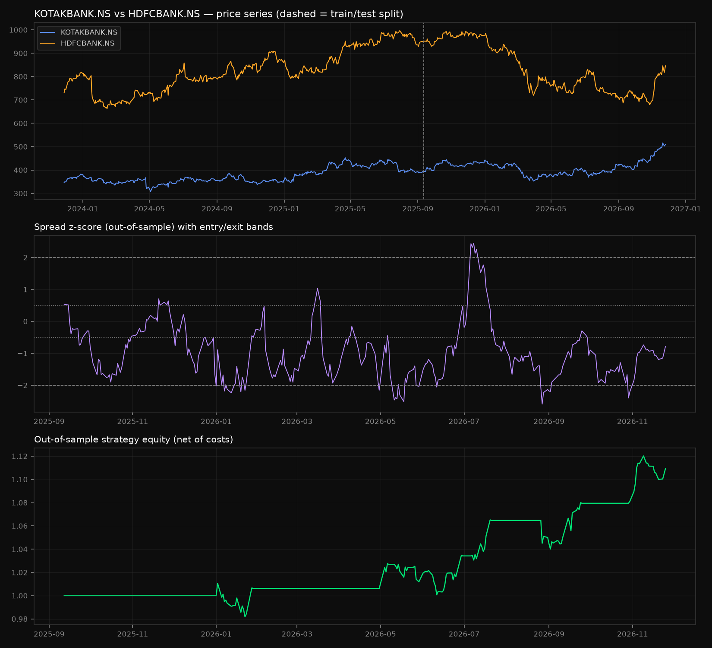

---

### SBIN.NS / BANKBARODA.NS

- **Latest prices:** SBIN.NS ₹1,138.15 · BANKBARODA.NS ₹276.43
- **Hedge ratio (train-fitted):** 0.1658
- **Cointegration (train):** FAIL at 5% — ADF -2.54, p=0.1056
- **Persistence:** passed 5% in 0 of 105 real-data runs (strict tier: 0/105)
- **Spread half-life:** 18.9 days
- **Current z-score:** +1.30
- **Signal today:** watch (approaching band)
- ⚠️ _Pair did not cointegrate on training data. Any signal here is not statistically justified — observation only._

**Out-of-sample backtest** (beta frozen from train window):

| Metric | Value |
|---|---|
| Sharpe | 0.24 |
| Sortino | 0.25 |
| Annualised return | 2.06% |
| Annualised vol | 11.10% |
| Max drawdown | -6.58% |
| Round-trip trades | 6 |

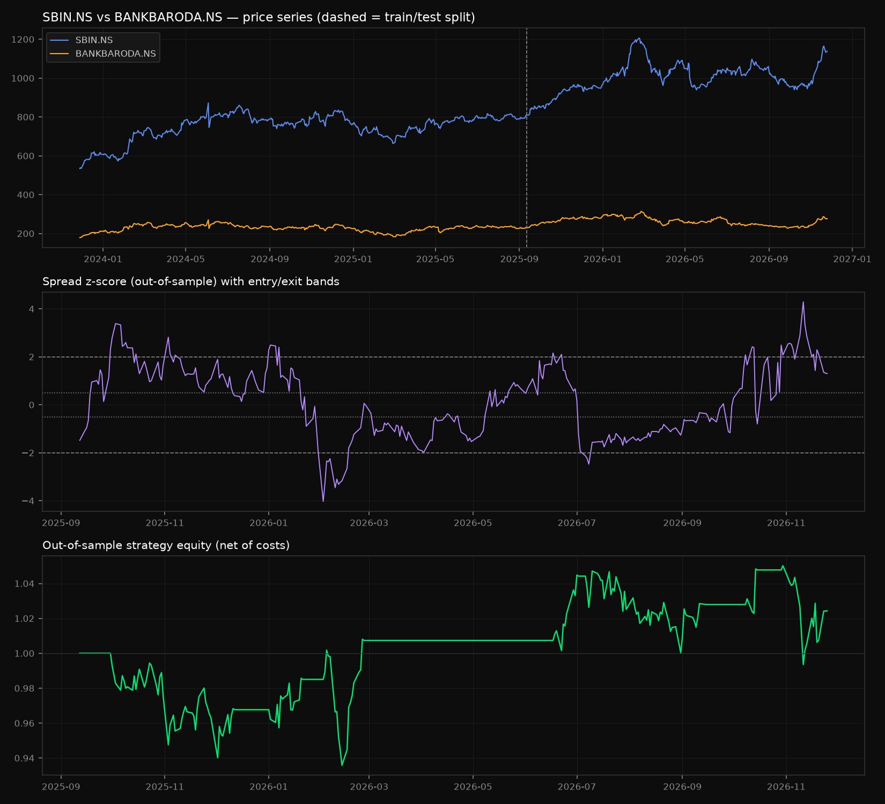

---

### TCS.NS / INFY.NS

- **Latest prices:** TCS.NS ₹2,517.30 · INFY.NS ₹1,130.00
- **Hedge ratio (train-fitted):** 0.3618
- **Cointegration (train):** FAIL at 5% — ADF -1.34, p=0.6116
- **Persistence:** passed 5% in 0 of 105 real-data runs (strict tier: 0/105)
- **Spread half-life:** 67.1 days
- **Current z-score:** -1.23
- **Signal today:** watch (approaching band)
- ⚠️ _Pair did not cointegrate on training data. Any signal here is not statistically justified — observation only._

**Out-of-sample backtest** (beta frozen from train window):

| Metric | Value |
|---|---|
| Sharpe | 1.84 |
| Sortino | 2.26 |
| Annualised return | 9.65% |
| Annualised vol | 5.09% |
| Max drawdown | -2.87% |
| Round-trip trades | 7 |

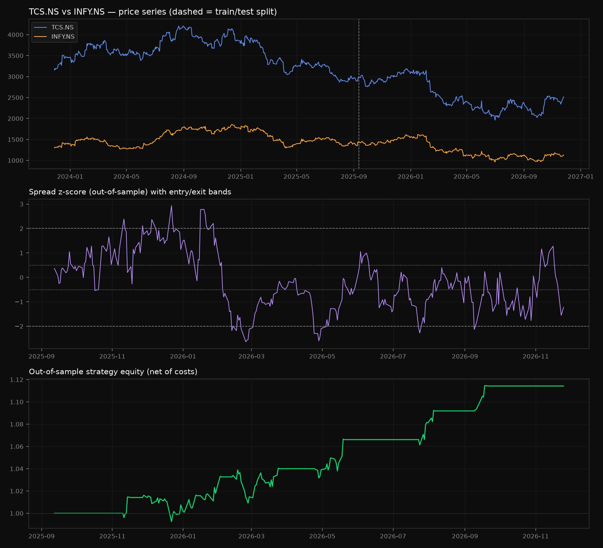

---

### INFY.NS / WIPRO.NS

- **Latest prices:** INFY.NS ₹1,130.00 · WIPRO.NS ₹189.05
- **Hedge ratio (train-fitted):** 0.1112
- **Cointegration (train):** FAIL at 5% — ADF -2.83, p=0.0547
- **Persistence:** passed 5% in 0 of 105 real-data runs (strict tier: 0/105)
- **Spread half-life:** 22.8 days
- **Current z-score:** +0.74
- **Signal today:** watch (approaching band)
- ⚠️ _Pair did not cointegrate on training data. Any signal here is not statistically justified — observation only._

**Out-of-sample backtest** (beta frozen from train window):

| Metric | Value |
|---|---|
| Sharpe | 2.42 |
| Sortino | 3.50 |
| Annualised return | 14.88% |
| Annualised vol | 5.79% |
| Max drawdown | -3.43% |
| Round-trip trades | 6 |

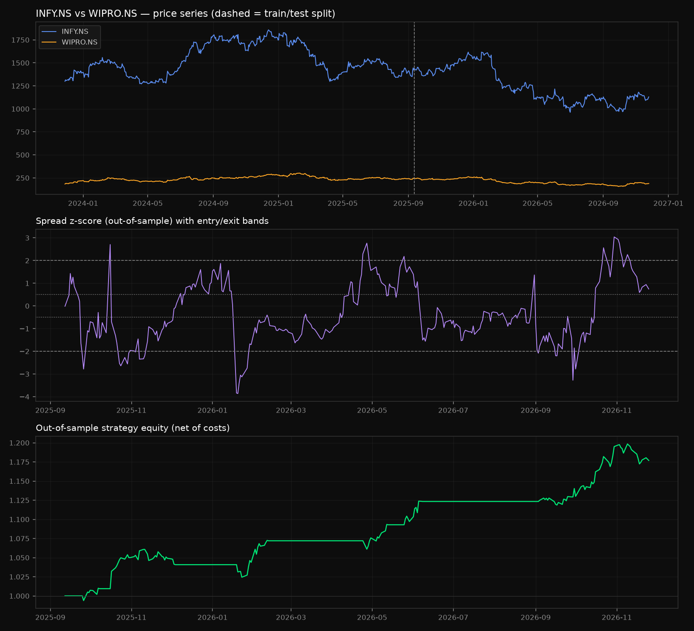

---

### HCLTECH.NS / TECHM.NS

- **Latest prices:** HCLTECH.NS ₹1,380.00 · TECHM.NS ₹1,801.20
- **Hedge ratio (train-fitted):** 0.9264
- **Cointegration (train):** FAIL at 5% — ADF -2.06, p=0.2591
- **Persistence:** passed 5% in 0 of 105 real-data runs (strict tier: 0/105)
- **Spread half-life:** 31.0 days
- **Current z-score:** +1.64
- **Signal today:** watch (approaching band)
- ⚠️ _Pair did not cointegrate on training data. Any signal here is not statistically justified — observation only._

**Out-of-sample backtest** (beta frozen from train window):

| Metric | Value |
|---|---|
| Sharpe | -0.09 |
| Sortino | -0.10 |
| Annualised return | -0.98% |
| Annualised vol | 7.60% |
| Max drawdown | -8.34% |
| Round-trip trades | 5 |

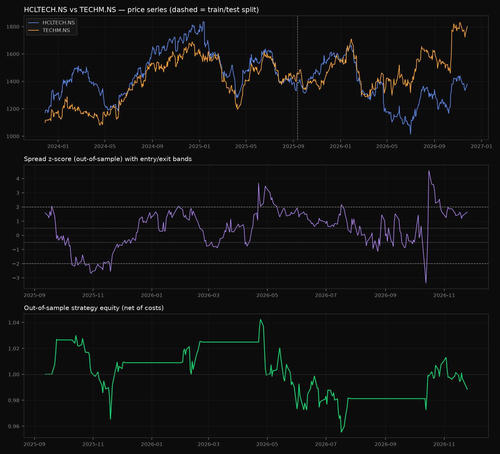

---

### ACC.NS / AMBUJACEM.NS

- **Latest prices:** ACC.NS ₹1,262.30 · AMBUJACEM.NS ₹392.00
- **Hedge ratio (train-fitted):** 0.1248
- **Cointegration (train):** FAIL at 5% — ADF -2.60, p=0.0939
- **Persistence:** passed 5% in 0 of 105 real-data runs (strict tier: 0/105)
- **Spread half-life:** 26.1 days
- **Current z-score:** +0.60
- **Signal today:** watch (approaching band)
- ⚠️ _Pair did not cointegrate on training data. Any signal here is not statistically justified — observation only._

**Out-of-sample backtest** (beta frozen from train window):

| Metric | Value |
|---|---|
| Sharpe | -0.20 |
| Sortino | -0.16 |
| Annualised return | -1.82% |
| Annualised vol | 7.75% |
| Max drawdown | -8.36% |
| Round-trip trades | 4 |

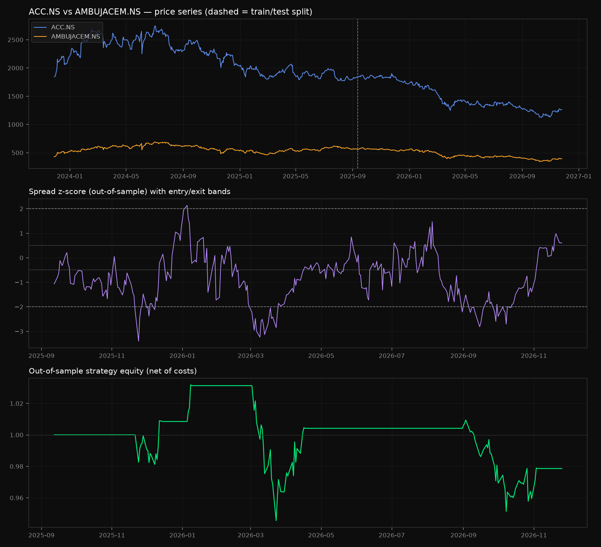

---

### ULTRACEMCO.NS / SHREECEM.NS

- **Latest prices:** ULTRACEMCO.NS ₹12,800.00 · SHREECEM.NS ₹25,245.00
- **Hedge ratio (train-fitted):** 1.2966
- **Cointegration (train):** FAIL at 5% — ADF -2.07, p=0.2586
- **Persistence:** passed 5% in 0 of 105 real-data runs (strict tier: 0/105)
- **Spread half-life:** 37.4 days
- **Current z-score:** +0.29
- **Signal today:** flat / no stretch
- ⚠️ _Pair did not cointegrate on training data. Any signal here is not statistically justified — observation only._

**Out-of-sample backtest** (beta frozen from train window):

| Metric | Value |
|---|---|
| Sharpe | -0.50 |
| Sortino | -0.58 |
| Annualised return | -3.40% |
| Annualised vol | 6.46% |
| Max drawdown | -6.40% |
| Round-trip trades | 5 |

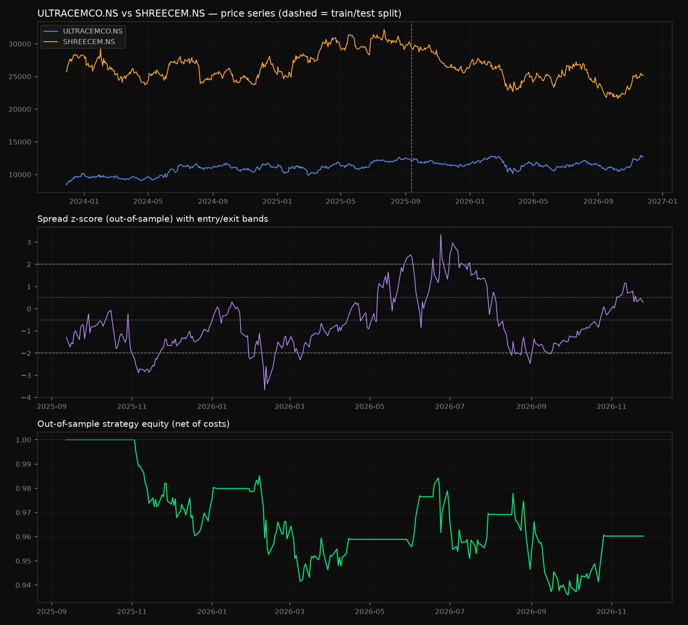

---

### IOC.NS / BPCL.NS

- **Latest prices:** IOC.NS ₹147.79 · BPCL.NS ₹309.95
- **Hedge ratio (train-fitted):** 1.3480
- **Cointegration (train):** FAIL at 5% — ADF -1.50, p=0.5360
- **Persistence:** passed 5% in 0 of 105 real-data runs (strict tier: 0/105)
- **Spread half-life:** 79.4 days
- **Current z-score:** -1.16
- **Signal today:** watch (approaching band)
- ⚠️ _Pair did not cointegrate on training data. Any signal here is not statistically justified — observation only._

**Out-of-sample backtest** (beta frozen from train window):

| Metric | Value |
|---|---|
| Sharpe | 0.57 |
| Sortino | 0.59 |
| Annualised return | 4.29% |
| Annualised vol | 7.88% |
| Max drawdown | -6.47% |
| Round-trip trades | 6 |

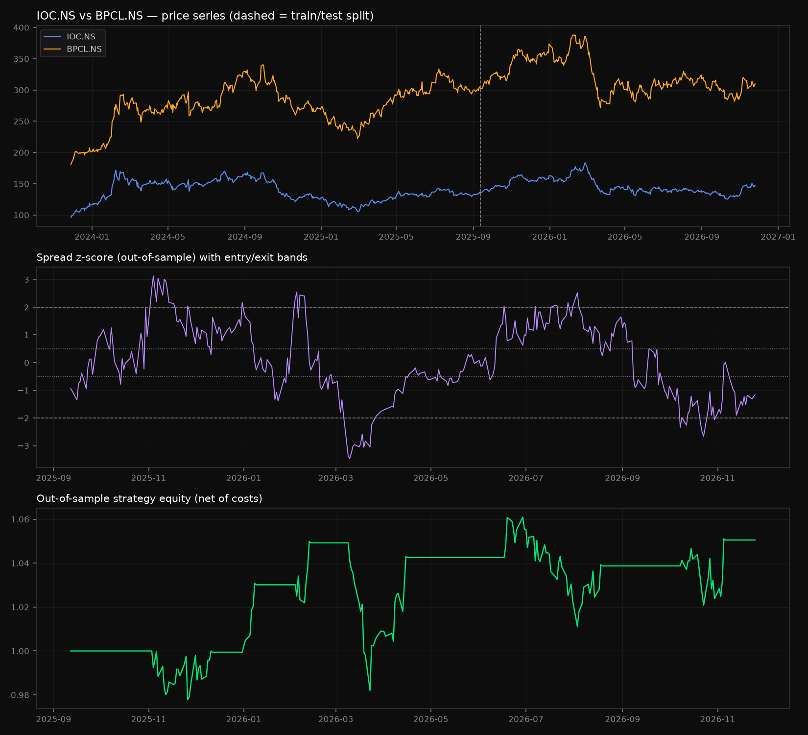

---

### BPCL.NS / HINDPETRO.NS

- **Latest prices:** BPCL.NS ₹309.95 · HINDPETRO.NS ₹391.00
- **Hedge ratio (train-fitted):** 1.2551
- **Cointegration (train):** FAIL at 5% — ADF -2.08, p=0.2534
- **Persistence:** passed 5% in 0 of 105 real-data runs (strict tier: 0/105)
- **Spread half-life:** 36.3 days
- **Current z-score:** +1.78
- **Signal today:** watch (approaching band)
- ⚠️ _Pair did not cointegrate on training data. Any signal here is not statistically justified — observation only._

**Out-of-sample backtest** (beta frozen from train window):

| Metric | Value |
|---|---|
| Sharpe | -0.41 |
| Sortino | -0.45 |
| Annualised return | -3.10% |
| Annualised vol | 7.06% |
| Max drawdown | -6.92% |
| Round-trip trades | 5 |

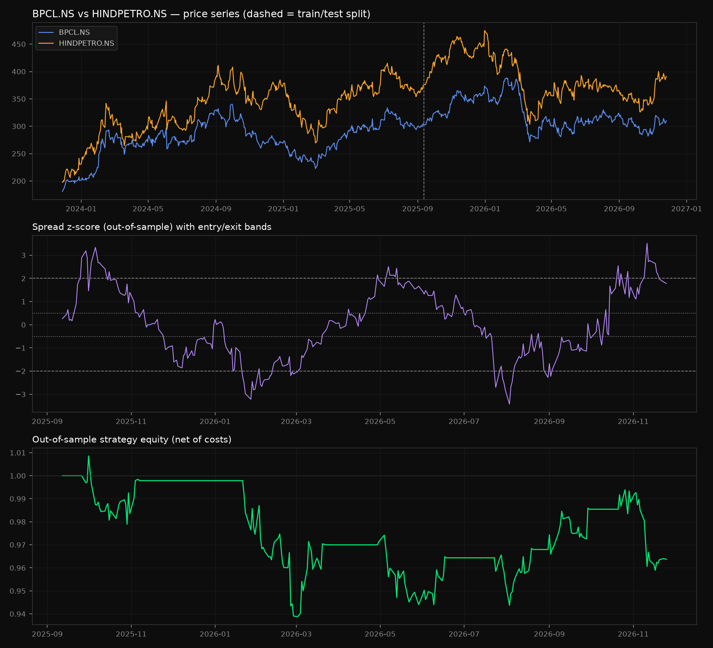

---

### ONGC.NS / COALINDIA.NS

- **Latest prices:** ONGC.NS ₹222.00 · COALINDIA.NS ₹385.00
- **Hedge ratio (train-fitted):** 1.3382
- **Cointegration (train):** PASS at 5% — ADF -3.37, p=0.0122
- **Persistence:** passed 5% in 97 of 105 real-data runs (strict tier: 1/105)
- **Spread half-life:** 13.6 days
- **Current z-score:** -1.36
- **Signal today:** watch (approaching band)

**Out-of-sample backtest** (beta frozen from train window):

| Metric | Value |
|---|---|
| Sharpe | 1.05 |
| Sortino | 0.85 |
| Annualised return | 8.41% |
| Annualised vol | 8.00% |
| Max drawdown | -6.37% |
| Round-trip trades | 6 |

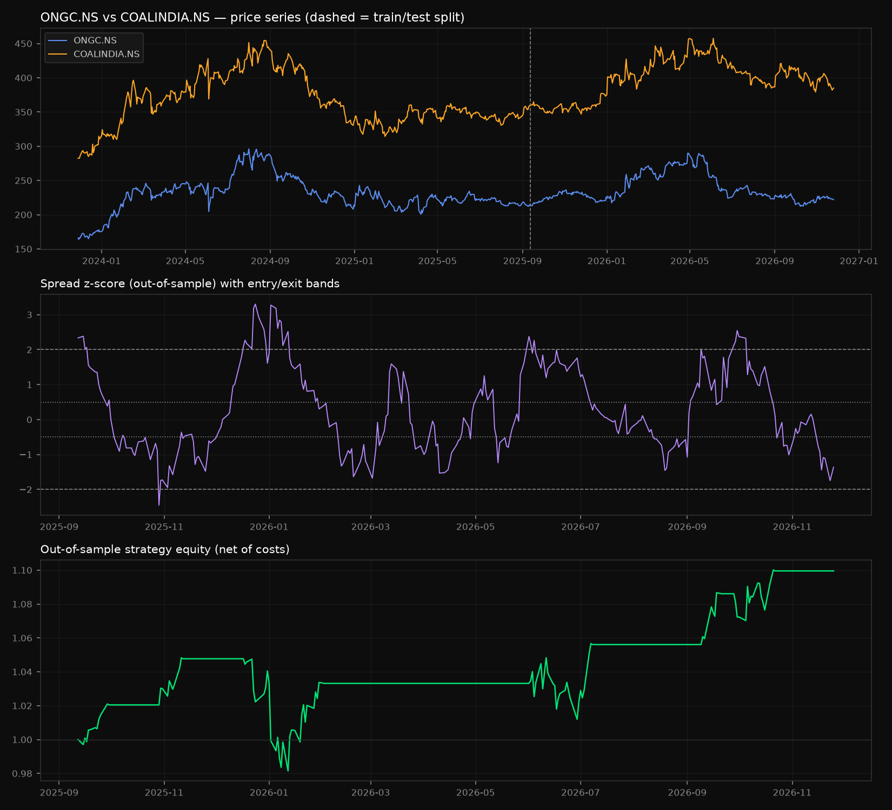

---

### NTPC.NS / POWERGRID.NS

- **Latest prices:** NTPC.NS ₹318.00 · POWERGRID.NS ₹266.75
- **Hedge ratio (train-fitted):** 0.7758
- **Cointegration (train):** FAIL at 5% — ADF -2.61, p=0.0915
- **Persistence:** passed 5% in 0 of 105 real-data runs (strict tier: 0/105)
- **Spread half-life:** 23.5 days
- **Current z-score:** +2.11
- **Signal today:** SHORT spread (short POWERGRID.NS, long NTPC.NS)
- ⚠️ _Pair did not cointegrate on training data. Any signal here is not statistically justified — observation only._

**Out-of-sample backtest** (beta frozen from train window):

| Metric | Value |
|---|---|
| Sharpe | 0.85 |
| Sortino | 0.67 |
| Annualised return | 4.72% |
| Annualised vol | 5.59% |
| Max drawdown | -5.23% |
| Round-trip trades | 7 |

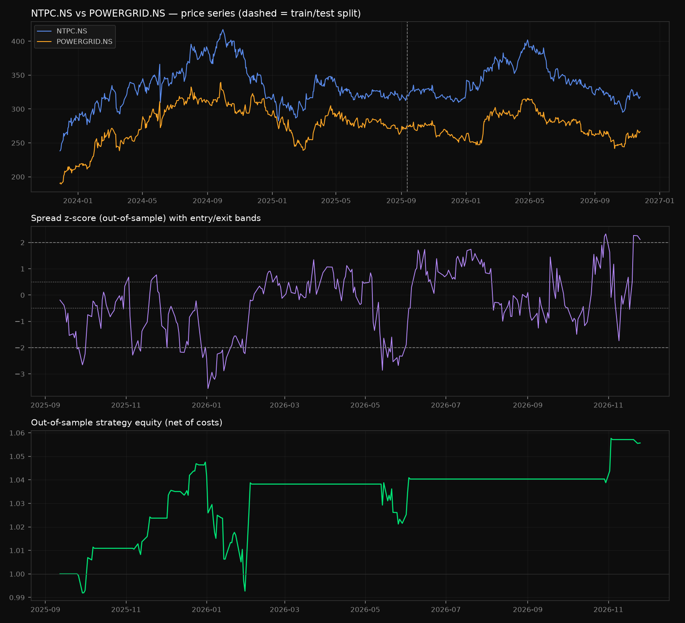

---

### BAJAJ-AUTO.NS / HEROMOTOCO.NS

- **Latest prices:** BAJAJ-AUTO.NS ₹10,868.00 · HEROMOTOCO.NS ₹5,751.50
- **Hedge ratio (train-fitted):** 0.4074
- **Cointegration (train):** FAIL at 5% — ADF -1.77, p=0.3942
- **Persistence:** passed 5% in 0 of 105 real-data runs (strict tier: 0/105)
- **Spread half-life:** 41.7 days
- **Current z-score:** +2.09
- **Signal today:** SHORT spread (short HEROMOTOCO.NS, long BAJAJ-AUTO.NS)
- ⚠️ _Pair did not cointegrate on training data. Any signal here is not statistically justified — observation only._

**Out-of-sample backtest** (beta frozen from train window):

| Metric | Value |
|---|---|
| Sharpe | 0.25 |
| Sortino | 0.21 |
| Annualised return | 1.62% |
| Annualised vol | 7.63% |
| Max drawdown | -10.18% |
| Round-trip trades | 5 |

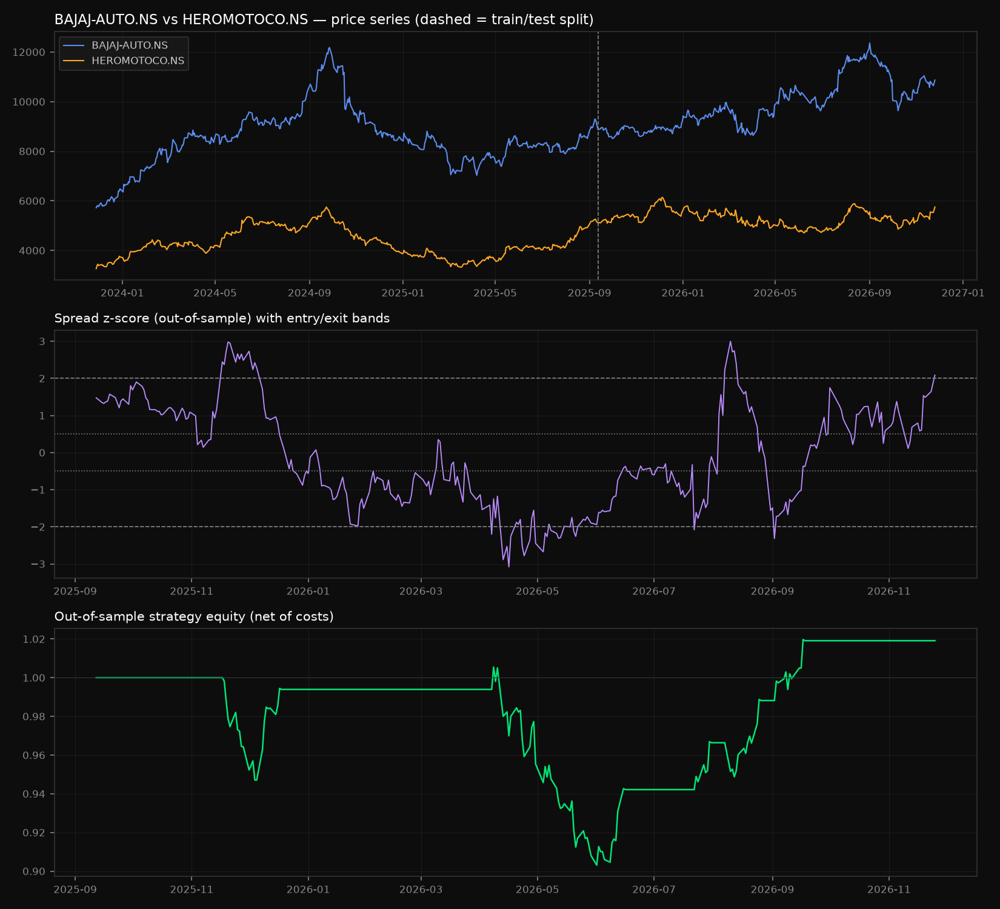

---

### TATASTEEL.NS / JSWSTEEL.NS

- **Latest prices:** TATASTEEL.NS ₹159.30 · JSWSTEEL.NS ₹1,302.50
- **Hedge ratio (train-fitted):** 2.5901
- **Cointegration (train):** FAIL at 5% — ADF -1.20, p=0.6745
- **Persistence:** passed 5% in 0 of 105 real-data runs (strict tier: 0/105)
- **Spread half-life:** 64.2 days
- **Current z-score:** +1.68
- **Signal today:** watch (approaching band)
- ⚠️ _Pair did not cointegrate on training data. Any signal here is not statistically justified — observation only._

**Out-of-sample backtest** (beta frozen from train window):

| Metric | Value |
|---|---|
| Sharpe | 0.42 |
| Sortino | 0.42 |
| Annualised return | 3.42% |
| Annualised vol | 8.83% |
| Max drawdown | -5.61% |
| Round-trip trades | 5 |

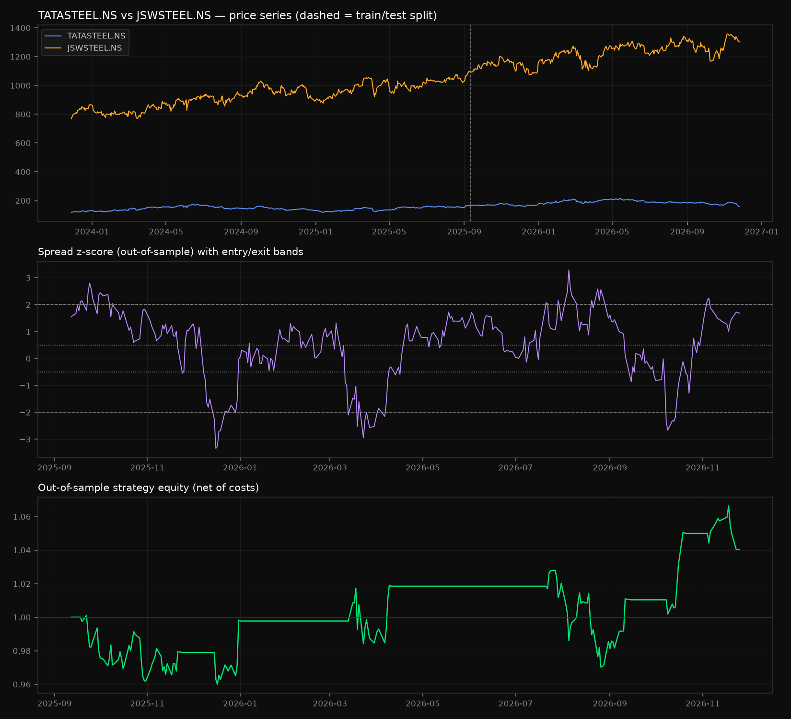

---

### SUNPHARMA.NS / CIPLA.NS

- **Latest prices:** SUNPHARMA.NS ₹1,901.00 · CIPLA.NS ₹1,433.20
- **Hedge ratio (train-fitted):** 0.4557
- **Cointegration (train):** PASS at 5% — ADF -2.91, p=0.0442
- **Persistence:** passed 5% in 94 of 105 real-data runs (strict tier: 5/105)
- **Spread half-life:** 14.2 days
- **Current z-score:** +1.32
- **Signal today:** watch (approaching band)

**Out-of-sample backtest** (beta frozen from train window):

| Metric | Value |
|---|---|
| Sharpe | 0.33 |
| Sortino | 0.33 |
| Annualised return | 2.13% |
| Annualised vol | 7.10% |
| Max drawdown | -10.13% |
| Round-trip trades | 5 |

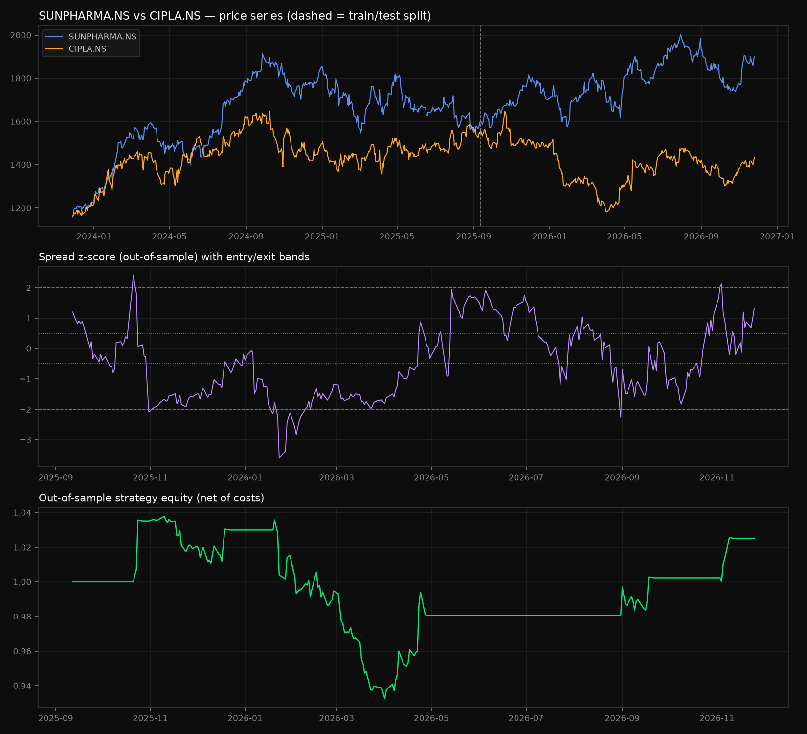

---

_Generated 2026-11-26 · pairs mean-reversion scanner · out-of-sample backtest · multiple-testing-aware · not investment advice._
