# Indian Pairs-Trading Scanner — 2026-11-27

> **What this is:** a market-neutral *pairs mean-reversion* scanner. It flags when two related NSE stocks have drifted apart far enough that their historical relationship signals a possible convergence trade. It does **not** forecast growth, rank "best" stocks, or predict company performance. A signal means the *spread between two stocks* is stretched — nothing about either stock being a good investment. Not investment advice; do your own research.

## Methodology (fixed in advance)

- **Universe:** 16 declared sector-mate pairs. Parameters (3y window, 60/40 train-test, z-entry 2.0, z-exit 0.5, 5 bps costs) are pre-registered; changes are logged in the README changelog *before* looking at results.
- **Multiple testing:** at the 5% level across 16 pairs, **≈0.8 false positives per run are expected by chance alone** even if nothing truly cointegrates. A single-day pass is a candidate, not a discovery.
- **Strict tier:** Bonferroni-corrected threshold p < 0.0031 (marked ✓✓).
- **Evidence = persistence:** the Persistence column counts how often each pair has passed the 5% test across all *real-data* daily runs recorded in `reports/history.csv`. Pairs deserve attention only when they pass persistently.

## Summary

| Pair | p-value | Coint. | Persistence | Current z | Signal | OOS Sharpe |
|---|---|---|---|---|---|---|
| HDFCBANK.NS/ICICIBANK.NS | 0.0160 | ✓ | 9/88 | -0.05 | flat / no stretch | 0.17 |
| AXISBANK.NS/ICICIBANK.NS | 0.5955 | ✗ | 0/106 | +1.61 | watch | 0.19 |
| KOTAKBANK.NS/HDFCBANK.NS | 0.1835 | ✗ | 0/106 | -0.47 | flat / no stretch | 1.56 |
| SBIN.NS/BANKBARODA.NS | 0.1061 | ✗ | 0/106 | +1.08 | watch | 0.27 |
| TCS.NS/INFY.NS | 0.6137 | ✗ | 0/106 | -0.75 | watch | 1.83 |
| INFY.NS/WIPRO.NS | 0.0484 | ✓ | 1/106 | +0.95 | watch | 2.48 |
| HCLTECH.NS/TECHM.NS | 0.2699 | ✗ | 0/106 | +1.10 | watch | 0.03 |
| ACC.NS/AMBUJACEM.NS | 0.0908 | ✗ | 0/106 | +0.54 | watch | -0.20 |
| ULTRACEMCO.NS/SHREECEM.NS | 0.2533 | ✗ | 0/106 | +0.73 | watch | -0.50 |
| IOC.NS/BPCL.NS | 0.5326 | ✗ | 0/106 | -0.85 | watch | 0.57 |
| BPCL.NS/HINDPETRO.NS | 0.2578 | ✗ | 0/106 | +1.54 | watch | -0.37 |
| ONGC.NS/COALINDIA.NS | 0.0126 | ✓ | 98/106 | -1.13 | watch | 1.08 |
| NTPC.NS/POWERGRID.NS | 0.0913 | ✗ | 0/106 | +1.68 | watch | 0.90 |
| BAJAJ-AUTO.NS/HEROMOTOCO.NS | 0.5328 | ✗ | 0/106 | +2.15 | SHORT spread | 0.18 |
| TATASTEEL.NS/JSWSTEEL.NS | 0.6720 | ✗ | 0/106 | +1.45 | watch | 0.48 |
| SUNPHARMA.NS/CIPLA.NS | 0.0511 | ✗ | 94/106 | +1.73 | watch | 0.33 |

_Legend: ✓✓ passes strict Bonferroni tier · ✓ passes 5% only · ✗ fails. Persistence = 5%-passes / real-data runs recorded. \*no real-data history yet._

---

### HDFCBANK.NS / ICICIBANK.NS

- **Latest prices:** HDFCBANK.NS ₹862.00 · ICICIBANK.NS ₹1,611.00
- **Hedge ratio (train-fitted):** 1.4883
- **Cointegration (train):** PASS at 5% — ADF -3.28, p=0.0160
- **Persistence:** passed 5% in 9 of 88 real-data runs (strict tier: 0/88)
- **Spread half-life:** 18.6 days
- **Current z-score:** -0.05
- **Signal today:** flat / no stretch

**Out-of-sample backtest** (beta frozen from train window):

| Metric | Value |
|---|---|
| Sharpe | 0.17 |
| Sortino | 0.17 |
| Annualised return | 0.83% |
| Annualised vol | 6.09% |
| Max drawdown | -4.30% |
| Round-trip trades | 5 |

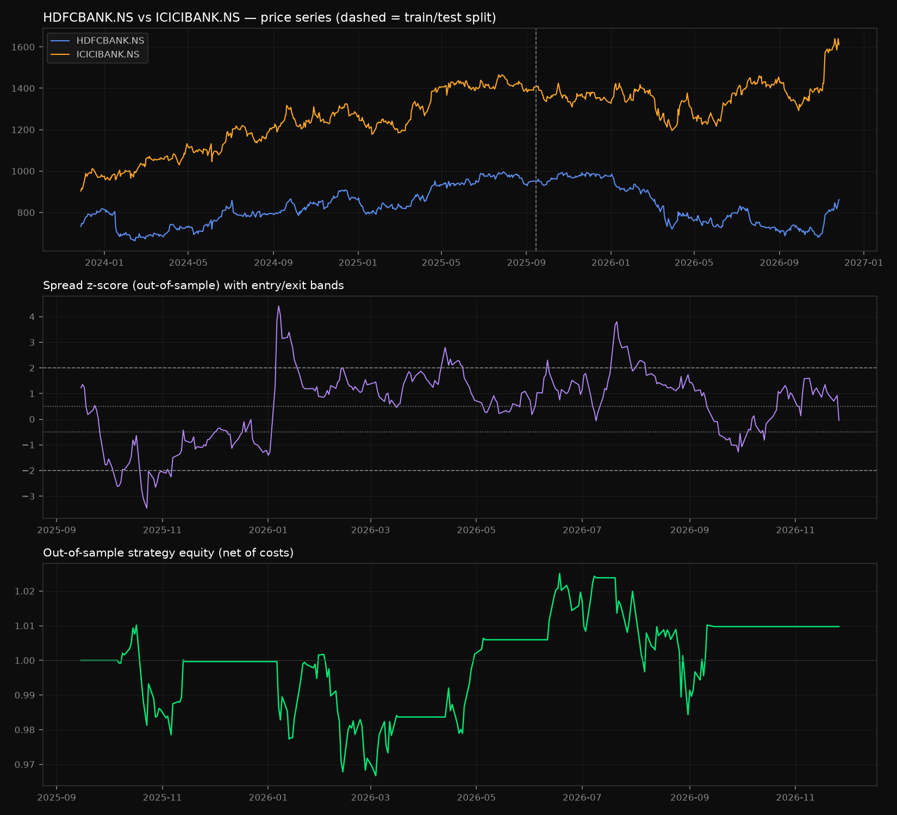

---

### AXISBANK.NS / ICICIBANK.NS

- **Latest prices:** AXISBANK.NS ₹1,408.00 · ICICIBANK.NS ₹1,611.00
- **Hedge ratio (train-fitted):** 0.4445
- **Cointegration (train):** FAIL at 5% — ADF -1.37, p=0.5955
- **Persistence:** passed 5% in 0 of 106 real-data runs (strict tier: 0/106)
- **Spread half-life:** 135.3 days
- **Current z-score:** +1.61
- **Signal today:** watch (approaching band)
- ⚠️ _Pair did not cointegrate on training data. Any signal here is not statistically justified — observation only._

**Out-of-sample backtest** (beta frozen from train window):

| Metric | Value |
|---|---|
| Sharpe | 0.19 |
| Sortino | 0.22 |
| Annualised return | 1.35% |
| Annualised vol | 9.54% |
| Max drawdown | -9.47% |
| Round-trip trades | 6 |

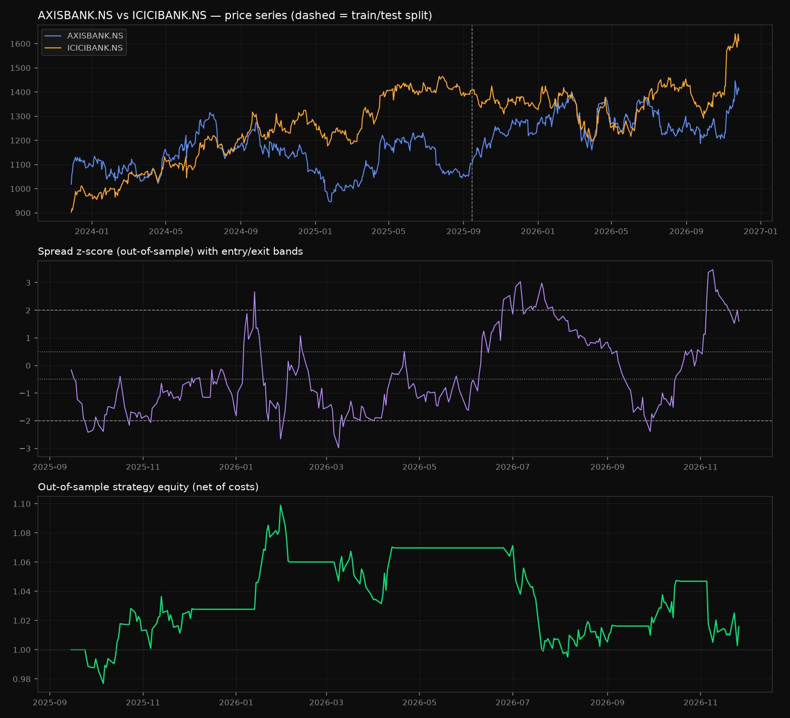

---

### KOTAKBANK.NS / HDFCBANK.NS

- **Latest prices:** KOTAKBANK.NS ₹509.95 · HDFCBANK.NS ₹862.00
- **Hedge ratio (train-fitted):** 2.2407
- **Cointegration (train):** FAIL at 5% — ADF -2.27, p=0.1835
- **Persistence:** passed 5% in 0 of 106 real-data runs (strict tier: 0/106)
- **Spread half-life:** 28.1 days
- **Current z-score:** -0.47
- **Signal today:** flat / no stretch
- ⚠️ _Pair did not cointegrate on training data. Any signal here is not statistically justified — observation only._

**Out-of-sample backtest** (beta frozen from train window):

| Metric | Value |
|---|---|
| Sharpe | 1.56 |
| Sortino | 1.69 |
| Annualised return | 9.91% |
| Annualised vol | 6.18% |
| Max drawdown | -2.84% |
| Round-trip trades | 5 |

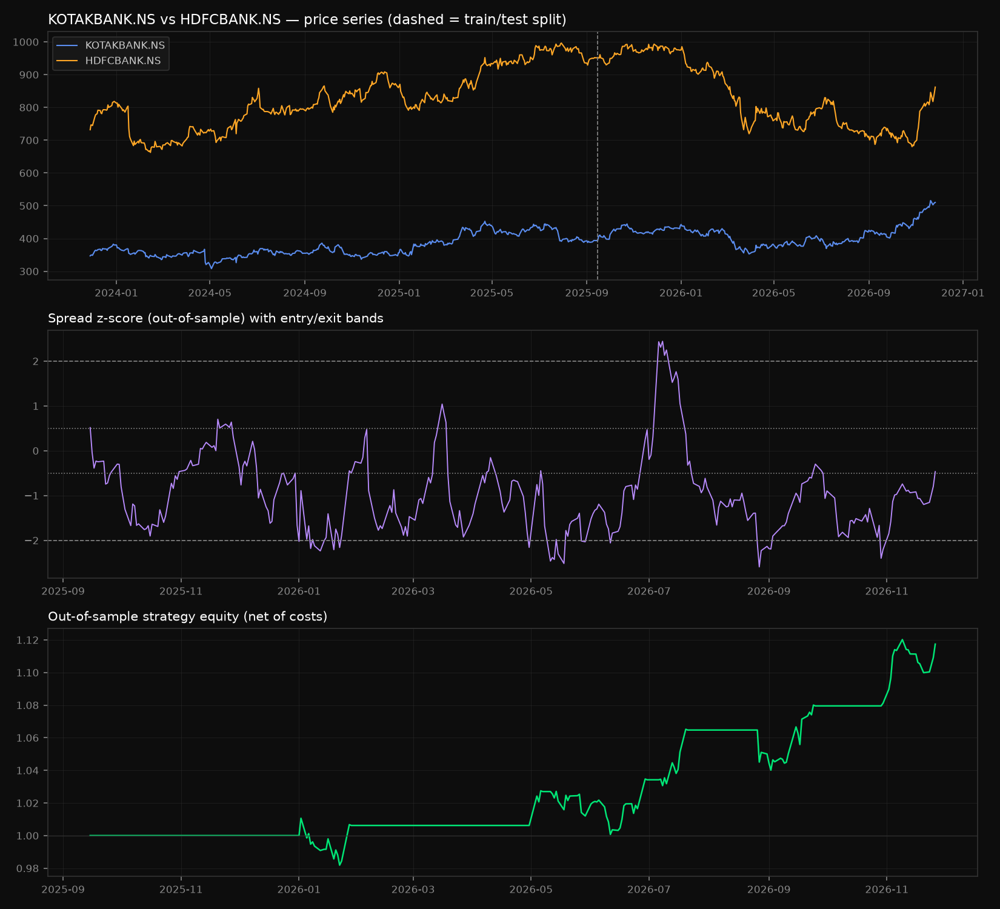

---

### SBIN.NS / BANKBARODA.NS

- **Latest prices:** SBIN.NS ₹1,136.65 · BANKBARODA.NS ₹274.61
- **Hedge ratio (train-fitted):** 0.1656
- **Cointegration (train):** FAIL at 5% — ADF -2.54, p=0.1061
- **Persistence:** passed 5% in 0 of 106 real-data runs (strict tier: 0/106)
- **Spread half-life:** 18.9 days
- **Current z-score:** +1.08
- **Signal today:** watch (approaching band)
- ⚠️ _Pair did not cointegrate on training data. Any signal here is not statistically justified — observation only._

**Out-of-sample backtest** (beta frozen from train window):

| Metric | Value |
|---|---|
| Sharpe | 0.27 |
| Sortino | 0.28 |
| Annualised return | 2.42% |
| Annualised vol | 11.06% |
| Max drawdown | -6.55% |
| Round-trip trades | 6 |

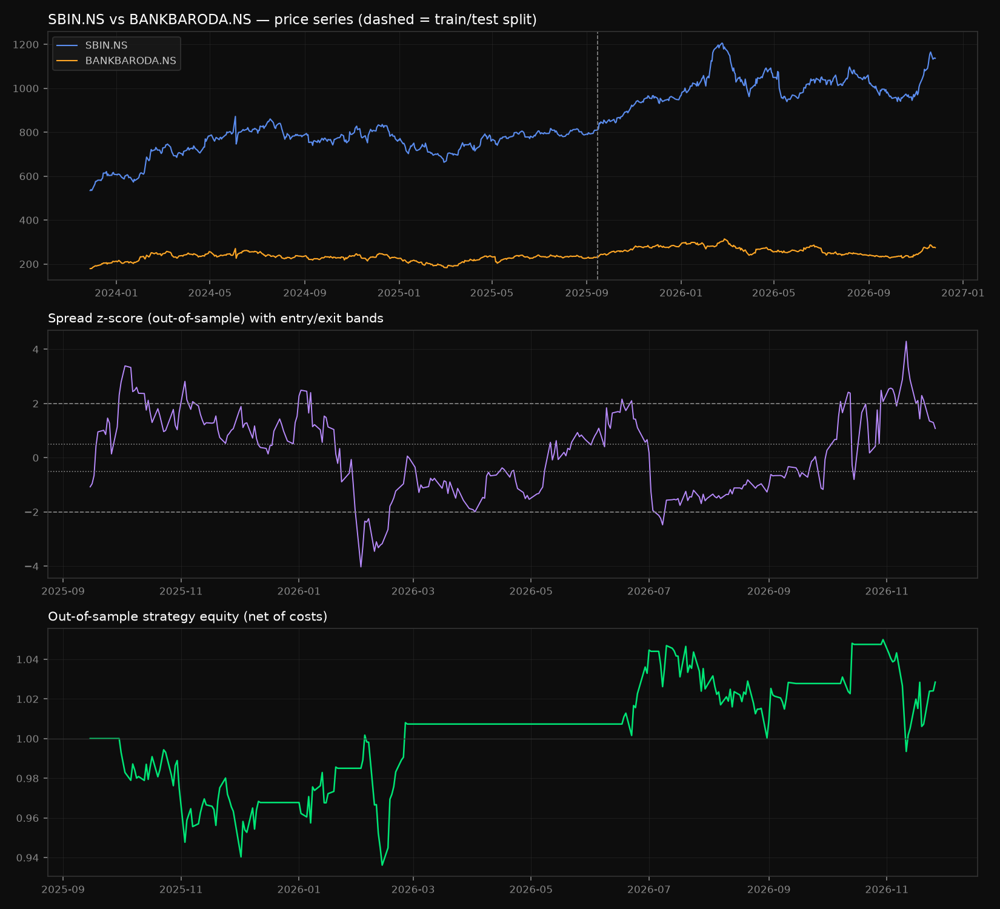

---

### TCS.NS / INFY.NS

- **Latest prices:** TCS.NS ₹2,640.30 · INFY.NS ₹1,183.00
- **Hedge ratio (train-fitted):** 0.3605
- **Cointegration (train):** FAIL at 5% — ADF -1.33, p=0.6137
- **Persistence:** passed 5% in 0 of 106 real-data runs (strict tier: 0/106)
- **Spread half-life:** 68.4 days
- **Current z-score:** -0.75
- **Signal today:** watch (approaching band)
- ⚠️ _Pair did not cointegrate on training data. Any signal here is not statistically justified — observation only._

**Out-of-sample backtest** (beta frozen from train window):

| Metric | Value |
|---|---|
| Sharpe | 1.83 |
| Sortino | 2.25 |
| Annualised return | 9.73% |
| Annualised vol | 5.15% |
| Max drawdown | -2.90% |
| Round-trip trades | 7 |

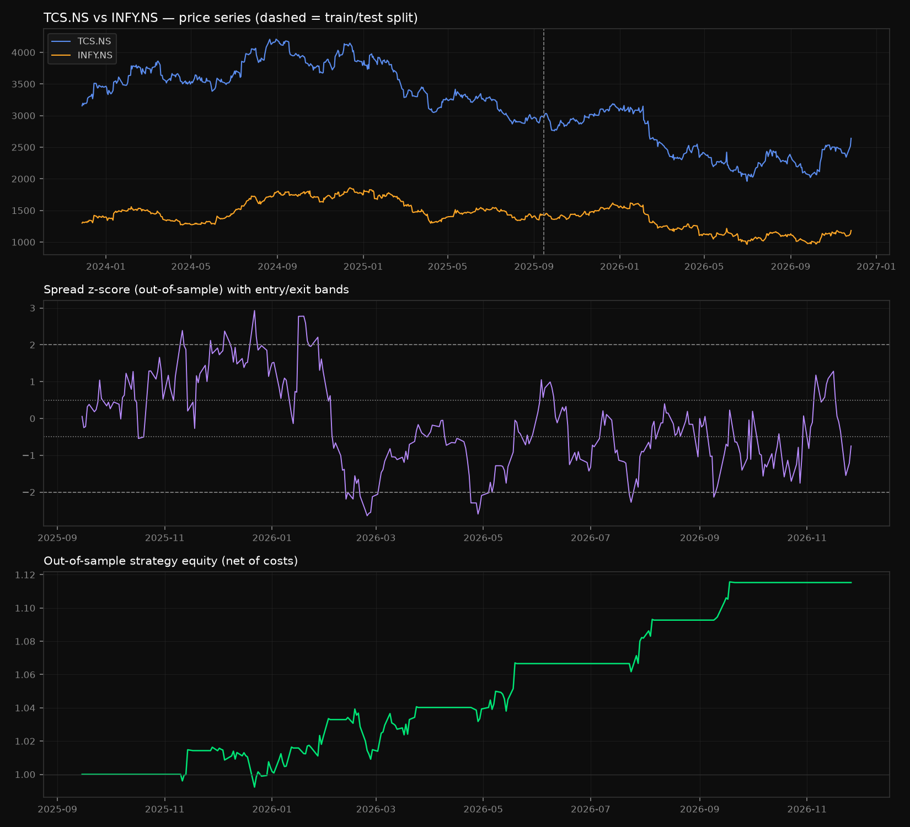

---

### INFY.NS / WIPRO.NS

- **Latest prices:** INFY.NS ₹1,183.00 · WIPRO.NS ₹196.54
- **Hedge ratio (train-fitted):** 0.1111
- **Cointegration (train):** PASS at 5% — ADF -2.87, p=0.0484
- **Persistence:** passed 5% in 1 of 106 real-data runs (strict tier: 0/106)
- **Spread half-life:** 22.4 days
- **Current z-score:** +0.95
- **Signal today:** watch (approaching band)

**Out-of-sample backtest** (beta frozen from train window):

| Metric | Value |
|---|---|
| Sharpe | 2.48 |
| Sortino | 3.59 |
| Annualised return | 15.36% |
| Annualised vol | 5.84% |
| Max drawdown | -3.45% |
| Round-trip trades | 6 |

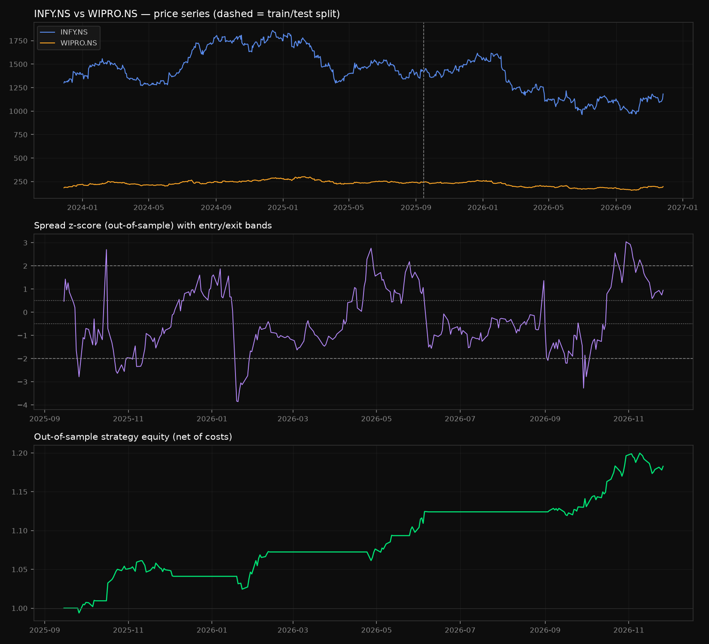

---

### HCLTECH.NS / TECHM.NS

- **Latest prices:** HCLTECH.NS ₹1,468.60 · TECHM.NS ₹1,854.70
- **Hedge ratio (train-fitted):** 0.9251
- **Cointegration (train):** FAIL at 5% — ADF -2.04, p=0.2699
- **Persistence:** passed 5% in 0 of 106 real-data runs (strict tier: 0/106)
- **Spread half-life:** 31.6 days
- **Current z-score:** +1.10
- **Signal today:** watch (approaching band)
- ⚠️ _Pair did not cointegrate on training data. Any signal here is not statistically justified — observation only._

**Out-of-sample backtest** (beta frozen from train window):

| Metric | Value |
|---|---|
| Sharpe | 0.03 |
| Sortino | 0.03 |
| Annualised return | -0.09% |
| Annualised vol | 7.68% |
| Max drawdown | -8.36% |
| Round-trip trades | 5 |

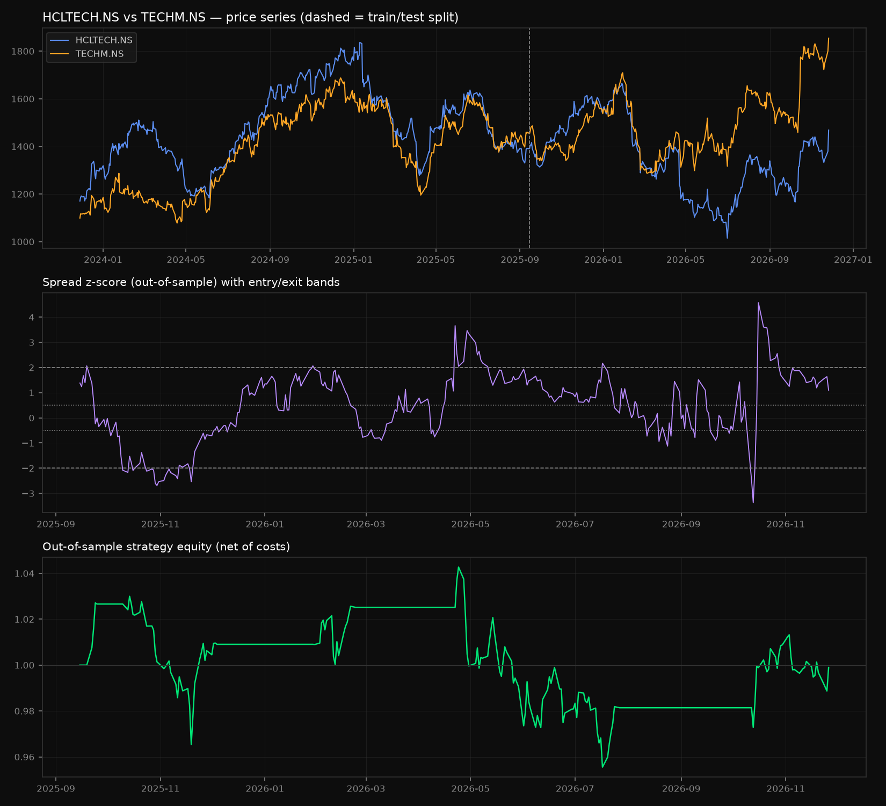

---

### ACC.NS / AMBUJACEM.NS

- **Latest prices:** ACC.NS ₹1,263.60 · AMBUJACEM.NS ₹390.95
- **Hedge ratio (train-fitted):** 0.1245
- **Cointegration (train):** FAIL at 5% — ADF -2.61, p=0.0908
- **Persistence:** passed 5% in 0 of 106 real-data runs (strict tier: 0/106)
- **Spread half-life:** 26.1 days
- **Current z-score:** +0.54
- **Signal today:** watch (approaching band)
- ⚠️ _Pair did not cointegrate on training data. Any signal here is not statistically justified — observation only._

**Out-of-sample backtest** (beta frozen from train window):

| Metric | Value |
|---|---|
| Sharpe | -0.20 |
| Sortino | -0.16 |
| Annualised return | -1.81% |
| Annualised vol | 7.67% |
| Max drawdown | -8.28% |
| Round-trip trades | 4 |

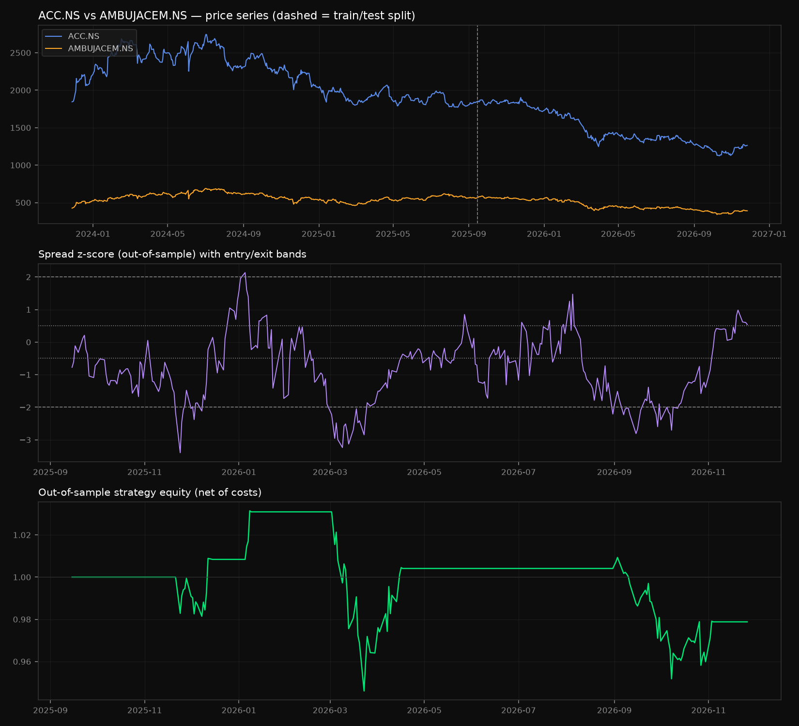

---

### ULTRACEMCO.NS / SHREECEM.NS

- **Latest prices:** ULTRACEMCO.NS ₹12,737.00 · SHREECEM.NS ₹25,335.00
- **Hedge ratio (train-fitted):** 1.2982
- **Cointegration (train):** FAIL at 5% — ADF -2.08, p=0.2533
- **Persistence:** passed 5% in 0 of 106 real-data runs (strict tier: 0/106)
- **Spread half-life:** 37.2 days
- **Current z-score:** +0.73
- **Signal today:** watch (approaching band)
- ⚠️ _Pair did not cointegrate on training data. Any signal here is not statistically justified — observation only._

**Out-of-sample backtest** (beta frozen from train window):

| Metric | Value |
|---|---|
| Sharpe | -0.50 |
| Sortino | -0.58 |
| Annualised return | -3.41% |
| Annualised vol | 6.48% |
| Max drawdown | -6.43% |
| Round-trip trades | 5 |

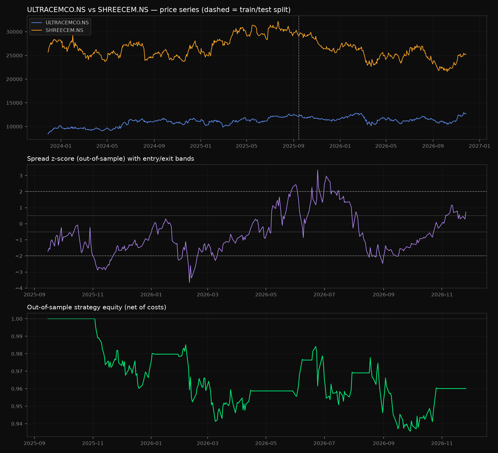

---

### IOC.NS / BPCL.NS

- **Latest prices:** IOC.NS ₹144.42 · BPCL.NS ₹307.65
- **Hedge ratio (train-fitted):** 1.3476
- **Cointegration (train):** FAIL at 5% — ADF -1.50, p=0.5326
- **Persistence:** passed 5% in 0 of 106 real-data runs (strict tier: 0/106)
- **Spread half-life:** 79.3 days
- **Current z-score:** -0.85
- **Signal today:** watch (approaching band)
- ⚠️ _Pair did not cointegrate on training data. Any signal here is not statistically justified — observation only._

**Out-of-sample backtest** (beta frozen from train window):

| Metric | Value |
|---|---|
| Sharpe | 0.57 |
| Sortino | 0.59 |
| Annualised return | 4.27% |
| Annualised vol | 7.86% |
| Max drawdown | -6.45% |
| Round-trip trades | 6 |

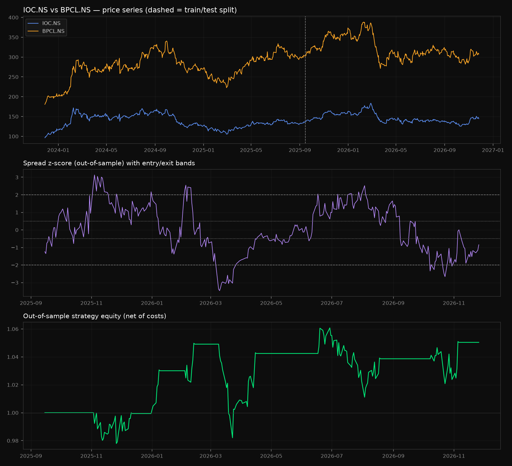

---

### BPCL.NS / HINDPETRO.NS

- **Latest prices:** BPCL.NS ₹307.65 · HINDPETRO.NS ₹385.65
- **Hedge ratio (train-fitted):** 1.2557
- **Cointegration (train):** FAIL at 5% — ADF -2.07, p=0.2578
- **Persistence:** passed 5% in 0 of 106 real-data runs (strict tier: 0/106)
- **Spread half-life:** 36.5 days
- **Current z-score:** +1.54
- **Signal today:** watch (approaching band)
- ⚠️ _Pair did not cointegrate on training data. Any signal here is not statistically justified — observation only._

**Out-of-sample backtest** (beta frozen from train window):

| Metric | Value |
|---|---|
| Sharpe | -0.37 |
| Sortino | -0.40 |
| Annualised return | -2.81% |
| Annualised vol | 7.06% |
| Max drawdown | -6.92% |
| Round-trip trades | 5 |

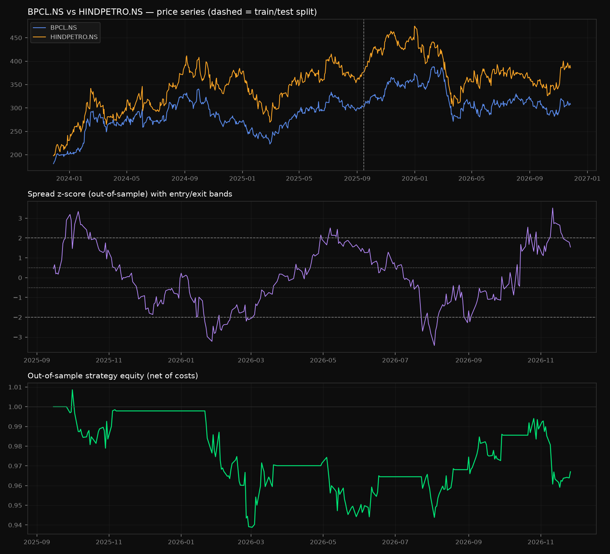

---

### ONGC.NS / COALINDIA.NS

- **Latest prices:** ONGC.NS ₹222.88 · COALINDIA.NS ₹388.90
- **Hedge ratio (train-fitted):** 1.3373
- **Cointegration (train):** PASS at 5% — ADF -3.35, p=0.0126
- **Persistence:** passed 5% in 98 of 106 real-data runs (strict tier: 1/106)
- **Spread half-life:** 13.7 days
- **Current z-score:** -1.13
- **Signal today:** watch (approaching band)

**Out-of-sample backtest** (beta frozen from train window):

| Metric | Value |
|---|---|
| Sharpe | 1.08 |
| Sortino | 0.87 |
| Annualised return | 8.65% |
| Annualised vol | 8.00% |
| Max drawdown | -6.38% |
| Round-trip trades | 6 |

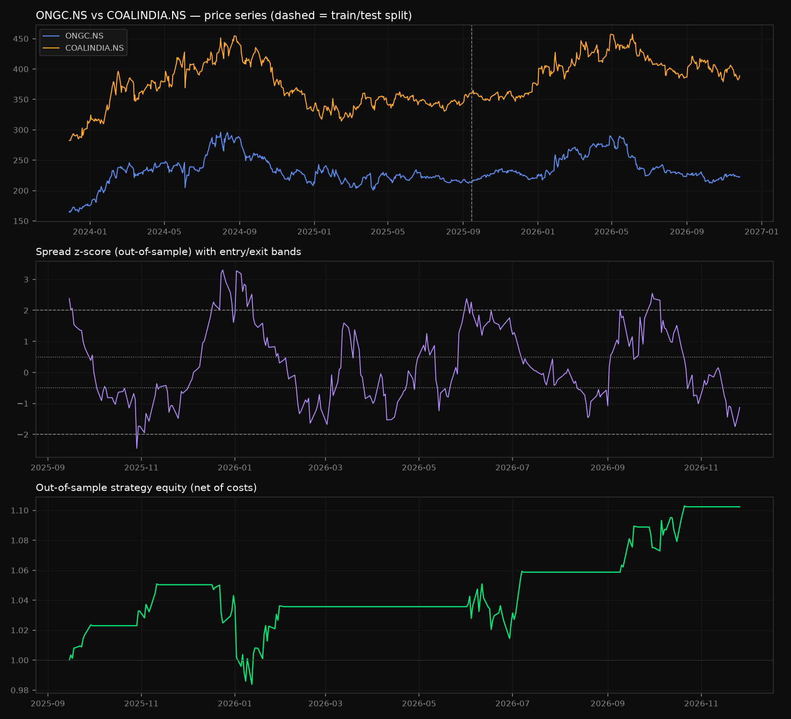

---

### NTPC.NS / POWERGRID.NS

- **Latest prices:** NTPC.NS ₹320.25 · POWERGRID.NS ₹266.95
- **Hedge ratio (train-fitted):** 0.7756
- **Cointegration (train):** FAIL at 5% — ADF -2.61, p=0.0913
- **Persistence:** passed 5% in 0 of 106 real-data runs (strict tier: 0/106)
- **Spread half-life:** 23.5 days
- **Current z-score:** +1.68
- **Signal today:** watch (approaching band)
- ⚠️ _Pair did not cointegrate on training data. Any signal here is not statistically justified — observation only._

**Out-of-sample backtest** (beta frozen from train window):

| Metric | Value |
|---|---|
| Sharpe | 0.90 |
| Sortino | 0.70 |
| Annualised return | 5.00% |
| Annualised vol | 5.61% |
| Max drawdown | -5.25% |
| Round-trip trades | 7 |

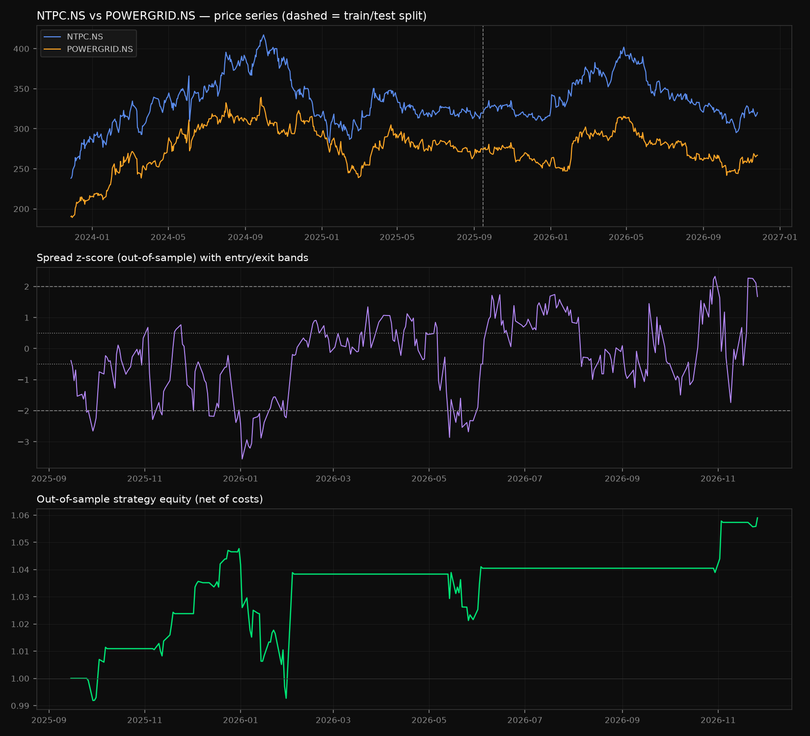

---

### BAJAJ-AUTO.NS / HEROMOTOCO.NS

- **Latest prices:** BAJAJ-AUTO.NS ₹10,850.00 · HEROMOTOCO.NS ₹5,789.00
- **Hedge ratio (train-fitted):** 0.4078
- **Cointegration (train):** FAIL at 5% — ADF -1.50, p=0.5328
- **Persistence:** passed 5% in 0 of 106 real-data runs (strict tier: 0/106)
- **Spread half-life:** 43.5 days
- **Current z-score:** +2.15
- **Signal today:** SHORT spread (short HEROMOTOCO.NS, long BAJAJ-AUTO.NS)
- ⚠️ _Pair did not cointegrate on training data. Any signal here is not statistically justified — observation only._

**Out-of-sample backtest** (beta frozen from train window):

| Metric | Value |
|---|---|
| Sharpe | 0.18 |
| Sortino | 0.16 |
| Annualised return | 1.13% |
| Annualised vol | 7.65% |
| Max drawdown | -10.18% |
| Round-trip trades | 5 |

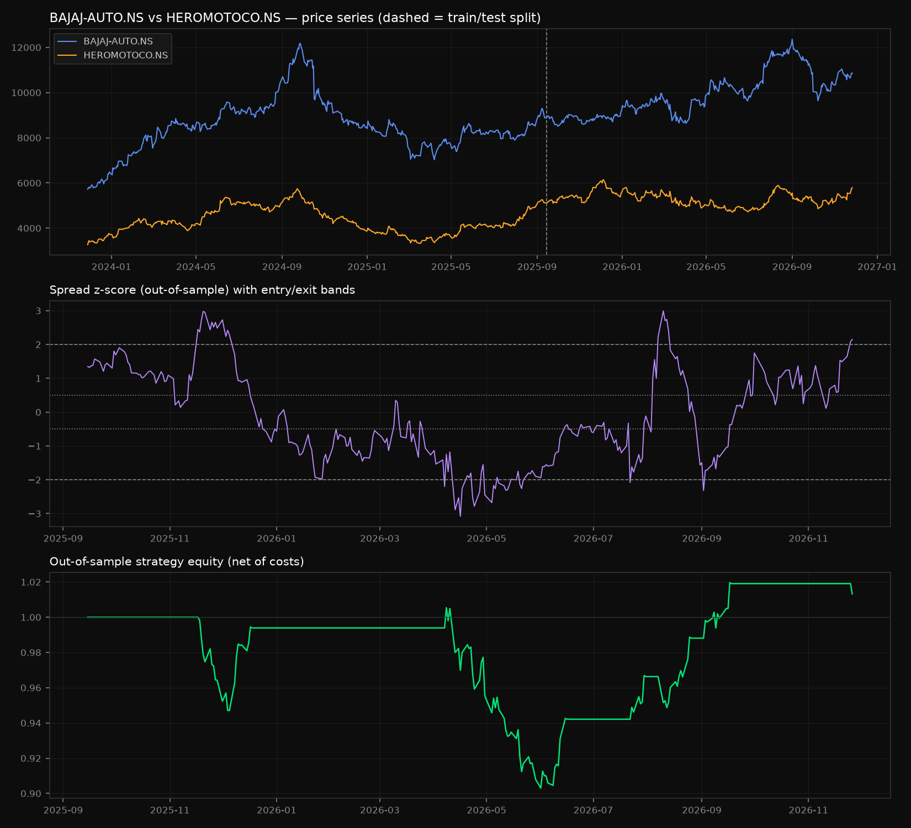

---

### TATASTEEL.NS / JSWSTEEL.NS

- **Latest prices:** TATASTEEL.NS ₹163.54 · JSWSTEEL.NS ₹1,303.00
- **Hedge ratio (train-fitted):** 2.6198
- **Cointegration (train):** FAIL at 5% — ADF -1.20, p=0.6720
- **Persistence:** passed 5% in 0 of 106 real-data runs (strict tier: 0/106)
- **Spread half-life:** 64.5 days
- **Current z-score:** +1.45
- **Signal today:** watch (approaching band)
- ⚠️ _Pair did not cointegrate on training data. Any signal here is not statistically justified — observation only._

**Out-of-sample backtest** (beta frozen from train window):

| Metric | Value |
|---|---|
| Sharpe | 0.48 |
| Sortino | 0.48 |
| Annualised return | 3.91% |
| Annualised vol | 8.80% |
| Max drawdown | -5.58% |
| Round-trip trades | 5 |

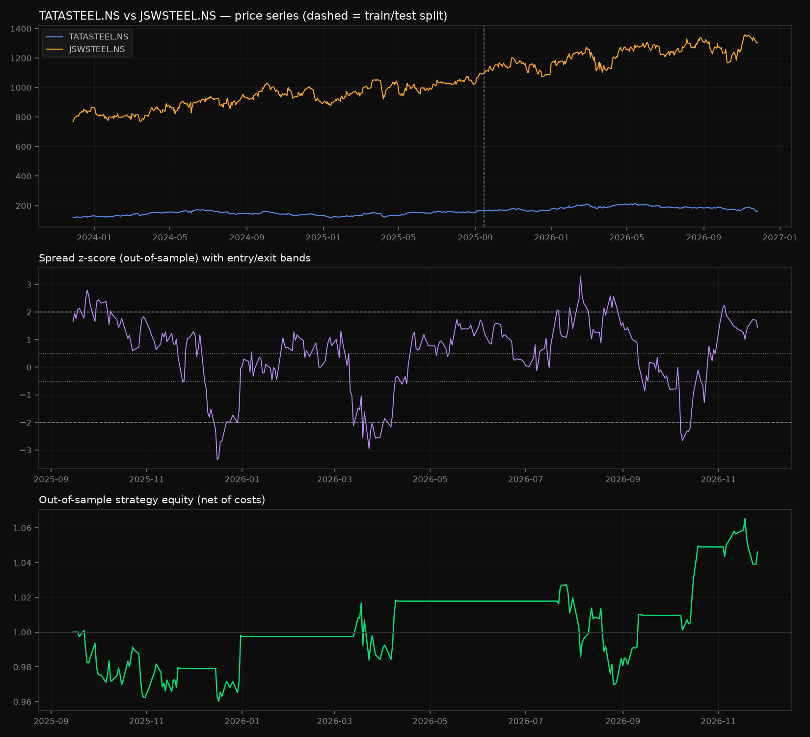

---

### SUNPHARMA.NS / CIPLA.NS

- **Latest prices:** SUNPHARMA.NS ₹1,915.70 · CIPLA.NS ₹1,450.00
- **Hedge ratio (train-fitted):** 0.4556
- **Cointegration (train):** FAIL at 5% — ADF -2.85, p=0.0511
- **Persistence:** passed 5% in 94 of 106 real-data runs (strict tier: 5/106)
- **Spread half-life:** 14.5 days
- **Current z-score:** +1.73
- **Signal today:** watch (approaching band)
- ⚠️ _Pair did not cointegrate on training data. Any signal here is not statistically justified — observation only._

**Out-of-sample backtest** (beta frozen from train window):

| Metric | Value |
|---|---|
| Sharpe | 0.33 |
| Sortino | 0.33 |
| Annualised return | 2.16% |
| Annualised vol | 7.20% |
| Max drawdown | -10.27% |
| Round-trip trades | 5 |

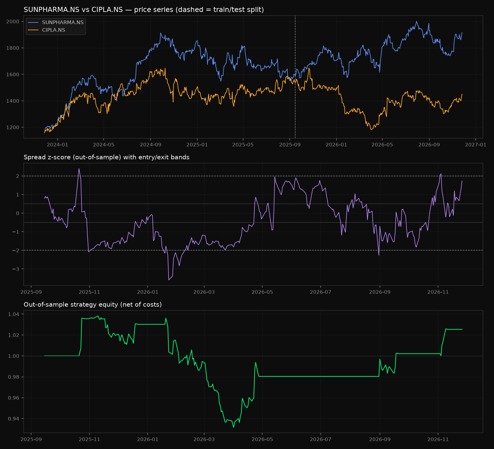

---

_Generated 2026-11-27 · pairs mean-reversion scanner · out-of-sample backtest · multiple-testing-aware · not investment advice._
